# Learn Angular 🅰️

<div align="center">

[](https://opensource.org/licenses/MIT)
[](https://angular.dev/)
[](https://www.typescriptlang.org/)
[](https://angular.dev/guide/signals)
[](https://angular.dev/guide/ssr)
[](https://github.com/manthanank/learn-angular)

**An exhaustive, production-grade masterclass from absolute zero to staff-level Angular platform architecture.**  
Master standalone applications, modern Signals reactivity, `@defer` incremental hydration, hierarchical dependency injection, functional router guards, reactive forms, and zoneless performance.

[Getting Started](#1-stage-1-absolute-beginner-foundations--standalone-architecture) • [Standalone Components](#2-stage-2-standalone-components-templates--modern-control-flow) • [Signals & Reactivity](#3-stage-3-modern-signals-reactivity--state-management) • [Dependency Injection](#4-stage-4-hierarchical-dependency-injection--routing) • [Forms & HTTP](#5-stage-5-enterprise-reactive-forms--http-client) • [SSR & Performance](#6-stage-6-server-side-rendering-ssr-deferrable-views--performance) • [Interview Prep](#7-stage-7-staff-angular-architect-interview-handbook--cheatsheet)

<br/>

<a href="https://www.buymeacoffee.com/manthanank">
  
</a>

</div>

---

## 🗺️ 7-Stage Pedagogical Roadmap

```mermaid
flowchart LR
    S1["Stage 1: Foundations & Standalone"] --> S2["Stage 2: Components & Templates"]
    S2 --> S3["Stage 3: Signals & Reactivity"]
    S3 --> S4["Stage 4: DI & Routing"]
    S4 --> S5["Stage 5: Reactive Forms & HTTP"]
    S5 --> S6["Stage 6: SSR, @defer & Perf"]
    S6 --> ADV["Advanced masterclasses: sections 20 to 44"]
    ADV --> S7["Stage 7: Staff Architect Handbook"]
```

| Stage | Focus Domain | Core Concepts & Engineering Outcomes | Chapters | Deep dives (advanced masterclasses) |
| :--- | :--- | :--- | :--- | :--- |
| [**Stage 1**](#1-stage-1-absolute-beginner-foundations--standalone-architecture) | **Absolute Beginner Foundations** | Standalone bootstrapping (`bootstrapApplication`), application configuration, TypeScript essentials, CLI and workspace setup. | [1.1 Architecture & Philosophy](#11-architecture--philosophy)<br/>[1.2 TypeScript Essentials](#12-typescript-essentials) | [20. Angular v20 → v21 → v22 Platform Updates & Migration Masterclass](#20-angular-v20--v21--v22-platform-updates--migration-masterclass)<br/>[29. Platform & Architecture Masterclass](#29-platform--architecture-masterclass-compiler-ivy-runtime-bootstrap-injectors-elements-builders--monorepos)<br/>[42. Developer Ecosystem & Tooling Masterclass](#42-developer-ecosystem--tooling-masterclass-schematics-compiler-config-linting-packaging-releases) |
| [**Stage 2**](#2-stage-2-standalone-components-templates--modern-control-flow) | **Components & Modern Control Flow** | Standalone components, templates and bindings, directives, `@if`, `@for (track)`, `@switch`, content projection, pipes, queries. | [2.1 Standalone Components Deep Dive](#21-standalone-components-deep-dive)<br/>[2.2 Templates](#22-templates)<br/>[2.3 Directives](#23-directives)<br/>[2.4 Modern Control Flow](#24-modern-control-flow)<br/>[2.5 Content Projection](#25-content-projection)<br/>[2.6 Pipes](#26-pipes)<br/>[2.7 Queries](#27-queries) | [24. Angular Aria (@angular/aria) & WebMCP / Angular AI](#24-angular-aria-angulararia--webmcp--angular-ai)<br/>[30. Advanced Component Architecture](#30-advanced-component-architecture-views-dynamic-rendering--template-performance) |
| [**Stage 3**](#3-stage-3-modern-signals-reactivity--state-management) | **Modern Signals Reactivity** | Fine-grained reactivity (`signal`, `computed`, `effect`), `input()`/`output()`, RxJS interop (`toSignal()`), state management, zoneless change detection. | [3.1 Signals Internals & Reactive Primitives](#31-signals-internals--reactive-primitives)<br/>[3.2 State Management](#32-state-management) | [21. Angular v22 Change Detection Architecture & Zoneless Traversal](#21-angular-v22-change-detection-architecture--zoneless-traversal)<br/>[23. Resource API & httpResource() Deep Dive](#23-resource-api--httpresource-deep-dive)<br/>[31. Signals & Reactivity Masterclass](#31-signals--reactivity-masterclass-graph-internals-resources-interop--state-architecture) |
| [**Stage 4**](#4-stage-4-hierarchical-dependency-injection--routing) | **Hierarchical DI & Routing** | Tree-shakeable providers, `inject()`, `EnvironmentInjector`, functional guards (`CanActivateFn`) and resolvers, lazy loading. | [4.1 Dependency Injection Architecture](#41-dependency-injection-architecture)<br/>[4.2 Functional APIs](#42-functional-apis)<br/>[4.3 Routing](#43-routing) | [25. Route-Level Rendering, Modern Router, View Transitions & Native CSS Animations](#25-route-level-rendering-modern-router-view-transitions--native-css-animations)<br/>[32. Dependency Injection Masterclass](#32-dependency-injection-masterclass-injection-context-environment-injectors-provider-scopes--memory)<br/>[33. Advanced Routing](#33-advanced-routing-navigation-lifecycle-cancellation-matchers-strategies--router-testing) |
| [**Stage 5**](#5-stage-5-enterprise-reactive-forms--http-client) | **Reactive Forms & HTTP Engine** | Strongly-typed `FormGroup`, Signal Forms, async validators, `HttpClient` with functional interceptors (`HttpInterceptorFn`), RxJS operators. | [5.1 Reactive Forms Architecture](#51-reactive-forms-architecture)<br/>[5.2 HTTP](#52-http)<br/>[5.3 RxJS](#53-rxjs) | [22. Signal Forms Complete Masterclass](#22-signal-forms-complete-masterclass)<br/>[26. Modern HTTP Engine, Advanced DI, SSR Hydration & @defer Deep Dive](#26-modern-http-engine-advanced-di-ssr-hydration--defer-deep-dive)<br/>[34. Advanced Forms Architecture](#34-advanced-forms-architecture)<br/>[35. HTTP Internals, Data Fetching Patterns & Real-Time Networking](#35-http-internals-data-fetching-patterns--real-time-networking)<br/>[36. RxJS Masterclass](#36-rxjs-masterclass-execution-model-multicasting-flattening-errors-rate-limiting-leaks--marble-testing) |
| [**Stage 6**](#6-stage-6-server-side-rendering-ssr-deferrable-views--performance) | **SSR, @defer & Enterprise Performance** | Hydration and event replay, `@defer` triggers, rendering, animations, i18n, security, performance, testing, Material/CDK, PWA, deployment, best practices and design patterns. | [6.1 Server-Side Rendering & Hydration](#61-server-side-rendering--hydration)<br/>[6.2 Rendering](#62-rendering)<br/>[6.3 Animations](#63-animations)<br/>[6.4 Internationalization (i18n)](#64-internationalization-i18n)<br/>[6.5 Security](#65-security)<br/>[6.6 Performance](#66-performance)<br/>[6.7 Testing](#67-testing)<br/>[6.8 Angular Material](#68-angular-material)<br/>[6.9 Angular CDK](#69-angular-cdk)<br/>[6.10 Progressive Web Apps (PWA)](#610-progressive-web-apps-pwa)<br/>[6.11 Deployment](#611-deployment)<br/>[6.12 Best Practices](#612-best-practices)<br/>[6.13 Design Patterns](#613-design-patterns) | [27. Vitest Testing, Library Development, Compiler Internals & Web Workers](#27-vitest-testing-library-development-compiler-internals--web-workers)<br/>[28. Advanced Security, Accessibility, Enterprise State & Flagship Blueprints](#28-advanced-security-accessibility-enterprise-state--flagship-blueprints)<br/>[37. Advanced SSR & Deployment](#37-advanced-ssr--deployment)<br/>[38. Testing Masterclass](#38-testing-masterclass-modern-angular-testing-with-vitest-zoneless-testbed-and-beyond)<br/>[40. Advanced Performance Engineering](#40-advanced-performance-engineering-web-vitals-profiling-budgets--runtime-tuning)<br/>[41. Application Security in Depth](#41-application-security-in-depth-dom-xss-csp-authentication-flows--supply-chain)<br/>[43. Web Platform Integration](#43-web-platform-integration-cdk-i18n-pwa-storage-and-interop) |
| [**Stage 7**](#7-stage-7-staff-angular-architect-interview-handbook--cheatsheet) | **Staff Architect Interview Handbook** | Staff-level interview Q&As, scenario questions and architecture trade-offs; read after the masterclasses that deepen Stages 1 to 6. | [7.1 40 Core Staff Architect Technical Interview Q&As](#71-40-core-staff-architect-technical-interview-qas) | [39. Enterprise Architecture Masterclass](#39-enterprise-architecture-masterclass)<br/>[44. Practical System Design](#44-practical-system-design-designing-large-angular-apps-from-requirements-to-production) |

The numbered sections from 20 to 44 form the **advanced masterclass track**. They sit after Stage 6 and before the Stage 7 interview handbook, and each one deepens the stage listed in the table above. Work through a stage first, then read its deep dives, or come back to them once all six stages are done.

---

## Table of Contents

**Start here**

- [🗺️ 7-Stage Pedagogical Roadmap](#️-7-stage-pedagogical-roadmap)

**Part I: Core stages (Stages 1 to 6)**

- [1. Stage 1: Absolute Beginner Foundations & Standalone Architecture](#1-stage-1-absolute-beginner-foundations--standalone-architecture)
  - [1.1 Architecture & Philosophy](#11-architecture--philosophy)
    - What is Angular?
    - Features
    - Architecture
    - Angular CLI
    - Project Structure
    - Workspace Configuration
    - Standalone Applications
    - Angular Version History
    - Migration Guide
    - Bootstrapping
    - Application Configuration
    - Environment Providers
    - Version Compatibility
  - [1.2 TypeScript Essentials](#12-typescript-essentials)
    - TypeScript Basics
    - Types
    - Interfaces
    - Enums
    - Generics
    - Decorators
    - Modules
    - Utility Types
    - Type Assertions
    - Type Narrowing
    - Type Aliases
    - Literal Types
    - Conditional Types
    - Mapped Types
- [2. Stage 2: Standalone Components, Templates & Modern Control Flow](#2-stage-2-standalone-components-templates--modern-control-flow)
  - [2.1 Standalone Components Deep Dive](#21-standalone-components-deep-dive)
    - Components
    - Standalone Components
    - Component Lifecycle
    - Lifecycle Hooks
    - Component Communication
    - Inputs
    - Outputs
    - Model Inputs
    - Signal Inputs
    - Signal Outputs
    - Component Styles
    - View Encapsulation
    - Change Detection
    - Dynamic Components
    - Dynamic Template Rendering
    - Host Elements
    - Host Bindings
    - Host Listeners
    - Content vs View DOM
    - Component Inheritance
    - Component Composition
  - [2.2 Templates](#22-templates)
    - Data Binding
    - Interpolation
    - Property Binding
    - Attribute Binding
    - Class Binding
    - Style Binding
    - Event Binding
    - Two-way Binding
    - Template Reference Variables
    - Template Statements
    - Template Expressions
    - Pipes in Templates
    - ng-template
    - ng-container
    - ngTemplateOutlet
    - Template Context
    - Safe Navigation Operator
    - Nullish Coalescing
    - Non-null Assertion
    - Template Variables
    - Track Expressions
  - [2.3 Directives](#23-directives)
    - Directives
    - Attribute Directives
    - Structural Directives
    - Built-in Directives
    - Custom Directives
    - Directive Composition API (hostDirectives)
  - [2.4 Modern Control Flow](#24-modern-control-flow)
    - @if
    - @else
    - @for
    - @empty
    - @switch
    - @case
    - @default
    - @let
    - @defer
    - Prefetching
    - Loading Placeholder
    - Error Placeholder
    - Track Expressions
    - Context Variables
  - [2.5 Content Projection](#25-content-projection)
    - ng-content
    - Multi-slot Projection
    - Conditional Projection
  - [2.6 Pipes](#26-pipes)
    - Built-in Pipes
    - Custom Pipes
    - Pure vs Impure Pipes
    - Async Pipe
  - [2.7 Queries](#27-queries)
    - viewChild()
    - viewChildren()
    - contentChild()
    - contentChildren()
- [3. Stage 3: Modern Signals Reactivity & State Management](#3-stage-3-modern-signals-reactivity--state-management)
  - [3.1 Signals Internals & Reactive Primitives](#31-signals-internals--reactive-primitives)
    - Signals Introduction
    - signal()
    - Writable Signals
    - computed()
    - effect()
    - Signal Equality
    - untracked()
    - Signal Inputs
    - Signal Outputs
    - Model Inputs
    - linkedSignal()
    - resource()
    - httpResource()
    - Signal Queries
    - Signal Store
    - toSignal()
    - toObservable()
    - Signal Best Practices
    - Signals vs RxJS
  - [3.2 State Management](#32-state-management)
    - Signals
    - Signal Store
    - NgRx
    - Component Store
    - NGXS
    - Akita
    - Elf
    - RxState
    - State Management Patterns
- [4. Stage 4: Hierarchical Dependency Injection & Routing](#4-stage-4-hierarchical-dependency-injection--routing)
  - [4.1 Dependency Injection Architecture](#41-dependency-injection-architecture)
    - Dependency Injection
    - Providers
    - Provider Types
    - Class Providers
    - Factory Providers
    - Existing Providers
    - Value Providers
    - Multi Providers
    - Injection Tokens
    - inject()
    - DestroyRef
    - EnvironmentInjector
    - Hierarchical DI
    - Optional
    - Self
    - SkipSelf
    - Host
    - forwardRef()
    - Injection Context & NG0203
    - makeEnvironmentProviders()
    - provideEnvironmentInitializer()
    - Route-level Providers
    - Circular Dependencies (NG0200)
    - DI Scopes & Memory
  - [4.2 Functional APIs](#42-functional-apis)
    - Functional Queries
    - Functional Guards
    - Functional Resolvers
    - Functional Interceptors
    - Functional Providers
  - [4.3 Routing](#43-routing)
    - Router
    - Route Configuration
    - RouterOutlet
    - RouterLink
    - RouterLinkActive
    - Nested Routes
    - Lazy Loading
    - loadComponent()
    - loadChildren()
    - Route Parameters
    - Query Parameters
    - Route Data
    - Redirect Routes
    - Wildcard Routes
    - Route Guards
    - CanActivate
    - CanActivateChild
    - CanDeactivate
    - CanMatch
    - Functional Guards
    - Resolvers
    - Title Strategy
    - Route Reuse Strategy
    - Preloading Strategies
    - Scroll Restoration
    - Navigation Extras
    - Route Animations
    - Component Input Binding
    - Router Events
- [5. Stage 5: Enterprise Reactive Forms & HTTP Client](#5-stage-5-enterprise-reactive-forms--http-client)
  - [5.1 Reactive Forms Architecture](#51-reactive-forms-architecture)
    - Template-driven Forms
    - Reactive Forms
    - FormControl
    - FormGroup
    - FormArray
    - FormBuilder
    - NonNullableFormBuilder
    - [FormRecord](#349-formrecord-typed-groups-with-dynamic-keys)
    - Typed Reactive Forms
    - ControlValueAccessor (CVA)
    - Signal Forms
    - Cross-field Validation
    - Custom Validators
    - Async Validators
    - Dynamic Forms
    - Form Reset
    - Error Handling
    - Update Strategies
  - [5.2 HTTP](#52-http)
    - HttpClient
    - provideHttpClient()
    - HTTP Methods
    - Headers
    - Params
    - HttpContext
    - Interceptors
    - Functional Interceptors
    - Error Handling
    - Retry Strategies
    - Caching
    - Polling
    - File Upload
    - File Download
    - Progress Events
    - Request Cancellation
  - [5.3 RxJS](#53-rxjs)
    - Observables
    - Observers
    - Subjects
    - BehaviorSubject
    - ReplaySubject
    - AsyncSubject
    - Cold vs Hot Observables
    - Creation Operators
    - Transformation Operators
    - Filtering Operators
    - Combination Operators
    - Higher-order Mapping Operators
    - Error Handling Operators
    - Utility Operators
    - Multicasting
    - Subscription Management
    - takeUntilDestroyed()
    - Schedulers
    - Best Practices
- [6. Stage 6: Server-Side Rendering (SSR), Deferrable Views & Performance](#6-stage-6-server-side-rendering-ssr-deferrable-views--performance)
  - [6.1 Server-Side Rendering & Hydration](#61-server-side-rendering--hydration)
    - SSR Introduction
    - CSR vs SSR vs SSG
    - provideServerRendering()
    - provideClientHydration()
    - Incremental Hydration
    - Event Replay
    - TransferState
    - HTTP Transfer Cache
    - Hybrid Rendering
    - Rendering Strategies
  - [6.2 Rendering](#62-rendering)
    - afterNextRender()
    - afterRenderEffect()
    - Rendering Pipeline
    - Change Detection Strategies
    - provideZoneChangeDetection()
    - Zoneless Angular
    - Pending Tasks
  - [6.3 Animations](#63-animations)
    - Angular Animations
    - Transitions
    - States
    - Route Animations
  - [6.4 Internationalization (i18n)](#64-internationalization-i18n)
    - i18n
    - Localization
    - ICU Messages
    - Lazy-loaded Translations
  - [6.5 Security](#65-security)
    - XSS Protection
    - Sanitization
    - DomSanitizer
    - CSP
    - Trusted Types
    - CSRF
    - CORS
    - Authentication
    - Authorization
    - JWT
    - OAuth
  - [6.6 Performance](#66-performance)
    - Lazy Loading
    - Deferred Loading
    - Image Optimization
    - NgOptimizedImage
    - Change Detection Optimization
    - Signals Performance
    - Bundle Optimization
    - Tree Shaking
    - Bundle Analysis
    - Memory Leak Prevention
  - [6.7 Testing](#67-testing)
    - Unit Testing
    - Component Testing
    - Service Testing
    - HTTP Testing
    - Router Testing
    - Signals Testing
    - TestBed
    - FakeAsync
    - Mocking
    - Component Harnesses
    - Jest
    - Cypress
    - Playwright
    - Vitest
  - [6.8 Angular Material](#68-angular-material)
    - Installation
    - Theming
    - Material 3
    - Design Tokens
    - Typography
    - Dark Mode
    - Components
    - CDK Overview
  - [6.9 Angular CDK](#69-angular-cdk)
    - Overlay
    - Portal
    - Drag & Drop
    - Clipboard
    - Virtual Scroll
    - Scrolling
    - Accessibility
    - Focus Monitor
    - Focus Trap
    - Text Field
  - [6.10 Progressive Web Apps (PWA)](#610-progressive-web-apps-pwa)
    - Service Workers
    - Offline Support
    - Web App Manifest
    - Push Notifications
    - Background Sync
  - [6.11 Deployment](#611-deployment)
    - Production Build
    - Environment Configuration
    - Docker
    - Docker Compose
    - Nginx
    - Firebase
    - Vercel
    - Netlify
    - GitHub Pages
    - AWS
    - Azure
    - CI/CD
    - GitHub Actions
  - [6.12 Best Practices](#612-best-practices)
    - Folder Structure
    - Coding Standards
    - Naming Conventions
    - Error Handling
    - Performance
    - Accessibility
    - Security
    - Code Organization
    - [Accessibility](#accessibility)
      - ARIA
      - Keyboard Navigation
      - Screen Readers
      - Focus Management
      - Color Contrast
  - [6.13 Design Patterns](#613-design-patterns)
    - Smart vs Presentational Components
    - Container Pattern
    - Facade Pattern
    - Repository Pattern
    - Dependency Injection Pattern
    - Feature-based Architecture
    - Clean Architecture

**Part II: Advanced masterclasses (sections 20 to 44)**

- [20. Angular v20 → v21 → v22 Platform Updates & Migration Masterclass](#20-angular-v20--v21--v22-platform-updates--migration-masterclass)
  - [20.1 Platform Evolution: From v20 to v22](#201-platform-evolution-from-v20-to-v22)
  - [20.2 Official Compatibility Matrix (Angular v20 – v22)](#202-official-compatibility-matrix-angular-v20--v22)
  - [20.3 Migration Guide: v20 → v21 → v22 Automated CLI Recipes](#203-migration-guide-v20--v21--v22-automated-cli-recipes)
  - [20.4 Deprecations & Breaking Changes Catalog (v20 – v22)](#204-deprecations--breaking-changes-catalog-v20--v22)
- [21. Angular v22 Change Detection Architecture & Zoneless Traversal](#21-angular-v22-change-detection-architecture--zoneless-traversal)
  - [21.1 OnPush as Default & The Deprecation of ChangeDetectionStrategy.Default](#211-onpush-as-default--the-deprecation-of-changedetectionstrategydefault)
  - [21.2 Signal-Driven Traversal & Subtree Skipping in Zoneless Applications](#212-signal-driven-traversal--subtree-skipping-in-zoneless-applications)
  - [21.3 markForCheck(), detectChanges(), and ApplicationRef.tick() in v22](#213-markforcheck-detectchanges-and-applicationreftick-in-v22)
  - [21.4 Change Detection Triggers Comparison](#214-change-detection-triggers-comparison)
- [22. Signal Forms Complete Masterclass](#22-signal-forms-complete-masterclass)
  - [22.1 Signal Forms Core Architecture (form(), FieldTree, FormField)](#221-signal-forms-core-architecture-form-fieldtree-formfield)
  - [22.2 Field Reactive State Signals Matrix](#222-field-reactive-state-signals-matrix)
  - [22.3 Cross-Field Validation & Custom Validators](#223-cross-field-validation--custom-validators)
  - [22.4 Migration Guide: Reactive Forms (FormGroup) → Signal Forms (form())](#224-migration-guide-reactive-forms-formgroup--signal-forms-form)
- [23. Resource API & httpResource() Deep Dive](#23-resource-api--httpresource-deep-dive)
  - [23.1 The resource() API Lifecycle](#231-the-resource-api-lifecycle)
  - [23.2 httpResource() Stable in Angular v22](#232-httpresource-stable-in-angular-v22)
  - [23.3 Specialized Response Formats & SSR TransferState Caching](#233-specialized-response-formats--ssr-transferstate-caching)
- [24. Angular Aria (@angular/aria) & WebMCP / Angular AI](#24-angular-aria-angulararia--webmcp--angular-ai)
  - [24.1 Angular Aria (@angular/aria) Headless Primitives](#241-angular-aria-angulararia-headless-primitives)
  - [24.2 WebMCP: AI-Agent Integration with Angular Applications](#242-webmcp-ai-agent-integration-with-angular-applications)
- [25. Route-Level Rendering, Modern Router, View Transitions & Native CSS Animations](#25-route-level-rendering-modern-router-view-transitions--native-css-animations)
  - [25.1 Server Routing & Route-Level Rendering (RenderMode)](#251-server-routing--route-level-rendering-rendermode)
  - [25.2 Modern Angular Router: withViewTransitions(), UrlTree & Navigation Handlers](#252-modern-angular-router-withviewtransitions-urltree--navigation-handlers)
  - [25.3 Native CSS Morphing Transitions (view-transition-name)](#253-native-css-morphing-transitions-view-transition-name)
  - [25.4 Modern Angular Animations: animate.enter & animate.leave](#254-modern-angular-animations-animateenter--animateleave)
- [26. Modern HTTP Engine, Advanced DI, SSR Hydration & @defer Deep Dive](#26-modern-http-engine-advanced-di-ssr-hydration--defer-deep-dive)
  - [26.1 Modern HTTP Engine: withFetch(), Streaming & Resilient Token Refresh](#261-modern-http-engine-withfetch-streaming--resilient-token-refresh)
  - [26.2 Advanced Dependency Injection: provideAppInitializer() & runInInjectionContext](#262-advanced-dependency-injection-provideappinitializer--runininjectioncontext)
  - [26.3 @defer Multi-Trigger Architecture & Prefetch Optimization](#263-defer-multi-trigger-architecture--prefetch-optimization)
  - [26.4 Modern Templates: @let Declarations & Loop Context Variables](#264-modern-templates-let-declarations--loop-context-variables)
  - [26.5 Rendering Lifecycle Hooks: DOM Read/Write Separation](#265-rendering-lifecycle-hooks-dom-readwrite-separation)
- [27. Vitest Testing, Library Development, Compiler Internals & Web Workers](#27-vitest-testing-library-development-compiler-internals--web-workers)
  - [27.1 Vitest as Primary Test Runner in Angular](#271-vitest-as-primary-test-runner-in-angular)
  - [27.2 Angular Package & Library Development (ng-packagr & APF)](#272-angular-package--library-development-ng-packagr--apf)
  - [27.3 Angular Compiler Architecture & Extended Diagnostics](#273-angular-compiler-architecture--extended-diagnostics)
  - [27.4 Web Workers with Signals & Transferable Objects](#274-web-workers-with-signals--transferable-objects)
- [28. Advanced Security, Accessibility, Enterprise State & Flagship Blueprints](#28-advanced-security-accessibility-enterprise-state--flagship-blueprints)
  - [28.1 Advanced Security: Dynamic CSP Nonces, Trusted Types & SRI](#281-advanced-security-dynamic-csp-nonces-trusted-types--sri)
  - [28.2 Enterprise State Management with NgRx SignalStore](#282-enterprise-state-management-with-ngrx-signalstore)
  - [28.3 Enterprise Architecture: Feature-Sliced Design (FSD) in Angular](#283-enterprise-architecture-feature-sliced-design-fsd-in-angular)
  - [28.4 Flagship Blueprint 1: AI-Agent Enabled Angular WebMCP Workspace](#284-flagship-blueprint-1-ai-agent-enabled-angular-webmcp-workspace)
  - [28.5 Flagship Blueprint 2: Signal Forms Multi-Step Enterprise Stepper](#285-flagship-blueprint-2-signal-forms-multi-step-enterprise-stepper)
  - [28.6 Flagship Blueprint 3: Real-Time High-Throughput Trading Orderbook (Web Worker + Signals)](#286-flagship-blueprint-3-real-time-high-throughput-trading-orderbook-web-worker--signals)
- [29. Platform & Architecture Masterclass: Compiler, Ivy Runtime, Bootstrap, Injectors, Elements, Builders & Monorepos](#29-platform--architecture-masterclass-compiler-ivy-runtime-bootstrap-injectors-elements-builders--monorepos)
  - [29.1 Compiler Internals: The ngtsc Pipeline](#291-compiler-internals-the-ngtsc-pipeline)
  - [29.2 Template Type-Checking and Type-Check Blocks](#292-template-type-checking-and-type-check-blocks)
  - [29.3 Reading Compiled Output: ɵcmp, ɵfac, Creation and Update Blocks](#293-reading-compiled-output-ɵcmp-ɵfac-creation-and-update-blocks)
  - [29.4 The Ivy Runtime: Locality and Tree-Shakable Instructions](#294-the-ivy-runtime-locality-and-tree-shakable-instructions)
  - [29.5 Runtime Data Structures: TView, LView and TNode](#295-runtime-data-structures-tview-lview-and-tnode)
  - [29.6 App Lifecycle and Bootstrap Internals](#296-app-lifecycle-and-bootstrap-internals)
  - [29.7 Initializers in Depth: provideAppInitializer(), provideEnvironmentInitializer(), providePlatformInitializer()](#297-initializers-in-depth-provideappinitializer-provideenvironmentinitializer-provideplatforminitializer)
  - [29.8 EnvironmentInjector vs ElementInjector](#298-environmentinjector-vs-elementinjector)
  - [29.9 Angular Elements (Advanced)](#299-angular-elements-advanced)
  - [29.10 Custom Builders (Angular CLI Architect)](#2910-custom-builders-angular-cli-architect)
  - [29.11 Library Development and Publishing](#2911-library-development-and-publishing)
  - [29.12 Workspace and Monorepo Architecture](#2912-workspace-and-monorepo-architecture)
  - [29.13 Nx for Angular Monorepos](#2913-nx-for-angular-monorepos)
  - [29.14 Interview Questions: Platform & Architecture](#2914-interview-questions-platform--architecture)
- [30. Advanced Component Architecture: Views, Dynamic Rendering & Template Performance](#30-advanced-component-architecture-views-dynamic-rendering--template-performance)
  - [30.1 The Mental Model: Views, Containers and Templates](#301-the-mental-model-views-containers-and-templates)
  - [30.2 ViewContainerRef in Depth](#302-viewcontainerref-in-depth)
  - [30.3 TemplateRef, Embedded Views and Typed Contexts](#303-templateref-embedded-views-and-typed-contexts)
  - [30.4 Dynamic Components with the Modern APIs](#304-dynamic-components-with-the-modern-apis)
  - [30.5 createComponent() Without a View Container](#305-createcomponent-without-a-view-container)
  - [30.6 Output Subscriptions and Cleanup](#306-output-subscriptions-and-cleanup)
  - [30.7 NgComponentOutlet: Declarative Dynamic Components](#307-ngcomponentoutlet-declarative-dynamic-components)
  - [30.8 Content Projection Edge Cases](#308-content-projection-edge-cases)
  - [30.9 Advanced Composition Patterns](#309-advanced-composition-patterns)
  - [30.10 Custom Render Strategies: Wrapping RendererFactory2](#3010-custom-render-strategies-wrapping-rendererfactory2)
  - [30.11 Template Type Checking & Extended Diagnostics](#3011-template-type-checking--extended-diagnostics)
  - [30.12 Template Performance](#3012-template-performance)
  - [30.13 Interview Questions: Advanced Components & Templates](#3013-interview-questions-advanced-components--templates)
- [31. Signals & Reactivity Masterclass: Graph Internals, Resources, Interop & State Architecture](#31-signals--reactivity-masterclass-graph-internals-resources-interop--state-architecture)
  - [31.1 The Signal Graph: Producers, Consumers & Version Counters](#311-the-signal-graph-producers-consumers--version-counters)
  - [31.2 Dynamic Dependency Tracking](#312-dynamic-dependency-tracking)
  - [31.3 Scheduling & Stabilization: Glitch-Free Reads and Effect Timing](#313-scheduling--stabilization-glitch-free-reads-and-effect-timing)
  - [31.4 Equality Functions Across the Signal APIs](#314-equality-functions-across-the-signal-apis)
  - [31.5 Effects in Depth: onCleanup, Lifetime & Manual Control](#315-effects-in-depth-oncleanup-lifetime--manual-control)
  - [31.6 Migrating Away from allowSignalWrites](#316-migrating-away-from-allowsignalwrites)
  - [31.7 untracked() Patterns](#317-untracked-patterns)
  - [31.8 Resource Internals: Cancellation, Races & Local Overrides](#318-resource-internals-cancellation-races--local-overrides)
  - [31.9 rxResource(): Resources Backed by Observables](#319-rxresource-resources-backed-by-observables)
  - [31.10 outputFromObservable() & outputToObservable()](#3110-outputfromobservable--outputtoobservable)
  - [31.11 Signal-Based State Architecture Without a Library](#3111-signal-based-state-architecture-without-a-library)
  - [31.12 NgRx SignalStore Beyond the Basics](#3112-ngrx-signalstore-beyond-the-basics)
  - [31.13 SignalStore vs NgRx Store: Choosing Deliberately](#3113-signalstore-vs-ngrx-store-choosing-deliberately)
  - [31.14 Signals with Web Workers: Correlation, Cancellation & SSR Safety](#3114-signals-with-web-workers-correlation-cancellation--ssr-safety)
  - [31.15 Interview Questions: Signals & Reactivity](#3115-interview-questions-signals--reactivity)
- [32. Dependency Injection Masterclass: Injection Context, Environment Injectors, Provider Scopes & Memory](#32-dependency-injection-masterclass-injection-context-environment-injectors-provider-scopes--memory)
  - [32.1 Injection Context: Where inject() Is Allowed](#321-injection-context-where-inject-is-allowed)
  - [32.2 runInInjectionContext() in Depth](#322-runininjectioncontext-in-depth)
  - [32.3 Creating Injectors Yourself: createEnvironmentInjector(), Injector.create() and destroy()](#323-creating-injectors-yourself-createenvironmentinjector-injectorcreate-and-destroy)
  - [32.4 makeEnvironmentProviders(): Building Your Own provideX() API](#324-makeenvironmentproviders-building-your-own-providex-api)
  - [32.5 provideEnvironmentInitializer(): Eager Work When an Injector Is Created](#325-provideenvironmentinitializer-eager-work-when-an-injector-is-created)
  - [32.6 Multi Providers](#326-multi-providers)
  - [32.7 Provider Precedence: providers vs viewProviders, @Host Boundaries and Override Order](#327-provider-precedence-providers-vs-viewproviders-host-boundaries-and-override-order)
  - [32.8 Lazy Route-level Providers: Route.providers Semantics](#328-lazy-route-level-providers-routeproviders-semantics)
  - [32.9 providedIn: 'platform' and providedIn: 'any' (Legacy)](#329-providedin-platform-and-providedin-any-legacy)
  - [32.10 Circular Dependencies (NG0200)](#3210-circular-dependencies-ng0200)
  - [32.11 DI Scopes and Memory: Injector Lifetimes and Leaks](#3211-di-scopes-and-memory-injector-lifetimes-and-leaks)
  - [32.12 Interview Questions: Advanced Dependency Injection](#3212-interview-questions-advanced-dependency-injection)
- [33. Advanced Routing: Navigation Lifecycle, Cancellation, Matchers, Strategies & Router Testing](#33-advanced-routing-navigation-lifecycle-cancellation-matchers-strategies--router-testing)
  - [33.1 The Navigation Lifecycle and Router Events, in Order](#331-the-navigation-lifecycle-and-router-events-in-order)
  - [33.2 Navigation Cancellation, Races and Redirects](#332-navigation-cancellation-races-and-redirects)
  - [33.3 Router Feature Functions: Scrolling, Preloading, Error Handling and Tracing](#333-router-feature-functions-scrolling-preloading-error-handling-and-tracing)
  - [33.4 canMatch: Choosing Between Routes for the Same URL](#334-canmatch-choosing-between-routes-for-the-same-url)
  - [33.5 Custom Preloading Strategies](#335-custom-preloading-strategies)
  - [33.6 Named Outlets and Auxiliary Routes](#336-named-outlets-and-auxiliary-routes)
  - [33.7 Custom URL Matchers (UrlMatcher)](#337-custom-url-matchers-urlmatcher)
  - [33.8 Route-Level Providers and Route Injectors](#338-route-level-providers-and-route-injectors)
  - [33.9 Title Strategy](#339-title-strategy)
  - [33.10 Route Reuse Strategy](#3310-route-reuse-strategy)
  - [33.11 Testing Routes with RouterTestingHarness](#3311-testing-routes-with-routertestingharness)
  - [33.12 Interview Questions: Advanced Routing](#3312-interview-questions-advanced-routing)
- [34. Advanced Forms Architecture](#34-advanced-forms-architecture)
  - [34.1 The Validation Lifecycle: What updateValueAndValidity() Really Does](#341-the-validation-lifecycle-what-updatevalueandvalidity-really-does)
  - [34.2 Status and State: FormControlStatus, Propagation and Unified events](#342-status-and-state-formcontrolstatus-propagation-and-unified-events)
  - [34.3 Async Validator Cancellation](#343-async-validator-cancellation)
  - [34.4 ControlValueAccessor in Depth](#344-controlvalueaccessor-in-depth)
  - [34.5 Custom Controls: Choosing the Right Contract](#345-custom-controls-choosing-the-right-contract)
  - [34.6 Error State Matchers: Deciding When to Show Errors](#346-error-state-matchers-deciding-when-to-show-errors)
  - [34.7 Nested Forms and Sub-form Components](#347-nested-forms-and-sub-form-components)
  - [34.8 FormArray Patterns](#348-formarray-patterns)
  - [34.9 FormRecord: Typed Groups with Dynamic Keys](#349-formrecord-typed-groups-with-dynamic-keys)
  - [34.10 Serialization: Getting Data Out (and Back In)](#3410-serialization-getting-data-out-and-back-in)
  - [34.11 Schema-Driven Dynamic Forms (Production Grade)](#3411-schema-driven-dynamic-forms-production-grade)
  - [34.12 Validation Performance](#3412-validation-performance)
  - [34.13 Signal Forms: Advanced Validation and Server Errors](#3413-signal-forms-advanced-validation-and-server-errors)
  - [34.14 Interview Questions: Advanced Forms](#3414-interview-questions-advanced-forms)
- [35. HTTP Internals, Data Fetching Patterns & Real-Time Networking](#35-http-internals-data-fetching-patterns--real-time-networking)
  - [35.1 The Request Lifecycle: From http.get() to the Wire](#351-the-request-lifecycle-from-httpget-to-the-wire)
  - [35.2 HttpBackend, HttpHandler and Bypassing Interceptors](#352-httpbackend-httphandler-and-bypassing-interceptors)
  - [35.3 Testing HTTP with provideHttpClientTesting()](#353-testing-http-with-providehttpclienttesting)
  - [35.4 httpResource() in Depth: Parsing, Defaults, Equality and Cancellation](#354-httpresource-in-depth-parsing-defaults-equality-and-cancellation)
  - [35.5 Configuring the SSR HTTP Transfer Cache](#355-configuring-the-ssr-http-transfer-cache)
  - [35.6 Request Deduplication and Short-Lived Caching](#356-request-deduplication-and-short-lived-caching)
  - [35.7 Optimistic Updates with Rollback](#357-optimistic-updates-with-rollback)
  - [35.8 Pagination and Infinite Scroll](#358-pagination-and-infinite-scroll)
  - [35.9 WebSockets with RxJS webSocket()](#359-websockets-with-rxjs-websocket)
  - [35.10 Server-Sent Events (SSE) and Streaming Responses](#3510-server-sent-events-sse-and-streaming-responses)
  - [35.11 GraphQL over HttpClient](#3511-graphql-over-httpclient)
  - [35.12 API Contract Typing: OpenAPI Codegen and Runtime Validation](#3512-api-contract-typing-openapi-codegen-and-runtime-validation)
  - [35.13 Interview Questions: HTTP and Networking](#3513-interview-questions-http-and-networking)
- [36. RxJS Masterclass: Execution Model, Multicasting, Flattening, Errors, Rate Limiting, Leaks & Marble Testing](#36-rxjs-masterclass-execution-model-multicasting-flattening-errors-rate-limiting-leaks--marble-testing)
  - [36.1 The Execution Model: Sync vs Async Emission, Cold vs Hot, Schedulers](#361-the-execution-model-sync-vs-async-emission-cold-vs-hot-schedulers)
  - [36.2 Subscription Internals and Teardown](#362-subscription-internals-and-teardown)
  - [36.3 share vs shareReplay: Reference Counting, Buffers and Reset Rules](#363-share-vs-sharereplay-reference-counting-buffers-and-reset-rules)
  - [36.4 The Flattening Operators: switchMap, mergeMap, concatMap, exhaustMap](#364-the-flattening-operators-switchmap-mergemap-concatmap-exhaustmap)
  - [36.5 Combining Streams: combineLatest, forkJoin, zip, withLatestFrom](#365-combining-streams-combinelatest-forkjoin-zip-withlatestfrom)
  - [36.6 Error Handling: catchError Placement and retry Instead of retryWhen](#366-error-handling-catcherror-placement-and-retry-instead-of-retrywhen)
  - [36.7 finalize: Cleanup That Runs on Every Exit](#367-finalize-cleanup-that-runs-on-every-exit)
  - [36.8 Rate Limiting: debounce, throttle, audit, sample](#368-rate-limiting-debounce-throttle-audit-sample)
  - [36.9 Debugging Subscription Memory Leaks](#369-debugging-subscription-memory-leaks)
  - [36.10 Marble Testing with TestScheduler](#3610-marble-testing-with-testscheduler)
  - [36.11 Signals Interop in Depth: toSignal, toObservable and Friends](#3611-signals-interop-in-depth-tosignal-toobservable-and-friends)
  - [36.12 Interview Questions: RxJS](#3612-interview-questions-rxjs)
- [37. Advanced SSR & Deployment](#37-advanced-ssr--deployment)
  - [37.1 The v22 SSR Request Pipeline](#371-the-v22-ssr-request-pipeline)
  - [37.2 Server Routes in Depth: Status, Headers and Fallbacks](#372-server-routes-in-depth-status-headers-and-fallbacks)
  - [37.3 Prerendering (SSG) in Practice](#373-prerendering-ssg-in-practice)
  - [37.4 Server-Only and Browser-Only Code](#374-server-only-and-browser-only-code)
  - [37.5 afterNextRender and the Server: What Runs Where](#375-afternextrender-and-the-server-what-runs-where)
  - [37.6 Request, Response and Cookies: REQUEST, REQUEST_CONTEXT, RESPONSE_INIT](#376-request-response-and-cookies-request-request_context-response_init)
  - [37.7 Redirects on the Server](#377-redirects-on-the-server)
  - [37.8 SSR Errors and Status Codes](#378-ssr-errors-and-status-codes)
  - [37.9 Server Memory: Per-Request State vs Per-Process State](#379-server-memory-per-request-state-vs-per-process-state)
  - [37.10 Customizing the HTTP Transfer Cache](#3710-customizing-the-http-transfer-cache)
  - [37.11 Lazy Hydration vs @defer Without hydrate](#3711-lazy-hydration-vs-defer-without-hydrate)
  - [37.12 Debugging Hydration Mismatches](#3712-debugging-hydration-mismatches)
  - [37.13 SSR Deployment: Node, Serverless and Edge](#3713-ssr-deployment-node-serverless-and-edge)
  - [37.14 Interview Questions: Advanced SSR & Deployment](#3714-interview-questions-advanced-ssr--deployment)
- [38. Testing Masterclass: Modern Angular Testing with Vitest, Zoneless TestBed and Beyond](#38-testing-masterclass-modern-angular-testing-with-vitest-zoneless-testbed-and-beyond)
  - [38.1 The v22 Test Stack: ng test and the Built-in Vitest Runner](#381-the-v22-test-stack-ng-test-and-the-built-in-vitest-runner)
  - [38.2 Standalone Components in Depth](#382-standalone-components-in-depth)
  - [38.3 ComponentFixture and Change Detection Without Zone.js](#383-componentfixture-and-change-detection-without-zonejs)
  - [38.4 Controlling Time: fakeAsync Family vs Vitest Fake Timers](#384-controlling-time-fakeasync-family-vs-vitest-fake-timers)
  - [38.5 HttpTestingController in Depth](#385-httptestingcontroller-in-depth)
  - [38.6 Testing Functional Guards, Interceptors and Resolvers](#386-testing-functional-guards-interceptors-and-resolvers)
  - [38.7 Router Testing with RouterTestingHarness](#387-router-testing-with-routertestingharness)
  - [38.8 Testing Signals and Effects](#388-testing-signals-and-effects)
  - [38.9 Testing NgRx SignalStore](#389-testing-ngrx-signalstore)
  - [38.10 Component Harnesses](#3810-component-harnesses)
  - [38.11 Integration Tests: Where TestBed Ends and the Browser Begins](#3811-integration-tests-where-testbed-ends-and-the-browser-begins)
  - [38.12 Accessibility Testing](#3812-accessibility-testing)
  - [38.13 End-to-End Testing with Playwright (and Cypress)](#3813-end-to-end-testing-with-playwright-and-cypress)
  - [38.14 Visual Regression Testing](#3814-visual-regression-testing)
  - [38.15 Contract Testing with Pact](#3815-contract-testing-with-pact)
  - [38.16 Coverage Gates and CI Test Speed](#3816-coverage-gates-and-ci-test-speed)
  - [38.17 Interview Questions: Testing](#3817-interview-questions-testing)
- [39. Enterprise Architecture Masterclass](#39-enterprise-architecture-masterclass)
  - [39.1 Nx Monorepos: Libraries, Tags and Enforced Boundaries](#391-nx-monorepos-libraries-tags-and-enforced-boundaries)
  - [39.2 Domain-Driven Design for the Frontend](#392-domain-driven-design-for-the-frontend)
  - [39.3 Clean and Hexagonal Architecture with Angular DI](#393-clean-and-hexagonal-architecture-with-angular-di)
  - [39.4 Repository and Facade, Done Properly](#394-repository-and-facade-done-properly)
  - [39.5 CQRS on the Client](#395-cqrs-on-the-client)
  - [39.6 Feature-Sliced Design: Rules That Make the Folders Work](#396-feature-sliced-design-rules-that-make-the-folders-work)
  - [39.7 Micro Frontends with Native Federation](#397-micro-frontends-with-native-federation)
  - [39.8 Runtime Plugin Architecture](#398-runtime-plugin-architecture)
  - [39.9 Multi-Tenant Angular Apps](#399-multi-tenant-angular-apps)
  - [39.10 Feature Flags](#3910-feature-flags)
  - [39.11 RBAC in the UI: Permissions, Directives and Guards](#3911-rbac-in-the-ui-permissions-directives-and-guards)
  - [39.12 Enterprise Authentication Architecture](#3912-enterprise-authentication-architecture)
  - [39.13 Multi-Environment Config: Build Once, Deploy Many](#3913-multi-environment-config-build-once-deploy-many)
  - [39.14 Migrating Large Codebases Incrementally](#3914-migrating-large-codebases-incrementally)
  - [39.15 Backward Compatibility for Internal Libraries](#3915-backward-compatibility-for-internal-libraries)
  - [39.16 Interview Questions: Enterprise Architecture](#3916-interview-questions-enterprise-architecture)
- [40. Advanced Performance Engineering: Web Vitals, Profiling, Budgets & Runtime Tuning](#40-advanced-performance-engineering-web-vitals-profiling-budgets--runtime-tuning)
  - [40.1 A Measurement-First Workflow](#401-a-measurement-first-workflow)
  - [40.2 Core Web Vitals in an Angular App: LCP, CLS and INP](#402-core-web-vitals-in-an-angular-app-lcp-cls-and-inp)
  - [40.3 Chrome DevTools Performance Panel with Angular's Custom Track](#403-chrome-devtools-performance-panel-with-angulars-custom-track)
  - [40.4 Change-Detection Profiling: From "It Is Slow" to a Specific Binding](#404-change-detection-profiling-from-it-is-slow-to-a-specific-binding)
  - [40.5 Bundle Budgets and Bundle Analysis](#405-bundle-budgets-and-bundle-analysis)
  - [40.6 Dynamic Imports and Preloading, Beyond Routes](#406-dynamic-imports-and-preloading-beyond-routes)
  - [40.7 Critical CSS and Font Optimization](#407-critical-css-and-font-optimization)
  - [40.8 NgOptimizedImage in Depth: priority, Responsive Images, fill, Loaders and Placeholders](#408-ngoptimizedimage-in-depth-priority-responsive-images-fill-loaders-and-placeholders)
  - [40.9 Virtual Scrolling: Tuning itemSize, Buffers and Variable Heights](#409-virtual-scrolling-tuning-itemsize-buffers-and-variable-heights)
  - [40.10 Web Workers: When Offloading Pays Off](#4010-web-workers-when-offloading-pays-off)
  - [40.11 Memory Leaks: A Heap Snapshot Workflow and Non-RxJS Leak Sources](#4011-memory-leaks-a-heap-snapshot-workflow-and-non-rxjs-leak-sources)
  - [40.12 Benchmarking: Micro, Macro and Regression Gates](#4012-benchmarking-micro-macro-and-regression-gates)
  - [40.13 Performance Review Checklist](#4013-performance-review-checklist)
  - [40.14 Interview Questions: Performance Engineering](#4014-interview-questions-performance-engineering)
- [41. Application Security in Depth: DOM XSS, CSP, Authentication Flows & Supply Chain](#41-application-security-in-depth-dom-xss-csp-authentication-flows--supply-chain)
  - [41.1 The Threat Model: What Angular Protects and What It Doesn't](#411-the-threat-model-what-angular-protects-and-what-it-doesnt)
  - [41.2 DOM XSS: Sinks Angular Never Sees](#412-dom-xss-sinks-angular-never-sees)
  - [41.3 Bypassing Sanitization Safely: One Reviewed Door](#413-bypassing-sanitization-safely-one-reviewed-door)
  - [41.4 CSP in Practice: Nonces, ngCspNonce, SSR and autoCsp](#414-csp-in-practice-nonces-ngcspnonce-ssr-and-autocsp)
  - [41.5 Trusted Types: Policies, Violations and Libraries](#415-trusted-types-policies-violations-and-libraries)
  - [41.6 Authentication for SPAs: OAuth 2.0, OpenID Connect and PKCE](#416-authentication-for-spas-oauth-20-openid-connect-and-pkce)
  - [41.7 Token Storage and Refresh-Token Rotation](#417-token-storage-and-refresh-token-rotation)
  - [41.8 Sessions: Cookies vs Tokens, and the Backend-for-Frontend Pattern](#418-sessions-cookies-vs-tokens-and-the-backend-for-frontend-pattern)
  - [41.9 Route Authorization: Role and Permission Guards](#419-route-authorization-role-and-permission-guards)
  - [41.10 API Boundaries: CORS, Proxies and SSRF in SSR](#4110-api-boundaries-cors-proxies-and-ssrf-in-ssr)
  - [41.11 Secure File Uploads](#4111-secure-file-uploads)
  - [41.12 Dependency Scanning and Supply-Chain Security](#4112-dependency-scanning-and-supply-chain-security)
  - [41.13 Security Checklist](#4113-security-checklist)
  - [41.14 Interview Questions: Security](#4114-interview-questions-security)
- [42. Developer Ecosystem & Tooling Masterclass: Schematics, Compiler Config, Linting, Packaging, Releases](#42-developer-ecosystem--tooling-masterclass-schematics-compiler-config-linting-packaging-releases)
  - [42.1 How the Schematics Engine Works](#421-how-the-schematics-engine-works)
  - [42.2 A Production ng generate Schematic](#422-a-production-ng-generate-schematic)
  - [42.3 ng add: Installing a Library Properly](#423-ng-add-installing-a-library-properly)
  - [42.4 ng update Migrations for Your Own Library](#424-ng-update-migrations-for-your-own-library)
  - [42.5 Testing Schematics and Migrations](#425-testing-schematics-and-migrations)
  - [42.6 Schematics or Builders?](#426-schematics-or-builders)
  - [42.7 tsconfig and Compiler Options in a v22 Workspace](#427-tsconfig-and-compiler-options-in-a-v22-workspace)
  - [42.8 Turning On Strict Templates in a Legacy App](#428-turning-on-strict-templates-in-a-legacy-app)
  - [42.9 ESLint for Angular: angular-eslint and Flat Config](#429-eslint-for-angular-angular-eslint-and-flat-config)
  - [42.10 Writing Custom ESLint Rules](#4210-writing-custom-eslint-rules)
  - [42.11 Semantic Versioning for Angular Libraries](#4211-semantic-versioning-for-angular-libraries)
  - [42.12 APF Packaging in Practice: Entry Points, Exports and Validation](#4212-apf-packaging-in-practice-entry-points-exports-and-validation)
  - [42.13 Publishing to npm and Private Registries](#4213-publishing-to-npm-and-private-registries)
  - [42.14 Automated Dependency Updates: Renovate and Dependabot](#4214-automated-dependency-updates-renovate-and-dependabot)
  - [42.15 Git Hooks and Release Automation](#4215-git-hooks-and-release-automation)
  - [42.16 Developer Tooling](#4216-developer-tooling)
    - Angular DevTools & Language Service
    - ESLint (angular-eslint) & custom rules
    - Prettier
    - Husky, lint-staged & Commitlint
    - Renovate / Dependabot
    - Release automation (Changesets, semantic-release)
    - VS Code Extensions
  - [42.17 Interview Questions: Developer Ecosystem](#4217-interview-questions-developer-ecosystem)
- [43. Web Platform Integration: CDK, i18n, PWA, Storage and Interop](#43-web-platform-integration-cdk-i18n-pwa-storage-and-interop)
  - [43.1 CDK Overlay in Depth: Position Strategies, Scroll Strategies and a Popover](#431-cdk-overlay-in-depth-position-strategies-scroll-strategies-and-a-popover)
  - [43.2 Custom Controls with the CDK: Listbox, Menu and a Combobox](#432-custom-controls-with-the-cdk-listbox-menu-and-a-combobox)
  - [43.3 RTL and Bidirectional Layouts](#433-rtl-and-bidirectional-layouts)
  - [43.4 View Transitions: Controlling and Skipping Them](#434-view-transitions-controlling-and-skipping-them)
  - [43.5 i18n Extraction Workflow for Real Teams](#435-i18n-extraction-workflow-for-real-teams)
  - [43.6 Runtime Localization with $localize and loadTranslations](#436-runtime-localization-with-localize-and-loadtranslations)
  - [43.7 Service Worker Updates with SwUpdate](#437-service-worker-updates-with-swupdate)
  - [43.8 Offline-First Architecture](#438-offline-first-architecture)
  - [43.9 Push Notifications with SwPush](#439-push-notifications-with-swpush)
  - [43.10 Browser Storage and IndexedDB](#4310-browser-storage-and-indexeddb)
  - [43.11 Consuming Web Components in Angular](#4311-consuming-web-components-in-angular)
  - [43.12 Integrating Third-Party JavaScript Libraries](#4312-integrating-third-party-javascript-libraries)
  - [43.13 Interview Questions: Web Platform Integration](#4313-interview-questions-web-platform-integration)
- [44. Practical System Design: Designing Large Angular Apps from Requirements to Production](#44-practical-system-design-designing-large-angular-apps-from-requirements-to-production)
  - [44.1 A Repeatable Method for Frontend System Design](#441-a-repeatable-method-for-frontend-system-design)
  - [44.2 Turning Requirements into Budgets](#442-turning-requirements-into-budgets)
  - [44.3 Choosing a Rendering Strategy per Route](#443-choosing-a-rendering-strategy-per-route)
  - [44.4 Choosing State and Data-Fetching Strategies](#444-choosing-state-and-data-fetching-strategies)
  - [44.5 Caching Strategy: Layers and Invalidation](#445-caching-strategy-layers-and-invalidation)
  - [44.6 Failure Modes and Resilience](#446-failure-modes-and-resilience)
  - [44.7 Observability: Seeing What Users Actually Experience](#447-observability-seeing-what-users-actually-experience)
  - [44.8 SLOs and Error Budgets for a Frontend](#448-slos-and-error-budgets-for-a-frontend)
  - [44.9 Scaling Teams and Repositories](#449-scaling-teams-and-repositories)
  - [44.10 Walkthrough: An Operations Dashboard](#4410-walkthrough-an-operations-dashboard)
  - [44.11 Walkthrough: An E-commerce Storefront](#4411-walkthrough-an-e-commerce-storefront)
  - [44.12 Walkthrough: Real-Time Team Chat](#4412-walkthrough-real-time-team-chat)
  - [44.13 Walkthrough: An Admin Console with RBAC](#4413-walkthrough-an-admin-console-with-rbac)
  - [44.14 The Flagship Blueprints as System Designs](#4414-the-flagship-blueprints-as-system-designs)
  - [44.15 Interview Questions: Practical System Design](#4415-interview-questions-practical-system-design)

**Part III: Interview handbook (Stage 7)**

- [7. Stage 7: Staff Angular Architect Interview Handbook & Cheatsheet](#7-stage-7-staff-angular-architect-interview-handbook--cheatsheet)
  - [7.1 40 Core Staff Architect Technical Interview Q&As](#71-40-core-staff-architect-technical-interview-qas)
    - Angular Interview Questions
    - Signals Interview Questions
    - RxJS Interview Questions
    - Scenario-based Questions

**Appendices**

- [Example Projects](#example-projects)
  - Todo App
  - CRUD App
  - Authentication
  - Dashboard
  - E-commerce
  - Chat App
  - Admin Panel
  - File Upload
  - Multi-step Form
  - Real-time Chat
  - Kanban Board
  - Blog CMS
  - Expense Tracker
- [Cheat Sheets](#cheat-sheets)
  - Angular CLI Commands
  - Signals Cheat Sheet
  - RxJS Operators Cheat Sheet
  - Lifecycle Hooks Cheat Sheet
  - Routing Cheat Sheet
  - Forms Cheat Sheet
  - HTTP Cheat Sheet
  - Template Syntax Cheat Sheet
  - Dependency Injection Cheat Sheet
  - Control Flow Cheat Sheet
  - Angular Material Cheat Sheet
  - Change Detection Cheat Sheet
- [Resources](#resources)
  - Official Documentation
  - Angular Roadmap
  - Release Notes
  - Community Resources
  - Learning Platforms
  - Blogs
  - YouTube Channels
  - GitHub Repositories
  - Newsletters
  - Podcasts
- [Contributing](#contributing)
- [License](#license)
- [Acknowledgments](#acknowledgments)
- [Connect with me](#connect-with-me)
- [Support](#support)

## 1. Stage 1: Absolute Beginner Foundations & Standalone Architecture

### 1.1 Architecture & Philosophy
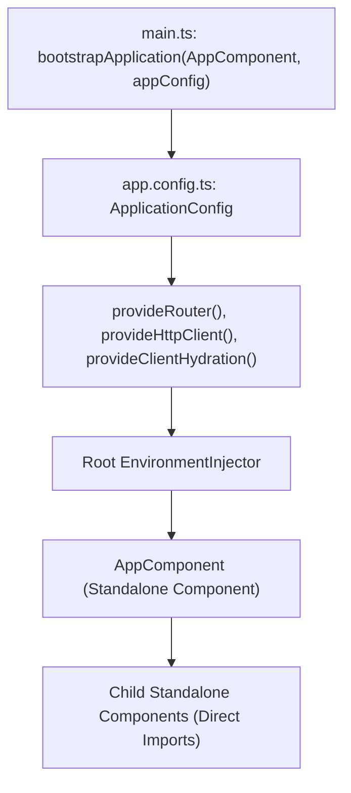

#### Line-by-Line Code Breakdown: Standalone Bootstrapping (`src/main.ts` & `src/app/app.config.ts`)

```typescript
// app.config.ts
import { ApplicationConfig, provideZoneChangeDetection } from '@angular/core';
import { provideRouter, withComponentInputBinding } from '@angular/router';
import { provideHttpClient, withInterceptors } from '@angular/common/http';
import { routes } from './app.routes';
import { authInterceptor } from './core/auth.interceptor';

export const appConfig: ApplicationConfig = {
  providers: [
    provideZoneChangeDetection({ eventCoalescing: true }),
    provideRouter(routes, withComponentInputBinding()),
    provideHttpClient(withInterceptors([authInterceptor]))
  ]
};

// main.ts
import { bootstrapApplication } from '@angular/platform-browser';
import { AppComponent } from './app/app';
import { appConfig } from './app/app.config';

bootstrapApplication(AppComponent, appConfig)
  .catch((err) => console.error('[Bootstrap Error]', err));
```

| Statement / API | Architectural Role | Pedagogical Runtime Mechanism |
| :--- | :--- | :--- |
| `ApplicationConfig` | **Configuration Interface** | Replaces historic `AppModule`. Holds the global array of environment providers passed during application bootstrap. |
| `provideZoneChangeDetection({ eventCoalescing: true })` | **Event Coalescing** | Coalesces multiple microtasks and DOM events into a single change detection tick, significantly reducing redundant template re-evaluations. |
| `withComponentInputBinding()` | **Router Feature** | Automatically maps route parameters (`:id`) and query parameters directly into component inputs (`input<string>()`) without subscribing to `ActivatedRoute`. |
| `provideHttpClient(withInterceptors([...]))` | **HTTP Engine** | Configures tree-shakeable, functional HTTP interceptors instead of legacy multi-provider class tokens (`HTTP_INTERCEPTORS`). |
| `bootstrapApplication(AppComponent, appConfig)` | **Platform Bootstrapper** | Mounts the root standalone component directly to the DOM host element without declaring an intermediate `NgModule`. |


#### What is Angular?

**Angular** is a popular open-source framework by Google for building single-page and dynamic web applications. It offers tools and libraries for components, services, forms, routing, and HTTP client, all built with TypeScript. Angular is known for its performance, scalability, and developer productivity.

##### Features

- **Component-Based Architecture**: Reusable, self-contained units of code that define the UI and behavior of a part of the application.
- **Two-Way Data Binding**: Automatic synchronization of data between the model and the view.
- **Dependency Injection**: Provides components with the services they need for better modularity and testability.
- **Routing**: Powerful system for navigation between different views, supporting deep linking, lazy loading, and route guards.
- **Forms**: Tools for template-driven and reactive forms, based on a model-driven approach.
- **HTTP Client**: Simple API for making HTTP requests and handling responses.
- **Observables**: Handles asynchronous operations and event handling.
- **TypeScript**: Superset of JavaScript with static typing, better tooling, error checking, and code completion.
- **Performance**: Optimized for performance with virtual DOM, lazy loading, tree shaking, and ahead-of-time compilation.
- **Mobile Support**: Tools for building responsive, touch-friendly mobile applications, including PWAs.
- **SEO Friendly**: Tools for server-side rendering, pre-rendering, and meta tags to improve search engine visibility.
- **Community Support**: Large, active community providing support and sharing knowledge.

##### Difference between AngularJS vs Angular

| AngularJS                                | Angular                                         |
| ---------------------------------------- | ----------------------------------------------- |
| Based on MVC Architecture                | Based on Components                             |
| Uses JavaScript to build the application | Uses TypeScript to build the application        |
| No Mobile Support                        | Mobile supports                                 |
| Run on only client-side                  | Runs on both client-side as well as server-side |
| CLI not present                          | CLI present                                     |
| No SEO Friendly                          | Seo Friendly                                    |
| Performance is slow                      | Performance is fast                             |

[Back to top⤴️](#table-of-contents)

##### Angular vs React

- **Angular**: A full-fledged framework by Google for building web applications. It includes features like two-way data binding, routing, forms, and HTTP client. Ideal for large, complex applications needing a complete solution.

- **React**: A JavaScript library by Facebook focused on building user interfaces. It provides a simple, declarative way to build UI components. Suitable for small to medium-sized applications requiring flexibility and customization.

**Comparison**: Angular offers a complete solution with built-in features, while React focuses on the view layer, allowing developers to choose additional tools and libraries.

**When to use Angular**: Best for large, complex applications needing integrated tools and scalability.

**When to use React**: Best for small to medium-sized applications needing flexibility and a focus on the UI.

[Back to top⤴️](#table-of-contents)

##### Architecture

Angular is built on a set of core design concepts that govern how applications are structured and how data flows. The fundamental building blocks of an Angular application include:

1. **Components**: The basic building block of the user interface. A component controls a patch of the screen (view) and consists of a TypeScript class (logic), an HTML template (UI), and CSS styles.
2. **Templates**: HTML markup combined with Angular-specific directives and binding syntax (e.g., interpolation, property binding, and event binding) to dynamically render data.
3. **Directives**: Classes that add custom behavior to elements in the DOM. They can be structural (modifying the layout, e.g., `@if`, `@for`) or attribute-based (modifying appearance or behavior).
4. **Dependency Injection (DI)**: A design pattern and mechanism where components delegate data fetching and business logic to **Services**. Angular's hierarchical DI system provides these services to components dynamically.
5. **Modules (NgModules)**: Legacy containers (though still widely used alongside Standalone components) that group related components, directives, pipes, and services into cohesive functional blocks.

```tree
       ┌───────────────────────────────┐
       │           NgModule            │
       └───────────────┬───────────────┘
                       │
       ┌───────────────▼───────────────┐
       │           Component           │◄──────────┐
       └───────┬───────────────▲───────┘           │
               │               │                   │
    Property   │               │ Event             │ Dependency
    Binding    │               │ Binding           │ Injection
               ▼               │                   │
       ┌───────────────────────┴───────┐   ┌───────┴───────┐
       │           Template            │   │    Service    │
       └───────────────────────────────┘   └───────────────┘
```

[Back to top⤴️](#table-of-contents)

##### Angular CLI

The **Angular CLI** (Command Line Interface) is a powerful command-line tool used to initialize, develop, scaffold, maintain, and test Angular applications directly from a terminal. It automates essential workflows such as:

- **Project Initialization**: Set up a new project skeleton using `ng new <project-name>`.
- **Scaffolding**: Generate boilerplates for components, services, directives, pipes, and routing modules with `ng generate` (or `ng g`).
- **Local Development**: Run a development server that hot-reloads on file changes using `ng serve`.
- **Testing**: Run unit tests (with Jest/Karma) or end-to-end tests (with Cypress/Playwright) using `ng test` and `ng e2e`.
- **Building**: Compile and optimize the application for production deployment with `ng build`.

For a complete list of commands and configurations, refer to the [CLI Commands](#cli-commands) section.

[Back to top⤴️](#table-of-contents)

##### Project Structure

A standard Angular project created with the CLI has a structured folder layout. Below are the key files and directories:

- **`src/`**: Contains the source code of the application.
  - **`app/`**: Contains the application components, services, and modules.
    - **`app.component.ts`**: The root component class.
    - **`app.config.ts`**: Defines the application configuration and global providers (introduced in Angular v17).
    - **`app.routes.ts`**: Defines the routing configuration (introduced in Angular v17).
  - **`assets/`**: Contains static assets like images, fonts, and icons.
  - **`index.html`**: The main HTML page served to users.
  - **`main.ts`**: The main entry point that bootstraps the application.
- **`angular.json`**: CLI configuration for build, serve, and test tools.
- **`package.json`**: Defines dependency packages and npm scripts.
- **`tsconfig.json`**: TypeScript configuration for the workspace.

[Back to top⤴️](#table-of-contents)

##### Workspace Configuration

An Angular workspace is configured using the `angular.json` file at the root of the project. This file defines the workspace-wide configuration as well as project-specific settings for build, serve, and test commands.

Key configuration blocks in `angular.json`:

- **`projects`**: Contains configuration for all projects in the workspace (applications and libraries).
  - **`projectType`**: Specifies whether the project is an `"application"` or a `"library"`.
  - **`root`**: The root folder for the project's source files.
  - **`sourceRoot`**: The folder containing the application's source code (typically `src`).
  - **`prefix`**: The prefix added to the selector of generated components (default is `app`).
  - **`architect`**: Defines the CLI tools and processes used to build, run, and test the project:
    - **`build`**: Configures options for production and development builds (e.g., assets, styles, scripts, optimization settings).
    - **`serve`**: Configures options for the development server (e.g., host, port, proxy configuration).
    - **`test`**: Configures choices for running unit tests.

- **`cli.schematicCollections`**: the collections `ng generate` searches, in order, when you omit a collection name (for example `["@acme/schematics", "@schematics/angular"]`).
- **`schematics`**: default options per generator, such as `"@schematics/angular:component": { "changeDetection": "OnPush" }`.

Each target names a **builder**, for example `"builder": "@angular/build:application"` for `build`. Builders are Node packages that the CLI's Architect layer loads; you can write your own ([section 29.10](#2910-custom-builders-angular-cli-architect)). For multi-project workspaces and monorepo layering, see [section 29.12](#2912-workspace-and-monorepo-architecture) and [section 29.13](#2913-nx-for-angular-monorepos).

[Back to top⤴️](#table-of-contents)

##### Standalone Applications

Starting with Angular v17, **Standalone Components, Directives, and Pipes** are the default format for building Angular applications. This approach removes the need for `NgModules` (like `app.module.ts`), simplifying the learning curve and reducing boilerplate.

Key characteristics of standalone applications:

- **Direct Imports**: Components declare their own dependencies (other components, directives, or pipes) directly in their decorator's `imports` array.
- **Bootstrapping**: The application is bootstrapped using the `bootstrapApplication` function inside `main.ts`, rather than bootstrapping a module.
- **Application Config**: Global providers, routing configurations, and interceptors are passed via an `ApplicationConfig` object (usually defined in `app.config.ts`) directly during bootstrapping.

For more details on building and using standalone features, refer to the [Standalone Components](#standalone-components) section.

[Back to top⤴️](#table-of-contents)

##### Angular Version History

Angular has evolved significantly over recent releases. Key highlights from recent major versions include:

- **Angular v14 (June 2022)**: Introduced Standalone Components as developer preview, Typed Forms, and CLI enhancements.
- **Angular v15 (November 2022)**: Standalone components became stable, Directive Composition API introduced, and stack trace improvements.
- **Angular v16 (May 2023)**: Introduced Angular Signals (developer preview), non-destructive hydration, server-side rendering improvements, and esbuild integration.
- **Angular v17 (November 2023)**: Introduced the new declarative control flow syntax (`@if`, `@for`, `@switch`), deferred views (`@defer`), and built-in hydration support.
- **Angular v18 (May 2024)**: Zoneless change detection support, hybrid rendering, and stabilization of Signals APIs (Signal-based queries/inputs).
- **Angular v19 (November 2024)**: Standalone-by-default inputs/queries, `linkedSignal()`, `resource()`, and improved SSR performance.

For dependency compatibilities (TypeScript, Node.js, RxJS) across versions, refer to the [Version Compatibility](#version-compatibility) section.

[Back to top⤴️](#table-of-contents)

##### Migration Guide

Keeping your Angular applications updated is simplified by the framework's built-in migration tools. The official recommendation is to update one major version at a time.

Key tools and processes for Angular migration:

- **Interactive Guide**: Visit [update.angular.io](https://update.angular.io/) to get step-by-step instructions customized for your source and target versions.
- **`ng update`**: Run `ng update` to view outdated packages. Execute `ng update @angular/core @angular/cli` to automate package upgrades and run code migrations (schematics) that rewrite deprecated APIs.
- **Core Migrations**: Angular provides specific CLI schematics to migrate existing codebases to modern features:
  - **Standalone Migration**: `ng g @angular/core:standalone` converts a modular application to a standalone configuration.
  - **Control Flow Migration**: `ng g @angular/core:control-flow` migrates templates to the modern `@if`, `@for`, and `@switch` syntax.

[Back to top⤴️](#table-of-contents)

##### Bootstrapping

Bootstrapping is the process that initializes and starts the Angular application. Angular supports two bootstrapping methods:

###### 1. Standalone Bootstrapping (stable since v15, CLI default since v17)
Bootstrapping is done using the `bootstrapApplication` function from `@angular/platform-browser`. It loads a standalone component as the root of the application, bypassing the need for an NgModule.

`main.ts`:
```typescript
import { bootstrapApplication } from '@angular/platform-browser';
import { AppComponent } from './app/app.component';
import { appConfig } from './app/app.config';

bootstrapApplication(AppComponent, appConfig)
  .catch((err) => console.error(err));
```

`bootstrapApplication` returns a `Promise<ApplicationRef>`. Keep the `.catch()`: if any `provideAppInitializer()` function fails, the promise rejects and the root component is never created. For what happens between this call and the first render (platform injector, root injector, initializers, `ApplicationRef.bootstrap`), see [section 29.6](#296-app-lifecycle-and-bootstrap-internals).

###### 2. NgModule Bootstrapping (Legacy)
Bootstrapping is done using the `platformBrowserDynamic` function to compile and launch a root module (usually `AppModule`).

`main.ts`:
```typescript
import { platformBrowserDynamic } from '@angular/platform-browser-dynamic';
import { AppModule } from './app/app.module';

platformBrowserDynamic().bootstrapModule(AppModule)
  .catch(err => console.error(err));
```

[Back to top⤴️](#table-of-contents)

##### Application Configuration

In standalone applications, global configuration is set up using the `ApplicationConfig` object, typically defined in `app.config.ts`. It contains providers that configure router, HTTP clients, animations, and other framework features.

`app.config.ts` example:
```typescript
import { ApplicationConfig, provideZoneChangeDetection } from '@angular/core';
import { provideRouter } from '@angular/router';
import { provideHttpClient, withInterceptors } from '@angular/common/http';
import { routes } from './app.routes';
import { authInterceptor } from './auth.interceptor';

export const appConfig: ApplicationConfig = {
  providers: [
    provideZoneChangeDetection({ eventCoalescing: true }),
    provideRouter(routes),
    provideHttpClient(withInterceptors([authInterceptor]))
  ]
};
```

> [!NOTE]
> Since v21, applications are zoneless by default. Including `provideZoneChangeDetection()` opts the app back into `zone.js`-based change detection and needs `zone.js` in `polyfills`. A new v22 app usually lists neither `provideZoneChangeDetection()` nor `provideZonelessChangeDetection()`.

[Back to top⤴️](#table-of-contents)

##### Environment Providers

**Environment Providers** are dependency injection providers that are configured at the application level (in the application's root injector). They are available globally throughout the entire application.

Environment providers are typically registered inside `appConfig.providers` during bootstrapping. Unlike component-level providers (which create separate instances for each component sub-tree), environment providers ensure a single shared instance or global configuration:

- **Helper Functions**: Angular provides functional helper APIs to set up global configurations, such as `provideRouter()`, `provideHttpClient()`, and `provideAnimations()`.
- **Custom Services**: You can configure custom services as environment providers by using `{ providedIn: 'root' }` in the `@Injectable()` decorator.

Environment providers (`provideRouter()`, `provideHttpClient()`, anything built with `makeEnvironmentProviders()`) can only be registered in environment injectors: `appConfig.providers`, route `providers`, or `createEnvironmentInjector()`. Putting them in a component's `providers` array is an error. [Section 29.8](#298-environmentinjector-vs-elementinjector) compares environment and element injectors.

[Back to top⤴️](#table-of-contents)

##### Version Compatibility

To ensure stability, your workspace dependencies (Node.js, TypeScript, and RxJS) must align with your installed version of Angular.

| Angular Version | Node.js Version | TypeScript Version | RxJS Version |
| :--- | :--- | :--- | :--- |
| **v19.x** | `^18.19.1` \|\| `^20.11.1` \|\| `>=22.0.0` | `>=5.5.0 <5.7.0` | `^7.4.0` |
| **v18.x** | `^18.19.1` \|\| `>=20.9.0` | `>=5.4.0 <5.5.0` | `^7.4.0` |
| **v17.x** | `^18.13.0` \|\| `>=20.9.0` | `>=5.2.0 <5.4.0` | `^7.4.0` |
| **v16.x** | `^16.14.0` \|\| `>=18.10.0` | `>=4.9.3 <5.1.0` | `^7.4.0` |
| **v15.x** | `^14.20.0` \|\| `^16.13.0` \|\| `>=18.10.0` | `>=4.8.2 <5.0.0` | `^6.5.0` \|\| `^7.4.0` |
| **v14.x** | `^14.15.0` \|\| `>=16.10.0` | `>=4.6.2 <4.9.0` | `^6.5.3` \|\| `^7.4.0` |

[Back to top⤴️](#table-of-contents)

#### Roadmap

[Angular Roadmap](https://roadmap.sh/angular)

#### Configuration

##### Prerequisites

- Node.js
- NPM
- Angular CLI

##### Installation

Install the Angular CLI globally:

```bash
npm install -g @angular/cli
```

If you are using `pnpm`, you can use the following command:

```bash
pnpm install -g @angular/cli
```

If you are using `yarn`, you can use the following command:

```bash
yarn global add @angular/cli
```

If you are using `bun`, you can use the following command:

```bash
bun install -g @angular/cli
```

If you want to install a specific version of the Angular CLI, you can use the following command:

```bash
npm install -g @angular/cli@version-number
```

If you have already installed the Angular CLI, you can update it to the latest version using the following command:

```bash
npm install -g @angular/cli@latest
```

Check version

```bash
ng version
```

Angular 22 requires TypeScript `>=6.0 <6.1` and a current Node.js LTS line (the v22 CLI packages declare `^22.22.3 || ^24.15.0 || >=26.0.0`). `ng version` prints the installed versions of each.

Create a new Angular project: (Replace `[PROJECT NAME]` with your project name)

```bash
**with standalone component**
ng new [PROJECT NAME]

**without standalone component**
ng new [PROJECT NAME] --standalone=false

## without routing
ng new [PROJECT NAME] --routing=false

## without testing
ng new [PROJECT NAME] --skip-tests=true

## without dependencies
ng new [PROJECT NAME] --skip-install=true

## without git
ng new [PROJECT NAME] --skip-git=true

## with experimental zonless
ng new [PROJECT NAME] --experimental-zoneless
```

**Note**: In version v16 and earlier, there is no standalone component. In version v17 and later, the standalone component is default enabled. You can enable or disable the standalone component using the `--standalone` flag while creating a new project (In this repository, an example repository is created with the latest version of Angular).

Navigate to the project directory:

```bash
cd [PROJECT NAME]
```

Run the application:

```bash
ng serve
```

Open the browser and navigate to `http://localhost:4200/`.

Project structure(Version 16 and earlier):

```bash
[PROJECT NAME]
├── node_modules
├── src
│   ├── app
│   │   ├── app.component.css
│   │   ├── app.component.html
│   │   ├── app.component.spec.ts
│   │   ├── app.component.ts
│   │   ├── app.module.ts
│   │   ├── ...
│   ├── assets
│   │   ├── .gitkeep
│   │   └── ...
│   ├── index.html
│   ├── main.ts
│   ├── styles.css
│   ├── favicon.ico
│   └── ...
├── .editorconfig
├── .gitignore
├── angular.json
├── package.json
├── README.md
├── tsconfig.json
├── tslint.json
└── ...
```

Project structure(Version 17 and later):

```bash
[PROJECT NAME]
├── node_modules
├── public
│   ├── favicon.ico
│   └── ...
├── src
│   ├── app
│   │   ├── app.component.css
│   │   ├── app.component.html
│   │   ├── app.component.spec.ts
│   │   ├── app.component.ts
│   │   ├── app.config.ts
│   │   ├── app.routes.ts
│   │   └── ...
│   ├── index.html
│   ├── main.ts
│   ├── styles.css
│   └── ...
├── .editorconfig
├── .gitignore
├── angular.json
├── package.json
├── README.md
├── tsconfig.json
├── tslint.json
└── ...
```

[Back to top⤴️](#table-of-contents)

### 1.2 TypeScript Essentials

#### TypeScript Basics

TypeScript is a typed superset of JavaScript that compiles to plain JavaScript. It adds static typing, classes, and interfaces to the language, helping developers catch errors early during development.

#### Types

TypeScript supports basic types such as `string`, `number`, `boolean`, `array`, `tuple`, `enum`, `any`, `void`, `null`, `undefined`, `never`, and `unknown`.

#### TypeScript Essentials

Angular is built with TypeScript, and a solid understanding of TypeScript is essential for building Angular applications. This section covers the fundamental TypeScript features used in Angular development.

##### Interfaces

In TypeScript, an **Interface** is a virtual structure that defines the contract or shape that an object must adhere to. Interfaces exist solely for type-checking at compile time and are completely compiled away in the resulting JavaScript.

In Angular, interfaces are heavily used to type-check components' data shapes, services' model structures, and API response objects.

Example interface definition:

```typescript
export interface User {
  id: number;
  name: string;
  email: string;
  role?: string; // Optional property
}
```

Using the interface in a component:

```typescript
import { Component } from "@angular/core";
import { User } from "./user.model";

@Component({
  selector: "app-user-profile",
  template: `<p>{{ user.name }} ({{ user.email }})</p>`,
})
export class UserProfileComponent {
  user: User = {
    id: 1,
    name: "John Doe",
    email: "john.doe@example.com",
  };
}
```

##### Enums

**Enums** (Enumerations) allow you to define a set of named constants. Using enums makes it easier to document intent and handle a set of distinct, related values. TypeScript supports both **numeric** and **string-based** enums.

In Angular, enums are frequently used to define statuses, user roles, or configuration modes.

Example of a string enum:

```typescript
export enum UserRole {
  Admin = "ADMIN",
  Editor = "EDITOR",
  User = "USER",
}
```

Using the enum in an Angular component:

```typescript
import { Component } from "@angular/core";
import { UserRole } from "./user-role.enum";

@Component({
  selector: "app-user-badge",
  template: ` <span [class]="role">{{ role }}</span> `,
})
export class UserBadgeComponent {
  // Expose enum to the template
  UserRole = UserRole;
  role: UserRole = UserRole.Admin;
}
```

##### Generics

**Generics** provide a way to create reusable code components that can work with a variety of types rather than a single type. This allows you to write type-safe code that adapts to different data models.

In Angular, generics are heavily utilized across core features, including:

- **HTTP Client**: Typing API responses, e.g., `http.get<User>('/api/profile')` returns an `Observable<User>`.
- **Signals**: Creating typed signals, e.g., `const count = signal<number>(0)`.
- **EventEmitters**: Typing output events, e.g., `@Output() selected = new EventEmitter<User>()`.
- **Form Controls**: Typing reactive form controls, e.g., `name = new FormControl<string>('')`.

Example of a generic interface:

```typescript
export interface ApiResponse<T> {
  data: T;
  status: string;
  error?: string;
}

// Consuming the generic API response with a User model
const response: ApiResponse<User> = {
  data: { id: 1, name: "John Doe", email: "john@example.com" },
  status: "success",
};
```

##### Utility Types

TypeScript provides several global **Utility Types** to facilitate common type transformations. These utilities help construct new types based on existing ones.

Common utility types used in Angular applications:

- **`Partial<T>`**: Makes all properties of type `T` optional. Extremely useful when patching form values or sending partial updates to a backend service.

  ```typescript
  // Typing a partial update function in a user service
  updateUser(id: number, changes: Partial<User>) {
    return this.http.patch<User>(`/api/users/${id}`, changes);
  }
  ```

- **`Omit<T, K>`**: Creates a type by picking all properties from `T` and then removing keys `K`. Often used when submitting new data where the server generates the ID.

  ```typescript
  // Define a type for creating a user (excluding the auto-generated id)
  type CreateUserDTO = Omit<User, "id">;
  ```

- **`Pick<T, K>`**: Creates a type by picking a specific set of keys `K` from type `T`.

  ```typescript
  // Only extract name and email from User
  type UserContactInfo = Pick<User, "name" | "email">;
  ```

- **`Readonly<T>`**: Sets all properties of `T` to readonly. Ideal for state management to ensure state remains immutable.

  ```typescript
  const state: Readonly<AppState> = { theme: "dark", loggedIn: true };
  // state.theme = 'light'; // Error: Cannot assign to 'theme' because it is a read-only property
  ```

##### Type Assertions

Sometimes you will have information about the type of a value that TypeScript can't know. In these situations, you can use a **Type Assertion** to specify a more precise type.

TypeScript supports two syntaxes for type assertions:
1. **`as` syntax** (recommended and compatible with JSX/TSX):
   ```typescript
   const element = document.getElementById("search-input") as HTMLInputElement;
   const query = element.value;
   ```
2. **Angle-bracket syntax**:
   ```typescript
   const element = <HTMLInputElement>document.getElementById("search-input");
   ```

In Angular templates, type assertions are commonly used when handling DOM events:
```typescript
onInput(event: Event) {
  // Assert event.target as an HTMLInputElement to access .value safely
  const input = event.target as HTMLInputElement;
  this.searchQuery.set(input.value);
}
```

[Back to top⤴️](#table-of-contents)

##### Type Narrowing

**Type Narrowing** is the process of moving from a less precise type to a more precise type. TypeScript analyzes runtime control flow to narrow types.

Common methods of type narrowing:

- **typeof guard**: Narrowing primitive types.
  ```typescript
  formatPadding(value: number | string) {
    if (typeof value === "number") {
      return `${value}px`; // 'value' is narrowed to number
    }
    return value; // 'value' is narrowed to string
  }
  ```
- **Truthiness & Equality guards**: Checking if values are nullish or equal to specific literals.
- **instanceof guard**: Narrowing class instances.
  ```typescript
  handleError(error: Error | string) {
    if (error instanceof Error) {
      console.error(error.message); // 'error' is narrowed to Error class
    }
  }
  ```
- **`in` operator guard**: Checking if a property exists on an object.
  ```typescript
  type Admin = { privileges: string[] };
  type Employee = { startDate: Date };

  printDetails(user: Admin | Employee) {
    if ("privileges" in user) {
      console.log(user.privileges); // Narrowed to Admin
    }
  }
  ```
- **User-defined Type Guards**: Custom functions returning a type predicate `parameterName is Type`.
  ```typescript
  function isUser(profile: any): profile is User {
    return profile && typeof profile.email === 'string';
  }
  ```

[Back to top⤴️](#table-of-contents)

##### Type Aliases

A **Type Alias** creates a new name for a type. Type aliases can represent primitives, unions, tuples, and any other types.

```typescript
type ID = string | number;
type Coordinate = [number, number];
type Callback = (data: string) => void;
```

###### Type Aliases vs Interfaces

| Feature | Interface | Type Alias |
| :--- | :--- | :--- |
| **Syntax** | `interface User { name: string; }` | `type User = { name: string; };` |
| **Extensibility** | Extends other interfaces using `extends`. | Extends other types using intersections (`&`). |
| **Declaration Merging**| Can be declared multiple times (merges fields). | Cannot be changed/merged after creation. |
| **Use Case** | Best for defining public API data shapes/contracts. | Best for unions, tuples, functions, or complex types. |

[Back to top⤴️](#table-of-contents)

##### Literal Types

**Literal Types** allow you to specify exact values that a string, number, or boolean must have. They are extremely powerful when combined into union types.

```typescript
// String literal type
type ThemeMode = 'light' | 'dark' | 'system';

// Numeric literal type
type DiceRoll = 1 | 2 | 3 | 4 | 5 | 6;

// Boolean literal type
type ToggleState = true | false;
```

Using literal types in Angular components constraints options to exact allowed values:
```typescript
import { Component, input } from '@angular/core';

@Component({
  selector: 'app-btn',
  template: `<button [class]="variant()">Click</button>`
})
export class ButtonComponent {
  // Constrain input to only valid literal button variants
  variant = input<'primary' | 'secondary' | 'danger'>('primary');
}
```

[Back to top⤴️](#table-of-contents)

##### Conditional Types

**Conditional Types** help select types based on a relation expressed as a condition (similar to ternary operators in JavaScript).

```typescript
// Type T extends U ? X : Y
type IsString<T> = T extends string ? true : false;

type A = IsString<string>;  // true
type B = IsString<number>;  // false
```

In Angular libraries or complex components, conditional types can dynamically resolve return types:
```typescript
type CacheValue<T> = T extends Promise<infer U> ? U : T;

// If a Promise is passed, cache type U (resolved value), otherwise cache T
```

[Back to top⤴️](#table-of-contents)

##### Mapped Types

**Mapped Types** allow you to create new types based on the properties of an existing type. They use the `keyof` operator to iterate over keys of another type.

```typescript
type FeatureFlags = {
  darkMode: boolean;
  betaFeatures: boolean;
};

// Create a mapped type that makes all properties optional
type OptionsFlags<Type> = {
  [Property in keyof Type]: boolean;
};

type AppFeatures = OptionsFlags<FeatureFlags>;
```

###### Mapping Modifiers
You can use `+` or `-` prefixes to add or remove modifiers like `readonly` and `?`:
```typescript
// Removes 'readonly' attributes from a type's properties
type CreateMutable<Type> = {
  -readonly [Property in keyof Type]: Type[Property];
};

// Makes all properties of Type required (removes '?')
type Concrete<Type> = {
  [Property in keyof Type]-?: Type[Property];
};
```

[Back to top⤴️](#table-of-contents)

#### Decorators

Decorators are design patterns used to isolate the modification or decoration of a class without modifying the source code.

There are several built-in decorators in Angular, including:

- **@Component**
- **@Directive**
- **@Injectable**
- **@Pipe**
- **@NgModule**
- **@Input**
- **@Output**
- **@HostListener**
- **@ContentChild**
- **@ContentChildren**
- **@ViewChild**
- **@ViewChildren**

##### Component

The `@Component` decorator is used to define a new component in Angular.

```ts
import { Component } from "@angular/core";

@Component({
  selector: "my-app",
  templateUrl: "./app.component.html",
  styleUrls: ["./app.component.css"],
})
export class AppComponent {
  title = "My App";
}
```

```html
<h1>{{ title }}</h1>
```

```typescript
import { NgModule } from "@angular/core";
import { BrowserModule } from "@angular/platform-browser";
import { FormsModule } from "@angular/forms";

import { AppComponent } from "./app.component";

@NgModule({
  imports: [BrowserModule, FormsModule],
  declarations: [AppComponent],
  bootstrap: [AppComponent],
})
export class AppModule {}
```

##### Directive

The `@Directive` decorator is used to define a new directive in Angular.

```ts
import { Directive, ElementRef, HostListener } from "@angular/core";

@Directive({
  selector: "[appCustomDirective]",
})
export class CustomDirective {
  constructor(private el: ElementRef) {}

  @HostListener("mouseenter") onMouseEnter() {
    this.highlight("yellow");
  }

  @HostListener("mouseleave") onMouseLeave() {
    this.highlight(null);
  }

  private highlight(color: string) {
    this.el.nativeElement.style.backgroundColor = color;
  }
}
```

```html
<div appCustomDirective>
  This element will have a yellow background when the mouse is over it.
</div>
```

```typescript
import { NgModule } from "@angular/core";

import { CustomDirective } from "./custom.directive";

@NgModule({
  declarations: [CustomDirective],
})
export class AppModule {}
```

##### Injectable

The `@Injectable` decorator is used to define a new service in Angular.

```ts
import { Injectable } from "@angular/core";

@Injectable
export class DataService {
  getData() {
    return "Hello, world!";
  }
}
```

```ts
import { Component } from "@angular/core";
import { DataService } from "./data.service";

@Component({
  selector: "my-app",
  templateUrl: "./app.component.html",
  styleUrls: ["./app.component.css"],
})
export class AppComponent {
  data: string;

  constructor(private dataService: DataService) {
    this.data = this.dataService.getData();
  }
}
```

```typescript
import { NgModule } from "@angular/core";

import { AppComponent } from "./app.component";

@NgModule({
  declarations: [AppComponent],
  providers: [DataService],
})
export class AppModule {}
```

##### Pipe

The `@Pipe` decorator is used to define a new pipe in Angular.

```ts
import { Pipe, PipeTransform } from "@angular/core";

@Pipe({
  name: "customPipe",
})
export class CustomPipe implements PipeTransform {
  transform(value: any, args?: any): any {
    return value;
  }
}
```

```html
<h1>{{ data | customPipe }}</h1>
```

```typescript
import { NgModule } from "@angular/core";

import { CustomPipe } from "./custom.pipe";

@NgModule({
  declarations: [CustomPipe],
})
export class AppModule {}
```

##### NgModule

The `@NgModule` decorator is used to define a new module in Angular.

```ts
import { NgModule } from "@angular/core";

@NgModule({
  imports: [],
  declarations: [],
  providers: [],
  bootstrap: [],
})
export class AppModule {}
```

```typescript
import { BrowserModule } from "@angular/platform-browser";
import { FormsModule } from "@angular/forms";

import { AppComponent } from "./app.component";

@NgModule({
  imports: [BrowserModule, FormsModule],
  declarations: [AppComponent],
  bootstrap: [AppComponent],
})
export class AppModule {}
```

##### Input

The `@Input` decorator is used to pass data from a parent component to a child component.

```ts
import { Component, Input, OnInit } from "@angular/core";

@Component({
  selector: "app-child",
  templateUrl: "./child.component.html",
  styleUrls: ["./child.component.css"],
})
export class ChildComponent implements OnInit {
  @Input() message: string;
  constructor() {}

  ngOnInit() {}
}
```

```ts
import { Component, OnInit } from "@angular/core";

@Component({
  selector: "app-parent",
  templateUrl: "./parent.component.html",
  styleUrls: ["./parent.component.css"],
})
export class ParentComponent implements OnInit {
  parentMessage = "Hello from the parent component!";
  constructor() {}

  ngOnInit() {}
}
```

```html
<p>{{ message }}</p>
```

```html
<app-child [message]="parentMessage"></app-child>
```

```html
<h1>@Input Example</h1>
<app-parent></app-parent>
```

```typescript
import { NgModule } from "@angular/core";
import { BrowserModule } from "@angular/platform-browser";
import { FormsModule } from "@angular/forms";

import { AppComponent } from "./app.component";
import { RouterModule } from "@angular/router";
import { ChildComponent } from "./child/child.component";
import { ParentComponent } from "./parent/parent.component";

@NgModule({
  imports: [BrowserModule, FormsModule, RouterModule],
  declarations: [AppComponent, ChildComponent, ParentComponent],
  bootstrap: [AppComponent],
})
export class AppModule {}
```

##### Output

The `@Output` decorator is used to pass data from a child component to a parent component.

```ts
import { Component, EventEmitter, OnInit, Output } from "@angular/core";

@Component({
  selector: "app-child",
  templateUrl: "./child.component.html",
  styleUrls: ["./child.component.css"],
})
export class ChildComponent implements OnInit {
  @Output() messageEvent = new EventEmitter<string>();

  constructor() {}

  ngOnInit() {}

  sendMessage() {
    this.messageEvent.emit("Hello from the child component!");
  }
}
```

```ts
import { Component, OnInit } from "@angular/core";

@Component({
  selector: "app-parent",
  templateUrl: "./parent.component.html",
  styleUrls: ["./parent.component.css"],
})
export class ParentComponent implements OnInit {
  constructor() {}

  ngOnInit() {}

  handleMessage(message: string) {
    console.log(message);
  }
}
```

```html
<button (click)="sendMessage()">Send message</button>
```

```html
<app-child (messageEvent)="handleMessage($event)"></app-child>
```

```html
<h1>@Output Decorator Example</h1>
<app-parent></app-parent>
```

##### HostListener

The `@HostListener` decorator is used to listen for events on the host element of a directive or component.

```html
<h1>@HostListener Decorator Example</h1>
<p>Click the host element to trigger the 'click' event.</p>
```

```ts
import { Component, HostListener } from "@angular/core";

@Component({
  selector: "my-app",
  templateUrl: "./app.component.html",
  styleUrls: ["./app.component.css"],
})
export class AppComponent {
  @HostListener("click")
  onClick() {
    console.log("The host element was clicked!");
  }
}
```

##### contentChild & contentChildren

The `@ContentChild` and `@ContentChildren` decorators are used to query for content children in the component's view.

```ts
import {
  Component,
  ContentChild,
  ContentChildren,
  ElementRef,
  OnInit,
  QueryList,
} from "@angular/core";

@Component({
  selector: "app-parent",
  templateUrl: "./parent.component.html",
  styleUrls: ["./parent.component.css"],
})
export class ParentComponent implements OnInit {
  @ContentChild("childButton1", { static: true }) childButton1: ElementRef;
  @ContentChildren("childButton2") childButtons2: QueryList<ElementRef>;

  ngAfterContentInit() {
    console.log(this.childButton1.nativeElement.textContent);
    this.childButtons2.forEach((button) => {
      console.log(button.nativeElement.textContent);
    });
  }

  constructor() {}

  ngOnInit() {}
}
```

```html
<ng-content></ng-content>
```

```html
<h1>@ContentChild Decorator Example</h1>
<app-parent></app-parent>
```

##### viewChild & viewChildren

The `@ViewChild` and `@ViewChildren` decorators are used to query for view children in the component's view.

```ts
import {
  Component,
  ElementRef,
  QueryList,
  ViewChild,
  ViewChildren,
} from "@angular/core";

@Component({
  selector: "my-app",
  templateUrl: "./app.component.html",
  styleUrls: ["./app.component.css"],
})
export class AppComponent {
  @ViewChild("childButton1", { static: true }) childButton1: ElementRef;
  @ViewChildren("childButton2") childButtons2: QueryList<ElementRef>;

  ngAfterViewInit() {
    console.log(this.childButton1.nativeElement.textContent);
    this.childButtons2.forEach((button) => {
      console.log(button.nativeElement.textContent);
    });
  }
}
```

```html
<h1>@viewChild & @viewChildren Example</h1>
<button #childButton1>Button 1</button>
<button #childButton2>Button 2</button>
```

[Back to top⤴️](#table-of-contents)

#### Modules

TypeScript uses ES6 module syntax. Files are modules, and variables/functions/classes are shared using `export` and `import` keywords.

#### TypeScript

**TypeScript** is JavaScript with syntax for types. TypeScript is a superset of JavaScript. It is developed and maintained by Microsoft.

#### Imports

Angular Core

```typescript
import { Component } from "@angular/core"; // Component decorator
import { NgModule } from "@angular/core"; // NgModule decorator
import { RouterModule, Routes } from "@angular/router"; // Routing module
import { FormsModule } from "@angular/forms"; // Forms module
import { ReactiveFormsModule } from "@angular/forms"; // Reactive forms module
import { HttpClientModule } from "@angular/common/http"; // HTTP client module
import { BrowserModule } from "@angular/platform-browser"; // Browser module
import { BrowserAnimationsModule } from "@angular/platform-browser/animations"; // Animations module
import { CommonModule } from "@angular/common"; // Common module
import { NgModel } from "@angular/forms"; // NgModel directive
import { NgForm } from "@angular/forms"; // NgForm directive
import { FormGroup, FormControl, Validators } from "@angular/forms"; // Form group, form control, validators
import { HttpClient } from "@angular/common/http"; // HTTP client
import { ActivatedRoute } from "@angular/router"; // Route parameters
import { Router } from "@angular/router"; // Router service
import { Title } from "@angular/platform-browser"; // Title service
import { Meta } from "@angular/platform-browser"; // Meta service
import { Renderer2 } from "@angular/core"; // Renderer2 service
import { ElementRef } from "@angular/core"; // ElementRef service
import { ViewChild } from "@angular/core"; // ViewChild decorator
import { ViewContainerRef } from "@angular/core"; // ViewContainerRef service
import { ComponentFactoryResolver } from "@angular/core"; // ComponentFactoryResolver service
import { ChangeDetectorRef } from "@angular/core"; // ChangeDetectorRef service
import { Pipe, PipeTransform } from "@angular/core"; // Pipe decorator, PipeTransform interface
import { Injectable } from "@angular/core"; // Injectable decorator
import { EventEmitter } from "@angular/core"; // EventEmitter class
import { Output } from "@angular/core"; // Output decorator
import { Input } from "@angular/core"; // Input decorator
import { HostListener } from "@angular/core"; // HostListener decorator
import { HostBinding } from "@angular/core"; // HostBinding decorator
import { ContentChild } from "@angular/core"; // ContentChild decorator
import { ContentChildren } from "@angular/core"; // ContentChildren decorator
import { QueryList } from "@angular/core"; // QueryList class
import { AfterContentInit } from "@angular/core"; // AfterContentInit interface
import { AfterContentChecked } from "@angular/core"; // AfterContentChecked interface
import { AfterViewInit } from "@angular/core"; // AfterViewInit interface
import { AfterViewChecked } from "@angular/core"; // AfterViewChecked interface
import { OnInit } from "@angular/core"; // OnInit interface
import { OnDestroy } from "@angular/core"; // OnDestroy interface
import { OnChanges } from "@angular/core"; // OnChanges interface
import { SimpleChanges } from "@angular/core"; // SimpleChanges class
import { DoCheck } from "@angular/core"; // DoCheck interface
import { KeyValueDiffers } from "@angular/core"; // KeyValueDiffers service
import { KeyValueDiffer } from "@angular/core"; // KeyValueDiffer interface
import { KeyValueChanges } from "@angular/core"; // KeyValueChanges interface
import { KeyValueChangeRecord } from "@angular/core"; // KeyValueChangeRecord interface
import { IterableDiffers } from "@angular/core"; // IterableDiffers service
import { IterableDiffer } from "@angular/core"; // IterableDiffer interface
import { IterableChanges } from "@angular/core"; // IterableChanges interface
import { IterableChangeRecord } from "@angular/core"; // IterableChangeRecord interface
import { ChangeDetectionStrategy } from "@angular/core"; // ChangeDetectionStrategy enum
import { ChangeDetectorRef } from "@angular/core"; // ChangeDetectorRef service
import { NgZone } from "@angular/core"; // NgZone service
import { ApplicationRef } from "@angular/core"; // ApplicationRef service
import { ComponentRef } from "@angular/core"; // ComponentRef class
import { ComponentFactory } from "@angular/core"; // ComponentFactory class
import { ComponentFactoryResolver } from "@angular/core"; // ComponentFactoryResolver service
import { ViewContainerRef } from "@angular/core"; // ViewContainerRef service
import { TemplateRef } from "@angular/core"; // TemplateRef class
import { EmbeddedViewRef } from "@angular/core"; // EmbeddedViewRef class
```

Angular Material

```typescript
import { MatDialog } from "@angular/material/dialog";
import { MatSnackBar } from "@angular/material/snack-bar";
import { MatTableDataSource } from "@angular/material/table";
import { MatPaginator } from "@angular/material/paginator";
import { MatSort } from "@angular/material/sort";
import { MatFormFieldModule } from "@angular/material/form-field";
import { MatButtonModule } from "@angular/material/button";
import { MatInputModule } from "@angular/material/input";
import { MatIconModule } from "@angular/material/icon";
import { MatToolbarModule } from "@angular/material/toolbar";
import { MatMenuModule } from "@angular/material/menu";
import { MatSelectModule } from "@angular/material/select";
import { MatCheckboxModule } from "@angular/material/checkbox";
import { MatDatepickerModule } from "@angular/material/datepicker";
import { MatNativeDateModule } from "@angular/material/core";
import { MatCardModule } from "@angular/material/card";
import { MatProgressSpinnerModule } from "@angular/material/progress-spinner";
import { MatProgressBarModule } from "@angular/material/progress-bar";
import { MatDialogModule } from "@angular/material/dialog";
import { MatTooltipModule } from "@angular/material/tooltip";
import { MatRadioModule } from "@angular/material/radio";
import { MatSlideToggleModule } from "@angular/material/slide-toggle";
import { MatTabsModule } from "@angular/material/tabs";
import { MatSidenavModule } from "@angular/material/sidenav";
import { MatExpansionModule } from "@angular/material/expansion";
import { MatGridListModule } from "@angular/material/grid-list";
import { MatAutocompleteModule } from "@angular/material/autocomplete";
import { MatChipsModule } from "@angular/material/chips";
import { MatListModule } from "@angular/material/list";
import { MatStepperModule } from "@angular/material/stepper";
import { MatBadgeModule } from "@angular/material/badge";
import { MatBottomSheetModule } from "@angular/material/bottom-sheet";
import { MatButtonToggleModule } from "@angular/material/button-toggle";
import { MatDividerModule } from "@angular/material/divider";
import { MatPaginatorModule } from "@angular/material/paginator";
import { MatRippleModule } from "@angular/material/core";
import { MatSliderModule } from "@angular/material/slider";
import { MatSnackBarModule } from "@angular/material/snack-bar";
import { MatSortModule } from "@angular/material/sort";
import { MatTreeModule } from "@angular/material/tree";
```

RxJS

```typescript
import { Observable } from "rxjs/Observable";
import { Subject } from "rxjs/Subject";
import { BehaviorSubject } from "rxjs/BehaviorSubject";
import { ReplaySubject } from "rxjs/ReplaySubject";
import { AsyncSubject } from "rxjs/AsyncSubject";
import { Subscription } from "rxjs/Subscription";
import { from } from "rxjs";
import { fromEvent } from "rxjs";
import { interval } from "rxjs";
import { timer } from "rxjs";
import { merge } from "rxjs";
import { zip } from "rxjs";
import { combineLatest } from "rxjs";
import { concat } from "rxjs";
import { forkJoin } from "rxjs";
import { race } from "rxjs";
import { map } from "rxjs/operators";
import { filter } from "rxjs/operators";
import { reduce } from "rxjs/operators";
import { tap } from "rxjs/operators";
import { catchError } from "rxjs/operators";
import { retry } from "rxjs/operators";
import { switchMap } from "rxjs/operators";
import { take } from "rxjs/operators";
import { debounceTime } from "rxjs/operators";
import { distinctUntilChanged } from "rxjs/operators";
import { scan } from "rxjs/operators";
import { mergeMap } from "rxjs/operators";
import { exhaustMap } from "rxjs/operators";
import { concatMap } from "rxjs/operators";
import { takeUntil } from "rxjs/operators";
import { finalize } from "rxjs/operators";
import { share } from "rxjs/operators";
import { shareReplay } from "rxjs/operators";
import { buffer } from "rxjs/operators";
import { bufferCount } from "rxjs/operators";
import { bufferTime } from "rxjs/operators";
import { bufferToggle } from "rxjs/operators";
import { bufferWhen } from "rxjs/operators";
import { combineAll } from "rxjs/operators";
import { concatAll } from "rxjs/operators";
import { count } from "rxjs/operators";
import { endWith } from "rxjs/operators";
import { every } from "rxjs/operators";
import { exhaust } from "rxjs/operators";
import { first } from "rxjs/operators";
import { groupBy } from "rxjs/operators";
import { ignoreElements } from "rxjs/operators";
import { isEmpty } from "rxjs/operators";
import { last } from "rxjs/operators";
import { max } from "rxjs/operators";
import { mergeAll } from "rxjs/operators";
import { min } from "rxjs/operators";
import { pairwise } from "rxjs/operators";
import { partition } from "rxjs/operators";
import { pluck } from "rxjs/operators";
```

Firebase

```typescript
import { AngularFireModule } from "@angular/fire/compat";
import { AngularFireAuthModule } from "@angular/fire/compat/auth";
import { AngularFireStorageModule } from "@angular/fire/compat/storage";
import { AngularFirestoreModule } from "@angular/fire/compat/firestore";
import { AngularFireDatabaseModule } from "@angular/fire/compat/database";
import { AngularFireStorage } from "@angular/fire/storage";

import { AngularFireModule } from "@angular/fire";
import { AngularFireAuthModule } from "@angular/fire/auth";
import { AngularFireDatabaseModule } from "@angular/fire/database";
import { AngularFireStorageModule } from "@angular/fire/storage";
import { AngularFirestoreModule } from "@angular/fire/firestore";
import { AngularFireFunctionsModule } from "@angular/fire/functions";
import { AngularFireMessagingModule } from "@angular/fire/messaging";
import { AngularFirePerformanceModule } from "@angular/fire/performance";
import { AngularFireRemoteConfigModule } from "@angular/fire/remote-config";
import { AngularFireAnalyticsModule } from "@angular/fire/analytics";
import { AngularFireAuthGuardModule } from "@angular/fire/auth-guard";
```

## 2. Stage 2: Standalone Components, Templates & Modern Control Flow

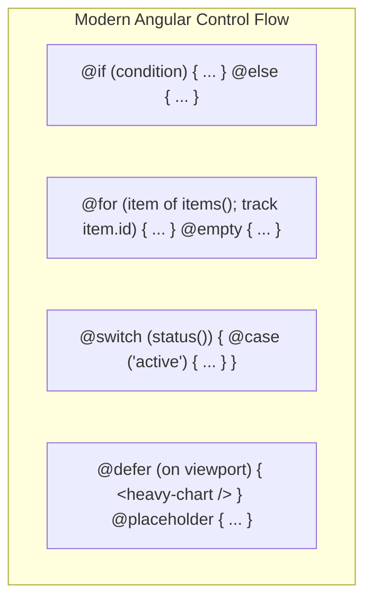

### 2.1 Standalone Components Deep Dive

#### Components

Component is the main building block of an Angular Application. It is a TypeScript class that interacts with the HTML template and provides the data and logic to the view.

##### Three main building blocks

There are three main building blocks of an Angular component:

- Template
- Class
- Metadata

**Template** - Defines the layout and content of the View.

**Class** - Class provides the data & logic to the View.

**MetaData** - Metadata Provides additional information about the component to the Angular.

##### Component metadata properties

There are several properties that can be defined in the component metadata:

- Selector
- Providers
- Styles
- StyleUrls
- Template
- TemplateUrl

**Selector** - Defines the element name or CSS selector that identifies the component in the HTML template.

```typescript
selector: "app-root";
```

**Providers** - Defines the providers of the component's dependencies.

```typescript
providers: [MyService];
```

**styles** - Defines the inline styles for the component.

```typescript
styles: ["h1 { color: red; }"];
```

**styleUrls** - Defines an array of URLs of the stylesheets for the component.

```typescript
styleUrls: ["./app.component.css"];
```

**template** - Defines the HTML template for the component.

```typescript
template: "<h1>My Component</h1>";
```

**templateUrl** - Defines the URL of the HTML template for the component.

```typescript
templateUrl: "./app.component.html";
```

#### Component Creation

##### Using Angular CLI

```bash
ng generate component [component-name]

**or**

ng g c [component-name]
```

##### Manual Creation

**Step 1** - Create a new folder for the component inside the `src/app` folder.

```bash
src/app/[component-name]
```

**Step 2** - Create a new TypeScript file for the component inside the new folder.

```bash
src/app/[component-name]/[component-name].component.ts
```

**Step 3** - Create a new HTML file for the component inside the new folder.

```bash
src/app/[component-name]/[component-name].component.html
```

**Step 4** - Create a new CSS file for the component inside the new folder.

```bash
src/app/[component-name]/[component-name].component.css
```

**Step 5** - Import the Component class from the `@angular/core` module.

```typescript
import { Component } from "@angular/core";
```

**Step 6** - Decorate the class with the `@Component` decorator.

```typescript
@Component({
  selector: 'app-[component-name]',
  standalone: true,
  templateUrl: './[component-name].component.html',
  styleUrls: ['./[component-name].component.css']
})
```

If you want to create a non-standalone component, set the `standalone` property to `false`. The standalone component is enabled by default in Angular v17 and v18.
In Angular v19 and later, the standalone component is enabled by default and the `standalone` property is not required. You can disable the standalone component by setting the `standalone` property to `false`.

**Step 7** - Define the selector, template, and styles for the component.

- selector - The selector for the component.
- templateUrl - The URL of the HTML template for the component.
- styleUrls - An array of URLs of the stylesheets for the component.

**Step 8** - Export the class.

```typescript
export class [ComponentName]Component {
  // Component logic here
}
```

**Step 9** - Import the component class in the `app.module.ts` file.

```typescript
import { [ComponentName]Component } from './[component-name]/[component-name].component';
```

**Step 10** - Add the component to the `declarations` array in the `@NgModule` decorator.

```typescript
declarations: [
  AppComponent,
  [ComponentName]Component
]
```

If you created a standalone component, `app.module.ts` file is not required. You can import the component in the `app.component.ts` file.
as shown below.

```typescript
import { [ComponentName]Component } from './[component-name]/[component-name].component';

@Component({
  selector: 'app-root',
  standalone: true,
  imports: [[ComponentName]Component],
  templateUrl: './app.component.html',
  styleUrl: './app.component.scss'
})

export class AppComponent {
  title = 'app';
}
```

**Step 11** - Use the component selector in the HTML template.

```typescript
<app-[component-name]></app-[component-name]>
```

**Step 12** - Run the application using the `ng serve` command.

```bash
ng serve

**or**

ng serve --open
```

##### Example

**Creating the component files (Version 16 and earlier)** -

```bash
//test-component.component.ts
import { Component } from '@angular/core';

@Component({
  selector: 'test-component',
  templateUrl: './component.component.html',
  styleUrls: ['./component.component.css']
})

export class TestComponent {
  // Component logic here
}
```

```html
<!--test.component.html-->
<h1>Test Component</h1>
```

```css
/*test.component.css*/
h1 {
  color: red;
}
```

**Importing the component in the app.module.ts file** -

```typescript
//app.module.ts
import { BrowserModule } from "@angular/platform-browser";
import { NgModule } from "@angular/core";

import { AppComponent } from "./app.component";
import { TestComponent } from "./test-component.component";

@NgModule({
  declarations: [AppComponent, TestComponent],
  imports: [BrowserModule],
  providers: [],
  bootstrap: [AppComponent],
})
export class AppModule {}
```

**Importing the component in the app.component.ts file** -

```typescript
//app.component.ts
import { Component } from "@angular/core";
import { RouterOutlet } from "@angular/router";
import { TestComponent } from "./test-component.component";

@Component({
  selector: "app-root",
  templateUrl: "./app.component.html",
  styleUrl: "./app.component.scss",
})
export class AppComponent {
  title = "app";
}
```

```html
<!--app.component.html-->
<app-test-component></app-test-component>
```

In Version 16 and earlier of Angular, there is no standalone component. You need to import the component in the `app.module.ts` file. If you created a non-standalone component, you will see no standalone property in the `@Component` decorator.

**Creating the component files (Version 17 and 18)** -

```bash
//test-component.component.ts
import { Component } from '@angular/core';

@Component({
  selector: 'app-test-component',
  standalone: true,
  templateUrl: './test-component.component.html',
  styleUrls: ['./test-component.component.css']
})

export class TestComponent {
  // Component logic here
}
```

```html
<!--test.component.html-->
<h1>Test Component</h1>
```

```css
/*test.component.css*/
h1 {
  color: red;
}
```

**Importing the component in the app.component.ts file** -

```typescript
//app.component.ts
import { Component } from "@angular/core";
import { TestComponent } from "./test-component.component";

@Component({
  selector: "app-root",
  imports: [TestComponent],
  templateUrl: "./app.component.html",
  styleUrl: "./app.component.scss",
})
export class AppComponent {
  title = "app";
}
```

In version 17 and 18 of Angular, the standalone component is enabled by default with the `standalone` property set to `true` in the `@Component` decorator. You can disable the standalone component by setting the `standalone` property to `false` or not adding the standalone property in the `@Component` decorator.

**Creating the component files (Version 19 and later)** -

```bash
//test-component.component.ts
import { Component } from '@angular/core';

@Component({
  selector: 'app-test-component',
  templateUrl: './test-component.component.html',
  styleUrls: ['./test-component.component.css']
})

export class TestComponent {
  // Component logic here
}
```

```html
<!--test.component.html-->
<h1>Test Component</h1>
```

```css
/*test.component.css*/
h1 {
  color: red;
}
```

**Importing the component in the app.component.ts file** -

```typescript
//app.component.ts
import { Component } from "@angular/core";
import { TestComponent } from "./test-component.component";

@Component({
  selector: "app-root",
  imports: [TestComponent],
  templateUrl: "./app.component.html",
  styleUrl: "./app.component.scss",
})
export class AppComponent {
  title = "app";
}
```

```html
<!--app.component.html-->
<app-test-component></app-test-component>
```

In version 19 and later of Angular, the standalone component is enabled by default. You can disable the standalone component by setting the `standalone` property to `false` in the `@Component` decorator.

Inside app folder, `app.config.ts` file is created by default in version 17 and later of Angular. And `app.routes.ts` file is created by default in version 17 and later of Angular.

```typescript
// app.config.ts
import { ApplicationConfig, provideZoneChangeDetection } from "@angular/core";
import { provideRouter } from "@angular/router";

import { routes } from "./app.routes";

export const appConfig: ApplicationConfig = {
  providers: [
    provideZoneChangeDetection({ eventCoalescing: true }),
    provideRouter(routes),
  ],
};
```

```typescript
// app.routes.ts
import { Routes } from "@angular/router";

export const routes: Routes = [];
```

You can import the component in the `app.component.ts` file and use the component selector in the HTML template.

**Creating the inline Template & StyleUrls** -

```typescript
import { Component } from "@angular/core";

@Component({
  selector: "app-root",
  template: "<h1> {{title}} works </h1>",
  styles: ["h1 { font-weight: bold; }"],
})
export class AppComponent {
  title = "app";
}
```

[Back to top⤴️](#table-of-contents)

#### Scope

In Angular, the scope of a variable determines where it can be accessed:

- **Global Scope**: Accessible anywhere in the application.
- **Local Scope**: Accessible only within a specific function or block.
- **Component Scope**: Accessible within a component and its child components.

##### Global Scope

Accessible from anywhere in the application; defined outside any function or block.

Example :

```typescript
// Global Scope
let globalVariable = "Global Variable";

function testFunction() {
  console.log(globalVariable); // Output: Global Variable
}

testFunction();
```

Example in Angular :

```typescript
import { Component } from "@angular/core";

// Global Scope
let globalVariable = "Global Variable";

@Component({
  selector: "app-root",
  templateUrl: "./app.component.html",
  styleUrls: ["./app.component.css"],
})
export class AppComponent {
  title = globalVariable;
}
```

```html
<!--app.component.html-->
<h1>{{ title }}</h1>
```

##### Local Scope

Accessible only within the function or block where defined.

Example :

```typescript
function testFunction() {
  // Local Scope
  let localVariable = "Local Variable";
  console.log(localVariable); // Output: Local Variable
}

testFunction();
console.log(localVariable); // Error: localVariable is not defined
```

Example in Angular :

```typescript
import { Component } from "@angular/core";

@Component({
  selector: "app-root",
  templateUrl: "./app.component.html",
  styleUrls: ["./app.component.css"],
})
export class AppComponent {
  testFunction() {
    // Local Scope
    let localVariable = "Local Variable";
    console.log(localVariable); // Output: Local Variable
  }
}
```

```html
<!--app.component.html-->
<button (click)="testFunction()">Test Function</button>
```

##### Component Scope

Accessible within the component and its children.

Example :

```typescript
import { Component } from "@angular/core";

@Component({
  selector: "app-root",
  templateUrl: "./app.component.html",
  styleUrls: ["./app.component.css"],
})
export class AppComponent {
  // Component Scope
  title = "app";
}
```

```html
<!--app.component.html-->
<h1>{{ title }}</h1>
```

[Back to top⤴️](#table-of-contents)

#### View Encapsulation

Controls how styles are applied to components. By default, Angular uses Emulated View Encapsulation, scoping styles to the component.

##### Emulated View Encapsulation

Default mode in Angular, emulating shadow DOM to scope styles to the component.

```typescript
import { Component, ViewEncapsulation } from "@angular/core";

@Component({
  selector: "app-root",
  templateUrl: "./app.component.html",
  styleUrls: ["./app.component.css"],
  encapsulation: ViewEncapsulation.Emulated,
})
export class AppComponent {
  title = "app";
}
```

[Stackblitz Example](https://stackblitz.com/edit/stackblitz-starters-xfz4uk?file=src%2Fmain.ts)

##### Shadow DOM View Encapsulation

Uses native shadow DOM to encapsulate styles within the component, preventing them from affecting other components.

```typescript
import { Component, ViewEncapsulation } from "@angular/core";

@Component({
  selector: "app-root",
  templateUrl: "./app.component.html",
  styleUrls: ["./app.component.css"],
  encapsulation: ViewEncapsulation.ShadowDom,
})
export class AppComponent {
  title = "app";
}
```

[Stackblitz Example](https://stackblitz.com/edit/stackblitz-starters-cc1rfn?file=src%2Fmain.ts)

##### None View Encapsulation

Disables encapsulation; styles can affect other components.

```typescript
import { Component, ViewEncapsulation } from "@angular/core";

@Component({
  selector: "app-root",
  templateUrl: "./app.component.html",
  styleUrls: ["./app.component.css"],
  encapsulation: ViewEncapsulation.None,
})
export class AppComponent {
  title = "app";
}
```

[Stackblitz Example](https://stackblitz.com/edit/stackblitz-starters-gzsxag?file=src%2Fmain.ts)

[Back to top⤴️](#table-of-contents)

#### Component Communication

Passing data between Angular components using Input/Output decorators, EventEmitter, and services.

##### Inputs

The `@Input()` decorator allows a parent component to pass data to a child component.

Example:

```typescript
import { Component, Input } from "@angular/core";

@Component({
  selector: "app-child",
  template: `<p>{{ message }} (Age: {{ age }})</p>`
})
export class ChildComponent {
  @Input() message: string = "";
  @Input({ required: true }) age!: number; // Required input (Angular v16+)
}
```

```html
<!-- parent.component.html -->
<app-child [message]="parentMessage" [age]="30"></app-child>
```

[Stackblitz Example](https://stackblitz.com/edit/stackblitz-starters-qqjcgn?file=src%2Fmain.ts)

[Back to top⤴️](#table-of-contents)

##### Outputs

The `@Output()` decorator allows a child component to emit custom events to send data back to a parent component. It relies on the `EventEmitter` class.

Example:

```typescript
import { Component, Output, EventEmitter } from "@angular/core";

@Component({
  selector: "app-child",
  templateUrl: "./child.component.html",
  styleUrls: ["./child.component.css"],
})
export class ChildComponent {
  @Output() messageEvent = new EventEmitter<string>();

  sendMessage() {
    this.messageEvent.emit("Hello from child component");
  }
}
```

```html
<!--child.component.html-->
<button (click)="sendMessage()">Send Message</button>
```

```typescript
import { Component } from "@angular/core";

@Component({
  selector: "app-parent",
  templateUrl: "./parent.component.html",
  styleUrls: ["./parent.component.css"],
})
export class ParentComponent {
  message: string;

  receiveMessage($event) {
    this.message = $event;
  }
}
```

```html
<!--parent.component.html-->
<app-child (messageEvent)="receiveMessage($event)"></app-child>
<p>{{ message }}</p>
```

[Stackblitz Example](https://stackblitz.com/edit/stackblitz-starters-4qgrhm?file=src%2Fmain.ts)

[Back to top⤴️](#table-of-contents)

##### Model Inputs

Introduced in Angular v17.2, **Model Inputs** (using the `model()` API) define a special kind of input that supports **two-way data binding**. Unlike normal inputs, model inputs return a writable signal, allowing the child component to write new values that propagate back to the parent.

Example:

```typescript
import { Component, model } from '@angular/core';

@Component({
  selector: 'custom-toggle',
  template: `<button (click)="toggle()">State: {{ checked() }}</button>`
})
export class CustomToggleComponent {
  // checked is a ModelSignal<boolean>
  checked = model(false);

  toggle() {
    this.checked.update(val => !val);
  }
}
```

Parent binding:
```html
<!-- Parent binds state two-way using the bananas-in-a-box syntax -->
<custom-toggle [(checked)]="isAdmin"></custom-toggle>
```

[Back to top⤴️](#table-of-contents)

##### Signal Inputs

Introduced in Angular v17.1, **Signal Inputs** are a modern, reactive alternative to the `@Input()` decorator. Instead of using class properties, inputs are declared using the `input()` function, which returns a read-only signal.

Benefits of Signal Inputs:
- **Reactive integration**: Easily derive values using `computed()` or trigger side-effects using `effect()`.
- **Better Type Safety**: Automatic type inference.
- **Required Inputs**: Declared cleanly via `input.required()`.

Example:

```typescript
import { Component, input, computed } from '@angular/core';

@Component({
  selector: 'app-user',
  template: `<p>User: {{ uppercaseName() }} ({{ age() }} years old)</p>`
})
export class UserComponent {
  name = input.required<string>(); // Required signal input
  age = input(0); // Optional signal input with default value

  // Compute a derived value automatically when 'name' changes
  uppercaseName = computed(() => this.name().toUpperCase());
}
```

[Back to top⤴️](#table-of-contents)

##### Signal Outputs

Introduced in Angular v17.3, **Signal Outputs** (using the `output()` API) are a modern functional replacement for the `@Output()` decorator. They return an `OutputEmitterRef` instead of an `EventEmitter` and offer simpler structure and cleaner API alignment with Signals.

Example:

```typescript
import { Component, output } from '@angular/core';

@Component({
  selector: 'app-child-btn',
  template: `<button (click)="handleClick()">Click Me</button>`
})
export class ChildBtnComponent {
  // Declares a custom signal output
  btnClick = output<void>();

  handleClick() {
    this.btnClick.emit();
  }
}
```

`output()` returns an `OutputEmitterRef`, whose `subscribe()` returns an `OutputRefSubscription` with an `unsubscribe()` method. Angular removes listeners automatically when the component that owns the output is destroyed. If the listener can be destroyed first (for example a routed page listening to a panel owned by a service), call `unsubscribe()` from the listener's `DestroyRef.onDestroy()`, or use `outputToObservable(ref).pipe(takeUntilDestroyed())`. See [section 30.6](#306-output-subscriptions-and-cleanup).

[Back to top⤴️](#table-of-contents)

#### Siblings to Siblings Communication

**Using Services** - Services are a way to share data and functionality between components in Angular. You can create a service that holds the data and methods that need to be shared between components.

Example 1 :

```typescript
import { Injectable } from "@angular/core";

@Injectable({
  providedIn: "root",
})
export class DataService {
  message: string;

  setMessage(message: string) {
    this.message = message;
  }

  getMessage() {
    return this.message;
  }
}
```

```typescript
import { Component } from "@angular/core";
import { DataService } from "./data.service";

@Component({
  selector: "app-sibling1",
  templateUrl: "./sibling1.component.html",
  styleUrls: ["./sibling1.component.css"],
})
export class Sibling1Component {
  message: string;

  constructor(private dataService: DataService) {}

  sendMessage() {
    this.dataService.setMessage("Hello from sibling1 component");
  }
}
```

```html
<!--sibling1.component.html-->
<button (click)="sendMessage()">Send Message</button>
```

```typescript
import { Component } from "@angular/core";
import { DataService } from "./data.service";

@Component({
  selector: "app-sibling2",
  templateUrl: "./sibling2.component.html",
  styleUrls: ["./sibling2.component.css"],
})
export class Sibling2Component {
  message: string;

  constructor(private dataService: DataService) {}

  receiveMessage() {
    this.message = this.dataService.getMessage();
  }
}
```

```html
<!--sibling2.component.html-->
<p>{{ message }}</p>
<button (click)="receiveMessage()">Receive Message</button>
```

[Stackblitz Example](https://stackblitz.com/edit/stackblitz-starters-uvqypy?file=src%2Fmain.ts)

Example 2 :

**Using RxJS Subjects** - RxJS Subjects are a way to share data and events between components in Angular. You can create a Subject that emits events and subscribe to those events in the components.

```typescript
import { Injectable } from "@angular/core";
import { Subject } from "rxjs";

@Injectable({
  providedIn: "root",
})
export class DataService {
  message = new Subject<string>();

  setMessage(message: string) {
    this.message.next(message);
  }
}
```

```typescript
import { Component } from "@angular/core";
import { DataService } from "./data.service";

@Component({
  selector: "app-sibling1",
  templateUrl: "./sibling1.component.html",
  styleUrls: ["./sibling1.component.css"],
})
export class Sibling1Component {
  message: string;

  constructor(private dataService: DataService) {}

  sendMessage() {
    this.dataService.setMessage("Hello from sibling1 component");
  }
}
```

```html
<!--sibling1.component.html-->
<button (click)="sendMessage()">Send Message</button>
```

```typescript
import { Component } from "@angular/core";
import { DataService } from "./data.service";

@Component({
  selector: "app-sibling2",
  templateUrl: "./sibling2.component.html",
  styleUrls: ["./sibling2.component.css"],
})
export class Sibling2Component {
  message: string;

  constructor(private dataService: DataService) {}

  ngOnInit() {
    this.dataService.message.subscribe((message) => {
      this.message = message;
    });
  }
}
```

```html
<!--sibling2.component.html-->
<p>{{ message }}</p>
```

Example 3 :

**Using ViewChild and ViewChildren** - ViewChild and ViewChildren are a way to access child components in Angular. You can use ViewChild to access a single child component and ViewChildren to access multiple child components.

```typescript
import { Component, ViewChild } from "@angular/core";
import { Sibling2Component } from "./sibling2.component";

@Component({
  selector: "app-sibling1",
  templateUrl: "./sibling1.component.html",
  styleUrls: ["./sibling1.component.css"],
})
export class Sibling1Component {
  @ViewChild(Sibling2Component) sibling2: Sibling2Component;

  sendMessage() {
    this.sibling2.message = "Hello from sibling1 component";
  }
}
```

```html
<!--sibling1.component.html-->
<button (click)="sendMessage()">Send Message</button>
<app-sibling2></app-sibling2>
```

```typescript
import { Component } from "@angular/core";

@Component({
  selector: "app-sibling2",
  templateUrl: "./sibling2.component.html",
  styleUrls: ["./sibling2.component.css"],
})
export class Sibling2Component {
  message: string;
}
```

```html
<!--sibling2.component.html-->
<p>{{ message }}</p>
```

[Stackblitz Example](https://stackblitz.com/edit/stackblitz-starters-nezkvf?file=src%2Fmain.ts)

[Back to top⤴️](#table-of-contents)

#### Host Elements

In Angular, the element that encloses a component's template is called the **Host Element**. For example, if you define a component with the selector `app-user`, then the `<app-user>` tag in the parent template is the host element.

Angular allows components to style, configure, and interact with their host elements:

- **Styling**: You can style the host element from within the component's CSS using the `:host` pseudo-class selector.
- **Attributes and Properties**: You can bind values to properties or attributes of the host element (e.g., setting a `class`, `id`, `tabindex`, or custom attributes).
- **Events**: You can listen and respond to DOM events triggered on the host element.

[Back to top⤴️](#table-of-contents)

#### Host Bindings

**Host Bindings** allow you to associate properties (like classes, styles, attributes, or properties) of the host element with properties in your component class. When a component property changes, Angular automatically updates the host element.

In modern Angular (v17+), the recommended approach is to define host bindings using the **`host` metadata property** in the `@Component` decorator. The older `@HostBinding()` decorator is still supported but generally discouraged for new code.

##### 1. Using the `host` Metadata Property (Recommended)

You can specify bindings inside a `host` configuration object within the `@Component` decorator:

```typescript
import { Component } from "@angular/core";

@Component({
  selector: "app-card",
  template: `<p>Card Content</p>`,
  host: {
    role: "region", // Binding static attribute
    "[class.active]": "isActive", // Binding dynamic CSS class
    "[style.color]": "textColor", // Binding dynamic style
  },
})
export class CardComponent {
  isActive = true;
  textColor = "blue";
}
```

##### 2. Using the `@HostBinding` Decorator (Legacy)

Alternatively, you can decorate individual properties inside the component class:

```typescript
import { Component, HostBinding } from "@angular/core";

@Component({
  selector: "app-legacy-card",
  template: `<p>Legacy Card Content</p>`,
})
export class LegacyCardComponent {
  @HostBinding("attr.role") role = "region";
  @HostBinding("class.active") isActive = true;
  @HostBinding("style.color") textColor = "blue";
}
```

#### Host Listeners

**Host Listeners** allow a component to listen to and handle DOM events triggered directly on its host element (or globally on the `window` or `document`).

In modern Angular (v17+), the recommended approach is to define host listeners using the **`host` metadata property** in the `@Component` decorator. The older `@HostListener()` decorator is still supported but generally discouraged for new code.

##### 1. Using the `host` Metadata Property (Recommended)

You can define event listeners inside the `host` configuration object within the `@Component` decorator:

```typescript
import { Component } from "@angular/core";

@Component({
  selector: "app-click-tracker",
  template: `<p>Click the host element!</p>`,
  host: {
    "(click)": "onHostClick($event)", // Listen to host click event
    "(window:resize)": "onWindowResize($event)", // Listen to global window resize event
  },
})
export class ClickTrackerComponent {
  onHostClick(event: MouseEvent) {
    console.log("Host element clicked:", event);
  }

  onWindowResize(event: Event) {
    console.log("Window resized:", event);
  }
}
```

##### 2. Using the `@HostListener` Decorator (Legacy)

Alternatively, you can decorate individual class methods inside the component class:

```typescript
import { Component, HostListener } from "@angular/core";

@Component({
  selector: "app-legacy-click-tracker",
  template: `<p>Legacy Click the host element!</p>`,
})
export class LegacyClickTrackerComponent {
  @HostListener("click", ["$event"])
  onHostClick(event: MouseEvent) {
    console.log("Host element clicked:", event);
  }

  @HostListener("window:resize", ["$event"])
  onWindowResize(event: Event) {
    console.log("Window resized:", event);
  }
}
```

[Back to top⤴️](#table-of-contents)

#### Content vs View DOM

Angular components manage two separate DOM trees:

- **View DOM**: The internal DOM nodes defined inside the component's own HTML template.
- **Content DOM**: The external DOM nodes projected into the component from a parent component using content projection (`<ng-content>`).

##### Querying the DOM
Angular provides decorators and signal queries to access these elements:
- **`viewChild` / `@ViewChild`**: Queries an element or child component from the **View DOM**.
- **`contentChild` / `@ContentChild`**: Queries an element or child component projected into the **Content DOM**.

Example:

```typescript
import { Component, ComponentRef, ContentChild, ElementRef, ViewChild } from '@angular/core';

@Component({
  selector: 'app-card',
  template: `
    <div class="card-header">
      <!-- View DOM element -->
      <h2 #title>Internal Header</h2>
    </div>
    <div class="card-content">
      <!-- Location where Content DOM is projected -->
      <ng-content></ng-content>
    </div>
  `
})
export class CardComponent {
  // Querying View DOM
  @ViewChild('title') titleElement!: ElementRef<HTMLHeadingElement>;

  // Querying Content DOM (projected from parent)
  @ContentChild('projectedBtn') projectedButton!: ElementRef<HTMLButtonElement>;
}
```

[Back to top⤴️](#table-of-contents)

#### Component Inheritance

Angular components support standard TypeScript class inheritance. This is useful for sharing common logic, properties, and methods across multiple components.

What is inherited:
- **State & Logic**: Non-private fields and methods from the base class.
- **Lifecycle Hooks**: If the subclass does not implement a hook (e.g., `ngOnInit`), the base class's hook runs automatically. If the subclass implements it, it must call `super.ngOnInit()` to execute base logic.

What is **NOT** inherited:
- **Metadata Decorators**: The `@Component` decorator metadata (selector, template, styles, providers) is **not** inherited. The child class must specify its own `@Component` decorator.

Example:

```typescript
// Base class sharing logic
export class BaseButton {
  label = 'Click';
  clickCount = 0;

  handleClick() {
    this.clickCount++;
  }
}

// Subclass inheriting base class
import { Component } from '@angular/core';

@Component({
  selector: 'app-submit-btn',
  template: `<button (click)="handleClick()">{{ label }} ({{ clickCount }})</button>`
})
export class SubmitButtonComponent extends BaseButton {
  // Overrides label
  override label = 'Submit';
}
```

[Back to top⤴️](#table-of-contents)

#### Component Composition

Angular v15 introduced the **Directive Composition API** (`hostDirectives`), allowing developers to compose components by applying directives to their host elements directly inside the component metadata. This provides a cleaner alternative to inheritance.

Benefits of Composition over Inheritance:
- **Multi-directive support**: A component can compose multiple directives, avoiding single-inheritance limitations.
- **Encapsulation**: Expose only specific inputs/outputs of the composed directives.

Example:

```typescript
import { Component } from '@angular/core';
import { HighlightDirective } from './highlight.directive';
import { TooltipDirective } from './tooltip.directive';

@Component({
  selector: 'app-composition-card',
  template: `<p>Hover over this card to see borders and tooltip!</p>`,
  // Compose behaviors dynamically
  hostDirectives: [
    HighlightDirective,
    {
      directive: TooltipDirective,
      inputs: ['tooltipText: text'], // Map/alias directive inputs
      outputs: ['tooltipShow']
    }
  ]
})
export class CompositionCardComponent {}
```

For patterns beyond `hostDirectives` (compound components coordinated through an injection token, typed slot templates and headless components), see [section 30.9](#309-advanced-composition-patterns).

[Back to top⤴️](#table-of-contents)

#### Standalone Components

A standalone component is a type of component which is not part of any Angular module. It provides a simplified way to build Angular applications by reducing the need for NgModules. Standalone components are self-contained and declare their own dependencies.

##### Creating a Standalone Component

```typescript
import { Component } from "@angular/core";
import { CommonModule } from "@angular/common";

@Component({
  selector: "app-standalone",
  standalone: true, // Mark as standalone
  imports: [CommonModule], // Import required dependencies
  template: `
    <h1>Standalone Component</h1>
    <p>This is a self-contained component</p>
  `,
})
export class StandaloneComponent {
  // Component logic here
}
```

##### Key Features of Standalone Components

- **Self-contained**: Declares its own dependencies through the imports array
- **No NgModule required**: Can be used without declaring in a module
- **Easier testing**: Simpler to test due to explicit dependencies
- **Better tree-shaking**: Enables more efficient bundle optimization
- **Simplified lazy-loading**: Can be lazy-loaded directly without module

##### Using Standalone Components

```typescript
// Importing in another standalone component
@Component({
  selector: "app-parent",
  standalone: true,
  imports: [StandaloneComponent],
  template: ` <app-standalone></app-standalone> `,
})
export class ParentComponent {}

// Bootstrapping a standalone component
import { bootstrapApplication } from "@angular/platform-browser";

bootstrapApplication(AppComponent, {
  providers: [
    // Root providers here
  ],
});
```

##### Converting to Standalone

To convert an existing component to standalone:

1. Add `standalone: true` to the component decorator
2. Move dependencies from NgModule imports to component imports
3. Remove component declaration from NgModule
4. Import required dependencies directly in the component

[Back to top⤴️](#table-of-contents)

#### Component Lifecycle

Angular manages the lifecycle of components and directives from creation to destruction, offering hooks to run code at specific lifecycle events.

##### Lifecycle Hooks

Here is the list of lifecycle hooks in order of execution:

| Hook | Phase | Description | Trigger |
| :--- | :--- | :--- | :--- |
| **`ngOnChanges`** | Initialization / Update | Called before `ngOnInit` and whenever data-bound input properties change. | On input changes. |
| **`ngOnInit`** | Initialization | Called once after the first `ngOnChanges` to initialize component data. | Component setup. |
| **`ngDoCheck`** | Change Detection | Called immediately after `ngOnChanges` and `ngOnInit` to detect changes manually. | On every change detection run. |
| **`ngAfterContentInit`** | Content Projection | Called once after Angular projects external content (`<ng-content>`) into the component. | Setup of projected content. |
| **`ngAfterContentChecked`**| Content Projection | Called after `ngAfterContentInit` and every subsequent `ngDoCheck` run. | Verification of projected content. |
| **`ngAfterViewInit`** | View Setup | Called once after Angular initializes the component's views and child views. | Setup of component views. |
| **`ngAfterViewChecked`** | View Setup | Called after `ngAfterViewInit` and every subsequent `ngAfterContentChecked` run. | Verification of component views. |
| **`ngOnDestroy`** | Destruction | Called once immediately before Angular destroys the component. | Cleanup (unsubscribing, timers). |

[Back to top⤴️](#table-of-contents)

##### OnChanges

It is called when the data-bound properties of a directive/component are changed. It is called before ngOnInit and whenever one or more data-bound input properties change.

```html
<form>
  <input [(ngModel)]="message" name="message" />
  <button type="submit" (click)="onSubmit()">Submit</button>
</form>
<p>{{ message }}</p>
```

```ts
import {
  Component,
  Input,
  OnChanges,
  OnInit,
  SimpleChanges,
} from "@angular/core";

@Component({
  selector: "app-test",
  templateUrl: "./test.component.html",
  styleUrls: ["./test.component.css"],
})
export class TestComponent implements OnChanges {
  @Input() message: string;
  prevMessage: string;

  ngOnChanges(changes: SimpleChanges) {
    if (changes.message) {
      console.log(
        `message changed from ${changes.message.previousValue} to ${changes.message.currentValue}`,
      );
    }
  }

  onSubmit() {
    this.prevMessage = this.message;
  }
}
```

```html
<app-test [message]="'Hello World'"></app-test>
```

[Stackblitz Link](https://stackblitz.com/edit/angular-ivy-19r5mc?file=src/app/test/test.component.ts)

##### OnInit

It is called after Angular has initialized all data-bound properties of a directive/component. It is called only once after the first ngOnChanges.

```ts
import { Component } from "@angular/core";

@Component({
  selector: "my-app",
  templateUrl: "./app.component.html",
  styleUrls: ["./app.component.css"],
})
export class AppComponent {
  constructor() {}

  ngOnInit() {
    console.log("logged from ngOnInit");
  }
}
```

[Stackblits Link](https://stackblitz.com/edit/angular-ivy-hkmssz?file=src/app/app.component.html)

##### DoCheck

It is called during every change detection run, and it is used to detect and act upon changes that Angular doesn't catch on its own.

```ts
import { Component, DoCheck } from "@angular/core";

@Component({
  selector: "my-app",
  templateUrl: "./app.component.html",
  styleUrls: ["./app.component.css"],
})
export class AppComponent implements DoCheck {
  ngDoCheck() {
    console.log("ngDoCheck Called");
  }
}
```

[Stackblitz Link](https://stackblitz.com/edit/angular-ivy-f5msas?file=src/app/app.component.ts)

##### AfterViewInit

It is called after Angular has fully initialized a component's view. It is the perfect place to put any initialization logic that depends on the view.

```ts
import { AfterViewInit, Component } from "@angular/core";

@Component({
  selector: "my-app",
  templateUrl: "./app.component.html",
  styleUrls: ["./app.component.css"],
})
export class AppComponent implements AfterViewInit {
  ngAfterViewInit() {
    console.log("after view init");
  }
  clickMe() {
    console.log("link clicked");
  }
}
```

```html
<a (click)="clickMe()">Click me</a>
```

[Stackblitz Link](https://stackblitz.com/edit/angular-wscf59?file=src/main.ts)

##### AfterViewChecked

It is called after Angular has checked the component's view and child views. It is called after ngAfterViewInit and every subsequent ngAfterContentChecked.

```ts
import { AfterViewChecked, Component } from "@angular/core";

@Component({
  selector: "my-app",
  templateUrl: "./app.component.html",
  styleUrls: ["./app.component.css"],
})
export class AppComponent implements AfterViewChecked {
  ngAfterViewChecked() {
    console.log("after view checked");
  }
  clickMe() {
    console.log("link clicked");
  }
}
```

```html
<a (click)="clickMe()">Click me</a>
```

[Stackblitz Link](https://stackblitz.com/edit/angular-wnwfnv?file=src/main.ts)

##### AfterContentInit

It is called after Angular has fully initialized the content of a directive. It is the perfect place to put any initialization logic that depends on the content.

```ts
import { AfterContentInit, Component } from "@angular/core";

@Component({
  selector: "my-app",
  templateUrl: "./app.component.html",
  styleUrls: ["./app.component.css"],
})
export class AppComponent implements AfterContentInit {
  ngAfterContentInit() {
    console.log("after content init");
  }
  clickMe() {
    console.log("clicked");
  }
}
```

```html
<a (click)="clickMe()">Click me</a>
```

[Stackblitz Link](https://stackblitz.com/edit/angular-qhy7cw?file=src/main.ts)

##### AfterContentChecked

It is called after the default change detector has completed checking all content of a directive. It is called after ngAfterContentInit and every subsequent ngAfterContentChecked.

```ts
import { AfterContentInit, Component } from "@angular/core";

@Component({
  selector: "my-app",
  templateUrl: "./app.component.html",
  styleUrls: ["./app.component.css"],
})
export class AppComponent implements AfterContentInit {
  ngAfterContentChecked() {
    console.log("after content init");
  }
  clickMe() {
    console.log("clicked");
  }
}
```

```html
<a (click)="clickMe()">Click me</a>
```

[Stackblitz Link](https://stackblitz.com/edit/angular-ryx2uh?file=src/main.ts)

##### OnDestroy

It is called just before Angular destroys the directive/component. It is used to cleanup any resources or subscriptions that the directive/component has created.

```ts
import { Component, OnDestroy, OnInit } from "@angular/core";
import { Subscription } from "rxjs";
import { of } from "rxjs";

@Component({
  selector: "my-app",
  templateUrl: "./app.component.html",
  styleUrls: ["./app.component.css"],
})
export class AppComponent implements OnInit, OnDestroy {
  private subscription: Subscription;

  ngOnInit() {
    const someObservable = of(1, 2, 3);
    this.subscription = someObservable.subscribe((data) => {
      console.log(data);
    });
  }

  ngOnDestroy() {
    this.subscription.unsubscribe();
  }
}
```

[Stackblitz Link](https://stackblitz.com/edit/angular-ivy-urqida?file=src/app/app.module.ts)

[Back to top⤴️](#table-of-contents)

#### Advanced Topics

##### Dynamic Component Loading

Load and create components programmatically at runtime.

###### Using ComponentFactory (Deprecated)

> [!WARNING]
> `ComponentFactoryResolver` is no longer exported from `@angular/core` in v22, so the example below does not compile on current versions. It is kept for reading older code. Pass the component class straight to `ViewContainerRef.createComponent()` (next example), and see [section 30.4](#304-dynamic-components-with-the-modern-apis) for creation-time `bindings` (`inputBinding`, `outputBinding`, `twoWayBinding`).

```typescript
import {
  ComponentFactoryResolver,
  ViewContainerRef,
  ComponentRef,
} from "@angular/core";

@Component({
  selector: "app-dynamic-host",
  template: "<ng-template #dynamicHost></ng-template>",
})
export class DynamicHostComponent {
  @ViewChild("dynamicHost", { read: ViewContainerRef })
  dynamicHost: ViewContainerRef;

  constructor(private componentFactoryResolver: ComponentFactoryResolver) {}

  loadComponent(componentType: any) {
    const componentFactory =
      this.componentFactoryResolver.resolveComponentFactory(componentType);

    this.dynamicHost.clear();
    const componentRef = this.dynamicHost.createComponent(componentFactory);

    // Set component inputs
    componentRef.instance.data = "Dynamic data";
  }
}
```

###### Using ViewContainerRef.createComponent (Angular 13+)

```typescript
import { ViewContainerRef, ComponentRef } from "@angular/core";

@Component({
  selector: "app-dynamic-host",
  template: "<ng-template #dynamicHost></ng-template>",
})
export class DynamicHostComponent {
  @ViewChild("dynamicHost", { read: ViewContainerRef })
  dynamicHost: ViewContainerRef;

  loadComponent(componentType: any) {
    this.dynamicHost.clear();
    const componentRef = this.dynamicHost.createComponent(componentType);

    // Set component inputs
    componentRef.setInput("data", "Dynamic data");

    // Subscribe to outputs
    componentRef.instance.dataChange.subscribe((value) => {
      console.log("Component output:", value);
    });
  }
}
```

In current code, prefer the signal query `viewChild.required('dynamicHost', { read: ViewContainerRef })` over `@ViewChild`, type the parameter as `Type<T>` instead of `any`, and keep the `ComponentRef` so you can call `destroy()` on it. Assigning to `componentRef.instance.data` does not work for signal inputs; use `setInput()` or `inputBinding()`.

###### Dynamic Component Service

```typescript
import { Injectable, Type, ViewContainerRef } from "@angular/core";

@Injectable({
  providedIn: "root",
})
export class DynamicComponentService {
  createComponent<T>(
    component: Type<T>,
    host: ViewContainerRef,
    inputs?: Partial<T>,
  ): ComponentRef<T> {
    host.clear();
    const componentRef = host.createComponent(component);

    if (inputs) {
      Object.keys(inputs).forEach((key) => {
        componentRef.setInput(key, inputs[key]);
      });
    }

    return componentRef;
  }
}
```

##### Angular Elements

Create custom elements that can be used in any HTML page.

###### Creating Angular Elements

```bash
ng add @angular/elements
```

```typescript
import { Component, Input, Output, EventEmitter } from "@angular/core";
import { createCustomElement } from "@angular/elements";
import { Injector } from "@angular/core";

@Component({
  selector: "app-popup",
  template: `
    <div class="popup">
      <h3>{{ title }}</h3>
      <p>{{ message }}</p>
      <button (click)="close()">Close</button>
    </div>
  `,
})
export class PopupComponent {
  @Input() title: string;
  @Input() message: string;
  @Output() closed = new EventEmitter<void>();

  close() {
    this.closed.emit();
  }
}

@NgModule({
  declarations: [PopupComponent],
  entryComponents: [PopupComponent],
})
export class AppModule {
  constructor(private injector: Injector) {
    const PopupElement = createCustomElement(PopupComponent, { injector });
    customElements.define("app-popup", PopupElement);
  }

  ngDoBootstrap() {
    // No component to bootstrap
  }
}
```

> [!NOTE]
> The example above uses `entryComponents`, which has not been needed since Ivy (v9) and is no longer part of the API. In a standalone v22 project, create the element from an application injector instead of an NgModule:

```typescript
// main.ts (standalone, no NgModule)
import { createApplication } from '@angular/platform-browser';
import { createCustomElement } from '@angular/elements';
import { PopupComponent } from './app/popup.component';

createApplication({ providers: [] }).then((app) => {
  const PopupElement = createCustomElement(PopupComponent, { injector: app.injector });
  customElements.define('app-popup', PopupElement);
});
```

Signal inputs (`input()`) become element properties the same way `@Input()` did, and `output()` events are dispatched as DOM `CustomEvent`s with the value in `event.detail`. For attribute vs property inputs, zoneless elements, single-file bundles and running several bundles on one page, see [section 29.9](#299-angular-elements-advanced). For the reverse direction, using third-party custom elements inside Angular templates with `CUSTOM_ELEMENTS_SCHEMA`, see [section 43](#43-web-platform-integration-cdk-i18n-pwa-storage-and-interop).

###### Using Angular Elements

```html
<!-- Can be used in any HTML page -->
<app-popup title="Alert" message="This is a custom element!"></app-popup>

<script>
  document.querySelector("app-popup").addEventListener("closed", () => {
    console.log("Popup closed");
  });
</script>
```

##### Angular Schematics

Create custom code generators and transformers.

The generator below copies template files. For schematics that edit existing code, `ng add` installers that register providers with `addRootProvider()`, `ng update` migrations for your own library, and testing with `SchematicTestRunner`, see the schematics parts of [section 42](#42-developer-ecosystem--tooling-masterclass-schematics-compiler-config-linting-packaging-releases).

###### Creating a Schematic

```bash
npm install -g @angular-devkit/schematics-cli
schematics blank --name=my-schematic
```

###### Schematic Definition

```typescript
// src/my-component/index.ts
import {
  Rule,
  SchematicContext,
  Tree,
  apply,
  url,
  template,
  move,
  chain,
  mergeWith,
} from "@angular-devkit/schematics";
import { strings, normalize } from "@angular-devkit/core";

interface Options {
  name: string;
  path?: string;
}

export function myComponent(options: Options): Rule {
  return (tree: Tree, context: SchematicContext) => {
    const templateSource = apply(url("./files"), [
      template({
        ...strings,
        ...options,
      }),
      move(normalize(options.path + "/" + strings.dasherize(options.name))),
    ]);

    return chain([mergeWith(templateSource)]);
  };
}
```

###### Template Files

```typescript
// src/my-component/files/__name@dasherize__.component.ts.template
import { Component } from '@angular/core';

@Component({
  selector: 'app-<%= dasherize(name) %>',
  template: `
    <h1><%= classify(name) %> Component</h1>
  `
})
export class <%= classify(name) %>Component {}
```

**Naming note:** since v20 the CLI generates `user-card.ts` with class `UserCard` (no `.component` suffix) by default. If your schematic should match what `ng generate component` produces in a v22 workspace, follow the same style, or read the workspace's `@schematics/angular:component` defaults from `angular.json`.

##### Custom Libraries

Create reusable Angular libraries.

###### Creating a Library

```bash
ng generate library my-lib
```

###### Library Structure

```tree
projects/
  my-lib/
    src/
      lib/
        my-lib.component.ts
        my-lib.service.ts
        my-lib.module.ts
      public-api.ts
    ng-package.json
    package.json
```

Libraries generated in v22 are standalone and have no NgModule file. Keep an NgModule only if you still support NgModule-based consumers.

###### Public API

```typescript
// public-api.ts
export * from "./lib/my-lib.service";
export * from "./lib/my-lib.component";
export * from "./lib/my-lib.module";
```

###### Building and Publishing

```bash
ng build my-lib --configuration production   # partial compilation for publishing
cd dist/my-lib
npm pack --dry-run                           # check the file list first
npm publish                                  # always from dist/, never from projects/my-lib
```

Bump the version in `projects/my-lib/package.json`, not in `dist/`, which is regenerated on every build. Registries, dist-tags for prereleases, and CI publishing with npm trusted publishing are covered in [section 42](#42-developer-ecosystem--tooling-masterclass-schematics-compiler-config-linting-packaging-releases).

###### Secondary Entry Points

```typescript
// projects/my-lib/testing/public-api.ts
export * from './src/test-utils';

// projects/my-lib/testing/ng-package.json
{
  "lib": {
    "entryFile": "public-api.ts"
  }
}
```

##### Micro Frontends

Split large applications into smaller, manageable pieces.

> [!NOTE]
> **Builder note:** `@angular-architects/module-federation` hooks into webpack, so it only works with the legacy webpack-based builders. Projects created with the Angular CLI since v17 use the esbuild-based `application` builder. For those, use Native Federation (`@angular-architects/native-federation`) or Module Federation 2 on Rspack. Both, plus shared-dependency and version-skew rules, are covered in the micro frontends part of [section 39](#39-enterprise-architecture-masterclass).

###### Module Federation Setup

```bash
npm install @angular-architects/module-federation
ng add @angular-architects/module-federation --project shell --type host
ng add @angular-architects/module-federation --project mfe1 --type remote
```

###### Shell Configuration

```typescript
// webpack.config.js (Shell)
const ModuleFederationPlugin = require("@module-federation/webpack");

module.exports = {
  plugins: [
    new ModuleFederationPlugin({
      remotes: {
        mfe1: "http://localhost:4201/remoteEntry.js",
      },
    }),
  ],
};
```

###### Remote Configuration

```typescript
// webpack.config.js (Remote)
const ModuleFederationPlugin = require("@module-federation/webpack");

module.exports = {
  plugins: [
    new ModuleFederationPlugin({
      name: "mfe1",
      filename: "remoteEntry.js",
      exposes: {
        "./Component": "./src/app/my-component/my-component.component.ts",
      },
    }),
  ],
};
```

###### Dynamic Import

```typescript
// Shell application
import { loadRemoteModule } from "@angular-architects/module-federation";

const routes: Routes = [
  {
    path: "mfe1",
    loadChildren: () =>
      loadRemoteModule({
        remoteEntry: "http://localhost:4201/remoteEntry.js",
        remoteName: "mfe1",
        exposedModule: "./Module",
      }).then((m) => m.RemoteModule),
  },
];
```

##### Content Projection Advanced Patterns

###### Multiple Slot Projection

```typescript
@Component({
  selector: "app-card",
  template: `
    <div class="card">
      <header class="card-header">
        <ng-content select="[slot=header]"></ng-content>
      </header>
      <div class="card-body">
        <ng-content></ng-content>
      </div>
      <footer class="card-footer">
        <ng-content select="[slot=footer]"></ng-content>
      </footer>
    </div>
  `,
})
export class CardComponent {}

// Usage
// <app-card>
//   <h2 slot="header">Card Title</h2>
//   <p>Card content goes here</p>
//   <button slot="footer">Action</button>
// </app-card>
```

###### Conditional Content Projection

> [!CAUTION]
> Wrapping `<ng-content>` in `*ngIf` (or `@if`) hides the projected content but does **not** prevent it from being created. The parent always instantiates projected components, runs their lifecycle hooks and keeps them alive. Use this pattern only for cheap content. For lazy content, have the parent pass an `<ng-template>` and render it with `ngTemplateOutlet` ([section 30.8](#308-content-projection-edge-cases)).

```typescript
@Component({
  selector: "app-conditional-wrapper",
  template: `
    <div *ngIf="showContent">
      <ng-content></ng-content>
    </div>
    <div *ngIf="!showContent" class="placeholder">
      <ng-content select="[slot=placeholder]"></ng-content>
    </div>
  `,
})
export class ConditionalWrapperComponent {
  @Input() showContent = true;
}
```

The same component with built-in control flow, a signal input and default fallback content (since v18):

```typescript
@Component({
  selector: 'app-conditional-wrapper',
  template: `
    @if (showContent()) {
      <ng-content />
    } @else {
      <ng-content select="[slot=placeholder]">
        <p class="placeholder">Nothing here yet.</p>
      </ng-content>
    }
  `,
})
export class ConditionalWrapperComponent {
  readonly showContent = input(true);
}
```

[Back to top⤴️](#table-of-contents)

#### Component Styles

Angular components can define their own CSS styles directly in the component metadata using the `styles` or `styleUrls`/`styleUrl` properties. These styles only apply to the component's own template.

#### Change Detection

Angular checks component state changes to update the view. By default, it uses the `Default` change detection strategy, checking the entire tree. For performance optimization, components can use `ChangeDetectionStrategy.OnPush`.

#### Dynamic Components

Components can be created at runtime in three ways:

- `ViewContainerRef.createComponent(Type, { bindings })` inserts the component at an anchor in your template.
- The standalone `createComponent(Type, { environmentInjector, hostElement })` creates it outside any container, for toasts and third-party DOM. Attach it with `ApplicationRef.attachView()`.
- `NgComponentOutlet` (`*ngComponentOutlet`) picks the component declaratively from the template.

```typescript
const ref: ComponentRef<AlertComponent> = this.vcr.createComponent(AlertComponent, {
  bindings: [inputBinding('message', this.message), outputBinding('closed', (): void => ref.destroy())],
});
```

[Section 30.4](#304-dynamic-components-with-the-modern-apis) to [section 30.7](#307-ngcomponentoutlet-declarative-dynamic-components) cover all three in depth.

[Back to top⤴️](#table-of-contents)

#### Dynamic Template Rendering

In addition to dynamic components, Angular allows you to render templates dynamically using `ngTemplateOutlet`. This is useful when you want to define a reusable template block and render it in multiple places or pass it into other components.

Example:

```html
<!-- Component Template -->
<div class="header">
  <!-- Dynamic template outlet with context binding -->
  <ng-container *ngTemplateOutlet="greetTemplate; context: customContext"></ng-container>
</div>

<!-- Define the template with a context input -->
<ng-template #greetTemplate let-user="name">
  <p>Welcome back, {{ user }}!</p>
</ng-template>
```

```typescript
import { Component } from '@angular/core';

@Component({
  selector: 'app-dynamic-render',
  templateUrl: './dynamic-render.component.html'
})
export class DynamicRenderComponent {
  // Define context variables passed to the template
  customContext = { name: 'John Doe' };
}
```

[Back to top⤴️](#table-of-contents)

### 2.2 Templates

#### Data Binding

Data binding is a core feature of Angular that allows you to bind data between the component's class and the HTML template.

There are two types of data binding in Angular:

- **One-way binding** - This allows for passing data from the component's class to the HTML template or vice-versa.
- **Two-way binding** - This allows for binding a property of an HTML element to a property in the component's class and vice-versa.

#### One-way Binding

One-way binding allows for passing data from the component's class to the HTML template.

There are several ways to achieve one-way binding in Angular, including:

1. From Component to View
2. From View to Component

**1. From Component to View** - This allows for passing data from the component's class to the HTML template.

There are several ways to achieve one-way binding from the component to the view in Angular, including:

1. Interpolation
2. Property binding
3. Class binding
4. Style binding
5. Attribute binding

#### Interpolation

Interpolation allows for embedding expressions in the HTML template. It is denoted by double curly braces (`{{ }}`).

Example :

```html
<h1>{{ firstText }} {{ lastText }}</h1>
```

```typescript
import { Component } from "@angular/core";

@Component({
  selector: "my-app",
  templateUrl: "./app.component.html",
  styleUrls: ["./app.component.css"],
})
export class AppComponent {
  firstText = "Interpolation";
  lastText = "Example";
}
```

[Stackblitz Example](https://stackblitz.com/edit/angular-ivy-zu564w?file=src%2Fapp%2Fapp.component.ts)

#### Property Binding

Property binding allows for binding a property of an HTML element to a property in the component's class. It is denoted by square brackets (`[]`).

Example:

```html
<h1 [innerText]="title"></h1>

<button [disabled]="isDisabled">I am disabled</button>
```

```typescript
import { Component } from "@angular/core";

@Component({
  selector: "my-app",
  templateUrl: "./app.component.html",
  styleUrls: ["./app.component.css"],
})
export class AppComponent {
  title = "Angular Property Binding Example";

  isDisabled = true;
}
```

[Stackblitz Example](https://stackblitz.com/edit/angular-ivy-vcpyoq?file=src/app/app.component.ts)

#### Class Binding

Class binding allows for binding a class of an HTML element to a property in the component's class. It is denoted by square brackets (`[]`).

Example:

```typescript
import { Component } from "@angular/core";

@Component({
  selector: "my-app",
  templateUrl: "./app.component.html",
  styleUrls: ["./app.component.css"],
})
export class AppComponent {
  isActive = false;

  toggleActive() {
    this.isActive = !this.isActive;
  }
}
```

```html
<div [class.active]="isActive">This div is active.</div>
<button (click)="toggleActive()">Toggle Active</button>
```

```css
.active {
  background-color: yellow;
}
```

[Stackblitz Example](https://stackblitz.com/edit/angular-ivy-s1pkwg?file=src/app/app.component.ts)

#### Style Binding

Style binding allows for binding a style of an HTML element to a property in the component's class. It is denoted by square brackets (`[]`).

Example:

```typescript
import { Component } from "@angular/core";

@Component({
  selector: "my-app",
  templateUrl: "./app.component.html",
  styleUrls: ["./app.component.css"],
})
export class AppComponent {
  backgroundColor = "red";
  textColor = "white";
}
```

```html
<div [style.background-color]="backgroundColor">
  <h1 [style.color]="textColor">Hello, world!</h1>
</div>
```

[Stackblitz Example](https://stackblitz.com/edit/angular-ivy-w8nf7f?file=src/app/app.component.ts)

#### Attribute Binding

Attribute binding allows for binding an attribute of an HTML element to a property in the component's class. It is denoted by square brackets (`[]`).

Example:

```typescript
import { Component } from "@angular/core";

@Component({
  selector: "my-app",
  templateUrl: "./app.component.html",
  styleUrls: ["./app.component.css"],
})
export class AppComponent {
  imageUrl = "https://example.com/image.jpg";
  imageAlt = "Example image";
  isButtonDisabled = false;
}
```

```html

<button [attr.disabled]="isButtonDisabled">Click me</button>
```

[Stackblitz Example](https://stackblitz.com/edit/angular-ivy-bhqsgc?file=src/app/app.component.html)

#### Event Binding

Event binding allows for binding an event of an HTML element to a method in the component's class. It is denoted by parentheses (`()`).

Example:

```typescript
import { Component } from "@angular/core";

@Component({
  selector: "my-app",
  templateUrl: "./app.component.html",
  styleUrls: ["./app.component.css"],
})
export class AppComponent {
  onClick() {
    console.log("Button was clicked");
  }
}
```

```html
<h1>Event Binding Example</h1>
<button (click)="onClick()">Click me</button>
```

[Stackblitz Example](https://stackblitz.com/edit/angular-ivy-kxuxsk?file=src/app/app.component.ts)

**ngModel** - The `ngModel` directive is used to create two-way data binding between an input element and a property in the component's class. It is commonly used to bind form controls to properties in the component.

Example :

```typescript
import { Component } from "@angular/core";

@Component({
  selector: "my-app",
  templateUrl: "./app.component.html",
  styleUrls: ["./app.component.css"],
})
export class AppComponent {
  name: string = "";
}
```

```html
<input [(ngModel)]="name" placeholder="Enter your name" />
<p>Your name is: {{name}}</p>
```

**Remeber💡** :

The (click) calls the specified function when a user clicks on the given element (in your example, when a user clicks on a row).

The (change) event binds to HTML's onChange event. This event is fired for `<input>`, `<select>`, and `<textarea>` elements when a change to the element's value is committed by the user.

The (change) event can also be specifically implemented by other Angular components. It is generally implemented on components where the contents of the component are changed by the user.

[☝️Source of Explaination](https://stackoverflow.com/a/51127794/14292971)

#### Two-Way Binding

Two-way binding allows for binding a property of an HTML element to a property in the component's class and vice-versa. It is denoted by `[(ngModel)]`.

There are several ways to achieve two-way binding in Angular, including:

1. ngModel
2. ngModelChange
3. change event

**ngModel** - The `ngModel` directive is used to create two-way data binding between an input element and a property in the component's class. It is commonly used to bind form controls to properties in the component.

```typescript
import { Component } from "@angular/core";

@Component({
  selector: "my-app",
  templateUrl: "./app.component.html",
  styleUrls: ["./app.component.css"],
})
export class AppComponent {
  name: string = "";
}
```

```html
<input [(ngModel)]="name" placeholder="Enter your name" />
<p>Your name is: {{name}}</p>
```

[Stackblitz Example](https://stackblitz.com/edit/angular-ivy-wrru3d?file=src/app/app.component.ts)

[Back to top⤴️](#table-of-contents)

**ngModelChange** - The `ngModelChange` event is emitted when the value of an input element bound to `ngModel` changes. It can be used to perform additional logic when the value changes.

Example :

```typescript
import { Component } from "@angular/core";

@Component({
  selector: "my-app",
  templateUrl: "./app.component.html",
  styleUrls: ["./app.component.css"],
})
export class AppComponent {
  name: string = "";

  onNameChange(value: string) {
    console.log("Name changed to:", value);
  }
}
```

```html
<input
  [(ngModel)]="name"
  (ngModelChange)="onNameChange($event)"
  placeholder="Enter your name"
/>
<p>Your name is: {{name}}</p>
```

[Stackblitz Example](https://stackblitz.com/edit/stackblitz-starters-s43hdu?file=src%2Fmain.ts)

**change event** - The `change` event is emitted when the value of an input element changes. It can be used to perform additional logic when the value changes.

Example :

```typescript
import { Component } from "@angular/core";

@Component({
  selector: "my-app",
  templateUrl: "./app.component.html",
  styleUrls: ["./app.component.css"],
})
export class AppComponent {
  name: string = "";

  onNameChange(value: string) {
    console.log("Name changed to:", value);
  }
}
```

```html
<input
  [(ngModel)]="name"
  (change)="onNameChange($event.target.value)"
  placeholder="Enter your name"
/>
<p>Your name is: {{name}}</p>
```

[Stackblitz Example](https://stackblitz.com/edit/stackblitz-starters-s43hdu?file=src%2Fmain.ts)

[Back to top⤴️](#table-of-contents)

#### Template Reference Variables

A **Template Reference Variable** allows you to reference a DOM element, component instance, or directive within your template. It is declared using the hash symbol (`#`).

Example referencing a DOM element:
```html
<input #phone placeholder="Phone number" />
<!-- Reads property from the input element directly in the template -->
<button (click)="callPhone(phone.value)">Call</button>
```

Example referencing an Angular directive (`ngForm`):
```html
<form #myForm="ngForm" (ngSubmit)="onSubmit(myForm)">
  <input name="email" ngModel required />
  <button [disabled]="myForm.invalid">Submit</button>
</form>
```

[Back to top⤴️](#table-of-contents)

#### Template Statements

A **Template Statement** is a method or property assignment that runs in response to an event. It appears on the right side of an event binding, such as `(click)="statement"`.

Rules for Template Statements:
- **Side effects are allowed**: They are designed to change application state (e.g., calling methods, assigning properties).
- **Supported operators**: Basic assignment (`=`, `+=`), method calls, and chaining with semicolons (`;`) are supported.

Example:
```html
<button (click)="isExpanded = !isExpanded; logClick($event)">Toggle</button>
```

[Back to top⤴️](#table-of-contents)

#### Template Expressions

 A **Template Expression** is a JavaScript-like code block that produces a value. It appears inside double curly braces (`{{ expression }}`) or as a property binding value `[property]="expression"`.

Rules for Template Expressions:
- **No side effects**: Expressions must not change application state (no assignments, no `++`/`--` operations, no `new` keyword).
- **Execution frequency**: Expressions are executed during change detection, so they must be fast and lightweight. Avoid calling expensive methods.

Example:
```html
<p>Total Cost: {{ item.price * item.quantity }}</p>
<div [class.high-cost]="item.price > 100">Item Details</div>
```

[Back to top⤴️](#table-of-contents)

#### Pipes in Templates

Pipes are simple functions designed to accept an input value, transform it, and return a formatted output directly inside your templates. They are declared using the pipe symbol (`|`).

Example:
```html
<p>Birthday: {{ birthday | date:'longDate' }}</p>
<p>Price: {{ price | currency:'EUR' }}</p>
<pre>{{ objectData | json }}</pre>
```

[Back to top⤴️](#table-of-contents)

#### ng-template

The `<ng-template>` element defines an Angular template block. Its content is **not** rendered by default in the DOM. Instead, Angular compiles it and renders it conditionally based on structural directives (like `*ngIf` or `*ngTemplateOutlet`).

Example:
```html
<div *ngIf="isLoggedIn; else guestTemplate">
  Welcome back, member!
</div>

<!-- This is not rendered until the else condition triggers -->
<ng-template #guestTemplate>
  <p>Please log in to continue.</p>
</ng-template>
```

[Back to top⤴️](#table-of-contents)

#### ng-container

The `<ng-container>` is a special structural element that Angular does not render in the final HTML DOM. It acts as a grouping element, allowing you to apply structural directives (like `*ngIf` or `*ngFor`) without creating redundant wrapping tags (like `<div>` or `<span>`).

Example:
```html
<ul>
  <!-- ng-container groups elements without introducing extra li/span elements in the DOM -->
  <ng-container *ngFor="let item of items">
    <li *ngIf="item.active">{{ item.name }}</li>
  </ng-container>
</ul>
```

[Back to top⤴️](#table-of-contents)

#### ngTemplateOutlet

The `*ngTemplateOutlet` directive is used to dynamically insert an `<ng-template>` fragment into the template DOM.

Example:
```html
<ng-container *ngTemplateOutlet="myTemplate"></ng-container>

<ng-template #myTemplate>
  <p>Rendered dynamically!</p>
</ng-template>
```

The outlet also takes `[ngTemplateOutletContext]` (see [Template Context](#template-context)) and `[ngTemplateOutletInjector]`. The injector becomes the parent injector for anything inside the rendered template; in v22 it also accepts the string `'outlet'`, which makes the template inherit the injector of the place where the outlet sits instead of where the template was declared.

[Back to top⤴️](#table-of-contents)

#### Template Context

When rendering templates dynamically via `ngTemplateOutlet`, you can pass a local context object. The template accesses these values using the `let-` syntax.

Example:
```html
<!-- Pass context parameters to template -->
<ng-container *ngTemplateOutlet="cardTemplate; context: myContext"></ng-container>

<ng-template #cardTemplate let-header="title" let-body>
  <h3>{{ header }}</h3>
  <p>{{ body }}</p> <!-- Binds to default '$implicit' property -->
</ng-template>
```

```typescript
myContext = { title: 'Card Title', $implicit: 'This is the card body text.' };
```

To get type checking on `let-` variables in your own structural directives, add a static `ngTemplateContextGuard(dir, ctx): ctx is MyContext` method to the directive. Without it, every context variable is typed `any`, even with `strictTemplates`. [Section 30.3](#303-templateref-embedded-views-and-typed-contexts) has a full example.

[Back to top⤴️](#table-of-contents)

#### Safe Navigation Operator

The **Safe Navigation Operator** (`?.`) protects your templates from throwing `NullPointerException` errors when navigating nested property paths that might be `null` or `undefined`.

Example:
```html
<!-- Will not throw error if user is null -->
<p>Username: {{ user?.profile?.name }}</p>
```

[Back to top⤴️](#table-of-contents)

#### Nullish Coalescing

The **Nullish Coalescing Operator** (`??`) returns the right-hand operand when the left-hand operand is `null` or `undefined`. Otherwise, it returns the left-hand operand.

Example:
```html
<!-- Displays 'Guest' if user.name is null or undefined -->
<p>Welcome, {{ user.name ?? 'Guest' }}</p>
```

[Back to top⤴️](#table-of-contents)

#### Non-null Assertion

The **Non-null Assertion Operator** (`!`) is a postfix operator that tells TypeScript's type checker that an expression is not `null` or `undefined` at template compile-time.

Example:
```html
<!-- Asserts that userProfile is guaranteed to be loaded here -->
<p>Address: {{ userProfile!.address }}</p>
```

[Back to top⤴️](#table-of-contents)

#### Template Variables

Introduced in Angular v18.1, the `@let` block syntax allows you to declare local template variables directly inside your HTML markup. This is extremely useful for storing intermediate values (like resolved async observables or computed variables) and reusing them multiple times.

Example:
```html
<!-- Declare a local variable in the template -->
@let user = user$ | async;
@let greeting = 'Hello, ' + (user?.name ?? 'Guest');

<p>{{ greeting }}</p>
<div *ngIf="user">
  <p>Email: {{ user.email }}</p>
</div>
```

[Back to top⤴️](#table-of-contents)

#### Track Expressions

In modern Angular control flow, the `@for` block requires a **Track Expression** (`track`) to uniquely identify each item in the iterated collection. This allows Angular to minimize DOM manipulation when items are added, removed, or reordered, significantly increasing loop rendering performance.

Example:
```html
<ul>
  <!-- Track by unique id property -->
  @for (item of items; track item.id) {
    <li>{{ item.name }}</li>
  } @empty {
    <li>No items available</li>
  }
</ul>
```

`track $index` is only safe for lists that never reorder or insert items. When an item is added at the top, every index shifts and every row is re-rendered. Also avoid `track item` (object identity) for data refreshed from an API: new objects on every response mean every row is destroyed and recreated.

[Back to top⤴️](#table-of-contents)

### 2.3 Directives

#### Directives

Directives add behaviour to an existing DOM element or an existing component instance.

##### Types of Directives

There are three types of directives in Angular:

1. **Structural Directives** - Structural directives are used to add or remove elements from the DOM based on a condition. They are denoted by an asterisk (*) before the directive name.

2. **Attribute Directives** - Attribute directives are used to change the appearance or behavior of an element. They are denoted by square brackets [] before the directive name.

3. **Custom Directives** - Custom directives are user-defined directives that add custom behavior to an element. They can be used to encapsulate complex behavior and reuse it across multiple components.

##### Structural Directives

There are several built-in structural directives in Angular, including:

1. NgIf
2. NgFor
3. NgSwitch

**ngIf** - The `ngIf` directive is used to conditionally display elements based on the value of a given expression. It is commonly used to show or hide elements in the UI based on certain conditions.

Example :

```typescript
import { Component } from "@angular/core";

@Component({
  selector: "my-app",
  templateUrl: "./app.component.html",
  styleUrls: ["./app.component.css"],
})
export class AppComponent {
  showElement = true;
}
```

```html
<h1>ngIf Example</h1>
<div *ngIf="showElement">
  This element will only be displayed if showElement is true.
</div>
```

[Stackblitz Example](https://stackblitz.com/edit/angular-ivy-bajfgs?file=src%2Fapp%2Fapp.component.ts)

**ngFor** - The `ngFor` directive is used to iterate over a list of items and create a template for each item. It is commonly used to display a list of items in the UI.

Example :

```typescript
import { Component } from "@angular/core";

@Component({
  selector: "my-app",
  templateUrl: "./app.component.html",
  styleUrls: ["./app.component.css"],
})
export class AppComponent {
  items = ["Item 1", "Item 2", "Item 3"];
}
```

```html
<h1>ngFor Example</h1>
<ul>
  <li *ngFor="let item of items">{{ item }}</li>
</ul>
```

[Stackblitz Example](https://stackblitz.com/edit/angular-ivy-sn3tgd?file=src%2Fapp%2Fapp.component.ts)

**ngSwitch** - The `ngSwitch` directive is used to conditionally display elements based on the value of a given expression. It is similar to a switch statement in JavaScript.

Example :

```typescript
import { Component } from "@angular/core";

@Component({
  selector: "my-app",
  templateUrl: "./app.component.html",
  styleUrls: ["./app.component.css"],
})
export class AppComponent {
  value = 1;
}
```

```html
<h1>ngSwitch Example</h1>
<div [ngSwitch]="value">
  <div *ngSwitchCase="1">Case 1</div>
  <div *ngSwitchCase="2">Case 2</div>
  <div *ngSwitchCase="3">Case 3</div>
  <div *ngSwitchDefault>Default case</div>
</div>
```

[Stackblitz Example](https://stackblitz.com/edit/angular-ivy-xm8ztp?file=src%2Fapp%2Fapp.component.ts)

##### Attribute Directives

There are several built-in attribute directives in Angular, including:

1. NgClass
2. NgStyle
3. NgModel

**ngClass** - The `ngClass` directive is used to conditionally apply CSS classes to an element based on the value of a given expression. It is commonly used to apply styles to elements based on certain conditions.

Example :

```typescript
import { Component } from "@angular/core";

@Component({
  selector: "my-app",
  templateUrl: "./app.component.html",
  styleUrls: ["./app.component.css"],
})
export class AppComponent {
  isHighlighted = true;
}
```

```html
<h1>ngClass Example</h1>
<div [ngClass]="{ highlighted: isHighlighted }">
  This element will have the 'highlighted' class if isHighlighted is true.
</div>
```

```css
.highlighted {
  background-color: yellow;
}
```

[Stackblitz Example](https://stackblitz.com/edit/angular-ivy-cn1fph?file=src%2Fapp%2Fapp.component.ts)

**ngStyle** - The `ngStyle` directive is used to conditionally apply inline styles to an element based on the value of a given expression. It is commonly used to apply dynamic styles to elements based on certain conditions.

Example :

```typescript
import { Component } from "@angular/core";

@Component({
  selector: "my-app",
  templateUrl: "./app.component.html",
  styleUrls: ["./app.component.css"],
})
export class AppComponent {
  color = "red";
}
```

```html
<h1>ngStyle Example</h1>
<div [ngStyle]="{ color: color }">
  This element will have the color style set to the value of the color property.
</div>
```

[Stackblitz Example](https://stackblitz.com/edit/angular-ivy-zcgf1h?file=src%2Fapp%2Fapp.component.ts)

**ngModel** - The `ngModel` directive is used to create two-way data binding between an input element and a property in the component's class. It is commonly used to bind form controls to properties in the component.

Example :

```typescript
import { Component } from "@angular/core";

@Component({
  selector: "my-app",
  templateUrl: "./app.component.html",
  styleUrls: ["./app.component.css"],
})
export class AppComponent {
  name: string;
}
```

```html
<h1>ngModel Example</h1>
<form>
  <label for="name">Name:</label>
  <input type="text" id="name" [(ngModel)]="name" name="name" />
</form>
```

[Stackblitz Example](https://stackblitz.com/edit/angular-ivy-wrru3d?file=src%2Fapp%2Fapp.component.ts)

[Back to top⤴️](#table-of-contents)

##### Built-in Directives

Angular provides several built-in directives that are categorized as either **Attribute** or **Structural** directives:

###### Built-in Attribute Directives
- **`NgClass`**: Adds and removes a set of CSS classes dynamically. See [Attribute Directives](#attribute-directives) for details.
- **`NgStyle`**: Adds and removes a set of HTML inline styles dynamically. See [Attribute Directives](#attribute-directives) for details.
- **`NgModel`**: Adds two-way data binding to an HTML form element. See [Attribute Directives](#attribute-directives) for details.

###### Built-in Structural Directives
- **`NgIf`**: Conditionally projects or removes content from the template DOM. See [Structural Directives](#structural-directives) for details.
- **`NgFor`**: Instantiates a template for each item in a collection. See [Structural Directives](#structural-directives) for details.
- **`NgSwitch` / `NgSwitchCase` / `NgSwitchDefault`**: Conditionally selects one of several alternative templates. See [Structural Directives](#structural-directives) for details.

[Back to top⤴️](#table-of-contents)

##### Custom Directives

Custom directives are user-defined directives that add custom behavior to an element. They can be used to encapsulate complex behavior and reuse it across multiple components.

Example :

```typescript
import { Directive, ElementRef, HostListener, Input } from "@angular/core";

@Directive({
  selector: "[appCustomDirective]",
})
export class CustomDirectiveDirective {
  constructor(private el: ElementRef) {}

  @HostListener("mouseenter") onMouseEnter() {
    this.highlight("yellow");
  }

  @HostListener("mouseleave") onMouseLeave() {
    this.highlight(null);
  }

  private highlight(color: string) {
    this.el.nativeElement.style.backgroundColor = color;
  }
}
```

```typescript
import { NgModule } from "@angular/core";
import { BrowserModule } from "@angular/platform-browser";
import { FormsModule } from "@angular/forms";

import { AppComponent } from "./app.component";
import { CustomDirectiveDirective } from "./custom-directive.directive";

@NgModule({
  imports: [BrowserModule, FormsModule],
  declarations: [AppComponent, CustomDirectiveDirective],
  bootstrap: [AppComponent],
})
export class AppModule {}
```

```html
<h1>Custom Directive Element</h1>
<div appCustomDirective>
  This element will have a yellow background when the mouse is over it.
</div>
```

[Stackblitz Example](https://stackblitz.com/edit/angular-ivy-xyv8qw?file=src%2Fapp%2Fapp.component.ts)

[Back to top⤴️](#table-of-contents)

##### Other directives

There are several other built-in directives in Angular, including:

- **ngContainer**
- **ngTemplate**
- **ngContent**
- **ngTemplateOutlet**

**ngContainer** - The `ngContainer` directive is a simple container that doesn't generate any markup in the DOM. It's mainly used as a placeholder to group and structure content within Angular templates.

Example :

```typescript
import { Component } from "@angular/core";

@Component({
  selector: "my-app",
  templateUrl: "./app.component.html",
  styleUrls: ["./app.component.css"],
})
export class AppComponent {
  condition = true;
}
```

```html
<h1>ngContainer Example</h1>
<div *ngIf="condition">
  <ng-container>
    <p>Content to be conditionally rendered</p>
    <p>More content...</p>
  </ng-container>
</div>
```

[Stackblitz Example](https://stackblitz.com/edit/stackblitz-starters-zjr4xc?file=src%2Fmain.ts)

**ngTemplate** - The `ngTemplate` directive is used to define a reusable template block that can be used later within the same component or shared across components using the ngTemplateOutlet directive.

Example :

```typescript
import { Component } from "@angular/core";

@Component({
  selector: "my-app",
  templateUrl: "./app.component.html",
  styleUrls: ["./app.component.css"],
})
export class AppComponent {
  selectedTemplate: any;
}
```

```html
<h1>ngTemplate Example</h1>
<ng-template #myTemplate>
  <p>This is a template</p>
  <p>It can be reused in multiple places</p>
</ng-template>

<div>
  <ng-container *ngTemplateOutlet="selectedTemplate"></ng-container>
</div>

<button (click)="selectedTemplate = myTemplate">Load Template</button>
```

[Stackblitz Example](https://stackblitz.com/edit/stackblitz-starters-azqjxv?file=src%2Fmain.ts)

**ngContent** - The `ngContent` directive is used for content projection or transclusion. It allows you to create reusable components with customizable content.

Example :

```typescript
import { Component } from "@angular/core";

@Component({
  selector: "app-child",
  templateUrl: "./child.component.html",
  styleUrls: ["./child.component.css"],
})
export class ChildComponent {}
```

```typescript
import { Component } from "@angular/core";

@Component({
  selector: "app-parent",
  templateUrl: "./parent.component.html",
  styleUrls: ["./parent.component.css"],
})
export class ParentComponent {}
```

```html
<!-- Parent Component -->
<app-child>
  <p>Content projected into the child component</p>
</app-child>
```

```html
<!-- Child Component Template -->
<div>
  <ng-content></ng-content>
</div>
```

[Stackblitz Example](https://stackblitz.com/edit/stackblitz-starters-8ddr3h?file=src%2Fmain.ts)

**ngTemplateOutlet** - The `ngTemplateOutlet` directive is used to render a template defined using ngTemplate. It allows you to dynamically render a template within a component's template.

Example :

```typescript
import { Component } from "@angular/core";

@Component({
  selector: "my-app",
  templateUrl: "./app.component.html",
  styleUrls: ["./app.component.css"],
})
export class AppComponent {
  selectedTemplate: any;
}
```

```html
<h1>ngTemplateOutlet Example</h1>
<ng-container *ngTemplateOutlet="selectedTemplate"></ng-container>

<ng-template #template1> Template 1 content </ng-template>

<ng-template #template2> Template 2 content </ng-template>

<button (click)="selectedTemplate = template1">Load Template 1</button>
<button (click)="selectedTemplate = template2">Load Template 2</button>
```

[Stackblitz Example](https://stackblitz.com/edit/stackblitz-starters-yerwcu?file=src%2Fmain.ts)

#### Directive Composition API (hostDirectives)

`hostDirectives` allows a component or directive to reuse the behavior of one or more standalone directives without adding them to its template.

Instead of using inheritance or wrapper components, Angular composes behaviors directly into the host component.

##### Why use hostDirectives?

- Reuse directive logic
- Composition over inheritance
- Cleaner components
- Better code reuse
- Less duplication
- Recommended for reusable behaviors

##### Basic Example

Highlight Directive

```typescript
import { Directive, ElementRef, inject } from "@angular/core";

@Directive({
  selector: "[appHighlight]",
  standalone: true,
})
export class HighlightDirective {
  private element = inject(ElementRef);

  constructor() {
    this.element.nativeElement.style.background = "yellow";
  }
}
```

Using the directive as a Host Directive

```typescript
import { Component } from "@angular/core";

@Component({
  selector: "app-card",
  template: ` Angular Host Directives `,
  hostDirectives: [HighlightDirective],
})
export class CardComponent {}
```

The component automatically gets the highlighting behavior without using:

```html
<div appHighlight></div>
```

---

##### Multiple Host Directives

```typescript
@Component({
  selector: "app-card",
  template: `Card`,
  hostDirectives: [HighlightDirective, TooltipDirective, RippleDirective],
})
export class CardComponent {}
```

Angular composes all directive behaviors into the component.

---

##### Exposing Inputs

Host directive inputs are private by default.

Expose them explicitly.

```typescript
@Component({
  selector: "app-card",
  template: `Card`,
  hostDirectives: [
    {
      directive: HighlightDirective,
      inputs: ["color"],
    },
  ],
})
export class CardComponent {}
```

Parent

```html
<app-card color="lightblue"> </app-card>
```

---

##### Exposing Outputs

```typescript
@Component({
  selector: "app-card",
  template: `Card`,
  hostDirectives: [
    {
      directive: TooltipDirective,
      outputs: ["opened"],
    },
  ],
})
export class CardComponent {}
```

Parent

```html
<app-card (opened)="onOpened()"> </app-card>
```

---

##### Aliasing Inputs

```typescript
hostDirectives: [
  {
    directive: HighlightDirective,
    inputs: ["color:backgroundColor"],
  },
];
```

Usage

```html
<app-card backgroundColor="orange"> </app-card>
```

---

##### Aliasing Outputs

```typescript
hostDirectives: [
  {
    directive: TooltipDirective,
    outputs: ["opened:tooltipOpened"],
  },
];
```

Usage

```html
<app-card (tooltipOpened)="showMessage()"> </app-card>
```

---

##### Real-world Example

Loading Directive

```typescript
@Directive({
  selector: "[appLoading]",
  standalone: true,
})
export class LoadingDirective {
  loading = input(false);
}
```

Card Component

```typescript
@Component({
  selector: "app-user-card",
  template: ` User Details `,
  hostDirectives: [
    {
      directive: LoadingDirective,
      inputs: ["loading"],
    },
  ],
})
export class UserCardComponent {}
```

Usage

```html
<app-user-card [loading]="isLoading"> </app-user-card>
```

The component gains loading behavior without containing any loading-related logic.

---

##### Combining Multiple Behaviors

```typescript
hostDirectives: [
  HighlightDirective,

  TooltipDirective,

  RippleDirective,

  LoadingDirective,
];
```

One component can reuse many independent behaviors.

---

##### hostDirectives vs Inheritance

| hostDirectives      | Inheritance       |
| ------------------- | ----------------- |
| Composition         | Inheritance       |
| Multiple behaviors  | Single base class |
| Better reuse        | Tightly coupled   |
| Easier maintenance  | Harder to extend  |
| Angular recommended | Less flexible     |

---

##### hostDirectives vs Wrapper Components

| hostDirectives     | Wrapper Component    |
| ------------------ | -------------------- |
| No extra DOM       | Extra DOM            |
| Better performance | Additional rendering |
| Cleaner templates  | More nesting         |
| Easier reuse       | More boilerplate     |

---

##### Best Practices

- Keep host directives focused on a single responsibility.
- Prefer composition over inheritance.
- Expose only the inputs and outputs required by consumers.
- Build reusable directives that can be shared across multiple components.
- Use meaningful names for aliased inputs and outputs.

---

##### Common Mistakes

❌ Using non-standalone directives

```typescript
@Directive({
  standalone: false
})
```

Host directives must be standalone.

---

❌ Exposing every input

```typescript
inputs: ["color", "size", "padding", "margin", "font", "border"];
```

Expose only what consumers actually need.

---

❌ Using inheritance for reusable UI behavior

```typescript
class CardComponent extends HighlightComponent {}
```

Prefer

```typescript
hostDirectives: [HighlightDirective];
```

---

##### Angular v22 Notes

- Promotes composition over inheritance.
- Only standalone directives can be used as host directives.
- Inputs and outputs are private unless explicitly exposed.
- Enables highly reusable and maintainable component architectures.
- Works seamlessly with standalone components.

##### Official Documentation

<https://angular.dev/guide/directives/directive-composition-api>

##### StackBlitz Example

<https://stackblitz.com/edit/stackblitz-starters-host-directives>

[Back to top⤴️](#table-of-contents)

### 2.4 Modern Control Flow

Angular's modern control flow (introduced in v17) provides a new, built-in syntax for conditionally displaying content, looping, and switching inside templates. It uses a cleaner `@` syntax which does not require importing directives like `NgIf` or `NgFor`.

#### @if

The `@if` block conditionally displays content when its expression is truthy.

```html
@if (isLoggedIn) {
<p>Welcome back, user!</p>
}
```

#### @else

The `@else` and `@else if` blocks provide fallback displays when the `@if` expression is falsy.

```html
@if (role === 'admin') {
<app-admin-panel />
} @else if (role === 'editor') {
<app-editor-panel />
} @else {
<app-viewer-panel />
}
```

#### @for

The `@for` block renders a template for each item in a collection. It requires a `track` expression to optimize rendering performance.

```html
<ul>
  @for (user of users; track user.id) {
  <li>{{ user.name }}</li>
  }
</ul>
```

#### @empty

The `@empty` block serves as a fallback inside a `@for` block when the collection is empty.

```html
<ul>
  @for (item of items; track item.id) {
  <li>{{ item.name }}</li>
  } @empty {
  <li>No items available.</li>
  }
</ul>
```

#### @switch

The `@switch` block conditionally displays one of several templates based on the value of an expression.

```html
@switch (status) { @case ('success') {
<p>Operation succeeded!</p>
} @case ('loading') {
<app-spinner />
} @default {
<p>An unknown state occurred.</p>
} }
```

[Back to top⤴️](#table-of-contents)

#### @case

The `@case` block is nested inside a `@switch` block to conditionally display content when the switch expression matches the case expression.

Example:
```html
@switch (userRole) {
  @case ('admin') {
    <p>Welcome, Administrator.</p>
  }
  @case ('editor') {
    <p>Welcome, Editor.</p>
  }
}
```

[Back to top⤴️](#table-of-contents)

#### @default

The `@default` block is nested inside a `@switch` block to display fallback content when none of the `@case` expressions match the switch expression.

Example:
```html
@switch (status) {
  @case ('active') { <span class="badge active">Active</span> }
  @case ('inactive') { <span class="badge inactive">Inactive</span> }
  @default { <span class="badge pending">Pending</span> }
}
```

[Back to top⤴️](#table-of-contents)

#### @let

Introduced in Angular v18.1, the `@let` block allows you to declare local template variables inside your component template.

```html
@let name = user().name;
<p>Hello, {{ name }}!</p>
```

#### @defer

The `@defer` block allows you to defer the loading of select dependencies (like components, directives, and pipes) within a template until a specific trigger condition is met (e.g., viewport entry, browser idle).

```html
@defer (on viewport) {
<app-large-chart />
}
```

##### Prefetching

You can prefetch a deferred component before rendering it, using the `prefetch` keyword.

```html
@defer (on interaction; prefetch on idle) {
<app-heavy-component />
}
```

##### Loading Placeholder

Use `@loading` to display a placeholder component while the deferred dependency is loading.

```html
@defer (on viewport) {
<app-map />
} @loading (minimum 2s) {
<app-spinner />
}
```

##### Error Placeholder

Use `@error` to display a fallback template if the deferred dependency fails to load.

```html
@defer (on viewport) {
<app-chart />
} @error {
<p>Failed to load the chart. Please try again later.</p>
}
```

[Back to top⤴️](#table-of-contents)

#### Track Expressions

In modern Angular control flow, the `@for` block requires a **Track Expression** to uniquely identify each item in the collection.

```html
@for (item of items; track item.id) {
  <li>{{ item.name }}</li>
}
```

Unlike legacy `*ngFor` which required writing a `trackBy` function inside the component class, modern track expressions:
- Are defined directly inline in the template.
- Can reference any property of the item (e.g. `item.id`, `item.uuid`, or even the item itself if it is a primitive/unique reference).
- Significantly optimize change detection by re-using DOM nodes rather than recreating them when the collection changes.

[Back to top⤴️](#table-of-contents)

#### Context Variables

Inside a `@for` block, Angular provides several implicit local variables to obtain details about the current iteration. These context variables are prefixed with a dollar sign (`$`):

| Variable | Type | Description |
| :--- | :--- | :--- |
| **`$index`** | `number` | The zero-based index of the current item. |
| **`$first`** | `boolean` | Whether the current item is the first item in the collection. |
| **`$last`** | `boolean` | Whether the current item is the last item in the collection. |
| **`$even`** | `boolean` | Whether the current item's index is even (0, 2, 4, ...). |
| **`$odd`** | `boolean` | Whether the current item's index is odd (1, 3, 5, ...). |
| **`$count`** | `number` | The total number of items in the collection. |

Example:
```html
<ul>
  @for (user of users; track user.id) {
    <li [class.first-row]="$first" [class.even-row]="$even">
      [{{ $index + 1 }}/{{ $count }}] {{ user.name }}
    </li>
  }
</ul>
```

[Back to top⤴️](#table-of-contents)

### 2.5 Content Projection

Content projection allows passing HTML templates from parent components to child components.

#### ng-content

Use the `<ng-content></ng-content>` tag to serve as a placeholder for projected elements.

#### Multi-slot Projection

Specify slots using the `select` attribute (e.g. `<ng-content select="[header]"></ng-content>`).

#### Conditional Projection

`@if` around `<ng-content>` controls only whether projected nodes are attached to the DOM. The content is still created by the parent. For content that should be created only on demand, accept an `<ng-template>` (via `contentChild`) and render it with `ngTemplateOutlet`. See [section 30.8](#308-content-projection-edge-cases) for this pattern, `ngProjectAs`, default fallback content and the `controlFlowPreventingContentProjection` diagnostic.

### 2.6 Pipes

A pipe takes in data as input and transforms it to a desired output.

Syntax:

```text
{{ data | pipe }}
```

```text
Expression | pipeOperator[:pipeArguments]

**Expression:** is the expression, which you want to transform
**|** : is the Pipe Character
**pipeOperator** : name of the Pipe
**pipeArguments:** arguments to the Pipe
```

#### Built-in Pipes

There are several built-in pipes in Angular, including:

- **Date Pipe**
- **Uppercase Pipe**
- **Lowercase Pipe**
- **Currency Pipe**
- **Percent Pipe**
- **Slice Pipe**
- **Decimal/number Pipe**
- **JSON Pipe**
- **Async Pipe**

#### Date Pipe

The `date` pipe is used to format a date value according to the locale rules specified in the application.

```ts
import { DatePipe } from "@angular/common";
import { Component } from "@angular/core";

@Component({
  selector: "my-app",
  templateUrl: "./app.component.html",
  styleUrls: ["./app.component.css"],
})
export class AppComponent {
  date = new Date();

  constructor(private datePipe: DatePipe) {}

  formatDate() {
    return this.datePipe.transform(this.date, "shortDate");
  }
}
```

```html
<h1>Date Pipe Example</h1>
<p>{{ date | date: 'shortDate' }}</p>
```

```ts
import { BrowserModule } from "@angular/platform-browser";
import { FormsModule } from "@angular/forms";

import { AppComponent } from "./app.component";
import { DatePipe } from "@angular/common";

@NgModule({
  imports: [BrowserModule, FormsModule],
  declarations: [AppComponent],
  bootstrap: [AppComponent],
  providers: [DatePipe],
})
export class AppModule {}
```

[Stackblitz Example](https://stackblitz.com/edit/angular-ivy-fobnad?file=src%2Fapp%2Fapp.component.ts)

#### Uppercase Pipe

The `uppercase` pipe is used to transform a string to uppercase.

```html
<h1>Upper Case Pipe Example</h1>
<p>{{ name | uppercase }}</p>
```

```ts
import { Component } from "@angular/core";

@Component({
  selector: "my-app",
  templateUrl: "./app.component.html",
  styleUrls: ["./app.component.css"],
})
export class AppComponent {
  name = "Manthan Ank";
}
```

[Stackblitz Example](https://stackblitz.com/edit/angular-ivy-hlmoxp?file=src%2Fapp%2Fapp.component.ts)

#### Lowercase Pipe

The `lowercase` pipe is used to transform a string to lowercase.

```html
<p>{{ name | lowercase }}</p>
```

```ts
import { Component } from "@angular/core";

@Component({
  selector: "my-app",
  templateUrl: "./app.component.html",
  styleUrls: ["./app.component.css"],
})
export class AppComponent {
  name = "Manthan Ank";
}
```

[Stackblitz Example](https://stackblitz.com/edit/angular-ivy-6gcdgx?file=src%2Fapp%2Fapp.component.ts)

#### Currency Pipe

The `currency` pipe is used to format a number as currency using the locale rules specified in the application.

```html
<h1>Currency Pipe Example</h1>
<p>{{ price | currency }}</p>
```

```ts
import { CurrencyPipe } from "@angular/common";
import { Component } from "@angular/core";

@Component({
  selector: "my-app",
  templateUrl: "./app.component.html",
  styleUrls: ["./app.component.css"],
})
export class AppComponent {
  price = 100;

  constructor(private currencyPipe: CurrencyPipe) {}

  formatCurrency() {
    return this.currencyPipe.transform(this.price, "USD", true);
  }
}
```

```ts
import { NgModule } from "@angular/core";
import { BrowserModule } from "@angular/platform-browser";
import { FormsModule } from "@angular/forms";

import { AppComponent } from "./app.component";
import { CurrencyPipe } from "@angular/common";

@NgModule({
  imports: [BrowserModule, FormsModule],
  declarations: [AppComponent],
  bootstrap: [AppComponent],
  providers: [CurrencyPipe],
})
export class AppModule {}
```

[Stackblitz Example](https://stackblitz.com/edit/angular-ivy-3fhhzz?file=src%2Fapp%2Fapp.component.ts)

#### Percent Pipe

The `percent` pipe is used to format a number as a percentage.

```html
<h1>Percent Pipe Example</h1>
<p>{{ percentage | percent }}</p>
```

```ts
import { PercentPipe } from "@angular/common";
import { Component } from "@angular/core";

@Component({
  selector: "my-app",
  templateUrl: "./app.component.html",
  styleUrls: ["./app.component.css"],
})
export class AppComponent {
  percentage = 0.5;

  constructor(private percentPipe: PercentPipe) {}

  formatPercentage() {
    return this.percentPipe.transform(this.percentage, "2");
  }
}
```

```ts
import { NgModule } from "@angular/core";
import { BrowserModule } from "@angular/platform-browser";
import { FormsModule } from "@angular/forms";

import { AppComponent } from "./app.component";
import { HelloComponent } from "./hello.component";
import { PercentPipe } from "@angular/common";

@NgModule({
  imports: [BrowserModule, FormsModule],
  declarations: [AppComponent],
  bootstrap: [AppComponent],
  providers: [PercentPipe],
})
export class AppModule {}
```

[Stackblitz Example](https://stackblitz.com/edit/angular-ivy-tccybj?file=src%2Fapp%2Fapp.component.ts)

#### Slice Pipe

The `slice` pipe is used to create a new array or string containing a subset of the elements of the input array or string.

```typescript
<p>{{ ['apple', 'banana', 'orange', 'mango'] | slice:1:3 }}</p>
```

[Stackblitz Example](https://stackblitz.com/edit/angular-ivy-q88gmm?file=src%2Fapp%2Fapp.component.ts)

#### Decimal/number Pipe

The `number` pipe is used to format a number as text. It can be used to format a number as a percentage, currency, or decimal number.

```html
<p>{{ 123456.78 | number:'3.2-3' }}</p>
```

[Stackblitz Example](https://stackblitz.com/edit/angular-ivy-7cwk1u?file=src%2Fapp%2Fapp.component.ts)

#### JSON Pipe

The `json` pipe is used to transform a JavaScript object into a JSON string.

```html
<p>{{data | json}}</p>
```

```typescript
import { Component } from "@angular/core";

@Component({
  selector: "my-app",
  templateUrl: "./app.component.html",
  styleUrls: ["./app.component.css"],
})
export class AppComponent {
  data = { name: "Manthan Ank", age: 25 };
}
```

[Stackblitz Example](https://stackblitz.com/edit/stackblitz-starters-jgc252?file=src%2Fmain.ts)

#### Async Pipe

The `async` pipe is used to subscribe to an Observable or Promise and return the latest value it has emitted.

```html
<p>{{data$ | async}}</p>
```

```typescript
// DataService.service.ts
import { Injectable } from "@angular/core";
import { Observable, of } from "rxjs";

@Injectable()
export class DataService {
  private data$: Observable<string>;

  constructor() {
    // Simulating an asynchronous data source
    this.data$ = of("Hello, async pipe!").pipe(
      // Simulating delay
      delay(2000),
    );
  }

  getData(): Observable<string> {
    return this.data$;
  }
}
```

```typescript
// ExampleComponent.component.ts
import { Component } from "@angular/core";
import { Observable } from "rxjs";
import { DataService } from "./data.service";

@Component({
  selector: "app-example",
  template: "<div>{{ data$ | async }}</div>",
})
export class ExampleComponent {
  data$: Observable<string>;

  constructor(private dataService: DataService) {
    this.data$ = this.dataService.getData();
  }
}
```

[Stackblitz Example](https://stackblitz.com/edit/stackblitz-starters-iatcbn?file=src%2Fmain.ts)

#### Impure Pipes

By default, Angular pipes are pure, meaning they are stateless and do not change unless the input value changes. However, you can create impure pipes by setting the pure property to false in the @Pipe decorator.

```typescript
import { Pipe, PipeTransform } from "@angular/core";

@Pipe({
  name: "impurePipe",
  pure: false,
})
export class ImpurePipe implements PipeTransform {
  transform(value: any): any {
    return value;
  }
}
```

```html
<p>{{ data | impurePipe }}</p>
```

```typescript
import { Component } from "@angular/core";

@Component({
  selector: "my-app",
  templateUrl: "./app.component.html",
  styleUrls: ["./app.component.css"],
})
export class AppComponent {
  data = "Hello, world!";
}
```

```typescript
import { BrowserModule } from "@angular/platform-browser";
import { FormsModule } from "@angular/forms";

import { AppComponent } from "./app.component";

@NgModule({
  imports: [BrowserModule, FormsModule],
  declarations: [AppComponent, ImpurePipe],
  bootstrap: [AppComponent],
})
export class AppModule {}
```

[Stackblitz Example](https://stackblitz.com/edit/stackblitz-starters-xy3hhp?file=src%2Fmain.ts)

[Back to top⤴️](#table-of-contents)

### 2.7 Queries

#### viewChild()

Returns a Signal containing the first matching element, directive, or component from the component's own template.

##### Example

Child Component

```typescript
@Component({
  selector: "app-child",
  template: `<h2>Angular</h2>`,
})
export class ChildComponent {
  message() {
    console.log("Hello Angular");
  }
}
```

Parent Component

```typescript
import { Component, viewChild } from "@angular/core";

@Component({
  selector: "app-parent",
  imports: [ChildComponent],
  template: ` <app-child /> `,
})
export class ParentComponent {
  child = viewChild(ChildComponent);

  callChild() {
    this.child()?.message();
  }
}
```

The returned value is a Signal.

```typescript
this.child();
```

---

#### Required viewChild()

```typescript
child = viewChild.required(ChildComponent);
```

Angular throws an error if the child component cannot be found.

---

#### Reading Template Reference Variables

```html
<input #search />
```

```typescript
import { ElementRef, viewChild } from "@angular/core";

search = viewChild<ElementRef<HTMLInputElement>>("search");
```

Reading the value

```typescript
this.search()?.nativeElement.value;
```

---

#### viewChildren()

Returns a Signal containing all matching elements or components.

```typescript
items = viewChildren(ItemComponent);
```

Reading the components

```typescript
this.items().forEach((item) => {
  console.log(item);
});
```

##### Example

```html
<app-item />
<app-item />
<app-item />
```

```typescript
items = viewChildren(ItemComponent);
```

Output

```text
[
  ItemComponent,
  ItemComponent,
  ItemComponent
]
```

---

#### contentChild()

Returns a Signal for projected content using `<ng-content>`.

Child Component

```typescript
@Component({
  selector: "app-card",
  template: ` <ng-content /> `,
})
export class CardComponent {
  heading = contentChild("heading");
}
```

Parent Component

```html
<app-card>
  <h2 #heading>Angular v22</h2>
</app-card>
```

Reading the projected content

```typescript
this.heading();
```

---

#### contentChildren()

Returns a Signal containing multiple projected elements.

Child Component

```typescript
items = contentChildren("item");
```

Parent Component

```html
<app-list>
  <p #item>One</p>

  <p #item>Two</p>

  <p #item>Three</p>
</app-list>
```

Reading all projected elements

```typescript
this.items();
```

---

#### Reacting to Query Changes

Since Functional Queries return Signals, they work naturally with `computed()`.

```typescript
childCount = computed(() => this.items().length);
```

Or with `effect()`.

```typescript
effect(() => {
  console.log(this.items());
});
```

Whenever the queried components change, the Signal updates automatically.

---

#### Real-world Example

```typescript
@Component({
  selector: "app-dashboard",
  imports: [ChartComponent],
  template: ` <app-chart /> `,
})
export class DashboardComponent {
  chart = viewChild(ChartComponent);

  refreshChart() {
    this.chart()?.refresh();
  }
}
```

---

#### Functional Queries vs Decorators

| Functional Queries      | Decorators               |
| ----------------------- | ------------------------ |
| Signal-based            | Decorator-based          |
| Reactive                | Static                   |
| Modern API              | Traditional API          |
| Better type inference   | Good type inference      |
| Works with `computed()` | Requires lifecycle hooks |
| Works with `effect()`   | Manual updates           |

---

#### Best Practices

- Prefer Functional Queries for new Angular applications.
- Use `.required()` when the queried element must exist.
- Use `viewChildren()` instead of multiple `viewChild()` calls.
- Use `computed()` for derived values.
- Keep direct DOM manipulation to a minimum.

---

#### Common Mistakes

❌ Forgetting that queries return Signals

```typescript
this.child.message();
```

✅ Correct

```typescript
this.child()?.message();
```

---

❌ Accessing before Angular initializes the view

Always access query results after Angular has created the view or react to them using Signals.

---

❌ Using `ElementRef` unnecessarily

Prefer querying components or directives instead of manipulating the DOM directly.

---

#### Angular v22 Notes

- Recommended replacement for query decorators.
- Fully integrated with Angular Signals.
- Eliminates much of the boilerplate associated with lifecycle hooks.
- Provides reactive access to child components and projected content.
- Works seamlessly with standalone components.

##### Official Documentation

<https://angular.dev/guide/components/queries>

##### StackBlitz Example

<https://stackblitz.com/edit/stackblitz-starters-functional-queries>

[Back to top⤴️](#table-of-contents)

## 3. Stage 3: Modern Signals Reactivity & State Management

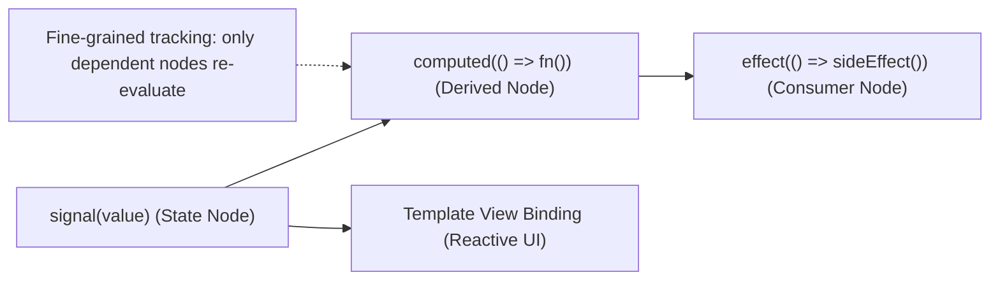

### 3.1 Signals Internals & Reactive Primitives

This stage covers the public primitives. For how the graph propagates changes internally (producer and consumer nodes, version counters, push/pull dirty marking, dynamic dependencies and effect scheduling), see [section 31](#31-signals--reactivity-masterclass-graph-internals-resources-interop--state-architecture).

#### Signals Introduction

Angular Signals is a powerful system that provides detailed monitoring of state usage within an application, enabling the framework to efficiently optimize rendering updates.

#### signal()

The `signal()` function instantiates a writable signal with an initial value. It returns a `WritableSignal<T>` object that can be read by calling it as a function, and updated using the `.set()` or `.update()` methods.

##### Writable Signals

Writable signals provide an API for updating their values directly. You create writable signals by calling the `signal` function with the signal's initial value:

```typescript
import { signal } from "@angular/core";

const count = signal(0); // Creates a writable signal with an initial value of 0

count.set(5); // Updates the signal's value to 5
console.log(count()); // Reads the current value of the signal, which is 5
```

[Back to top⤴️](#table-of-contents)

#### computed()

The `computed()` function creates a read-only signal that derives its value from other signals. It returns a `Signal<T>` that automatically tracks any reactive dependencies read during its execution.

##### Computed Signals

Computed signals are read-only signals that derive their value from other signals. You define computed signals using the `computed` function and specifying a derivation:

```typescript
import { signal, computed } from "@angular/core";

const count = signal(0);
const doubleCount = computed(() => count() * 2); // Creates a computed signal that doubles the count

console.log(doubleCount()); // Reads the current value of the computed signal, which is 0

count.set(3); // Updates the count signal to 3
console.log(doubleCount()); // The computed signal automatically updates to 6
```

[Back to top⤴️](#table-of-contents)

#### effect()

The `effect()` function registers a side-effect operation that runs whenever one or more signal dependencies change. It is designed for operations like logging, DOM synchronization, or rendering integrations.

##### Effects

Signals are useful because they notify interested consumers when they change. An effect is an operation that runs whenever one or more signal values change. You can create an effect with the `effect` function:

```typescript
import { signal, effect } from "@angular/core";

const count = signal(0);

effect(() => {
  console.log("Count changed to:", count()); // Logs the count value whenever it changes
});

count.set(5); // Triggers the effect, logging "Count changed to: 5"
```

The effect function receives an `onCleanup` callback. Anything registered with it runs before the next run and when the effect is destroyed:

```typescript
effect((onCleanup) => {
  const id = setInterval(() => console.log('tick', count()), 1000);
  onCleanup(() => clearInterval(id));
});
```

Since v19, writing to signals inside an effect is allowed by default. The old `allowSignalWrites: true` option is deprecated and does nothing; remove it ([section 31.6](#316-migrating-away-from-allowsignalwrites)).

Here is an example of using Angular Signals in an Angular component:

```typescript
import { Component, OnInit } from "@angular/core";
import { signal, computed } from "@angular/core"; // Import from '@angular/core'

@Component({
  selector: "my-app",
  templateUrl: "./app.component.html",
  styleUrls: ["./app.component.css"],
})
export class AppComponent implements OnInit {
  count = signal(0);
  doubleCount = computed(() => this.count() * 2);

  constructor() {}

  ngOnInit() {
    // Optional logging for debugging displayedCount changes
    // console.log('Displayed count changed to:', this.displayedCount());
  }

  incrementCount() {
    this.count.set(this.count() + 1);
  }

  decrementCount() {
    this.count.update((value) => Math.max(0, value - 1));
  }
}
```

```html
<h1>Angular Signals Example</h1>

<button (click)="incrementCount()" style="margin-right: 10px;">
  Increment Count
</button>
<button (click)="decrementCount()">Decrement Count</button>

<p>Count: {{ count() }}</p>
<p>Double Count: {{ doubleCount() }}</p>
```

##### Signal Equality

When you update a signal's value, it notifies its dependents only if the new value is different from the previous one. The default comparison is `Object.is`, which behaves like `===` except that `NaN` equals `NaN` and `+0` does not equal `-0`. Because the check is by reference for objects, mutating an object or array in place and returning the same reference does **not** notify anyone. Return a new object instead.

You can customize this check by providing a custom equality function when creating the signal:

```typescript
import { signal } from "@angular/core";

interface Coordinate {
  x: number;
  y: number;
}

// Custom equality function comparing object values
const point = signal<Coordinate>(
  { x: 0, y: 0 },
  {
    equal: (a, b) => a.x === b.x && a.y === b.y,
  },
);

// Since x and y are the same, this update will NOT trigger dependencies/effects
point.set({ x: 0, y: 0 });
```

`computed()`, `linkedSignal()`, `resource()` and `toSignal()` accept the same `equal` option. `input()` does not; wrap it in a `computed` with `equal`. See [section 31.4](#314-equality-functions-across-the-signal-apis).

##### untracked()

By default, reading a signal inside a computed derivation or an effect registers it as a dependency. If you want to read a signal's value _without_ creating a dependency, use the `untracked` function.

```typescript
import { signal, effect, untracked } from "@angular/core";

const count = signal(0);
const currentUser = signal("Guest");

effect(() => {
  // This effect tracks 'count' but ignores changes to 'currentUser'
  console.log(
    `Count is ${count()}, logged-in user is: ${untracked(currentUser)}`,
  );
});

count.set(1); // Triggers the effect
currentUser.set("Alice"); // Does NOT trigger the effect
```

`untracked()` also returns the value of the function you pass, so `const draft = untracked(() => this.draft());` is a common way to take a snapshot inside an effect. More patterns (calling services that read signals internally, creating components inside effects) are in [section 31.7](#317-untracked-patterns).

[Back to top⤴️](#table-of-contents)

#### Signal Inputs

Signal Inputs are a modern way to receive data from a parent component. Introduced in Angular, they replace the traditional `@Input()` decorator with a signal-based API.

Unlike `@Input()`, Signal Inputs automatically integrate with Angular Signals and provide reactive updates without additional code.

##### Why use Signal Inputs?

- Better performance
- Fully reactive
- No setters required
- Easier to read
- Type-safe
- Works seamlessly with computed() and effect()

##### Creating a Signal Input

```typescript
import { Component, input } from "@angular/core";

@Component({
  selector: "app-child",
  template: `<h2>{{ name() }}</h2>`,
})
export class ChildComponent {
  name = input<string>();
}
```

##### Passing Data from Parent

```typescript
@Component({
  selector: "app-parent",
  imports: [ChildComponent],
  template: ` <app-child [name]="username"></app-child> `,
})
export class ParentComponent {
  username = "Manthan";
}
```

##### Reading Signal Input Value

Signal Inputs are signals.

Always call them like functions.

```typescript
name();
```

NOT

```typescript
name;
```

##### Default Value

```typescript
import { Component, input } from "@angular/core";

@Component({
  selector: "app-child",
  template: `{{ age() }}`,
})
export class ChildComponent {
  age = input(18);
}
```

If the parent doesn't provide a value, the default value is used.

##### Required Signal Input

```typescript
import { Component, input } from "@angular/core";

@Component({
  selector: "app-child",
  template: `{{ name() }}`,
})
export class ChildComponent {
  name = input.required<string>();
}
```

Angular throws an error if the parent does not provide the input.

##### Using with computed()

```typescript
import { Component, computed, input } from "@angular/core";

@Component({
  selector: "app-child",
  template: ` {{ upperName() }} `,
})
export class ChildComponent {
  name = input("");

  upperName = computed(() => this.name().toUpperCase());
}
```

Whenever the input changes, `upperName` updates automatically.

##### Using with effect()

```typescript
import { Component, effect, input } from "@angular/core";

@Component({
  selector: "app-child",
  template: `{{ name() }}`,
})
export class ChildComponent {
  name = input("");

  constructor() {
    effect(() => {
      console.log(this.name());
    });
  }
}
```

The effect automatically runs whenever the input value changes.

##### Aliasing

```typescript
name = input("", {
  alias: "userName",
});
```

Parent

```html
<app-child [userName]="username"> </app-child>
```

##### Transforming Input Values

```typescript
count = input(0, {
  transform: (value: string) => Number(value),
});
```

Angular transforms the value before storing it.

##### Real-world Example

```typescript
@Component({
  selector: "app-user-card",
  template: `
    <h2>{{ fullName() }}</h2>

    <p>{{ age() }}</p>
  `,
})
export class UserCardComponent {
  firstName = input("");

  lastName = input("");

  age = input(0);

  fullName = computed(() => `${this.firstName()} ${this.lastName()}`);
}
```

Parent

```html
<app-user-card [firstName]="'Manthan'" [lastName]="'Ankolekar'" [age]="28">
</app-user-card>
```

##### Signal Input vs @Input()

| Signal Input          | @Input()                  |
| --------------------- | ------------------------- |
| Reactive              | Non-reactive              |
| Uses Signals          | Uses Decorators           |
| Better Performance    | Good Performance          |
| Works with computed() | Requires additional logic |
| Works with effect()   | Requires ngOnChanges      |
| Cleaner API           | More boilerplate          |

##### Best Practices

- Prefer Signal Inputs for new Angular applications.
- Use `input.required()` when an input is mandatory.
- Use `computed()` instead of recalculating values manually.
- Avoid mutating input values directly.
- Keep Signal Inputs immutable whenever possible.

##### Common Mistakes

❌ Forgetting parentheses

```typescript
this.name;
```

✅ Correct

```typescript
this.name();
```

---

❌ Modifying the input directly

```typescript
this.name.set("Angular");
```

Signal Inputs are read-only.

---

❌ Using `ngOnChanges` unnecessarily

Prefer `effect()` or `computed()` when working with Signal Inputs.

##### Angular v22 Notes

- Recommended API for new Angular applications.
- Integrates seamlessly with Signals.
- Eliminates most `ngOnChanges` use cases.
- Provides better type safety and readability.
- Works perfectly with standalone components.

##### Official Documentation

<https://angular.dev/guide/components/inputs>

##### StackBlitz Example

<https://stackblitz.com/edit/stackblitz-starters-signal-input-example>

[Back to top⤴️](#table-of-contents)

#### Signal Outputs

Signal Outputs provide a modern way to emit events from a child component to a parent component. They replace the traditional `@Output()` decorator with a signal-based API, making component communication simpler and more type-safe.

##### Why use Signal Outputs?

- Modern replacement for `@Output()`
- Better type safety
- Less boilerplate
- Easy to emit events
- Works seamlessly with standalone components
- Recommended for new Angular applications

##### Creating a Signal Output

```typescript
import { Component, output } from "@angular/core";

@Component({
  selector: "app-child",
  template: ` <button (click)="sendMessage()">Send</button> `,
})
export class ChildComponent {
  messageSent = output<string>();

  sendMessage() {
    this.messageSent.emit("Hello from Child");
  }
}
```

##### Listening in Parent Component

```html
<app-child (messageSent)="receiveMessage($event)"> </app-child>
```

```typescript
@Component({
  selector: "app-parent",
  imports: [ChildComponent],
  templateUrl: "./parent.component.html",
})
export class ParentComponent {
  message = "";

  receiveMessage(message: string) {
    this.message = message;
  }
}
```

##### Emitting Different Types

###### String

```typescript
messageSent = output<string>();

this.messageSent.emit("Angular");
```

###### Number

```typescript
counterChanged = output<number>();

this.counterChanged.emit(100);
```

###### Boolean

```typescript
statusChanged = output<boolean>();

this.statusChanged.emit(true);
```

###### Object

```typescript
userSelected = output<{
  id: number;
  name: string;
}>();

this.userSelected.emit({
  id: 1,
  name: "Manthan",
});
```

##### Aliasing Output

```typescript
saved = output<void>({
  alias: "save",
});
```

Parent

```html
<app-child (save)="onSave()"> </app-child>
```

##### Real-world Example

Child Component

```typescript
import { Component, output } from "@angular/core";

@Component({
  selector: "app-product-card",
  template: ` <button (click)="buyProduct()">Buy Now</button> `,
})
export class ProductCardComponent {
  productPurchased = output<number>();

  buyProduct() {
    this.productPurchased.emit(101);
  }
}
```

Parent Component

```html
<app-product-card (productPurchased)="buyProduct($event)"> </app-product-card>
```

```typescript
export class HomeComponent {
  buyProduct(productId: number) {
    console.log(productId);
  }
}
```

##### Emitting Without Data

```typescript
closed = output<void>();

closeDialog() {
  this.closed.emit();
}
```

Parent

```html
<app-dialog (closed)="dialogClosed()"> </app-dialog>
```

##### Signal Output vs @Output()

| Signal Output                | @Output()        |
| ---------------------------- | ---------------- |
| Uses `output()`              | Uses `@Output()` |
| Modern API                   | Traditional API  |
| Better Type Safety           | Good Type Safety |
| Less Boilerplate             | More Boilerplate |
| Recommended for New Projects | Supported        |

##### Best Practices

- Prefer `output()` for new Angular applications.
- Always specify the emitted type.
- Keep emitted data minimal.
- Use meaningful event names.
- Emit immutable objects whenever possible.

##### Common Mistakes

❌ Forgetting `.emit()`

```typescript
this.messageSent("Hello");
```

✅ Correct

```typescript
this.messageSent.emit("Hello");
```

---

❌ Using generic event names

```typescript
event = output();
```

✅ Better

```typescript
userDeleted = output<number>();
```

---

❌ Emitting unnecessary large objects

```typescript
this.userSelected.emit(hugeUserObject);
```

Instead, emit only the required data.

```typescript
this.userSelected.emit(user.id);
```

##### Angular v22 Notes

- Recommended replacement for `@Output()`.
- Provides a cleaner and more readable API.
- Fully compatible with standalone components.
- Offers better type inference than the traditional decorator approach.

##### Official Documentation

<https://angular.dev/guide/components/outputs>

##### StackBlitz Example

<https://stackblitz.com/edit/stackblitz-starters-signal-output-example>

[Back to top⤴️](#table-of-contents)

#### Model Inputs

Model Inputs provide a convenient way to create two-way binding between parent and child components. They replace the traditional combination of `@Input()` and `@Output()` with a single signal-based API.

Unlike traditional two-way binding, Model Inputs are fully reactive and integrate seamlessly with Angular Signals.

##### Why use Model Inputs?

- Simplifies two-way binding
- Less boilerplate
- Fully reactive
- Type-safe
- Works with Signals
- Recommended for modern Angular applications

##### Creating a Model Input

```typescript
import { Component, model } from "@angular/core";

@Component({
  selector: "app-counter",
  template: `
    <button (click)="decrement()">-</button>

    <span>{{ count() }}</span>

    <button (click)="increment()">+</button>
  `,
})
export class CounterComponent {
  count = model(0);

  increment() {
    this.count.update((value) => value + 1);
  }

  decrement() {
    this.count.update((value) => value - 1);
  }
}
```

##### Using Model Input in Parent

```typescript
@Component({
  selector: "app-root",
  imports: [CounterComponent],
  template: `
    <app-counter [(count)]="counter"></app-counter>

    <h2>Current Count: {{ counter }}</h2>
  `,
})
export class AppComponent {
  counter = 10;
}
```

Whenever the child updates `count`, the parent property is automatically updated.

##### Default Value

```typescript
count = model(100);
```

If the parent doesn't provide a value, Angular uses the default value.

##### Required Model Input

```typescript
name = model.required<string>();
```

Angular throws an error if the parent doesn't bind the value.

##### Reading Model Value

Model Inputs are signals.

```typescript
count();
```

NOT

```typescript
count;
```

##### Updating the Value

Using `set()`

```typescript
this.count.set(50);
```

Using `update()`

```typescript
this.count.update((value) => value + 1);
```

##### Working with computed()

```typescript
import { Component, computed, model } from "@angular/core";

@Component({
  selector: "app-cart",
  template: ` Total: {{ total() }} `,
})
export class CartComponent {
  quantity = model(2);

  price = 500;

  total = computed(() => this.quantity() * this.price);
}
```

Whenever the quantity changes, the total updates automatically.

##### Working with effect()

```typescript
import { Component, effect, model } from "@angular/core";

@Component({
  selector: "app-counter",
  template: `{{ count() }}`,
})
export class CounterComponent {
  count = model(0);

  constructor() {
    effect(() => {
      console.log(this.count());
    });
  }
}
```

The effect automatically runs whenever the model value changes.

##### Real-world Example

Child Component

```typescript
import { Component, model } from "@angular/core";

@Component({
  selector: "app-theme-toggle",
  template: `
    <button (click)="toggle()">
      {{ darkMode() ? "Light" : "Dark" }}
    </button>
  `,
})
export class ThemeToggleComponent {
  darkMode = model(false);

  toggle() {
    this.darkMode.update((value) => !value);
  }
}
```

Parent Component

```typescript
@Component({
  selector: "app-root",
  imports: [ThemeToggleComponent],
  template: `
    <app-theme-toggle [(darkMode)]="isDark"> </app-theme-toggle>

    <p>Dark Mode: {{ isDark }}</p>
  `,
})
export class AppComponent {
  isDark = false;
}
```

##### Model Input vs @Input() + @Output()

| Model Input      | Traditional                   |
| ---------------- | ----------------------------- |
| Uses `model()`   | Uses `@Input()` + `@Output()` |
| One API          | Two APIs                      |
| Less Boilerplate | More Boilerplate              |
| Reactive         | Event-based                   |
| Signal-based     | Decorator-based               |
| Cleaner Syntax   | More Code                     |

##### Best Practices

- Prefer `model()` for two-way binding.
- Use `set()` when assigning a new value.
- Use `update()` when the new value depends on the current value.
- Keep model values immutable.
- Use meaningful model names.

##### Common Mistakes

❌ Forgetting parentheses

```typescript
this.count;
```

✅ Correct

```typescript
this.count();
```

---

❌ Updating manually

```typescript
this.count.set(this.count() + 1);
```

✅ Better

```typescript
this.count.update((value) => value + 1);
```

---

❌ Using separate Input and Output

```typescript
@Input()
count!: number;

@Output()
countChange = new EventEmitter<number>();
```

Prefer

```typescript
count = model(0);
```

##### Angular v22 Notes

- Recommended for two-way binding in new Angular applications.
- Eliminates the need for paired `@Input()` and `@Output()`.
- Fully integrated with Angular Signals.
- Improves readability and reduces boilerplate.

##### Official Documentation

<https://angular.dev/guide/components/inputs#model-inputs>

##### StackBlitz Example

<https://stackblitz.com/edit/stackblitz-starters-model-input-example>

[Back to top⤴️](#table-of-contents)

#### linkedSignal()

`linkedSignal()` creates a writable signal whose value is derived from another signal while still allowing local updates. It automatically resets whenever its source signal changes.

Unlike `computed()`, a `linkedSignal()` can be updated using `set()` and `update()`.

##### Why use linkedSignal()?

- Creates writable derived state
- Automatically stays in sync with another signal
- Supports local modifications
- Eliminates manual synchronization
- Improves readability

##### Creating a linkedSignal

```typescript
import { Component, signal, linkedSignal } from "@angular/core";

@Component({
  selector: "app-user",
  template: ` <p>{{ selectedUser() }}</p> `,
})
export class UserComponent {
  users = signal(["Angular", "React", "Vue"]);

  selectedUser = linkedSignal(() => this.users()[0]);
}
```

Initially, the value of `selectedUser()` is:

```text
Angular
```

##### Updating the Linked Signal

```typescript
this.selectedUser.set("Vue");
```

Output

```text
Vue
```

Unlike `computed()`, the value can be changed manually.

##### Source Signal Changes

```typescript
this.users.set(["Svelte", "Solid", "Angular"]);
```

Output

```text
Svelte
```

Whenever the source signal changes, Angular automatically recalculates the linked signal.

##### Using update()

```typescript
this.selectedUser.update((value) => value.toUpperCase());
```

Output

```text
ANGULAR
```

##### Real-world Example

```typescript
import { Component, signal, linkedSignal } from "@angular/core";

@Component({
  selector: "app-product",
  template: `
    <select (change)="changeProduct($event)">
      <option *ngFor="let product of products()">
        {{ product }}
      </option>
    </select>

    <h2>{{ selectedProduct() }}</h2>
  `,
})
export class ProductComponent {
  products = signal(["Laptop", "Phone", "Tablet"]);

  selectedProduct = linkedSignal(() => this.products()[0]);

  changeProduct(event: Event) {
    const value = (event.target as HTMLSelectElement).value;

    this.selectedProduct.set(value);
  }
}
```

If the product list changes,

```typescript
this.products.set(["Camera", "Drone"]);
```

`selectedProduct()` automatically becomes

```text
Camera
```

##### linkedSignal() vs computed()

| linkedSignal()                  | computed()                      |
| ------------------------------- | ------------------------------- |
| Writable                        | Read-only                       |
| Supports `set()`                | No                              |
| Supports `update()`             | No                              |
| Derived from another signal     | Derived from another signal     |
| Automatically syncs with source | Automatically syncs with source |

##### Best Practices

- Use `linkedSignal()` when derived state needs to be editable.
- Use `computed()` for read-only derived values.
- Keep linked state lightweight.
- Avoid storing duplicated business data.
- Prefer immutable updates.

##### Common Mistakes

❌ Using `computed()` for editable state

```typescript
total = computed(() => ...);

total.set(10);
```

This is not allowed.

---

✅ Correct

```typescript
total = linkedSignal(() => ...);

total.set(10);
```

---

❌ Duplicating source state

```typescript
users = signal([...]);

selectedUser = signal(users()[0]);
```

Prefer

```typescript
selectedUser = linkedSignal(() => users()[0]);
```

##### Angular v22 Notes

- Part of Angular's modern Signals API.
- Ideal for editable derived state.
- Automatically synchronizes with its source signal.
- Reduces boilerplate required to keep signals in sync.

##### Official Documentation

<https://angular.dev/guide/signals/linked-signal>

##### StackBlitz Example

<https://stackblitz.com/edit/stackblitz-starters-linked-signal>

[Back to top⤴️](#table-of-contents)

#### resource()

`resource()` is a reactive API for managing asynchronous data in Angular Signals. It automatically tracks loading, success, and error states without requiring subscriptions.

Unlike Observables, a Resource integrates directly with Signals and updates automatically whenever its dependencies change.

##### Why use resource()?

- Reactive asynchronous data
- Automatic loading state
- Automatic error handling
- No manual subscriptions
- Works seamlessly with Signals
- Eliminates boilerplate

##### Creating a Resource

```typescript
import { Component, resource, signal } from "@angular/core";

@Component({
  selector: "app-user",
  template: ` <p>{{ user.value() }}</p> `,
})
export class UserComponent {
  userId = signal(1);

  user = resource({
    params: () => this.userId(),

    loader: async ({ params }) => {
      return {
        id: params,
        name: `User ${params}`,
      };
    },
  });
}
```

##### Reading Resource Value

```typescript
user.value();
```

Example output

```text
{
  id: 1,
  name: "User 1"
}
```

##### Loading State

```typescript
@if (user.isLoading()) {
  <p>Loading...</p>
}
```

##### Error State

```typescript
@if (user.error()) {
  <p>Something went wrong.</p>
}
```

##### Updating the Request

```typescript
this.userId.set(2);
```

Angular automatically executes the loader again.

##### Real-world Example

```typescript
import { Component, resource, signal } from "@angular/core";

@Component({
  selector: "app-product",
  template: `
    <button (click)="next()">Next Product</button>

    @if (product.isLoading()) {
      Loading...

    } @else {
      {{ product.value()?.name }}
    }
  `,
})
export class ProductComponent {
  productId = signal(1);

  product = resource({
    params: () => this.productId(),

    loader: async ({ params }) => {
      await new Promise((resolve) => setTimeout(resolve, 1000));

      return {
        id: params,
        name: `Product ${params}`,
      };
    },
  });

  next() {
    this.productId.update((id) => id + 1);
  }
}
```

Whenever the product ID changes, the resource reloads automatically.

##### Resource States

```typescript
resource.value();
```

Returns the current value.

```typescript
resource.isLoading();
```

Returns `true` while loading.

```typescript
resource.error();
```

Returns the current error.

```typescript
resource.hasValue();
```

Returns `true` if a value exists.

`status()` returns one of `'idle'`, `'loading'`, `'reloading'`, `'resolved'`, `'error'` or `'local'`. In v22, reading `value()` while the status is `'error'` throws, so check `hasValue()` or `status()` first. The difference between `loading` and `reloading`, and what `set()` / `update()` do (`'local'`), is explained in [section 31.8](#318-resource-internals-cancellation-races--local-overrides).

> [!NOTE]
> The option that feeds the loader is called `params` (it was named `request` before v20). Older snippets that use `request: () => ...` and `loader: ({ request })` do not compile on v22.

##### Reloading a Resource

```typescript
this.user.reload();
```

Angular executes the loader again using the current request.

##### resource() vs Observable

| resource()              | Observable            |
| ----------------------- | --------------------- |
| Signal-based            | RxJS-based            |
| No subscriptions        | Requires subscription |
| Automatic loading state | Manual loading state  |
| Automatic error state   | Manual error handling |
| Reactive by default     | Reactive through RxJS |
| Cleaner API             | More boilerplate      |

##### Best Practices

- Use `resource()` for asynchronous Signal-based state.
- Keep the loader focused on fetching data.
- Handle errors gracefully.
- Avoid expensive computations inside the loader.
- Use `reload()` when data needs refreshing.

##### Common Mistakes

❌ Fetching data outside the loader

```typescript
const data = await fetch(...);
```

Always fetch inside the `loader`.

---

❌ Calling the loader manually

```typescript
loader();
```

Angular automatically manages loader execution.

---

❌ Forgetting loading state

```html
{{ user.value().name }}
```

Prefer

```html
@if (user.isLoading()) { Loading... } @else { {{ user.value()?.name }} }
```

##### Angular v22 Notes

- Designed for Signal-based asynchronous state.
- Automatically reacts to Signal changes.
- Removes much of the boilerplate associated with Observables.
- Forms the foundation for higher-level APIs such as `httpResource()`.

##### Official Documentation

<https://angular.dev/guide/signals/resource>

##### StackBlitz Example

<https://stackblitz.com/edit/stackblitz-starters-resource-example>

[Back to top⤴️](#table-of-contents)

#### httpResource()

`httpResource()` is a Signal-based API for fetching HTTP data reactively. It is built on top of Angular's `HttpClient` and `resource()`, automatically handling loading, success, and error states.

Whenever the request URL or request options change, Angular automatically sends a new HTTP request.

##### Why use httpResource()?

- Declarative data fetching
- Automatic loading state
- Automatic error handling
- No manual subscriptions
- Reactive updates
- Built on Angular Signals

##### Prerequisites

Provide the HttpClient when bootstrapping the application.

```typescript
import { ApplicationConfig } from "@angular/core";
import { provideHttpClient } from "@angular/common/http";

export const appConfig: ApplicationConfig = {
  providers: [provideHttpClient()],
};
```

##### Creating an HTTP Resource

```typescript
import { Component, signal } from "@angular/core";

import { httpResource } from "@angular/common/http";

@Component({
  selector: "app-user",
  template: ` <pre>{{ user.value() | json }}</pre> `,
})
export class UserComponent {
  userId = signal(1);

  user = httpResource(
    () => `https://jsonplaceholder.typicode.com/users/${this.userId()}`,
  );
}
```

Angular automatically performs a new request whenever `userId()` changes.

##### Reading Data

```typescript
user.value();
```

Example Output

```json
{
  "id": 1,
  "name": "Leanne Graham"
}
```

##### Loading State

```html
@if (user.isLoading()) {
<p>Loading...</p>
}
```

##### Error State

```html
@if (user.error()) {
<p>Unable to load data.</p>
}
```

##### Changing the Request

```typescript
this.userId.set(2);
```

Angular automatically performs another HTTP request.

##### Real-world Example

```typescript
import { Component, signal } from "@angular/core";

import { httpResource } from "@angular/common/http";

@Component({
  selector: "app-product-list",
  template: `
    <button (click)="nextPage()">Next Page</button>

    @if (products.isLoading()) {
      <p>Loading...</p>
    } @else {
      <ul>
        @for (product of products.value(); track product.id) {
          <li>{{ product.title }}</li>
        }
      </ul>
    }
  `,
})
export class ProductListComponent {
  page = signal(1);

  products = httpResource(
    () =>
      `https://dummyjson.com/products?limit=10&skip=${(this.page() - 1) * 10}`,
  );

  nextPage() {
    this.page.update((page) => page + 1);
  }
}
```

Every time the page changes, Angular automatically requests the next set of products.

##### Reloading Data

```typescript
this.products.reload();
```

This performs the HTTP request again using the current URL.

##### Resource States

```typescript
products.value();
```

Returns the current response.

```typescript
products.isLoading();
```

Returns `true` while the request is in progress.

```typescript
products.error();
```

Returns the current error.

```typescript
products.hasValue();
```

Returns `true` if a response has been successfully received.

##### httpResource() vs HttpClient

| httpResource()          | HttpClient                    |
| ----------------------- | ----------------------------- |
| Signal-based            | Observable-based              |
| Automatic subscription  | Manual subscription           |
| Automatic loading state | Manual loading state          |
| Automatic reload        | Manual implementation         |
| Best for GET requests   | Suitable for all HTTP methods |
| Reactive by default     | RxJS-based                    |

##### Best Practices

- Use `httpResource()` primarily for reactive **GET** requests.
- Use `HttpClient` directly for POST, PUT, PATCH, and DELETE operations.
- Handle loading and error states in the UI.
- Avoid performing business logic inside the resource.
- Use Signals to drive request parameters.

##### Common Mistakes

❌ Creating a resource inside a method

```typescript
loadUsers() {
  this.users = httpResource(...);
}
```

Create the resource once as a component property.

---

❌ Ignoring loading state

```html
{{ users.value() }}
```

Always display a loading indicator while the request is in progress.

---

❌ Using httpResource() for every API call

`httpResource()` is ideal for reactive data fetching.

For mutations (POST, PUT, PATCH, DELETE), prefer `HttpClient`.

##### Angular v22 Notes

- Built on top of Angular Signals.
- Automatically refetches when reactive dependencies change.
- Eliminates the need for manual subscriptions.
- Designed for declarative HTTP data fetching.
- Complements, rather than replaces, `HttpClient`.

##### Official Documentation

<https://angular.dev/guide/http/http-resource>

##### StackBlitz Example

<https://stackblitz.com/edit/stackblitz-starters-http-resource>

[Back to top⤴️](#table-of-contents)

#### Signal Queries

**Signal Queries** are modern, signal-based alternatives to decorator-based queries (`@ViewChild`, `@ViewChildren`, `@ContentChild`, `@ContentChildren`). They return queries as standard Angular Signals.

Signal query functions:
- **`viewChild()`**: Queries a single matching element or component from the component view.
- **`viewChildren()`**: Queries all matching elements or components from the component view.
- **`contentChild()`**: Queries a single matching element or component projected into the component.
- **`contentChildren()`**: Queries all matching elements or components projected into the component.

Example:
```typescript
import { Component, ElementRef, effect, viewChild } from '@angular/core';

@Component({
  selector: 'app-search-input',
  template: `<input #searchField type="text" placeholder="Search..." />`
})
export class SearchInputComponent {
  // Returns a Signal<ElementRef<HTMLInputElement> | undefined>
  inputElement = viewChild<ElementRef<HTMLInputElement>>('searchField');

  constructor() {
    effect(() => {
      const el = this.inputElement();
      if (el) {
        el.nativeElement.focus(); // Focus input element automatically when ready
      }
    });
  }
}
```

[Back to top⤴️](#table-of-contents)

#### Signal Store

The **NgRx SignalStore** (`@ngrx/signals`) is a lightweight, fully reactive state management library built on top of Angular Signals. It provides a modular, functional API to define and compose local or global state.

Features of SignalStore:
- **Declarative structure**: Define state, computed properties, and methods using pipeable creators.
- **Strictly typed**: Automatically infers type signatures.
- **Signal-based reactivity**: Components read state as standard read-only signals.

Example:
```typescript
import { signalStore, withState, withComputed, withMethods, patchState } from '@ngrx/signals';
import { computed } from '@angular/core';

export interface TasksState {
  items: string[];
  filter: 'all' | 'done';
}

const initialState: TasksState = {
  items: [],
  filter: 'all'
};

export const TasksStore = signalStore(
  // 1. Initialize State
  withState(initialState),
  // 2. Define Computed Properties
  withComputed(({ items }) => ({
    count: computed(() => items().length)
  })),
  // 3. Define Methods to Update State
  withMethods((store) => ({
    addTask(task: string) {
      patchState(store, (state) => ({ items: [...state.items, task] }));
    }
  }))
);
```

Beyond `withState` / `withComputed` / `withMethods`, SignalStore offers `withEntities()` for normalized collections, `rxMethod()` for RxJS-based side effects, `withHooks()` for init and destroy logic, `signalState()` for lightweight component state, and `signalStoreFeature()` for reusable features. See [section 31.12](#3112-ngrx-signalstore-beyond-the-basics), and [section 31.13](#3113-signalstore-vs-ngrx-store-choosing-deliberately) for a comparison with the classic NgRx Store.

[Back to top⤴️](#table-of-contents)

#### toSignal()

The `toSignal()` helper function (from `@angular/core/rxjs-interop`) converts an RxJS **Observable** into a read-only Angular **Signal**. This is the primary tool for bridging existing RxJS streams (like HttpClient requests or router events) into signal-based templates.

Key characteristics:
- **Injection Context**: Must be called within an active injection context (e.g. constructor or field initializer) unless an environment injector is explicitly passed.
- **Subscription Management**: Automatically subscribes to the source Observable immediately and unsubscribes when the hosting component/service is destroyed.
- **Initial Values**: Since Observables are asynchronous, you can specify an `initialValue` options parameter.
- **Synchronous sources**: pass `requireSync: true` for sources that emit on subscribe (such as a `BehaviorSubject`). The signal type then has no `undefined`, and Angular throws `NG0601` if the source does not emit synchronously.
- **Outside an injection context**: pass `{ injector }`; the subscription is cleaned up with that injector's `DestroyRef`. `manualCleanup: true` skips `DestroyRef` entirely.
- **Errors**: if the source errors, reading the signal throws that error. Handle errors in the pipe with `catchError` first.
- **Eager**: it subscribes as soon as `toSignal()` is called, not when the signal is first read.

Example:
```typescript
import { Component, inject } from '@angular/core';
import { HttpClient } from '@angular/common/http';
import { toSignal } from '@angular/core/rxjs-interop';

@Component({
  selector: 'app-user-list',
  template: `
    <ul>
      @for (user of users(); track user.id) {
        <li>{{ user.name }}</li>
      }
    </ul>
  `
})
export class UserListComponent {
  private http = inject(HttpClient);

  // Converts HttpClient Observable to a ReadonlySignal
  users = toSignal(
    this.http.get<any[]>('https://jsonplaceholder.typicode.com/users'),
    { initialValue: [] }
  );
}
```

[Back to top⤴️](#table-of-contents)

#### toObservable()

The `toObservable()` helper function (from `@angular/core/rxjs-interop`) converts an Angular **Signal** into an RxJS **Observable**. It sets up an internal effect that monitors the signal and emits new values to the Observable stream whenever the signal changes.

Key characteristics:
- **Injection Context**: Must be called within an injection context (constructor or field initializer).
- **Asynchronous Propagation**: Values are pushed from an `effect`, so they arrive when Angular runs effects, not synchronously on `set()`. Several `set()` calls before the effect runs produce one emission with the latest value. Late subscribers receive the current value immediately (it is replayed). Outside an injection context, pass `{ injector }`.

Example:
```typescript
import { Component, signal } from '@angular/core';
import { toObservable } from '@angular/core/rxjs-interop';
import { debounceTime, distinctUntilChanged, switchMap } from 'rxjs';

@Component({
  selector: 'app-live-search',
  template: `<input (input)="searchTerm.set($any($event.target).value)" />`
})
export class LiveSearchComponent {
  searchTerm = signal('');

  // 1. Convert signal changes to an Observable
  searchTerm$ = toObservable(this.searchTerm);

  // 2. Compose with RxJS operators
  searchResults$ = this.searchTerm$.pipe(
    debounceTime(300),
    distinctUntilChanged(),
    switchMap(term => this.fetchResults(term))
  );

  fetchResults(query: string) {
    // API Call...
    return [];
  }
}
```

For outputs, the same package has `outputFromObservable()` (turn an Observable into a component output) and `outputToObservable()` (consume an output as an Observable). For async loading with Observables, use `rxResource()` instead of `toSignal()` when you need loading and error statuses. Both are covered in [section 31.9](#319-rxresource-resources-backed-by-observables) and [section 31.10](#3110-outputfromobservable--outputtoobservable).

[Back to top⤴️](#table-of-contents)

#### Signal Best Practices

- Always read signal values in templates using function call syntax: `{{ value() }}`
- Keep effects for side effects that leave the signal graph (storage, logging, third-party APIs). For DOM reads and writes after rendering, prefer `afterRenderEffect()`. For derived values, use `computed()` or `linkedSignal()` instead of writing one signal from an effect.
- Use `computed` for derived state instead of manual updates inside effects

#### Signals vs RxJS

- **Signals**: Best for synchronous state management, template bindings, and local reactivity.
- **RxJS**: Best for asynchronous operations, event streams, timers, HTTP calls, and complex data flows.

- **Bridges**: `toSignal()` / `toObservable()` for values, `rxResource()` for Observable-backed async loading, `outputFromObservable()` / `outputToObservable()` for component outputs (all in `@angular/core/rxjs-interop`).

### 3.2 State Management

#### State Management Introduction

State management is essential for maintaining application state across components and providing a predictable data flow.

##### NgRx

NgRx is a reactive state management library inspired by Redux. It provides a centralized store for all application state.

###### Installing NgRx

```bash
ng add @ngrx/store
ng add @ngrx/effects
ng add @ngrx/store-devtools
```

###### Setting up NgRx Store

```typescript
// counter.actions.ts
import { createAction, props } from "@ngrx/store";

export const increment = createAction("[Counter] Increment");
export const decrement = createAction("[Counter] Decrement");
export const reset = createAction("[Counter] Reset");
```

```typescript
// counter.reducer.ts
import { createReducer, on } from "@ngrx/store";
import { increment, decrement, reset } from "./counter.actions";

export const initialState = 0;

const _counterReducer = createReducer(
  initialState,
  on(increment, (state) => state + 1),
  on(decrement, (state) => state - 1),
  on(reset, () => 0),
);

export function counterReducer(state, action) {
  return _counterReducer(state, action);
}
```

```typescript
// app.module.ts
import { StoreModule } from "@ngrx/store";
import { counterReducer } from "./counter.reducer";

@NgModule({
  imports: [StoreModule.forRoot({ counter: counterReducer })],
})
export class AppModule {}
```

###### Using NgRx in Components

```typescript
import { Component } from "@angular/core";
import { Store } from "@ngrx/store";
import { Observable } from "rxjs";
import { increment, decrement, reset } from "./counter.actions";

@Component({
  selector: "app-counter",
  template: `
    <div>Current Count: {{ count$ | async }}</div>
    <button (click)="increment()">+</button>
    <button (click)="decrement()">-</button>
    <button (click)="reset()">Reset</button>
  `,
})
export class CounterComponent {
  count$: Observable<number>;

  constructor(private store: Store<{ counter: number }>) {
    this.count$ = store.select("counter");
  }

  increment() {
    this.store.dispatch(increment());
  }

  decrement() {
    this.store.dispatch(decrement());
  }

  reset() {
    this.store.dispatch(reset());
  }
}
```

##### NgXS

NgXS is a state management pattern that acts as a single source of truth for your application.

###### Installing NgXS

```bash
npm install @ngxs/store
```

###### Setting up NgXS

```typescript
// counter.state.ts
import { State, Action, StateContext, Selector } from "@ngxs/store";

export class Increment {
  static readonly type = "[Counter] Increment";
}

export class Decrement {
  static readonly type = "[Counter] Decrement";
}

export interface CounterStateModel {
  count: number;
}

@State<CounterStateModel>({
  name: "counter",
  defaults: {
    count: 0,
  },
})
export class CounterState {
  @Selector()
  static getCount(state: CounterStateModel) {
    return state.count;
  }

  @Action(Increment)
  increment(ctx: StateContext<CounterStateModel>) {
    const state = ctx.getState();
    ctx.setState({
      count: state.count + 1,
    });
  }

  @Action(Decrement)
  decrement(ctx: StateContext<CounterStateModel>) {
    const state = ctx.getState();
    ctx.setState({
      count: state.count - 1,
    });
  }
}
```

##### Akita

Akita is a state management library built on top of RxJS.

```bash
npm install @datorama/akita
```

##### Simple State Management

For simple applications, you can use services with BehaviorSubject:

```typescript
import { Injectable } from "@angular/core";
import { BehaviorSubject } from "rxjs";

@Injectable({
  providedIn: "root",
})
export class StateService {
  private countSubject = new BehaviorSubject<number>(0);
  count$ = this.countSubject.asObservable();

  increment() {
    this.countSubject.next(this.countSubject.value + 1);
  }

  decrement() {
    this.countSubject.next(this.countSubject.value - 1);
  }

  reset() {
    this.countSubject.next(0);
  }
}
```

[Back to top⤴️](#table-of-contents)

#### What is NgRx?

**NgRx** is a Reactive libraries for Angular. It provides state management, side effects, and route handling. It is inspired by Redux. It is a set of Angular libraries to help manage state at scale in Angular applications.

#### What is NgXS?

**NgXS** is a state management pattern + library for Angular. It acts as a single source of truth for your application's state, providing simple rules for predictable state mutations.

[Back to top⤴️](#table-of-contents)

#### Signals

Use services that hold private writable signals, expose them with `asReadonly()`, derive values with `computed()`, and change state only through methods. For server data, prefer `resource()`, `httpResource()` or `rxResource()`. A full example and scaling rules are in [section 31.11](#3111-signal-based-state-architecture-without-a-library).

#### Signal Store

NgRx SignalStore (`@ngrx/signals`) builds feature stores from composable functions such as `withState`, `withComputed`, `withMethods`, `withEntities` and `withHooks`. See [section 31.12](#3112-ngrx-signalstore-beyond-the-basics) for advanced features and [section 31.13](#3113-signalstore-vs-ngrx-store-choosing-deliberately) for when to choose it over the classic NgRx Store.

#### Component Store

Manage component-specific state using `ComponentStore`.

#### State Management Patterns

Use actions, reducers, and selectors to enforce unidirectional data flow.

## 4. Stage 4: Hierarchical Dependency Injection & Routing

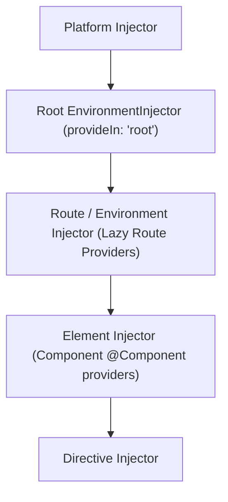

### 4.1 Dependency Injection Architecture

#### Dependency Injection

Services are used to encapsulate reusable functionality that can be shared across components. They are used to fetch data from a server, perform calculations, or interact with external services.

```ts
import { Injectable } from "@angular/core";

@Injectable({ providedIn: 'root' })
export class DataService {
  getData() {
    return "Data from the service";
  }
}
```

`providedIn: 'root'` registers the service in the application's root injector and lets the build drop it if nothing injects it. Without `providedIn`, the class must appear in some `providers` array before it can be injected.

```ts
import { Component } from "@angular/core";
import { DataService } from "./data.service";

@Component({
  selector: "my-app",
  templateUrl: "./app.component.html",
  styleUrls: ["./app.component.css"],
})
export class AppComponent {
  data: string;

  constructor(private dataService: DataService) {
    this.data = this.dataService.getData();
  }
}
```

[Back to top⤴️](#table-of-contents)

##### Injectable Decorator

The `@Injectable` decorator is used to define a service class that can be injected into other components or services.

```ts
import { Injectable } from "@angular/core";

@Injectable({ providedIn: 'root' })
export class DataService {
  getData() {
    return "Data from the service";
  }
}
```

[Back to top⤴️](#table-of-contents)

##### Dependency Injection

Dependency injection is a design pattern used to create objects and manage their dependencies. It allows you to inject dependencies into a class rather than creating them within the class.

```ts
import { Injectable } from "@angular/core";

@Injectable({ providedIn: 'root' })
export class DataService {
  getData() {
    return "Data from the service";
  }
}
```

```ts
import { Component } from "@angular/core";
import { DataService } from "./data.service";

@Component({
  selector: "my-app",
  templateUrl: "./app.component.html",
  styleUrls: ["./app.component.css"],
})
export class AppComponent {
  data: string;

  constructor(private dataService: DataService) {
    this.data = this.dataService.getData();
  }
}
```

Using `inject` function is an alternative way to inject dependencies into a class.

```typescript
import { Component, inject } from "@angular/core";
import { DataService } from "./data.service";

@Component({
  selector: "my-app",
  templateUrl: "./app.component.html",
  styleUrls: ["./app.component.css"],
})
export class AppComponent {
  data: string;
  private dataService = inject(DataService);

  constructor() {
    this.data = this.dataService.getData();
  }
}
```

[Back to top⤴️](#table-of-contents)

##### Providers

Providers are used to define dependencies that are injected into components, directives, pipes, and services. They are defined in the `@NgModule` decorator of the root module or feature modules.

```ts
import { NgModule } from "@angular/core";
import { BrowserModule } from "@angular/platform-browser";
import { FormsModule } from "@angular/forms";

import { AppComponent } from "./app.component";
import { DataService } from "./data.service";

@NgModule({
  imports: [BrowserModule, FormsModule],
  declarations: [AppComponent],
  bootstrap: [AppComponent],
  providers: [DataService],
})
export class AppModule {}
```

In standalone applications (the default), the same providers go in `app.config.ts`:

```ts
export const appConfig: ApplicationConfig = {
  providers: [DataService],
};
```

Providers can also be declared on a route (`Route.providers`), a component or directive (`providers` / `viewProviders`), or a custom injector. Which one wins when several match is covered in [section 32.7](#327-provider-precedence-providers-vs-viewproviders-host-boundaries-and-override-order).

##### Provider Types

Angular provides different ways to define how a dependency token is resolved. When configuring a provider, you can use the following options:

1. **`useClass` (Class Provider)**: Tells the injector to instantiate a specific class when the token is resolved.

   ```typescript
   { provide: LoggerService, useClass: FileLoggerService }
   ```

2. **`useValue` (Value Provider)**: Associates a static value, configuration object, or constant with a dependency token. Often used with `InjectionToken`.

   ```typescript
   { provide: APP_CONFIG, useValue: { apiEndpoint: 'https://api.com' } }
   ```

3. **`useExisting` (Aliased/Existing Provider)**: Maps a token to another existing provider token, creating an alias.

   ```typescript
   { provide: NewLogger, useExisting: OldLogger }
   ```

4. **`useFactory` (Factory Provider)**: Instantiates a dependency dynamically using a factory function, allowing complex initialization logic. It can declare dependencies using the `deps` property.

   ```typescript
   {
     provide: LoggerService,
     useFactory: (config: ConfigService) => config.isDev ? new ConsoleLogger() : new FileLogger(),
     deps: [ConfigService]
   }
   ```

5. **`multi: true` (Multi Provider)**: Combined with any of the four forms above, it adds a value to an array instead of replacing the previous registration. Injecting the token returns every registered value in order. Angular's own `HTTP_INTERCEPTORS`, `NG_VALIDATORS` and `NG_VALUE_ACCESSOR` tokens work this way.

   ```typescript
   { provide: EXPORTERS, multi: true, useClass: CsvExporter },
   { provide: EXPORTERS, multi: true, useClass: PdfExporter },
   // inject(EXPORTERS) -> [CsvExporter, PdfExporter]
   ```

   See [section 32.6](#326-multi-providers) for scoping rules and pitfalls.

##### Hierarchical DI

Angular has a **Hierarchical Dependency Injection** system, meaning the application has a tree of injectors that mirrors the component tree structure.

###### The Injector Hierarchy

When a dependency is requested, Angular resolves it by traversing the injector tree upward, starting from the requesting component:

1. **ElementInjector**: Created for each DOM element or component. If a component defines a `providers` array in its `@Component` decorator, those providers belong to its ElementInjector.
2. **EnvironmentInjector / ModuleInjector**: Configured globally during bootstrapping (using `app.config.ts` or `AppModule`) or via `providedIn: 'root'` in services.
3. **PlatformInjector**: Configured for platform-wide services (e.g., shared across multiple Angular apps running on the same page).
4. **NullInjector**: The top of the hierarchy. If a dependency lookup reaches this injector, Angular throws a "No provider found" error (unless the dependency is marked with `@Optional()`).

Resolution walks the whole element-injector chain first (from the requesting element up to the root component), and only then the environment chain (lazy route injector, root injector, platform injector). Resolution modifiers such as `inject(Token, { skipSelf: true })` and `{ host: true }` only affect the element part of that walk.

###### Resolution Rules & Decorators

You can modify the traversal behavior using resolution decorators:

- **`@Self()`**: Instructs the injector to search _only_ the current component's ElementInjector.
- **`@SkipSelf()`**: Instructs the injector to start the search from the _parent_ component's ElementInjector, bypassing the current one.
- **`@Optional()`**: Prevents the application from crashing if a provider is not found, returning `null` instead.
- **`@Host()`**: Restricts the search within the current component's host element.

With `inject()`, the same rules are options: `inject(Logger, { self: true })`, `{ skipSelf: true }`, `{ optional: true }` and `{ host: true }`.

Two details that the list above leaves out:

- **`providers` vs `viewProviders`:** `viewProviders` on a component are visible to its own template only, not to content projected into it with `<ng-content>`.
- **`@Host()` stops at the host element** and, at that boundary, sees the host component's `viewProviders`, not its `providers`. It never falls back to route or root injectors.

Details and examples: [section 32.7](#327-provider-precedence-providers-vs-viewproviders-host-boundaries-and-override-order).

[Back to top⤴️](#table-of-contents)

#### inject()

`inject()` is a modern Dependency Injection (DI) API that allows dependencies to be injected without using a constructor. It simplifies Angular code, improves readability, and is the recommended approach for new Angular applications.

It can be used in components, directives, pipes, services, route guards, resolvers, interceptors, validators, and other injection contexts.

##### Why use inject()?

- Eliminates constructor injection
- Less boilerplate
- Better readability
- Easier refactoring
- Better type inference
- Recommended for modern Angular applications

##### Basic Example

Traditional constructor injection

```typescript
import { Component } from "@angular/core";
import { UserService } from "./user.service";

@Component({
  selector: "app-home",
  template: `Home`,
})
export class HomeComponent {
  constructor(private userService: UserService) {}
}
```

Using `inject()`

```typescript
import { Component, inject } from "@angular/core";
import { UserService } from "./user.service";

@Component({
  selector: "app-home",
  template: `Home`,
})
export class HomeComponent {
  private userService = inject(UserService);
}
```

##### Injecting Multiple Services

```typescript
import { Component, inject } from "@angular/core";

import { Router } from "@angular/router";
import { HttpClient } from "@angular/common/http";
import { UserService } from "./user.service";

@Component({
  selector: "app-home",
  template: `Home`,
})
export class HomeComponent {
  private router = inject(Router);

  private http = inject(HttpClient);

  private userService = inject(UserService);
}
```

##### Using inject() in Services

```typescript
import { Injectable, inject } from "@angular/core";

import { HttpClient } from "@angular/common/http";

@Injectable({
  providedIn: "root",
})
export class UserService {
  private http = inject(HttpClient);

  getUsers() {
    return this.http.get("/api/users");
  }
}
```

##### Using inject() in Functional Route Guards

```typescript
import { inject } from "@angular/core";

import { CanActivateFn, Router } from "@angular/router";

import { AuthService } from "./auth.service";

export const authGuard: CanActivateFn = () => {
  const auth = inject(AuthService);

  const router = inject(Router);

  if (auth.isLoggedIn()) {
    return true;
  }

  return router.parseUrl("/login");
};
```

##### Using inject() in Functional HTTP Interceptors

```typescript
import { inject } from "@angular/core";

import { HttpInterceptorFn } from "@angular/common/http";

import { AuthService } from "./auth.service";

export const authInterceptor: HttpInterceptorFn = (req, next) => {
  const auth = inject(AuthService);

  const token = auth.getToken();

  const request = req.clone({
    setHeaders: {
      Authorization: `Bearer ${token}`,
    },
  });

  return next(request);
};
```

##### Optional Injection

```typescript
import { inject } from "@angular/core";

import { LoggerService } from "./logger.service";

const logger = inject(LoggerService, {
  optional: true,
});
```

If the service is unavailable, Angular returns `null` instead of throwing an error.

##### Injecting an Injection Token

```typescript
import { inject } from "@angular/core";

import { APP_CONFIG } from "./app.config";

const config = inject(APP_CONFIG);
```

##### Real-world Example

```typescript
import { Component, inject } from "@angular/core";

import { Router } from "@angular/router";
import { UserService } from "./user.service";

@Component({
  selector: "app-profile",
  template: ` <button (click)="logout()">Logout</button> `,
})
export class ProfileComponent {
  private router = inject(Router);

  private userService = inject(UserService);

  logout() {
    this.userService.logout();

    this.router.navigate(["/login"]);
  }
}
```

##### inject() vs Constructor Injection

| inject()                 | Constructor Injection |
| ------------------------ | --------------------- |
| Modern API               | Traditional API       |
| No constructor required  | Constructor required  |
| Less boilerplate         | More boilerplate      |
| Easier to refactor       | More verbose          |
| Works in functional APIs | Constructor only      |
| Better readability       | Familiar syntax       |

##### Best Practices

- Prefer `inject()` for new Angular applications.
- Group injected dependencies together at the top of the class.
- Mark injected services as `private` unless they are used in the template.
- Continue using Angular's Dependency Injection system instead of manually creating services.
- Use constructor injection only when a framework or library specifically requires it.

##### Common Mistakes

❌ Calling `inject()` outside an injection context

```typescript
function getUser() {
  const service = inject(UserService);
}
```

This throws an error because the function is not executed within Angular's injection context.

---

❌ Creating services manually

```typescript
const service = new UserService();
```

Always use Dependency Injection.

---

❌ Mixing constructor injection and `inject()` unnecessarily

```typescript
constructor(
  private router: Router
) {}

private userService = inject(UserService);
```

Prefer one style consistently unless there is a specific reason to mix them.

##### Angular v22 Notes

- Recommended Dependency Injection API for new Angular applications.
- Works seamlessly with standalone components.
- Essential for functional guards, resolvers, interceptors, validators, and effects.
- Reduces boilerplate and improves code readability.

##### Official Documentation

<https://angular.dev/reference/migrations/inject-function>

##### StackBlitz Example

<https://stackblitz.com/edit/stackblitz-starters-inject-function>

[Back to top⤴️](#table-of-contents)

#### EnvironmentInjector

`EnvironmentInjector` is Angular's modern dependency injection container used to manage providers outside the component tree. It enables creating isolated dependency injection scopes for standalone applications, lazy-loaded features, and dynamically created components.

Unlike the traditional `Injector`, an `EnvironmentInjector` is designed to work with Angular's standalone APIs.

##### Why use EnvironmentInjector?

- Create custom dependency injection scopes
- Support standalone applications
- Dynamically create components
- Better control over providers
- Improve modularity
- Recommended for advanced Angular applications

##### Injecting EnvironmentInjector

```typescript
import { Component, EnvironmentInjector, inject } from "@angular/core";

@Component({
  selector: "app-home",
  template: `Home`,
})
export class HomeComponent {
  private environmentInjector = inject(EnvironmentInjector);
}
```

---

##### Creating a Child Environment Injector

```typescript
import { Component, DestroyRef, EnvironmentInjector, createEnvironmentInjector, inject } from '@angular/core';
import { UserService } from './user.service';

@Component({
  selector: 'app-home',
  template: `Home`,
})
export class HomeComponent {
  private parentInjector = inject(EnvironmentInjector);

  childInjector = createEnvironmentInjector([UserService], this.parentInjector, 'HomeChild');

  constructor() {
    // The creator owns the injector: destroy it with the component
    inject(DestroyRef).onDestroy(() => this.childInjector.destroy());
  }
}
```

The child injector inherits providers from the parent while allowing additional providers. Destroying it runs `ngOnDestroy` on the services it created. Destroying the parent does **not** destroy children created with `createEnvironmentInjector()`.

---

##### Creating a Dynamic Component

```typescript
import {
  Component,
  EnvironmentInjector,
  ViewContainerRef,
  inject,
} from "@angular/core";

import { UserCardComponent } from "./user-card.component";

@Component({
  selector: "app-dashboard",
  template: ` <ng-container /> `,
})
export class DashboardComponent {
  private viewContainer = inject(ViewContainerRef);

  private environmentInjector = inject(EnvironmentInjector);

  createCard() {
    this.viewContainer.createComponent(UserCardComponent, {
      environmentInjector: this.environmentInjector,
    });
  }
}
```

Angular creates the component using the provided injector.

---

##### Providing Feature-specific Services

```typescript
const featureInjector = createEnvironmentInjector(
  [UserService, ProductService],
  inject(EnvironmentInjector),
);
```

Only components created with this injector can access those providers.

---

##### Lazy-loaded Features

```typescript
export const routes = [
  {
    path: "admin",

    loadComponent: () =>
      import("./admin.component").then((m) => m.AdminComponent),
  },
];
```

Lazy loading by itself does not create a new injector. The router creates a route `EnvironmentInjector` only when the route has a `providers` array (or `loadChildren` returns an NgModule):

```typescript
{
  path: 'admin',
  providers: [AdminApi], // this creates the route injector
  loadComponent: () => import('./admin.component').then((m) => m.AdminComponent),
}
```

Route injectors are kept after navigating away unless you enable `withAutoCleanupInjectors()` (since v22.2). See [section 32.8](#328-lazy-route-level-providers-routeproviders-semantics).

---

##### Real-world Example

```typescript
import {
  Component,
  EnvironmentInjector,
  ViewContainerRef,
  inject,
} from "@angular/core";

import { NotificationComponent } from "./notification.component";

@Component({
  selector: "app-root",
  template: ` <button (click)="showNotification()">Show</button> `,
})
export class AppComponent {
  private viewContainer = inject(ViewContainerRef);

  private environmentInjector = inject(EnvironmentInjector);

  showNotification() {
    this.viewContainer.createComponent(NotificationComponent, {
      environmentInjector: this.environmentInjector,
    });
  }
}
```

The dynamically created notification receives all required dependencies through the environment injector.

---

##### EnvironmentInjector vs Injector

`Injector` is not a legacy API: it is the base interface that every injector implements, and `EnvironmentInjector` extends it.

| `EnvironmentInjector` | `Injector` |
| --- | --- |
| Abstract subclass of `Injector` used for application-level scopes (root, lazy routes, `createEnvironmentInjector()`) | Base interface implemented by every injector, including element injectors |
| Accepts environment providers such as `provideRouter()` and `provideHttpClient()` | `Injector.create()` accepts plain providers only |
| Has `destroy()`, `runInContext()` and runs environment initializers | Has `get()`; element injectors are destroyed with their element |
| Inject it when you need to create components or child scopes at application level | Inject it when you need "the injector at this point in the tree", e.g. for `runInInjectionContext()` |

---

##### EnvironmentInjector vs NgModule Providers

| EnvironmentInjector     | NgModule                  |
| ----------------------- | ------------------------- |
| Standalone applications | Module-based applications |
| Explicit provider scope | Module scope              |
| Dynamic                 | Static                    |
| Modern Angular          | Traditional Angular       |

---

##### Best Practices

- Prefer `EnvironmentInjector` in standalone applications.
- Use `createEnvironmentInjector()` for isolated dependency scopes.
- Reuse the existing environment injector whenever possible.
- Use it when creating dynamic components.
- Avoid creating unnecessary injector hierarchies.

---

##### Common Mistakes

❌ Creating multiple injectors unnecessarily

```typescript
const injector =
  createEnvironmentInjector(...);

const injector2 =
  createEnvironmentInjector(...);
```

Reuse existing injectors whenever possible.

---

❌ Using `Injector.create()` where an environment injector is required

```typescript
// Type error: Injector.create() is not an EnvironmentInjector
viewContainer.createComponent(UserCardComponent, {
  environmentInjector: Injector.create({ providers: [] }),
});
```

Use `createEnvironmentInjector()` for environment scopes (it accepts `provideHttpClient()` and similar), and `Injector.create()` for small per-instance values passed as `elementInjector`. Both return injectors you must `destroy()` yourself. See [section 32.3](#323-creating-injectors-yourself-createenvironmentinjector-injectorcreate-and-destroy).

---

❌ Forgetting to pass the injector

```typescript
viewContainer.createComponent(UserCardComponent);
```

Better

```typescript
viewContainer.createComponent(UserCardComponent, {
  environmentInjector: this.environmentInjector,
});
```

---

##### Angular v22 Notes

- Recommended dependency injection container for standalone applications.
- Used internally for lazy-loaded routes.
- Supports dynamic component creation.
- Enables isolated provider scopes.
- Works seamlessly with the modern Angular dependency injection system.

##### Official Documentation

<https://angular.dev/api/core/EnvironmentInjector>

##### StackBlitz Example

<https://stackblitz.com/edit/stackblitz-starters-environment-injector>

[Back to top⤴️](#table-of-contents)

#### Destroy Ref

The DestroyRef provider is a utility that allows Angular components to register cleanup callbacks that are executed when the component is destroyed. This is useful for cleaning up resources, such as subscriptions, timers, or other resources that need to be released when the component is no longer in use.

```typescript
import { Component, DestroyRef, inject } from '@angular/core';

@Component({
  selector: 'my-component',
  template: `...`,
})
export class MyComponent {
  constructor() {
    const id = setInterval(() => console.log('tick'), 1000);

    // Register cleanup once, at construction time
    const unregister = inject(DestroyRef).onDestroy(() => clearInterval(id));

    // Optional: cancel the callback early with unregister()
  }
}
```

`DestroyRef` injected in a component or directive fires when that component or directive is destroyed. Injected in a service, it fires when the service's injector is destroyed (for root services, when the app is destroyed). `destroyRef.destroyed` tells you whether that already happened.

### 4.2 Functional APIs

#### Functional Guards, Resolvers & Interceptors

Angular introduced **Functional APIs** in v15 (which became the default in v17+) to replace class-based guards, resolvers, and interceptors with simpler, lightweight function-based alternatives. These APIs utilize the `inject()` function to manage dependencies.

##### Functional Guards

**Functional Guards** are functions (like `CanActivateFn`, `CanActivateChildFn`, or `CanMatchFn`) that control navigation to routes. Unlike legacy class-based guards, they don't require creating a class that implements an interface.

Example of a functional authentication guard:

```typescript
import { inject } from "@angular/core";
import { CanActivateFn, Router } from "@angular/router";
import { AuthService } from "./auth.service";

export const authGuard: CanActivateFn = (route, state) => {
  const authService = inject(AuthService);
  const router = inject(Router);

  if (authService.isLoggedIn()) {
    return true;
  }

  // Redirect to login page
  return router.createUrlTree(["/login"]);
};
```

Registering it in route configuration:

```typescript
import { Routes } from "@angular/router";
import { authGuard } from "./auth.guard";
import { DashboardComponent } from "./dashboard.component";

export const routes: Routes = [
  {
    path: "dashboard",
    component: DashboardComponent,
    canActivate: [authGuard],
  },
];
```

##### Functional Resolvers

**Functional Resolvers** (using the `ResolveFn` type) are functions that fetch data before a route is activated, ensuring the component is only rendered once data is ready.

Example functional resolver:

```typescript
import { inject } from "@angular/core";
import { ResolveFn } from "@angular/router";
import { UserService } from "./user.service";
import { User } from "./user.model";

export const userResolver: ResolveFn<User> = (route, state) => {
  const userService = inject(UserService);
  const userId = route.paramMap.get("id");
  return userService.getUserDetails(userId!);
};
```

Registering it in route configuration:

```typescript
export const routes: Routes = [
  {
    path: "user/:id",
    component: UserDetailComponent,
    resolve: { user: userResolver },
  },
];
```

##### Functional Interceptors

**Functional Interceptors** (using the `HttpInterceptorFn` type) intercept and modify outgoing HTTP requests or incoming HTTP responses globally. They replace legacy class-based interceptors.

Example of a functional authorization token interceptor:

```typescript
import { HttpInterceptorFn } from "@angular/common/http";
import { inject } from "@angular/core";
import { AuthService } from "./auth.service";

export const authInterceptor: HttpInterceptorFn = (req, next) => {
  const authService = inject(AuthService);
  const token = authService.getToken();

  if (token) {
    // Clone the request to add the authorization header
    const clonedReq = req.clone({
      setHeaders: {
        Authorization: `Bearer ${token}`,
      },
    });
    return next(clonedReq);
  }

  return next(req);
};
```

Registering functional interceptors in `app.config.ts`:

```typescript
import { ApplicationConfig } from "@angular/core";
import { provideHttpClient, withInterceptors } from "@angular/common/http";
import { authInterceptor } from "./auth.interceptor";

export const appConfig: ApplicationConfig = {
  providers: [provideHttpClient(withInterceptors([authInterceptor]))],
};
```

[Back to top⤴️](#table-of-contents)

#### Functional Queries

Functional Queries are a modern API for accessing child components, directives, template references, and projected content. They replace the traditional decorator-based query APIs with functions that return Signals.

Unlike decorators, Functional Queries are reactive and integrate seamlessly with Angular Signals.

##### Why use Functional Queries?

- Modern replacement for decorators
- Signal-based API
- Reactive updates
- Better type safety
- Less boilerplate
- Recommended for new Angular applications

##### Available Functional Queries

| Function            | Replaces             |
| ------------------- | -------------------- |
| `viewChild()`       | `@ViewChild()`       |
| `viewChildren()`    | `@ViewChildren()`    |
| `contentChild()`    | `@ContentChild()`    |
| `contentChildren()` | `@ContentChildren()` |

---

#### Functional Providers

Functional providers allow configuring dependencies using functions instead of traditional provider configuration arrays, such as `provideHttpClient(withInterceptors([...]))`.

### 4.3 Routing

#### Routing

Routing is used to navigate between different components in an Angular application. It allows users to move between different parts of the application by changing the URL in the browser.

```ts
import { NgModule } from "@angular/core";
import { RouterModule, Routes } from "@angular/router";

const routes: Routes = [];

@NgModule({
  imports: [RouterModule.forRoot(routes)],
  exports: [RouterModule],
})
export class AppRoutingModule {}
```

```typescript
import { Routes } from "@angular/router";

export const routes: Routes = [];
```

```typescript
import { ApplicationConfig, provideZoneChangeDetection } from "@angular/core";
import { provideRouter } from "@angular/router";

import { routes } from "./app.routes";

export const appConfig: ApplicationConfig = {
  providers: [
    provideZoneChangeDetection({ eventCoalescing: true }),
    provideRouter(routes),
  ],
};
```

[Back to top⤴️](#table-of-contents)

##### Router Outlet

The `router-outlet` directive is used to render the component associated with the current route.

```html
<router-outlet></router-outlet>
```

[Back to top⤴️](#table-of-contents)

##### Router Link

The `routerLink` directive is used to navigate to a different route when the element is clicked.

```html
<a [routerLink]="['/home']">Home</a>
```

[Back to top⤴️](#table-of-contents)

##### Router Link Active

The `routerLinkActive` directive is used to add a CSS class to an element when the associated route is active.

```html
<a routerLink="/home" routerLinkActive="active">Home</a>
```

[Back to top⤴️](#table-of-contents)

##### Router Link Active Options

The `routerLinkActiveOptions` directive is used to configure the behavior of the `routerLinkActive` directive.

```html
<a
  routerLink="/home"
  routerLinkActive="active"
  [routerLinkActiveOptions]="{ exact: true }"
  >Home</a
>
```

[Back to top⤴️](#table-of-contents)

##### Router State

The `RouterState` class is used to access the current state of the router.

```ts
import { Router } from '@angular/router';

constructor(private router: Router) {
  const state = this.router.routerState;
  console.log(state);
}
```

[Back to top⤴️](#table-of-contents)

##### Router Events

The `RouterEvents` class is used to listen for router events such as navigation start, navigation end, and navigation error.

```ts
import { Router, NavigationStart, NavigationEnd, NavigationError } from '@angular/router';

constructor(private router: Router) {
  router.events.subscribe((event) => {
    if (event instanceof NavigationStart) {
      console.log('Navigation started');
    }
    if (event instanceof NavigationEnd) {
      console.log('Navigation ended');
    }
    if (event instanceof NavigationError) {
      console.log('Navigation error');
    }
  });
}
```

> [!NOTE]
> A navigation always ends with exactly one of `NavigationEnd`, `NavigationCancel`, `NavigationError` or `NavigationSkipped`. Code that only listens for `NavigationEnd` (for example a loading spinner) gets stuck when a guard rejects or a newer navigation cancels the current one. In modern code, subscribe with `inject(Router)` and `takeUntilDestroyed()` instead of a constructor parameter, or read the `router.currentNavigation()` signal for a simple "is navigating" flag. See [section 33](#33-advanced-routing-navigation-lifecycle-cancellation-matchers-strategies--router-testing) for the full event order and cancellation codes.

[Back to top⤴️](#table-of-contents)

##### Router Guards

Router guards are used to control navigation and access to routes in an Angular application. They can be used to prevent unauthorized access to certain routes, redirect users to a login page, or perform other actions before navigating to a route.

```ts
import { Injectable } from "@angular/core";
import { CanActivate, Router } from "@angular/router";

@Injectable()
export class AuthGuard implements CanActivate {
  constructor(private router: Router) {}

  canActivate() {
    if (localStorage.getItem("token")) {
      return true;
    } else {
      this.router.navigate(["/login"]);
      return false;
    }
  }
}
```

```ts
import { NgModule } from "@angular/core";
import { RouterModule, Routes } from "@angular/router";
import { AuthGuard } from "./auth.guard";

const routes: Routes = [];

@NgModule({
  imports: [RouterModule.forRoot(routes)],
  exports: [RouterModule],
  providers: [AuthGuard],
})
export class AppRoutingModule {}
```

> [!TIP]
> Class-based `CanActivate` guards still work but are the legacy style. Prefer a functional `CanActivateFn` and return a `UrlTree` or `new RedirectCommand(router.parseUrl('/login'))` instead of calling `router.navigate()` and returning `false`. Returning the redirect keeps it in one navigation and avoids races.
>
> ```typescript
> export const authGuard: CanActivateFn = () =>
>   inject(AuthService).isLoggedIn() || inject(Router).parseUrl('/login');
> ```

[Back to top⤴️](#table-of-contents)

##### Nested Routes

**Nested Routes** (or Child Routes) allow you to define routes inside other routes. This is useful for layouts where a parent view (like a dashboard) has its own nested sub-views (like analytics, settings, or profile) that render within a child `<router-outlet>`.

To define nested routes, use the `children` array property in a route configuration:

```typescript
import { Routes } from "@angular/router";
import { DashboardComponent } from "./dashboard/dashboard.component";
import { AnalyticsComponent } from "./dashboard/analytics.component";
import { SettingsComponent } from "./dashboard/settings.component";

export const routes: Routes = [
  {
    path: "dashboard",
    component: DashboardComponent, // This component must contain a <router-outlet></router-outlet>
    children: [
      { path: "analytics", component: AnalyticsComponent },
      { path: "settings", component: SettingsComponent },
    ],
  },
];
```

##### Query Parameters

**Query Parameters** allow you to pass optional, serialized parameters to any route in the application (e.g., `/search?q=angular&page=2`). Unlike route parameters (e.g. `/user/:id`), query parameters are not configured as part of the route path.

###### 1. Passing Query Parameters

From template using `routerLink`:

```html
<a [routerLink]="['/search']" [queryParams]="{ q: 'angular', page: 2 }"
  >Search</a
>
```

From component class using `Router.navigate`:

```typescript
import { inject } from "@angular/core";
import { Router } from "@angular/router";

export class SearchTriggerComponent {
  private router = inject(Router);

  goToSearch() {
    this.router.navigate(["/search"], {
      queryParams: { q: "angular", page: 2 },
      queryParamsHandling: "merge", // Options: 'merge', 'preserve', or null (default)
    });
  }
}
```

###### 2. Reading Query Parameters

Using **ActivatedRoute** observables (recommended for tracking dynamic changes on the same page):

```typescript
import { Component, OnInit, inject } from "@angular/core";
import { ActivatedRoute } from "@angular/router";

@Component({
  selector: "app-search",
  template: `<p>Search query: {{ query }}</p>`,
})
export class SearchComponent implements OnInit {
  private route = inject(ActivatedRoute);
  query = "";

  ngOnInit() {
    this.route.queryParams.subscribe((params) => {
      this.query = params["q"] || "";
    });
  }
}
```

Alternatively, you can enable component input binding (`withComponentInputBinding()`) in your router configuration to receive query parameters directly as `@Input()` properties or signal inputs:

```typescript
import { Component, Input } from "@angular/core";

@Component({ selector: "app-search", template: `<p>Search query: {{ q }}</p>` })
export class SearchComponent {
  @Input() q?: string; // Automatically receives the value of '?q=...'
  @Input() page?: number; // Automatically receives the value of '&page=...'
}
```

##### Route Data

**Route Data** allows you to attach custom data to a specific route configuration. This data can be static (pre-defined in the configuration) or dynamic (resolved at runtime via resolvers before component rendering).

###### 1. Defining Static Route Data

You can attach static data directly in the routes configuration using the `data` property:

```typescript
import { Routes } from "@angular/router";
import { AdminComponent } from "./admin.component";

export const routes: Routes = [
  {
    path: "admin",
    component: AdminComponent,
    data: { requiresAdmin: true, title: "Admin Dashboard" },
  },
];
```

###### 2. Reading Route Data

Using **ActivatedRoute** observable:

```typescript
import { Component, OnInit, inject } from "@angular/core";
import { ActivatedRoute } from "@angular/router";

@Component({ selector: "app-admin", template: `<h1>{{ pageTitle }}</h1>` })
export class AdminComponent implements OnInit {
  private route = inject(ActivatedRoute);
  pageTitle = "";

  ngOnInit() {
    this.route.data.subscribe((data) => {
      this.pageTitle = data["title"] || "";
    });
  }
}
```

Alternatively, using Component Input binding (if `withComponentInputBinding()` is enabled in router configuration):

```typescript
import { Component, Input } from "@angular/core";

@Component({ selector: "app-admin", template: `<h1>{{ title }}</h1>` })
export class AdminComponent {
  @Input() title?: string; // Automatically binds from route data
  @Input() requiresAdmin?: boolean; // Automatically binds from route data
}
```

##### Route Animations

**Route Animations** let you animate transitions between different components when the active route changes.

###### 1. Enable Animations

To use animations, import and add the animations provider in `app.config.ts` (or `main.ts` for standalone applications):

```typescript
import { ApplicationConfig } from "@angular/core";
import { provideAnimations } from "@angular/platform-browser/animations";

export const appConfig: ApplicationConfig = {
  providers: [provideAnimations()],
};
```

###### 2. Define the Animation

Create a reusable animation trigger (e.g. inside `route-animations.ts`):

```typescript
import {
  trigger,
  transition,
  style,
  query,
  animate,
} from "@angular/animations";

export const slideInAnimation = trigger("routeAnimations", [
  transition("* <=> *", [
    style({ position: "relative" }),
    query(
      ":enter, :leave",
      [
        style({
          position: "absolute",
          top: 0,
          left: 0,
          width: "100%",
        }),
      ],
      { optional: true },
    ),
    query(":enter", [style({ left: "-100%" })], { optional: true }),
    query(":leave", [animate("300ms ease-out", style({ left: "100%" }))], {
      optional: true,
    }),
    query(":enter", [animate("300ms ease-out", style({ left: "0%" }))], {
      optional: true,
    }),
  ]),
]);
```

###### 3. Assign Animation States to Routes

Assign custom states to routes using the `data` configuration property:

```typescript
export const routes: Routes = [
  { path: "home", component: HomeComponent, data: { animation: "HomePage" } },
  {
    path: "about",
    component: AboutComponent,
    data: { animation: "AboutPage" },
  },
];
```

###### 4. Apply Animation in the App Template

Wrap the `<router-outlet>` inside a container bound to the animation trigger:

```typescript
import { Component } from "@angular/core";
import { RouterOutlet } from "@angular/router";
import { slideInAnimation } from "./route-animations";

@Component({
  selector: "app-root",
  animations: [slideInAnimation],
  template: `
    <div [@routeAnimations]="prepareRoute(outlet)">
      <router-outlet #outlet="outlet"></router-outlet>
    </div>
  `,
})
export class AppComponent {
  prepareRoute(outlet: RouterOutlet) {
    return (
      outlet &&
      outlet.activatedRouteData &&
      outlet.activatedRouteData["animation"]
    );
  }
}
```

[Back to top⤴️](#table-of-contents)

#### Routing Module Configuration

A module is a container for a group of related components, directives, pipes, and services. It is used to organize an Angular application into cohesive blocks of functionality.

```typescript
import { NgModule } from "@angular/core";
import { BrowserModule } from "@angular/platform-browser";
import { FormsModule } from "@angular/forms";

import { AppComponent } from "./app.component";

@NgModule({
  imports: [BrowserModule, FormsModule],
  declarations: [AppComponent],
  bootstrap: [AppComponent],
})
export class AppModule {}
```

[Back to top⤴️](#table-of-contents)

##### Router

The Angular Router is a powerful tool that allows you to define navigation paths and routes in your application. It enables you to navigate between different components and views based on the URL path.

Example of routing in Angular non standalone components:

```typescript
// app.module.ts
import { NgModule } from "@angular/core";
import { RouterModule, Routes } from "@angular/router";

const routes: Routes = [
  // Define your routes here
];

@NgModule({
  imports: [RouterModule.forRoot(routes)],
  exports: [RouterModule],
})
export class AppRoutingModule {}
```

##### Required Route Params

To define a route with a required parameter, you can use a colon (`:`) followed by the parameter name. For example, in `app.module.ts`:

```typescript
// app.module.ts
import { NgModule } from "@angular/core";
import { RouterModule, Routes } from "@angular/router";
import { UserDetailsComponent } from "./user-details/user-details.component";

const routes: Routes = [
  { path: "user/:id", component: UserDetailsComponent },
  // Other routes...
];

@NgModule({
  imports: [RouterModule.forRoot(routes)],
  exports: [RouterModule],
})
export class AppRoutingModule {}
```

##### Navigating in the App

To navigate to a route with a required parameter, you can use the `Router` service. For example, in a component:

```typescript
// some-component.component.ts
import { Router } from "@angular/router";

export class SomeComponent {
  constructor(private router: Router) {}

  navigateToUserDetails(userId: number): void {
    this.router.navigate(["/user", userId]);
  }
}
```

##### Optional Route Params

To define a route with an optional parameter, you can use a question mark (`?`) after the parameter name. For example, in `app.module.ts`:

```typescript
// app.module.ts
import { NgModule } from "@angular/core";
import { RouterModule, Routes } from "@angular/router";
import { UserDetailsComponent } from "./user-details/user-details.component";

const routes: Routes = [
  { path: "user/:id?", component: UserDetailsComponent },
  // Other routes...
];

@NgModule({
  imports: [RouterModule.forRoot(routes)],
  exports: [RouterModule],
})
export class AppRoutingModule {}
```

##### Params

To access route parameters in a component, you can use the `ActivatedRoute` service. For example, in a component:

```typescript
// user-details.component.ts
import { ActivatedRoute } from "@angular/router";

export class UserDetailsComponent {
  constructor(private route: ActivatedRoute) {
    // Accessing route parameters
    this.route.params.subscribe((params) => {
      const userId = params["id"];
      // Do something with the userId...
    });
  }
}
```

#### Route Parameters

Route parameters are used to pass data to a route in Angular. They allow you to create dynamic routes that can be customized based on user input or other factors. Route parameters are defined in the route configuration and can be accessed in the component associated with the route.

There are three types of route parameters in Angular:

_**Path Parameters**_:

Path parameters are used to extract data from the URL path. They are denoted by placing a colon (":") before the parameter name in the route configuration. Path parameters are part of the route path and can be accessed in the component associated with the route. For example:

```typescript
{ path: 'users/:id', component: UserComponent }
```

In this example, the ":id" parameter is a path parameter. The UserComponent can retrieve the value of the ":id" parameter from the URL and use it to fetch user data.

_**Query Parameters**_:

Query parameters are used to pass data as key-value pairs in the URL query string. They are denoted by placing a question mark ("?") after the route path, followed by the parameter name and value. Query parameters are not part of the route path but can be accessed in the component associated with the route. For example:

```typescript
{ path: 'search', component: SearchComponent }
```

In this example, the SearchComponent can access query parameters like "/search?query=angular" or "/search?query=react" and use them to perform a search operation.

_**Optional Parameters**_:

Optional parameters are used to define route parameters that are not required. They are denoted by placing a question mark ("?") after the parameter name in the route configuration. Optional parameters can be present or absent in the URL, and the component associated with the route can handle both cases. For example:

```typescript
{ path: 'products/:id/:category?', component: ProductComponent }
```

In this example, the ":category" parameter is optional. The ProductComponent can handle URLs like "/products/123" or "/products/123/electronics" based on the presence of the ":category" parameter.

#### Route Guards

Route guards are used to control access to routes in an Angular application. They allow you to implement logic that determines whether a user is allowed to navigate to a particular route or not. Route guards can be used to protect routes based on user authentication, authorization, or other criteria.

There are four types of route guards in Angular:

_**CanActivate**_:

The CanActivate guard is used to determine whether a route can be activated or not. It is typically used to check if a user is authenticated before allowing access to a route. The guard returns a boolean value or an Observable or Promise that resolves to a boolean value. If the guard returns true, the route is activated; if it returns false, the route is blocked.

```typescript
import { Injectable } from "@angular/core";
import {
  CanActivate,
  ActivatedRouteSnapshot,
  RouterStateSnapshot,
} from "@angular/router";
import { Observable } from "rxjs";

@Injectable()
export class AuthGuard implements CanActivate {
  canActivate(
    route: ActivatedRouteSnapshot,
    state: RouterStateSnapshot,
  ): Observable<boolean> | Promise<boolean> | boolean {
    // Check if the user is authenticated
    return true; // Allow access
  }
}
```

_**canActivateFn**_:

The CanActivateFn guard is a function used to decide if a route can be accessed. It works like the CanActivate guard but is a function instead of a class. It takes two arguments: ActivatedRouteSnapshot and RouterStateSnapshot. The guard returns a boolean value or an Observable or Promise that resolves to a boolean value. If the guard returns true, the route is activated; if it returns false, the route is blocked.

```typescript
import {
  CanActivateFn,
  ActivatedRouteSnapshot,
  RouterStateSnapshot,
} from "@angular/router";

export const authGuard: CanActivateFn = (
  route: ActivatedRouteSnapshot,
  state: RouterStateSnapshot,
) => {
  // Check if the user is authenticated
  return true; // Allow access
};
```

_**CanActivateChild**_:

The CanActivateChild guard is similar to CanActivate but is used to protect child routes of a parent route. It is applied to the parent route configuration and is triggered when any child route is activated. The guard returns a boolean value or an Observable or Promise that resolves to a boolean value.

```typescript
import { Injectable } from "@angular/core";
import {
  CanActivateChild,
  ActivatedRouteSnapshot,
  RouterStateSnapshot,
} from "@angular/router";
import { Observable } from "rxjs";

@Injectable()
export class AuthGuard implements CanActivateChild {
  canActivateChild(
    childRoute: ActivatedRouteSnapshot,
    state: RouterStateSnapshot,
  ): Observable<boolean> | Promise<boolean> | boolean {
    // Check if the user is authenticated
    return true; // Allow access
  }
}
```

_**CanDeactivate**_:

The CanDeactivate guard is used to determine whether a route can be deactivated or not. It is typically used to prompt the user for confirmation before leaving a route with unsaved changes. The guard returns a boolean value or an Observable or Promise that resolves to a boolean value. If the guard returns true, the route is deactivated; if it returns false, the route is not deactivated.

```typescript
import { Injectable } from "@angular/core";
import {
  CanDeactivate,
  ActivatedRouteSnapshot,
  RouterStateSnapshot,
} from "@angular/router";
import { Observable } from "rxjs";

@Injectable()
export class ConfirmDeactivateGuard implements CanDeactivate<any> {
  canDeactivate(
    component: any,
    currentRoute: ActivatedRouteSnapshot,
    currentState: RouterStateSnapshot,
    nextState?: RouterStateSnapshot,
  ): Observable<boolean> | Promise<boolean> | boolean {
    // Check if the user wants to leave the route
    return confirm("Are you sure you want to leave?");
  }
}
```

_**CanLoad**_:

The CanLoad guard is used to determine whether a lazy-loaded module can be loaded or not. It is applied to the route configuration of a lazy-loaded module and is triggered when the module is about to be loaded. The guard returns a boolean value or an Observable or Promise that resolves to a boolean value. If the guard returns true, the module is loaded; if it returns false, the module is not loaded.

```typescript
import { Injectable } from "@angular/core";
import { CanLoad, Route } from "@angular/router";
import { Observable } from "rxjs";

@Injectable()
export class AuthGuard implements CanLoad {
  canLoad(route: Route): Observable<boolean> | Promise<boolean> | boolean {
    // Check if the user is authenticated
    return true; // Allow loading
  }
}
```

> [!TIP]
> For role or permission checks, write a guard factory such as `canMatchPermission({ anyOf: ['invoices:read'] })` so each route declares its requirement, and await the session load inside the guard so a hard refresh does not bounce logged-in users to `/login`. Guards are UX only; the API must enforce the same rule. [Section 41](#41-application-security-in-depth-dom-xss-csp-authentication-flows--supply-chain) has the full pattern with a matching `*appIfPermission` directive.

[Back to top⤴️](#table-of-contents)

#### Component Input Binding

With `withComponentInputBinding()` enabled, Angular can automatically bind route parameters directly to component inputs (including Signal inputs).

## 5. Stage 5: Enterprise Reactive Forms & HTTP Client

### 5.1 Reactive Forms Architecture

#### Forms Introduction

Angular provides two types of forms:

- **Template-driven forms**
- **Reactive forms**

##### Template-driven Forms

Template-driven forms are created using directives in the template. Angular automatically tracks the value and validity of the form controls.

```html
<form #myForm="ngForm" (ngSubmit)="onSubmit(myForm)">
  <input type="text" name="name" ngModel required />
  <button type="submit">Submit</button>
</form>
```

```ts
import { Component } from "@angular/core";

@Component({
  selector: "my-app",
  templateUrl: "./app.component.html",
  styleUrls: ["./app.component.css"],
})
export class AppComponent {
  onSubmit(form: NgForm) {
    console.log(form.value);
  }
}
```

##### Reactive Forms

Reactive forms are created programmatically using form controls and form groups. They provide more control and flexibility compared to template-driven forms.

```ts
import { Component } from "@angular/core";
import { FormBuilder, FormGroup, Validators } from "@angular/forms";

@Component({
  selector: "my-app",
  templateUrl: "./app.component.html",
  styleUrls: ["./app.component.css"],
})
export class AppComponent {
  form: FormGroup;

  constructor(private fb: FormBuilder) {
    this.form = this.fb.group({
      name: ["", Validators.required],
      email: ["", Validators.email],
    });
  }

  onSubmit() {
    console.log(this.form.value);
  }
}
```

```html
<form [formGroup]="form" (ngSubmit)="onSubmit()">
  <input type="text" formControlName="name" />
  <input type="email" formControlName="email" />
  <button type="submit">Submit</button>
</form>
```

[Back to top⤴️](#table-of-contents)

Set Value in Template Driven forms in Angular

```html
<form #myForm="ngForm" (ngSubmit)="onSubmit(myForm)">
  <input type="text" name="name" ngModel required />
  <button type="submit">Submit</button>
</form>
```

```ts
import { Component } from "@angular/core";

@Component({
  selector: "my-app",
  templateUrl: "./app.component.html",
  styleUrls: ["./app.component.css"],
})
export class AppComponent {
  onSubmit(form: NgForm) {
    form.setValue({ name: "John" });
  }
}
```

[Back to top⤴️](#table-of-contents)

FormBuilder in Reactive Forms

```ts
import { Component } from "@angular/core";
import { FormBuilder, FormGroup, Validators } from "@angular/forms";

@Component({
  selector: "my-app",
  templateUrl: "./app.component.html",
  styleUrls: ["./app.component.css"],
})
export class AppComponent {
  form: FormGroup;

  constructor(private fb: FormBuilder) {
    this.form = this.fb.group({
      name: ["", Validators.required],
      email: ["", Validators.email],
    });
  }

  onSubmit() {
    console.log(this.form.value);
  }
}
```

SetValue & PatchValue in Angular

```ts
import { Component } from "@angular/core";
import { FormBuilder, FormGroup } from "@angular/forms";

@Component({
  selector: "my-app",
  templateUrl: "./app.component.html",
  styleUrls: ["./app.component.css"],
})
export class AppComponent {
  form: FormGroup;

  constructor(private fb: FormBuilder) {
    this.form = this.fb.group({
      name: "",
      email: "",
    });

    this.form.setValue({
      name: "John",
      email: "john.doe@gmail.com",
    });

    this.form.patchValue({
      name: "Jane",
    });
  }

  onSubmit() {
    console.log(this.form.value);
  }
}
```

StatusChanges in Angular Forms

```ts
import { Component } from "@angular/core";
import { FormBuilder, FormGroup } from "@angular/forms";

@Component({
  selector: "my-app",
  templateUrl: "./app.component.html",
  styleUrls: ["./app.component.css"],
})
export class AppComponent {
  form: FormGroup;

  constructor(private fb: FormBuilder) {
    this.form = this.fb.group({
      name: "",
      email: "",
    });

    this.form.statusChanges.subscribe((status) => {
      console.log(status);
    });
  }

  onSubmit() {
    console.log(this.form.value);
  }
}
```

ValueChanges in Angular Forms

```ts
import { Component } from "@angular/core";
import { FormBuilder, FormGroup } from "@angular/forms";

@Component({
  selector: "my-app",
  templateUrl: "./app.component.html",
  styleUrls: ["./app.component.css"],
})
export class AppComponent {
  form: FormGroup;

  constructor(private fb: FormBuilder) {
    this.form = this.fb.group({
      name: "",
      email: "",
    });

    this.form.valueChanges.subscribe((value) => {
      console.log(value);
    });
  }

  onSubmit() {
    console.log(this.form.value);
  }
}
```

FormControl

```ts
import { Component } from "@angular/core";
import { FormControl } from "@angular/forms";

@Component({
  selector: "my-app",
  templateUrl: "./app.component.html",
  styleUrls: ["./app.component.css"],
})
export class AppComponent {
  name = new FormControl("");

  onSubmit() {
    console.log(this.name.value);
  }
}
```

FormGroup

```ts
import { Component } from "@angular/core";
import { FormBuilder, FormGroup } from "@angular/forms";

@Component({
  selector: "my-app",
  templateUrl: "./app.component.html",
  styleUrls: ["./app.component.css"],
})
export class AppComponent {
  form: FormGroup;

  constructor(private fb: FormBuilder) {
    this.form = this.fb.group({
      name: "",
      email: "",
    });
  }

  onSubmit() {
    console.log(this.form.value);
  }
}
```

FormArray Example

```ts
import { Component } from "@angular/core";
import { FormBuilder, FormGroup, FormArray } from "@angular/forms";

@Component({
  selector: "my-app",
  templateUrl: "./app.component.html",
  styleUrls: ["./app.component.css"],
})
export class AppComponent {
  form: FormGroup;

  constructor(private fb: FormBuilder) {
    this.form = this.fb.group({
      name: "",
      emails: this.fb.array([]),
    });
  }

  get emails() {
    return this.form.get("emails") as FormArray;
  }

  addEmail() {
    this.emails.push(this.fb.control(""));
  }

  removeEmail(index: number) {
    this.emails.removeAt(index);
  }

  onSubmit() {
    console.log(this.form.value);
  }
}
```

```html
<form [formGroup]="form" (ngSubmit)="onSubmit()">
  <input type="text" formControlName="name" />
  <div formArrayName="emails">
    <div *ngFor="let email of emails.controls; let i = index">
      <input type="email" [formControlName]="i" />
      <button type="button" (click)="removeEmail(i)">Remove</button>
    </div>
  </div>
  <button type="button" (click)="addEmail()">Add Email</button>
  <button type="submit">Submit</button>
</form>
```

Build Dynamic or Nested Forms using FormArray

```ts
import { Component } from "@angular/core";
import { FormBuilder, FormGroup, FormArray } from "@angular/forms";

@Component({
  selector: "my-app",
  templateUrl: "./app.component.html",
  styleUrls: ["./app.component.css"],
})
export class AppComponent {
  form: FormGroup;

  constructor(private fb: FormBuilder) {
    this.form = this.fb.group({
      name: "",
      addresses: this.fb.array([]),
    });
  }

  get addresses() {
    return this.form.get("addresses") as FormArray;
  }

  addAddress() {
    this.addresses.push(
      this.fb.group({
        street: "",
        city: "",
        state: "",
        zip: "",
      }),
    );
  }

  removeAddress(index: number) {
    this.addresses.removeAt(index);
  }

  onSubmit() {
    console.log(this.form.value);
  }
}
```

```html
<form [formGroup]="form" (ngSubmit)="onSubmit()">
  <input type="text" formControlName="name" />
  <div formArrayName="addresses">
    <div *ngFor="let address of addresses.controls; let i = index">
      <div [formGroupName]="i">
        <input type="text" formControlName="street" />
        <input type="text" formControlName="city" />
        <input type="text" formControlName="state" />
        <input type="text" formControlName="zip" />
        <button type="button" (click)="removeAddress(i)">Remove</button>
      </div>
    </div>
  </div>
  <button type="button" (click)="addAddress()">Add Address</button>
  <button type="submit">Submit</button>
</form>
```

SetValue & PatchValue in FormArray

```ts
import { Component } from "@angular/core";
import { FormBuilder, FormGroup, FormArray } from "@angular/forms";

@Component({
  selector: "my-app",
  templateUrl: "./app.component.html",
  styleUrls: ["./app.component.css"],
})
export class AppComponent {
  form: FormGroup;

  constructor(private fb: FormBuilder) {
    this.form = this.fb.group({
      name: "",
      addresses: this.fb.array([]),
    });

    this.form.setValue({
      name: "John",
      addresses: [
        { street: "123 Main St", city: "Anytown", state: "CA", zip: "12345" },
        { street: "456 Elm St", city: "Othertown", state: "NY", zip: "67890" },
      ],
    });

    this.form.patchValue({
      name: "Jane",
    });
  }

  get addresses() {
    return this.form.get("addresses") as FormArray;
  }

  addAddress() {
    this.addresses.push(
      this.fb.group({
        street: "",
        city: "",
        state: "",
        zip: "",
      }),
    );
  }

  removeAddress(index: number) {
    this.addresses.removeAt(index);
  }

  onSubmit() {
    console.log(this.form.value);
  }
}
```

```html
<form [formGroup]="form" (ngSubmit)="onSubmit()">
  <input type="text" formControlName="name" />
  <div formArrayName="addresses">
    <div *ngFor="let address of addresses.controls; let i = index">
      <div [formGroupName]="i">
        <input type="text" formControlName="street" />
        <input type="text" formControlName="city" />
        <input type="text" formControlName="state" />
        <input type="text" formControlName="zip" />
        <button type="button" (click)="removeAddress(i)">Remove</button>
      </div>
    </div>
  </div>
  <button type="button" (click)="addAddress()">Add Address</button>
  <button type="submit">Submit</button>
</form>
```

Select Options Dropdown

```ts
import { Component } from "@angular/core";
import { FormBuilder, FormGroup } from "@angular/forms";

@Component({
  selector: "my-app",
  templateUrl: "./app.component.html",
  styleUrls: ["./app.component.css"],
})
export class AppComponent {
  form: FormGroup;

  constructor(private fb: FormBuilder) {
    this.form = this.fb.group({
      name: "",
      gender: "",
    });
  }

  onSubmit() {
    console.log(this.form.value);
  }
}
```

```html
<form [formGroup]="form" (ngSubmit)="onSubmit()">
  <input type="text" formControlName="name" />
  <select formControlName="gender">
    <option value="male">Male</option>
    <option value="female">Female</option>
  </select>
  <button type="submit">Submit</button>
</form>
```

Typed Forms in Angular

```ts
import { Component } from "@angular/core";
import { FormBuilder, FormGroup } from "@angular/forms";

interface User {
  name: string;
  email: string;
}

@Component({
  selector: "my-app",
  templateUrl: "./app.component.html",
  styleUrls: ["./app.component.css"],
})
export class AppComponent {
  form: FormGroup;

  constructor(private fb: FormBuilder) {
    this.form = this.fb.group<User>({
      name: "",
      email: "",
    });
  }

  onSubmit() {
    console.log(this.form.value);
  }
}
```

```html
<form [formGroup]="form" (ngSubmit)="onSubmit()">
  <input type="text" formControlName="name" />
  <input type="email" formControlName="email" />
  <button type="submit">Submit</button>
</form>
```

FormArray in Angular

```ts
import { Component } from "@angular/core";
import { FormBuilder, FormGroup } from "@angular/forms";

@Component({
  selector: "my-app",
  templateUrl: "./app.component.html",
  styleUrls: ["./app.component.css"],
})
export class AppComponent {
  form: FormGroup;

  constructor(private fb: FormBuilder) {
    this.form = this.fb.group({
      name: "",
      email: "",
    });
  }

  onSubmit() {
    console.log(this.form.value);
  }
}
```

```html
<form [formGroup]="form" (ngSubmit)="onSubmit()">
  <input type="text" formControlName="name" />
  <input type="email" formControlName="email" />
  <button type="submit">Submit</button>
</form>
```

#### Signal Forms

Signal Forms provide a modern, signal-based approach to building forms in Angular. Unlike Reactive Forms, Signal Forms use Angular Signals for state management, making forms more reactive, easier to read, and requiring less boilerplate.

Signal Forms automatically track field values, validation state, dirty state, touched state, and form validity using Signals.

> **Note:** In Angular v22, Signal Forms (`@angular/forms/signals`) are a stable public API. The examples in this subsection use plain `signal()`s to show the idea; the real API (`form()`, `[formField]`, schema rules) is covered in [section 22](#22-signal-forms-complete-masterclass) and [section 34](#34-advanced-forms-architecture).

##### Why use Signal Forms?

- Signal-based state management
- Less boilerplate
- Better type safety
- Reactive by default
- Excellent performance
- Easier validation
- Seamless Signals integration

---

##### Creating a Signal Form

```typescript
import { Component, signal } from "@angular/core";

@Component({
  selector: "app-user-form",
  template: `
    <input [value]="name()" (input)="updateName($event)" />

    <p>{{ name() }}</p>
  `,
})
export class UserFormComponent {
  name = signal("");

  updateName(event: Event) {
    this.name.set((event.target as HTMLInputElement).value);
  }
}
```

---

##### Form State

Signal Forms expose reactive form state.

```typescript
name();
```

Returns the current value.

```typescript
name.set("Angular");
```

Updates the value.

```typescript
name.update((value) => value.trim());
```

Updates based on the current value.

---

##### Multiple Fields

```typescript
import { Component, signal } from "@angular/core";

@Component({
  selector: "app-profile",
  template: `...`,
})
export class ProfileComponent {
  firstName = signal("");

  lastName = signal("");

  email = signal("");
}
```

Each field is independently reactive.

---

##### Computed Values

```typescript
import { computed } from "@angular/core";

fullName = computed(() => `${this.firstName()} ${this.lastName()}`);
```

Whenever either field changes, `fullName()` updates automatically.

---

##### Validation Example

```typescript
email = signal("");

emailValid = computed(() => this.email().includes("@"));
```

Template

```html
@if (!emailValid()) {

<p>Invalid email.</p>

}
```

---

##### Required Field

```typescript
name = signal("");

isRequired = computed(() => this.name().trim().length > 0);
```

---

##### Password Validation

```typescript
password = signal("");

passwordValid = computed(() => this.password().length >= 8);
```

---

##### Confirm Password

```typescript
password = signal("");

confirmPassword = signal("");

passwordsMatch = computed(() => this.password() === this.confirmPassword());
```

---

##### Form Validity

```typescript
formValid = computed(
  () => this.emailValid() && this.passwordValid() && this.passwordsMatch(),
);
```

Template

```html
<button [disabled]="!formValid()">Submit</button>
```

---

##### Real-world Example

```typescript
import { Component, computed, signal } from "@angular/core";

@Component({
  selector: "app-register",
  template: `
    <input
      [value]="username()"
      (input)="username.set(
        ($event.target as HTMLInputElement).value
      )"
    />

    <input
      type="email"
      [value]="email()"
      (input)="email.set(
        ($event.target as HTMLInputElement).value
      )"
    />

    <button [disabled]="!formValid()">Register</button>
  `,
})
export class RegisterComponent {
  username = signal("");

  email = signal("");

  formValid = computed(
    () => this.username().length > 2 && this.email().includes("@"),
  );
}
```

---

##### Using effect()

```typescript
import {
  effect
} from '@angular/core';

constructor() {

  effect(() => {

    console.log(this.email());

  });

}
```

Runs automatically whenever the email changes.

---

##### Signal Forms vs Reactive Forms

| Signal Forms                  | Reactive Forms   |
| ----------------------------- | ---------------- |
| Signal-based                  | Observable-based |
| Less boilerplate              | More boilerplate |
| Reactive by default           | Uses RxJS        |
| Better readability            | More verbose     |
| Excellent Signals integration | RxJS integration |

---

##### Signal Forms vs Template-driven Forms

| Signal Forms       | Template Forms          |
| ------------------ | ----------------------- |
| Type-safe          | Less type-safe          |
| Signal-based       | Directive-based         |
| Reactive           | Template-driven         |
| Better scalability | Better for simple forms |

---

##### Best Practices

- Keep each field as an individual Signal.
- Use `computed()` for validation.
- Use `effect()` for side effects.
- Avoid duplicating state.
- Keep validation logic separate from business logic.
- Prefer immutable updates.

---

##### Common Mistakes

❌ Storing derived values manually

```typescript
isValid = signal(false);
```

Prefer

```typescript
isValid = computed(() => ...);
```

---

❌ Using `effect()` for validation

```typescript
effect(() => {

  this.valid.set(...);

});
```

Prefer

```typescript
valid = computed(() => ...);
```

---

❌ Mutating objects

```typescript
this.user().name = "Angular";
```

Prefer

```typescript
this.user.update((user) => ({
  ...user,
  name: "Angular",
}));
```

---

##### Angular v22 Notes

- Designed for Angular Signals.
- Simplifies form state management.
- Reduces boilerplate compared to Reactive Forms.
- Excellent performance due to fine-grained reactivity.
- Integrates naturally with `computed()` and `effect()`.

###### Official Documentation

<https://next.angular.dev/essentials/signal-forms>

###### StackBlitz Example

<https://stackblitz.com/edit/stackblitz-starters-signal-forms>

[Back to top⤴️](#table-of-contents)

#### ControlValueAccessor (CVA)

`ControlValueAccessor` (CVA) is an interface that allows custom components to integrate with Angular Forms. It acts as a bridge between Angular Forms and your custom form controls.

Once implemented, a custom component behaves like a built-in form control such as `<input>`, `<textarea>`, or `<select>`.

##### Why use ControlValueAccessor?

- Create reusable form controls
- Works with Reactive Forms
- Works with Template-driven Forms
- Supports validation
- Supports disabled state
- Integrates seamlessly with Angular Forms

---

##### How ControlValueAccessor Works

```
Angular Form

       │

       ▼

ControlValueAccessor

       │

       ▼

Custom Component
```

Angular communicates with your component through the `ControlValueAccessor` interface.

---

##### ControlValueAccessor Interface

```typescript
interface ControlValueAccessor {
  writeValue(obj: any): void;

  registerOnChange(fn: any): void;

  registerOnTouched(fn: any): void;

  setDisabledState?(isDisabled: boolean): void;
}
```

---

##### Methods

###### writeValue()

Updates the value inside the custom component.

```typescript
writeValue(value: string): void {

  this.value = value;

}
```

---

###### registerOnChange()

Registers a callback that Angular calls whenever the value changes.

```typescript
registerOnChange(fn: any): void {

  this.onChange = fn;

}
```

---

###### registerOnTouched()

Registers a callback when the control is touched.

```typescript
registerOnTouched(fn: any): void {

  this.onTouched = fn;

}
```

---

###### setDisabledState()

Handles the disabled state.

```typescript
setDisabledState(
  disabled: boolean
): void {

  this.disabled = disabled;

}
```

---

##### Creating a Custom Input Component

```typescript
import { Component, forwardRef } from "@angular/core";

import { ControlValueAccessor, NG_VALUE_ACCESSOR } from "@angular/forms";

@Component({
  selector: "app-textbox",
  template: `
    <input
      [value]="value"
      [disabled]="disabled"
      (input)="onInput($event)"
      (blur)="onTouched()"
    />
  `,
  providers: [
    {
      provide: NG_VALUE_ACCESSOR,
      useExisting: forwardRef(() => TextboxComponent),
      multi: true,
    },
  ],
})
export class TextboxComponent implements ControlValueAccessor {
  value = "";

  disabled = false;

  onChange = (_: string) => {};

  onTouched = () => {};

  writeValue(value: string): void {
    this.value = value ?? "";
  }

  registerOnChange(fn: any): void {
    this.onChange = fn;
  }

  registerOnTouched(fn: any): void {
    this.onTouched = fn;
  }

  setDisabledState(disabled: boolean): void {
    this.disabled = disabled;
  }

  onInput(event: Event): void {
    const value = (event.target as HTMLInputElement).value;

    this.value = value;

    this.onChange(value);
  }
}
```

---

##### Using with Reactive Forms

```typescript
form = new FormGroup({
  username: new FormControl(""),
});
```

Template

```html
<form [formGroup]="form">
  <app-textbox formControlName="username"> </app-textbox>
</form>
```

The custom component behaves exactly like a standard `<input>`.

---

##### Using with Template-driven Forms

```html
<app-textbox [(ngModel)]="username" name="username"> </app-textbox>
```

---

##### Real-world Example

Rating Component

```typescript
@Component({
  selector: "app-rating",
  template: ` ⭐ {{ value }} `,
  providers: [
    {
      provide: NG_VALUE_ACCESSOR,
      useExisting: forwardRef(() => RatingComponent),
      multi: true,
    },
  ],
})
export class RatingComponent implements ControlValueAccessor {
  value = 0;

  onChange = (_: number) => {};

  onTouched = () => {};

  selectRating(rating: number) {
    this.value = rating;

    this.onChange(rating);

    this.onTouched();
  }

  writeValue(value: number): void {
    this.value = value ?? 0;
  }

  registerOnChange(fn: any): void {
    this.onChange = fn;
  }

  registerOnTouched(fn: any): void {
    this.onTouched = fn;
  }
}
```

Usage

```html
<app-rating formControlName="rating"> </app-rating>
```

---

##### ControlValueAccessor Lifecycle

```
Angular Form

↓

writeValue()

↓

User Types

↓

onChange()

↓

FormControl Updates

↓

Touched

↓

onTouched()
```

---

##### ControlValueAccessor vs Standard Input

| ControlValueAccessor     | Standard Input         |
| ------------------------ | ---------------------- |
| Custom UI                | Native HTML            |
| Reusable                 | Built-in               |
| Supports Angular Forms   | Supports Angular Forms |
| Fully customizable       | Limited customization  |
| Ideal for design systems | General-purpose        |

---

##### Best Practices

- Always implement all required interface methods.
- Call `onChange()` whenever the value changes.
- Call `onTouched()` when the control loses focus or is interacted with.
- Support the disabled state.
- Keep business logic outside the form control.

---

##### Common Mistakes

❌ Forgetting to call `onChange()`

```typescript
this.value = value;
```

Angular Forms will not receive the updated value.

---

✅ Correct

```typescript
this.value = value;

this.onChange(value);
```

---

❌ Ignoring the disabled state

```typescript
<input>
```

Always bind

```html
<input [disabled]="disabled" />
```

---

❌ Forgetting the provider

```typescript
providers: [];
```

Always register the component as a value accessor.

---

##### Angular v22 Notes

- Required for creating custom Angular form controls.
- Fully compatible with Reactive Forms and Template-driven Forms.
- Continues to be the recommended integration mechanism for custom controls.
- Can be combined with Signals for internal component state management while exposing the standard Angular Forms API.
- Forms directives call `setDisabledState()` on registration even when the control is enabled (since v15), so implement it idempotently. `ReactiveFormsModule.withConfig({ callSetDisabledState: 'whenDisabledForLegacyCode' })` restores the old behaviour.
- To read the control's errors inside the component, inject `NgControl` (`{ self: true, optional: true }`) and assign `ngControl.valueAccessor = this` instead of providing `NG_VALUE_ACCESSOR`.

###### Official Documentation

<https://angular.dev/api/forms/ControlValueAccessor>

###### StackBlitz Example

<https://stackblitz.com/edit/stackblitz-starters-control-value-accessor>

[Back to top⤴️](#table-of-contents)

#### Typed Reactive Forms

Typed Reactive Forms provide strong type safety for Angular forms by ensuring that form controls, values, and validation are checked at compile time. This helps catch errors early, improves IDE autocompletion, and makes applications more maintainable.

Unlike untyped forms, Typed Reactive Forms know the exact type of every control.

##### Why use Typed Reactive Forms?

- Better type safety
- Compile-time error checking
- Improved IntelliSense
- Less type casting
- Easier refactoring
- Recommended for modern Angular applications

---

##### Creating a Typed Form

```typescript
import { Component } from "@angular/core";

import { FormControl, FormGroup } from "@angular/forms";

@Component({
  selector: "app-user",
  template: `...`,
})
export class UserComponent {
  form = new FormGroup({
    firstName: new FormControl<string>(""),

    lastName: new FormControl<string>(""),

    age: new FormControl<number>(18),
  });
}
```

---

##### Accessing Values

```typescript
const firstName = this.form.controls.firstName.value;

const age = this.form.controls.age.value;
```

The returned values are strongly typed.

---

##### Setting Values

```typescript
this.form.controls.firstName.setValue("Manthan");

this.form.controls.age.setValue(28);
```

Invalid types produce compile-time errors.

```typescript
this.form.controls.age.setValue("Twenty Eight");
```

❌ Error

---

##### Form Value

```typescript
const value = this.form.value;
```

Example

```typescript
{
  firstName: 'Manthan',
  lastName: 'Patel',
  age: 28
}
```

---

##### Using patchValue()

```typescript
this.form.patchValue({
  firstName: "Angular",
});
```

Only specified controls are updated.

---

##### Using setValue()

```typescript
this.form.setValue({
  firstName: "Angular",

  lastName: "Developer",

  age: 10,
});
```

All controls must be provided.

---

##### Nested Typed Forms

```typescript
form = new FormGroup({
  name: new FormControl(""),

  address: new FormGroup({
    city: new FormControl(""),

    state: new FormControl(""),
  }),
});
```

Accessing nested controls

```typescript
this.form.controls.address.controls.city.value;
```

---

##### Typed FormArray

```typescript
import { FormArray, FormControl } from "@angular/forms";

skills = new FormArray<FormControl<string>>([new FormControl("Angular")]);
```

Adding a new skill

```typescript
this.skills.push(new FormControl("TypeScript"));
```

---

##### Using FormBuilder

```typescript
import {
  FormBuilder
} from '@angular/forms';

constructor(

  private fb: FormBuilder

) {}

form = this.fb.group({

  username: [''],

  email: [''],

  age: [18]

});
```

Angular infers the control types automatically.

---

##### NonNullableFormBuilder

```typescript
import {
  NonNullableFormBuilder
} from '@angular/forms';

constructor(

  private fb: NonNullableFormBuilder

) {}

form = this.fb.group({

  username: '',

  age: 18

});
```

Controls never return `null`.

---

##### Real-world Example

```typescript
import { Component } from "@angular/core";

import { FormControl, FormGroup, Validators } from "@angular/forms";

@Component({
  selector: "app-register",
  template: `
    <form [formGroup]="form">
      <input formControlName="username" />

      <input formControlName="email" />

      <button>Register</button>
    </form>
  `,
})
export class RegisterComponent {
  form = new FormGroup({
    username: new FormControl(
      "",

      Validators.required,
    ),

    email: new FormControl(
      "",

      [Validators.required, Validators.email],
    ),
  });
}
```

---

##### Typed Forms vs Untyped Forms

| Typed Forms           | Untyped Forms          |
| --------------------- | ---------------------- |
| Strong typing         | `any` values           |
| Better IntelliSense   | Limited IntelliSense   |
| Compile-time checking | Runtime errors         |
| Easier refactoring    | More manual validation |
| Recommended           | Legacy                 |

---

##### FormBuilder vs NonNullableFormBuilder

| FormBuilder            | NonNullableFormBuilder                      |
| ---------------------- | ------------------------------------------- |
| Controls may be `null` | Controls are never `null`                   |
| General-purpose        | Preferred when `null` values are not needed |
| Flexible               | Stronger type safety                        |

---

##### Best Practices

- Prefer Typed Reactive Forms for all new applications.
- Use `NonNullableFormBuilder` whenever possible.
- Use `patchValue()` for partial updates.
- Use `setValue()` only when updating every control.
- Keep validation logic separate from business logic.

---

##### Common Mistakes

❌ Using `UntypedFormGroup`

```typescript
new UntypedFormGroup(...)
```

Prefer

```typescript
new FormGroup(...)
```

---

❌ Using `any`

```typescript
new FormControl<any>("");
```

Specify the exact type.

```typescript
new FormControl<string>("");
```

---

❌ Forgetting nullable values

```typescript
new FormControl<string>("");
```

If `null` is expected, declare it explicitly.

```typescript
new FormControl<string | null>(null);
```

Or use `NonNullableFormBuilder` to avoid `null` entirely.

---

##### Angular v22 Notes

- Typed Reactive Forms are the recommended approach for new Angular applications.
- They provide stronger compile-time guarantees than untyped forms.
- Work seamlessly with Reactive Forms, validators, and custom form controls.
- Pair well with `ControlValueAccessor` for reusable, type-safe custom components.

###### Official Documentation

<https://angular.dev/guide/forms/typed-forms>

###### StackBlitz Example

<https://stackblitz.com/edit/stackblitz-starters-typed-reactive-forms>

[Back to top⤴️](#table-of-contents)

#### Custom Validators

Custom Validators allow you to create reusable validation logic for Angular forms. They are useful when the built-in validators are not sufficient for your business requirements.

Custom validators can be applied to individual form controls or entire form groups.

##### Why use Custom Validators?

- Reusable validation logic
- Encapsulate business rules
- Improve maintainability
- Type-safe
- Works with Reactive Forms
- Works with Template-driven Forms

---

##### Validator Function

A custom validator is simply a function that accepts an `AbstractControl` and returns either:

- `null` (valid)
- `ValidationErrors` (invalid)

```typescript
import { AbstractControl, ValidationErrors } from "@angular/forms";

export function usernameValidator(
  control: AbstractControl,
): ValidationErrors | null {
  if (control.value === "admin") {
    return {
      reservedUsername: true,
    };
  }

  return null;
}
```

---

##### Using a Custom Validator

```typescript
import { FormControl } from "@angular/forms";

username = new FormControl(
  "",

  usernameValidator,
);
```

---

##### Template

```html
<input [formControl]="username" />

@if (username.hasError('reservedUsername')) {

<p>Username is reserved.</p>

}
```

---

##### Validator with Parameters

```typescript
import { AbstractControl, ValidationErrors, ValidatorFn } from "@angular/forms";

export function minLengthValidator(length: number): ValidatorFn {
  return (control: AbstractControl): ValidationErrors | null => {
    if (control.value.length < length) {
      return {
        minLength: {
          required: length,
        },
      };
    }

    return null;
  };
}
```

Usage

```typescript
password = new FormControl(
  "",

  minLengthValidator(8),
);
```

---

##### Multiple Validators

```typescript
import { Validators } from "@angular/forms";

username = new FormControl(
  "",

  [Validators.required, Validators.minLength(3), usernameValidator],
);
```

Angular executes every validator.

---

##### Cross-field Validator

```typescript
import { AbstractControl, ValidationErrors } from "@angular/forms";

export function passwordMatchValidator(
  control: AbstractControl,
): ValidationErrors | null {
  const password = control.get("password")?.value;

  const confirmPassword = control.get("confirmPassword")?.value;

  if (password !== confirmPassword) {
    return {
      passwordMismatch: true,
    };
  }

  return null;
}
```

---

##### Using with FormGroup

```typescript
form = new FormGroup(
  {
    password: new FormControl(""),

    confirmPassword: new FormControl(""),
  },

  {
    validators: passwordMatchValidator,
  },
);
```

---

##### Displaying Group Errors

```html
@if ( form.hasError( 'passwordMismatch' ) ) {

<p>Passwords do not match.</p>

}
```

---

##### Real-world Example

```typescript
import { Component } from "@angular/core";

import { FormControl, FormGroup, Validators } from "@angular/forms";

@Component({
  selector: "app-register",
  template: `
    <form [formGroup]="form">
      <input formControlName="username" />

      <button>Register</button>
    </form>
  `,
})
export class RegisterComponent {
  form = new FormGroup({
    username: new FormControl(
      "",

      [Validators.required, usernameValidator],
    ),
  });
}
```

---

##### Validator Factory Example

```typescript
export function forbiddenWordsValidator(words: string[]): ValidatorFn {
  return (control) => {
    const value = control.value.toLowerCase();

    const found = words.some((word) => value.includes(word));

    return found
      ? {
          forbiddenWord: true,
        }
      : null;
  };
}
```

Usage

```typescript
comment = new FormControl(
  "",

  forbiddenWordsValidator(["spam", "fake", "test"]),
);
```

---

##### Custom Validators vs Built-in Validators

| Custom Validators | Built-in Validators     |
| ----------------- | ----------------------- |
| User-defined      | Angular-provided        |
| Business-specific | Common validation       |
| Reusable          | Reusable                |
| Flexible          | Limited to common cases |

---

##### Best Practices

- Keep validators pure.
- Return `null` when valid.
- Return descriptive error keys.
- Create validator factories when parameters are needed.
- Reuse validators across multiple forms.
- Keep business logic outside components.

---

##### Common Mistakes

❌ Returning `false`

```typescript
return false;
```

Validators must return

```typescript
return null;
```

or

```typescript
return {
  customError: true,
};
```

---

❌ Performing HTTP requests

```typescript
http.get(...)
```

Use **Async Validators** instead.

---

❌ Mutating control values

```typescript
control.setValue(...)
```

Validators should only validate.

---

##### Angular v22 Notes

- Custom Validators remain the recommended approach for implementing business-specific validation rules.
- Compatible with Typed Reactive Forms, Reactive Forms, and Template-driven Forms.
- Combine with Async Validators when validation depends on server-side data.

###### Official Documentation

<https://angular.dev/guide/forms/form-validation>

###### StackBlitz Example

<https://stackblitz.com/edit/stackblitz-starters-custom-validator>

[Back to top⤴️](#table-of-contents)

#### Async Validators

Async Validators allow Angular forms to perform asynchronous validation using Observables or Promises. They are commonly used when validation depends on server-side data, such as checking whether a username or email already exists.

Unlike synchronous validators, Async Validators execute after synchronous validation succeeds.

##### Why use Async Validators?

- Validate against server data
- Check username availability
- Verify email uniqueness
- Reusable validation logic
- Works with Reactive Forms
- Supports Promises and Observables

---

##### How Async Validation Works

```
User Input

      │

      ▼

Synchronous Validators

      │

      ▼

Valid?

      │

      ▼

Async Validator

      │

      ▼

Server Request

      │

      ▼

Validation Result
```

---

##### Async Validator Function

An Async Validator returns either:

- `Promise<ValidationErrors | null>`
- `Observable<ValidationErrors | null>`

```typescript
import {
  AbstractControl,
  ValidationErrors,
  AsyncValidatorFn,
} from "@angular/forms";

import { Observable, of } from "rxjs";

import { delay, map } from "rxjs/operators";

export function usernameAvailableValidator(): AsyncValidatorFn {
  return (control: AbstractControl): Observable<ValidationErrors | null> => {
    return of(control.value).pipe(
      delay(1000),

      map((username) =>
        username === "admin"
          ? {
              usernameTaken: true,
            }
          : null,
      ),
    );
  };
}
```

---

##### Using an Async Validator

```typescript
import { FormControl } from "@angular/forms";

username = new FormControl(
  "",

  [],

  usernameAvailableValidator(),
);
```

---

##### Displaying Validation Errors

```html
<input [formControl]="username" />

@if ( username.pending ) {

<p>Checking availability...</p>

} @if ( username.hasError('usernameTaken') ) {

<p>Username already exists.</p>

}
```

---

##### Using HttpClient

```typescript
import { HttpClient } from "@angular/common/http";

import { inject } from "@angular/core";

const http = inject(HttpClient);

export function emailValidator(): AsyncValidatorFn {
  return (control) =>
    http

      .get<boolean>(`/api/email-exists?email=${control.value}`)

      .pipe(
        map((exists) =>
          exists
            ? {
                emailExists: true,
              }
            : null,
        ),
      );
}
```

---

##### Using with FormGroup

```typescript
form = new FormGroup({
  email: new FormControl(
    "",

    [],

    emailValidator(),
  ),
});
```

---

##### Multiple Async Validators

```typescript
email = new FormControl(
  "",

  [],

  [emailValidator(), companyEmailValidator()],
);
```

Angular executes all Async Validators.

---

##### Real-world Example

```typescript
@Component({
  selector: "app-register",
  template: `
    <form [formGroup]="form">
      <input formControlName="username" />

      @if (form.controls.username.pending) {
        Checking username...
      }
    </form>
  `,
})
export class RegisterComponent {
  form = new FormGroup({
    username: new FormControl(
      "",

      [],

      usernameAvailableValidator(),
    ),
  });
}
```

---

##### Validation Status

```typescript
control.pending;
```

Returns `true` while validation is running.

```typescript
control.valid;
```

Returns `true` when validation succeeds.

```typescript
control.invalid;
```

Returns `true` when validation fails.

```typescript
control.errors;
```

Returns validation errors.

---

##### Async Validators vs Custom Validators

| Async Validators           | Custom Validators                |
| -------------------------- | -------------------------------- |
| Asynchronous               | Synchronous                      |
| HTTP requests allowed      | No HTTP requests                 |
| Returns Observable/Promise | Returns ValidationErrors or null |
| Server validation          | Local validation                 |

---

##### Best Practices

- Perform quick synchronous validation before async validation.
- Debounce API requests when appropriate.
- Return `null` for valid values.
- Keep Async Validators focused on validation only.
- Reuse validators across forms.
- Make sure the returned Observable completes (`HttpClient` and `timer` do; for anything else add `take(1)`). Angular combines async validators with `forkJoin`, so a never-completing stream leaves the control `PENDING`.
- `debounceTime` inside the validator has no effect, because Angular creates a new Observable for every value. Debounce with `timer(ms).pipe(switchMap(...))`; see [section 34](#34-advanced-forms-architecture).

---

##### Common Mistakes

❌ Making HTTP requests in synchronous validators

```typescript
Validators.required

http.get(...)
```

Use an Async Validator instead.

---

❌ Returning a boolean

```typescript
return true;
```

Return

```typescript
return null;
```

or

```typescript
return {
  usernameTaken: true,
};
```

wrapped in an `Observable` or `Promise`.

---

❌ Calling the server for empty values

```typescript
http.get(...)
```

Check for empty values first.

```typescript
if (!control.value) {
  return of(null);
}
```

---

##### Angular v22 Notes

- Async Validators remain the recommended solution for server-side validation.
- Fully compatible with Typed Reactive Forms.
- Support both Observables and Promises.
- Angular waits for all synchronous validators to pass before executing Async Validators.

###### Official Documentation

<https://angular.dev/guide/forms/form-validation>

###### StackBlitz Example

<https://stackblitz.com/edit/stackblitz-starters-async-validator>

[Back to top⤴️](#table-of-contents)

#### Dynamic Forms

Dynamic Forms allow you to build Angular forms from configuration instead of hardcoding form controls. This approach is useful when form fields are determined at runtime, such as forms generated from APIs, JSON schemas, or database configurations.

Instead of manually creating every control, Angular generates the form based on metadata.

##### Why use Dynamic Forms?

- Generate forms from configuration
- Reduce duplicated code
- Easy to maintain
- Server-driven forms
- Reusable form components
- Ideal for enterprise applications

---

##### How Dynamic Forms Work

```
JSON Configuration

        │

        ▼

Generate Form Controls

        │

        ▼

Generate FormGroup

        │

        ▼

Render Form
```

---

##### Example Configuration

```typescript
fields = [
  {
    key: "firstName",
    label: "First Name",
    type: "text",
    required: true,
  },

  {
    key: "email",
    label: "Email",
    type: "email",
    required: true,
  },

  {
    key: "age",
    label: "Age",
    type: "number",
    required: false,
  },
];
```

---

##### Creating the Form

```typescript
import {
  FormControl,
  FormGroup,
  Validators
} from '@angular/forms';

form = new FormGroup({});

constructor() {

  this.fields.forEach(field => {

    this.form.addControl(

      field.key,

      new FormControl(

        '',

        field.required

          ? Validators.required

          : []

      )

    );

  });

}
```

---

##### Rendering the Form

```html
<form [formGroup]="form">
  @for ( field of fields; track field.key ) {

  <label> {{ field.label }} </label>

  <input [type]="field.type" [formControlName]="field.key" />

  }
</form>
```

Angular automatically renders all configured fields.

---

##### Real-world Example

```typescript
fields = [
  {
    key: "username",

    label: "Username",

    type: "text",

    required: true,
  },

  {
    key: "password",

    label: "Password",

    type: "password",

    required: true,
  },

  {
    key: "country",

    label: "Country",

    type: "select",

    required: true,
  },
];
```

Template

```html
<form [formGroup]="form">
  @for ( field of fields; track field.key ) { @switch (field.type) { @case
  ('text') {

  <input type="text" [formControlName]="field.key" />

  } @case ('password') {

  <input type="password" [formControlName]="field.key" />

  } @case ('select') {

  <select [formControlName]="field.key">
    <option>India</option>

    <option>USA</option>
  </select>

  } } }
</form>
```

---

##### Adding Controls Dynamically

```typescript
this.form.addControl(
  "phone",

  new FormControl(""),
);
```

---

##### Removing Controls

```typescript
this.form.removeControl("phone");
```

---

##### Updating Validators

```typescript
const control = this.form.get("email");

control?.addValidators(Validators.email);

control?.updateValueAndValidity();
```

---

##### Nested Dynamic Forms

```typescript
form = new FormGroup({
  address: new FormGroup({
    city: new FormControl(""),

    state: new FormControl(""),
  }),
});
```

Dynamic controls can also contain nested `FormGroup` and `FormArray` instances.

---

##### Dynamic FormArray

```typescript
skills = new FormArray([new FormControl("Angular")]);

this.skills.push(new FormControl("TypeScript"));
```

---

##### Dynamic Forms vs Static Forms

| Dynamic Forms              | Static Forms            |
| -------------------------- | ----------------------- |
| Configuration-driven       | Hardcoded               |
| Highly reusable            | Less reusable           |
| Runtime generation         | Compile-time structure  |
| Better for enterprise apps | Better for simple forms |

---

##### Best Practices

- Keep form configuration separate from UI.
- Use Typed Reactive Forms for generated controls.
- Use `track` with `@for` for better rendering performance.
- Reuse field components whenever possible.
- Store validation rules in the configuration.

---

##### Common Mistakes

❌ Hardcoding every control

```typescript
new FormControl();

new FormControl();

new FormControl();
```

Generate controls from configuration whenever the form structure is dynamic.

---

❌ Mixing configuration with UI logic

Keep metadata in one place and rendering logic in the component/template.

---

❌ Forgetting to update validation

```typescript
control.addValidators(...)
```

Always call

```typescript
control.updateValueAndValidity();
```

after changing validators.

---

##### Angular v22 Notes

- Dynamic Forms continue to be built using Reactive Forms.
- Angular's modern control flow (`@for`, `@switch`, `@if`) makes dynamic templates cleaner and easier to read.
- Typed Reactive Forms provide better type safety for dynamically generated forms.
- Ideal for admin panels, survey builders, CMS platforms, and configurable business applications.

###### Official Documentation

<https://angular.dev/guide/forms/dynamic-forms>

###### StackBlitz Example

<https://stackblitz.com/edit/stackblitz-starters-dynamic-forms>

[Back to top⤴️](#table-of-contents)

### 5.2 HTTP

#### HTTP Client Module

The `HttpClientModule` is used to make HTTP requests to a server in an Angular application. It provides services for making GET, POST, PUT, DELETE, and other types of requests.

```ts
import { HttpClientModule } from "@angular/common/http";

@NgModule({
  imports: [HttpClientModule],
})
export class AppModule {}
```

Since Angular v18, `HttpClientModule` is deprecated. Use `provideHttpClient()` instead (with `withInterceptorsFromDi()` if you still have class-based interceptors). You can use the `provideHttpClient` function to provide the `HttpClient` service in your application. Here is an example of how to use the `provideHttpClient` function to provide the `HttpClient` service in your application:

```ts
import { ApplicationConfig, provideZoneChangeDetection } from "@angular/core";
import { provideRouter } from "@angular/router";

import { routes } from "./app.routes";
import { provideHttpClient } from "@angular/common/http";

export const appConfig: ApplicationConfig = {
  providers: [
    provideZoneChangeDetection({ eventCoalescing: true }),
    provideRouter(routes),
    provideHttpClient(),
  ],
};
```

#### HTTP Client

The `HttpClient` service is used to make HTTP requests to a server. It provides methods for making GET, POST, PUT, DELETE, and other types of requests.

```ts
import { HttpClient } from '@angular/common/http';

constructor(private http: HttpClient) {}

getData() {
  return this.http.get('https://api.example.com/data');
}
```

[Back to top⤴️](#table-of-contents)

#### HTTP Introduction

Import HttpClient Module in Root Module -

```typescript
import { NgModule } from "@angular/core";
import { HttpClientModule } from "@angular/common/http";

@NgModule({
  declarations: [AppComponent],
  imports: [HttpClientModule],
  providers: [],
  bootstrap: [AppComponent],
})
export class AppModule {}
```

Import Required Module in Component/Service -

```typescript
import { HttpClient } from "@angular/common/http";
```

Inject HttpClient service -

```typescript
constructor(public http: HttpClient) {
}
```

##### HTTP GET

```typescript
getData(){
  return this.http.get('url');
}
```

##### HTTP POST

```typescript
sendData(data: any){
  return this.http.post('url', data);
}
```

##### HTTP PUT

```typescript
updateData(data: any){
  return this.http.put('url', data);
}
```

##### HTTP PATCH

```typescript
updateData(data: any){
  return this.http.patch('url', data);
}
```

##### HTTP DELETE

```typescript
deleteData(id: string){
  return this.http.delete(`url/${id}`);
}
```

##### HTTP Interceptor

Http Interceptors are a powerful feature provided by the `@angular/common/http` module. They allow you to intercept and modify HTTP requests and responses in your Angular application. With interceptors, you can perform various tasks such as authentication, logging, error handling, and more. Interceptors provide a way to add global behavior to your HTTP requests and responses, making it easier to implement common functionalities across your application.

```typescript
import { Injectable } from "@angular/core";
import {
  HttpInterceptor,
  HttpRequest,
  HttpHandler,
  HttpEvent,
} from "@angular/common/http";
import { Observable, throwError } from "rxjs";
import { catchError } from "rxjs/operators";

@Injectable()
export class ErrorInterceptor implements HttpInterceptor {
  intercept(
    req: HttpRequest<any>,
    next: HttpHandler,
  ): Observable<HttpEvent<any>> {
    console.log("Request started");
    return next.handle(req).pipe(
      catchError((error) => {
        console.error("Request failed", error);
        return throwError(() => error);
      }),
    );
  }
}
```

In angular v17, the `HttpInterceptor` interface has been deprecated in favor of the `HttpInterceptorFn` type. The `HttpInterceptorFn` type is a function that takes a `HttpRequest` and a `HttpHandler` and returns an `Observable<HttpEvent>`. Here is an example of how to create an interceptor using the `HttpInterceptorFn` type:

```typescript
import { HttpInterceptorFn } from "@angular/common/http";
import { catchError } from "rxjs/operators";
import { throwError } from "rxjs";

export const ErrorInterceptor: HttpInterceptorFn = (req, next) => {
  console.log("Request started");
  return next.handle(req).pipe(
    catchError((error) => {
      console.error("Request failed", error);
      return throwError(() => error);
    }),
  );
};
```

There are two ways to implement interceptors in Angular:

1. Functional Interceptors (Modern Approach)
   For Angular v17+, use the `HttpInterceptorFn` type:

   ```typescript
   import { HttpInterceptorFn } from "@angular/common/http";

   export const loggingInterceptor: HttpInterceptorFn = (req, next) => {
     console.log("Request URL:", req.url);
     return next.handle(req);
   };
   ```

   Configure in your app config:

   ```typescript
   export const appConfig: ApplicationConfig = {
     providers: [provideHttpClient(withInterceptors([loggingInterceptor]))],
   };
   ```

2. DI-based Interceptors (Traditional Approach)
   Create an injectable class implementing `HttpInterceptor`:

   ```typescript
   @Injectable()
   export class LoggingInterceptor implements HttpInterceptor {
     intercept(
       req: HttpRequest<any>,
       handler: HttpHandler,
     ): Observable<HttpEvent<any>> {
       console.log("Request URL:", req.url);
       return handler.handle(req);
     }
   }
   ```

   Configure in your app module:

   ```typescript
   bootstrapApplication(AppComponent, {
     providers: [
       provideHttpClient(
         withInterceptorsFromDi(), // Enable DI-based interceptors
       ),
       {
         provide: HTTP_INTERCEPTORS,
         useClass: LoggingInterceptor,
         multi: true,
       },
     ],
   });
   ```

**Note**: DI-based interceptors run in provider registration order, which can be unpredictable in complex applications with hierarchical DI configurations.

##### Using Observable

```typescript
import { Observable } from "rxjs";
import { HttpClient } from "@angular/common/http";
import { Injectable } from "@angular/core";

@Injectable({
  providedIn: "root",
})
export class MyService {
  constructor(private http: HttpClient) {}

  getData(): Observable<any> {
    return this.http.get<any>("url");
  }

  sendData(data: any): Observable<any> {
    return this.http.post<any>("url", data);
  }

  updateData(data: any): Observable<any> {
    return this.http.put<any>("url", data);
  }

  updateData(data: any): Observable<any> {
    return this.http.patch<any>("url", data);
  }

  deleteData(id: string): Observable<any> {
    return this.http.delete<any>(`url/${id}`);
  }
}
```

##### Headers

HTTP headers are configured using the `HttpHeaders` class. Since `HttpHeaders` instances are immutable, utility methods like `set()`, `append()`, and `delete()` return a new instance of `HttpHeaders` rather than modifying the existing one.

```typescript
import { HttpClient, HttpHeaders } from "@angular/common/http";
import { Component, inject } from "@angular/core";

@Component({
  selector: "app-header-demo",
  standalone: true,
  template: `<button (click)="fetchSecureData()">Fetch Data</button>`,
})
export class HeaderDemoComponent {
  private http = inject(HttpClient);

  fetchSecureData() {
    // Creating headers using constructor
    const headers = new HttpHeaders({
      "Content-Type": "application/json",
      Authorization: "Bearer my-token-value",
    });

    // Alternatively, using the fluent API (remembers that HttpHeaders is immutable)
    const customHeaders = new HttpHeaders()
      .set("X-Custom-Header", "custom-value")
      .set("X-Another-Header", "another-value");

    this.http.get("/api/secure-data", { headers }).subscribe((response) => {
      console.log("Secure Data:", response);
    });
  }
}
```

##### Params

Query parameters are configured using the `HttpParams` class. Similar to `HttpHeaders`, `HttpParams` is immutable, so calling `set()` or `append()` returns a new instance.

```typescript
import { HttpClient, HttpParams } from "@angular/common/http";
import { Component, inject } from "@angular/core";

@Component({
  selector: "app-params-demo",
  standalone: true,
  template: `<button (click)="searchProducts()">Search</button>`,
})
export class ParamsDemoComponent {
  private http = inject(HttpClient);

  searchProducts() {
    // Constructing query params: ?query=angular&limit=10&page=1
    const params = new HttpParams()
      .set("query", "angular")
      .set("limit", "10")
      .set("page", "1");

    this.http.get("/api/products", { params }).subscribe((products) => {
      console.log("Search Results:", products);
    });
  }
}
```

##### Observe and Response Type

By default, `HttpClient` parses the JSON body of the response. You can customize this behavior by setting the `observe` option to read the full `HttpResponse` object or by configuring `responseType` to receive text, blob, or arraybuffer.

```typescript
import { HttpClient, HttpResponse } from "@angular/common/http";
import { Component, inject } from "@angular/core";

@Component({
  selector: "app-response-demo",
  standalone: true,
  template: `<button (click)="fetchFullResponse()">Fetch Response</button>`,
})
export class ResponseDemoComponent {
  private http = inject(HttpClient);

  fetchFullResponse() {
    // Accessing the full HttpResponse object (status code, headers, body)
    this.http
      .get("/api/data", { observe: "response" })
      .subscribe((response: HttpResponse<any>) => {
        console.log("Status Code:", response.status);
        console.log("Headers:", response.headers.get("Content-Type"));
        console.log("Body:", response.body);
      });

    // Requesting non-JSON response type (text)
    this.http
      .get("/api/text-data", { responseType: "text" })
      .subscribe((text) => {
        console.log("Text Content:", text);
      });
  }
}
```

##### File Upload

Uploading files with `HttpClient` involves wrapping the file object in a `FormData` payload and sending it via an HTTP POST or PUT request. `HttpClient` automatically sets the appropriate `multipart/form-data` content-type header along with the boundary string when `FormData` is passed as the request body.

```typescript
import { HttpClient } from "@angular/common/http";
import { Component, inject } from "@angular/core";

@Component({
  selector: "app-file-upload",
  standalone: true,
  template: `
    <input type="file" (change)="onFileSelected($event)" />
    <button [disabled]="!selectedFile" (click)="onUpload()">Upload File</button>
  `,
})
export class FileUploadComponent {
  private http = inject(HttpClient);
  selectedFile: File | null = null;

  onFileSelected(event: Event) {
    const input = event.target as HTMLInputElement;
    if (input.files && input.files.length > 0) {
      this.selectedFile = input.files[0];
    }
  }

  onUpload() {
    if (!this.selectedFile) return;

    const formData = new FormData();
    formData.append("file", this.selectedFile, this.selectedFile.name);

    this.http.post("/api/upload", formData).subscribe({
      next: (response) => console.log("Upload successful", response),
      error: (error) => console.error("Upload failed", error),
    });
  }
}
```

> [!WARNING]
> Upload progress (`HttpEventType.UploadProgress`) needs the XHR backend. Since fetch became the default backend in v22, add `withXhr()` to the `provideHttpClient()` call that serves your upload requests, ideally only on the upload route's providers. Without it you still get the final response and download progress, but no upload percentages.

##### Progress Events

To monitor the progress of uploading or downloading large files, configure the request with `reportProgress: true` and `observe: 'events'`. This returns an Observable that emits events of type `HttpEvent`, which can be filtered using `HttpEventType`.

```typescript
import { HttpClient, HttpEvent, HttpEventType } from "@angular/common/http";
import { Component, inject } from "@angular/core";

@Component({
  selector: "app-upload-progress",
  standalone: true,
  template: `
    <input type="file" (change)="onFileSelected($event)" />
    <button (click)="uploadWithProgress()">Upload</button>
    @if (progress > 0) {
      <progress [value]="progress" max="100"></progress> {{ progress }}%
    }
  `,
})
export class UploadProgressComponent {
  private http = inject(HttpClient);
  selectedFile: File | null = null;
  progress = 0;

  onFileSelected(event: Event) {
    const input = event.target as HTMLInputElement;
    if (input.files && input.files.length > 0) {
      this.selectedFile = input.files[0];
    }
  }

  uploadWithProgress() {
    if (!this.selectedFile) return;

    const formData = new FormData();
    formData.append("file", this.selectedFile, this.selectedFile.name);

    this.http
      .post("/api/upload", formData, {
        reportProgress: true,
        observe: "events",
      })
      .subscribe({
        next: (event: HttpEvent<any>) => {
          switch (event.type) {
            case HttpEventType.UploadProgress:
              if (event.total) {
                this.progress = Math.round((100 * event.loaded) / event.total);
              }
              break;
            case HttpEventType.Response:
              console.log("Upload complete!", event.body);
              this.progress = 0;
              break;
          }
        },
        error: (err) => {
          console.error("Upload error", err);
          this.progress = 0;
        },
      });
  }
}
```

> [!NOTE]
> With the default fetch backend, `DownloadProgress` events for `responseType: 'text'` include a cumulative `partialText`. This lets you render a streamed response (for example a server that writes `text/event-stream` to a POST) as it arrives. Upload progress events require `withXhr()`.

##### Request Cancellation

HTTP requests in Angular are represented by RxJS Observables, which are cold by default. The actual request is sent only when you call `.subscribe()`. You can cancel an active request simply by unsubscribing from the corresponding Subscription. In modern Angular applications, you can manage this efficiently using RxJS declarative operators like `takeUntil` or `takeUntilDestroyed`.

```typescript
import { HttpClient } from "@angular/common/http";
import { Component, DestroyRef, inject, OnInit } from "@angular/core";
import { takeUntilDestroyed } from "@angular/core/rxjs-interop";
import { Subject, takeUntil } from "rxjs";

@Component({
  selector: "app-cancellation-demo",
  standalone: true,
  template: `
    <button (click)="startRequest()">Start Request</button>
    <button (click)="cancelRequest()">Cancel Request</button>
  `,
})
export class CancellationDemoComponent implements OnInit {
  private http = inject(HttpClient);
  private destroyRef = inject(DestroyRef);
  private cancel$ = new Subject<void>();

  ngOnInit() {
    // 1. Automatic cancellation on component destruction using takeUntilDestroyed:
    this.http
      .get("/api/long-running")
      .pipe(takeUntilDestroyed(this.destroyRef))
      .subscribe((data) => console.log("Data received:", data));
  }

  startRequest() {
    // 2. Manual/imperative cancellation using takeUntil:
    this.http
      .get("/api/heavy-computation")
      .pipe(takeUntil(this.cancel$))
      .subscribe({
        next: (data) => console.log("Heavy computation data:", data),
        error: (err) => console.log("Request was cancelled or failed:", err),
      });
  }

  cancelRequest() {
    // Emitting a value to cancel the active request
    this.cancel$.next();
  }
}
```

> [!NOTE]
> Unsubscribing really aborts the network call (`AbortController.abort()` with the fetch backend), but the server may already have processed it. Cancellation is safe for reads. For writes, prefer `concatMap` or `exhaustMap` over `switchMap`, so a newer click does not abandon a save that may have succeeded. `httpResource()` cancels automatically whenever its request signal changes.

### 5.3 RxJS

#### RxJS Introduction

**Reactive Extensions Library for JavaScript** - RxJS is a library for reactive programming using Observables, to make it easier to compose asynchronous or callback-based code.

##### Observables

An Observable is a lazy computation stream that can synchronously or asynchronously emit multiple values over time to zero or more consumers (unicast). Observables are cold by default, meaning they do not start producing data until they are subscribed to.

```typescript
import { Observable } from "rxjs";

// Creating a custom Observable
const stream$ = new Observable<string>((subscriber) => {
  subscriber.next("Hello");
  subscriber.next("RxJS");

  // Emitting an asynchronous value
  const timeoutId = setTimeout(() => {
    subscriber.next("Asynchronous message");
    subscriber.complete();
  }, 1000);

  // Cleanup function on unsubscribe
  return () => {
    clearTimeout(timeoutId);
  };
});

// Subscribing to the Observable
const subscription = stream$.subscribe({
  next: (value) => console.log("Received:", value),
  error: (err) => console.error("Error:", err),
  complete: () => console.log("Stream completed!"),
});
```

##### Observers

An Observer is a consumer of values delivered by an Observable. It is a simple object containing callbacks for the three kinds of notifications that an Observable can deliver: `next`, `error`, and `complete`.

```typescript
import { of } from "rxjs";

// An Observer object
const consoleObserver = {
  next: (value: number) => console.log(`Next value: ${value}`),
  error: (error: any) => console.error(`An error occurred: ${error}`),
  complete: () => console.log("Data retrieval complete"),
};

// Subscribing by passing the Observer object
of(10, 20, 30).subscribe(consoleObserver);
```

##### Subjects

A Subject is a special type of Observable that allows values to be multicasted to many Observers. While plain Observables are unicast (each subscribed Observer owns an independent execution of the Observable), Subjects are multicast. A Subject is also an Observer, meaning you can call `next()`, `error()`, and `complete()` directly on it.

```typescript
import { Subject } from "rxjs";

const subject = new Subject<number>();

// Subscriber A
subject.subscribe((val) => console.log(`Subscriber A: ${val}`));

subject.next(1);
subject.next(2);

// Subscriber B (misses values 1 and 2)
subject.subscribe((val) => console.log(`Subscriber B: ${val}`));

subject.next(3); // Both subscribers will receive 3
```

##### BehaviorSubject

A `BehaviorSubject` is a variant of Subject that requires an initial value and stores the "current" or "latest" value. Whenever a new Observer subscribes to a `BehaviorSubject`, it immediately receives the latest emitted value.

```typescript
import { BehaviorSubject } from "rxjs";

// Initialized with a default state
const appState$ = new BehaviorSubject<string>("logged-out");

// Immediately receives 'logged-out'
appState$.subscribe((state) => console.log(`Auth state (Sub A): ${state}`));

// Emits new state
appState$.next("logging-in");

// Immediately receives the latest state ('logging-in')
appState$.subscribe((state) => console.log(`Auth state (Sub B): ${state}`));
```

##### ReplaySubject

A `ReplaySubject` is a variant of Subject that records multiple values from the Observable execution and replays them to new subscribers. You can configure it to buffer a specific number of values and/or specify a window of time for how long values should be cached.

```typescript
import { ReplaySubject } from "rxjs";

// Buffer last 2 values
const history$ = new ReplaySubject<string>(2);

history$.next("Event 1");
history$.next("Event 2");
history$.next("Event 3");

// Subscribing now replays 'Event 2' and 'Event 3'
history$.subscribe((evt) => console.log(`Replayed event: ${evt}`));
```

##### AsyncSubject

An `AsyncSubject` is a variant of Subject where only the last value of the execution is sent to its subscribers, and only when the execution completes. If the subject never completes, no values are emitted.

```typescript
import { AsyncSubject } from "rxjs";

const result$ = new AsyncSubject<number>();

result$.subscribe((val) => console.log(`Final value: ${val}`));

result$.next(100);
result$.next(200);
result$.next(300); // Only this value will be emitted

result$.complete(); // Subscribers receive 300 and complete notification
```

##### Common Operators

Pipeable operators are functions that take an Observable as input, process the stream, and return a new Observable. They are combined using the `.pipe()` method.

```typescript
import { of } from "rxjs";
import {
  map,
  filter,
  tap,
  debounceTime,
  distinctUntilChanged,
} from "rxjs/operators";

of(1, 2, 2, 3, 4, 5)
  .pipe(
    filter((num) => num % 2 === 0), // Evens: 2, 2, 4
    map((num) => num * 10), // Times 10: 20, 20, 40
    tap((val) => console.log(`Tapped value: ${val}`)),
    // Note: debounceTime and distinctUntilChanged are typically used for event streams:
    distinctUntilChanged(), // Filters out consecutive duplicate values: 20, 40
  )
  .subscribe((val) => console.log(`Subscriber got: ${val}`));
```

##### Higher-order Mapping Operators

Higher-order mapping operators map outer observable values to inner observables and flatten the resulting stream. Choosing the right operator is critical to avoid race conditions:

- **`switchMap`**: Cancels the current active inner observable when a new outer value is emitted. Excellent for search/autocomplete queries.
- **`mergeMap` (FlatMap)**: Spawns a new inner observable for every outer value concurrently. Order is not guaranteed, and no requests are cancelled. Good for parallel, independent requests.
- **`concatMap`**: Queues inner observables and runs them one by one sequentially. Order is guaranteed. Good for sequential operations like DB operations.
- **`exhaustMap`**: Ignores new outer values while the current inner observable is still executing. Useful to prevent duplicate submissions (e.g., clicking a submit button multiple times).

**Writes need care:** cancelling an HTTP request with `switchMap` only stops the browser waiting for it; the server may already have applied a `POST` or `PUT`. Use `concatMap` (ordered) or `exhaustMap` (ignore repeats) for writes, and give `mergeMap` a concurrency limit as its second argument, for example `mergeMap(upload, 3)`. Marble comparisons and a decision diagram are in [section 36](#36-rxjs-masterclass-execution-model-multicasting-flattening-errors-rate-limiting-leaks--marble-testing).

```typescript
import { fromEvent, of } from "rxjs";
import {
  switchMap,
  mergeMap,
  concatMap,
  exhaustMap,
  delay,
} from "rxjs/operators";

const click$ = fromEvent(document, "click");

// switchMap: only the latest click's simulated network request executes
const switchExample$ = click$.pipe(
  switchMap(() => of("Data fetched").pipe(delay(1000))),
);

// exhaustMap: subsequent clicks are ignored until 1 second has elapsed
const exhaustExample$ = click$.pipe(
  exhaustMap(() => of("Form Submitted").pipe(delay(1000))),
);
```

##### Error Handling Operators

Errors in RxJS streams are terminal notifications. Operators like `catchError` and `retry` allow you to intercept errors, retry executions, or gracefully recover by providing fallback streams.

```typescript
import { of, throwError } from "rxjs";
import { catchError, retry } from "rxjs/operators";

const unreliableStream$ = throwError(() => new Error("Server unavailable"));

unreliableStream$
  .pipe(
    retry(2), // Try up to 2 times before calling catchError
    catchError((error) => {
      console.warn(`Recovering from: ${error.message}`);
      return of({ fallbackData: true }); // Graceful fallback
    }),
  )
  .subscribe((response) => console.log("Data:", response));
```

**Placement matters.** A `catchError` on the outer pipe of a `switchMap` stream runs after the error has already ended the outer stream, so the fallback is the last value ever emitted. Put `catchError` (and `retry`) on the inner Observable to keep the outer stream alive.

**`retryWhen` is deprecated** (RxJS 7, removal planned). Use the config form of `retry`: `retry({ count: 3, delay: 1000 })`, or `retry({ count: 3, delay: (err, n) => timer(2 ** n * 200) })` for backoff. Return `throwError(() => err)` from `delay` to stop retrying for errors that should not be retried, such as 4xx responses.

##### Combination Operators

Combination operators merge multiple streams into a single Observable stream.

- **`combineLatest`**: Emits the latest values from all source Observables whenever any source emits (requires all sources to have emitted at least once).
- **`forkJoin`**: Waits for all input Observables to complete, then emits a single object/array containing their final values. (Equivalent to `Promise.all`).
- **`withLatestFrom`**: Combines the source Observable with values from other Observables, but only triggers when the source Observable emits.
- **`merge`**: Concurrently blends multiple Observables, forwarding all emissions directly to the output stream.
- **`zip`**: Pairs values by index: the first value of every input, then the second of every input, and so on. Fast inputs buffer values in memory while they wait for slower ones.

**Pitfall:** `forkJoin` only emits when every input completes. With an input that never completes (`valueChanges`, a store selector, a Subject) it never emits; with an input that completes without a value (`EMPTY`) it completes with no output at all.

```typescript
import { forkJoin, combineLatest, of, delay } from "rxjs";

// forkJoin example
forkJoin({
  profile: of({ name: "User" }),
  preferences: of({ theme: "dark" }).pipe(delay(300)),
}).subscribe((result) => {
  console.log(
    "User Profile & Prefs loaded:",
    result.profile,
    result.preferences,
  );
});
```

##### Multicasting

By default, Observables are cold and unicast. Multicasting operators share a single subscription execution among multiple observers.

- **`share()`**: Shares one source subscription through a plain `Subject`. Late subscribers only get future values. By default it unsubscribes from the source when the last subscriber leaves (`resetOnRefCountZero: true`); `share({ resetOnRefCountZero: () => timer(5000) })` adds a grace period.
- **`shareReplay()`**: Shares through a `ReplaySubject` and replays cached values to late subscribers. Defaults are `bufferSize: Infinity` and `refCount: false`, so `shareReplay()` with no arguments caches every value and keeps the source subscribed after all subscribers leave. Pass the config object explicitly, as in the example below.

```typescript
import { interval } from "rxjs";
import { take, shareReplay } from "rxjs/operators";

// Cold observable shared and replayed
const multicasted$ = interval(1000).pipe(
  take(5),
  shareReplay({ bufferSize: 1, refCount: true }),
);

// Sub A starts the stream
multicasted$.subscribe((val) => console.log(`Sub A: ${val}`));

// Sub B subscribes late and immediately receives the last cached value
setTimeout(() => {
  multicasted$.subscribe((val) => console.log(`Sub B (late): ${val}`));
}, 2500);
```

#### Observables in Angular

An observable is a class that can be used to handle asynchronous data streams. Observables are used to handle data that can arrive over time, such as data received from a server, user input, or timed events.

##### Creating Observables

There are several ways to create observables in Angular:

_**Using the Observable Constructor**_: You can create an observable using the `Observable` constructor and the `new` keyword. The constructor takes a function as an argument, which is called when the observable is subscribed to.

```typescript
import { Observable } from "rxjs";

const observable = new Observable((observer) => {
  observer.next("Hello");
  observer.next("World");
  observer.complete();
});
```

_**Using the `of` Operator**_: You can create an observable from a list of values using the `of` operator. The `of` operator emits each value in the list in sequence.

```typescript
import { of } from "rxjs";

const observable = of("Hello", "World");
```

_**Using the `from` Operator**_: You can create an observable from an array, promise, or iterable using the `from` operator. The `from` operator emits each item in the array, promise, or iterable in sequence.

```typescript
import { from } from "rxjs";

const observable = from(["Hello", "World"]);
```

##### Subscribing to Observables

To receive data from an observable, you need to subscribe to it. The `subscribe` method is used to subscribe to an observable and receive data emitted by the observable.

```typescript
observable.subscribe({
  next: (value) => console.log(value),
  error: (error) => console.error(error),
  complete: () => console.log("Complete"),
});
```

##### Difference between `observables` and `promises` in Angular

- **Observables**:
  - Observables are lazy, meaning they only execute when subscribed to.
  - Observables can emit multiple values over time.
  - Observables can be canceled using the `unsubscribe` method.
  - Observables can be transformed and combined using operators.
  - Observables are used for handling streams of data, such as user input, server responses, and events.

- **Promises**:
  - Promises are eager, meaning they execute immediately when created.
  - Promises can only emit a single value.
  - Promises cannot be canceled once created.
  - Promises do not have built-in transformation or combination methods.
  - Promises are used for handling asynchronous operations that produce a single result, such as HTTP requests and file reads.

[Back to top⤴️](#table-of-contents)

#### Unsubscribe in Angular

In Angular, managing subscriptions is crucial to avoid memory leaks and improve the performance of your application. Here are five ways to unsubscribe in Angular:

**Recommended in current Angular:** `takeUntilDestroyed()` from `@angular/core/rxjs-interop` (stable since v19) completes the stream when the surrounding component, directive or service is destroyed, so you do not need a `Subject` or `ngOnDestroy`. Call it without arguments in an injection context (field initializer or constructor), or pass a `DestroyRef` elsewhere. Keep it as the **last** operator in the pipe, so inner subscriptions created by `switchMap` or `combineLatest` are closed too.

```typescript
import { Component, DestroyRef, inject } from '@angular/core';
import { takeUntilDestroyed } from '@angular/core/rxjs-interop';
import { interval } from 'rxjs';

@Component({ selector: 'app-example', template: '' })
export class ExampleComponent {
  private destroyRef = inject(DestroyRef);

  constructor() {
    interval(1000).pipe(takeUntilDestroyed()).subscribe((n) => console.log(n));
  }

  startLater() {
    interval(500).pipe(takeUntilDestroyed(this.destroyRef)).subscribe();
  }
}
```

Teardown order, `Subscription.add()` and how to find leaks are covered in [section 36](#36-rxjs-masterclass-execution-model-multicasting-flattening-errors-rate-limiting-leaks--marble-testing). The older techniques below still work:

1. Using the takeUntil operator:

   - Create a subject to act as a notifier.
   - In your component, create a private property for the subject.
   - Subscribe to observables using the takeUntil operator with the subject as the parameter.
   - Emit a value on the subject when you want to unsubscribe, typically in the ngOnDestroy lifecycle hook.
   - In the ngOnDestroy hook, call complete() on the subject to stop emitting values.

   ```typescript
   import { Component, OnDestroy } from "@angular/core";
   import { Subject } from "rxjs";
   import { takeUntil } from "rxjs/operators";

   @Component({
     selector: "app-example",
     templateUrl: "./example.component.html",
     styleUrls: ["./example.component.css"],
   })
   export class ExampleComponent implements OnDestroy {
     private unsubscribe$ = new Subject<void>();

     ngOnInit() {
       // Subscribe to an observable
       someObservable.pipe(takeUntil(this.unsubscribe$)).subscribe((data) => {
         // Handle data
       });
     }

     ngOnDestroy() {
       this.unsubscribe$.next();
       this.unsubscribe$.complete();
     }
   }
   ```

2. Using the async pipe:

   - In your template, use the async pipe to subscribe to observables directly.
   - Angular automatically handles the subscription and unsubscription for you.
   - Ensure you don't manually subscribe to the observable in your component.

   ```html
   <div>{{ someObservable$ | async }}</div>
   ```

3. Using the Subscription object:

   - Declare a Subscription property in your component.
   - Assign the subscription to the property when subscribing.
   - In the ngOnDestroy hook, unsubscribe from the subscription.

   ```typescript
   import { Component, OnDestroy } from "@angular/core";
   import { Subscription } from "rxjs";

   @Component({
     selector: "app-example",
     templateUrl: "./example.component.html",
     styleUrls: ["./example.component.css"],
   })
   export class ExampleComponent implements OnDestroy {
     private subscription: Subscription;

     ngOnInit() {
       // Assign the subscription
       this.subscription = someObservable.subscribe((data) => {
         // Handle data
       });
     }

     ngOnDestroy() {
       // Unsubscribe from the subscription
       this.subscription.unsubscribe();
     }
   }
   ```

4. Using the unsubscribe operator:

   - Store the subscription in a variable.
   - Call the unsubscribe method on the subscription in the ngOnDestroy hook.

   ```typescript
   import { Component, OnDestroy } from "@angular/core";

   @Component({
     selector: "app-example",
     templateUrl: "./example.component.html",
     styleUrls: ["./example.component.css"],
   })
   export class ExampleComponent implements OnDestroy {
     private subscription;

     ngOnInit() {
       // Assign the subscription
       this.subscription = someObservable.subscribe((data) => {
         // Handle data
       });
     }

     ngOnDestroy() {
       // Unsubscribe from the subscription
       this.subscription.unsubscribe();
     }
   }
   ```

5. Using the ngOnDestroy hook and manual unsubscription:

   - Declare an array to store all the subscriptions.
   - Push the subscription to the array when subscribing.
   - Loop through the array in the ngOnDestroy hook and unsubscribe from each subscription.

   ```typescript
   import { Component, OnDestroy } from "@angular/core";
   import { Subscription } from "rxjs";

   @Component({
     selector: "app-example",
     templateUrl: "./example.component.html",
     styleUrls: ["./example.component.css"],
   })
   export class ExampleComponent implements OnDestroy {
     private subscriptions: Subscription[] = [];

     ngOnInit() {
       // Push the subscription to the array
       this.subscriptions.push(
         someObservable.subscribe((data) => {
           // Handle data
         }),
       );
     }

     ngOnDestroy() {
       // Unsubscribe from all subscriptions
       this.subscriptions.forEach((subscription) => subscription.unsubscribe());
     }
   }
   ```

[Back to top⤴️](#table-of-contents)

#### Subjects

A `Subject` is a special type of Observable that allows values to be multicasted to many Observers. The Subject family is explained with examples in [RxJS Introduction](#rxjs-introduction). Behavior worth remembering:

- A Subject that has completed or errored stays that way: later subscribers immediately receive the same `complete` or `error`, and `next()` is ignored. (A `ReplaySubject` replays its buffer first.)
- Expose `subject.asObservable()` from services, so only the owner can call `next()`.
- `BehaviorSubject.getValue()` reads the current value synchronously, but for template state a `signal()` is usually the better fit.
- `subject.observed` (RxJS 7) tells you whether anyone is subscribed; `subject.observers` is deprecated.

#### BehaviorSubject

A `BehaviorSubject` stores the latest value emitted and immediately emits it to new subscribers.

#### ReplaySubject

A `ReplaySubject` caches a specified number of values and replays them to new subscribers.

#### AsyncSubject

An `AsyncSubject` only emits the last value of the execution, and only when the execution completes.

## 6. Stage 6: Server-Side Rendering (SSR), Deferrable Views & Performance

### 6.1 Server-Side Rendering & Hydration

#### SSR Introduction

Server-Side Rendering (SSR) is the process of rendering pages on the server and serving static HTML to client browsers.

#### provideServerRendering()

Configures the providers needed to render the application on the server. In CLI apps, import it from `@angular/ssr` and pass the server routes: `provideServerRendering(withRoutes(serverRoutes))` in `app.config.server.ts`, merged with the browser config through `mergeApplicationConfig()`. An optional `withAppShell(Component)` feature generates an app shell. (`@angular/platform-server` exports a lower-level function with the same name that takes no route features.) See [section 37.1](#371-the-v22-ssr-request-pipeline) and [section 37.2](#372-server-routes-in-depth-status-headers-and-fallbacks).

#### provideClientHydration()

`provideClientHydration()` enables hydration for Angular Server-Side Rendered (SSR) applications. Instead of discarding the HTML generated on the server and rendering everything again in the browser, Angular reuses the existing DOM and attaches event listeners, making the application interactive.

Hydration improves startup performance, reduces DOM work, and enhances Core Web Vitals.

##### Why use provideClientHydration()?

- Reuses server-rendered HTML
- Faster page interactivity
- Better Core Web Vitals
- Improves Largest Contentful Paint (LCP)
- Reduces unnecessary DOM rendering
- Recommended for Angular SSR applications

---

#### Without Hydration

```
Server

      │

      ▼

Generated HTML

      │

      ▼

Browser

      │

      ▼

Discard HTML

      │

      ▼

Render Again
```

The browser recreates the DOM from scratch.

---

#### With Hydration

```
Server

      │

      ▼

Generated HTML

      │

      ▼

Browser

      │

      ▼

Reuse Existing HTML

      │

      ▼

Attach Event Listeners
```

The browser keeps the existing HTML and makes it interactive.

---

#### Enabling Client Hydration

```typescript
import { ApplicationConfig } from "@angular/core";

import { provideClientHydration } from "@angular/platform-browser";

export const appConfig: ApplicationConfig = {
  providers: [provideClientHydration()],
};
```

This enables hydration for the application.

---

#### Complete Example

```typescript
import { bootstrapApplication } from "@angular/platform-browser";

import { provideClientHydration } from "@angular/platform-browser";

import { AppComponent } from "./app.component";

bootstrapApplication(AppComponent, {
  providers: [provideClientHydration()],
});
```

Angular automatically hydrates the server-rendered application.

---

#### Hydration Process

```
SSR

↓

Server generates HTML

↓

Browser downloads HTML

↓

Angular downloads JavaScript

↓

Hydration starts

↓

Event listeners attached

↓

Application becomes interactive
```

Unlike client-side rendering, Angular does **not** recreate the DOM.

---

#### Event Replay

During hydration, users may interact with the page before Angular finishes attaching event listeners.

Angular queues these interactions and replays them once hydration completes.

Example

```
User clicks button

↓

Angular stores click

↓

Hydration completes

↓

Click event replayed
```

This prevents lost user interactions during startup.

**Configuration:** in v22 event replay comes with the default `provideClientHydration()` setup, because incremental hydration (on by default) depends on it. If you opt out with `withNoIncrementalHydration()` and still want replay, add `withEventReplay()` explicitly.

---

#### Real-world Example

Imagine an online shopping application.

```
-------------------------

Navigation

Search

Categories

Products

Reviews

Footer

-------------------------
```

Flow

```
Server renders page

↓

Browser displays page immediately

↓

Angular hydrates Navigation

↓

Angular hydrates Search

↓

Angular hydrates Products

↓

Application fully interactive
```

Users can start interacting much sooner.

---

#### Using with Incremental Hydration

```typescript
providers: [provideClientHydration()];
```

Then configure individual components to hydrate only when needed using incremental hydration strategies.

This combination provides excellent startup performance.

---

#### Benefits

- Better SEO
- Faster startup
- Better LCP
- Better FCP
- Better INP
- Less JavaScript execution
- Reduced DOM work
- Improved user experience

---

#### provideClientHydration() vs Client-side Rendering

| Client Hydration       | Client-side Rendering       |
| ---------------------- | --------------------------- |
| Reuses HTML            | Recreates HTML              |
| Better performance     | Slower startup              |
| Better SEO             | SEO depends on prerendering |
| Less DOM work          | More DOM work               |
| Better Core Web Vitals | Higher rendering cost       |

---

#### Best Practices

- Enable hydration for all SSR applications.
- Combine hydration with Incremental Hydration.
- Use deferred loading for below-the-fold content.
- Test hydration using Angular DevTools.
- Keep server and client output consistent.

---

#### Common Mistakes

❌ Using hydration without SSR

```typescript
provideClientHydration();
```

Hydration only works with Server-Side Rendering.

---

❌ Rendering different HTML on the server and client

```typescript
@if (isBrowser()) {

  ...

}
```

Server and client should produce matching HTML to avoid hydration mismatches.

---

❌ Ignoring `NG0500`-series errors

Each code points to a specific cause (invalid HTML nesting, direct DOM changes, stripped comment nodes, an app that never becomes stable). Use `ngSkipHydration` on a component host only as a last resort. The full table and a debugging workflow are in [section 37.12](#3712-debugging-hydration-mismatches).

---

❌ Disabling hydration unnecessarily

Hydration generally provides better performance than re-rendering the entire application.

---

#### Angular v22 Notes

- Recommended for all Angular SSR applications.
- Reuses server-rendered DOM instead of recreating it.
- Improves Core Web Vitals.
- Supports Incremental Hydration.
- Supports Event Replay during application startup.
- Integrates seamlessly with standalone applications.
- Since v22, `provideClientHydration()` enables incremental hydration by default, and incremental hydration installs event replay. You no longer need `withIncrementalHydration()` (deprecated in v22, removal planned for v24) or `withEventReplay()`. Opt out with `withNoIncrementalHydration()`.
- The HTTP transfer cache is also on by default; tune it with `withHttpTransferCacheOptions()` or turn it off with `withNoHttpTransferCache()` (see [section 37.10](#3710-customizing-the-http-transfer-cache)).

##### Official Documentation

<https://angular.dev/guide/hydration>

##### StackBlitz Example

Hydration requires Angular SSR and cannot be demonstrated in StackBlitz.

[Back to top⤴️](#table-of-contents)

#### Incremental Hydration

Incremental Hydration is a modern Angular rendering technique that allows parts of a Server-Side Rendered (SSR) application to become interactive only when needed.

Instead of hydrating the entire application at once, Angular hydrates components individually based on user interaction, viewport visibility, or browser idle time.

This improves initial page load performance and reduces JavaScript execution.

##### Why use Incremental Hydration?

- Faster initial page load
- Less JavaScript execution
- Better Core Web Vitals
- Improved Time to Interactive (TTI)
- Better user experience
- Reduced memory usage

##### What is Hydration?

When using Server-Side Rendering (SSR), Angular first sends static HTML from the server.

Without hydration:

```
Server
   │
   ▼
Static HTML
   │
   ▼
Browser downloads JavaScript
   │
   ▼
Entire application becomes interactive
```

The entire application waits for all JavaScript before becoming interactive.

---

##### What is Incremental Hydration?

Instead of hydrating everything immediately,

Angular hydrates only the parts that are needed.

```
Server
   │
   ▼
Static HTML
   │
   ▼
Navbar Hydrates
   │
   ▼
Hero Section Hydrates
   │
   ▼
Product List Hydrates
   │
   ▼
Comments Hydrate Later
```

Each section becomes interactive independently.

---

#### Example

```html
<header>...</header>

<hero-banner> ... </hero-banner>

<product-list> ... </product-list>

<comments-section> ... </comments-section>
```

Angular can hydrate these sections independently instead of waiting for the entire page.

---

**v22 setup:** incremental hydration needs no extra provider; `provideClientHydration()` turns it on. Older guides show `provideClientHydration(withIncrementalHydration())`; that function is deprecated in v22. For how `hydrate` triggers differ from plain `@defer` triggers (placeholder vs full server HTML), see [section 37.11](#3711-lazy-hydration-vs-defer-without-hydrate).

#### Hydration Triggers

Angular can hydrate components based on different triggers.

##### On Viewport

Hydrate when the component enters the viewport.

Ideal for

- Product lists
- Blog comments
- Images
- Maps

---

##### On Interaction

Hydrate when the user interacts.

Examples

- Click
- Hover
- Focus
- Touch

Useful for

- Dropdowns
- Menus
- Dialogs
- Forms

---

##### On Idle

Hydrate when the browser is idle.

Useful for

- Analytics
- Chat widgets
- Feedback forms
- Recommendations

---

##### On Immediate

Hydrate immediately after the page loads.

Useful for

- Navigation
- Search
- Authentication
- Header

---

#### Real-world Example

Imagine an e-commerce homepage.

```
----------------------------------

Navigation

Hero Banner

Categories

Featured Products

Reviews

Footer

----------------------------------
```

Recommended hydration strategy

| Section     | Strategy    |
| ----------- | ----------- |
| Navigation  | Immediate   |
| Hero Banner | Immediate   |
| Categories  | Viewport    |
| Products    | Viewport    |
| Reviews     | Idle        |
| Chat Widget | Interaction |

Only important parts become interactive first.

---

#### Benefits

- Smaller startup cost
- Better Lighthouse score
- Better SEO
- Faster interaction
- Reduced CPU usage
- Better mobile performance

---

#### Incremental Hydration vs Full Hydration

| Incremental Hydration              | Full Hydration                  |
| ---------------------------------- | ------------------------------- |
| Hydrates only necessary components | Hydrates the entire application |
| Better performance                 | Slower startup                  |
| Less JavaScript execution          | More JavaScript execution       |
| Better Core Web Vitals             | Higher CPU usage                |
| Recommended                        | Traditional approach            |

---

#### Best Practices

- Hydrate only interactive components.
- Delay non-critical UI.
- Hydrate below-the-fold content when it becomes visible.
- Keep critical UI interactive immediately.
- Measure performance using Lighthouse and Angular DevTools.

---

#### Common Mistakes

❌ Hydrating everything immediately

```
Entire application
```

This defeats the purpose of Incremental Hydration.

---

❌ Delaying critical UI

Do not delay

- Navigation
- Authentication
- Search
- Primary actions

These should hydrate immediately.

---

❌ Hydrating static content

Static content such as

- Blog text
- Articles
- Documentation
- Images

usually does not need immediate hydration.

---

#### Angular v22 Notes

- Available for Angular Server-Side Rendering (SSR) applications.
- Improves Core Web Vitals and startup performance.
- Reduces JavaScript execution during initial page load.
- Especially beneficial for large applications.
- Works together with `provideClientHydration()` and deferred loading.

##### Official Documentation

<https://angular.dev/guide/incremental-hydration>

##### StackBlitz Example

Incremental Hydration requires Angular SSR and is not currently supported in StackBlitz.

[Back to top⤴️](#table-of-contents)

#### Hybrid Rendering

Combines pre-rendering and server-side rendering strategies to dynamically render routes.

Hybrid rendering is configured per route in `app.routes.server.ts` with `RenderMode.Prerender`, `RenderMode.Server` and `RenderMode.Client`, and built with `"outputMode": "server"` in `angular.json` (use `"static"` when every route is prerendered or client-rendered). See [section 25.1](#251-server-routing--route-level-rendering-rendermode), [section 37.2](#372-server-routes-in-depth-status-headers-and-fallbacks) and [section 37.3](#373-prerendering-ssg-in-practice).

#### Rendering Strategies

Allows configuring build/deploy tasks using static pre-rendering, server rendering, or client rendering.

#### Meta tags

##### Title Service

```typescript
import { BrowserModule, Title } from "@angular/platform-browser";
```

```typescript
import { BrowserModule, Title } from "@angular/platform-browser";
import { NgModule } from "@angular/core";
import { AppRoutingModule } from "./app-routing.module";
import { AppComponent } from "./app.component";

@NgModule({
  declarations: [AppComponent],
  imports: [BrowserModule, AppRoutingModule],
  providers: [Title],
  bootstrap: [AppComponent],
})
export class AppModule {}
```

```typescript
export class TitleComponent implements OnInit {
  constructor(private title: Title) {}
}
```

```typescript
ngOnInit() {
  this.title.setTitle("Learn Angular")
}
```

```typescript
import { Component, OnInit } from "@angular/core";
import { Title, MetaDefinition } from "@angular/platform-browser";

@Component({
  template: `<h1>App Component</h1>`,
})
export class AppComponent implements OnInit {
  title = "App Component";

  constructor(private title: Title) {}

  ngOnInit() {
    this.title.setTitle("Learn Angular");
  }
}
```

##### Title Service Example

```typescript
// app.module.ts
import { BrowserModule, Title } from "@angular/platform-browser";
import { NgModule } from "@angular/core";

import { AppRoutingModule } from "./app-routing.module";
import { AppComponent } from "./app.component";
import { HomeComponent } from "./home.component";

@NgModule({
  declarations: [AppComponent, HomeComponent],
  imports: [BrowserModule, AppRoutingModule],
  providers: [Title],
  bootstrap: [AppComponent],
})
export class AppModule {}
```

```typescript
// app-routing.module.ts
import { NgModule } from "@angular/core";
import { Routes, RouterModule } from "@angular/router";
import { HomeComponent } from "./home.component";

const routes: Routes = [{ path: "home", component: HomeComponent }];

@NgModule({
  imports: [RouterModule.forRoot(routes)],
  exports: [RouterModule],
})
export class AppRoutingModule {}
```

```typescript
// app.component.ts
import { Component } from "@angular/core";
import { Title } from "@angular/platform-browser";

@Component({
  selector: "app-root",
  templateUrl: "./app.component.html",
  styleUrls: ["./app.component.css"],
})
export class AppComponent {
  title = "Title Service Example";

  constructor(private titleService: Title) {}

  ngOnInit() {
    this.titleService.setTitle(this.title);
  }
}
```

```html
<!-- app.component.html -->
<h1>Title Service Example</h1>

<ul>
  <li><a [routerLink]="['/home']">Home</a></li>
</ul>

<router-outlet></router-outlet>
```

```typescript
// home.component.ts
import { Component, OnInit } from "@angular/core";
import { Title } from "@angular/platform-browser";

@Component({
  template: `<h1>Home Component</h1>`,
})
export class HomeComponent implements OnInit {
  title = "Home Component Title";

  constructor(private titleService: Title) {}

  ngOnInit() {
    this.titleService.setTitle(this.title);
  }
}
```

##### Dynamic Title

```typescript
// app.module.ts
import { BrowserModule, Title } from "@angular/platform-browser";
import { NgModule } from "@angular/core";

import { AppRoutingModule } from "./app-routing.module";
import { AppComponent } from "./app.component";
import { HomeComponent } from "./home.component";

@NgModule({
  declarations: [AppComponent, HomeComponent],
  imports: [BrowserModule, AppRoutingModule],
  providers: [Title],
  bootstrap: [AppComponent],
})
export class AppModule {}
```

```typescript
// app-routing.module.ts
import { NgModule } from "@angular/core";
import { Routes, RouterModule } from "@angular/router";
import { HomeComponent } from "./home.component";
import { PParentComponent } from "./parent.component";
import { ChildComponent } from "./child.component";

const routes: Routes = [
  {
    path: "",
    component: HomeComponent,
    data: { title: "Title for Home Component" },
  },
  {
    path: "parent",
    component: ParentComponent,
    data: { title: "Title for Parent Component" },
    children: [
      {
        path: "child",
        component: ChildComponent,
        data: { title: "Title for Child Component" },
      },
    ],
  },
];

@NgModule({
  imports: [RouterModule.forRoot(routes)],
  exports: [RouterModule],
})
export class AppRoutingModule {}
```

```typescript
// app.component.ts
import { Component } from "@angular/core";
import { Title } from "@angular/platform-browser";
import { Router, NavigationEnd, ActivatedRoute } from "@angular/router";
import { filter, map } from "rxjs/operators";

@Component({
  selector: "app-root",
  templateUrl: "./app.component.html",
  styleUrls: ["./app.component.css"],
})
export class AppComponent {
  constructor(
    private router: Router,
    private activatedRoute: ActivatedRoute,
    private titleService: Title,
  ) {}

  ngOnInit() {
    this.router.events
      .pipe(filter((event) => event instanceof NavigationEnd))
      .subscribe(() => {
        var rt = this.getChild(this.activatedRoute);

        rt.data.subscribe((data) => {
          console.log(data);
          this.titleService.setTitle(data.title);
        });
      });
  }

  getChild(activatedRoute: ActivatedRoute) {
    if (activatedRoute.firstChild) {
      return this.getChild(activatedRoute.firstChild);
    } else {
      return activatedRoute;
    }
  }
}
```

```html
<!-- app.component.html -->
<h1>Dynamic Title Example</h1>

<ul>
  <li><a routerLink="">Home</a></li>
  <li><a [routerLink]="['/parent']">Parent</a></li>
  <li><a [routerLink]="['/child']">Child</a></li>
</ul>

<router-outlet></router-outlet>
```

```typescript
// home.component.ts
import { Component, OnInit } from "@angular/core";

@Component({
  template: `<h1>Home Component</h1>`,
})
export class HomeComponent implements OnInit {
  constructor() {}

  ngOnInit() {}
}
```

```typescript
// parent.component.ts
import { Component, OnInit } from "@angular/core";

@Component({
  template: `<h1>Parent Component</h1>
    <router-outlet></router-outlet> `,
})
export class ParentComponent implements OnInit {
  constructor() {}

  ngOnInit() {}
}
```

```typescript
// child.component.ts
import { Component, OnInit } from "@angular/core";

@Component({
  template: `<h1>Child Component</h1>`,
})
export class ChildComponent implements OnInit {
  constructor() {}

  ngOnInit() {}
}
```

##### Meta Service

```typescript
import { BrowserModule, Meta } from "@angular/platform-browser";
```

```typescript
@NgModule({
  declarations: [AppComponent],
  imports: [BrowserModule, AppRoutingModule],
  providers: [Meta],
  bootstrap: [AppComponent],
})
export class AppModule {}
```

```typescript
import { Component, OnInit } from "@angular/core";
import { Meta, MetaDefinition } from "@angular/platform-browser";

@Component({
  template: `<h1>App Component</h1>`,
})
export class AppComponent implements OnInit {
  title = "App Component";

  constructor(private metaService: Meta) {}

  ngOnInit() {
    this.metaService.addTag({
      name: "description",
      content: "Article Description",
    });
  }
}
```

Adding Tags with addTag() & addTags()

```typescript
this.metaService.addTag({
  name: "description",
  content: "Article Description",
});
```

```typescript
this.metaService.addTag(
  { name: "description", content: "Article Description" },
  { name: "robots", content: "index,follow" },
  { property: "og:title", content: "Content Title for social media" },
);
```

Reading the Tags with getTag()

```typescript
this.metaService.getTag("name='description'");
```

Update the Tag with updateTag()

```typescript
this.metaService.updateTag(
  { name: "robots", content: "index, nofoloow" },
  "name='robots'",
);
```

Removing the Tag with removeTag()

```typescript
this.metaService.removeTag("name='robots'");
```

[Back to top⤴️](#table-of-contents)

### 6.2 Rendering

#### afterNextRender()

`afterNextRender()` schedules a callback to run once after Angular has finished rendering the current view. It is useful when you need to interact with the DOM after it has been created.

Unlike `ngAfterViewInit`, it is a standalone function that works naturally with standalone components and the modern Angular rendering pipeline.

##### Why use afterNextRender()?

- Modern alternative to `ngAfterViewInit`
- Executes after the view has been rendered
- Safe for DOM interactions
- Works with Signals
- Better readability
- Recommended for new Angular applications

##### Basic Example

```typescript
import { Component, afterNextRender } from "@angular/core";

@Component({
  selector: "app-home",
  template: ` <h2>Hello Angular</h2> `,
})
export class HomeComponent {
  constructor() {
    afterNextRender(() => {
      console.log("View rendered");
    });
  }
}
```

Output

```text
View rendered
```

The callback runs once after Angular finishes rendering the component.

##### Accessing DOM Elements

```typescript
import {
  Component,
  ElementRef,
  viewChild,
  afterNextRender,
} from "@angular/core";

@Component({
  selector: "app-search",
  template: ` <input #search /> `,
})
export class SearchComponent {
  search = viewChild<ElementRef<HTMLInputElement>>("search");

  constructor() {
    afterNextRender(() => {
      this.search()?.nativeElement.focus();
    });
  }
}
```

The input automatically receives focus after the component is rendered.

##### Measuring Element Size

```typescript
afterNextRender(() => {
  const width = this.card()?.nativeElement.offsetWidth;

  console.log(width);
});
```

This is useful for responsive layouts and chart libraries.

##### Scrolling an Element

```typescript
afterNextRender(() => {
  this.messages()?.nativeElement.scrollIntoView();
});
```

##### Real-world Example

```typescript
import {
  Component,
  ElementRef,
  viewChild,
  afterNextRender,
} from "@angular/core";

@Component({
  selector: "app-chat",
  template: ` <div #container>Chat Messages</div> `,
})
export class ChatComponent {
  container = viewChild<ElementRef>("container");

  constructor() {
    afterNextRender(() => {
      this.container()?.nativeElement.scrollIntoView({
        behavior: "smooth",
      });
    });
  }
}
```

##### Using with Signals

```typescript
import { Component, signal, afterNextRender } from "@angular/core";

@Component({
  selector: "app-counter",
  template: ` {{ count() }} `,
})
export class CounterComponent {
  count = signal(0);

  constructor() {
    afterNextRender(() => {
      console.log(this.count());
    });
  }
}
```

##### afterNextRender() vs ngAfterViewInit

| afterNextRender()                | ngAfterViewInit                    |
| -------------------------------- | ---------------------------------- |
| Function-based                   | Lifecycle hook                     |
| Modern API                       | Traditional API                    |
| Works with standalone components | Works with all components          |
| Better readability               | Requires implementing an interface |
| Signal-friendly                  | Lifecycle-based                    |
| Recommended for new projects     | Legacy approach                    |

##### Best Practices

- Use `afterNextRender()` for DOM-related logic.
- Prefer querying components instead of directly manipulating the DOM.
- Use it for focus management, scrolling, measuring elements, and initializing third-party libraries.
- Keep rendering callbacks lightweight.
- Combine with Functional Queries where appropriate.

##### Common Mistakes

❌ Accessing DOM before rendering

```typescript
constructor() {

  this.input()?.nativeElement.focus();

}
```

The element may not exist yet.

---

✅ Correct

```typescript
constructor() {

  afterNextRender(() => {

    this.input()?.nativeElement.focus();

  });

}
```

---

❌ Performing expensive work

```typescript
afterNextRender(() => {
  // Heavy calculations...
});
```

Keep the callback focused on rendering-related tasks.

---

❌ Using `setTimeout()`

```typescript
setTimeout(() => {
  this.input.focus();
});
```

Prefer

```typescript
afterNextRender(() => {
  this.input()?.nativeElement.focus();
});
```

##### Angular v22 Notes

- Recommended replacement for many `ngAfterViewInit` use cases.
- Designed for Angular's modern rendering pipeline.
- Integrates naturally with Functional Queries and Signals.
- Improves readability by avoiding unnecessary lifecycle hooks.

##### Official Documentation

<https://angular.dev/api/core/afterNextRender>

##### StackBlitz Example

<https://stackblitz.com/edit/stackblitz-starters-after-next-render>

[Back to top⤴️](#table-of-contents)

#### afterRenderEffect()

`afterRenderEffect()` registers a reactive effect that runs after Angular finishes rendering the view. Unlike `afterNextRender()`, which executes only once, `afterRenderEffect()` automatically re-runs whenever its Signal dependencies change and Angular performs another render.

It is ideal for synchronizing the rendered DOM with reactive application state.

##### Why use afterRenderEffect()?

- Reactive after-render callback
- Automatically re-runs after every render
- Integrates seamlessly with Signals
- Eliminates many `ngAfterViewChecked` use cases
- Ideal for DOM synchronization
- Recommended for modern Angular applications

##### Basic Example

```typescript
import { Component, signal, afterRenderEffect } from "@angular/core";

@Component({
  selector: "app-counter",
  template: `
    <h2>{{ count() }}</h2>

    <button (click)="increment()">Increment</button>
  `,
})
export class CounterComponent {
  count = signal(0);

  constructor() {
    afterRenderEffect(() => {
      console.log("Rendered:", this.count());
    });
  }

  increment() {
    this.count.update((value) => value + 1);
  }
}
```

Output

```text
Rendered: 0
Rendered: 1
Rendered: 2
Rendered: 3
```

The effect automatically runs after every render.

##### Updating the Document Title

```typescript
import { Component, signal, afterRenderEffect } from "@angular/core";

@Component({
  selector: "app-profile",
  template: ` {{ username() }} `,
})
export class ProfileComponent {
  username = signal("Manthan");

  constructor() {
    afterRenderEffect(() => {
      document.title = this.username();
    });
  }
}
```

Whenever `username()` changes, the browser title updates after rendering.

##### Synchronizing Third-party Libraries

```typescript
afterRenderEffect(() => {
  chart.update();
});
```

Useful when integrating libraries such as:

- Chart.js
- Leaflet
- Google Maps
- Monaco Editor
- CodeMirror

The snippet assumes `chart` already exists. In practice, create the instance in `afterNextRender` (browser only, after the DOM exists), keep it in a signal so `afterRenderEffect` re-runs once it is ready, and call `destroy()` from `DestroyRef.onDestroy`. A complete Chart.js wrapper, a script-tag loader with CSP nonce support, and notes on zoneless versus `runOutsideAngular` are in the third-party libraries part of [section 43](#43-web-platform-integration-cdk-i18n-pwa-storage-and-interop).

##### Working with Functional Queries

```typescript
import {
  Component,
  ElementRef,
  viewChild,
  signal,
  afterRenderEffect,
} from "@angular/core";

@Component({
  selector: "app-search",
  template: `
    <input #search />

    <button (click)="toggle()">Toggle</button>
  `,
})
export class SearchComponent {
  visible = signal(true);

  search = viewChild<ElementRef<HTMLInputElement>>("search");

  constructor() {
    afterRenderEffect(() => {
      if (this.visible()) {
        this.search()?.nativeElement.focus();
      }
    });
  }

  toggle() {
    this.visible.update((value) => !value);
  }
}
```

The effect runs again whenever Angular re-renders.

##### Real-world Example

```typescript
import { Component, signal, afterRenderEffect } from "@angular/core";

@Component({
  selector: "app-progress",
  template: ` Progress: {{ progress() }}% `,
})
export class ProgressComponent {
  progress = signal(0);

  constructor() {
    afterRenderEffect(() => {
      console.log(`Current progress: ${this.progress()}%`);
    });
  }

  updateProgress(value: number) {
    this.progress.set(value);
  }
}
```

##### afterRenderEffect() vs afterNextRender()

| afterRenderEffect()                  | afterNextRender()           |
| ------------------------------------ | --------------------------- |
| Runs after every render              | Runs once                   |
| Reactive                             | Non-reactive                |
| Tracks Signals                       | No dependency tracking      |
| Automatically re-executes            | Executes only once          |
| Suitable for ongoing synchronization | Suitable for initialization |

##### afterRenderEffect() vs ngAfterViewChecked

| afterRenderEffect() | ngAfterViewChecked                   |
| ------------------- | ------------------------------------ |
| Signal-based        | Lifecycle hook                       |
| Reactive            | Runs on every change detection cycle |
| Better performance  | Can execute unnecessarily            |
| Modern API          | Traditional API                      |
| Cleaner code        | More boilerplate                     |

##### Best Practices

- Use `afterRenderEffect()` only for work that must happen after rendering.
- Keep the callback lightweight.
- Prefer Signals over manual state tracking.
- Use it to synchronize UI with external libraries.
- Avoid expensive calculations inside the callback.

##### Common Mistakes

❌ Updating Signals inside the effect

```typescript
afterRenderEffect(() => {
  this.count.set(10);
});
```

This can create unnecessary render cycles.

---

❌ Performing heavy business logic

```typescript
afterRenderEffect(() => {
  // Complex calculations...
});
```

Keep business logic outside rendering callbacks.

---

❌ Using it for one-time initialization

```typescript
afterRenderEffect(() => {
  input.focus();
});
```

Prefer

```typescript
afterNextRender(() => {
  input.focus();
});
```

##### When to Use

Use **afterNextRender()**

- Focus an input
- Initialize a chart
- Measure an element once
- Scroll after page load

Use **afterRenderEffect()**

- Synchronize DOM with Signals
- Update third-party libraries
- React after every render
- Keep external UI in sync

##### Angular v22 Notes

- Modern replacement for many `ngAfterViewChecked` use cases.
- Fully integrated with Angular Signals.
- Runs only when reactive dependencies require it.
- Designed for Angular's new rendering model.

##### Official Documentation

<https://angular.dev/api/core/afterRenderEffect>

##### StackBlitz Example

<https://stackblitz.com/edit/stackblitz-starters-after-render-effect>

[Back to top⤴️](#table-of-contents)

#### Rendering Pipeline

To optimize performance and avoid forced reflows (layout thrashing), Angular's rendering hooks allow you to partition DOM operations into four discrete execution phases:

1. **`earlyRead`**: Use this phase to read DOM properties needed for subsequent writes (e.g., element size or layout position).
2. **`write`**: Use this phase to safely write modifications to the DOM.
3. **`read`**: Use this phase to perform subsequent DOM reading operations once the layout is stable.
4. **`mixedReadWrite`**: Use this fallback phase only if reads and writes cannot be separated.

```typescript
import { Component, afterRender } from "@angular/core";

@Component({
  selector: "app-safe-dom",
  standalone: true,
  template: `<div>Safe Rendering</div>`,
})
export class SafeDomComponent {
  constructor() {
    // Specifying phase execution to keep the rendering pipeline clean
    afterRender(
      () => {
        const height = document.body.clientHeight; // Safe read phase
        console.log("Height read in safe phase:", height);
      },
      { phase: 1 },
    ); // Phase 1 represents earlyRead/read
  }
}
```

#### Change Detection Strategies

Angular offers two strategies for tracking application state changes and propagating them to the template:

- **`Default` (CheckAlways)**: Angular checks the component template during every change detection run. Any asynchronous task, user event, or timer will trigger a check of the entire component tree.
- **`OnPush` (CheckOnce)**: Angular optimizes performance by checking the component template _only_ when:
  1. An `@Input` reference changes.
  2. An event originates from the component or its children.
  3. A component signal changes.
  4. An `Observable` bound with the `async` pipe emits a new value.
  5. You manually request a check via `ChangeDetectorRef.markForCheck()`.

```typescript
import { Component, ChangeDetectionStrategy, Input } from "@angular/core";

@Component({
  selector: "app-optimized-view",
  standalone: true,
  template: `<div>Optimized: {{ data }}</div>`,
  changeDetection: ChangeDetectionStrategy.OnPush, // Enables OnPush optimization
})
export class OptimizedViewComponent {
  @Input() data!: string;
}
```

#### Zoneless Angular

Historically, Angular relied on `zone.js` to patch asynchronous APIs (like events, promises, and timers) and trigger automatic global change detection. Beginning in Angular 18, you can construct fully **Zoneless** applications. Zoneless Angular does not load `zone.js`, resulting in smaller bundle sizes, faster startup speeds, and easier debugging. Instead, it relies on Signals, event handlers, and explicit CD notifications to refresh the UI.

To bootstrap an application without `zone.js`, configure `provideExperimentalZonelessChangeDetection()` in your `ApplicationConfig`:

```typescript
import {
  ApplicationConfig,
  provideExperimentalZonelessChangeDetection,
} from "@angular/core";
import { provideRouter } from "@angular/router";
import { routes } from "./app.routes";

export const appConfig: ApplicationConfig = {
  providers: [
    provideExperimentalZonelessChangeDetection(), // Enables Zoneless Change Detection
    provideRouter(routes),
  ],
};
```

#### Pending Tasks

In Zoneless or Server-Side Rendered (SSR) environments, Angular needs to know when an application is "stable" (e.g., when all asynchronous actions have finished) before rendering the final HTML or completing hydration. The `PendingTasks` service allows developers to notify Angular of ongoing asynchronous work, preventing stability resolution until the task completes.

```typescript
import { Component, inject } from "@angular/core";
import { PendingTasks } from "@angular/core";

@Component({
  selector: "app-async-data",
  standalone: true,
  template: `<div>Rendering complex data...</div>`,
})
export class AsyncDataComponent {
  private pendingTasks = inject(PendingTasks);

  constructor() {
    // Notify Angular that an async operation has started
    const removeTask = this.pendingTasks.add();

    this.loadHeavyResources().then(() => {
      // Notify Angular that the operation has completed
      removeTask();
    });
  }

  async loadHeavyResources() {
    return new Promise((resolve) => setTimeout(resolve, 3000));
  }
}
```

#### Renderer2

Renderer2 is a utility class that provides methods to manipulate and interact with the DOM (Document Object Model). It is used to perform operations such as creating, modifying, and removing elements, applying styles, and listening to events.

```typescript
import { Component, Renderer2, ElementRef } from "@angular/core";

@Component({
  selector: "app-example",
  template: ` <button (click)="changeColor()">Change Color</button> `,
})
export class ExampleComponent {
  constructor(
    private renderer: Renderer2,
    private el: ElementRef,
  ) {}

  changeColor() {
    const button = this.el.nativeElement.querySelector("button");
    this.renderer.setStyle(button, "background-color", "red");
  }
}
```

Each component's `Renderer2` comes from a `RendererFactory2`. Replacing or wrapping that factory changes how every component renders, which is useful for instrumentation in dev builds and for non-DOM render targets. [Section 30.10](#3010-custom-render-strategies-wrapping-rendererfactory2) shows a delegating factory and its risks.

#### JIT

**Just-in-Time** (JIT) is a type of compilation that compiles your app in the browser at runtime. Angular CLI builds no longer use it: `ng build` and `ng serve` both compile ahead of time (AOT) by default, and have done so since v9. JIT only happens when `@angular/compiler` is loaded at runtime, for example in some test setups. See [section 29.1](#291-compiler-internals-the-ngtsc-pipeline) for the compiler pipeline.

##### Advantages of JIT

- Faster development cycle as changes can be seen immediately.
- No build step required during development.
- More flexible for dynamic template generation.

#### AOT

**Ahead-of-Time** (AOT) is a type of compilation that compiles your app at build time. This mode is used to pre-compile your Angular application before deployment.

##### Advantages of AOT

- Faster startup times as the browser only needs to execute the compiled code.
- Improved performance due to optimized and pre-compiled templates.
- Better security as the templates are already compiled and validated before deployment.
- Smaller bundle sizes since the templates are not included.

#### JIT vs AOT

##### Differences between AOT and JIT

| Feature               | AOT            | JIT     |
| --------------------- | -------------- | ------- |
| Compilation time      | Build time     | Runtime |
| Application size      | Smaller        | Larger  |
| Application load time | Faster         | Slower  |
| Debugging             | More difficult | Easier  |
| Development           | More difficult | Easier  |
| Performance           | Better         | Worse   |

In current Angular, "JIT vs AOT" is mostly historical. Development and production builds both use AOT, and source maps make AOT output easy to debug, so the "Debugging: more difficult" row no longer applies in practice. [Section 29.3](#293-reading-compiled-output-ɵcmp-ɵfac-creation-and-update-blocks) shows how to read the compiled output.

#### Deferrable Views

Deferrable views can be used in component template to defer the loading of select dependencies within that template.

```typescript
@defer {
  <large-component />
}
```

### 6.3 Animations

> [!WARNING]
> **Legacy API.** `@angular/animations` (`trigger`, `state`, `transition`, `animate`, `BrowserAnimationsModule`, `provideAnimations`) is deprecated since v20.2, and the typings state an intent to remove it in v23. New code should use native CSS with `animate.enter` / `animate.leave` ([section 25.4](#254-modern-angular-animations-animateenter--animateleave)). The examples below are kept for maintaining existing code.

The fade example below, migrated:

```html
<button (click)="show.set(!show())">Toggle</button>
@if (show()) {
  <div animate.enter="fade-in" animate.leave="fade-out">
    <h1>Angular Animation Example</h1>
  </div>
}
```

```css
.fade-in  { animation: fade 1s ease-out; }
.fade-out { animation: fade 1s ease-in reverse; }
@keyframes fade { from { opacity: 0; } to { opacity: 1; } }
```

Angular adds the `animate.enter` class when the element is inserted and removes it when the animation ends. For `animate.leave` it adds the class and waits for the animation to finish before removing the element. No package install or provider is needed.

#### Angular Animations Overview

Angular's animation system is built on CSS functionality in order to animate any property that the browser considers animatable. These properties includes positions, sizes, transforms, colors, borders etc. The Angular modules for animations are @angular/animations and @angular/platform-browser.

##### Installing Angular Animations

```bash
npm install @angular/animations
```

##### Importing Angular Animations

To use Angular animations in an Angular application, you need to import the BrowserAnimationsModule module in the app.module.ts file.

```typescript
import { BrowserAnimationsModule } from "@angular/platform-browser/animations";

@NgModule({
  declarations: [AppComponent],
  imports: [BrowserModule, BrowserAnimationsModule],
  providers: [],
  bootstrap: [AppComponent],
})
export class AppModule {}
```

##### Animation Example

```typescript
import { Component } from "@angular/core";
import { trigger, transition, style, animate } from "@angular/animations";

@Component({
  selector: "app-root",
  templateUrl: "./app.component.html",
  styleUrls: ["./app.component.css"],
  animations: [
    trigger("fadeInOut", [
      transition(":enter", [
        style({ opacity: 0 }),
        animate("1s", style({ opacity: 1 })),
      ]),
      transition(":leave", [animate("1s", style({ opacity: 0 }))]),
    ]),
  ],
})
export class AppComponent {
  show = false;

  toggle() {
    this.show = !this.show;
  }
}
```

```html
<button (click)="toggle()">Toggle</button>
<div *ngIf="show" @fadeInOut>
  <h1>Angular Animation Example</h1>
</div>
```

[Back to top⤴️](#table-of-contents)

#### Transitions

Defines animations that run when transitioning between two visual states.

#### States

Defines named animation states and style properties.

#### Route Animations

Provides transition animations triggered by active routing actions.

### 6.4 Internationalization (i18n)

#### i18n Basics

Internationalization (i18n) is the process of designing and preparing your application to be usable in multiple languages and regions.

##### Setting up i18n

First, add the Angular i18n package:

```bash
ng add @angular/localize
```

Configure your application to support multiple locales in `angular.json`:

```json
{
  "projects": {
    "my-app": {
      "i18n": {
        "sourceLocale": "en-US",
        "locales": {
          "fr": {
            "translation": "src/locale/messages.fr.xlf",
            "baseHref": "/fr/"
          },
          "es": {
            "translation": "src/locale/messages.es.xlf",
            "baseHref": "/es/"
          }
        }
      }
    }
  }
}
```

##### Marking Text for Translation

Mark text for translation using the `i18n` attribute:

```html
<!-- Simple text -->
<h1 i18n="@@welcome">Welcome</h1>

<!-- Text with description -->
<p i18n="site.header|An introduction header for this sample@@intro">
  Hello i18n!
</p>

<!-- Text with interpolation -->
<span i18n="@@currently_online">
  Currently there are {{ usersOnline }} users online
</span>

<!-- Plural expressions -->
<span i18n="@@user_count">
  {count, plural, =0 {no users} =1 {one user} other {{{count}} users} }
</span>

<!-- ICU expressions -->
<span i18n="@@gender_select">
  {gender, select, male {he} female {she} other {they} } will respond shortly.
</span>
```

##### Extracting Messages

Extract marked text into translation files:

```bash
ng extract-i18n
```

This creates an XLIFF file (`messages.xlf`) in your `src/locale` directory:

```xml
<?xml version="1.0" encoding="UTF-8" ?>
<xliff version="1.2" xmlns="urn:oasis:names:tc:xliff:document:1.2">
  <file source-language="en" datatype="plaintext" original="ng2.template">
    <body>
      <trans-unit id="welcome" datatype="html">
        <source>Welcome</source>
        <note priority="1" from="description">Welcome message</note>
      </trans-unit>
    </body>
  </file>
</xliff>
```

##### Creating Translation Files

Copy and translate the extraction file for each locale:

```xml
<!-- messages.fr.xlf -->
<?xml version="1.0" encoding="UTF-8" ?>
<xliff version="1.2" xmlns="urn:oasis:names:tc:xliff:document:1.2">
  <file source-language="en" target-language="fr" datatype="plaintext" original="ng2.template">
    <body>
      <trans-unit id="welcome" datatype="html">
        <source>Welcome</source>
        <target>Bienvenue</target>
        <note priority="1" from="description">Welcome message</note>
      </trans-unit>
    </body>
  </file>
</xliff>
```

##### Building for Different Locales

Build for specific locales:

```bash
# Build for French
ng build --localize --locale=fr

# Build for all configured locales
ng build --localize

# Serve with specific locale
ng serve --configuration=fr
```

##### Runtime i18n with Angular i18n Service

For dynamic locale switching, use a custom service:

```typescript
import { Injectable, Inject, LOCALE_ID } from "@angular/core";
import { BehaviorSubject } from "rxjs";

@Injectable({
  providedIn: "root",
})
export class I18nService {
  private localeSubject = new BehaviorSubject<string>(this.locale);
  public locale$ = this.localeSubject.asObservable();

  constructor(@Inject(LOCALE_ID) public locale: string) {}

  setLocale(locale: string) {
    this.localeSubject.next(locale);
    // Reload page with new locale
    window.location.href = `/${locale}`;
  }
}
```

This service only redirects to a separately built locale. To keep one build and load translations at startup, use `loadTranslations()` from `@angular/localize` in `main.ts` before importing the app, plus `registerLocaleData()` and a `LOCALE_ID` provider. See the runtime localization part of [section 43](#43-web-platform-integration-cdk-i18n-pwa-storage-and-interop).

##### Date and Currency Pipes with i18n

```html
<!-- Date formatting based on locale -->
<p>{{ date | date:'short' }}</p>

<!-- Currency formatting based on locale -->
<p>{{ price | currency }}</p>

<!-- Number formatting based on locale -->
<p>{{ largeNumber | number:'1.2-2' }}</p>
```

##### Custom i18n Pipe

```typescript
import { Pipe, PipeTransform } from "@angular/core";
import { I18nService } from "./i18n.service";

@Pipe({
  name: "translate",
  pure: false,
})
export class TranslatePipe implements PipeTransform {
  constructor(private i18nService: I18nService) {}

  transform(key: string): string {
    return this.i18nService.translate(key);
  }
}
```

[Back to top⤴️](#table-of-contents)

#### Localization

Configure translation files (`messages.xlf`, `messages.fr.xlf`) and localized configurations.

#### ICU Messages

Use ICU Message format inside templates to translate numbers, select values, and plurals:

```html
{numGuests, plural, =0 {no guests} =1 {one guest} other {# guests}}
```

### 6.5 Security

#### Security Introduction

The security of an Angular application is a critical aspect that needs to be considered during development. Here are some best practices to enhance the security of your Angular application:

#### Preventing cross-site scripting (XSS)

Cross-site scripting (XSS) is a security vulnerability that allows attackers to inject malicious scripts into web pages viewed by other users. To prevent XSS attacks in Angular applications, you can use the following best practices:

- Use Angular's built-in sanitization mechanisms to sanitize user input and prevent script injection.
- Avoid using unsafe methods like innerHTML and instead use Angular's data binding syntax to render dynamic content.
- Use Angular's built-in security features like Content Security Policy (CSP) to restrict the sources of scripts and other resources that can be loaded by your application.
- Enable strict mode in Angular templates to prevent template expressions from executing arbitrary code.
- Use Angular's HttpClient module to make HTTP requests and automatically sanitize responses to prevent XSS attacks.

#### Angular's cross-site scripting security model

Angular provides a built-in security model to prevent cross-site scripting (XSS) attacks in applications. This security model includes the following features:

- Automatic sanitization of user input: Angular automatically sanitizes user input to prevent script injection and other security vulnerabilities.
- Strict mode in templates: Angular templates run in strict mode by default, which prevents template expressions from executing arbitrary code.
- Content Security Policy (CSP): Angular applications can use CSP to restrict the sources of scripts and other resources that can be loaded by the application.
- Trusted Types: Angular supports Trusted Types, a new web platform feature that helps prevent DOM-based XSS attacks by enforcing strict type checking on DOM APIs.

#### Sanitization and security contexts

Angular provides a built-in sanitization mechanism to prevent cross-site scripting (XSS) attacks in applications. Sanitization is the process of cleaning user input to remove potentially dangerous content, such as script tags and event handlers. Angular uses security contexts to determine how to sanitize user input based on its intended use.

Angular provides the following security contexts for sanitization:

- HTML: Sanitizes user input for use in HTML contexts, such as rendering dynamic content in templates.
- Style: Sanitizes user input for use in CSS contexts, such as setting inline styles.
- Script: Sanitizes user input for use in script contexts, such as event handlers and script tags.
- URL: Sanitizes user input for use in URL contexts, such as setting href attributes.
- Resource URL: Sanitizes user input for use in resource URL contexts, such as loading external resources.

#### Sanitization example

A plain `[innerHTML]` binding is already sanitized, so untrusted HTML needs no sanitizer call at all:

```typescript
import { Component } from "@angular/core";

@Component({
  selector: "app-root",
  template: `<div [innerHTML]="untrustedHtml"></div>`,
})
export class AppComponent {
  // Angular's sanitizer strips the onerror handler and logs a dev-mode warning
  untrustedHtml = "";
}
```

> [!WARNING]
> `bypassSecurityTrustHtml` does not sanitize. It marks a value as already checked, so passing the string above through it would render the payload and run the `onerror` handler. Never call it on data you did not produce yourself. See [section 41](#41-application-security-in-depth-dom-xss-csp-authentication-flows--supply-chain) for a reviewed bypass pattern.

#### Direct use of the DOM APIs and explicit sanitization calls

Directly using the DOM APIs to manipulate the DOM can introduce security vulnerabilities in Angular applications. To prevent XSS attacks, avoid using unsafe methods like innerHTML and instead use Angular's built-in sanitization mechanisms to render dynamic content safely.

```typescript
import { Renderer2 } from '@angular/core';

constructor(private renderer: Renderer2, private sanitizer: DomSanitizer) { }

const div = this.renderer.createElement('div');
const unsafeContent = '<script>alert("XSS")</script>';
const sanitizedContent = this.sanitizer.sanitize(SecurityContext.HTML, unsafeContent);
this.renderer.setProperty(div, 'innerHTML', sanitizedContent);
document.body.appendChild(div);
```

> [!NOTE]
> `Renderer2` is not a sanitizer. `renderer.setProperty(el, 'innerHTML', value)` and `elementRef.nativeElement.innerHTML = value` both write the string unchanged, which is why the example calls `sanitizer.sanitize(...)` first. Prefer `textContent` for text, and a template `[innerHTML]` binding for HTML. [Section 41](#41-application-security-in-depth-dom-xss-csp-authentication-flows--supply-chain) lists the common DOM XSS sinks and an ESLint configuration that flags them.

#### Trusting safe values

Angular provides a mechanism to trust safe values and bypass the built-in sanitization mechanisms when rendering trusted content. To trust a safe value, you can use the bypassSecurityTrustHtml, bypassSecurityTrustStyle, bypassSecurityTrustScript, bypassSecurityTrustUrl, and bypassSecurityTrustResourceUrl methods provided by the DomSanitizer service.

```typescript
const safeHtml = this.sanitizer.bypassSecurityTrustHtml("<b>Safe Content</b>");
```

> [!TIP]
> Keep every `bypassSecurityTrust*` call in one service that runs a real sanitizer first, requires a documented reason, and is the only file your linter allows to call these methods. Expose it to templates through a pure pipe (`[innerHTML]="body | trustedHtml: 'cms-article-body'"`). [Section 41](#41-application-security-in-depth-dom-xss-csp-authentication-flows--supply-chain) has the full service, pipe and lint rule.

#### Content security policy

Content Security Policy (CSP) is a security feature that helps prevent cross-site scripting (XSS) attacks by restricting the sources of scripts and other resources that can be loaded by a web application. Angular applications can use CSP to define a policy that specifies which content is allowed to be loaded by the application.

To enable CSP in an Angular application, you can add a Content-Security-Policy header to the HTTP response from the server. The CSP header should include directives that restrict the sources of scripts, styles, images, fonts, and other resources that can be loaded by the application.

```typescript
Content-Security-Policy: default-src 'self'; script-src 'self' https://example.com; style-src 'self' https://example.com; img-src 'self' https://example.com; font-src 'self' https://example.com;
```

> [!NOTE]
> A host allowlist like the one above is easy to bypass (JSONP endpoints and script gadgets on allowed hosts). Prefer a strict policy based on a per-response nonce: `script-src 'nonce-...' 'strict-dynamic'; object-src 'none'; base-uri 'self'`. Angular reads the nonce from the `CSP_NONCE` token or, if it is not provided, from the `ngCspNonce` attribute on the root element, and the CLI copies `ngCspNonce` onto the script and style tags it emits. For static hosting, the experimental `security.autoCsp` build option generates a hash-based policy instead. See [section 41](#41-application-security-in-depth-dom-xss-csp-authentication-flows--supply-chain) for SSR nonce injection.

#### Enforcing Trusted Types

Trusted Types is a new web platform feature that helps prevent DOM-based cross-site scripting (XSS) attacks by enforcing strict type checking on DOM APIs. Angular applications can use Trusted Types to ensure that only trusted values are passed to DOM APIs, preventing script injection and other security vulnerabilities.

Angular has no Trusted Types configuration token to provide: it creates its Trusted Types policies automatically when the browser supports them. (A user-defined token such as `TRUSTED_TYPES_CONFIG` is never read by Angular, so providing one has no effect.) Enforcement is switched on by the server, with a response header:

```text
Content-Security-Policy: require-trusted-types-for 'script'; trusted-types angular angular#unsafe-bypass
```

> [!NOTE]
> Angular uses the `angular` policy for values it sanitized or produced itself, and `angular#unsafe-bypass` for values passed through `bypassSecurityTrust*`. Leave `angular#unsafe-bypass` out of the header to make any bypass throw. Code of your own that writes HTML needs its own named policy added to the list.

#### Use the AOT template compiler

The Angular Ahead-of-Time (AOT) template compiler compiles Angular templates at build time, which helps prevent cross-site scripting (XSS) attacks by statically analyzing the templates and generating optimized code. AOT compilation eliminates the need for the browser to compile templates at runtime, reducing the risk of template injection vulnerabilities.

AOT is the default for `ng build` and `ng serve` (since Angular v9), so there is nothing to enable and `ng build --aot` is redundant. What matters for security is not to combine templates with user input at runtime (for example by compiling components from strings), because that reintroduces template injection.

#### Server-side XSS protection

Server-side XSS protection is a security feature that helps prevent cross-site scripting (XSS) attacks by validating and sanitizing user input on the server before rendering it in the browser. To protect against XSS attacks, you can implement server-side input validation and sanitization to ensure that user input is safe and does not contain malicious content.

#### HTTP-level vulnerabilities

Angular applications can be vulnerable to various HTTP-level attacks, such as cross-site request forgery (CSRF), cross-site scripting (XSS), and cross-site script inclusion (XSSI). To protect against these vulnerabilities, you can use Angular's built-in security features, such as HttpClient XSRF/CSRF protection, custom cookie/header names, and disabling XSRF protection.

#### Cross-site request forgery

Cross-site request forgery (CSRF) is a security vulnerability that allows attackers to execute unauthorized actions on behalf of authenticated users. To prevent CSRF attacks in Angular applications, you can use Angular's built-in XSRF/CSRF protection mechanism to add a token to HTTP requests and validate it on the server.

```typescript
// app.config.ts
import { provideHttpClient, withXsrfConfiguration } from "@angular/common/http";

export const appConfig = {
  providers: [
    provideHttpClient(
      withXsrfConfiguration({ cookieName: "XSRF-TOKEN", headerName: "X-XSRF-TOKEN" }),
    ),
  ],
};
```

`HttpClientModule` and `HttpClientXsrfModule` are deprecated in favor of this provider API.

> [!NOTE]
> The built-in interceptor adds the header only to mutating requests (not `GET` or `HEAD`) whose URL has the same origin as the page. It skips cross-origin URLs so the token never leaks to other hosts. The XSRF cookie must be readable by script (not `HttpOnly`); the session cookie should be `HttpOnly`, `Secure` and `SameSite=Lax` or `Strict`.

#### HttpClient XSRF/CSRF security

Angular's HttpClient module provides built-in support for cross-site request forgery (CSRF) protection using the XSRF/CSRF token mechanism. `withXsrfConfiguration()` configures custom cookie and header names for the XSRF/CSRF token (it replaces the deprecated `HttpClientXsrfModule.withOptions()`).

```typescript
import { provideHttpClient, withXsrfConfiguration } from "@angular/common/http";

export const appConfig = {
  providers: [
    provideHttpClient(withXsrfConfiguration({ cookieName: "XSRF-TOKEN", headerName: "X-XSRF-TOKEN" })),
  ],
};
```

#### Configure custom cookie/header names

Angular's HttpClient module allows you to configure custom cookie and header names for the XSRF/CSRF token using the HttpClientXsrfModule.withOptions method. By specifying custom names for the XSRF/CSRF token, you can enhance the security of your application and prevent CSRF attacks.

```typescript
import { HttpClientModule } from "@angular/common/http";
import { HttpClientXsrfModule } from "@angular/common/http";

@NgModule({
  imports: [
    HttpClientModule,
    HttpClientXsrfModule.withOptions({
      cookieName: "XSRF-TOKEN",
      headerName: "X-XSRF-TOKEN",
    }),
  ],
})
export class AppModule {}
```

#### Disabling XSRF protection

Angular's HttpClient module provides built-in support for cross-site request forgery (CSRF) protection using the XSRF/CSRF token mechanism. To turn off the built-in XSRF interceptor for an `HttpClient` configuration, use `withNoXsrfProtection()`:

```typescript
provideHttpClient(withNoXsrfProtection());
```

`withNoXsrfProtection()` and `withXsrfConfiguration()` cannot be combined. Note that `{ withCredentials: true }` does **not** disable XSRF protection; it tells the browser to send cookies on cross-origin requests.

#### Cross-site script inclusion (XSSI)

Cross-site script inclusion (XSSI) is a security vulnerability that allows attackers to include external scripts in an application and execute malicious code. To prevent XSSI attacks in Angular applications, you can use Angular's built-in security features, such as HttpClient XSSI protection, to validate and sanitize external script responses.

#### Auditing Angular applications

Auditing Angular applications is an essential step to identify and fix security vulnerabilities in the codebase. You can use various tools and techniques to audit Angular applications, such as security scanners, code reviews, penetration testing, and security best practices.

[Back to top⤴️](#table-of-contents)

#### DomSanitizer

Inject the `DomSanitizer` service to programmatically bypass security checks for trusted values.

#### CSP

Implement Content Security Policy headings or tags to restrict loaded sources.

### 6.6 Performance

#### Performance Optimization

Performance optimization is an essential part of software development. Angular provides various tools and frameworks to help you optimize your application's performance.

##### OnPush Change Detection

OnPush change detection is a strategy that Angular uses to optimize performance by only re-rendering components when their inputs change. You can use the `ChangeDetectionStrategy.OnPush` strategy to enable OnPush change detection.

```typescript
import { Component, ChangeDetectionStrategy } from "@angular/core";

@Component({
  selector: "my-app",
  templateUrl: "./app.component.html",
  styleUrls: ["./app.component.css"],
  changeDetection: ChangeDetectionStrategy.OnPush,
})
export class AppComponent {
  // Component logic here
}
```

> [!NOTE]
> Since Angular v22, `OnPush` is the default change detection strategy, so new components do not need the `changeDetection` line. The old "check always" behaviour is now called `ChangeDetectionStrategy.Eager`, and `ChangeDetectionStrategy.Default` is a deprecated alias for it. See [section 21](#21-angular-v22-change-detection-architecture--zoneless-traversal) for how this works and the change-detection profiling part of [section 40](#40-advanced-performance-engineering-web-vitals-profiling-budgets--runtime-tuning) for how to find components that are checked too often.

##### Track By Function

Track by function is a technique used to optimize performance by reusing existing DOM elements instead of creating new ones. You can use the track by function to optimize performance.

```typescript
import { Component } from "@angular/core";

@Component({
  selector: "my-app",
  templateUrl: "./app.component.html",
  styleUrls: ["./app.component.css"],
})
export class AppComponent {
  items = ["Item 1", "Item 2", "Item 3"];

  trackByFn(index: number, item: string) {
    return item;
  }
}
```

> [!TIP]
> With the built-in control flow, write the identity directly in the template: `@for (item of items(); track item.id) { ... }`. `trackBy` functions are only needed for `*ngFor` and for `*cdkVirtualFor`.

##### Lazy Loading

Lazy loading is a technique used to load modules only when they are needed. This can help reduce the initial load time of the application by loading only the necessary modules.

Example of lazy loading in non standalone components:

```typescript
import { NgModule } from "@angular/core";
import { BrowserModule } from "@angular/platform-browser";
import { FormsModule } from "@angular/forms";

import { AppComponent } from "./app.component";
import { AppRoutingModule } from "./app-routing.module";

@NgModule({
  imports: [BrowserModule, FormsModule, AppRoutingModule],
  declarations: [AppComponent],
  bootstrap: [AppComponent],
})
export class AppModule {}
```

```typescript
import { NgModule } from "@angular/core";
import { Routes, RouterModule } from "@angular/router";

const routes: Routes = [
  {
    path: "page-1",
    loadChildren: () =>
      import("./page-1/page-1.module").then((m) => m.Page1Module),
  },
  {
    path: "page-2",
    loadChildren: () =>
      import("./page-2/page-2.module").then((m) => m.Page2Module),
  },
];

@NgModule({
  imports: [RouterModule.forRoot(routes)],
  exports: [RouterModule],
})
export class AppRoutingModule {}
```

```typescript
import { NgModule } from "@angular/core";
import { Routes, RouterModule } from "@angular/router";
import { Page1Component } from "./page-1.component";

const routes: Routes = [
  {
    path: "",
    component: Page1Component,
  },
];

@NgModule({
  imports: [RouterModule.forChild(routes)],
  exports: [RouterModule],
})
export class Page1RoutingModule {}
```

```typescript
import { NgModule } from "@angular/core";
import { CommonModule } from "@angular/common";
import { Page1Component } from "./page-1.component";
import { Page1RoutingModule } from "./page-1-routing.module";

@NgModule({
  imports: [CommonModule, Page1RoutingModule],
  declarations: [Page1Component],
})
export class Page1Module {}
```

```typescript
import { NgModule } from "@angular/core";
import { Routes, RouterModule } from "@angular/router";
import { Page2Component } from "./page-2.component";

const routes: Routes = [
  {
    path: "",
    component: Page2Component,
  },
];

@NgModule({
  imports: [RouterModule.forChild(routes)],
  exports: [RouterModule],
})
export class Page2RoutingModule {}
```

```typescript
import { NgModule } from "@angular/core";
import { CommonModule } from "@angular/common";
import { Page2Component } from "./page-2.component";
import { Page2RoutingModule } from "./page-2-routing.module";

@NgModule({
  imports: [CommonModule, Page2RoutingModule],
  declarations: [Page2Component],
})
export class Page2Module {}
```

```html
<h1>Lazy Loading Example</h1>
<a routerLink="page-1">Page-1</a> &nbsp;
<a routerLink="page-2">Page-2</a>
<router-outlet></router-outlet>
```

Example of lazy loading in standalone components:

```typescript
import { Routes } from "@angular/router";

export const routes: Routes = [
  {
    path: "page-1",
    loadComponent: () =>
      import("./page-1/page-1.component").then((m) => m.Page1Component),
  },
  {
    path: "page-2",
    loadComponent: () =>
      import("./page-2/page-2.component").then((m) => m.Page2Component),
  },
];
```

```typescript
import { ApplicationConfig, provideZoneChangeDetection } from "@angular/core";
import { provideRouter } from "@angular/router";

import { routes } from "./app.routes";

export const appConfig: ApplicationConfig = {
  providers: [
    provideZoneChangeDetection({ eventCoalescing: true }),
    provideRouter(routes),
  ],
};
```

```typescript
import { Component } from "@angular/core";
import { RouterOutlet } from "@angular/router";

@Component({
  selector: "app-root",
  standalone: true,
  imports: [RouterOutlet],
  templateUrl: "./app.component.html",
  styleUrl: "./app.component.scss",
})
export class AppComponent {
  // component logic here
}
```

```html
<h1>Lazy Loading Example</h1>
<a routerLink="page-1">Page-1</a> &nbsp;
<a routerLink="page-2">Page-2</a>
<router-outlet></router-outlet>
```

> [!TIP]
> Routes are not the only thing you can lazy-load. A plain `await import('./pdf/export')` inside a click handler splits a heavy library into its own chunk, and since v22 `injectAsync(() => import('./x').then(m => m.Service), { prefetch: onIdle })` lazy-loads a root service. A module only becomes lazy if nothing else imports it statically, so check the result with `ng build --stats-json`. Details in [section 40](#40-advanced-performance-engineering-web-vitals-profiling-budgets--runtime-tuning).

[Back to top⤴️](#table-of-contents)

##### Tree Shaking

Tree shaking is a technique used to remove unused code from your application. Angular CLI automatically performs tree shaking when building for production.

```bash
ng build --prod
```

To ensure optimal tree shaking:

- Use ES6 modules instead of CommonJS
- Import only what you need
- Use Angular's built-in optimization features

```typescript
// Good - import only what you need
import { HttpClient } from "@angular/common/http";

// Bad - imports entire module
import * as http from "@angular/common/http";
```

##### Preloading Strategies

Preloading strategies allow you to load modules before they are needed. Angular provides several preloading strategies:

In a standalone app, register the strategy through the router feature function instead of `RouterModule.forRoot`:

```typescript
// app.config.ts
import { provideRouter, withPreloading, PreloadAllModules } from '@angular/router';

export const appConfig = {
  providers: [provideRouter(routes, withPreloading(PreloadAllModules))],
};
```

Preloading covers both `loadChildren` and `loadComponent` routes and starts after the first navigation. The NgModule form, still found in older apps:

```typescript
import { PreloadAllModules, RouterModule } from "@angular/router";

@NgModule({
  imports: [
    RouterModule.forRoot(routes, {
      preloadingStrategy: PreloadAllModules,
    }),
  ],
})
export class AppModule {}
```

Custom preloading strategy:

```typescript
import { PreloadingStrategy, Route } from "@angular/router";
import { Observable, of } from "rxjs";

export class CustomPreloadingStrategy implements PreloadingStrategy {
  preload(route: Route, load: () => Observable<any>): Observable<any> {
    if (route.data && route.data["preload"]) {
      return load();
    }
    return of(null);
  }
}
```

> [!WARNING]
> `PreloadAllModules` downloads every lazy route after startup, including rarely used ones, on the user's data plan. On larger apps prefer a selective strategy (route `data` flags, network-aware checks). [Section 33](#33-advanced-routing-navigation-lifecycle-cancellation-matchers-strategies--router-testing) has flag-based, network-aware and on-demand strategies.

##### Virtual Scrolling (CDK)

Virtual scrolling efficiently renders large lists by only rendering visible items. Use Angular CDK's virtual scrolling:

```bash
npm install @angular/cdk
```

```typescript
import { ScrollingModule } from "@angular/cdk/scrolling";

@NgModule({
  imports: [ScrollingModule],
})
export class AppModule {}
```

In a standalone component, add `ScrollingModule` to the component's own `imports` array instead of an NgModule.

```html
<cdk-virtual-scroll-viewport itemSize="50" class="viewport">
  <div *cdkVirtualFor="let item of items">{{item}}</div>
</cdk-virtual-scroll-viewport>
```

```css
.viewport {
  height: 200px;
}
```

> [!IMPORTANT]
> `itemSize` must equal the real rendered row height in pixels, including borders and margins, or the scrollbar and `scrollToIndex()` drift. For smoother fast scrolling raise `minBufferPx` / `maxBufferPx` (defaults 100 / 200), and always pass `trackBy` when the data array is replaced. Variable-height rows need the `autosize` strategy from the experimental `@angular/cdk-experimental/scrolling` package. See [section 40](#40-advanced-performance-engineering-web-vitals-profiling-budgets--runtime-tuning) for tuning rules.

##### Web Workers

Web workers run JavaScript in background threads, keeping the main thread responsive:

```bash
ng generate web-worker app
```

```typescript
// app.worker.ts
addEventListener("message", ({ data }) => {
  const response = `Worker response to ${data}`;
  postMessage(response);
});
```

```typescript
// app.component.ts
import { Component } from "@angular/core";

@Component({
  selector: "app-root",
  templateUrl: "./app.component.html",
})
export class AppComponent {
  ngOnInit() {
    if (typeof Worker !== "undefined") {
      const worker = new Worker(new URL("./app.worker", import.meta.url));
      worker.onmessage = ({ data }) => {
        console.log(`Page got message: ${data}`);
      };
      worker.postMessage("hello");
    }
  }
}
```

Pass `{ type: 'module' }` when creating the worker, as `ng generate web-worker` does: `new Worker(new URL('./app.worker', import.meta.url), { type: 'module' })`. Also guard against server rendering with `isPlatformBrowser()` rather than `typeof Worker`, and call `worker.terminate()` when the owner is destroyed.

> [!TIP]
> A worker pays off for work over roughly 50 ms whose data can be transferred (typed arrays, `ImageBitmap`) rather than cloned. See [section 27.4](#274-web-workers-with-signals--transferable-objects), [section 31.14](#3114-signals-with-web-workers-correlation-cancellation--ssr-safety) for an RPC client, and [section 40](#40-advanced-performance-engineering-web-vitals-profiling-budgets--runtime-tuning) for when offloading is worth it and a small worker pool.

[Back to top⤴️](#table-of-contents)

#### Angular DevTools

Angular DevTools is a browser extension that provides debugging and profiling utilities for Angular applications.

##### Installation of Angular DevTools

Install Angular DevTools from the Chrome Web Store or Firefox Add-ons:

- [Chrome Extension](https://chrome.google.com/webstore/detail/angular-devtools/)
- [Firefox Add-on](https://addons.mozilla.org/en-US/firefox/addon/angular-devtools/)

##### Component Explorer

The Component Explorer shows the component tree structure and allows you to:

- **Inspect component properties**: View and modify component properties in real-time
- **Navigate component hierarchy**: Browse through parent and child components
- **View component metadata**: See selectors, lifecycle hooks, and change detection info

```typescript
// Component properties are editable in DevTools
@Component({
  selector: "app-user",
  template: `<h1>{{ userName }}</h1>`,
})
export class UserComponent {
  userName = "John Doe"; // Editable in DevTools
}
```

##### Debugging

###### Setting Breakpoints

```typescript
export class UserService {
  getUsers(): Observable<User[]> {
    debugger; // Will trigger DevTools breakpoint
    return this.http.get<User[]>("/api/users");
  }
}
```

###### Console Debugging

```typescript
export class MyComponent implements OnInit {
  ngOnInit() {
    console.log("Component initialized");
    console.table(this.users); // Display data in table format
    console.group("User operations"); // Group related logs
    console.log("Fetching users...");
    console.groupEnd();
  }
}
```

###### Using ng.profiler

Enable profiler in development mode:

```typescript
import { enableProdMode } from "@angular/core";
import { platformBrowserDynamic } from "@angular/platform-browser-dynamic";

// Enable profiler for development
if (!environment.production) {
  // Access ng.profiler in browser console
  (window as any).ng = require("@angular/core");
}
```

> [!WARNING]
> The `(window as any).ng = require("@angular/core")` line above does not enable a profiler and would break an ESM build. Use `enableProfiling()` instead:

```typescript
// main.ts (development only)
import { enableProfiling, isDevMode } from '@angular/core';

if (isDevMode()) {
  enableProfiling(); // since v21: adds an "Angular" track to the Chrome DevTools Performance panel
}
```

The older `ng.profiler.timeChangeDetection()` console helper still exists, but only after calling `enableDebugTools(appRef.components[0])` from `@angular/platform-browser`. It times forced full `ApplicationRef.tick()` passes, which overstates cost in a zoneless app. In a dev build you can also type `ng.enableProfiling()` in the console.

##### Profiling

###### Change Detection Profiling

Monitor change detection cycles:

```typescript
import { ChangeDetectorRef, NgZone } from "@angular/core";

export class ProfilingComponent {
  constructor(
    private cdr: ChangeDetectorRef,
    private ngZone: NgZone,
  ) {
    // Run outside Angular zone for performance testing
    this.ngZone.runOutsideAngular(() => {
      // Heavy computation here
    });
  }

  trackPerformance() {
    console.time("change-detection");
    this.cdr.detectChanges();
    console.timeEnd("change-detection");
  }
}
```

###### Performance Monitoring

```typescript
import { Injectable } from "@angular/core";
import { Observable } from "rxjs";
import { finalize } from "rxjs/operators";

@Injectable({
  providedIn: "root",
})
export class PerformanceService {
  measureApiCall<T>(
    operation: () => Observable<T>,
    label: string,
  ): Observable<T> {
    console.time(label);
    return operation().pipe(finalize(() => console.timeEnd(label)));
  }
}
```

> [!NOTE]
> `console.time()` around `detectChanges()` measures only that component's synchronous check, and `NgZone.runOutsideAngular` has no effect in a zoneless app (the v22 default). For real profiling, record the interaction in the Chrome DevTools Performance panel with `enableProfiling()` turned on and read the Angular track next to the main thread. [Section 40](#40-advanced-performance-engineering-web-vitals-profiling-budgets--runtime-tuning) walks through the workflow.

##### Profiler Tab

The Profiler tab helps you:

- **Record performance profiles**: Capture performance data over time
- **Analyze change detection**: See which components triggered change detection
- **Identify performance bottlenecks**: Find slow operations and heavy computations
- **Memory usage tracking**: Monitor memory consumption patterns

###### Profiling Configuration

```typescript
// Enable detailed profiling
import { enableProdMode, isDevMode } from "@angular/core";

if (isDevMode()) {
  // Enable additional debugging info
  console.log("Development mode: DevTools profiling enabled");
}
```

##### Router State Inspection

DevTools shows router information:

```typescript
import { Router, NavigationEnd } from "@angular/router";

export class AppComponent {
  constructor(private router: Router) {
    // Router events are visible in DevTools
    this.router.events
      .pipe(filter((event) => event instanceof NavigationEnd))
      .subscribe((event) => {
        console.log("Navigation completed:", event.url);
      });
  }
}
```

##### Injector Graph

Visualize dependency injection:

```typescript
import { Injectable } from "@angular/core";
import { HttpClient } from "@angular/common/http";

// Services and their dependencies are shown in DevTools
@Injectable({
  providedIn: "root",
})
export class UserService {
  constructor(
    private http: HttpClient,
    private logger: LoggerService,
    private cache: CacheService,
  ) {}
}
```

##### Tips for Effective Debugging

###### Use Meaningful Component Names

```typescript
// Good: Descriptive names appear in DevTools
@Component({
  selector: "app-user-profile-card",
  template: "...",
})
export class UserProfileCardComponent {}

// Bad: Generic names are hard to debug
@Component({
  selector: "app-comp1",
  template: "...",
})
export class Comp1Component {}
```

###### Add Debug Information

```typescript
import { Component, OnInit, OnDestroy, HostListener } from "@angular/core";

export class DebugComponent implements OnInit, OnDestroy {
  private componentName = "DebugComponent";

  ngOnInit() {
    console.log(`${this.componentName} initialized`);
  }

  ngOnDestroy() {
    console.log(`${this.componentName} destroyed`);
  }

  @HostListener("click", ["$event"])
  onClick(event: MouseEvent) {
    console.log(`${this.componentName} clicked:`, event);
  }
}
```

###### Enable Source Maps

Ensure source maps are enabled in `angular.json`:

```json
{
  "projects": {
    "my-app": {
      "architect": {
        "build": {
          "options": {
            "sourceMap": true
          }
        }
      }
    }
  }
}
```

[Back to top⤴️](#table-of-contents)

#### Lazy Loading

Load modules or standalone components asynchronously on route changes.

#### Deferred Loading

Use `@defer` to load template blocks when specific triggers are met (e.g. `on viewport`, `on idle`).

#### Image Optimization

Use `NgOptimizedImage` (from `@angular/common`) by writing `ngSrc` instead of `src`, together with `width` and `height` (or `fill`). Images are lazy-loaded by default. Add `priority` to the image that is likely to be the Largest Contentful Paint element: it switches to eager loading, sets `fetchpriority="high"` and, with SSR, adds a preload link to `<head>`. Configure an image loader (`provideImgixLoader`, `provideCloudinaryLoader`, a custom `IMAGE_LOADER`, ...) to get an automatic `srcset`, and add `sizes` for responsive images.

```html

```

See [section 40](#40-advanced-performance-engineering-web-vitals-profiling-budgets--runtime-tuning) for `fill`, loaders, placeholders and the common pitfalls.

#### Change Detection Optimization

Configure components to use the `OnPush` change detection strategy.

#### Signals Performance

Signals provide fine-grained reactivity, avoiding global change detection cycles.

#### Bundle Optimization

Use esbuild, build optimization tools, and tree shaking to shrink compiled bundle files.

> [!TIP]
> Add `budgets` to the production configuration in `angular.json` (at least `initial`, `anyScript` and `anyComponentStyle`) so `ng build` fails when a bundle grows past a limit. When one fails, run `ng build --stats-json` and open `browser-stats.json` in the esbuild bundle analyzer to see which import pulled the code in. Production builds also inline critical CSS (`optimization.styles.inlineCritical`) and Google/Adobe font stylesheets (`optimization.fonts.inline`) by default.

#### Memory Leak Prevention

Unsubscribe from subscriptions using `takeUntil`, functional `DestroyRef`, or `async` pipe.

Subscriptions are only one source. Also clean up, in `DestroyRef.onDestroy`: listeners on `window` / `document` (or register them with an `AbortController` signal and abort it), `setInterval` timers, `ResizeObserver` / `IntersectionObserver` / `MutationObserver` instances, third-party widgets (call their `destroy()`), and components you created manually with `createComponent()`. Avoid root-service caches that hold component instances or DOM nodes. To confirm a leak, compare heap snapshots in Chrome DevTools after repeating the action several times. [Section 40](#40-advanced-performance-engineering-web-vitals-profiling-budgets--runtime-tuning) has the step-by-step workflow and automated detection with memlab.

### 6.7 Testing

#### Testing Introduction

Testing is an essential part of software development. Angular provides various tools and frameworks to help you write effective tests.

##### Unit Testing

Unit testing involves testing individual components or services in isolation. Angular provides the Angular TestBed module to create a testing module and configure the component or service before each test.

```typescript
import { TestBed } from "@angular/core/testing";
import { AppComponent } from "./app.component";

describe("AppComponent", () => {
  beforeEach(() => {
    TestBed.configureTestingModule({
      declarations: [AppComponent],
    });
  });

  it("should create the app", () => {
    const fixture = TestBed.createComponent(AppComponent);
    const app = fixture.componentInstance;
    expect(app).toBeTruthy();
  });
});
```

> [!NOTE]
> **Standalone note:** `AppComponent` in a v22 app is standalone, so it goes in `imports`, not `declarations`: `TestBed.configureTestingModule({ imports: [AppComponent] })`. Putting a standalone component in `declarations` throws. The same applies to the Testing Components, Testing Pipes and Testing Directives examples below. For a directive without a host component, v22.2 adds `TestBed.createDirective(MyDirective)`. See "Standalone Components in Depth" in [section 38](#38-testing-masterclass-modern-angular-testing-with-vitest-zoneless-testbed-and-beyond).

##### Integration Testing

Integration testing exercises several real units together, such as a routed page with its child components, store and guards, while faking only the network with `HttpTestingController`. The example below shows the TestBed setup; for a full feature-flow example using `RouterTestingHarness`, see "Integration Tests" in [section 38](#38-testing-masterclass-modern-angular-testing-with-vitest-zoneless-testbed-and-beyond).

```typescript
import { TestBed } from "@angular/core/testing";
import { AppComponent } from "./app.component";

describe("AppComponent", () => {
  beforeEach(() => {
    TestBed.configureTestingModule({
      declarations: [AppComponent],
    });
  });

  it("should create the app", () => {
    const fixture = TestBed.createComponent(AppComponent);
    const app = fixture.componentInstance;
    expect(app).toBeTruthy();
  });
});
```

##### End-to-End Testing

End-to-end testing involves testing the entire application as a user would interact with it. Angular provides the Angular TestBed module to create a testing module and configure the component or service before each test.

> [!NOTE]
> The snippet below is a `TestBed` unit test. Real end-to-end tests drive a browser against a served build with a tool such as Playwright or Cypress; the Angular CLI does not ship one, and `ng e2e` offers to add a package. See "End-to-End Testing with Playwright" in [section 38](#38-testing-masterclass-modern-angular-testing-with-vitest-zoneless-testbed-and-beyond).

```typescript
import { TestBed } from "@angular/core/testing";
import { AppComponent } from "./app.component";

describe("AppComponent", () => {
  beforeEach(() => {
    TestBed.configureTestingModule({
      declarations: [AppComponent],
    });
  });

  it("should create the app", () => {
    const fixture = TestBed.createComponent(AppComponent);
    const app = fixture.componentInstance;
    expect(app).toBeTruthy();
  });
});
```

##### Testing Services

Services are tested in isolation using dependency injection. You can use the Angular TestBed module to create a testing module and configure the service before each test.

```typescript
import { TestBed } from "@angular/core/testing";
import { DataService } from "./data.service";

describe("DataService", () => {
  let service: DataService;

  beforeEach(() => {
    TestBed.configureTestingModule({
      providers: [DataService],
    });
    service = TestBed.inject(DataService);
  });

  it("should be created", () => {
    expect(service).toBeTruthy();
  });

  it("should return data from getData()", () => {
    const data = service.getData();
    expect(data).toEqual("Data from the service");
  });
});
```

##### Testing Components

Components are tested in isolation using dependency injection. You can use the Angular TestBed module to create a testing module and configure the component before each test.

```typescript
import { TestBed } from "@angular/core/testing";
import { AppComponent } from "./app.component";

describe("AppComponent", () => {
  beforeEach(() => {
    TestBed.configureTestingModule({
      declarations: [AppComponent],
    });
  });

  it("should create the app", () => {
    const fixture = TestBed.createComponent(AppComponent);
    const app = fixture.componentInstance;
    expect(app).toBeTruthy();
  });
});
```

##### Testing Pipes

Pipes are tested in isolation using dependency injection. You can use the Angular TestBed module to create a testing module and configure the pipe before each test.

```typescript
import { TestBed } from "@angular/core/testing";
import { DatePipe } from "@angular/common";
import { AppComponent } from "./app.component";

describe("AppComponent", () => {
  beforeEach(() => {
    TestBed.configureTestingModule({
      declarations: [AppComponent],
      providers: [DatePipe],
    });
  });

  it("should format date correctly", () => {
    const fixture = TestBed.createComponent(AppComponent);
    const app = fixture.componentInstance;
    const date = new Date();
    const formattedDate = app.formatDate();
    expect(formattedDate).toEqual(date.toLocaleDateString());
  });
});
```

##### Testing Directives

Directives are tested in isolation using dependency injection. You can use the Angular TestBed module to create a testing module and configure the directive before each test.

```typescript
import { TestBed } from "@angular/core/testing";
import { CustomDirectiveDirective } from "./custom-directive.directive";

describe("CustomDirectiveDirective", () => {
  beforeEach(() => {
    TestBed.configureTestingModule({
      declarations: [CustomDirectiveDirective],
    });
  });

  it("should create an instance", () => {
    const directive = TestBed.createComponent(CustomDirectiveDirective);
    const app = directive.componentInstance;
    expect(app).toBeTruthy();
  });
});
```

##### Mocking Dependencies

Mocking dependencies is an essential part of testing. Angular provides various tools and frameworks to help you mock dependencies.

```typescript
import { TestBed } from "@angular/core/testing";
import { DataService } from "./data.service";

describe("DataService", () => {
  let service: DataService;

  beforeEach(() => {
    TestBed.configureTestingModule({
      providers: [DataService],
    });
    service = TestBed.inject(DataService);
  });

  it("should be created", () => {
    expect(service).toBeTruthy();
  });

  it("should return data from getData()", () => {
    const data = service.getData();
    expect(data).toEqual("Data from the service");
  });
});
```

To replace a dependency, provide a fake under the real token:

```typescript
TestBed.configureTestingModule({
  imports: [DashboardComponent],
  providers: [{ provide: DataService, useValue: { getData: () => 'stub data' } }],
});
```

If the component lists the service in its own `providers`, use `TestBed.overrideComponent(DashboardComponent, { set: { providers: [...] } })` instead, because a component-level provider wins over the testing module.

[Back to top⤴️](#table-of-contents)

#### Unit Testing

Unit test components and services using standard test suites (Jasmine/Jest).

#### Component Testing

Test component template bindings, lifecycle states, and events.

#### Service Testing

Test services, mock dependencies, and isolate business logic.

#### HTTP Testing

Use `provideHttpClient()` followed by `provideHttpClientTesting()` (`HttpClientTestingModule` is deprecated). The order matters: the testing backend must come second. Inject `HttpTestingController`, answer requests with `expectOne(...).flush(body, { status, statusText })` or `.error(new ProgressEvent('error'))`, and call `verify()` in `afterEach`.

```typescript
import { TestBed } from '@angular/core/testing';
import { provideHttpClient } from '@angular/common/http';
import { HttpTestingController, provideHttpClientTesting } from '@angular/common/http/testing';
import { firstValueFrom } from 'rxjs';

TestBed.configureTestingModule({
  providers: [provideHttpClient(), provideHttpClientTesting()],
});
const http = TestBed.inject(HttpTestingController);
const api = TestBed.inject(OrdersApi);

const result = firstValueFrom(api.list(1));
http.expectOne((r) => r.url === '/api/orders').flush([{ id: 'a1', total: 40 }]);
expect(await result).toHaveLength(1);
http.verify(); // no unexpected or unanswered requests
```

Full coverage: "HttpTestingController in Depth" in [section 38](#38-testing-masterclass-modern-angular-testing-with-vitest-zoneless-testbed-and-beyond). Interceptor and `httpResource()` tests are in [section 35](#35-http-internals-data-fetching-patterns--real-time-networking).

#### Router Testing

Test functional guards and resolvers by calling them inside `TestBed.runInInjectionContext(...)`, and test route wiring with `RouterTestingHarness` from `@angular/router/testing` together with `provideRouter(routes)`. `RouterTestingModule` is deprecated.

```typescript
it('shows the order page', async () => {
  TestBed.configureTestingModule({
    providers: [provideRouter([{ path: 'orders/:id', component: OrderDetail }], withComponentInputBinding())],
  });
  const harness = await RouterTestingHarness.create();
  const cmp = await harness.navigateByUrl('/orders/7', OrderDetail);
  expect(cmp.id()).toBe('7');
});
```

[Section 33](#33-advanced-routing-navigation-lifecycle-cancellation-matchers-strategies--router-testing) covers guards, redirects and isolated guard tests, and [section 38](#38-testing-masterclass-modern-angular-testing-with-vitest-zoneless-testbed-and-beyond) covers `RouterTestingHarness` in a full test suite.

#### Signals Testing

`signal` and `computed` can be tested by setting and reading them directly. Effects are scheduled: flush service-level effects with `TestBed.tick()` (`TestBed.flushEffects()` is deprecated) and component effects with `fixture.detectChanges()` or `await fixture.whenStable()`. Set signal inputs with `fixture.componentRef.setInput()` or `TestBed.createComponent(Cmp, { bindings: [inputBinding('name', sig)] })`. See "Testing Signals and Effects" in [section 38](#38-testing-masterclass-modern-angular-testing-with-vitest-zoneless-testbed-and-beyond).

#### Jest

The default `ng test` runner in v22 is Vitest via `@angular/build:unit-test`. Existing Jest suites can keep running with `jest-preset-angular`, which loads Zone.js, so `fakeAsync`/`tick` still work there. New projects should prefer the built-in Vitest runner. See "Coverage Gates and CI Test Speed" in [section 38](#38-testing-masterclass-modern-angular-testing-with-vitest-zoneless-testbed-and-beyond).

#### Cypress

Cypress drives a real browser against `ng serve` or a production build. Mock the network with `cy.intercept`, select elements by role or label, and keep the suite to critical journeys. [Section 38](#38-testing-masterclass-modern-angular-testing-with-vitest-zoneless-testbed-and-beyond) shows the same patterns with Playwright, including accessibility (`@axe-core/playwright`) and screenshot comparison.

### 6.8 Angular Material

#### Material Basics

Angular Material is a UI component library for Angular applications that provides a set of reusable and customizable components, such as buttons, cards, dialogs, and menus. It is built on top of the Angular CDK (Component Dev Kit) and follows the Material Design guidelines.

##### Installing Angular Material

```bash
ng add @angular/material
```

##### Importing Angular Material

To use Angular Material in an Angular application, you need to import the required modules in the app.module.ts file.

```typescript
import { MatSliderModule } from "@angular/material/slider";

@NgModule({
  declarations: [AppComponent],
  imports: [BrowserModule, BrowserAnimationsModule, MatSliderModule],
  providers: [],
  bootstrap: [AppComponent],
})
export class AppModule {}
```

[Back to top⤴️](#table-of-contents)

#### Bootstrap

Bootstrap is a popular front-end framework for building responsive web applications. It provides a set of CSS and JavaScript components that can be used to create modern and mobile-friendly user interfaces.

##### Installing Bootstrap

```bash
npm install bootstrap
```

##### Importing Bootstrap

To use Bootstrap in an Angular application, you need to import the Bootstrap CSS file in the styles array of the angular.json file.

```json
"styles": [
  "node_modules/bootstrap/dist/css/bootstrap.min.css",
  "src/styles.css"
]
```

[Back to top⤴️](#table-of-contents)

#### Tailwind CSS

Tailwind CSS is a utility-first CSS framework that provides a set of pre-built utility classes for styling web applications. It allows you to build custom designs by composing utility classes together, rather than writing custom CSS styles.

##### Installing Tailwind CSS

```bash
npm install -D tailwindcss postcss autoprefixer
npx tailwindcss init
```

##### Configure your template paths

```javascript
// tailwind.config.js
/** @type {import('tailwindcss').Config} */
module.exports = {
  content: ["./src/**/*.{html,ts}"],
  theme: {
    extend: {},
  },
  plugins: [],
};
```

##### Importing Tailwind CSS

```css
/* styles.css */
@tailwind base;
@tailwind components;
@tailwind utilities;
```

##### Upgrading Tailwind CSS

To upgrade Tailwind CSS to the latest version, follow the steps outlined in the [Tailwind CSS Upgrade Guide](https://tailwindcss.com/docs/upgrade-guide). This guide provides detailed instructions on how to update your Tailwind CSS configuration and resolve any breaking changes.

[Back to top⤴️](#table-of-contents)

#### PrimeNG

PrimeNG is a popular UI component library for Angular applications that provides a set of rich and customizable components, such as data tables, calendars, dialogs, and charts. It is built on top of the PrimeFaces library and follows the PrimeNG design guidelines.

##### Installing PrimeNG

```bash
npm install primeng
```

##### Importing PrimeNG

To use PrimeNG in an Angular application, you need to import the required styles and modules in the angular.json file.

```json
// angular.json
"styles": [
  "node_modules/primeng/resources/themes/saga-blue/theme.css",
  "node_modules/primeng/resources/primeng.min.css",
  "src/styles.css"
]
```

```css
/* styles.css */
@import "primeng/resources/themes/saga-blue/theme.css";
@import "primeng/resources/primeng.min.css";
```

[Back to top⤴️](#table-of-contents)

#### Installation

Install Angular Material using `ng add @angular/material`.

#### Theming

Define custom styles using the `@use '@angular/material' as mat;` Sass configurations.

#### Components

Import and use UI controls like tables, dialogs, buttons, and form-fields.

#### CDK Overview

The Component Dev Kit provides a set of layout and behavior helpers.

### 6.9 Angular CDK

#### CDK Basics

Angular CDK (Component Dev Kit) provides low-level building blocks for creating custom components without Material Design styling.

##### Installation (CDK)

```bash
npm install @angular/cdk
```

##### Layout

The Layout module provides utilities for responsive design and managing layouts.

###### Breakpoint Observer

```typescript
import { BreakpointObserver, Breakpoints } from "@angular/cdk/layout";

@Component({
  selector: "app-responsive",
  template: `
    <div *ngIf="isHandset$ | async">Mobile View</div>
    <div *ngIf="!(isHandset$ | async)">Desktop View</div>
  `,
})
export class ResponsiveComponent {
  isHandset$ = this.breakpointObserver.observe(Breakpoints.Handset);

  constructor(private breakpointObserver: BreakpointObserver) {}
}
```

##### A11y (Accessibility)

Accessibility utilities for focus management and screen reader support.

###### Focus Trap

```typescript
import { FocusTrap, FocusTrapFactory } from "@angular/cdk/a11y";

@Component({
  selector: "app-modal",
  template: `
    <div #modalContainer class="modal">
      <input placeholder="First input" />
      <input placeholder="Second input" />
      <button (click)="close()">Close</button>
    </div>
  `,
})
export class ModalComponent implements AfterViewInit, OnDestroy {
  @ViewChild("modalContainer") modalContainer: ElementRef;
  private focusTrap: FocusTrap;

  constructor(private focusTrapFactory: FocusTrapFactory) {}

  ngAfterViewInit() {
    this.focusTrap = this.focusTrapFactory.create(
      this.modalContainer.nativeElement,
    );
    this.focusTrap.focusInitialElement();
  }

  ngOnDestroy() {
    this.focusTrap.destroy();
  }
}
```

###### Live Announcer

```typescript
import { LiveAnnouncer } from "@angular/cdk/a11y";

@Component({
  selector: "app-notification",
  template: `<button (click)="announce()">Announce</button>`,
})
export class NotificationComponent {
  constructor(private liveAnnouncer: LiveAnnouncer) {}

  announce() {
    this.liveAnnouncer.announce("Message announced to screen readers");
  }
}
```

##### Drag and Drop

Powerful drag and drop functionality with customizable behavior.

```typescript
import {
  CdkDragDrop,
  moveItemInArray,
  transferArrayItem,
} from "@angular/cdk/drag-drop";

@Component({
  selector: "app-drag-drop",
  template: `
    <div
      cdkDropList
      [cdkDropListData]="todo"
      (cdkDropListDropped)="drop($event)"
    >
      <div *ngFor="let item of todo" cdkDrag>
        {{ item }}
      </div>
    </div>
  `,
})
export class DragDropComponent {
  todo = ["Get to work", "Pick up groceries", "Go home", "Fall asleep"];

  drop(event: CdkDragDrop<string[]>) {
    moveItemInArray(this.todo, event.previousIndex, event.currentIndex);
  }
}
```

###### Multiple Lists

```typescript
@Component({
  template: `
    <div class="container">
      <div
        cdkDropList
        [cdkDropListData]="todo"
        [cdkDropListConnectedTo]="[doneList]"
        (cdkDropListDropped)="drop($event)"
      >
        <div *ngFor="let item of todo" cdkDrag>{{ item }}</div>
      </div>

      <div
        cdkDropList
        #doneList
        [cdkDropListData]="done"
        [cdkDropListConnectedTo]="[todoList]"
        (cdkDropListDropped)="drop($event)"
      >
        <div *ngFor="let item of done" cdkDrag>{{ item }}</div>
      </div>
    </div>
  `,
})
export class MultiListComponent {
  todo = ["Get to work", "Pick up groceries"];
  done = ["Go home", "Fall asleep"];

  drop(event: CdkDragDrop<string[]>) {
    if (event.previousContainer === event.container) {
      moveItemInArray(
        event.container.data,
        event.previousIndex,
        event.currentIndex,
      );
    } else {
      transferArrayItem(
        event.previousContainer.data,
        event.container.data,
        event.previousIndex,
        event.currentIndex,
      );
    }
  }
}
```

##### Portals

Render components dynamically in different locations.

```typescript
import { ComponentPortal, DomPortal, Portal } from "@angular/cdk/portal";

@Component({
  selector: "app-portal-example",
  template: `
    <div>
      <button (click)="showComponent()">Show Component Portal</button>
      <button (click)="showDom()">Show DOM Portal</button>
    </div>

    <ng-container [cdkPortalOutlet]="selectedPortal"></ng-container>

    <div #domPortalContent>
      <p>This DOM content can be moved around</p>
    </div>
  `,
})
export class PortalExampleComponent {
  @ViewChild("domPortalContent") domPortalContent: ElementRef;
  selectedPortal: Portal<any>;

  showComponent() {
    this.selectedPortal = new ComponentPortal(SomeComponent);
  }

  showDom() {
    this.selectedPortal = new DomPortal(this.domPortalContent);
  }
}
```

##### Overlay

Create overlays, tooltips, and modals positioned relative to other elements.

```typescript
import { Overlay, OverlayRef } from "@angular/cdk/overlay";
import { ComponentPortal } from "@angular/cdk/portal";

@Component({
  selector: "app-overlay-example",
  template: `
    <button #trigger (click)="openOverlay()" cdkOverlayOrigin>
      Open Overlay
    </button>
  `,
})
export class OverlayExampleComponent {
  @ViewChild("trigger", { read: CdkOverlayOrigin }) trigger: CdkOverlayOrigin;
  private overlayRef: OverlayRef;

  constructor(private overlay: Overlay) {}

  openOverlay() {
    const positionStrategy = this.overlay
      .position()
      .flexibleConnectedTo(this.trigger.elementRef)
      .withPositions([
        {
          originX: "center",
          originY: "bottom",
          overlayX: "center",
          overlayY: "top",
        },
      ]);

    this.overlayRef = this.overlay.create({
      positionStrategy,
      hasBackdrop: true,
      backdropClass: "cdk-overlay-transparent-backdrop",
    });

    const portal = new ComponentPortal(OverlayContentComponent);
    this.overlayRef.attach(portal);

    this.overlayRef.backdropClick().subscribe(() => {
      this.overlayRef.dispose();
    });
  }
}
```

The overlay needs the CDK structural styles: add `@import '@angular/cdk/overlay-prebuilt.css';` to `styles.css` (Material themes include them already). The example above also needs `CdkOverlayOrigin` in the component's `imports`. For positioning fallbacks, scroll strategies (`reposition`, `close`, `block`, `noop`), RTL direction, focus handling and a complete popover, see the CDK Overlay part of [section 43](#43-web-platform-integration-cdk-i18n-pwa-storage-and-interop).

##### Virtual Scrolling

Efficiently render large lists by only rendering visible items.

```typescript
import { ScrollingModule } from "@angular/cdk/scrolling";

@Component({
  selector: "app-virtual-scroll",
  template: `
    <cdk-virtual-scroll-viewport itemSize="50" class="viewport">
      <div *cdkVirtualFor="let item of items">{{ item }}</div>
    </cdk-virtual-scroll-viewport>
  `,
  styles: [
    `
      .viewport {
        height: 300px;
        border: 1px solid #ccc;
      }
    `,
  ],
})
export class VirtualScrollComponent {
  items = Array.from({ length: 100000 }, (_, i) => `Item #${i}`);
}
```

##### Text Field

Utilities for working with text inputs and text areas.

```typescript
import { TextFieldModule } from "@angular/cdk/text-field";

@Component({
  template: `
    <textarea
      cdkTextareaAutosize
      cdkAutosizeMinRows="2"
      cdkAutosizeMaxRows="5"
      placeholder="Auto-resizing textarea"
    >
    </textarea>
  `,
})
export class AutoResizeTextareaComponent {}
```

##### Stepper

Create step-by-step workflows.

```typescript
import { CdkStepper } from "@angular/cdk/stepper";

@Component({
  selector: "app-custom-stepper",
  template: `
    <section class="step">
      <ng-container [ngTemplateOutlet]="selected ? selected.content : null">
      </ng-container>
    </section>

    <footer class="step-navigation">
      <button [disabled]="!hasPrevious()" (click)="previous()">Previous</button>
      <button [disabled]="!hasNext()" (click)="next()">Next</button>
    </footer>
  `,
  providers: [{ provide: CdkStepper, useExisting: CustomStepperComponent }],
})
export class CustomStepperComponent extends CdkStepper {
  selectStepByIndex(index: number): void {
    this.selectedIndex = index;
  }
}
```

[Back to top⤴️](#table-of-contents)

#### Overlay

Create dropdowns, overlays, and custom dialogs.

#### Portal

Render dynamic elements outside standard parent elements.

#### Drag & Drop

Implement custom item dragging and dropping controls.

#### Clipboard

Copy values to the clipboard programmatically.

#### Virtual Scroll

Render long list elements dynamically inside the viewport.

#### Scrolling

Manage page scrolling actions using scroll helpers.

### 6.10 Progressive Web Apps (PWA)

#### PWA Basics

Progressive Web Apps (PWAs) are web applications that provide a native app-like experience to users, including offline support, push notifications, and home screen installation. Angular provides built-in support for creating PWAs using the @angular/pwa package.

##### Installing PWA

```bash
ng add @angular/pwa
```

##### Configuring PWA

To configure the PWA settings, you can modify the ngsw-config.json file in the src/ directory.

```json
{
  "index": "/index.html",
  "assetGroups": [
    {
      "name": "app",
      "installMode": "prefetch",
      "resources": {
        "files": ["/favicon.ico", "/index.html", "/*.css", "/*.js"]
      }
    }
  ]
}
```

##### Building PWA

Build normally; production is the default configuration and the CLI adds `ngsw-worker.js` and `ngsw.json` to the output when the service worker is enabled. The `--prod` flag was removed in Angular 14.

```bash
ng build
```

##### Service Worker

The service worker is a script that runs in the background of the browser and handles tasks such as caching assets, intercepting network requests, and providing offline support. Angular's service worker is generated automatically when you create a PWA using the @angular/pwa package.

##### Features of PWA

**Offline Support** - The service worker caches assets and intercepts network requests to provide offline support for the application.

**Push Notifications** - The service worker can receive push notifications from the server and display them to the user.

**Background Sync** - Angular's service worker does not implement the Background Sync API, and it does not cache or replay POST/PUT requests. Queue writes in IndexedDB and replay them when the app is open and online (outbox pattern), or write a custom service worker if you need replay with the tab closed.

**Home Screen Installation** - The service worker can prompt the user to install the application on the home screen for quick access.

Handling new versions (`SwUpdate`, `VERSION_READY`, `unrecoverable`), offline-first data, and push notifications with `SwPush` are covered in [section 43](#43-web-platform-integration-cdk-i18n-pwa-storage-and-interop).

[Back to top⤴️](#table-of-contents)

#### SPA

**SPA** (Single Page Application) is a web application that dynamically rewrites the current page instead of loading entire new pages from the server, providing a fluid and responsive user experience.

##### Advantages of SPA

- **Faster Load Times**: Loads the initial page once; subsequent interactions update dynamically.
- **Better User Experience**: No full page reloads, allowing faster navigation and smoother transitions.
- **Reduced Server Load**: Less server load as only necessary data is fetched.
- **Improved SEO**: Optimizable for search engines with server-side rendering and meta tags.
- **Offline Support**: Accessible offline using service workers and caching.
- **Mobile Support**: Optimized for mobile with responsive design and touch gestures.
- **Scalability**: Handles many users and interactions with performance optimizations like lazy loading.

[Back to top⤴️](#table-of-contents)

#### Service Workers

Register a browser service worker to cache routes.

#### Offline Support

Allow users to browseCached pages when disconnected.

#### Web App Manifest

Define metadata properties like icons and theme colors inside `manifest.webmanifest`.

#### Push Notifications

Implement push server notification handlers.

### 6.11 Deployment

#### Deploying an Angular Application

| DEPLOYMENT TO    | PACKAGE                         |
| ---------------- | ------------------------------- |
| Firebase hosting | ng add @angular/fire            |
| Vercel           | vercel init angular             |
| Netlify          | ng add @netlify-builder/deploy  |
| GitHub pages     | ng add angular-cli-ghpages      |
| NPM              | ng add ngx-deploy-npm           |
| Amazon Cloud S3  | ng add @jefiozie/ngx-aws-deploy |

These targets serve static builds. An SSR build with `"outputMode": "server"` needs a runtime for `dist/<app>/server/server.mjs` (Node, a serverless function via the exported `reqHandler`, or an edge runtime with `ssr.platform: "neutral"`). See [section 37.13](#3713-ssr-deployment-node-serverless-and-edge).

[Back to top⤴️](#table-of-contents)

#### Environment Configuration

Environment configuration allows you to maintain different settings for development, testing, and production environments.

`environment.ts` files are replaced at **build** time, so each environment needs its own build. If you want to promote the same tested artifact from staging to production (build once, deploy many), keep only build-time switches in `environment.ts` and move URLs and client ids into a runtime `config.json` (see [Runtime Environment Configuration](#runtime-environment-configuration) and [section 39](#39-enterprise-architecture-masterclass)).

##### Setting Up Environment Variables

Angular provides environment files to manage configuration:

```bash
src/
  environments/
    environment.ts          # Default environment (development)
    environment.prod.ts     # Production environment
    environment.staging.ts  # Staging environment (optional)
```

###### Development Environment (`environment.ts`)

```typescript
export const environment = {
  production: false,
  apiUrl: "http://localhost:3000/api",
  enableLogging: true,
  version: "1.0.0-dev",
  firebase: {
    apiKey: "dev-api-key",
    authDomain: "myapp-dev.firebaseapp.com",
    projectId: "myapp-dev",
  },
};
```

###### Production Environment (`environment.prod.ts`)

```typescript
export const environment = {
  production: true,
  apiUrl: "https://api.myapp.com",
  enableLogging: false,
  version: "1.0.0",
  firebase: {
    apiKey: "prod-api-key",
    authDomain: "myapp.firebaseapp.com",
    projectId: "myapp-prod",
  },
};
```

##### Using Environment Variables

Import and use environment variables in your services:

```typescript
import { Injectable } from "@angular/core";
import { HttpClient } from "@angular/common/http";
import { environment } from "../environments/environment";

@Injectable({
  providedIn: "root",
})
export class ApiService {
  private apiUrl = environment.apiUrl;

  constructor(private http: HttpClient) {
    if (environment.enableLogging) {
      console.log("API URL:", this.apiUrl);
    }
  }

  getData() {
    return this.http.get(`${this.apiUrl}/data`);
  }
}
```

##### Building for Different Environments

Configure build environments in `angular.json`:

```json
{
  "projects": {
    "my-app": {
      "architect": {
        "build": {
          "configurations": {
            "production": {
              "fileReplacements": [
                {
                  "replace": "src/environments/environment.ts",
                  "with": "src/environments/environment.prod.ts"
                }
              ]
            },
            "staging": {
              "fileReplacements": [
                {
                  "replace": "src/environments/environment.ts",
                  "with": "src/environments/environment.staging.ts"
                }
              ]
            }
          }
        }
      }
    }
  }
}
```

Build commands:

```bash
# Development build
ng build

# Production build
ng build --configuration=production

# Staging build
ng build --configuration=staging

# Serve with specific environment
ng serve --configuration=production
```

##### Runtime Environment Configuration

For runtime configuration, create a configuration service:

```typescript
import { Injectable } from "@angular/core";
import { HttpClient } from "@angular/common/http";
import { tap } from "rxjs/operators";
import { firstValueFrom } from "rxjs";

@Injectable({
  providedIn: "root",
})
export class ConfigService {
  private config: any;

  constructor(private http: HttpClient) {}

  loadConfig(): Promise<any> {
    return firstValueFrom(
      this.http
        .get("/assets/config.json")
        .pipe(tap((config) => (this.config = config))),
    );
  }

  getConfig(key: string) {
    return this.config[key];
  }
}
```

Load configuration at app startup:

```typescript
import { APP_INITIALIZER } from "@angular/core";
import { ConfigService } from "./config.service";

export function configFactory(configService: ConfigService) {
  return () => configService.loadConfig();
}

@NgModule({
  providers: [
    {
      provide: APP_INITIALIZER,
      useFactory: configFactory,
      deps: [ConfigService],
      multi: true,
    },
  ],
})
export class AppModule {}
```

**Modern equivalent:** `APP_INITIALIZER` has been deprecated since v19. In standalone apps, register the same work with `provideAppInitializer()`:

```typescript
// app.config.ts
import { ApplicationConfig, inject, provideAppInitializer } from '@angular/core';
import { ConfigService } from './config.service';

export const appConfig: ApplicationConfig = {
  providers: [provideAppInitializer(() => inject(ConfigService).loadConfig())],
};
```

An even simpler option is to `fetch('/config.json')` in `main.ts` and pass the result to `bootstrapApplication` as an `InjectionToken` value via `mergeApplicationConfig`, so every provider can read the config synchronously. Serve `config.json` with `Cache-Control: no-store`, keep it out of the service worker's asset groups, and never put secrets in it.

[Back to top⤴️](#table-of-contents)

#### Production Build

Compile optimized production build artifacts using `ng build`.

#### Docker

Build and package applications inside container files.

#### Nginx

Configure routing and serve compiled files using Nginx.

#### Firebase

Deploy hosting applications using Firebase CLI tools.

#### Vercel

Host and deploy applications on Vercel.

#### Netlify

Host and deploy applications on Netlify.

### 6.12 Best Practices

#### Best Practices Overview

Following Angular best practices ensures maintainable, scalable, and performant applications.

##### Code Organization

###### Feature Modules

Organize your application into feature modules:

```tree
src/
  app/
    core/               # Core module (singleton services)
      services/
      guards/
      interceptors/
    shared/             # Shared module (common components/pipes)
      components/
      pipes/
      directives/
    features/
      user/             # Feature module
        components/
        services/
        user.module.ts
        user-routing.module.ts
      product/          # Feature module
        components/
        services/
        product.module.ts
        product-routing.module.ts
```

###### Barrel Exports

Use barrel exports (index.ts files) to simplify imports:

```typescript
// shared/index.ts
export * from "./components";
export * from "./pipes";
export * from "./directives";

// Usage
import { LoaderComponent, ConfirmDialogComponent } from "../shared";
```

##### Naming Conventions

Follow Angular's style guide for consistent naming:

```typescript
// Components: PascalCase with Component suffix
export class UserDetailComponent {}

// Services: PascalCase with Service suffix
export class UserService {}

// Files: kebab-case with type suffix
user - detail.component.ts;
user.service.ts;
user - detail.component.spec.ts;

// Properties and methods: camelCase
export class UserComponent {
  userName: string;

  getUserData() {}
}

// Constants: UPPER_SNAKE_CASE
export const API_BASE_URL = "https://api.example.com";

// Interfaces: PascalCase with descriptive names
export interface User {
  id: number;
  name: string;
}
```

##### Performance Best Practices

###### Use OnPush Change Detection

```typescript
@Component({
  selector: "app-user-list",
  changeDetection: ChangeDetectionStrategy.OnPush,
  template: `...`,
})
export class UserListComponent {
  @Input() users: User[];
}
```

###### Implement TrackBy Functions

```typescript
@Component({
  template: `
    <div *ngFor="let item of items; trackBy: trackByFn">
      {{ item.name }}
    </div>
  `,
})
export class ListComponent {
  trackByFn(index: number, item: any) {
    return item.id;
  }
}
```

###### Lazy Load Feature Modules

```typescript
const routes: Routes = [
  {
    path: "users",
    loadChildren: () =>
      import("./features/user/user.module").then((m) => m.UserModule),
  },
];
```

###### Unsubscribe from Observables

```typescript
import { Component, OnInit, OnDestroy } from "@angular/core";
import { Subject } from "rxjs";
import { takeUntil } from "rxjs/operators";

export class ComponentWithSubscription implements OnInit, OnDestroy {
  private destroy$ = new Subject<void>();

  ngOnInit() {
    this.dataService
      .getData()
      .pipe(takeUntil(this.destroy$))
      .subscribe((data) => {
        // Handle data
      });
  }

  ngOnDestroy() {
    this.destroy$.next();
    this.destroy$.complete();
  }
}
```

###### Use Async Pipe

```html
<!-- Instead of manual subscription -->
<div *ngIf="users$ | async as users">
  <div *ngFor="let user of users">{{ user.name }}</div>
</div>
```

##### Security Best Practices

###### Sanitize User Input

```typescript
import { DomSanitizer } from '@angular/platform-browser';

constructor(private sanitizer: DomSanitizer) {}

sanitizeHtml(html: string) {
  return this.sanitizer.sanitize(SecurityContext.HTML, html);
}
```

###### Use HTTPS

```typescript
// environment.prod.ts
export const environment = {
  production: true,
  apiUrl: "https://secure-api.example.com", // Always use HTTPS
};
```

###### Implement Authentication Guards

```typescript
@Injectable()
export class AuthGuard implements CanActivate {
  constructor(
    private authService: AuthService,
    private router: Router,
  ) {}

  canActivate(): boolean {
    if (this.authService.isAuthenticated()) {
      return true;
    }
    this.router.navigate(["/login"]);
    return false;
  }
}
```

###### Validate Forms

```typescript
export class UserFormComponent {
  userForm = this.fb.group({
    email: ["", [Validators.required, Validators.email]],
    password: ["", [Validators.required, Validators.minLength(8)]],
  });

  constructor(private fb: FormBuilder) {}
}
```

##### Component Best Practices

###### Keep Components Small and Focused

```typescript
// Good: Single responsibility
@Component({
  selector: "app-user-avatar",
  template: ``,
})
export class UserAvatarComponent {
  @Input() user: User;
}

// Bad: Too many responsibilities
@Component({
  selector: "app-user-everything",
  template: `...`, // Handles avatar, profile, settings, etc.
})
export class UserEverythingComponent {
  // Too much logic
}
```

###### Use Smart and Dumb Components

```typescript
// Smart (Container) Component
@Component({
  selector: "app-user-page",
  template: `
    <app-user-list
      [users]="users$ | async"
      (userSelected)="onUserSelected($event)"
    >
    </app-user-list>
  `,
})
export class UserPageComponent {
  users$ = this.userService.getUsers();

  constructor(private userService: UserService) {}

  onUserSelected(user: User) {
    // Handle user selection
  }
}

// Dumb (Presentational) Component
@Component({
  selector: "app-user-list",
  template: `...`,
})
export class UserListComponent {
  @Input() users: User[];
  @Output() userSelected = new EventEmitter<User>();
}
```

##### Service Best Practices

###### Use Injectable ProvidedIn Root

```typescript
@Injectable({
  providedIn: "root", // Creates singleton service
})
export class UserService {
  // Service implementation
}
```

###### Handle Errors Consistently

```typescript
@Injectable()
export class UserService {
  constructor(
    private http: HttpClient,
    private errorHandler: ErrorHandlerService,
  ) {}

  getUsers(): Observable<User[]> {
    return this.http
      .get<User[]>("/api/users")
      .pipe(catchError((error) => this.errorHandler.handleError(error)));
  }
}
```

###### Use RxJS Operators Efficiently

```typescript
// Good: Combine operators efficiently
searchUsers(term: string): Observable<User[]> {
  return this.searchTerms.pipe(
    debounceTime(300),
    distinctUntilChanged(),
    switchMap(term =>
      term.length >= 2
        ? this.userService.searchUsers(term)
        : of([])
    ),
    catchError(error => {
      console.error('Search error:', error);
      return of([]);
    })
  );
}
```

[Back to top⤴️](#table-of-contents)

#### Folder Structure

Align directories logically under core, shared, and features layout structures:

```text
src/app/
├── core/         # single-instance services (auth, guards)
├── shared/       # shared components, directives, pipes
└── features/     # feature pages / modules
```

#### Coding Standards

Adhere strictly to official style guide directives (naming files with hyphenation, keeping templates small).

#### Naming Conventions

Use standardized suffixes: `.component.ts`, `.service.ts`, `.directive.ts`, `.pipe.ts`.

#### Error Handling

Handle component failures using `ErrorHandler` services.

#### Performance

Optimize page performance using OnPush and trackby.

#### Accessibility

Ensure screen-reader accessibility using correct semantic elements and ARIA controls.

#### Security

Sanitize user input and enforce Trusted Types.

#### Code Organization

Keep components lean by delegating logical actions to services.

### 6.13 Design Patterns

#### MVVM

**MVVM** stands for Model-View-ViewModel. It is a design pattern that separates the user interface (View) from the business logic (Model) using a ViewModel. The ViewModel acts as an intermediary between the View and the Model, providing data binding and event handling.

#### MVC

**MVC** stands for Model-View-Controller. It is a design pattern that separates the user interface (View) from the business logic (Model) using a Controller. The Controller acts as an intermediary between the View and the Model, handling user input and updating the Model.

#### Smart vs Presentational Components

Separate components into data fetching (smart) and presentation layout (presentational) targets.

#### Container Pattern

Let parent container components fetch data and pass inputs to child presenter components.

#### Facade Pattern

Hide complex service operations behind a simple API. Components call the facade (`orders()`, `loading()`, `release(id)`) and never see whether state lives in signals, NgRx or a `resource()`, so the state library can change without touching components. Provide a facade that holds per-screen state on the route or component, not in `root`. A full example with signals and `resource()` is in the repository and facade part of [section 39](#39-enterprise-architecture-masterclass).

#### Repository Pattern

Abstract where data lives (HTTP, IndexedDB, cache, mock) behind an abstract class used as a DI token. The repository returns domain models, maps API DTOs at the edge, and holds no UI state. The composition root picks the adapter (`{ provide: OrderRepository, useClass: HttpOrderRepository }`), and tests swap in an in-memory one. See the clean/hexagonal and repository parts of [section 39](#39-enterprise-architecture-masterclass).

#### Dependency Injection Pattern

Delegate dependency resolution tasks dynamically using Angular's DI systems.

---

## 20. Angular v20 → v21 → v22 Platform Updates & Migration Masterclass

> **Advanced masterclass track.** Sections 20 to 44 follow Stage 6 and come before the Stage 7 interview handbook. Each one deepens one of the core stages; the [roadmap](#️-7-stage-pedagogical-roadmap) table shows which. Sections 20 to 28 cover the v20 to v22 platform changes, and sections 29 to 44 go further into internals, enterprise architecture, testing, security and system design.

### 20.1 Platform Evolution: From v20 to v22
The Angular platform underwent a foundational modernization cycle across versions 20, 21, and 22, completing the transition from Zone.js-dependent class architectures to a fine-grained, signal-driven, zoneless-ready, and AI-enabled web framework:

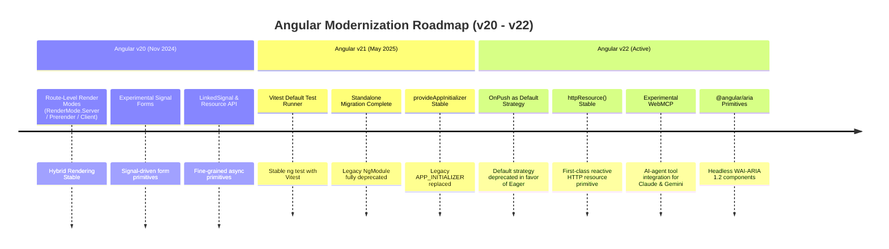

---

### 20.2 Official Compatibility Matrix (Angular v20 – v22)

| Angular Version | Release Date | Node.js Supported Ranges | TypeScript Supported | RxJS Supported | Default Change Detection | Primary Test Runner |
|---|---|---|---|---|---|---|
| **Angular v20** | November 2024 | `^18.19.0 \|\| ^20.9.0 \|\| ^22.0.0` | `~5.5.0 \|\| ~5.6.0` | `^7.8.0` | `Default` (Zone.js) | Karma / Vitest (Exp) |
| **Angular v21** | May 2025 | `^20.11.0 \|\| ^22.0.0` | `~5.6.0 \|\| ~5.7.0` | `^7.8.0` | `Default` / Zoneless Opt-in | **Vitest** (Stable) |
| **Angular v22** | November 2025 / Active | `^20.18.0 \|\| ^22.11.0 \|\| ^24.0.0` | `~5.7.0 \|\| ~5.8.0 \|\| ~5.9.0` | `^7.8.0 \|\| ^8.0.0` | **`OnPush`** (Default) | **Vitest** (Primary) |

---

### 20.3 Migration Guide: v20 → v21 → v22 Automated CLI Recipes

#### Step 1: Upgrading to Angular v21
```bash
# Update core framework packages, CLI, and Angular Material to v21
ng update @angular/core@21 @angular/cli@21 @angular/material@21

# Migrate automated unit test runner from Karma to Vitest
ng update @angular/core@21 --migrate-only karma-to-vitest

# Migrate legacy APP_INITIALIZER providers to provideAppInitializer()
ng update @angular/core@21 --migrate-only app-initializer
```

#### Step 2: Upgrading to Angular v22
```bash
# Update core framework packages and CLI to v22
ng update @angular/core@22 @angular/cli@22 @angular/material@22

# Automated migration: Flip component change detection strategy to OnPush
ng update @angular/core@22 --migrate-only change-detection-onpush

# Automated migration: Migrate stable httpResource primitives
ng update @angular/core@22 --migrate-only http-resource-stable
```

`ng update` moves you between versions; it does not finish paradigm migrations (NgModules to standalone, decorator inputs to signals, Zone.js to zoneless). In large codebases run those as separate, incremental migrations with `ng g @angular/core:standalone`, `@angular/core:signals` (or the individual `signal-input-migration`, `output-migration` and `signal-queries-migration`) and a `--path` per library. The recommended order and guardrails are in the incremental migrations part of [section 39](#39-enterprise-architecture-masterclass).

---

### 20.4 Deprecations & Breaking Changes Catalog (v20 – v22)

| Version | Deprecated API | Replacement API | Breaking Change Details |
|---|---|---|---|
| **v22** | `ChangeDetectionStrategy.Default` | `ChangeDetectionStrategy.Eager` or `OnPush` | `Default` is formally deprecated. Components without explicit strategy now default to **`OnPush`**. |
| **v22** | `@angular/animations` DSL triggers | Native CSS `@keyframes` & `animate.enter` / `animate.leave` | Browser View Transitions and native CSS transitions are the primary animation engine. |
| **v21** | Karma & Jasmine test runners | **Vitest** (`@angular/build:unit-test`) | Karma is removed from new CLI projects; Vitest is the primary runner. |
| **v19** | `APP_INITIALIZER`, `ENVIRONMENT_INITIALIZER` and `PLATFORM_INITIALIZER` tokens | `provideAppInitializer()`, `provideEnvironmentInitializer()`, `providePlatformInitializer()` | Deprecated since v19, not v21; listed here because many apps finish this migration during the v20 to v22 upgrade. Class-based multi-providers replaced with functional initializer callbacks. |
| **v20** | `NgModule` application bootstrapping | `bootstrapApplication(RootComponent, appConfig)` | Standalone APIs are the sole recommended architecture. |

## 21. Angular v22 Change Detection Architecture & Zoneless Traversal

### 21.1 `OnPush` as Default & The Deprecation of `ChangeDetectionStrategy.Default`
In Angular v22, **`ChangeDetectionStrategy.OnPush` is the default change detection strategy** for all newly generated components. The legacy `ChangeDetectionStrategy.Default` (which performed top-down recursive dirty-checking of every component on every browser event) is officially deprecated in favor of **`ChangeDetectionStrategy.Eager`**:

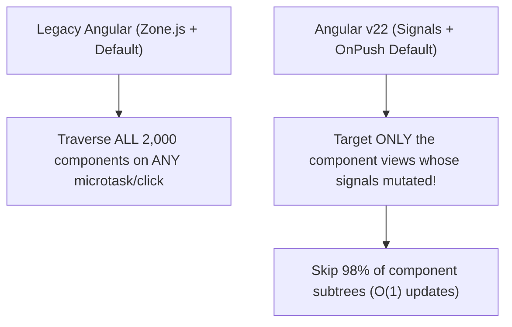

```typescript
import { Component, ChangeDetectionStrategy, signal, computed } from '@angular/core';

// In Angular v22, omitting `changeDetection` defaults to OnPush automatically!
@Component({
  selector: 'app-v22-telemetry-card',
  standalone: true,
  template: `
    <div class="card p-4 border rounded shadow-sm">
      <h3 class="font-bold">{{ title() }}</h3>
      <p class="text-2xl font-mono text-blue-600">{{ latency() }} ms</p>
      <span class="text-xs" [class.text-green-600]="isOptimal()">
        {{ isOptimal() ? 'Optimal Latency' : 'High Latency Warning' }}
      </span>
      <button (click)="pingTelemetry()" class="mt-2 px-3 py-1 bg-blue-600 text-white rounded">
        Ping Server
      </button>
    </div>
  `,
  // In v22, OnPush is the default. If legacy continuous checking is strictly required:
  // changeDetection: ChangeDetectionStrategy.Eager // (Replaces deprecated ChangeDetectionStrategy.Default)
})
export class TelemetryCardComponent {
  title = signal('Edge Gateway Telemetry');
  latency = signal(14);
  isOptimal = computed(() => this.latency() < 30);

  pingTelemetry() {
    this.latency.set(Math.floor(Math.random() * 50) + 5);
    // Setting latency() notifies the Angular reactive scheduler directly.
    // Only this component view is scheduled for checking.
  }
}
```

---

### 21.2 Signal-Driven Traversal & Subtree Skipping in Zoneless Applications
When using `provideZonelessChangeDetection()`, Angular replaces Zone.js monkey-patching with an internal reactive scheduler. Subtrees whose inputs, signals, or event bindings have not changed are skipped completely:

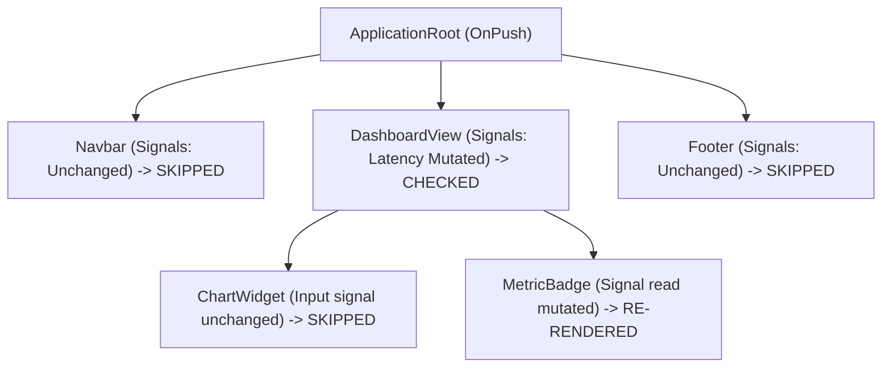

```typescript
// app.config.ts (Angular v22 Zoneless Setup)
import { ApplicationConfig, provideZonelessChangeDetection } from '@angular/core';
import { provideRouter } from '@angular/router';
import { routes } from './app.routes';

export const appConfig: ApplicationConfig = {
  providers: [
    // Activates fine-grained zoneless change detection without zone.js overhead
    provideZonelessChangeDetection(),
    provideRouter(routes),
  ],
};
```

---

### 21.3 `markForCheck()`, `detectChanges()`, and `ApplicationRef.tick()` in v22

| Method | Execution Timing | Traversal Behavior | Angular v22 Primary Use Case |
|---|---|---|---|
| **Signal Mutation** (`sig.set()`) | Microtask Coalesced | Notifies scheduler; marks specific view as dirty | **Default for 99% of modern code**. |
| `ChangeDetectorRef.markForCheck()` | Microtask Coalesced | Traverses parent path to root, marking components for next tick | Legacy RxJS / external callback interop. |
| `ChangeDetectorRef.detectChanges()` | **Synchronous Immediate** | Rerenders *only* this component and its immediate children | Immediate DOM measurement before paint. |
| `ApplicationRef.tick()` | **Synchronous Immediate** | Runs change detection across the entire application root | Global integration testing harness. |

---

### 21.4 Change Detection Triggers Comparison

```typescript
import { Component, input, model, output, signal } from '@angular/core';

@Component({
  selector: 'app-trigger-comparison',
  standalone: true,
  template: `
    <div class="space-y-2">
      <!-- 1. Signal input: triggers check only if input reference changes -->
      <p>Threshold: {{ threshold() }}</p>

      <!-- 2. Two-way model input: updates parent and child synchronously -->
      <input [value]="activeFilter()" (input)="activeFilter.set($any($event.target).value)" />

      <!-- 3. DOM event listener: automatically marks component dirty in OnPush -->
      <button (click)="triggerEvent()">Emit Action</button>
    </div>
  `
})
export class TriggerComparisonComponent {
  // Signal input: read-only from parent
  threshold = input.required<number>();

  // Two-way model input: writable by both parent and child
  activeFilter = model<string>('all');

  // Output emitter
  actionFired = output<string>();

  triggerEvent() {
    this.actionFired.emit('action_executed');
  }
}
```

> [!NOTE]
> If a single user action produces several change detection runs in the Angular DevTools profiler, look for an `effect()` that writes a signal the template reads, an `interval` updating a signal faster than the UI needs, or a library calling `ApplicationRef.tick()`. [Section 40](#40-advanced-performance-engineering-web-vitals-profiling-budgets--runtime-tuning) has a diagnostic flow.

> [!TIP]
> To see this traversal in a real app, call `enableProfiling()` from `@angular/core` in development and record in the Chrome DevTools Performance panel. The Angular track shows each change detection run and the components it visited, next to the browser's own work. [Section 40](#40-advanced-performance-engineering-web-vitals-profiling-budgets--runtime-tuning) covers how to read it.


---

## 22. Signal Forms Complete Masterclass

### 22.1 Signal Forms Core Architecture (`form()`, `FieldTree`, `FormField`)
Angular Signal Forms replace class-based `FormGroup` and string-based form controls with a **type-safe, signal-driven form tree**. Every field exposes fine-grained signals for value, validity, and metadata:

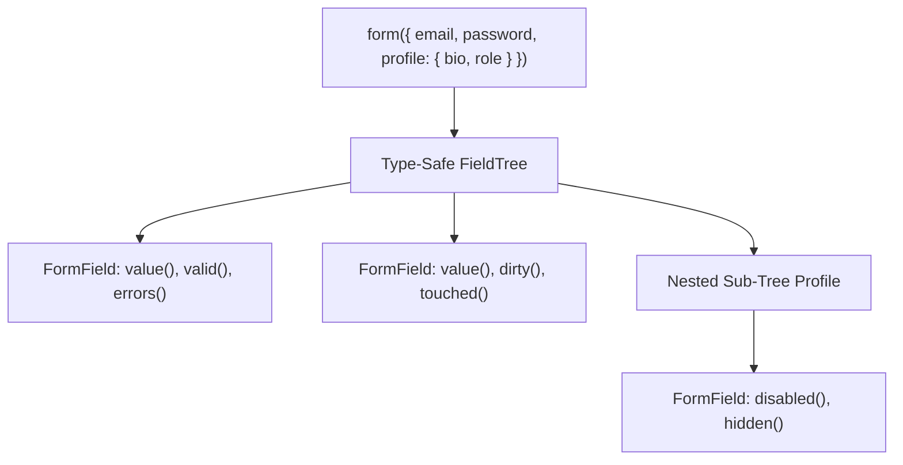

```typescript
import { Component, signal } from '@angular/core';
import { form, FormField, FieldTree } from '@angular/forms/signals';

interface UserRegistrationSchema {
  username: string;
  email: string;
  age: number;
  newsletter: boolean;
  preferences: {
    theme: 'light' | 'dark' | 'system';
    notifications: boolean;
  };
}

@Component({
  selector: 'app-signal-registration-form',
  standalone: true,
  template: `
    <form (submit)="onSubmit($event)" class="space-y-4 max-w-lg p-6 border rounded-lg shadow-sm">
      <h2 class="text-xl font-bold">Enterprise Signal Form Registration</h2>

      <!-- Username Field -->
      <div>
        <label class="block text-sm font-semibold">Username</label>
        <input
          [value]="regForm.username.value()"
          (input)="regForm.username.value.set($any($event.target).value)"
          [class.border-red-500]="regForm.username.invalid() && regForm.username.touched()"
          class="border px-3 py-1.5 rounded w-full"
        />
        @if (regForm.username.invalid() && regForm.username.touched()) {
          <p class="text-red-500 text-xs mt-1">{{ regForm.username.errors()?.[0] }}</p>
        }
      </div>

      <!-- Email Field with Async Validation -->
      <div>
        <label class="block text-sm font-semibold">Corporate Email</label>
        <input
          type="email"
          [value]="regForm.email.value()"
          (input)="regForm.email.value.set($any($event.target).value)"
          class="border px-3 py-1.5 rounded w-full"
        />
        @if (regForm.email.pending()) {
          <span class="text-xs text-blue-500 animate-pulse">Checking email availability...</span>
        }
      </div>

      <!-- Nested Preferences Tree -->
      <fieldset class="border p-3 rounded space-y-2">
        <legend class="text-sm font-semibold px-1">Preferences</legend>
        <select
          [value]="regForm.preferences.theme.value()"
          (change)="regForm.preferences.theme.value.set($any($event.target).value)"
          class="border px-2 py-1 rounded w-full"
        >
          <option value="light">Light Theme</option>
          <option value="dark">Dark Theme</option>
          <option value="system">System Default</option>
        </select>
      </fieldset>

      <button
        type="submit"
        [disabled]="regForm.invalid() || regForm.pending()"
        class="px-4 py-2 bg-blue-600 text-white font-semibold rounded disabled:opacity-50"
      >
        {{ regForm.pending() ? 'Validating...' : 'Register Account' }}
      </button>
    </form>
  `
})
export class SignalRegistrationFormComponent {
  // Initialize the typed Signal Form tree
  regForm = form<UserRegistrationSchema>({
    username: '',
    email: '',
    age: 21,
    newsletter: true,
    preferences: {
      theme: 'system',
      notifications: true,
    },
  });

  onSubmit(e: Event) {
    e.preventDefault();
    if (this.regForm.valid()) {
      console.log('Form data submitted:', this.regForm.value());
    }
  }
}
```

> [!IMPORTANT]
> **v22 API check:** `form()` takes a `WritableSignal` of the model, not a plain object: `regForm = form(signal<UserRegistrationSchema>({ ... }))`. Calling a field returns its state, so reads are `regForm.username().value()`, `regForm.username().invalid()`, `regForm().pending()`. Bind inputs with the `FormField` directive (`imports: [FormField]`, `<input [formField]="regForm.username" />`) instead of manual `[value]`/`(input)` pairs; the directive also handles touched-on-blur, `disabled`, `required` and other state.

---

### 22.2 Field Reactive State Signals Matrix

Every field in a Signal Form exposes standard reactive signals:

| Field Signal | Type | Description |
|---|---|---|
| `field.value()` | `Signal<T>` | Current reactive value of the field. Writable via `.set()` or `.update()`. |
| `field.valid()` | `Signal<boolean>` | `true` if all sync and async validators have passed. |
| `field.invalid()` | `Signal<boolean>` | `true` if any validation error exists. |
| `field.dirty()` | `Signal<boolean>` | `true` if the user has modified the value from its initial state. |
| `field.touched()` | `Signal<boolean>` | `true` if the field has received and lost focus (`blur`). |
| `field.pending()` | `Signal<boolean>` | `true` while asynchronous validators are currently in-flight. |
| `field.errors()` | `Signal<string[] \| null>` | Array of active error messages or validation tokens. |
| `field.disabled()` | `Signal<boolean>` | `true` if the field is excluded from submission and disabled. |

In v22, signals live on the field *state*: `field().value()`, `field().errors()`, and so on. `errors()` returns `ValidationError.WithFieldTree[]` (objects with `kind` and optional `message`), not `string[]`. Also available: `errorSummary()` (errors including descendants), `hidden()`, `readonly()`, `required()`, `submitting()`, and the methods `markAsTouched()`, `markAsDirty()`, `reset()`. Note that `valid()` is not the same as `!invalid()`: while an async rule is pending both are `false`.

---

### 22.3 Cross-Field Validation & Custom Validators

> [!WARNING]
> **Correction for v22:** `@angular/forms/signals` does not export `ValidatorFn` or `AsyncValidatorFn` (those are Reactive Forms types in `@angular/forms`), so the snippet below does not compile as written. Signal Forms validation is declared with schema rule functions: `validate(path, ctx => error | null)` for custom sync rules, `validateTree()` for rules that target child fields, and `validateAsync()` / `validateHttp()` for async rules (both require `onSuccess` and `onError`, accept `debounce`, and cancel stale requests automatically). Errors are objects such as `{ kind: 'invalidDomain', message: '...' }`.

For a cross-field example, read the other value with `valueOf(path)` inside the rule:

```typescript
import { form, schema, validate } from '@angular/forms/signals';

const signupSchema = schema<{ password: string; confirm: string }>((p) => {
  validate(p.confirm, ({ value, valueOf }) =>
    value() === valueOf(p.password) ? null : { kind: 'mismatch', message: 'Passwords do not match' },
  );
});
```

See [section 34](#34-advanced-forms-architecture) for async rules and server errors on submit. The original snippet follows for reference:
```typescript
import { ValidatorFn, AsyncValidatorFn } from '@angular/forms/signals';

// 1. Synchronous Custom Validator
export function enterpriseDomainValidator(allowedDomain: string): ValidatorFn<string> {
  return (value: string) => {
    if (!value || value.endsWith(`@${allowedDomain}`)) return null;
    return { invalidDomain: `Email must belong to @${allowedDomain}` };
  };
}

// 2. Asynchronous Validator with Auto-Cancellation & Debouncing
export function checkUsernameAvailable(apiService: any): AsyncValidatorFn<string> {
  return async (username: string, signal: AbortSignal) => {
    if (!username || username.length < 3) return null;
    try {
      const response = await fetch(`/api/users/check?username=${encodeURIComponent(username)}`, { signal });
      const data = await response.json();
      return data.available ? null : { usernameTaken: 'This username is already claimed' };
    } catch (err: any) {
      if (err.name === 'AbortError') return null; // Gracefully handle cancelled debounces
      return { networkError: 'Verification failed' };
    }
  };
}
```

---

### 22.4 Migration Guide: Reactive Forms (`FormGroup`) → Signal Forms (`form()`)

| Reactive Forms (v2 – v21 Legacy) | Signal Forms (v22 Modern) | Refactoring Benefit |
|---|---|---|
| `fb.group({ email: ['', [Validators.required]] })` | `form(signal<Schema>({ email: '' }), (p) => { required(p.email); })` | **Full TypeScript inference** without string-key lookups. |
| `form.get('email')?.value` | `form.email().value()` | Direct reactive signal read; zero runtime string indexing errors. |
| `form.get('email')?.valueChanges.pipe(...)` | `computed(() => form.email().value())` | Pure synchronous signal derivation; zero manual unsubscribe leaks. |
| `[formControl]="form.controls.email"` | `[formField]="form.email"` | Unbundled from DOM directive overhead; works with any custom primitive. |

For gradual migration, `compatForm()` from `@angular/forms/signals/compat` lets a Signal Forms model contain existing `FormControl` instances.


---

## 23. Resource API & `httpResource()` Deep Dive

### 23.1 The `resource()` API Lifecycle
The `resource()` function creates an asynchronous data resource tied directly to signal reactivity. When its reactive `params` signal mutates, it automatically cancels in-flight loaders and transitions through its lifecycle states:

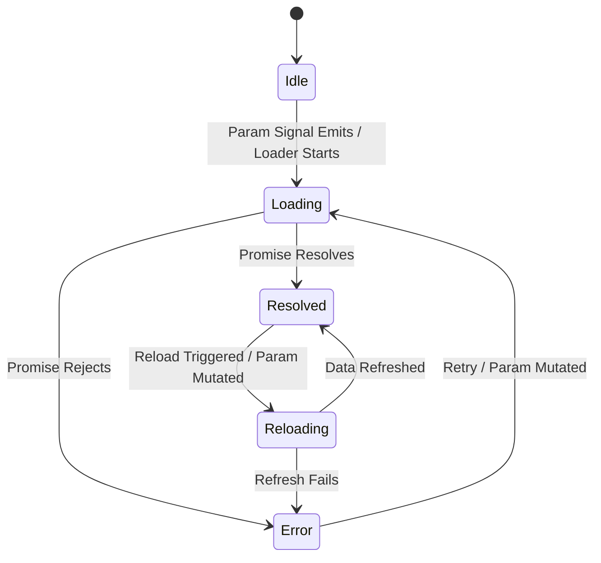

The diagram leaves out two states. `idle` is entered when `params` returns `undefined` (nothing to load). `local` is entered when you call `set()` or `update()` on the resource; the local value stays until params change or `reload()` runs. A params change moves to `loading` and drops the old value, while `reload()` moves to `reloading` and keeps the old value visible. Full state machine and race handling: [section 31.8](#318-resource-internals-cancellation-races--local-overrides).

```typescript
import { Component, signal, resource, linkedSignal } from '@angular/core';

export interface ProjectData {
  id: string;
  name: string;
  status: 'ACTIVE' | 'ARCHIVED';
  tasksCount: number;
}

@Component({
  selector: 'app-resource-explorer',
  standalone: true,
  template: `
    <div class="p-6 border rounded-lg max-w-xl space-y-4">
      <div class="flex gap-2">
        <button (click)="projectId.set('proj_1')" class="px-3 py-1 bg-gray-200 rounded">Project 1</button>
        <button (click)="projectId.set('proj_2')" class="px-3 py-1 bg-gray-200 rounded">Project 2</button>
        <button (click)="projectResource.reload()" class="px-3 py-1 bg-blue-100 text-blue-700 rounded">Reload</button>
      </div>

      <!-- Resource Status Tracking -->
      @switch (projectResource.status()) {
        @case ('loading') {
          <div class="p-4 bg-yellow-50 text-yellow-800 rounded animate-pulse">Loading project details...</div>
        }
        @case ('resolved') {
          <div class="p-4 bg-green-50 border border-green-200 rounded">
            <h3 class="font-bold text-lg">{{ projectResource.value()?.name }}</h3>
            <p>Status: {{ projectResource.value()?.status }}</p>
            <p>Total Tasks: {{ projectResource.value()?.tasksCount }}</p>
          </div>
        }
        @case ('error') {
          <div class="p-4 bg-red-50 text-red-700 rounded">
            Failed to load: {{ projectResource.error() }}
          </div>
        }
      }
    </div>
  `
})
export class ResourceExplorerComponent {
  projectId = signal('proj_1');

  // Resource automatically re-executes when projectId() changes, passing an AbortSignal!
  projectResource = resource<ProjectData, string>({
    params: () => this.projectId(),
    loader: async ({ params: id, abortSignal }) => {
      const response = await fetch(`https://api.enterprise.io/projects/${id}`, {
        signal: abortSignal, // Auto-cancels if user clicks Project 2 before Project 1 resolves!
      });
      if (!response.ok) throw new Error(`Project query returned ${response.status}`);
      return response.json();
    },
  });

  // linkedSignal: Resets local edit state whenever the server resource resolves fresh data
  localProjectName = linkedSignal(() => this.projectResource.value()?.name ?? '');
}
```

---

### 23.2 `httpResource()` Stable in Angular v22
`httpResource()` is a first-class HTTP primitive in Angular v22 that bridges the reactive `HttpClient` with Signals. It eliminates manual `takeUntilDestroyed()`, `toSignal()`, and subscription management:

```typescript
import { Component, signal } from '@angular/core';
import { httpResource } from '@angular/common/http';

export interface AuditLogItem {
  id: string;
  action: string;
  actor: string;
  timestamp: string;
}

@Component({
  selector: 'app-http-resource-demo',
  standalone: true,
  template: `
    <div class="p-6 border rounded-lg">
      <h2 class="text-xl font-bold mb-4">Enterprise Audit Logs via httpResource()</h2>

      <div class="flex items-center gap-3 mb-4">
        <label class="text-sm font-semibold">Filter Actor:</label>
        <input
          [value]="actorQuery()"
          (input)="actorQuery.set($any($event.target).value)"
          placeholder="e.g. admin"
          class="border px-2 py-1 rounded"
        />
        @if (auditLogs.isLoading()) {
          <span class="text-xs text-blue-500 animate-pulse">Streaming network request...</span>
        }
      </div>

      <!-- httpResource reactive status checks -->
      @if (auditLogs.hasValue()) {
        <table class="w-full text-left divide-y border rounded">
          <thead>
            <tr class="bg-gray-50 text-xs font-semibold text-gray-500">
              <th class="p-2">Action</th>
              <th class="p-2">Actor</th>
              <th class="p-2">Timestamp</th>
            </tr>
          </thead>
          <tbody class="divide-y text-sm">
            @for (log of auditLogs.value(); track log.id) {
              <tr>
                <td class="p-2 font-mono">{{ log.action }}</td>
                <td class="p-2">{{ log.actor }}</td>
                <td class="p-2 text-gray-400">{{ log.timestamp }}</td>
              </tr>
            }
          </tbody>
        </table>
      } @else if (auditLogs.error()) {
        <div class="text-red-600 p-3 bg-red-50 rounded">
          HTTP Error (Status {{ auditLogs.statusCode() }}): {{ auditLogs.error()?.message }}
        </div>
      }
    </div>
  `
})
export class HttpResourceDemoComponent {
  actorQuery = signal('');

  // httpResource re-triggers reactively whenever actorQuery() emits!
  auditLogs = httpResource<AuditLogItem[]>(() => ({
    url: '/api/audit-logs',
    params: { actor: this.actorQuery() },
    headers: { 'X-Telemetry-Channel': 'Enterprise-HTTP' }
  }));
}
```

> [!TIP]
> Two details the example glosses over. First, return `undefined` from the request function to keep the resource `idle` instead of sending a request with an empty filter, for example `() => this.actorQuery() ? { url: '/api/audit-logs', params: { actor: this.actorQuery() } } : undefined`. Second, `value()` throws while the resource is in the `error` state, so always guard it with `hasValue()`, as the template does. For `parse`, `defaultValue`, `equal`, `chain()` and cancellation behavior, see the `httpResource()` in Depth part of [section 35](#35-http-internals-data-fetching-patterns--real-time-networking).

---

### 23.3 Specialized Response Formats & SSR TransferState Caching
```typescript
import { httpResource } from '@angular/common/http';

// 1. Text Parsing
export const rawLicenseAgreement = httpResource.text(() => '/assets/legal/enterprise-eula.txt');

// 2. Blob Parsing (Binary Report PDF)
export const financialReportPdf = httpResource.blob(() => '/api/reports/q4-financials.pdf');

// 3. ArrayBuffer Parsing (Protobuf / WebAssembly Binaries)
export const tensorModelWeights = httpResource.arrayBuffer(() => '/models/recommendation-engine.onnx');

// 4. SSR transfer cache
// The transfer cache belongs to HttpClient, not to httpResource: with provideClientHydration(),
// responses fetched through HttpClient during the server render (httpResource included)
// are embedded in the page and reused during hydration instead of being requested again.
// Defaults: GET/HEAD only, no response headers, and requests with auth headers or credentials are skipped.
// Tune with withHttpTransferCacheOptions({ filter, includeHeaders, includePostRequests, ... })
// or per request with { transferCache: false }.
export const liveStock = httpResource(() => ({ url: '/api/stock', transferCache: false }));
```

For cache options, per-request `transferCache`, origin mapping and manual `TransferState`, see [section 37.10](#3710-customizing-the-http-transfer-cache).


---

## 24. Angular Aria (`@angular/aria`) & WebMCP / Angular AI

### 24.1 Angular Aria (`@angular/aria`) Headless Primitives
Angular Aria provides **headless accessibility directives** that implement strict WAI-ARIA 1.2 interaction behaviors (keyboard navigation, focus management, ARIA attribute reflection) without imposing any opinionated CSS or HTML markup:

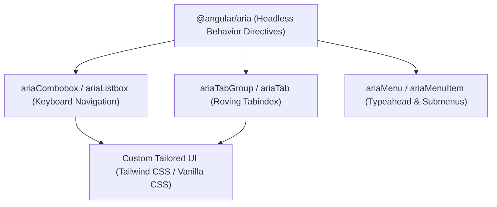

> [!IMPORTANT]
> **Correction for v22:** `@angular/aria` does not export `AriaCombobox`, `AriaComboboxInput`, `AriaListbox` or `AriaOption`, so the example that follows is illustrative only. The listbox entry point exports `Listbox` and `Option` (`import { Listbox, Option } from '@angular/aria/listbox'`) with selectors `[ngListbox]` and `[ngOption]` (`value` is a required input on `ngOption`, and the listbox's `value` is a model of the selected values). The combobox entry point exports `Combobox`, `ComboboxPopup` and `ComboboxWidget` (`[ngCombobox]`, `ng-template[ngComboboxPopup]`, `[ngComboboxWidget]`); menus use `ngMenu`, `ngMenuItem`, `ngMenuTrigger`, `ngMenuBar`. The package was introduced in v21 as a developer preview; check the stability label in the docs for your version before using it in a shared design system. The stable CDK equivalents (`CdkListbox`, `CdkMenu`, `ActiveDescendantKeyManager`) are covered in [section 43](#43-web-platform-integration-cdk-i18n-pwa-storage-and-interop).
>
> A listbox written against the real API:
>
> ```typescript
> import { Component, signal } from '@angular/core';
> import { Listbox, Option } from '@angular/aria/listbox';
>
> @Component({
>   selector: 'app-clearance-listbox',
>   imports: [Listbox, Option],
>   template: `
>     <label id="clearance-label">Security clearance</label>
>     <ul ngListbox aria-labelledby="clearance-label" [(value)]="selected">
>       @for (role of roles; track role) {
>         <li ngOption [value]="role" [label]="role">{{ role }}</li>
>       }
>     </ul>
>     <p>Selected: {{ selected()[0] }}</p>
>   `,
> })
> export class ClearanceListboxComponent {
>   readonly roles = ['Level 1: Public Trust', 'Level 2: Confidential', 'Level 3: Secret'];
>   readonly selected = signal<string[]>(['Level 1: Public Trust']);
> }
> ```

```typescript
import { Component, signal } from '@angular/core';
import {
  AriaCombobox,
  AriaComboboxInput,
  AriaListbox,
  AriaOption,
} from '@angular/aria/combobox';

@Component({
  selector: 'app-headless-combobox',
  standalone: true,
  imports: [AriaCombobox, AriaComboboxInput, AriaListbox, AriaOption],
  template: `
    <div class="combobox-wrapper relative max-w-xs" ariaCombobox>
      <label class="block text-sm font-semibold mb-1">Select Security Clearance</label>
      
      <!-- Headless input managing ARIA-expanded and keyboard arrow navigation -->
      <input
        ariaComboboxInput
        [value]="selectedRole()"
        (input)="query.set($any($event.target).value)"
        class="w-full border px-3 py-1.5 rounded focus:ring-2 focus:ring-blue-500"
        placeholder="Search clearance..."
      />

      <!-- Headless Listbox with automatic activeDescendant management -->
      <ul ariaListbox class="absolute z-10 w-full mt-1 bg-white dark:bg-gray-800 border rounded shadow-lg divide-y max-h-48 overflow-auto">
        @for (item of filteredRoles(); track item) {
          <li
            ariaOption
            [value]="item"
            (selected)="selectedRole.set(item)"
            class="p-2 cursor-pointer hover:bg-blue-50 dark:hover:bg-gray-700 text-sm"
          >
            {{ item }}
          </li>
        }
      </ul>
    </div>
  `
})
export class HeadlessComboboxComponent {
  roles = ['Level 1: Public Trust', 'Level 2: Confidential', 'Level 3: Secret', 'Level 4: Top Secret'];
  query = signal('');
  selectedRole = signal('Level 1: Public Trust');

  filteredRoles = () => this.roles.filter(r => r.toLowerCase().includes(this.query().toLowerCase()));
}
```

#### Angular Aria vs Angular CDK vs Angular Material Decision Matrix

| Dimension | `@angular/aria` (v22) | `@angular/cdk` | `@angular/material` |
|---|---|---|---|
| **Styling** | 100% Unstyled (Zero CSS) | Mostly Unstyled (Basic structural CSS) | Opinionated Material Design 3 |
| **Focus** | Strict WAI-ARIA behavioral contracts | General utility behaviors (Overlay, Drag) | Ready-to-ship UI design components |
| **Primary Use** | Building custom enterprise design systems | Complex UI widgets (Portals, Virtual Scroll) | Standardized Material enterprise apps |

---

### 24.2 WebMCP: AI-Agent Integration with Angular Applications
The Web Model Context Protocol (WebMCP) enables AI agents (Claude, Gemini, Cursor) to discover, inspect, and execute typed tools directly inside a running Angular application:

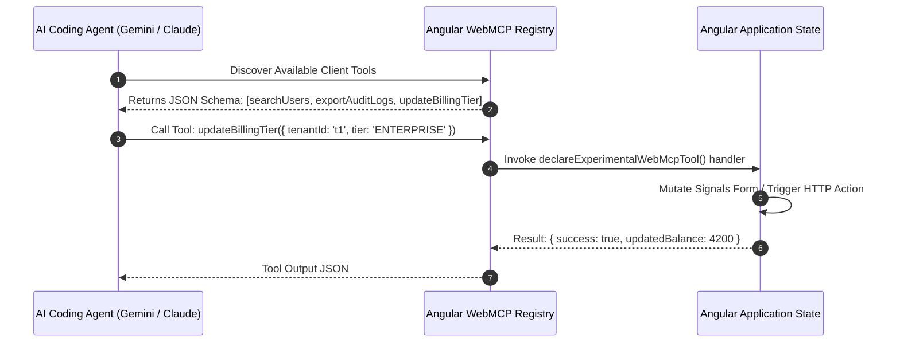

```typescript
// app.config.ts (Registering WebMCP AI Tool Registry)
import { ApplicationConfig } from '@angular/core';
import { provideExperimentalWebMcpTools } from '@angular/core/ai';

export const appConfig: ApplicationConfig = {
  providers: [
    provideExperimentalWebMcpTools({
      agentName: 'EnterpriseConsoleAgent',
      capabilities: ['form-inspection', 'data-export', 'workflow-automation'],
    }),
  ],
};
```

```typescript
// services/billing-mcp-tools.service.ts
import { Injectable, inject } from '@angular/core';
import { declareExperimentalWebMcpTool } from '@angular/core/ai';
import { HttpClient } from '@angular/common/http';

@Injectable({ providedIn: 'root' })
export class BillingMcpToolsService {
  private http = inject(HttpClient);

  // Expose a typed tool callable by AI agents interacting with the Angular browser tab
  readonly updateBillingTool = declareExperimentalWebMcpTool({
    name: 'updateBillingTier',
    description: 'Upgrades or downgrades the current enterprise organization subscription tier',
    inputSchema: {
      type: 'object',
      properties: {
        organizationId: { type: 'string', description: 'Unique organization UUID' },
        tier: { type: 'string', enum: ['STARTER', 'PRO', 'ENTERPRISE'] },
      },
      required: ['organizationId', 'tier'],
    },
    handler: async ({ organizationId, tier }) => {
      console.log(`[WebMCP Invocation] Upgrading ${organizationId} to ${tier}`);
      const result = await fetch(`/api/organizations/${organizationId}/billing`, {
        method: 'POST',
        headers: { 'Content-Type': 'application/json' },
        body: JSON.stringify({ tier }),
      });
      return result.json();
    },
  });
}
```


---

## 25. Route-Level Rendering, Modern Router, View Transitions & Native CSS Animations

### 25.1 Server Routing & Route-Level Rendering (`RenderMode`)
In Angular v20+, applications no longer need to choose globally between SSR or SSG. The Server Routing API allows configuring **granular render modes per route** in `app.routes.server.ts`:

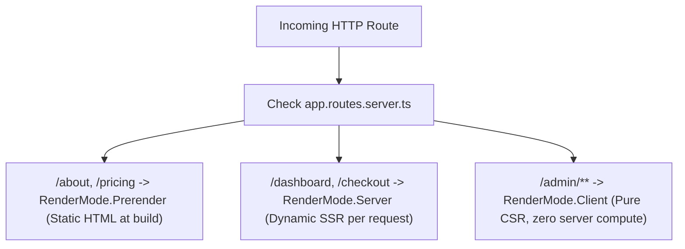

```typescript
// app.routes.server.ts (Server Route Configuration)
import { RenderMode, ServerRoute } from '@angular/ssr';

export const serverRoutes: ServerRoute[] = [
  // 1. Static Prerendering (Built ahead of time during 'ng build')
  {
    path: '',
    renderMode: RenderMode.Prerender,
  },
  {
    path: 'features',
    renderMode: RenderMode.Prerender,
  },

  // 2. Dynamic Parameterized Prerendering (e.g. Top 500 Product Slugs)
  {
    path: 'products/:slug',
    renderMode: RenderMode.Prerender,
    async getPrerenderParams() {
      const topSlugs = ['cloud-compute', 'edge-storage', 'ai-accelerator'];
      return topSlugs.map(slug => ({ slug }));
    },
  },

  // 3. Dynamic Server-Side Rendering (SSR) per request (Personalized dashboards)
  {
    path: 'dashboard',
    renderMode: RenderMode.Server,
  },

  // 4. Client-Only Rendering (CSR) for heavily interactive admin portals
  {
    path: 'console/**',
    renderMode: RenderMode.Client,
  },
];
```

**Wiring and extra options:** the list is registered with `provideServerRendering(withRoutes(serverRoutes))` from `@angular/ssr` in `app.config.server.ts`. Each server route can also set `headers` (for example `Cache-Control`) and, except for `Prerender` routes, a `status` (for example `404` on the `'**'` route, or `301` on a route with `redirectTo`). Parameterized prerender routes accept `fallback: PrerenderFallback.Server | Client | None` for values that were not prerendered (default `Server`). `getPrerenderParams()` runs in an injection context, so it can call `inject()`.

---

### 25.2 Modern Angular Router: `withViewTransitions()`, `UrlTree` & Navigation Handlers

```typescript
// app.config.ts (Modern Router Feature Functions)
import { ApplicationConfig } from '@angular/core';
import {
  provideRouter,
  withComponentInputBinding,
  withViewTransitions,
  withNavigationErrorHandler,
} from '@angular/router';
import { routes } from './app.routes';

export const appConfig: ApplicationConfig = {
  providers: [
    provideRouter(
      routes,
      // 1. Automatic route & query param binding directly to component input() signals
      withComponentInputBinding(),

      // 2. Native Browser View Transitions API Integration
      withViewTransitions({
        skipInitialTransition: true,
        onViewTransitionCreated: ({ transition, from, to }) => {
          console.log(`Transitioning from ${from.url} -> ${to.url}`);
        },
      }),

      // 3. Resilient Navigation Error Handling
      withNavigationErrorHandler((error) => {
        console.error('[Router Navigation Error Caught]:', error);
      })
    ),
  ],
};
```

> [!NOTE]
> `withViewTransitions()` is still marked developer preview in Angular v22. The handler passed to `withNavigationErrorHandler()` runs in an injection context and may return a `RedirectCommand` to send the user to an error page, for example `return new RedirectCommand(inject(Router).parseUrl('/error'));`. Other router features that pair well with these are `withInMemoryScrolling()`, `withPreloading()` and `withDebugTracing()`, covered in [section 33](#33-advanced-routing-navigation-lifecycle-cancellation-matchers-strategies--router-testing).

`from` and `to` in `onViewTransitionCreated` are the **root** `ActivatedRouteSnapshot`s, so `from.url` is usually an empty segment array; walk `firstChild` to the leaf to compare screens, or read `inject(Router).currentNavigation()` for the target URL. For skipping transitions (reduced motion, same-screen param changes, per-link opt-out via navigation `info`) and direction-aware animations, see [section 43](#43-web-platform-integration-cdk-i18n-pwa-storage-and-interop).

---

### 25.3 Native CSS Morphing Transitions (`view-transition-name`)
View Transitions smoothly animate layout changes between route changes:

```html
<!-- product-list.component.html -->
<div class="product-grid">
  @for (product of products(); track product.id) {
    <a [routerLink]="['/products', product.id]">
      <!-- Element morphs seamlessly into the detail hero image on click! -->
      
      <h4>{{ product.title }}</h4>
    </a>
  }
</div>
```

```css
/* styles.css: Custom View Transition Animations */
::view-transition-old(root) {
  animation: 0.25s ease-out both fade-out;
}

::view-transition-new(root) {
  animation: 0.25s ease-in both fade-in;
}

@keyframes fade-out {
  from { opacity: 1; transform: scale(1); }
  to { opacity: 0; transform: scale(0.98); }
}

@keyframes fade-in {
  from { opacity: 0; transform: scale(1.02); }
  to { opacity: 1; transform: scale(1); }
}
```

---

### 25.4 Modern Angular Animations: `animate.enter` & `animate.leave`

> [!IMPORTANT]
> The legacy `@angular/animations` package (with `trigger`, `state`, `transition`, and `animate`) is formally deprecated. Angular recommends **native CSS animations** paired with signal control or the modern `animate.enter` / `animate.leave` structural classes.

```html
<!-- modern-dialog.component.html -->
@if (isOpen()) {
  <div class="modal-dialog animate-fade-in animate-slide-up">
    <h3>Enterprise Security Audit</h3>
    <p>Session tokens verified via biometric challenge.</p>
    <button (click)="isOpen.set(false)">Dismiss</button>
  </div>
}
```

```css
/* Native CSS Transitions replacing legacy @angular/animations DSL */
.animate-fade-in {
  animation: fadeIn 0.2s cubic-bezier(0.16, 1, 0.3, 1) forwards;
}

@keyframes fadeIn {
  from { opacity: 0; transform: translateY(8px); }
  to { opacity: 1; transform: translateY(0); }
}
```

**The actual `animate.enter` / `animate.leave` API** (stable since v20.2):

```html
@if (isOpen()) {
  <!-- Static class names -->
  <div class="modal-dialog" animate.enter="dialog-in" animate.leave="dialog-out">...</div>
}

<!-- Bound class names, e.g. to vary by direction -->
<li [animate.enter]="enterClass()" animate.leave="row-out">...</li>

<!-- Function form, for JS animation libraries: call animationComplete() when done -->
<div (animate.leave)="slideOut($event)">...</div>
```

```typescript
import { AnimationCallbackEvent } from '@angular/core';

slideOut(event: AnimationCallbackEvent) {
  const anim = event.target.animate([{ opacity: 1 }, { opacity: 0, transform: 'translateY(8px)' }], 200);
  anim.onfinish = () => event.animationComplete();   // element is removed only after this
}
```

If `animationComplete()` is never called, Angular removes the element after a timeout configured by the `MAX_ANIMATION_TIMEOUT` token. Respect reduced motion with `@media (prefers-reduced-motion: reduce) { .dialog-in, .dialog-out { animation: none; } }`.


---

## 26. Modern HTTP Engine, Advanced DI, SSR Hydration & `@defer` Deep Dive

### 26.1 Modern HTTP Engine: `withFetch()`, Streaming & Resilient Token Refresh
Angular's `HttpClient` in modern architectures uses the native browser `fetch` API via `withFetch()`. This enables streaming responses, Service Worker cache interaction, and zero-allocation network transfers:

```typescript
// app.config.ts (Configuring Modern HTTP Engine)
import { ApplicationConfig } from '@angular/core';
import { provideHttpClient, withFetch, withInterceptors } from '@angular/common/http';
import { authRefreshInterceptor } from './interceptors/auth-refresh.interceptor';
import { correlationIdInterceptor } from './interceptors/correlation-id.interceptor';

export const appConfig: ApplicationConfig = {
  providers: [
    provideHttpClient(
      // Not needed in v22: FetchBackend is already the default
      withFetch(),
      withInterceptors([correlationIdInterceptor, authRefreshInterceptor])
    ),
  ],
};
```

```typescript
// interceptors/auth-refresh.interceptor.ts
import { HttpInterceptorFn, HttpErrorResponse } from '@angular/common/http';
import { inject } from '@angular/core';
import { catchError, switchMap, throwError, from, Subject, filter, take } from 'rxjs';
import { AuthService } from '../services/auth.service';

let isRefreshing = false;
const refreshTokenSubject = new Subject<string | null>();

export const authRefreshInterceptor: HttpInterceptorFn = (req, next) => {
  const auth = inject(AuthService);

  return next(req).pipe(
    catchError((error: HttpErrorResponse) => {
      if (error.status === 401 && !req.url.includes('/api/auth/refresh')) {
        if (!isRefreshing) {
          isRefreshing = true;
          refreshTokenSubject.next(null);

          return from(auth.rotateRefreshToken()).pipe(
            switchMap((newToken: string) => {
              isRefreshing = false;
              refreshTokenSubject.next(newToken);
              return next(req.clone({ setHeaders: { Authorization: `Bearer ${newToken}` } }));
            }),
            catchError((refreshErr) => {
              isRefreshing = false;
              auth.forceLogout();
              return throwError(() => refreshErr);
            })
          );
        } else {
          // Concurrent 401 queue: queue all subsequent requests until new token arrives!
          return refreshTokenSubject.pipe(
            filter((token): token is string => token !== null),
            take(1),
            switchMap((token) => next(req.clone({ setHeaders: { Authorization: `Bearer ${token}` } })))
          );
        }
      }
      return throwError(() => error);
    })
  );
};
```

> [!NOTE]
> Since Angular v22, `FetchBackend` is the default `HttpBackend` and `withFetch()` is deprecated, because it no longer changes anything. To go back to `XMLHttpRequest` (for example for upload progress events, which fetch cannot report), use `withXhr()`. Avoid `withXhr()` in SSR: server-side XHR is deprecated and slated for removal. See [section 35](#35-http-internals-data-fetching-patterns--real-time-networking) for the full request lifecycle and the fetch/XHR comparison.

The refresh call inside `auth.rotateRefreshToken()` must not pass through this interceptor again. Send it with an `HttpContextToken` opt-out flag, or with a client built from `new HttpClient(inject(HttpBackend))`.

Attach the bearer token only to your own API origins (check `req.url` against configured origins) and let specific calls opt out with an `HttpContextToken`. If several tabs share a session, make sure only one refreshes at a time (for example with `navigator.locks.request('token-refresh', ...)`), or refresh-token rotation can invalidate the token another tab just received. Architecture choices such as a Backend-for-Frontend and cross-tab logout are covered in [section 39](#39-enterprise-architecture-masterclass).

> [!WARNING]
> If your authorization server rotates refresh tokens with reuse detection, two refreshes sent with the same token (two tabs, or two queues) look like token theft and revoke the session. Serialize refreshes across tabs too (Web Locks or `BroadcastChannel`), and keep the refresh token in an `HttpOnly` cookie rather than `localStorage`. See "Token Storage and Refresh-Token Rotation" in [section 41](#41-application-security-in-depth-dom-xss-csp-authentication-flows--supply-chain).

---

### 26.2 Advanced Dependency Injection: `provideAppInitializer()` & `runInInjectionContext`
Angular v19 introduced the functional `provideAppInitializer()` and deprecated the `APP_INITIALIZER` token, together with `ENVIRONMENT_INITIALIZER` and `PLATFORM_INITIALIZER` (replaced by `provideEnvironmentInitializer()` and `providePlatformInitializer()`). In v22 `provideAppInitializer()` is the way to run async startup work:

```typescript
import { ApplicationConfig, provideAppInitializer, inject } from '@angular/core';
import { RuntimeConfigService } from './services/runtime-config.service';

export const appConfig: ApplicationConfig = {
  providers: [
    // Asynchronous Application Bootstrap Initializer
    provideAppInitializer(async () => {
      const configService = inject(RuntimeConfigService);
      console.log('Loading enterprise runtime configurations before bootstrap...');
      await configService.loadRemoteConfig();
    }),
  ],
};
```

```typescript
// Executing code inside dynamic injection context
import { Injector, runInInjectionContext } from '@angular/core';

export function executeDynamicTask(injector: Injector, callback: () => void) {
  // Makes inject() work for the synchronous duration of the callback only.
  // Anything after an await or inside a later setTimeout runs without the context.
  runInInjectionContext(injector, () => {
    callback();
  });
}
```

Several `provideAppInitializer()` functions are called in provider order, but their promises and observables are awaited **in parallel**, and an observable must complete before bootstrap continues. Call `inject()` before the first `await`. [Section 29.7](#297-initializers-in-depth-provideappinitializer-provideenvironmentinitializer-provideplatforminitializer) covers ordering, error handling and the environment and platform variants. For the full list of injection contexts, `assertInInjectionContext()` and the NG0203 error, see [section 32.1](#321-injection-context-where-inject-is-allowed) and [section 32.2](#322-runininjectioncontext-in-depth).

---

### 26.3 `@defer` Multi-Trigger Architecture & Prefetch Optimization
`@defer` allows deferring the loading and hydration of component subtrees until specific browser conditions are satisfied:

```html
<!-- Heavy analytics chart deferred with composite viewport and interaction triggers -->
@defer (on viewport; prefetch on idle) {
  <app-heavy-financial-chart [data]="portfolioData()" />
} @placeholder (minimum 300ms) {
  <div class="h-64 bg-gray-100 dark:bg-gray-800 rounded animate-pulse p-4">
    <p class="text-xs text-gray-400">Chart will render when scrolled into viewport...</p>
  </div>
} @loading (after 100ms; minimum 500ms) {
  <div class="h-64 flex items-center justify-center">
    <span class="animate-spin h-6 w-6 border-2 border-blue-600 border-t-transparent rounded-full" />
  </div>
} @error {
  <div class="p-4 bg-red-50 text-red-700 rounded">
    Failed to load chart asset chunk.
  </div>
}
```

---

### 26.4 Modern Templates: `@let` Declarations & Loop Context Variables
Angular supports local template variable declarations via `@let`:

```html
<!-- Local template variables eliminate repetitive signal calls and async unwraps -->
@let activeUser = currentUser();
@let isPrivileged = activeUser?.role === 'SUPER_ADMIN';

@if (isPrivileged) {
  <div class="admin-banner bg-amber-100 text-amber-900 p-2 rounded">
    Logged in as Administrator: {{ activeUser.name }}
  </div>
}

<!-- Contextual loop variables reference -->
<ul class="divide-y">
  @for (log of auditLogs(); track log.id; let idx = $index, let total = $count, let isFirst = $first, let isLast = $last) {
    <li class="p-2 flex justify-between" [class.bg-gray-50]="isFirst">
      <span>#{{ idx + 1 }} of {{ total }}: {{ log.message }}</span>
      @if (isLast) { <span class="text-xs text-gray-400">(Oldest Entry)</span> }
    </li>
  }
</ul>
```

---

### 26.5 Rendering Lifecycle Hooks: DOM Read/Write Separation
`afterNextRender()` and `afterRenderEffect()` execute only in the browser (never on the server during SSR), guaranteeing SSR safety:

Because these hooks never run on the server, do not put server-side work in them. Server-only logic belongs in providers registered in `app.config.server.ts` or behind `isPlatformServer()`, and async work the server must wait for should be wrapped in `PendingTasks.run()`. See [section 37.4](#374-server-only-and-browser-only-code) and [section 37.5](#375-afternextrender-and-the-server-what-runs-where).

```typescript
import { Component, ElementRef, viewChild, afterNextRender, afterRenderEffect } from '@angular/core';

@Component({
  selector: 'app-canvas-telemetry',
  standalone: true,
  template: `<canvas #canvasRef width="400" height="200" class="border rounded"></canvas>`
})
export class CanvasTelemetryComponent {
  canvas = viewChild.required<ElementRef<HTMLCanvasElement>>('canvasRef');

  constructor() {
    // 1. afterNextRender: Executes once after the next render cycle completes
    afterNextRender({
      write: () => {
        const ctx = this.canvas().nativeElement.getContext('2d')!;
        ctx.fillStyle = '#2563eb';
        ctx.fillRect(10, 10, 80, 80);
      }
    });

    // 2. afterRenderEffect: Automatically re-runs when tracked signals mutate, separating Read and Write phases
    afterRenderEffect({
      read: () => {
        // Safe DOM measurement phase (prevents layout thrashing)
        const rect = this.canvas().nativeElement.getBoundingClientRect();
        return rect.width;
      },
      write: (width) => {
        // Safe DOM mutation phase based on measured width
        console.log('Canvas rendered with width:', width);
      }
    });
  }
}
```


---

## 27. Vitest Testing, Library Development, Compiler Internals & Web Workers

### 27.1 Vitest as Primary Test Runner in Angular
Angular adopted **Vitest** as the official, high-speed test runner. Vitest executes unit tests natively via ESM and Vite transforms, reducing test suite execution times by 5x to 10x compared to legacy Karma/Webpack:

> [!NOTE]
> **v22 note:** in an Angular CLI workspace you don't need `@analogjs/vite-plugin-angular` or a hand-written `vitest.config.ts`. The `test` target uses the `@angular/build:unit-test` builder, whose default runner is Vitest. Configure it in `angular.json` (`coverageThresholds`, `coverageExclude`, `providersFile`, `setupFiles`, `browsers`, `include`, `filter`); for extra Vitest options set `"runnerConfig": true` and add a `vitest-base.config.ts`. The Analog plugin setup below is still valid for Vite-based projects outside the CLI. See "The v22 Test Stack" in [section 38](#38-testing-masterclass-modern-angular-testing-with-vitest-zoneless-testbed-and-beyond).

```typescript
// vitest.config.ts (Angular Production Test Configuration)
import { defineConfig } from 'vitest/config';
import angular from '@analogjs/vite-plugin-angular';

export default defineConfig({
  plugins: [angular()],
  test: {
    globals: true,
    environment: 'jsdom',
    setupFiles: ['src/test-setup.ts'],
    include: ['src/**/*.spec.ts'],
    coverage: {
      provider: 'v8',
      reporter: ['text', 'json', 'html'],
      thresholds: { lines: 85, functions: 85, branches: 80, statements: 85 },
    },
  },
});
```

```typescript
// src/app/components/counter.component.spec.ts (Vitest Component Test)
import { TestBed } from '@angular/core/testing';
import { describe, it, expect, beforeEach } from 'vitest';
import { CounterComponent } from './counter.component';

describe('CounterComponent with Vitest', () => {
  beforeEach(async () => {
    await TestBed.configureTestingModule({
      imports: [CounterComponent],
    }).compileComponents();
  });

  it('should initialize signal state and increment cleanly', () => {
    const fixture = TestBed.createComponent(CounterComponent);
    const component = fixture.componentInstance;

    expect(component.count()).toBe(0);

    component.increment();
    fixture.detectChanges();

    expect(component.count()).toBe(1);
    const compiled = fixture.nativeElement as HTMLElement;
    expect(compiled.querySelector('.count-display')?.textContent).toContain('1');
  });
});
```

---

### 27.2 Angular Package & Library Development (`ng-packagr` & APF)
Enterprise teams publish shared design systems and domain libraries using the **Angular Package Format (APF)**:

```bash
# Generate standalone library inside an Angular workspace
ng generate library @enterprise/ui-primitives
```

```json
// projects/ui-primitives/ng-package.json
{
  "$schema": "../../node_modules/ng-packagr/ng-package.schema.json",
  "dest": "../../dist/enterprise/ui-primitives",
  "lib": {
    "entryFile": "src/public-api.ts"
  }
}
```

```typescript
// projects/ui-primitives/src/public-api.ts (Strict Public Interface)
export * from './lib/components/button/button.component';
export * from './lib/components/modal/modal.component';
export * from './lib/directives/autofocus.directive';
export * from './lib/tokens/theme.token';
```

#### Secondary Entrypoints (`@enterprise/ui-primitives/charts`)
Secondary entrypoints prevent consumers from pulling heavy dependencies unless explicitly imported. Create a subfolder with its own `ng-package.json`:

```json
// projects/ui-primitives/charts/ng-package.json
{
  "lib": {
    "entryFile": "public-api.ts"
  }
}
```

Each entry point gets its own key in the package's `exports` map, so only those paths can be imported. Extra `exports` you add in the source `package.json` (for example a Sass `"./theming": { "sass": "./theming/_index.scss" }` entry) are merged into the generated one. Validate the built package with `npm pack --dry-run`, `npx publint` and `npx @arethetypeswrong/cli --pack .` from `dist/`.

Production library builds use `"compilationMode": "partial"`, declare Angular as a `peerDependency`, and are published from `dist/`, never from `projects/`. [Section 29.11](#2911-library-development-and-publishing) covers the APF output layout, the linker, versioning and the release workflow.

---

### 27.3 Angular Compiler Architecture & Extended Diagnostics
The Angular Compiler transforms HTML templates into concise JavaScript instructions (Ivy runtime calls like `ɵɵelementStart`, `ɵɵtext`, `ɵɵadvance`). Extended diagnostics catch common developer bugs at build time:

[Section 29.1](#291-compiler-internals-the-ngtsc-pipeline) to [section 29.5](#295-runtime-data-structures-tview-lview-and-tnode) walk through the full `ngtsc` pipeline, type-check blocks, a real compiled `ɵcmp` with its creation and update blocks, and the runtime `TView` / `LView` / `TNode` structures.

```json
// tsconfig.json
{
  "angularCompilerOptions": {
    "strictTemplates": true,
    "extendedDiagnostics": {
      "checks": {
        "invalidBananaInBox": "error",
        "nullishCoalescingNotNullable": "warning",
        "missingControlFlowDirective": "error"
      }
    }
  }
}
```

The v22 compiler has eighteen extended diagnostics, and `extendedDiagnostics.defaultCategory` sets the category for every check you don't list. `typeCheckHostBindings` (since v20) extends type checking to `host` metadata. [Section 30.11](#3011-template-type-checking--extended-diagnostics) lists every check and the individual `strictTemplates` flags.

In v22, `strictTemplates` defaults to `true` in the compiler, and TypeScript 6 (required by Angular 22) enables `strict` by default, so a strict `ng new` workspace does not list either flag; the non-strict template sets them to `false` explicitly. A step-by-step recipe for enabling strict templates in an older app is in [section 42](#42-developer-ecosystem--tooling-masterclass-schematics-compiler-config-linting-packaging-releases).

---

### 27.4 Web Workers with Signals & Transferable Objects
Offload CPU-intensive computations (e.g. processing large data sets or encryption) to a background Web Worker without blocking the UI:

```typescript
// src/app/workers/heavy-compute.worker.ts
/// <reference lib="webworker" />

addEventListener('message', ({ data }: { data: Float64Array }) => {
  // Heavy numerical analysis
  let sum = 0;
  for (let i = 0; i < data.length; i++) {
    sum += Math.sqrt(data[i]);
  }
  postMessage({ result: sum });
});
```

```typescript
// src/app/services/worker-runner.service.ts
import { Injectable, signal } from '@angular/core';

@Injectable({ providedIn: 'root' })
export class WorkerRunnerService {
  readonly resultSignal = signal<number | null>(null);
  private worker = new Worker(new URL('../workers/heavy-compute.worker', import.meta.url), { type: 'module' });

  constructor() {
    this.worker.onmessage = ({ data }) => {
      this.resultSignal.set(data.result);
    };
  }

  runComputation(numbers: Float64Array) {
    // Transfer buffer ownership with zero memory copy!
    this.worker.postMessage(numbers, [numbers.buffer]);
  }
}
```

Two caveats with this minimal version. First, `postMessage(numbers, [numbers.buffer])` detaches the caller's buffer, so `numbers.length` is `0` afterwards. Second, `new Worker(...)` runs in the service constructor, which throws during SSR where `Worker` is undefined. Guard it with `isPlatformBrowser(inject(PLATFORM_ID))`. [Section 31.14](#3114-signals-with-web-workers-correlation-cancellation--ssr-safety) builds a version with request ids, cancellation through `AbortSignal`, and a `resource()` front end.


---

## 28. Advanced Security, Accessibility, Enterprise State & Flagship Blueprints

### 28.1 Advanced Security: Dynamic CSP Nonces, Trusted Types & SRI
Enterprise Angular applications protect against XSS and injection attacks via multi-layer browser defenses:

```html
<!-- index.html (Strict Content Security Policy with Dynamic Nonce) -->
<!DOCTYPE html>
<html lang="en">
<head>
  <meta charset="utf-8">
  <title>Enterprise Security Console</title>
  <meta http-equiv="Content-Security-Policy" content="
    default-src 'self';
    script-src 'self' 'nonce-RANDOM_SERVER_NONCE' 'strict-dynamic';
    style-src 'self' 'nonce-RANDOM_SERVER_NONCE';
    require-trusted-types-for 'script';
    trusted-types angular angular#unsafe-bypass;
  ">
</head>
<body>
  <app-root></app-root>
</body>
</html>
```

```typescript
// Enforcing Dynamic Nonces in Angular App Bootstrap (main.ts)
import { bootstrapApplication } from '@angular/platform-browser';
import { CSP_NONCE } from '@angular/core';
import { AppComponent } from './app/app.component';
import { appConfig } from './app/app.config';

// Read server-injected nonce from meta tag or window global
const serverNonce = (window as any).__CSP_NONCE__ || '';

bootstrapApplication(AppComponent, {
  ...appConfig,
  providers: [
    ...appConfig.providers,
    { provide: CSP_NONCE, useValue: serverNonce },
  ],
});
```

> [!NOTE]
> With SSR, you do not need the `window.__CSP_NONCE__` global or a `CSP_NONCE` provider. Put a placeholder in `<app-root ngCspNonce="__CSP_NONCE__">`, let the CLI copy it to the emitted tags, and replace it with a fresh random value per response in `server.ts` while setting the matching header. The nonce must be different on every response, so do not use a `<meta>` tag with a fixed value or cache nonce-bearing HTML in a shared cache.

---

### 28.2 Enterprise State Management with NgRx SignalStore
NgRx SignalStore provides a lightweight, modular, signal-based state management solution built natively for modern Angular:

```typescript
// src/app/store/organization.store.ts
import { signalStore, withState, withComputed, withMethods, patchState } from '@ngrx/signals';
import { computed, inject } from '@angular/core';
import { HttpClient } from '@angular/common/http';
import { firstValueFrom } from 'rxjs';

export interface OrgMember {
  id: string;
  name: string;
  role: 'OWNER' | 'ADMIN' | 'MEMBER';
}

export interface OrganizationState {
  members: OrgMember[];
  selectedMemberId: string | null;
  isLoading: boolean;
  filterQuery: string;
}

const initialState: OrganizationState = {
  members: [],
  selectedMemberId: null,
  isLoading: false,
  filterQuery: '',
};

export const OrganizationStore = signalStore(
  { providedIn: 'root' },
  withState(initialState),
  withComputed(({ members, filterQuery }) => ({
    filteredMembers: computed(() =>
      members().filter(m => m.name.toLowerCase().includes(filterQuery().toLowerCase()))
    ),
    adminCount: computed(() =>
      members().filter(m => m.role === 'ADMIN' || m.role === 'OWNER').length
    ),
  })),
  withMethods((store, http = inject(HttpClient)) => ({
    async loadMembers(orgId: string) {
      patchState(store, { isLoading: true });
      try {
        const members = await firstValueFrom(http.get<OrgMember[]>(`/api/orgs/${orgId}/members`));
        patchState(store, { members, isLoading: false });
      } catch (err) {
        patchState(store, { isLoading: false });
        console.error('Failed to load members', err); // or store an error field in state
      }
    },
    setFilter(query: string) {
      patchState(store, { filterQuery: query });
    },
  }))
);
```

---

### 28.3 Enterprise Architecture: Feature-Sliced Design (FSD) in Angular
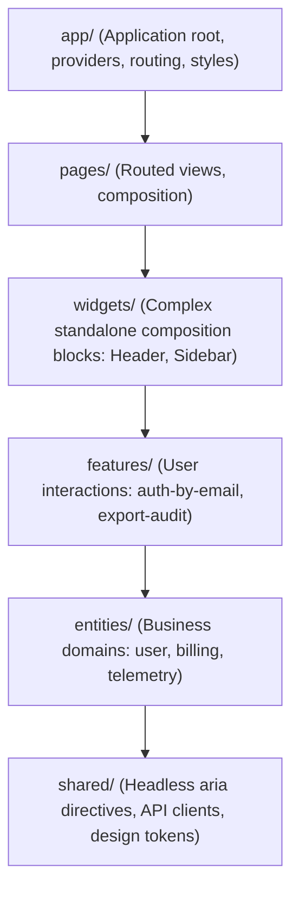

```
src/
├── app/
│   ├── app.config.ts
│   └── app.routes.ts
├── pages/
│   └── telemetry-dashboard/
├── widgets/
│   ├── navigation-header/
│   └── server-health-grid/
├── features/
│   ├── rotate-api-keys/
│   └── export-audit-logs/
├── entities/
│   ├── user/
│   │   ├── index.ts (Strict Public API)
│   │   ├── ui/user-card.component.ts
│   │   └── model/user.model.ts
│   └── tenant/
└── shared/
    ├── ui/ (Design Tokens, CVA variants)
    └── api/ (tracedFetch, httpResource wrappers)
```

The layers only help if imports go strictly downward (`app > pages > widgets > features > entities > shared`), sibling slices on the same layer never import each other, and every slice is imported through its `index.ts`. Enforce this with a lint rule; [section 39](#39-enterprise-architecture-masterclass) shows an `eslint-plugin-boundaries` config, the `@x` cross-import convention for entities, and where Angular pieces (facades, repositories, routed components) go.

---

### 28.4 Flagship Blueprint 1: AI-Agent Enabled Angular WebMCP Workspace
```typescript
import { Component, inject, signal } from '@angular/core';
import { declareExperimentalWebMcpTool } from '@angular/core/ai';
import { OrganizationStore } from './store/organization.store';

@Component({
  selector: 'app-ai-workspace',
  standalone: true,
  template: `
    <div class="ai-console p-6 border rounded-lg max-w-2xl bg-slate-900 text-slate-100">
      <div class="flex items-center justify-between border-b border-slate-700 pb-3 mb-4">
        <h2 class="text-lg font-mono font-bold text-emerald-400">Angular WebMCP Agent Hub</h2>
        <span class="text-xs bg-emerald-950 text-emerald-300 px-2 py-1 rounded">Claude/Gemini Ready</span>
      </div>

      <p class="text-sm text-slate-400 mb-4">
        AI coding agents can automatically query active member rosters and promote organization roles via WebMCP tool calls.
      </p>

      <div class="space-y-2">
        <p class="text-xs font-semibold uppercase text-slate-500">Live Organization Members (Signals Store):</p>
        <div class="grid grid-cols-2 gap-2">
          @for (member of store.members(); track member.id) {
            <div class="p-2 border border-slate-700 rounded bg-slate-800 text-xs flex justify-between">
              <span>{{ member.name }}</span>
              <span class="font-mono text-emerald-400">{{ member.role }}</span>
            </div>
          }
        </div>
      </div>
    </div>
  `
})
export class AiWorkspaceComponent {
  store = inject(OrganizationStore);

  // Expose WebMCP Tool to connected LLM agents
  readonly rolePromotionTool = declareExperimentalWebMcpTool({
    name: 'promoteMemberRole',
    description: 'Promotes an organization team member to ADMIN or OWNER',
    inputSchema: {
      type: 'object',
      properties: {
        memberId: { type: 'string' },
        targetRole: { type: 'string', enum: ['ADMIN', 'OWNER'] },
      },
      required: ['memberId', 'targetRole'],
    },
    handler: async ({ memberId, targetRole }) => {
      console.log(`[WebMCP Tool Called by AI]: Promoting ${memberId} to ${targetRole}`);
      // Mutate signal store directly in response to AI agent instructions!
      return { success: true, updatedRole: targetRole };
    }
  });
}
```

> [!WARNING]
> WebMCP and `declareExperimentalWebMcpTool` are experimental. A tool exposed to an agent runs with the user's session, so treat each tool like a public API endpoint: validate input against the schema, enforce the same permission on the server that the UI enforces, ask the human to confirm destructive or privileged actions (such as a role promotion), and write an audit entry for every call. Keep the handler thin and have it call the same application service the UI uses, so the integration can be replaced without touching business logic. [Section 44](#44-practical-system-design-designing-large-angular-apps-from-requirements-to-production) lists the requirements, trade-offs and failure modes for this blueprint.

---

### 28.5 Flagship Blueprint 2: Signal Forms Multi-Step Enterprise Stepper
```typescript
import { Component, signal } from '@angular/core';
import { form, FormField } from '@angular/forms/signals';

interface StepperSchema {
  step1: { corporateEmail: string; fullName: string };
  step2: { cloudTier: 'STANDARD' | 'ENTERPRISE'; dedicatedIps: number };
  step3: { agreementAccepted: boolean };
}

@Component({
  selector: 'app-multi-step-form',
  standalone: true,
  template: `
    <div class="stepper-container p-6 border rounded-lg max-w-lg shadow">
      <!-- Step Indicator -->
      <div class="flex justify-between border-b pb-3 mb-4 text-xs font-semibold">
        <span [class.text-blue-600]="currentStep() === 1">1. Identity</span>
        <span [class.text-blue-600]="currentStep() === 2">2. Cloud Infrastructure</span>
        <span [class.text-blue-600]="currentStep() === 3">3. Final Review</span>
      </div>

      <!-- Step 1: Identity -->
      @if (currentStep() === 1) {
        <div class="space-y-3">
          <div>
            <label class="block text-xs font-bold">Full Name</label>
            <input
              [value]="stepperForm.step1.fullName.value()"
              (input)="stepperForm.step1.fullName.value.set($any($event.target).value)"
              class="border px-3 py-1.5 rounded w-full"
            />
          </div>
          <div>
            <label class="block text-xs font-bold">Corporate Email</label>
            <input
              [value]="stepperForm.step1.corporateEmail.value()"
              (input)="stepperForm.step1.corporateEmail.value.set($any($event.target).value)"
              class="border px-3 py-1.5 rounded w-full"
            />
          </div>
          <button (click)="currentStep.set(2)" class="px-4 py-2 bg-blue-600 text-white rounded text-sm">
            Continue to Cloud Setup →
          </button>
        </div>
      }

      <!-- Step 2: Infrastructure -->
      @if (currentStep() === 2) {
        <div class="space-y-3">
          <label class="block text-xs font-bold">Select Cloud Tier</label>
          <select
            [value]="stepperForm.step2.cloudTier.value()"
            (change)="stepperForm.step2.cloudTier.value.set($any($event.target).value)"
            class="border px-2 py-1.5 rounded w-full"
          >
            <option value="STANDARD">Standard Tier (Shared Nodes)</option>
            <option value="ENTERPRISE">Enterprise Tier (Dedicated VPC)</option>
          </select>
          <div class="flex gap-2">
            <button (click)="currentStep.set(1)" class="px-3 py-1.5 border rounded text-sm">Back</button>
            <button (click)="currentStep.set(3)" class="px-3 py-1.5 bg-blue-600 text-white rounded text-sm">Review</button>
          </div>
        </div>
      }

      <!-- Step 3: Confirmation -->
      @if (currentStep() === 3) {
        <div class="space-y-3">
          <h4 class="font-bold">Order Summary</h4>
          <p class="text-sm">Account: {{ stepperForm.step1.corporateEmail.value() }}</p>
          <p class="text-sm">Tier: {{ stepperForm.step2.cloudTier.value() }}</p>
          <button (click)="submitFinalOrder()" class="w-full py-2 bg-green-600 text-white font-bold rounded">
            Confirm & Deploy Enterprise Cluster
          </button>
        </div>
      }
    </div>
  `
})
export class MultiStepFormComponent {
  currentStep = signal(1);

  stepperForm = form<StepperSchema>({
    step1: { corporateEmail: '', fullName: '' },
    step2: { cloudTier: 'ENTERPRISE', dedicatedIps: 4 },
    step3: { agreementAccepted: true },
  });

  submitFinalOrder() {
    console.log('Final deployment triggered:', this.stepperForm.value());
    alert('Enterprise cluster deployment initiated successfully!');
  }
}
```

> [!TIP]
> Before building a long stepper, decide where a draft lives. Persisting each completed step to the server under a draft ID (kept in the URL) lets users close the tab and resume, and lets the server reject a step early instead of at the final submit. Map server validation errors back onto fields as described in [section 34](#34-advanced-forms-architecture). See [section 44](#44-practical-system-design-designing-large-angular-apps-from-requirements-to-production) for the full design table.

---

### 28.6 Flagship Blueprint 3: Real-Time High-Throughput Trading Orderbook (Web Worker + Signals)
Processes 10,000 WebSocket market orderbook ticks per second in a background Web Worker, batching updates to an Angular Signal state to render 60fps animations:

```typescript
import { Component, signal, OnInit, OnDestroy, ElementRef, viewChild } from '@angular/core';

export interface OrderbookRow {
  price: number;
  size: number;
  total: number;
}

@Component({
  selector: 'app-trading-orderbook',
  standalone: true,
  template: `
    <div class="orderbook-panel p-4 bg-gray-950 text-gray-100 rounded-lg max-w-md font-mono text-xs">
      <div class="flex justify-between text-gray-500 pb-2 border-b border-gray-800">
        <span>Price (USDT)</span>
        <span>Size (BTC)</span>
        <span>Total</span>
      </div>

      <!-- Ask Rows (Red) -->
      <div class="space-y-0.5 my-2">
        @for (row of asks(); track row.price) {
          <div class="flex justify-between text-red-400">
            <span>{{ row.price.toFixed(2) }}</span>
            <span>{{ row.size.toFixed(4) }}</span>
            <span class="text-gray-400">{{ row.total.toFixed(4) }}</span>
          </div>
        }
      </div>

      <div class="py-2 text-center text-lg font-bold border-y border-gray-800 text-emerald-400">
        $98,420.50 ↗
      </div>

      <!-- Bid Rows (Green) -->
      <div class="space-y-0.5 my-2">
        @for (row of bids(); track row.price) {
          <div class="flex justify-between text-green-400">
            <span>{{ row.price.toFixed(2) }}</span>
            <span>{{ row.size.toFixed(4) }}</span>
            <span class="text-gray-400">{{ row.total.toFixed(4) }}</span>
          </div>
        }
      </div>
    </div>
  `
})
export class TradingOrderbookComponent implements OnInit, OnDestroy {
  asks = signal<OrderbookRow[]>([]);
  bids = signal<OrderbookRow[]>([]);
  private worker?: Worker;

  ngOnInit() {
    // Spin up specialized background Web Worker for WebSocket tick crunching
    this.worker = new Worker(new URL('../workers/orderbook.worker', import.meta.url), { type: 'module' });
    this.worker.onmessage = ({ data }: { data: { asks: OrderbookRow[]; bids: OrderbookRow[] } }) => {
      // Direct signal updates trigger fine-grained DOM updates without zone.js overhead
      this.asks.set(data.asks);
      this.bids.set(data.bids);
    };
  }

  ngOnDestroy() {
    this.worker?.terminate();
  }
}
```

> [!NOTE]
> 10,000 messages per second does not mean 10,000 renders. The worker applies every delta, but posts at most one snapshot per animation frame, so the UI always shows the latest book rather than every tick. Two things the example leaves out and production needs: a sequence-number check that requests a fresh snapshot when a gap appears, and a computed "data age" signal that marks the book as stale when no update arrived for a few hundred milliseconds. Alert on data age, not on message rate. [Section 44](#44-practical-system-design-designing-large-angular-apps-from-requirements-to-production) walks through this design.

## 29. Platform & Architecture Masterclass: Compiler, Ivy Runtime, Bootstrap, Injectors, Elements, Builders & Monorepos

This section goes underneath the APIs you use every day. It follows a component from the moment `ngtsc` reads its decorator, through the instructions the compiler emits, into the runtime data structures (`TView`, `LView`, `TNode`) that hold it in memory, and out to the platform and application injectors that bootstrap it. The second half covers the architecture around an app: Angular Elements, custom Architect builders, publishing libraries, and organising a workspace or an Nx monorepo.

Everything here targets **Angular v22**. Internal names (anything prefixed with `ɵ`, `LView` slot numbers, instruction names) are private implementation details. They are shown so you can read compiled output and debug with confidence, not so you can depend on them. They can change in any release.

---

### 29.1 Compiler Internals: The `ngtsc` Pipeline

The Angular compiler (`ngtsc`, shipped in `@angular/compiler-cli`) is a TypeScript compiler plugin. The CLI's `@angular/build:application` builder runs it for every build, including `ng serve`, so AOT compilation is the default everywhere. JIT compilation only happens when `@angular/compiler` is loaded at runtime, which in practice means some test setups and legacy code paths.

`ngtsc` works in four phases:

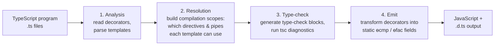

| Phase | What happens | What you see when it fails |
| :--- | :--- | :--- |
| **Analysis** | Each `@Component`, `@Directive`, `@Pipe`, `@Injectable` and `@NgModule` is read statically. Templates and styles are parsed into an AST. | `NG1001`-style errors: decorator arguments that cannot be evaluated statically. |
| **Resolution** | For every component the compiler works out which selectors match which directives (from `imports`, or from the declaring NgModule). | `NG8001: 'app-foo' is not a known element`. |
| **Type-check** | Templates are turned into TypeScript code (type-check blocks) and checked by `tsc`. | `TS2339`, `TS2345` etc. reported against your template. |
| **Emit** | Decorators are removed and replaced by static definition fields containing template functions. | Rare; usually a bug report. |

#### Compilation modes

`angularCompilerOptions.compilationMode` decides what the emit phase produces:

| Mode | Output | Used for |
| :--- | :--- | :--- |
| `full` (default) | Final `ɵɵdefineComponent(...)` calls with template functions. Tied to the exact Angular version that compiled it. | Applications. |
| `partial` | `ɵɵngDeclareComponent(...)` calls that keep the template as a string plus metadata. A **linker** inside the consuming app's build finishes the job. | Libraries published to npm (see [29.11](#2911-library-development-and-publishing)). |
| `local` | Compiles each file without looking at other files. | Specialised build systems. Not something a normal CLI workspace should switch on. |

#### Seeing the compiler's output yourself

You do not need a full app to inspect what the compiler generates. Point `ngc` (the command-line front end of `ngtsc`) at a single file:

```json
// tsconfig.inspect.json
{
  "compilerOptions": {
    "target": "ES2022",
    "module": "ES2022",
    "moduleResolution": "bundler",
    "rootDir": "src",
    "outDir": "out",
    "strict": true,
    "skipLibCheck": true
  },
  "files": ["src/greet.ts"],
  "angularCompilerOptions": { "strictTemplates": true, "compilationMode": "full" }
}
```

```bash
npx ngc -p tsconfig.inspect.json
cat out/greet.js
```

Switch `compilationMode` to `"partial"` to see what a library build ships.

#### Pitfalls

- ❌ Computing decorator metadata at runtime (`template: buildTemplate()`, selectors from a variable that is assigned later). The analysis phase needs values it can evaluate statically.
- ❌ Assuming JIT is used in development. `ng serve` compiles AOT; template errors show up at build time in both dev and prod.
- ❌ Publishing a library compiled in `full` mode. It only works with the exact Angular version used to build it.

---

### 29.2 Template Type-Checking and Type-Check Blocks

With `strictTemplates: true` (the default for new projects), the compiler checks your templates by **writing TypeScript code that mirrors them** and handing that code to `tsc`. Each generated function is called a **type-check block (TCB)**. TCBs are never emitted into your bundle; they exist only in the compiler's in-memory program, and diagnostics are mapped back to template positions.

For this component:

```typescript
// src/greet.ts
import { Component, input, signal } from '@angular/core';

@Component({
  selector: 'app-greet',
  template: `
    <h2 class="title">Hello {{ name() }}</h2>
    <button (click)="count.set(count() + 1)">Clicked {{ count() }}</button>
    @if (count() > 2) { <p>Enough!</p> }
  `,
})
export class Greet {
  name = input.required<string>();
  count = signal(0);
}
```

the TCB is conceptually something like this (simplified; the real code uses generated names and extra casts):

```typescript
// Conceptual illustration only. Not the literal generated code.
function tcb_Greet(this: Greet) {
  // {{ name() }} : the expression must be valid on the component instance
  '' + this.name();

  // (click)="count.set(count() + 1)" : the handler body is checked with $event typed
  const btn = document.createElement('button');
  btn.addEventListener('click', ($event: HTMLElementEventMap['click']) => {
    this.count.set(this.count() + 1);
  });

  '' + this.count();

  // @if narrows exactly like a TypeScript if-statement
  if (this.count() > 2) {
    // contents of the @if block
  }
}
```

That is why template errors look like ordinary TypeScript errors, and why `@if (user(); as u)` narrows `u` to non-null: the TCB literally contains an `if`.

#### Directives participate through their types

When a template uses a directive, the TCB "constructs" it with the bound inputs so TypeScript can infer generic parameters. Directives can also give the type-checker extra information through static members:

```typescript
import { Directive, TemplateRef, ViewContainerRef, effect, inject, input } from '@angular/core';

interface LoadedContext<T> {
  $implicit: T;
  loaded: T;
}

/** Usage: <ng-template [appLoaded]="user()" let-u> {{ u.name }} </ng-template> */
@Directive({ selector: '[appLoaded]' })
export class LoadedDirective<T> {
  readonly appLoaded = input.required<T | null | undefined>();

  private readonly tpl = inject<TemplateRef<LoadedContext<T>>>(TemplateRef);
  private readonly vcr = inject(ViewContainerRef);

  constructor() {
    effect(() => {
      const value = this.appLoaded();
      this.vcr.clear();
      if (value != null) {
        this.vcr.createEmbeddedView(this.tpl, { $implicit: value, loaded: value });
      }
    });
  }

  // Tells the type-checker what the template context looks like, so `let-u` is typed as T.
  static ngTemplateContextGuard<T>(
    _dir: LoadedDirective<T>,
    ctx: unknown,
  ): ctx is LoadedContext<NonNullable<T>> {
    return true;
  }

  // Tells the type-checker that the template body only renders when the input is non-null.
  static ngTemplateGuard_appLoaded: 'binding';
}
```

Without the two static members, `u` would be typed `any` inside the template and you would lose every check below that point.

#### Pitfalls

- ❌ Using `$any(...)` to silence an error. It disables checking for the whole expression; fix the type or narrow it instead.
- ❌ Adding new `ngAcceptInputType_*` static fields. They were a workaround for input coercion; input `transform` functions (`input(0, { transform: numberAttribute })`) replace them.
- ❌ Turning `strictTemplates` off to "unblock" an upgrade. You lose null checks, `$event` types and generic inference across every template.

#### When to care

Read TCB-shaped errors with this model in mind, and write `ngTemplateContextGuard` whenever you author a structural directive or a component that renders consumer templates (`TemplateRef` inputs, table cells, list items).

---

### 29.3 Reading Compiled Output: `ɵcmp`, `ɵfac`, Creation and Update Blocks

This is the real v22 output of `ngc` for the `Greet` component above (full mode, trimmed only for the `debugName` arguments):

```javascript
import * as i0 from "@angular/core";

function Greet_Conditional_4_Template(rf, ctx) { if (rf & 1) {
    i0.ɵɵdomElementStart(0, "p");
    i0.ɵɵtext(1, "Enough!");
    i0.ɵɵdomElementEnd();
} }

export class Greet {
    name = input.required();
    count = signal(0);

    static ɵfac = function Greet_Factory(__ngFactoryType__) {
        return new (__ngFactoryType__ || Greet)();
    };

    static ɵcmp = /*@__PURE__*/ i0.ɵɵdefineComponent({
        type: Greet,
        selectors: [["app-greet"]],
        inputs: { name: [1, "name"] },
        decls: 5,
        vars: 3,
        consts: [[1, "title"], [3, "click"]],
        template: function Greet_Template(rf, ctx) {
            if (rf & 1) {                                   // CREATION block
                i0.ɵɵdomElementStart(0, "h2", 0);
                i0.ɵɵtext(1);
                i0.ɵɵdomElementEnd();
                i0.ɵɵdomElementStart(2, "button", 1);
                i0.ɵɵdomListener("click", function Greet_Template_button_click_2_listener() {
                    return ctx.count.set(ctx.count() + 1);
                });
                i0.ɵɵtext(3);
                i0.ɵɵdomElementEnd();
                i0.ɵɵconditionalCreate(4, Greet_Conditional_4_Template, 2, 0, "p");
            }
            if (rf & 2) {                                   // UPDATE block
                i0.ɵɵadvance();
                i0.ɵɵtextInterpolate1("Hello ", ctx.name());
                i0.ɵɵadvance(2);
                i0.ɵɵtextInterpolate1("Clicked ", ctx.count());
                i0.ɵɵadvance();
                i0.ɵɵconditional(ctx.count() > 2 ? 4 : -1);
            }
        },
        encapsulation: 2,
    });
}
```

How to read it:

| Piece | Meaning |
| :--- | :--- |
| `ɵfac` | The factory. DI calls it to create the instance (constructor parameters would appear here as `ɵɵdirectiveInject(...)` calls). |
| `ɵcmp` | The component definition: selectors, inputs, outputs, styles, and the template function. The runtime reads everything from here; there is no separate metadata. |
| `rf` | Render flags. `rf & 1` runs once to **create** DOM nodes; `rf & 2` runs on every change detection pass to **update** bindings. |
| `decls: 5` | Number of slots the template needs: `h2`, text, `button`, text, and the `@if` container. |
| `vars: 3` | Number of binding slots that remember previous values (two interpolations, one conditional). |
| `consts` | Static attribute arrays shared by all instances. `[1, "title"]` is a marker for "classes: title"; `[3, "click"]` records a bound event for directive matching. |
| `0, 1, 2 ...` | Slot indices. Every node lives at a fixed index; `ɵɵadvance(n)` moves the update cursor forward so bindings know which node they target. |
| `ɵɵdomElementStart` | A DOM-only element instruction. The compiler emits it when it can prove no directive matches the element, which keeps the runtime path shorter. Elements that host directives get `ɵɵelementStart`. |
| `ɵɵconditionalCreate` / `ɵɵconditional` | `@if` compiles to an embedded template (`Greet_Conditional_4_Template`) plus an update instruction that says which branch index to show (`-1` for none). |
| `encapsulation: 2` | `ViewEncapsulation.None` here because the component has no styles; with styles it would be emulated encapsulation. |

The update block only compares the values in `vars` slots with what they were last time and touches the DOM when they differ. There is no virtual DOM diff.

A **partial** (library) build of the same file emits a declaration instead of the final code:

```javascript
static ɵcmp = i0.ɵɵngDeclareComponent({
    minVersion: "17.0.0", version: "22.2.4", type: Greet, isStandalone: true,
    selector: "app-greet",
    inputs: { name: { classPropertyName: "name", publicName: "name", isSignal: true, isRequired: true, /* ... */ } },
    template: `<h2 class="title">Hello {{ name() }}</h2> ...`,
});
```

And the generated `.d.ts` carries everything a consumer's compiler needs to type-check usages of the component without seeing its source:

```typescript
static ɵcmp: i0.ɵɵComponentDeclaration<Greet, "app-greet", never,
  { "name": { "alias": "name"; "required": true; "isSignal": true; }; }, {}, never, never, true, never>;
```

#### Pitfalls

- ❌ Calling `ɵɵ` instructions or reading `ɵcmp` in application code. They are private and change between majors; the `ɵɵdom*` family and `ɵɵconditionalCreate` above are recent additions, and older versions emit different instructions for the same template.
- ❌ Expensive work inside template expressions. Everything in the update block runs on every check of that view; use `computed()` so the work only re-runs when inputs change.

---

### 29.4 The Ivy Runtime: Locality and Tree-Shakable Instructions

**Ivy** is the name of Angular's compiler-plus-runtime architecture (the default since v9, and the only one since v13 removed View Engine). Two ideas define it:

1. **Locality.** Each component is compiled using only its own decorator and the public type information (`.d.ts` declarations like the one above) of what it imports. The compiler never needs the source of a dependency. This is what makes incremental rebuilds fast and makes partial compilation for libraries possible.
2. **Instructions instead of an interpreter.** A template becomes a function that calls small runtime functions (`ɵɵtext`, `ɵɵproperty`, `ɵɵlistener`...). If no template in your app uses `ɵɵpipeBind1` or `ɵɵi18nStart`, the bundler drops them. The runtime you ship is roughly proportional to the features you use.

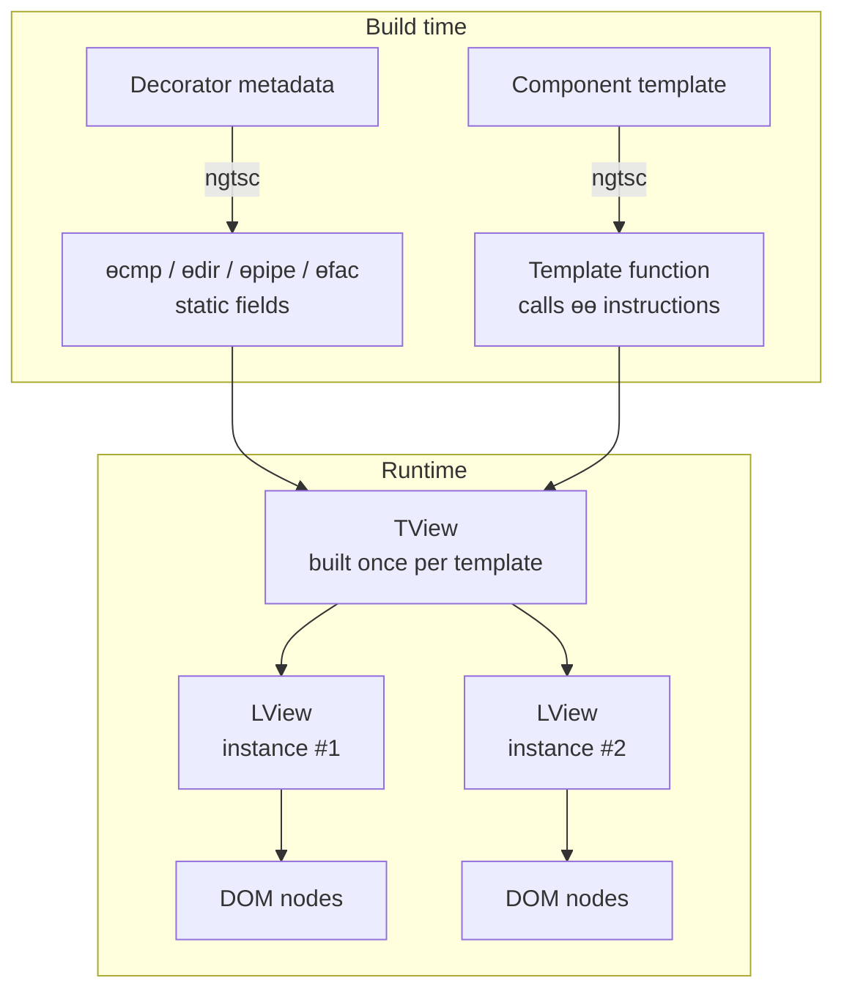

The rest of the runtime story (how those `TView` and `LView` objects are shaped) follows.

---

### 29.5 Runtime Data Structures: `TView`, `LView` and `TNode`

The runtime separates what is **the same for every instance** of a template from what is **specific to one instance**:

| Structure | One per | Holds |
| :--- | :--- | :--- |
| `TView` ("template view") | template (component template, `@if` branch, `@for` body, `<ng-template>`) | The template function, `decls`/`vars` counts, `consts`, the list of `TNode`s, directive and pipe registries, cleanup and lifecycle hook tables. Created the first time the template renders and then reused. |
| `TNode` ("template node") | node in a template | Static facts about one node: type (element, text, container, element container, projection, `@let` declaration, ICU), tag name, static attributes, which directives matched, input/output maps, parent/child/next links. Lives in `TView.data`. |
| `LView` ("logical view") | rendered instance | A plain JavaScript array. A fixed header (host element, its `TView`, flags, parent `LView`, context object, injector, cleanup, reactive consumer...) followed by one slot per declaration (DOM nodes, directive instances) and one slot per binding (previous values). |
| `LContainer` | `@if`, `@for`, `@switch`, `@defer`, `<ng-template>` / `ViewContainerRef` anchor | An array holding the anchor comment node and the embedded `LView`s currently inserted at that location. |

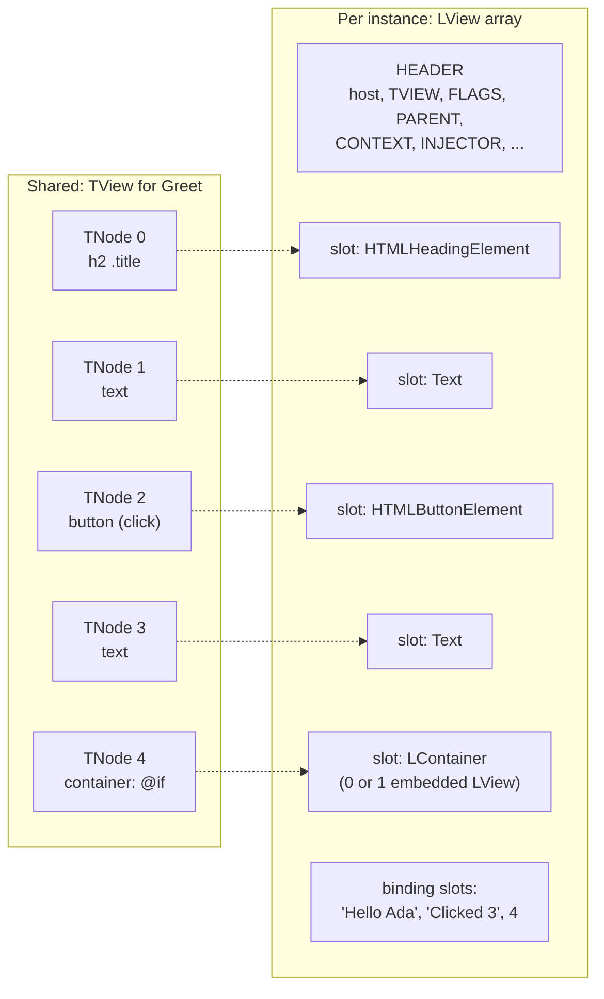

The slot indices you saw in the compiled output (`ɵɵdomElementStart(0, ...)`, `ɵɵtext(1)`) are offsets into the declaration area that begins right after the `LView` header. (In v22 the header is 28 entries long; treat that number as trivia, not an API.)

#### How change detection walks these structures

1. `ApplicationRef.tick()` starts at each root view.
2. For each `LView` it decides whether to refresh, based on its `FLAGS` (dirty, attached, `OnPush`/`Eager` mode) and whether a signal read by its template changed.
3. Refreshing an `LView` means calling `TView.template(2 /* update */, context)` with the `LView` set as the current view. Each binding instruction compares against the stored binding slot.
4. It descends into child component `LView`s and into embedded views inside `LContainer`s.

Two v22 facts change how this walk behaves:

- **Every template has a reactive consumer** (the `REACTIVE_TEMPLATE_CONSUMER` header slot). When a signal that the template read changes, only that `LView` is marked for refresh and its ancestors are flagged as "has a child to refresh". Change detection can then skip clean ancestors entirely and refresh just the view that changed.
- **`OnPush` is the default change detection strategy in v22.** A component without a `changeDetection` setting is only refreshed when one of its inputs changes, an event bound in its template fires, a signal it reads changes, or `markForCheck()` is called. The old always-check behaviour is now spelled `ChangeDetectionStrategy.Eager` (`Default` is a deprecated alias for it).

#### Debugging in development

```typescript
// In the browser console of a dev build (these globals are stripped in production):
const el = document.querySelector('app-greet')!;
const cmp = (window as any).ng.getComponent(el);   // the Greet instance
cmp.count.set(10);                                 // signal write schedules a refresh of that view
```

Every DOM node Angular creates carries a monkey-patched `__ngContext__` property that lets the runtime (and Angular DevTools) find the owning `LView` again. Angular DevTools' component tree and profiler are built on exactly these structures.

#### Pitfalls

- ❌ Reading `__ngContext__` or `ɵgetLContext()` in app code. Use `ng.*` console utilities and DevTools for debugging, and public APIs (`viewChild`, `ElementRef`, `DestroyRef`) in code.
- ❌ Creating many embedded views for content that never changes. Each one costs an `LView` array, a reactive consumer and refresh bookkeeping. Prefer plain static markup when no bindings are involved.

---

### 29.6 App Lifecycle and Bootstrap Internals

`bootstrapApplication(App, appConfig)` looks like one call, but it builds three layers and runs a defined sequence. The order below is taken from the v22 implementation:

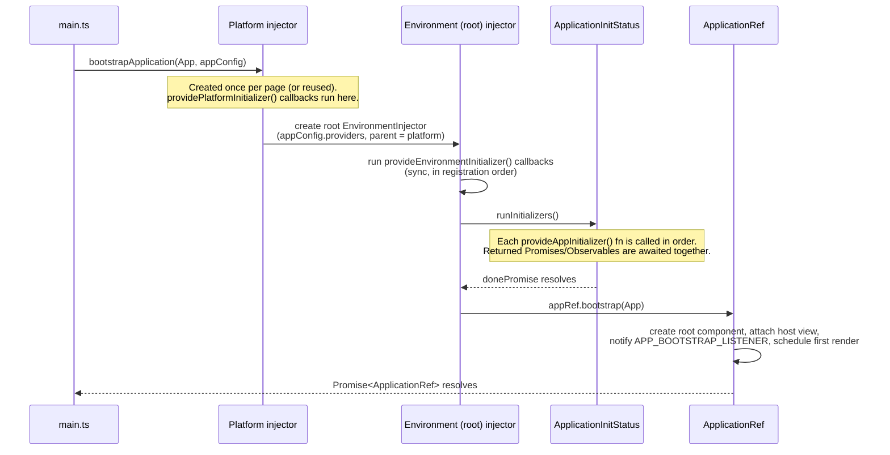

The three layers:

| Layer | Created by | Typical contents | Lifetime |
| :--- | :--- | :--- | :--- |
| **Platform injector** | `platformBrowser()` (implicitly by `bootstrapApplication`) | `PlatformRef`, platform-wide services, `providedIn: 'platform'` services | The page. Shared by every Angular app bootstrapped on the page. |
| **Root environment injector** | `bootstrapApplication` / `createApplication` | `appConfig.providers`, `providedIn: 'root'` services | Until `appRef.destroy()` or `destroyPlatform()`. |
| **`ApplicationRef`** | Provided in the root injector | Root components, attached views, `tick()`, stability tracking | Same as the root injector. |

Zoneless change detection is the default since v21: unless you add `provideZoneChangeDetection()`, the app does not use `NgZone` and the scheduler is driven by signals, `markForCheck()`, `setInput()` and template events.

#### `ApplicationRef` in practice

```typescript
// main.ts
import { ApplicationRef } from '@angular/core';
import { bootstrapApplication } from '@angular/platform-browser';
import { App } from './app/app';
import { appConfig } from './app/app.config';

bootstrapApplication(App, appConfig)
  .then(async (appRef: ApplicationRef) => {
    // Resolves once no PendingTasks are outstanding and no render is scheduled.
    await appRef.whenStable();
    performance.mark('app-stable');
    document.documentElement.dataset['appReady'] = 'true'; // e.g. a hook for E2E tests
  })
  .catch((err) => {
    // Any initializer rejection or root component constructor error lands here.
    console.error('Bootstrap failed', err);
    document.body.textContent = 'The application could not start. Please reload.';
  });
```

`whenStable()` (and the `isStable` observable) are driven by **`PendingTasks`**. Anything that should hold the app "unstable" (for SSR serialization, for tests, for the hook above) can register itself:

```typescript
import { Injectable, PendingTasks, inject } from '@angular/core';

@Injectable({ providedIn: 'root' })
export class WarmupService {
  private readonly pendingTasks = inject(PendingTasks);

  warmUp(): void {
    // run() keeps the app unstable until the promise settles; errors go to the ErrorHandler.
    this.pendingTasks.run(async () => {
      const response = await fetch('/api/feature-flags');
      sessionStorage.setItem('flags', await response.text());
    });
  }
}
```

#### Several roots, one injector: `createApplication`

`createApplication()` (from `@angular/platform-browser`) runs the same sequence **without** rendering a root component. You then attach as many roots as you need. This is the foundation for micro-frontends and for Angular Elements (29.9):

```typescript
import { createApplication } from '@angular/platform-browser';
import { provideHttpClient, withFetch } from '@angular/common/http';
import { HeaderWidget } from './header-widget';
import { CartWidget } from './cart-widget';

const appRef = await createApplication({ providers: [provideHttpClient(withFetch())] });

// Both widgets share one root injector, so they share HttpClient and every root service.
appRef.bootstrap(HeaderWidget, { hostElement: '#site-header' });
appRef.bootstrap(CartWidget, { hostElement: '#mini-cart' });

// Tear everything down (destroys root components, the injector and its services):
window.addEventListener('pagehide', () => appRef.destroy(), { once: true });
```

#### Pitfalls

- ❌ Calling `bootstrapApplication` twice to get two widgets. You get two root injectors and two copies of every root service (two auth states, two caches). Use one `createApplication` with several `bootstrap()` calls.
- ❌ Waiting for "the app is ready" with `setTimeout`. Use `appRef.whenStable()`.
- ❌ Leaving `.catch()` off `bootstrapApplication`. A failed initializer then produces a blank page with nothing but a console error.

---

### 29.7 Initializers in Depth: `provideAppInitializer()`, `provideEnvironmentInitializer()`, `providePlatformInitializer()`

Angular has one initializer helper per injector layer. The three tokens they replace (`APP_INITIALIZER`, `ENVIRONMENT_INITIALIZER`, `PLATFORM_INITIALIZER`) have been deprecated since v19; new code should use the functions.

| Helper | Runs when | Can be async? | Typical use |
| :--- | :--- | :--- | :--- |
| `providePlatformInitializer(fn)` | The platform injector is created | No | Page-wide setup shared by several apps (polyfill checks, global telemetry). |
| `provideEnvironmentInitializer(fn)` | An environment injector is created: the root one at bootstrap, or a lazy route's / `createEnvironmentInjector()` injector later | No (return value ignored) | Eager setup for a feature scope: register an icon set, start a store slice, wire a global listener. |
| `provideAppInitializer(fn)` | Once, after the root injector exists and before the root component is created | Yes: `Promise` or `Observable` | Load runtime config, restore a session, fetch translations before first render. |

All three run their function in an **injection context**, so `inject()` works inside.

#### Ordering and concurrency

```typescript
import { ApplicationConfig, inject, provideAppInitializer, provideEnvironmentInitializer } from '@angular/core';
import { provideHttpClient, withFetch, HttpClient } from '@angular/common/http';
import { firstValueFrom } from 'rxjs';
import { ConfigStore } from './config-store';
import { I18nStore } from './i18n-store';
import { IconRegistry } from './icon-registry';

export const appConfig: ApplicationConfig = {
  providers: [
    provideHttpClient(withFetch()),

    // Runs synchronously while the root injector is set up: before any app initializer.
    provideEnvironmentInitializer(() => inject(IconRegistry).registerDefaults()),

    // A: Promise
    provideAppInitializer(() => inject(ConfigStore).load()),

    // B: Observable (must COMPLETE; firstValueFrom makes that explicit)
    provideAppInitializer(() => {
      const http = inject(HttpClient);
      const i18n = inject(I18nStore);
      return firstValueFrom(http.get<Record<string, string>>('/i18n/en.json')).then((t) => i18n.set(t));
    }),
  ],
};
```

What actually happens:

1. The environment initializer runs first, during injector setup.
2. App initializers are **called** one after another in provider order (A, then B).
3. Their returned promises and observables are then **awaited together** (`Promise.all` semantics). A and B run in parallel; B does not wait for A.
4. The root component is created only after all of them have settled successfully.

If one initializer depends on another, do not rely on provider order. Chain them inside a single initializer:

```typescript
provideAppInitializer(async () => {
  const config = inject(ConfigStore);
  const i18n = inject(I18nStore);
  await config.load();                  // must finish first
  await i18n.load(config.locale());     // needs the locale from config
}),
```

Grab every `inject()` you need **before** the first `await`. The injection context only lasts for the synchronous part of the function.

#### Error handling at bootstrap

A rejected promise, an erroring observable, or a thrown error in any initializer rejects the `bootstrapApplication()` promise, and the root component is never created. Decide per initializer whether a failure is fatal:

```typescript
provideAppInitializer(async () => {
  const config = inject(ConfigStore);
  try {
    await config.load();
  } catch (err) {
    // Non-fatal: continue with bundled defaults, but report it.
    console.warn('Remote config unavailable, using defaults', err);
    config.useDefaults();
  }
}),
```

Keep initializers short. Every millisecond spent in them is a millisecond of blank screen. Add a timeout for remote calls (`AbortSignal.timeout(3000)` with `fetch`, or `timeout()` with RxJS) so a slow endpoint cannot hold the app hostage.

#### Platform initializers need an explicit platform

```typescript
import { providePlatformInitializer } from '@angular/core';
import { bootstrapApplication, platformBrowser } from '@angular/platform-browser';

const platformRef = platformBrowser([
  providePlatformInitializer(() => console.info('Angular platform ready')),
]);

bootstrapApplication(App, appConfig, { platformRef });
```

#### Pitfalls

- ❌ An observable initializer that never completes (a `BehaviorSubject`, a WebSocket stream). Bootstrap waits forever. Use `firstValueFrom()` or `take(1)`.
- ❌ Expecting `provideEnvironmentInitializer` to wait for a promise. Its return value is ignored.
- ❌ Calling `inject()` after an `await` in an initializer. It throws `NG0203` because the injection context has ended.
- ❌ Doing route-specific work in an app initializer. Put it in that route's `providers` with `provideEnvironmentInitializer`, so it only runs when the feature loads.

---

### 29.8 `EnvironmentInjector` vs `ElementInjector`

Angular resolves dependencies through **two separate trees**, and understanding them removes most "why did I get a second instance?" questions.

| | Environment injectors | Element (node) injectors |
| :--- | :--- | :--- |
| Created by | Platform, `bootstrapApplication`, lazy routes with `providers`/`loadChildren`, `createEnvironmentInjector()` | Every element that hosts a component or directive |
| Configured with | `appConfig.providers`, route `providers`, `providedIn: 'root'` | `@Component({ providers, viewProviders })`, `@Directive({ providers })` |
| Accepts `EnvironmentProviders` (`provideRouter()`, `provideHttpClient()`...) | Yes | No (compile/runtime error) |
| Lifetime | Until destroyed explicitly (or its route/app is destroyed) | Same as the element |
| Public type you inject | `EnvironmentInjector` | `Injector` (the current node's injector) |

`Injector` is not a "legacy" API. It is the base interface that **both** kinds implement. `EnvironmentInjector` is the specialised subclass that adds `runInContext()`, `destroy()` and support for environment providers.

#### Resolution order

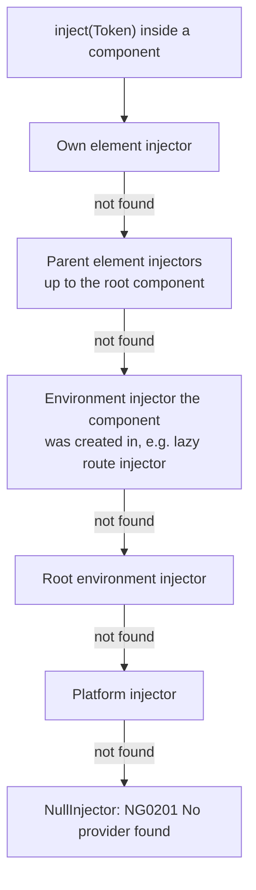

The element chain is walked completely before the environment chain. That is why a service in a component's `providers` shadows the root instance for that subtree, and why `inject(X, { skipSelf: true })` or `{ host: true }` only change the **element** part of the walk.

#### Creating and destroying a child environment injector

An injector you create is an object you own. Destroy it, or its services (and their subscriptions, intervals and `DestroyRef` callbacks) live forever:

```typescript
import {
  Component, DestroyRef, EnvironmentInjector, Injectable, OnDestroy,
  createEnvironmentInjector, inject, provideEnvironmentInitializer,
} from '@angular/core';

@Injectable()
export class ReportSession implements OnDestroy {
  readonly startedAt = Date.now();
  ngOnDestroy(): void {
    console.log('ReportSession released');
  }
}

@Component({ selector: 'app-report-host', template: `<p>Report scope active</p>` })
export class ReportHost {
  private readonly parent = inject(EnvironmentInjector);

  private readonly scope = createEnvironmentInjector(
    [
      ReportSession,
      provideEnvironmentInitializer(() => console.log('report scope created')),
    ],
    this.parent,
    'ReportScope', // debug name shown in DevTools injector tree
  );

  readonly session = this.scope.get(ReportSession);

  constructor() {
    // Tie the child injector's lifetime to this component.
    inject(DestroyRef).onDestroy(() => this.scope.destroy());
  }
}
```

`destroy()` calls `ngOnDestroy` on every service the injector created and runs its `DestroyRef` callbacks. Services inherited from the parent are untouched.

To render a component inside that scope, pass it as the `environmentInjector`:

```typescript
const ref = viewContainerRef.createComponent(ReportPanel, { environmentInjector: this.scope });
```

#### Pitfalls

- ❌ Putting `provideHttpClient()` or `provideRouter()` in a component's `providers`. Environment providers only work in environment injectors.
- ❌ Expecting a component-level provider to be shared by siblings. Each host element gets its own instance.
- ❌ Creating child environment injectors in a loop (per list item, per dialog) without destroying them.

#### When to use which

- Component/directive `providers`: state that should live and die with a UI subtree (a form wizard store, a table's selection model).
- Route `providers`: services and environment providers for a lazy feature.
- `createEnvironmentInjector()`: plugin systems, dynamically loaded modules of features, or anything created imperatively whose lifetime you manage.

---

### 29.9 Angular Elements (Advanced)

`createCustomElement()` wraps a component in a standard Custom Element class. The basics are covered in the Angular Elements section earlier in this guide; this part covers how to build them for real embedding.

#### A standalone, zoneless element bundle

```typescript
// src/price-tag.ts
import { Component, ViewEncapsulation, booleanAttribute, computed, input, numberAttribute, output } from '@angular/core';

@Component({
  selector: 'acme-price-tag-internal', // selector is irrelevant once registered as an element
  encapsulation: ViewEncapsulation.ShadowDom, // keep host-page CSS out, and ours in
  template: `
    <span class="amount">{{ formatted() }}</span>
    @if (!soldOut()) {
      <button type="button" (click)="buy.emit({ sku: sku() })">Buy</button>
    } @else {
      <em>Sold out</em>
    }
  `,
  styles: `.amount { font-weight: 600; }`,
})
export class PriceTag {
  readonly sku = input.required<string>();
  readonly amount = input(0, { transform: numberAttribute });
  readonly currencyCode = input('EUR');
  readonly soldOut = input(false, { transform: booleanAttribute });

  readonly buy = output<{ sku: string }>();

  protected readonly formatted = computed(() =>
    new Intl.NumberFormat(undefined, { style: 'currency', currency: this.currencyCode() }).format(this.amount()),
  );
}
```

```typescript
// src/main.ts
import { createApplication } from '@angular/platform-browser';
import { createCustomElement } from '@angular/elements';
import { PriceTag } from './price-tag';

const TAG = 'acme-price-tag';

createApplication({ providers: [] })
  .then((appRef) => {
    if (!customElements.get(TAG)) {
      customElements.define(TAG, createCustomElement(PriceTag, { injector: appRef.injector }));
    }
  })
  .catch((err) => console.error(`[${TAG}] failed to start`, err));
```

Because v22 apps are zoneless by default, the element works without `zone.js` on the host page. Signal inputs, `setInput()` and template events schedule rendering on their own.

#### Inputs: attributes vs properties

```html
<!-- Attributes: always strings, names are the input names in dash-case -->
<acme-price-tag sku="TSHIRT-01" amount="19.9" currency-code="USD" sold-out></acme-price-tag>

<script type="module">
  const tag = document.querySelector('acme-price-tag');

  // Properties: any JS value, names are the input names as written in the class
  tag.amount = 24.5;
  tag.currencyCode = 'GBP';

  // Outputs become DOM CustomEvents named after the output; the value is in event.detail
  tag.addEventListener('buy', (event) => console.log('buy', event.detail.sku));
</script>
```

| Mechanism | Name used | Value type | Notes |
| :--- | :--- | :--- | :--- |
| HTML attribute | `currency-code` (dash-cased input name) | `string` (or `null` when removed) | Use `transform` (`numberAttribute`, `booleanAttribute`, your own) to convert. |
| JS property | `currencyCode` | anything | The only way to pass objects, arrays, functions. Values set before the element is upgraded are picked up on connect. |
| Output | `buy` (the output's public name) | `CustomEvent`, payload in `detail` | Events do not bubble by default. Re-dispatch from the host page if you need bubbling. |

Lifecycle details worth knowing:

- The component is created on `connectedCallback`, not when the element is constructed.
- On `disconnectedCallback` the component is destroyed after a short delay, so moving an element within the DOM (remove + insert in the same task) keeps the same instance.
- Light-DOM children present at connect time are projected into `<ng-content>` slots. Children added later are not re-projected.

#### Shipping one script

The application builder emits lazy chunks only for dynamic `import()`s. An element bundle that avoids dynamic imports, does not load `zone.js`, and keeps styles in components produces a single `main.js` (plus `styles.css` only if you configure global styles). Turn off hashing so the host page can reference a stable URL:

```json
// angular.json (excerpt for an elements project)
"build": {
  "builder": "@angular/build:application",
  "options": {
    "browser": "src/main.ts",
    "outputHashing": "none",
    "polyfills": [],
    "styles": []
  }
}
```

```html
<script type="module" src="https://cdn.acme.example/price-tag/main.js"></script>
```

#### Several Angular versions or bundles on one page

Every element bundle carries its own copy of the Angular runtime. That works, with rules:

- **Unique tag names.** `customElements.define` throws if a name is already taken. Prefix with the team or product (`acme-`), and guard with `customElements.get()` as above.
- **Zoneless everywhere.** Two bundles that each load a different `zone.js` version will fight over patched browser APIs. Zoneless elements avoid the problem entirely.
- **Shadow DOM encapsulation.** Keeps one bundle's styles from leaking into another's.
- **Size.** Five elements from five bundles means five runtimes. If they ship together, build them from **one** bundle with one `createApplication()` and several `define()` calls.

#### Pitfalls

- ❌ Passing objects through attributes (`config='{"a":1}'`). Use properties.
- ❌ Expecting `@Output` names in camelCase to be listened to in kebab-case. The event name is exactly the output's public name.
- ❌ Calling `bootstrapApplication` inside every element module. Use one `createApplication()` per bundle.

#### When to use Angular Elements

Embedding Angular widgets into CMS pages, server-rendered apps or other frameworks, and incremental migrations. For composing whole Angular apps from independently deployed parts, a micro-frontend setup (Native Federation or Module Federation) usually fits better.

---

### 29.10 Custom Builders (Angular CLI Architect)

Every `ng build`, `ng serve` and `ng test` runs a **builder** through the CLI's Architect layer: `angular.json` maps a target (`build`) to a builder (`@angular/build:application`) plus options. You can write your own builder when a task needs workspace awareness (project paths, configurations, other targets) and should be invoked like any other target.

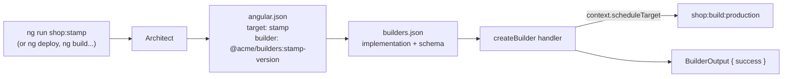

#### 1. The implementation

```typescript
// tools/builders/src/stamp-version/index.ts
import { BuilderContext, BuilderOutput, createBuilder, targetFromTargetString } from '@angular-devkit/architect';
import { execFileSync } from 'node:child_process';
import { writeFile } from 'node:fs/promises';
import { join } from 'node:path';

interface StampOptions {
  buildTarget: string;   // e.g. "shop:build:production"
  outputPath: string;    // e.g. "dist/shop/browser"
}

async function stampVersion(options: StampOptions, context: BuilderContext): Promise<BuilderOutput> {
  context.logger.info(`Building ${options.buildTarget} before stamping...`);

  // Run another target and wait for it.
  const run = await context.scheduleTarget(targetFromTargetString(options.buildTarget));
  const result = await run.result;
  await run.stop();
  if (!result.success) {
    return result;
  }

  const commit = execFileSync('git', ['rev-parse', '--short', 'HEAD'], { cwd: context.workspaceRoot })
    .toString()
    .trim();

  const file = join(context.workspaceRoot, options.outputPath, 'version.json');
  await writeFile(file, JSON.stringify({ commit, builtAt: new Date().toISOString() }, null, 2));

  context.logger.info(`Wrote ${file}`);
  return { success: true };
}

export default createBuilder<StampOptions>(stampVersion);
```

#### 2. Schema and registration

```json
// tools/builders/src/stamp-version/schema.json
{
  "$schema": "http://json-schema.org/draft-07/schema",
  "type": "object",
  "properties": {
    "buildTarget": { "type": "string", "description": "Target to build first, project:target[:configuration]" },
    "outputPath": { "type": "string", "description": "Folder that receives version.json" }
  },
  "required": ["buildTarget", "outputPath"]
}
```

```json
// tools/builders/builders.json
{
  "builders": {
    "stamp-version": {
      "implementation": "./dist/stamp-version/index.js",
      "schema": "./src/stamp-version/schema.json",
      "description": "Build a project, then write version.json next to it"
    }
  }
}
```

```json
// tools/builders/package.json
{
  "name": "@acme/builders",
  "private": true,
  "builders": "builders.json",
  "devDependencies": { "@angular-devkit/architect": "*" }
}
```

Compile the builder's TypeScript (a small `tsconfig.json` with `outDir: dist` is enough), install the folder as a local package so the CLI can resolve it by name, then reference it from a project:

```bash
npm install --save-dev ./tools/builders
```

```json
// angular.json (excerpt)
"stamp": {
  "builder": "@acme/builders:stamp-version",
  "options": {
    "buildTarget": "shop:build:production",
    "outputPath": "dist/shop/browser"
  }
}
```

```bash
ng run shop:stamp
```

To share the builder across repositories, publish `@acme/builders` to your registry; the `angular.json` reference stays the same.

#### Pitfalls

- ❌ Re-implementing the application builder. Wrap it with `scheduleTarget` instead and keep Angular's optimisations.
- ❌ Forgetting `await run.stop()` after a scheduled target. Watch-mode targets keep running.
- ❌ Using `@angular-devkit/architect` versions that do not match the CLI. Keep it aligned with your `@angular/cli` major.
- ❌ Writing a builder for something an npm script does fine. Builders earn their keep when they need project configuration, configurations (`:production`) or composition with other targets.

#### When to use

Deployment steps (`ng deploy` uses a `deploy` target), code generation that runs before builds, wrapping a third-party tool so it reads project paths from `angular.json`, or enforcing team-wide build steps.

---

### 29.11 Library Development and Publishing

The library basics (generation, `public-api.ts`, secondary entry points) are covered in section [27.2](#272-angular-package--library-development-ng-packagr--apf). This part covers what happens after `ng build my-lib`.

#### Partial compilation and the linker

`ng generate library` configures production builds with `"compilationMode": "partial"`. The published code contains `ɵɵngDeclare*` calls (29.3). When an application installs the library, the Angular **linker** in the app's build turns those declarations into final definitions for the app's Angular version.

```mermaid
flowchart LR
    SRC[Library source] -->|ng build lib<br/>partial mode| NPM["npm package<br/>ɵɵngDeclareComponent"]
    NPM -->|npm install| APP[Application build]
    APP -->|linker| FULL["ɵɵdefineComponent<br/>for the app's Angular version"]
```

Rule of thumb: **build your library with the oldest Angular version you support.** Partial output from an older compiler can be linked by newer Angular versions, but not the other way round.

#### What lands in `dist/` (Angular Package Format)

ng-packagr produces an APF package. Angular's own packages are a good reference; this is `@angular/elements` v22:

```text
@angular/elements/
├── fesm2022/
│   ├── elements.mjs        # flat ES module: the whole entry point in one file
│   └── elements.mjs.map
├── types/
│   └── elements.d.ts       # bundled type declarations
├── package.json            # "exports", "sideEffects": false, peerDependencies
└── README.md
```

```json
// excerpt of the generated package.json
{
  "type": "module",
  "sideEffects": false,
  "module": "./fesm2022/elements.mjs",
  "typings": "./types/elements.d.ts",
  "exports": {
    "./package.json": { "default": "./package.json" },
    ".": {
      "types": "./types/elements.d.ts",
      "default": "./fesm2022/elements.mjs"
    }
  }
}
```

Each secondary entry point gets its own key in `exports` (`"./charts"`) and its own flat file. Do not hand-edit the generated `package.json` in `dist/`; change the source `package.json` and `ng-package.json` instead.

#### `peerDependencies` vs `dependencies`

```json
// projects/ui/package.json (source)
{
  "name": "@acme/ui",
  "version": "4.1.0",
  "peerDependencies": {
    "@angular/core": "^22.0.0",
    "@angular/common": "^22.0.0",
    "@angular/cdk": "^22.0.0",
    "rxjs": "^7.4.0"
  },
  "dependencies": {
    "tslib": "^2.3.0"
  },
  "sideEffects": false
}
```

- **Peer dependencies** are packages the app must provide and share: Angular itself, the CDK, RxJS, anything that holds singletons or injection tokens. Two copies of `@angular/core` in one app break DI and change detection.
- **Dependencies** are private helpers bundled per library (`tslib`, a small date utility). ng-packagr refuses unknown non-peer dependencies unless you list them in `allowedNonPeerDependencies` in `ng-package.json`, which forces you to make that decision deliberately.
- Keep `"sideEffects": false` truthful. If a file registers something globally on import, list it, or bundlers will drop it.

#### Versioning policy

- Follow semver strictly. Widening or narrowing the Angular peer range is a **major** release for your consumers.
- Align your major cadence with Angular's (a new library major shortly after each Angular major) so consumers can upgrade both together.
- Deprecate with `/** @deprecated Use X instead. */` for at least one major before removing.
- Ship automated migrations with `ng update` by adding `"ng-update": { "migrations": "./migrations.json" }` to the library's package.json (see the Angular Schematics section).

#### A release workflow

```bash
# 1. Build in production (partial) mode
ng build ui --configuration production

# 2. Check exactly what will be published
cd dist/acme/ui
npm pack --dry-run

# 3. Try it in a real app before publishing
npm pack                                # creates acme-ui-4.1.0.tgz
(cd ../../../../sample-app && npm i ../acme-workspace/dist/acme/ui/acme-ui-4.1.0.tgz && ng build)

# 4. Publish from dist, never from the project folder
npm publish --access public
```

In CI, publish from a tagged commit with `npm publish --provenance` (it needs the `id-token: write` permission in GitHub Actions) so consumers can verify which workflow built the package.

#### Pitfalls

- ❌ Running `npm publish` in `projects/ui/`. That publishes raw TypeScript. Always publish from `dist/`.
- ❌ Publishing a `full`-mode build (a development build). Use the production configuration; recent ng-packagr versions add a `prepublishOnly` guard that blocks full-mode packages.
- ❌ Listing `@angular/core` under `dependencies`. Consumers end up with two copies.
- ❌ Exporting internals through `public-api.ts` "just in case". Everything exported is API you must keep stable.

---

### 29.12 Workspace and Monorepo Architecture

An Angular CLI workspace can hold many applications and libraries in one `angular.json`. A multi-project workspace starts empty:

```bash
ng new acme --no-create-application
cd acme
ng generate application shop
ng generate application admin
ng generate library ui
ng generate library shop-data-access
```

```text
acme/
├── angular.json          # one entry per project under "projects"
├── tsconfig.json         # shared compiler options + "paths" to libraries
├── projects/
│   ├── shop/             # application
│   ├── admin/            # application
│   ├── ui/               # library: presentational components
│   └── shop-data-access/ # library: services, state, API clients
└── package.json          # one dependency set for the whole repo
```

#### Layering rules

Most of the value of a monorepo comes from rules about **which code may import which**. A common layering for Angular:

```mermaid
flowchart TB
    APP[app: shop, admin<br/>routes, app.config] --> FEAT[feature<br/>smart components, route trees]
    FEAT --> DATA[data-access<br/>services, stores, API clients]
    FEAT --> UI[ui<br/>presentational components]
    DATA --> UTIL[util<br/>pure functions, types]
    UI --> UTIL
```

- Arrows only point downward. A `ui` library never imports a `data-access` library.
- Apps are thin: routing, configuration, composition.
- Each domain (shop, admin, billing) gets its own `feature` and `data-access` libraries; only `ui` and `util` are shared across domains.

#### Source paths vs built libraries

`ng generate library` adds a `paths` entry pointing at the **built** output:

```json
// tsconfig.json
"paths": {
  "ui": ["./dist/ui"]
}
```

That is right for libraries you also publish, because the app then consumes exactly what npm users get. For internal-only libraries it adds a build step before every app build. Many teams point internal libraries at their source instead (`"@acme/ui": ["./projects/ui/src/public-api.ts"]`) so the app compiles them directly, and keep ng-packagr only for libraries that are published.

#### Pitfalls

- ❌ Deep imports (`@acme/ui/src/lib/button/button`). Import only from the public entry point.
- ❌ One giant `shared` library. It turns into a dependency magnet that every change invalidates.
- ❌ Relying on code review alone for layering rules. Enforce them with lint rules (Nx below, or `eslint-plugin-boundaries` / `no-restricted-imports` in a plain CLI workspace).

#### When a plain CLI workspace is enough

A handful of projects, one team, and builds that finish quickly. Once CI time grows with every new project or several teams share the repo, look at Nx.

---

### 29.13 Nx for Angular Monorepos

Nx is a third-party build system (by Nrwl) that is widely used for large Angular repos. It keeps the Angular CLI's builders but adds a project graph, caching and boundary enforcement on top.

| Capability | What it gives you |
| :--- | :--- |
| **Project graph** | Nx reads imports to work out which projects depend on which (`nx graph` opens an interactive view). |
| **Affected commands** | `nx affected -t lint test build` runs targets only for projects changed since the base branch, plus their dependents. |
| **Computation caching** | Identical inputs give cached outputs, locally and optionally shared across CI and developers. |
| **Module boundaries** | Tags on projects plus the `@nx/enforce-module-boundaries` lint rule turn the layering diagram above into errors. |
| **Generators and executors** | Nx's equivalents of schematics and builders. Angular CLI builders still run inside Nx. |

#### Getting started

```bash
# New Angular monorepo
npx create-nx-workspace@latest acme --preset=angular-monorepo

# Or add Nx to an existing Angular CLI workspace
npx nx@latest init
```

Generator flags change between Nx majors, so check `--help` or use `--dry-run` before generating:

```bash
npx nx g @nx/angular:library --help
npx nx g @nx/angular:library libs/shop/feature-cart --tags=scope:shop,type:feature --dry-run
```

#### Enforcing boundaries

```json
// project.json of libs/shop/feature-cart (excerpt)
{
  "name": "shop-feature-cart",
  "tags": ["scope:shop", "type:feature"]
}
```

```javascript
// eslint.config.mjs (excerpt)
import nx from '@nx/eslint-plugin';

export default [
  ...nx.configs['flat/angular'],
  {
    files: ['**/*.ts'],
    rules: {
      '@nx/enforce-module-boundaries': ['error', {
        depConstraints: [
          { sourceTag: 'type:app',         onlyDependOnLibsWithTags: ['type:feature', 'type:ui', 'type:util'] },
          { sourceTag: 'type:feature',     onlyDependOnLibsWithTags: ['type:data-access', 'type:ui', 'type:util'] },
          { sourceTag: 'type:data-access', onlyDependOnLibsWithTags: ['type:util'] },
          { sourceTag: 'type:ui',          onlyDependOnLibsWithTags: ['type:ui', 'type:util'] },
          { sourceTag: 'scope:shop',       onlyDependOnLibsWithTags: ['scope:shop', 'scope:shared'] },
        ],
      }],
    },
  },
];
```

Now `import { CartStore } from '@acme/shop/data-access'` inside a `type:ui` library fails lint with a message naming the violated rule.

#### CI with affected and caching

```yaml
# .github/workflows/ci.yml (excerpt)
- uses: actions/checkout@v4
  with: { fetch-depth: 0 }          # affected needs history to compare against
- run: npm ci
- uses: nrwl/nx-set-shas@v4         # sets the base/head commits for affected
- run: npx nx affected -t lint test build --parallel=3
```

#### Upgrading

Use `nx migrate latest` followed by `nx migrate --run-migrations` rather than `ng update`. Nx migrations wrap Angular's own migrations and update Nx configuration at the same time. Each Nx major supports a specific range of Angular majors, so check Nx's Angular compatibility table before upgrading Angular past what your Nx version supports.

#### Pitfalls

- ❌ Creating libraries without tags. Untagged projects bypass every boundary rule.
- ❌ Shallow clones in CI (`fetch-depth: 1`). `affected` cannot find the base commit and falls back to running everything, or fails.
- ❌ Treating the cache as a substitute for small projects. Caching helps only when a change touches a few projects; one huge library is invalidated by every change.

#### When to use Nx

Multiple apps or many libraries, several teams in one repo, CI time that grows with the repo, or a need for enforced architecture. For a single app with a couple of libraries, the plain CLI workspace from 29.12 is simpler.

---

### 29.14 Interview Questions: Platform & Architecture

#### Q: What does the Angular compiler do between your `.ts` file and the emitted JavaScript?

`ngtsc` analyses decorators and parses templates, resolves which directives and pipes each template can use, generates type-check blocks so `tsc` can type-check templates, and finally replaces decorators with static definition fields (`ɵcmp`, `ɵfac`) whose template functions call runtime instructions. Applications use `full` mode; published libraries use `partial` mode so the consuming app's linker can finish compilation for its own Angular version.

#### Q: What are the creation and update blocks in a compiled template?

The template function takes render flags. With `rf & 1` it runs once per view instance and creates DOM nodes, listeners and containers at fixed slot indices. With `rf & 2` it runs on each refresh, walks the bindings with `ɵɵadvance`, compares each value with the one stored in the `LView` binding slots, and updates the DOM only where a value changed.

#### Q: Explain `TView`, `LView` and `TNode`.

A `TView` is the shared, static blueprint of one template (template function, consts, list of `TNode`s, hook tables). A `TNode` describes one node statically: type, tag, attributes, matched directives. An `LView` is the per-instance array: a header (host, parent, context, flags, injector, reactive consumer) followed by the instance's DOM nodes, directive instances and binding values. Ten instances of a component share one `TView` and own ten `LView`s.

#### Q: In what order does `bootstrapApplication` run things, and what happens if an initializer fails?

The platform injector is created or reused (platform initializers run), then the root environment injector is created from `appConfig.providers` (environment initializers run synchronously), then every `provideAppInitializer` function is called in order and their promises/observables are awaited together. Only after all succeed is the root component created through `ApplicationRef.bootstrap`. Any failure rejects the promise returned by `bootstrapApplication` and the root component is never rendered, so the `.catch()` must handle it.

#### Q: Two app initializers both return promises. Does the second wait for the first?

No. They are invoked in provider order, but their results are awaited in parallel. If B needs A's result, put both steps in one initializer and `await` them in sequence, capturing all `inject()` calls before the first `await`.

#### Q: What is the difference between `EnvironmentInjector` and `ElementInjector`?

Environment injectors form the application-level tree (platform, root, lazy routes, manually created scopes), accept environment providers such as `provideRouter()`, and live until destroyed. Element injectors are created per element that hosts a component or directive, are configured by `providers`/`viewProviders`, and die with the element. Resolution walks the element chain first, then the environment chain. `Injector` is the shared base interface, not a legacy alternative.

#### Q: How do inputs and outputs map when a component becomes a custom element?

Each input is observable as a dash-cased attribute (strings only, so use `numberAttribute`/`booleanAttribute` transforms) and as a camelCase property (any value). Each output is dispatched as a DOM `CustomEvent` named after the output, with the emitted value in `event.detail`. The component is created on connect and destroyed shortly after disconnect.

#### Q: Why should a library declare `@angular/core` as a peer dependency, and which Angular version should build it?

A peer dependency makes the application supply a single shared copy; two copies of Angular break DI, tokens and change detection. Build the library in partial mode with the **oldest** Angular major you support, because newer Angular linkers can process older partial declarations but not the reverse.

[Back to top⤴️](#table-of-contents)

---

## 30. Advanced Component Architecture: Views, Dynamic Rendering & Template Performance

The earlier component chapters cover the everyday surface: inputs, outputs, `model()`, host bindings and `hostDirectives`. This chapter goes one level down, to the pieces Angular itself uses to build those features: view containers, template references, embedded views, programmatically created components and the renderer. The second half covers how the compiler checks your templates and what a template actually costs at runtime.

All examples target Angular v22. Components are standalone by default (since v19), so `standalone: true` is omitted, and `OnPush` is the default change detection strategy.

---

### 30.1 The Mental Model: Views, Containers and Templates

Everything Angular renders lives in a **view**. A view is the smallest unit Angular creates, checks and destroys as a whole. There are three kinds you deal with directly:

| Kind | Created from | Public handle | Typical creator |
|---|---|---|---|
| Component (host) view | A component class | `ComponentRef<T>` (its `hostView`) | The template compiler, `ViewContainerRef.createComponent()`, `createComponent()` |
| Embedded view | An `<ng-template>` | `EmbeddedViewRef<C>` | `@if`, `@for`, structural directives, `ViewContainerRef.createEmbeddedView()` |
| Root view | `bootstrapApplication()` | `ApplicationRef` | The framework |

A **`ViewContainerRef`** is an anchor point in the DOM (a comment node or an element) that can hold an ordered list of views. Every `@if` and `@for` block is a view container under the hood. A **`TemplateRef`** is a compiled blueprint that can be stamped out into any number of embedded views.

```mermaid
graph TD
    T["&lt;ng-template #row let-item&gt;<br/>(TemplateRef&lt;RowContext&gt;)"] -->|"createEmbeddedView(ctx)"| EV1["EmbeddedViewRef #0"]
    T -->|"createEmbeddedView(ctx)"| EV2["EmbeddedViewRef #1"]
    C["ComponentType (class)"] -->|"createComponent()"| CR["ComponentRef.hostView"]
    VCR["ViewContainerRef<br/>(anchor comment node)"] --> EV1
    VCR --> EV2
    VCR --> CR
    VCR -.->|"DOM nodes are inserted<br/>as siblings AFTER the anchor"| DOM["Rendered DOM"]
```

Two rules explain most surprises in this chapter:

1. **Views render as siblings of the anchor, not children.** If you obtain a `ViewContainerRef` for `<div #host>`, created views appear *after* the `div`, not inside it. Use `<ng-container #host />` when you want no wrapper at all.
2. **Templates bind against where they were declared.** An embedded view reads component fields from the component whose template contains the `<ng-template>`, wherever the view is finally inserted. The context object you pass is the only extra data it gets.

[Back to top⤴️](#table-of-contents)

---

### 30.2 `ViewContainerRef` in Depth

You get a `ViewContainerRef` in two ways:

- **Inject it in a directive.** The container is anchored at the directive's host element. Structural directives (`*appFoo`) use this, and the host is the generated `<ng-template>`.
- **Query it from a component template** with `viewChild('ref', { read: ViewContainerRef })`.

```typescript
import { Component, ViewContainerRef, viewChild } from '@angular/core';

@Component({
  selector: 'app-widget-board',
  template: `
    <h2>Widgets</h2>
    <!-- Views are inserted right after this anchor -->
    <ng-container #slot />
  `,
})
export class WidgetBoardComponent {
  // Signal query; resolves once the view is created
  private readonly slot = viewChild.required('slot', { read: ViewContainerRef });

  count(): number {
    return this.slot().length;
  }
}
```

The container API, grouped by what it does:

| Method | Effect | Destroys the view? |
|---|---|---|
| `createEmbeddedView(tpl, ctx?, opts?)` | Stamps a `TemplateRef` and inserts it | No |
| `createComponent(Type, opts?)` | Creates a component and inserts its host view | No |
| `insert(viewRef, index?)` | Inserts an existing (detached) view | No |
| `move(viewRef, index)` | Reorders a view that is already in this container | No |
| `indexOf(viewRef)` / `get(i)` / `length` | Inspection | No |
| `detach(index?)` | Removes from DOM and container, **keeps the view alive** | No |
| `remove(index?)` | Removes and **destroys** the view | Yes |
| `clear()` | Removes and destroys every view | Yes |

`detach()` plus `insert()` is how you keep expensive views alive while they are off screen, for example a tab strip that caches inactive tabs:

```typescript
import { Directive, EmbeddedViewRef, TemplateRef, ViewContainerRef, effect, inject, input } from '@angular/core';

/**
 * Like @if, but the view is detached instead of destroyed when hidden,
 * so form state and scroll positions inside it survive.
 */
@Directive({ selector: '[appKeepAlive]' })
export class KeepAliveDirective {
  readonly appKeepAlive = input.required<boolean>();

  private readonly vcr = inject(ViewContainerRef);
  private readonly tpl = inject(TemplateRef<unknown>);
  private cached: EmbeddedViewRef<unknown> | null = null;

  constructor() {
    effect(() => {
      const visible = this.appKeepAlive();
      if (visible) {
        if (!this.cached) {
          this.cached = this.vcr.createEmbeddedView(this.tpl);
        } else if (this.vcr.indexOf(this.cached) === -1) {
          this.vcr.insert(this.cached);
        }
      } else if (this.cached && this.vcr.indexOf(this.cached) !== -1) {
        this.vcr.detach(this.vcr.indexOf(this.cached));
      }
    });
  }
}
```

```html
<section *appKeepAlive="activeTab() === 'billing'">
  <app-billing-form />
</section>
```

**Pitfalls**

- A detached view is not checked by change detection and stays in memory. If you never re-insert it, call `destroy()` yourself. Views still inside the container are destroyed with the container's host.
- `move()` only works for views already in that container. To move a view between containers, `detach()` it from one and `insert()` it into the other.
- Querying with `viewChild` gives you `undefined` until the view exists. Create views in an `effect()`, `afterNextRender()` or an event handler, not in the constructor.

[Back to top⤴️](#table-of-contents)

---

### 30.3 `TemplateRef`, Embedded Views and Typed Contexts

The existing [Template Context](#template-context) section shows `let-` variables with `ngTemplateOutlet`. Here we create the views ourselves and make the context type-safe.

#### Context objects and `$implicit`

The context is a plain object. `let-x` binds the `$implicit` key; `let-x="name"` binds the `name` key. The microsyntax `*appFoo="expr; let i = index"` writes into the same object.

#### A typed structural directive

The compiler cannot guess the shape of your context. A static `ngTemplateContextGuard` tells it, so `strictTemplates` can check every `let-` variable:

```typescript
import { Directive, EmbeddedViewRef, TemplateRef, ViewContainerRef, effect, inject, input } from '@angular/core';

export interface PagedContext<T> {
  $implicit: T[];     // let-rows
  page: number;       // let-page="page"
  pageCount: number;  // let-pageCount="pageCount"
}

@Directive({ selector: '[appPaged]' })
export class PagedDirective<T> {
  readonly appPaged = input.required<T[]>();
  readonly appPagedSize = input(10);
  readonly appPagedPage = input(0);

  private readonly vcr = inject(ViewContainerRef);
  private readonly tpl = inject<TemplateRef<PagedContext<T>>>(TemplateRef);
  private view: EmbeddedViewRef<PagedContext<T>> | null = null;

  constructor() {
    effect(() => {
      const items = this.appPaged();
      const size = this.appPagedSize();
      const page = this.appPagedPage();
      const ctx: PagedContext<T> = {
        $implicit: items.slice(page * size, page * size + size),
        page,
        pageCount: Math.max(1, Math.ceil(items.length / size)),
      };

      if (!this.view) {
        this.view = this.vcr.createEmbeddedView(this.tpl, ctx);
      } else {
        // Mutate the existing context instead of recreating the view:
        // the DOM is patched in place on the next check.
        Object.assign(this.view.context, ctx);
        this.view.markForCheck();
      }
    });
  }

  // Lets the template type checker know what the context looks like
  static ngTemplateContextGuard<T>(_dir: PagedDirective<T>, ctx: unknown): ctx is PagedContext<T> {
    return true;
  }
}
```

```html
<ul *appPaged="orders(); size: 20; page: currentPage(); let rows; let p = page; let total = pageCount">
  @for (order of rows; track order.id) {
    <li>{{ order.number }}</li>
  }
  <li class="meta">Page {{ p + 1 }} of {{ total }}</li>
</ul>
```

The microsyntax maps `size: 20` to the `appPagedSize` input (selector name plus capitalised key). With the guard in place, `order.number` is checked against `T`, and a typo such as `let total = pageCont` is a compile error.

#### Typing an `<ng-template>` you receive as an input

When a component accepts a template from its parent, type the input. There is no guard here, so the template's `let-` variables stay loosely typed; document the context type and reuse it in both places.

```typescript
import { Component, TemplateRef, input } from '@angular/core';
import { NgTemplateOutlet } from '@angular/common';

export interface EmptyStateContext {
  $implicit: string; // the search query that returned nothing
}

@Component({
  selector: 'app-result-list',
  imports: [NgTemplateOutlet],
  template: `
    @if (items().length) {
      <ng-content />
    } @else {
      <ng-container
        [ngTemplateOutlet]="emptyTemplate() ?? defaultEmpty"
        [ngTemplateOutletContext]="{ $implicit: query() }" />
    }
    <ng-template #defaultEmpty let-q>No results for "{{ q }}".</ng-template>
  `,
})
export class ResultListComponent {
  readonly items = input.required<readonly unknown[]>();
  readonly query = input('');
  readonly emptyTemplate = input<TemplateRef<EmptyStateContext> | null>(null);
}
```

#### View lifetime and injectors

Who destroys an embedded view depends on where it lives:

```mermaid
flowchart LR
    A["templateRef.createEmbeddedView(ctx)"] --> B{"Inserted into a<br/>ViewContainerRef?"}
    B -- yes --> C["Destroyed by remove(), clear()<br/>or when the container's host dies"]
    B -- no --> D["Free-floating view:<br/>not checked, not destroyed"]
    D --> E["appRef.attachView(view) to get it checked"]
    D --> F["view.destroy() yourself"]
```

`createEmbeddedView` on a container accepts `{ index, injector }`. The `injector` becomes the parent for anything the template injects, which is how a generic component can hand services to a caller's template. `ngTemplateOutletInjector` does the same for the outlet directive, and in v22 it also accepts the string `'outlet'`, meaning "inherit the injector from where the outlet sits" instead of where the template was declared.

**Pitfalls**

- Replacing the whole context object does nothing. `EmbeddedViewRef.context` is the object the view reads from, so mutate it (or recreate the view).
- Forgetting the guard silently gives you `any` for every `let-` variable, even with `strictTemplates`.
- Free-floating views (`templateRef.createEmbeddedView()` without a container) are an easy leak. Prefer creating views through a container.

**When to use:** custom structural directives, renderless/headless components, and "slot template" APIs such as table cells, empty states or item renderers.

[Back to top⤴️](#table-of-contents)

---

### 30.4 Dynamic Components with the Modern APIs

The README's [Dynamic Component Loading](#dynamic-component-loading) section starts with `ComponentFactoryResolver`. That class is **no longer exported from `@angular/core` in v22**; it was deprecated in v13 and later removed. You pass the component class directly to `ViewContainerRef.createComponent()` or to the standalone `createComponent()` function.

Since v20 both creation APIs also accept **creation-time bindings**, built with three helper functions:

| Helper | Template equivalent | Value |
|---|---|---|
| `inputBinding('name', getter)` | `[name]="expr"` | A signal or any `() => value` function. Re-read on every check. |
| `outputBinding<T>('name', fn)` | `(name)="handler($event)"` | A listener |
| `twoWayBinding('name', writableSignal)` | `[(name)]="sig"` | A `WritableSignal`; works with `model()` inputs |

```typescript
import {
  Component, ComponentRef, ViewContainerRef, inputBinding, input, model,
  output, outputBinding, signal, twoWayBinding, viewChild,
} from '@angular/core';

@Component({
  selector: 'app-rating',
  template: `
    <p>{{ label() }}</p>
    @for (star of [1, 2, 3, 4, 5]; track star) {
      <button type="button" (click)="value.set(star); rated.emit(star)">
        {{ star <= value() ? '★' : '☆' }}
      </button>
    }
  `,
})
export class RatingComponent {
  readonly label = input.required<string>();
  readonly value = model(0);
  readonly rated = output<number>();
}

@Component({
  selector: 'app-feedback-host',
  template: `
    <button type="button" (click)="open()">Rate this article</button>
    <ng-container #outlet />
    <p>Current score: {{ score() }}</p>
  `,
})
export class FeedbackHostComponent {
  private readonly outlet = viewChild.required('outlet', { read: ViewContainerRef });
  private ref: ComponentRef<RatingComponent> | null = null;

  readonly title = signal('How useful was this?');
  readonly score = signal(3);

  open(): void {
    this.ref?.destroy();
    this.ref = this.outlet().createComponent(RatingComponent, {
      bindings: [
        inputBinding('label', this.title),          // live: follows the signal
        twoWayBinding('value', this.score),         // child writes flow back
        outputBinding<number>('rated', (stars) => console.log('rated', stars)),
      ],
    });
  }
}
```

Compared with the older patterns:

| Approach | Reactivity | Notes |
|---|---|---|
| `ref.instance.label = 'x'` | None | Does not work for signal inputs and bypasses `OnPush` marking. Avoid. |
| `ref.setInput('label', 'x')` | Push, imperative | Marks the view dirty. You must call it again on every change. |
| `inputBinding('label', sig)` | Pull, declarative | Behaves like a template binding. Required inputs are satisfied at creation. |

#### Applying directives at creation

The `directives` option attaches directives to the new component's host, each with its own bindings. It is the runtime counterpart of `hostDirectives`, decided by the caller instead of the component:

```typescript
import { Directive, ViewContainerRef, inputBinding, input } from '@angular/core';
import { RatingComponent } from './rating.component';

@Directive({
  selector: '[appTooltip]',
  host: { '[attr.title]': 'appTooltip()' },
})
export class TooltipDirective {
  readonly appTooltip = input('');
}

export function createRatingWithTooltip(vcr: ViewContainerRef) {
  return vcr.createComponent(RatingComponent, {
    bindings: [inputBinding('label', () => 'Rate us')],
    directives: [
      { type: TooltipDirective, bindings: [inputBinding('appTooltip', () => 'One to five stars')] },
    ],
  });
}
```

#### Injector options

`ViewContainerRef.createComponent()` accepts two different injectors, and mixing them up is a common source of "No provider" errors:

- `injector`: the **element injector** parent. Defaults to the container's own injector, so the new component can inject whatever its anchor location could (parent components, directives, view providers).
- `environmentInjector`: the **environment** (module-level) injector. Pass this when the component should see providers from a lazy-loaded route or a custom `EnvironmentInjector`, not those of the place it was inserted.

```mermaid
graph BT
    New["New component"] --> EI["injector option<br/>(element injector chain)"]
    EI --> Anchor["Anchor's directives & components"]
    Anchor --> Env["environmentInjector option<br/>(route / app providers)"]
    Env --> Root["Root / platform injectors"]
```

#### Destroying

`ComponentRef.destroy()` runs `ngOnDestroy`, all `DestroyRef` callbacks, removes the host view from its container and cleans up output listeners registered on it. `ComponentRef.onDestroy(cb)` lets the creator react, for example to clear a stored reference. `ViewContainerRef.clear()` destroys every component in it, and so does destroying the container's host.

**Pitfalls**

- Binding names are **public names**: if the input is declared `input('', { alias: 'heading' })`, bind `'heading'`.
- `inputBinding` takes a function. Passing `this.title()` (the current value) instead of `this.title` freezes the value.
- Do not combine `bindings` with `setInput()` for the same input; the binding wins on the next check and the imperative value is lost.
- In v22.2, both creation APIs also accept an `onError` callback for errors in the new view's change detection. Its `ErrorDetails` type is marked **developer preview**, so treat that option as subject to change.

[Back to top⤴️](#table-of-contents)

---

### 30.5 `createComponent()` Without a View Container

Toasts, global dialogs and widgets mounted into a third-party DOM tree often have no natural place in your component tree. The standalone `createComponent()` function creates a component **outside** any container. You then decide where its DOM goes and how it gets change-detected.

```mermaid
sequenceDiagram
    participant S as ToastService
    participant CC as createComponent()
    participant AR as ApplicationRef
    participant DOM as document.body
    S->>CC: ToastComponent + environmentInjector + bindings
    CC-->>S: ComponentRef (detached, host element created)
    S->>AR: attachView(ref.hostView)
    Note over AR: now part of app change detection
    S->>DOM: appendChild(ref.location.nativeElement)
    S->>S: ref.destroy() after timeout
    Note over AR: destroy() also detaches the view from ApplicationRef
```

```typescript
import {
  ApplicationRef, Component, ComponentRef, EnvironmentInjector, Injectable,
  createComponent, inject, input, inputBinding, output, outputBinding,
} from '@angular/core';
import { DOCUMENT } from '@angular/common';

@Component({
  selector: 'app-toast',
  template: `
    <div role="status" class="toast">
      {{ message() }}
      <button type="button" (click)="dismissed.emit()">Close</button>
    </div>
  `,
})
export class ToastComponent {
  readonly message = input.required<string>();
  readonly dismissed = output<void>();
}

@Injectable({ providedIn: 'root' })
export class ToastService {
  private readonly appRef = inject(ApplicationRef);
  private readonly envInjector = inject(EnvironmentInjector);
  private readonly document = inject(DOCUMENT);
  private readonly open = new Set<ComponentRef<ToastComponent>>();

  show(message: string, durationMs = 4000): void {
    const ref: ComponentRef<ToastComponent> = createComponent(ToastComponent, {
      environmentInjector: this.envInjector,  // required
      bindings: [
        inputBinding('message', () => message),
        outputBinding('dismissed', (): void => ref.destroy()),
      ],
    });

    this.appRef.attachView(ref.hostView);     // without this the toast never updates
    const host = ref.location.nativeElement as HTMLElement;
    this.document.body.appendChild(host);
    this.open.add(ref);

    const timer = setTimeout(() => ref.destroy(), durationMs);
    ref.onDestroy(() => {
      clearTimeout(timer);
      host.remove();                          // we appended it, so we remove it
      this.open.delete(ref);
    });
  }

  dismissAll(): void {
    for (const ref of [...this.open]) ref.destroy();
  }
}
```

Options worth knowing:

- `hostElement`: mount onto an existing element (for example a node a charting library created) instead of letting Angular create one from the selector.
- `elementInjector`: an element-level parent injector, for when the component must see providers from a specific component even though it is rendered elsewhere. This is how an overlay can still inject a parent form or a theme service declared on a component.
- `projectableNodes`: DOM nodes to project into the component's `<ng-content>` slots, one array per slot.

**Pitfalls**

- Forgetting `appRef.attachView()` gives you a component that renders once and then never reflects signal or input changes.
- A component created this way is not destroyed when the code that created it is. Tie it to something: a service's `DestroyRef`, a timeout, or the caller's `DestroyRef`.
- During SSR there is no real `document.body` to mount into. Create such components from browser-only code paths (`afterNextRender()`, user events).

**When to use:** the CDK Overlay covers most popup needs with positioning and focus handling built in. Reach for raw `createComponent()` when you integrate with non-Angular DOM, build a micro-frontend mount, or need full control.

[Back to top⤴️](#table-of-contents)

---

### 30.6 Output Subscriptions and Cleanup

`output()` returns an `OutputEmitterRef<T>`. Its `subscribe()` method returns an **`OutputRefSubscription`** with a single `unsubscribe()` method. Angular removes every listener automatically **when the component that owns the output is destroyed**. That covers template bindings and most dynamic cases, but not the case where the *listener* dies first.

```mermaid
flowchart TD
    Q{"Who is destroyed first?"} -->|"Emitter (child)"| A["Angular removes listeners<br/>automatically"]
    Q -->|"Listener (host/service)<br/>while emitter lives on"| B["Callback still registered:<br/>it runs against a dead host"]
    B --> C["unsubscribe() via the listener's DestroyRef"]
```

A realistic case: a long-lived panel component, owned by a layout service, that several short-lived pages listen to.

```typescript
import { Component, DestroyRef, inject } from '@angular/core';
import { outputToObservable, takeUntilDestroyed } from '@angular/core/rxjs-interop';
import { filter } from 'rxjs';
import { LayoutService } from './layout.service'; // exposes a ComponentRef<SidePanelComponent>

@Component({
  selector: 'app-orders-page',
  template: `<h1>Orders</h1>`,
})
export class OrdersPageComponent {
  private readonly layout = inject(LayoutService);

  constructor() {
    const panel = this.layout.sidePanelRef.instance;

    // Option 1: plain subscription bound to this component's DestroyRef
    const sub = panel.closed.subscribe(() => this.refresh());
    inject(DestroyRef).onDestroy(() => sub.unsubscribe());

    // Option 2: bridge to RxJS when you need operators
    outputToObservable(panel.itemPicked)
      .pipe(filter((id) => id.startsWith('ORD-')), takeUntilDestroyed())
      .subscribe((id) => this.open(id));
  }

  private refresh(): void { /* reload */ }
  private open(_id: string): void { /* navigate */ }
}
```

Guidelines:

- Prefer `outputBinding()` when *you* create the component. The listener is part of the component's bindings and disappears with it.
- Subscribe through `ComponentRef.instance.someOutput.subscribe()` only when you did not create the component or need to attach later, and then pair it with the listener's `DestroyRef`.
- `outputToObservable()` completes when the emitting component is destroyed, so `takeUntilDestroyed()` is still needed for the opposite direction.
- `outputFromObservable()` turns an existing `Observable` into an output. Angular subscribes to the source lazily (when someone listens) and unsubscribes when the component is destroyed.

[Back to top⤴️](#table-of-contents)

---

### 30.7 `NgComponentOutlet`: Declarative Dynamic Components

`NgComponentOutlet` (from `@angular/common`) renders a component chosen at runtime directly from the template. It is the declarative counterpart to `ViewContainerRef.createComponent()`.

| Input | Purpose |
|---|---|
| `ngComponentOutlet` | The component class, or `null` to render nothing |
| `ngComponentOutletInputs` | `Record<string, unknown>` of input values, diffed on every change |
| `ngComponentOutletInjector` | Element injector parent |
| `ngComponentOutletEnvironmentInjector` | Environment injector |
| `ngComponentOutletContent` | `Node[][]` to project into `<ng-content>` slots |

The directive is exported as `ngComponentOutlet`, and its `componentInstance` getter gives you the created instance.

```typescript
import { Component, Type, computed, input, signal } from '@angular/core';
import { DecimalPipe, NgComponentOutlet } from '@angular/common';

@Component({ selector: 'app-text-cell', template: `{{ value() }}` })
export class TextCellComponent { readonly value = input(''); }

@Component({
  selector: 'app-money-cell',
  imports: [DecimalPipe],
  template: `{{ value() | number: '1.2-2' }} {{ currency() }}`,
})
export class MoneyCellComponent {
  readonly value = input(0);
  readonly currency = input('EUR');
}

// Imported lazily: the chunk is only fetched when a chart cell is first needed
const loadSparkline = () => import('./sparkline-cell.component').then((m) => m.SparklineCellComponent);

type CellKind = 'text' | 'money' | 'sparkline';

@Component({
  selector: 'app-dynamic-cell',
  imports: [NgComponentOutlet],
  template: `
    <!-- Attribute form: needed when you want the #outlet reference -->
    <ng-container
      [ngComponentOutlet]="component()"
      [ngComponentOutletInputs]="cellInputs()"
      #outlet="ngComponentOutlet" />
    <!-- Short form: <ng-container *ngComponentOutlet="component(); inputs: cellInputs()" /> -->
  `,
})
export class DynamicCellComponent {
  readonly kind = input.required<CellKind>();
  readonly data = input.required<Record<string, unknown>>();

  private readonly sparkline = signal<Type<unknown> | null>(null);

  readonly component = computed<Type<unknown> | null>(() => {
    switch (this.kind()) {
      case 'text': return TextCellComponent;
      case 'money': return MoneyCellComponent;
      case 'sparkline':
        if (!this.sparkline()) loadSparkline().then((c) => this.sparkline.set(c));
        return this.sparkline();
    }
  });

  readonly cellInputs = computed(() => this.data());
}
```

`outlet.componentInstance` is available in the template, or through `viewChild(NgComponentOutlet)` in the class. The `#outlet` reference only works on the attribute form: with `*ngComponentOutlet`, the directive sits on a generated `<ng-template>`, not on the element carrying the reference.

**Pitfalls**

- **No output bindings.** `NgComponentOutlet` cannot listen to outputs. Pass callbacks as inputs, use a shared service, or switch to `createComponent()` with `outputBinding()`.
- Changing the component class destroys the old instance and creates a new one; changing only `inputs` updates the existing one. Keep the class stable when the type has not changed.
- Inputs are diffed by key. A key that disappears from the object is reset on the component, so always send the full set.
- Avoid starting a lazy import inside a `computed()` in real code; it works here because the import runs once, but a dedicated `resource()` or route-level lazy loading is cleaner for larger cases.

**When to use:** CMS-driven pages, table cell renderers, dashboard widgets selected by configuration. Use `ViewContainerRef` when you need outputs, ordering control or several components in one container.

[Back to top⤴️](#table-of-contents)

---

### 30.8 Content Projection Edge Cases

The basic [Content Projection](#25-content-projection) sections show `<ng-content>` and `select`. The edge cases all follow from one fact: **projected content belongs to the parent.** The parent creates it, change-detects it and destroys it. The child only decides where in its DOM those nodes are placed.

```mermaid
sequenceDiagram
    participant P as Parent template
    participant C as Child (app-panel)
    P->>P: create <app-chart> (projected content)
    Note over P: constructor, ngOnInit, queries run NOW
    P->>C: create child view
    C->>C: @if (open()) { <ng-content /> }
    alt open() is false
        Note over C: nodes exist but are not attached to the DOM
    else open() is true
        C->>C: nodes attached under the @if block
    end
```

#### Conditionals do not make projection lazy

The README's "Conditional Content Projection" example wraps `<ng-content>` in `*ngIf`. That hides the content, but the projected components are still created and initialised, run their effects and HTTP calls, and stay alive while hidden. The same is true with `@if`.

For genuinely lazy content, accept a template and instantiate it only when needed:

```typescript
import { Component, Directive, TemplateRef, contentChild, inject, signal } from '@angular/core';
import { NgTemplateOutlet } from '@angular/common';

/** Marks the lazily rendered body of an <app-expander>. */
@Directive({ selector: 'ng-template[appExpanderBody]' })
export class ExpanderBodyDirective {
  readonly template = inject(TemplateRef<unknown>);
}

@Component({
  selector: 'app-expander',
  imports: [NgTemplateOutlet],
  template: `
    <button type="button" (click)="open.set(!open())" [attr.aria-expanded]="open()">
      <ng-content select="[expanderTitle]" />
    </button>
    @if (open()) {
      <ng-container [ngTemplateOutlet]="body()?.template ?? null" />
    }
  `,
})
export class ExpanderComponent {
  readonly open = signal(false);
  readonly body = contentChild(ExpanderBodyDirective);
}
```

```html
<app-expander>
  <span expanderTitle>Audit log</span>
  <ng-template appExpanderBody>
    <!-- Created on first open, destroyed on close -->
    <app-audit-table [query]="filter()" />
  </ng-template>
</app-expander>
```

#### Default (fallback) content

Since v18, anything placed inside `<ng-content>` is rendered when nothing matches that slot:

```html
<!-- app-card template -->
<header>
  <ng-content select="[cardTitle]">Untitled</ng-content>
</header>
<ng-content>
  <p class="muted">Nothing to show yet.</p>
</ng-content>
```

The fallback depends on whether the parent's template puts anything into that slot, not on whether it currently renders. An `@if` block placed in the slot counts as content, so the fallback stays hidden even while the condition is false. Put the fallback in an `@else` branch on the parent side if you need both.

#### `ngProjectAs`

`select` matches against the **top-level** nodes the parent writes. When those nodes are wrapped in an `<ng-container>` (often because of control flow or a template outlet), they no longer match. `ngProjectAs` makes a node project as if it matched a different selector:

```html
<app-card>
  <ng-container ngProjectAs="[cardTitle]">
    @if (user(); as u) { {{ u.name }} } @else { Guest }
  </ng-container>
  <p>Body text</p>
</app-card>
```

The value is a static selector string; it cannot be bound.

#### Control flow at the top level of projected content

A control flow block in projected content is projected as a single unit **only if it has exactly one root node**. With two root elements, Angular cannot match the block to a `select` slot, so everything falls into the default slot. The `controlFlowPreventingContentProjection` diagnostic warns about this:

```html
<!-- Both spans land in the DEFAULT slot, not in [badge] -->
<app-card>
  @if (isNew()) {
    <span badge>New</span>
    <span badge>Hot</span>
  }
</app-card>

<!-- Fix: one root node, e.g. a single element or an <ng-container badge> wrapping both -->
<app-card>
  @if (isNew()) {
    <span badge>New · Hot</span>
  }
</app-card>
```

**Other edge cases**

- Each `<ng-content>` slot renders its content once. Putting `<ng-content>` inside `@for` does not duplicate content; use a template (`ng-template` + outlet) to repeat it.
- `contentChild`/`contentChildren` queries see projected content even when the child never renders the matching `<ng-content>`.
- Projected content is checked as part of the **parent's** view. An `OnPush` child that changes does not refresh content the parent owns, and vice versa.

[Back to top⤴️](#table-of-contents)

---

### 30.9 Advanced Composition Patterns

[Component Composition](#component-composition) and [Directive Composition API](#directive-composition-api-hostdirectives) cover `hostDirectives`. Three further patterns cover most component library designs.

#### Compound components with an injection contract

A group of components that only make sense together (tabs, accordions, steppers) talk through an injection token instead of inputs threaded through every level:

```typescript
import {
  Component, InjectionToken, computed, contentChildren, forwardRef, inject, input, signal,
} from '@angular/core';

export interface TabGroupApi {
  readonly activeId: () => string | null;
  select(id: string): void;
}
export const TAB_GROUP = new InjectionToken<TabGroupApi>('TAB_GROUP');

@Component({
  selector: 'app-tab',
  host: { role: 'tabpanel', '[hidden]': '!isActive()' },
  template: `@if (isActive()) { <ng-content /> }`,
})
export class TabComponent {
  readonly id = input.required<string>();
  readonly label = input.required<string>();
  private readonly group = inject(TAB_GROUP);
  readonly isActive = computed(() => this.group.activeId() === this.id());
}

@Component({
  selector: 'app-tab-group',
  providers: [{ provide: TAB_GROUP, useExisting: forwardRef(() => TabGroupComponent) }],
  template: `
    <div role="tablist">
      @for (tab of tabs(); track tab.id()) {
        <button type="button" role="tab"
                [attr.aria-selected]="tab.isActive()"
                (click)="select(tab.id())">{{ tab.label() }}</button>
      }
    </div>
    <ng-content />
  `,
})
export class TabGroupComponent implements TabGroupApi {
  readonly tabs = contentChildren(TabComponent);
  private readonly selected = signal<string | null>(null);

  // Falls back to the first tab until the user picks one
  readonly activeId = computed(() => this.selected() ?? this.tabs()[0]?.id() ?? null);

  select(id: string): void {
    this.selected.set(id);
  }
}
```

Note that the `@if` inside `TabComponent` only controls the panel's own DOM. The components the *parent* projects into each tab are still created up front (see [30.8](#308-content-projection-edge-cases)); use a template-based body if inactive tabs are expensive.

#### Slot templates (render props)

Let consumers replace part of a component's rendering while the component keeps control of data and behaviour. A marker directive with a context guard gives callers a typed template:

```typescript
import { Directive, TemplateRef, inject } from '@angular/core';

export interface RowContext<T> { $implicit: T; index: number; }

@Directive({ selector: 'ng-template[appRow]' })
export class RowTemplateDirective<T> {
  readonly template = inject<TemplateRef<RowContext<T>>>(TemplateRef);
  static ngTemplateContextGuard<T>(_d: RowTemplateDirective<T>, ctx: unknown): ctx is RowContext<T> {
    return true;
  }
}
```

The list component reads it with `contentChild(RowTemplateDirective)` and renders it through `ngTemplateOutlet` with `{ $implicit: item, index: i }` as context.

#### Headless components

A headless component (or directive) owns state, keyboard handling and ARIA wiring, and renders nothing of its own, leaving markup to the consumer. The `@angular/aria` package and CDK primitives follow this approach. In your own code, combine `hostDirectives` for behaviour with exported template references:

```html
<ul appListbox #lb="appListbox" (selectionChange)="save($event)">
  @for (opt of options(); track opt.id) {
    <li appOption [value]="opt.id" [class.selected]="lb.isSelected(opt.id)">{{ opt.label }}</li>
  }
</ul>
```

| Pattern | Use when | Cost |
|---|---|---|
| `hostDirectives` | Reusing behaviour on many components | Static; inputs must be re-exposed explicitly |
| Compound + token | Siblings that coordinate (tabs, menus) | Parent and child coupled through one interface |
| Slot templates | Consumers customise rendering | Context type must be documented and guarded |
| Headless | Design systems with many visual themes | More markup per use site |

[Back to top⤴️](#table-of-contents)

---

### 30.10 Custom Render Strategies: Wrapping `RendererFactory2`

The [Renderer2](#renderer2) section covers using `Renderer2` inside components. Below that, every DOM operation Angular performs goes through a `Renderer2` instance created by a **`RendererFactory2`**. The factory is called once per component type (and host element) and wraps each change detection pass in optional `begin()`/`end()` calls.

```mermaid
graph LR
    CD["Change detection"] -->|"begin()"| RF["RendererFactory2"]
    View["Component view creation"] -->|"createRenderer(host, type)"| RF
    RF --> R["Renderer2 per component type"]
    R --> Ops["createElement, setAttribute,<br/>setProperty, listen, appendChild..."]
    Ops --> Target["DOM (browser) / server DOM / other target"]
    CD -->|"end()"| RF
```

Replacing the factory is how Angular itself layers features on top of the DOM renderer, and how non-DOM targets (native mobile, canvas, terminals) have been built. For application teams the realistic use is **instrumentation**: wrap the default renderer and observe what it does.

```typescript
import {
  EnvironmentProviders, Injectable, Renderer2, RendererFactory2, RendererStyleFlags2,
  RendererType2, inject, isDevMode, makeEnvironmentProviders,
} from '@angular/core';
import { ɵDomRendererFactory2 as DomRendererFactory2 } from '@angular/platform-browser';

@Injectable()
export class DomOpStats {
  readonly counts = new Map<string, number>();
  bump(op: string): void {
    this.counts.set(op, (this.counts.get(op) ?? 0) + 1);
  }
}

class CountingRenderer implements Renderer2 {
  constructor(private readonly inner: Renderer2, private readonly stats: DomOpStats) {}

  get data() { return this.inner.data; }
  get destroyNode() { return this.inner.destroyNode; }
  destroy(): void { this.inner.destroy(); }

  createElement(name: string, ns?: string | null) { this.stats.bump('createElement'); return this.inner.createElement(name, ns); }
  createComment(value: string) { return this.inner.createComment(value); }
  createText(value: string) { this.stats.bump('createText'); return this.inner.createText(value); }
  appendChild(parent: any, child: any): void { this.stats.bump('appendChild'); this.inner.appendChild(parent, child); }
  insertBefore(parent: any, child: any, ref: any, isMove?: boolean): void { this.stats.bump('insertBefore'); this.inner.insertBefore(parent, child, ref, isMove); }
  removeChild(parent: any, child: any, isHost?: boolean, sync?: boolean): void { this.stats.bump('removeChild'); this.inner.removeChild(parent, child, isHost, sync); }
  selectRootElement(sel: any, preserve?: boolean) { return this.inner.selectRootElement(sel, preserve); }
  parentNode(node: any) { return this.inner.parentNode(node); }
  nextSibling(node: any) { return this.inner.nextSibling(node); }
  setAttribute(el: any, name: string, value: string, ns?: string | null): void { this.stats.bump('setAttribute'); this.inner.setAttribute(el, name, value, ns); }
  removeAttribute(el: any, name: string, ns?: string | null): void { this.inner.removeAttribute(el, name, ns); }
  addClass(el: any, name: string): void { this.stats.bump('addClass'); this.inner.addClass(el, name); }
  removeClass(el: any, name: string): void { this.inner.removeClass(el, name); }
  setStyle(el: any, style: string, value: any, flags?: RendererStyleFlags2): void { this.stats.bump('setStyle'); this.inner.setStyle(el, style, value, flags); }
  removeStyle(el: any, style: string, flags?: RendererStyleFlags2): void { this.inner.removeStyle(el, style, flags); }
  setProperty(el: any, name: string, value: any): void { this.stats.bump('setProperty'); this.inner.setProperty(el, name, value); }
  setValue(node: any, value: string): void { this.stats.bump('setValue'); this.inner.setValue(node, value); }
  listen(target: any, event: string, cb: (e: any) => boolean | void, options?: Parameters<Renderer2['listen']>[3]) {
    this.stats.bump('listen');
    return this.inner.listen(target, event, cb, options);
  }
}

class CountingRendererFactory implements RendererFactory2 {
  constructor(private readonly inner: RendererFactory2, private readonly stats: DomOpStats) {}
  createRenderer(host: any, type: RendererType2 | null): Renderer2 {
    return new CountingRenderer(this.inner.createRenderer(host, type), this.stats);
  }
  begin(): void { this.inner.begin?.(); }
  end(): void { this.inner.end?.(); }
  whenRenderingDone(): Promise<any> { return this.inner.whenRenderingDone?.() ?? Promise.resolve(); }
}

/** Dev-only: counts DOM operations so you can spot expensive templates. */
export function provideDomOpCounter(): EnvironmentProviders {
  if (!isDevMode()) return makeEnvironmentProviders([]);
  return makeEnvironmentProviders([
    DomOpStats,
    {
      provide: RendererFactory2,
      useFactory: () => new CountingRendererFactory(inject(DomRendererFactory2), inject(DomOpStats)),
    },
  ]);
}
```

```typescript
// app.config.ts (browser only; leave it out of app.config.server.ts)
import { ApplicationConfig, provideZonelessChangeDetection } from '@angular/core';
import { provideRouter } from '@angular/router';
import { routes } from './app.routes';
import { provideDomOpCounter } from './dev/dom-op-counter';

export const appConfig: ApplicationConfig = {
  providers: [provideZonelessChangeDetection(), provideRouter(routes), provideDomOpCounter()],
};
```

Expose `DomOpStats` in a debug panel, or read it in a test after a known interaction to assert that a list update touched only the rows that changed.

**Pitfalls**

- `ɵDomRendererFactory2` is a **private** export (the `ɵ` prefix). It can change in any release, which is why this belongs in dev tooling and tests, not in production paths.
- Only one `RendererFactory2` provider wins. Anything else that replaces the factory (for example the legacy `@angular/platform-browser/animations` providers) must be wrapped, not bypassed; check the order of your providers.
- Do not mutate the DOM from inside the wrapper (for example to add attributes). The renderer must stay a faithful pass-through, or hydration and SSR will see a different DOM than the browser.
- Prefer smaller tools first: a directive with `Renderer2` for one element, `afterRenderEffect()` for DOM reads/writes, Chrome DevTools' Angular performance track for profiling.

[Back to top⤴️](#table-of-contents)

---

### 30.11 Template Type Checking & Extended Diagnostics

The compiler type-checks templates by generating TypeScript "type-check blocks" from each template and running the TypeScript checker over them. How strict that check is depends on `angularCompilerOptions`. Section [27.3](#273-angular-compiler-architecture--extended-diagnostics) shows the basic config; this is the full picture.

```mermaid
graph LR
    HTML["Template"] --> TCB["Generated type-check block<br/>(TypeScript)"]
    TS["Component class types"] --> TCB
    Guards["ngTemplateContextGuard<br/>ngTemplateGuard_*"] --> TCB
    TCB --> TSC["TypeScript checker"]
    TSC --> Err["Type errors (NG + TS codes)"]
    HTML --> Ext["Extended diagnostics<br/>(pattern checks)"]
    Ext --> Warn["Warnings / errors by category"]
```

#### Strictness flags

In the v22 compiler options `strictTemplates` is documented as defaulting to `true`, and CLI-generated workspaces also set it explicitly. It turns on a family of individual flags you can switch off one at a time while migrating an older app:

| Flag | What it checks |
|---|---|
| `strictInputTypes` | The bound value is assignable to the input's type |
| `strictNullInputTypes` | `null`/`undefined` are rejected unless the input allows them |
| `strictAttributeTypes` | Static text attributes (`size="3"`) against input types |
| `strictSafeNavigationTypes` | `a?.b` produces `T \| undefined`, not `any` |
| `strictDomLocalRefTypes` | `#ref` on DOM elements is typed (`HTMLInputElement`) |
| `strictOutputEventTypes` | `$event` is typed for component outputs |
| `strictDomEventTypes` | `$event` is typed for DOM events (`KeyboardEvent`) |
| `strictContextGenerics` | Generic components keep their type parameters inside their own template |
| `strictLiteralTypes` | Object/array literals in templates keep their literal types |

Three related options are *not* implied by `strictTemplates`:

- `strictInputAccessModifiers`: reports bindings to `private`, `protected` or `readonly` inputs.
- `strictUnclaimedEventNames` (off by default): reports `(someEvent)` bindings that match neither an output of a directive on that element nor a known DOM event. It is a heuristic; skip it if you listen to camelCase custom events bubbling from child elements.
- `typeCheckHostBindings` (since v20): also type-checks expressions in the `host` metadata object and `@HostBinding`/`@HostListener`. Enable it explicitly if your tsconfig does not already set it.

```jsonc
// tsconfig.json
{
  "angularCompilerOptions": {
    "strictTemplates": true,
    "strictInputAccessModifiers": true,
    "typeCheckHostBindings": true,
    "strictStandalone": true,           // NgModule-declared components become errors
    "extendedDiagnostics": {
      "defaultCategory": "error",       // every check fails the build...
      "checks": {
        "unusedStandaloneImports": "warning",  // ...except the ones you relax
        "optionalChainNotNullable": "suppress"
      }
    }
  }
}
```

#### Extended diagnostics in v22

Extended diagnostics are pattern checks for code that type-checks but is almost certainly a bug. Checks you don't configure run at `defaultCategory` (a warning unless you change it). The names below come from the v22 compiler:

| Check | Catches |
|---|---|
| `invalidBananaInBox` | `([value])` instead of `[(value)]` |
| `nullishCoalescingNotNullable` / `optionalChainNotNullable` | `??` or `?.` on a value that cannot be null |
| `missingControlFlowDirective` / `missingStructuralDirective` | `*ngIf` / `*appFoo` used without importing the directive |
| `textAttributeNotBinding` | `attr.title="x"` or `class.active="x"` written without brackets |
| `uninvokedFunctionInEventBinding` | `(click)="save"` instead of `save()` |
| `uninvokedFunctionInTextInterpolation` | `{{ total }}` where `total` is a function |
| `interpolatedSignalNotInvoked` | `{{ count }}` where `count` is a signal |
| `uninvokedTrackFunction` | `track trackById` instead of `track trackById($index, item)` |
| `missingNgForOfLet` | `*ngFor="item of items"` without `let` |
| `suffixNotSupported` | `.px` style suffixes on attribute bindings |
| `skipHydrationNotStatic` | `ngSkipHydration` bound instead of written statically |
| `controlFlowPreventingContentProjection` | Multi-root control flow that cannot match a `select` slot (30.8) |
| `unusedLetDeclaration` | An `@let` that nothing reads |
| `unusedStandaloneImports` | Entries in `imports` the template never uses |
| `unparenthesizedNullishCoalescing` | Mixing `??` with `&&`/`\|\|` without parentheses |
| `deferTriggerMisconfiguration` | `@defer` triggers that are redundant or ineffective, such as extra triggers next to `immediate` or a `prefetch` that fires no earlier than the main trigger |

#### Escape hatches, from least to most dangerous

1. Fix the type at the source (`input<User | null>()` instead of `input<User>()` with a cast).
2. `@if (user(); as u)` to narrow, or a context guard for your own directives.
3. The non-null assertion `user()!.name` when you know more than the compiler.
4. `$any(expr)` to disable checking for one expression. Leave a comment saying why.

**Pitfalls**

- Turning off `strictTemplates` to silence one error turns off every flag in the table. Disable the single flag instead.
- Suppressing a check globally hides it in new code too. Fix the existing cases, or downgrade to `warning` while you work through them.

[Back to top⤴️](#table-of-contents)

---

### 30.12 Template Performance

With signals and `OnPush`, Angular checks far fewer views than before (see chapter [21](#21-angular-v22-change-detection-architecture--zoneless-traversal)). The views it does check still evaluate **every binding expression in them**. Template performance is about two numbers: how often a view is checked, and how much each check costs.

```mermaid
graph TD
    Check["View is checked"] --> B1["Each [prop] / {{ }} / @if / @for expression is evaluated"]
    B1 --> Cmp{"Value changed<br/>(=== previous)?"}
    Cmp -- no --> Skip["No DOM work"]
    Cmp -- yes --> DOM["Renderer call (setProperty, setText...)"]
    B1 --> Cost["Cost = sum of expression costs<br/>× number of checks"]
```

#### Method calls, `computed()` and pure pipes

| In the template | Runs when the view is checked | Memoised? |
|---|---|---|
| `{{ formatTotal(order) }}` | Every check | No |
| `{{ total() }}` with `total = computed(...)` | Reads the cached value | Yes, until a dependency changes |
| `{{ order \| orderTotal }}` (pure pipe) | Only if the input reference changed | Yes, last arguments only |
| `{{ order \| orderTotal }}` (impure pipe) | Every check | No |

```typescript
import { Component, Pipe, PipeTransform, computed, input } from '@angular/core';

interface Line { qty: number; unitPrice: number; }
interface Order { id: string; lines: Line[]; }

@Pipe({ name: 'orderTotal' }) // pure by default
export class OrderTotalPipe implements PipeTransform {
  transform(order: Order): number {
    return order.lines.reduce((sum, l) => sum + l.qty * l.unitPrice, 0);
  }
}

@Component({
  selector: 'app-order-summary',
  imports: [OrderTotalPipe],
  template: `
    <!-- Avoid: recalculated on every check of this view -->
    <!-- <p>{{ grandTotalSlow() }}</p> -->

    <!-- Good: cached until orders() changes -->
    <p>Grand total: {{ grandTotal() }}</p>

    @for (order of orders(); track order.id) {
      <!-- Good: per-item value, recomputed only when that order object changes -->
      <p>{{ order.id }}: {{ order | orderTotal }}</p>
    }
  `,
})
export class OrderSummaryComponent {
  readonly orders = input.required<Order[]>();

  readonly grandTotal = computed(() =>
    this.orders().reduce((sum, o) => sum + o.lines.reduce((s, l) => s + l.qty * l.unitPrice, 0), 0),
  );

  grandTotalSlow(): number {
    return this.orders().reduce((sum, o) => sum + o.lines.reduce((s, l) => s + l.qty * l.unitPrice, 0), 0);
  }
}
```

Pure pipes and `computed()` both rely on immutable updates. Mutating `order.lines.push(...)` keeps the same reference, so neither recomputes.

#### `@let` is a name, not a cache

`@let` (stable since v19) evaluates its expression once per check of that view and lets you reuse the result several times. It removes duplicate work within a check, but it is recalculated on every check, so put expensive logic in a `computed()` and use `@let` to name it:

```html
@let summary = orderSummary();   <!-- computed(): cheap to read -->
@let isLarge = summary.total > 10_000;

@if (isLarge) {
  <app-approval-banner [total]="summary.total" />
}
<p>{{ summary.count }} orders, {{ summary.total | currency }}</p>
```

#### `track` and list cost

`track item.id` lets `@for` move existing views instead of destroying and recreating them. Two less obvious points:

- `track $index` is only fine for static lists. When items are inserted at the top, every row's context changes and every row is re-rendered.
- If your API returns fresh objects on every poll, tracking by `id` keeps the DOM nodes, but every row's bindings still see new references and pure pipes recompute. Keep stable references where you can (for example merge server data into existing objects in a store).

#### `@defer` to cut template cost

`@defer` reduces both bundle size and creation work: nothing inside the block is created or checked until its trigger fires.

```html
@defer (on viewport; prefetch on idle) {
  <app-revenue-chart [series]="series()" />
} @placeholder (minimum 300ms) {
  <div class="chart-skeleton"></div>
}
```

Use it for below-the-fold widgets, heavy third-party components and rarely opened panels. `@defer` does not help components that are always visible on first paint; it only adds a placeholder flash.

#### Binding cost checklist

- Keep template expressions to property reads, signal reads and cheap operators. Move logic into `computed()`.
- Avoid object and array literals in bindings to `OnPush` children (`[options]="{ dense: true }"`). The compiler memoises pure literals, but a literal containing a changing value creates a new object on every change.
- Prefer `[class.active]` and `[style.width.px]` over building strings in methods.
- Bind events to methods, not inline arrow-heavy expressions, and debounce high-frequency DOM events (`scroll`, `pointermove`) outside the template.
- Measure before optimising: the Angular DevTools profiler and the Angular track in Chrome DevTools' performance panel show which components are checked and how long each takes.

[Back to top⤴️](#table-of-contents)

---

### 30.13 Interview Questions: Advanced Components & Templates

#### Q: What is the difference between `ViewContainerRef.detach()` and `remove()`?

Both take the view out of the container and the DOM. `remove()` also destroys it (lifecycle hooks, `DestroyRef` callbacks, listeners). `detach()` keeps the view alive so it can be re-inserted with `insert()`, preserving its state. A detached view is not change-detected and must eventually be destroyed manually, or it leaks.

#### Q: How do you pass inputs to a dynamically created component in v22, and which approach keeps it reactive?

Use the `bindings` option with `inputBinding('name', signalOrGetter)`. The getter is re-read on every check, like a template binding. `twoWayBinding()` connects a `model()` input to a writable signal, and `outputBinding()` registers a listener that is cleaned up with the component. `setInput()` still works but is imperative, so you have to call it on every change. Assigning to `instance.prop` does not work for signal inputs.

#### Q: Why does `<ng-content>` inside `@if` not make projected content lazy?

The parent's template owns projected content and creates it when the parent's view is created, before the child decides whether to show it. `@if` only controls whether the nodes are attached to the DOM. For lazy content, the parent passes an `<ng-template>` (usually marked with a directive and read via `contentChild`) and the child renders it with `ngTemplateOutlet` only when needed.

#### Q: When would you choose `NgComponentOutlet` over `ViewContainerRef.createComponent()`?

`NgComponentOutlet` suits declarative cases where the template picks one component from configuration and passes inputs, such as CMS blocks or table cells. It cannot bind outputs and manages only one component per outlet. `ViewContainerRef.createComponent()` gives you outputs, directives with bindings, ordering and several components per container, at the cost of imperative code.

#### Q: What is `ngTemplateContextGuard` and why does it matter?

It is a static method on a structural directive that tells the template type checker the type of the context object its template receives. Without it, every `let-` variable in that template is `any`, even under `strictTemplates`. With it, the compiler checks property access on context variables and catches typos in microsyntax keys.

#### Q: A component's output listener keeps firing after the listening component was destroyed. Why, and how do you fix it?

Angular removes output listeners automatically when the component that *owns* the output is destroyed. If the emitter outlives the listener (for example a panel created by a service, subscribed to by a routed page), the subscription stays. Keep the `OutputRefSubscription` returned by `subscribe()` and call `unsubscribe()` from the listener's `DestroyRef.onDestroy()`, or use `outputToObservable(...).pipe(takeUntilDestroyed())`.

#### Q: How do pure pipes, `computed()` and template method calls differ in cost?

A method call runs on every check of the view. A pure pipe re-runs only when its input references change, and remembers only the last call per binding. A `computed()` caches until one of its signal dependencies changes and can be shared by many bindings. All three rely on immutable updates to notice changes.

#### Q: When would you write a custom `RendererFactory2`, and what are the risks?

To target a non-DOM platform or to instrument the DOM renderer, for example counting DOM operations in tests or dev builds. The wrapper must delegate every method faithfully. Wrapping the browser renderer means injecting the private `ɵDomRendererFactory2`, which can change between releases, and only one factory provider wins, so other features that replace the factory can be silently bypassed. Keep it out of production and SSR builds.

[Back to top⤴️](#table-of-contents)

---

## 31. Signals & Reactivity Masterclass: Graph Internals, Resources, Interop & State Architecture

Stage 3 introduced `signal()`, `computed()`, `effect()`, `linkedSignal()` and the resource APIs. This section goes one level lower. It explains how the signal graph actually propagates changes, when effects run, how resources deal with races, how signals meet RxJS and outputs, and how to structure application state on top of signals with plain services or NgRx SignalStore.

Everything here targets Angular v22. APIs marked **experimental** or **developer preview** can still change in a minor release.

---

### 31.1 The Signal Graph: Producers, Consumers & Version Counters

Every signal, computed, effect and component template is a node in a directed graph. A node can play two roles:

- **Producer**: something that holds a value others can read (`signal`, `computed`, `linkedSignal`, `input`, `model`).
- **Consumer**: something that reads producers while it runs (`computed`, `effect`, a component template).

A `computed` is both: it consumes its inputs and produces its own value.

The engine lives in `@angular/core/primitives/signals`. Those internals are not public API and their names can change, but the model is stable and explains almost every behavior you will see:

| Concept | What it does |
|---|---|
| **Active consumer** | A global pointer set while a consumer runs. Any signal read during that time records a link from the active consumer to the producer. |
| **Producer version** | A counter on each producer. It increases only when the value actually changes according to the node's equality function. |
| **Recorded version** | For each dependency, the consumer remembers which version it saw during its last run. |
| **Dirty flag** | Set on a consumer when one of its producers *might* have changed. |
| **Global epoch** | A counter bumped on every signal write. A computed that was verified clean in the current epoch can skip checking its dependencies again. |
| **Live consumer** | A consumer that must be notified eagerly (effects, templates). A `computed` becomes live only while something live depends on it. |

#### Push dirtiness, pull values

A write does **not** recompute anything. It only spreads a "maybe changed" flag. Values are recomputed later, on read, and only if a dependency's version really moved.

```mermaid
sequenceDiagram
    participant W as count.set(5)
    participant S as count (signal)
    participant C as isEven (computed)
    participant E as effect / template
    W->>S: compare with equal(), bump version
    S-->>C: push: mark dirty
    C-->>E: push: mark dirty, schedule
    Note over E: later, when the scheduler runs
    E->>C: pull: read isEven()
    C->>S: poll: has version changed?
    S-->>C: yes (v3 -> v4)
    C->>C: recompute, compare with equal()
    C-->>E: value unchanged? keep old version
    Note over E: effect skips its body if no dependency version moved
```

The last step matters. If `count` goes from 2 to 4, `isEven` recomputes to `true` again. Its equality check finds no change, so its version stays the same, and the effect that only reads `isEven` does not run its body. This is called an **equality cutoff**, and it is why chains of `computed` stay cheap.

```typescript
import { computed, signal } from '@angular/core';

const count = signal(2);
let labelRuns = 0;

const isEven = computed(() => count() % 2 === 0);
const label = computed(() => {
  labelRuns++;
  return isEven() ? 'even' : 'odd';
});

label();      // labelRuns === 1
count.set(4); // isEven is marked dirty, label is marked dirty
label();      // isEven recomputes to true (unchanged), so label does NOT recompute: labelRuns === 1
count.set(7);
label();      // isEven changes to false, label recomputes: labelRuns === 2
```

#### Non-live computeds and memory

A `computed` that nobody live is reading does not register itself on its producers. Its producers hold no reference back to it, so it can be garbage collected like any other object. When you read it, it polls its recorded versions instead of waiting for a push. You do not need to "unsubscribe" from a `computed`.

#### Pitfalls

- Reading a signal inside a plain callback (`setTimeout`, a promise `then`) is not tracked, because no consumer is active at that moment.
- Writing to a signal inside `computed()` throws (`NG0600`). A computed must be a pure derivation.
- Internal names such as `producerAccessed` or `consumerPollProducersForChange` are useful when reading the source or a stack trace. Never import them in application code.

[Back to top⤴️](#table-of-contents)

---

### 31.2 Dynamic Dependency Tracking

Dependencies are not declared up front. They are whatever the consumer read during its **most recent** run. After each run, links to producers that were not read are dropped.

```typescript
import { computed, signal } from '@angular/core';

const showDetails = signal(false);
const summary = signal('3 items');
const details = signal('Apples, pears, plums');

const panelText = computed(() => (showDetails() ? details() : summary()));
```

```mermaid
flowchart LR
    subgraph Run1["Run 1: showDetails() = false"]
        A1["showDetails"] --> P1["panelText"]
        B1["summary"] --> P1
        C1["details (not tracked)"]
    end
    subgraph Run2["Run 2: showDetails() = true"]
        A2["showDetails"] --> P2["panelText"]
        C2["details"] --> P2
        B2["summary (link dropped)"]
    end
```

While `showDetails` is `false`, writing to `details` costs nothing, because `panelText` is not linked to it. As soon as the branch flips, the set changes.

#### Short-circuits hide dependencies

```typescript
const isAdmin = signal(false);
const pendingReports = signal(12);

// pendingReports() is never read while isAdmin() is false
const badge = computed(() => isAdmin() && pendingReports() > 0);
```

This is correct behavior, but it surprises people in effects:

```typescript
effect(() => {
  // BUG: if user() is null on the first run, theme() is never read,
  // so later theme changes do not re-run this effect until user changes.
  const u = user();
  if (!u) return;
  applyTheme(u.id, theme());
});
```

The fix is either to accept that (the effect re-runs when `user` changes and will then read `theme`), or to read every signal you care about before any early `return`:

```typescript
effect(() => {
  const u = user();
  const t = theme(); // always tracked
  if (!u) return;
  applyTheme(u.id, t);
});
```

#### When to use it

Let the conditional tracking work for you in `computed` (it is a free optimization). In effects, read signals at the top when every one of them should trigger the side effect.

[Back to top⤴️](#table-of-contents)

---

### 31.3 Scheduling & Stabilization: Glitch-Free Reads and Effect Timing

#### Glitch-free computeds

A "glitch" is a moment where a derived value is computed from a mix of old and new inputs. Angular's pull model avoids it. A `computed` is only evaluated when read, and at read time it first brings every dependency up to date.

```typescript
import { computed, signal } from '@angular/core';

const firstName = signal('Ada');
const lastName = signal('Lovelace');
const fullName = computed(() => `${firstName()} ${lastName()}`);
const initials = computed(() => fullName().split(' ').map((p) => p[0]).join(''));

firstName.set('Grace');
lastName.set('Hopper');

console.log(initials()); // "GH", never "GL"
```

Nothing ran between the two writes, so there was no chance to see "Grace Lovelace".

#### Effects are scheduled, not synchronous

Writes mark effects dirty, and the effect runs later. Several synchronous writes therefore produce **one** effect run with the final values.

```typescript
effect(() => console.log('saving', firstName(), lastName()));

firstName.set('Grace');
lastName.set('Hopper');
// One log: "saving Grace Hopper"
```

Since v19, Angular runs effects in two groups:

| Effect kind | Created where | When it runs |
|---|---|---|
| **Root effect** | Outside the component tree, for example in a `providedIn: 'root'` service | During `ApplicationRef.tick()`, before the view tree is checked |
| **View (component) effect** | In a component or directive (constructor or field initializer) | During change detection of its host view, before that view's template is refreshed |

The order matters for state that a template reads. A component effect that writes a signal runs before the template of the same component, so the template already sees the new value in that pass. If an effect writes a signal that a view earlier in the tree already rendered, Angular marks that view for refresh and loops again before the tick ends. Endless write loops are cut off after a fixed number of passes with error `NG0103` (infinite change detection) instead of freezing the page.

```mermaid
flowchart TD
    W["signal.set() from event / timer / HTTP"] --> N["Scheduler notified (zoneless or zone)"]
    N --> T["ApplicationRef.tick()"]
    T --> R["Run dirty root effects"]
    R --> V["Traverse dirty views top-down"]
    V --> VE["Run that view's dirty effects"]
    VE --> TPL["Refresh that view's template"]
    TPL --> CHK{"Any view marked dirty again?"}
    CHK -- yes --> V
    CHK -- no --> AR["afterRenderEffect / afterNextRender phases"]
```

`afterRenderEffect()` (covered in its own section) runs after rendering and is the right place for DOM reads and writes. Use `effect()` for syncing state to non-DOM targets such as storage, analytics or a third-party widget's API.

#### Pitfalls

- Do not use an effect to copy one signal into another. Use `computed()` or `linkedSignal()`. Copying through an effect adds an extra pass and a moment where the two disagree.
- Tests: effects do not run until the fixture or application ticks. Call `TestBed.tick()` (or `fixture.detectChanges()`) before asserting on effect output.

[Back to top⤴️](#table-of-contents)

---

### 31.4 Equality Functions Across the Signal APIs

Every producer decides whether a new value counts as a change. The default is `Object.is`, not `===`. The two differ only for `NaN` (equal to itself under `Object.is`) and `+0` / `-0` (different under `Object.is`).

Where you can pass `equal`:

| API | Option | Typical use |
|---|---|---|
| `signal(v, { equal })` | yes | Value objects such as coordinates or date ranges |
| `computed(fn, { equal })` | yes | Stop a derived array that is rebuilt every time from waking up its readers |
| `linkedSignal(fn, { equal })` / `linkedSignal({ source, computation, equal })` | yes | Same as computed |
| `resource({ equal })`, `rxResource({ equal })` | yes | Skip updates when a reload returns identical data |
| `toSignal(obs$, { equal })` | yes | Dedupe noisy streams |
| `input()` / `model()` | **no** | Wrap in a `computed` with `equal` (below) |

#### Equality on computed

```typescript
import { computed, signal } from '@angular/core';

interface Order { id: string; status: 'open' | 'shipped'; total: number }

const orders = signal<Order[]>([]);

const sameIds = (a: readonly string[], b: readonly string[]) =>
  a.length === b.length && a.every((id, i) => id === b[i]);

// filter() returns a new array on every recompute; the custom equal
// keeps readers asleep when the set of open order ids did not change.
const openOrderIds = computed(
  () => orders().filter((o) => o.status === 'open').map((o) => o.id),
  { equal: sameIds },
);
```

Now updating the `total` of a shipped order recomputes `openOrderIds`, but nothing downstream of it runs.

#### Equality for inputs

`input()` has no `equal` option. Create a derived signal and depend on that instead:

```typescript
import { Component, computed, input } from '@angular/core';

interface Range { from: number; to: number }

@Component({
  selector: 'app-range-chart',
  template: `<p>{{ stableRange().from }} – {{ stableRange().to }}</p>`,
})
export class RangeChartComponent {
  // Parent passes [range]="{ from: a, to: b }", which is a new object on every check
  readonly range = input.required<Range>();

  readonly stableRange = computed(() => this.range(), {
    equal: (a, b) => a.from === b.from && a.to === b.to,
  });
}
```

#### The mutated-object trap

Equality runs on references by default. Mutating the current value in place gives the **same** reference, so no change is detected:

```typescript
const tags = signal<string[]>(['angular']);

// BUG: same array reference, readers are not notified
tags.update((list) => {
  list.push('signals');
  return list;
});

// FIX: return a new array
tags.update((list) => [...list, 'signals']);
```

The opposite mistake is a custom `equal` that compares too little:

```typescript
// BUG: equal only compares id, so changing name never propagates
const user = signal({ id: 1, name: 'Ada' }, { equal: (a, b) => a.id === b.id });
user.set({ id: 1, name: 'Grace' }); // ignored
```

#### Best practices

- Treat signal values as immutable. Use spread, `structuredClone`, or a helper like `patchState` (NgRx) that always produces new references.
- Put `equal` on the `computed` that creates new objects, not on every reader.
- Keep equality functions cheap. They run on every write and recompute.
- Avoid `equal: () => false` ("always notify") except as a short-term bridge for code that mutates in place.

[Back to top⤴️](#table-of-contents)

---

### 31.5 Effects in Depth: `onCleanup`, Lifetime & Manual Control

`effect()` passes a cleanup registrar as its first argument. A cleanup function runs **before the next run** of the effect and **when the effect is destroyed**. Use it to cancel whatever the previous run started.

```typescript
import { Component, effect, input, signal } from '@angular/core';

@Component({
  selector: 'app-live-price',
  template: `<p>{{ symbol() }}: {{ price() ?? '...' }}</p>`,
})
export class LivePriceComponent {
  readonly symbol = input.required<string>();
  readonly price = signal<number | null>(null);

  constructor() {
    effect((onCleanup) => {
      const sym = this.symbol();
      this.price.set(null);

      const socket = new WebSocket(`wss://quotes.example.com/${encodeURIComponent(sym)}`);
      socket.onmessage = (msg) => this.price.set(Number(msg.data));

      // Runs when symbol changes (before the next run) and when the component is destroyed
      onCleanup(() => socket.close());
    });
  }
}
```

Without the cleanup, switching from `AAPL` to `MSFT` would leave the old socket open and both would write into `price`.

#### Common cleanup targets

| Started in the effect | Cleanup |
|---|---|
| `setInterval` / `setTimeout` | `clearInterval` / `clearTimeout` |
| `addEventListener` | `removeEventListener`, or `AbortController.abort()` |
| `fetch` | `AbortController.abort()` |
| Third-party widget instance | its `destroy()` |
| RxJS subscription | `subscription.unsubscribe()` |

#### Lifetime options

```typescript
import { EffectRef, Injectable, Injector, effect, inject } from '@angular/core';

@Injectable({ providedIn: 'root' })
export class AuditLogger {
  private injector = inject(Injector);
  private ref?: EffectRef;

  start(events: () => string[]) {
    // Outside the constructor there is no injection context, so pass the injector
    this.ref = effect(() => console.table(events()), {
      injector: this.injector,
      debugName: 'AuditLogger.events', // shows in Angular DevTools signal graph
    });
  }

  stop() {
    this.ref?.destroy(); // runs any registered cleanup
  }
}
```

- `injector`: required when calling `effect()` outside an injection context.
- `manualCleanup: true`: the effect is not tied to a `DestroyRef`, so it lives until you call `destroy()`. Use it rarely, because forgetting `destroy()` is a leak.
- `debugName`: labels the node in DevTools.

#### Pitfalls

- An async effect body only tracks reads before the first `await`. Read all signals synchronously at the top, then start async work, and cancel it in `onCleanup`.
- Calling `onCleanup` after an `await` registers it too late for the current run if the effect re-runs in between. Register cleanup synchronously.
- If the job is "load data when params change", use `resource()` / `httpResource()` / `rxResource()` instead of an effect with manual cancellation.

[Back to top⤴️](#table-of-contents)

---

### 31.6 Migrating Away from `allowSignalWrites`

In v16–v18, writing to a signal inside `effect()` threw an error unless you passed `{ allowSignalWrites: true }`. In v19 Angular changed the rule: signal writes inside effects are allowed by default, and the flag was deprecated. In v22 the option still exists in the `CreateEffectOptions` type, marked `@deprecated`, and has no effect.

```typescript
// Before (v17/v18 style)
effect(
  () => {
    if (this.query().length === 0) {
      this.results.set([]);
    }
  },
  { allowSignalWrites: true },
);

// After (v19+): drop the option
effect(() => {
  if (this.query().length === 0) {
    this.results.set([]);
  }
});
```

#### Migration checklist

1. Search the codebase for `allowSignalWrites` and delete the option. If it was the only option, remove the whole options object.
2. For each effect you touched, ask whether it is really derived state. Writing one signal from another is often clearer as:
   - `computed()` when the target is read-only,
   - `linkedSignal()` when the target must stay writable but reset when a source changes.
3. Keep the effect only when the write reacts to something outside the signal graph, or when the write is a side effect (for example, clearing a form after a successful save).

```typescript
// Effect that copies state: replace with linkedSignal
readonly selectedId = linkedSignal(() => this.items()[0]?.id ?? null);
```

#### Pitfall

Removing the flag does not change behavior, so it is a safe mechanical change. The risk is in keeping effects that create two-way write loops (A writes B, B's effect writes A). Angular's tick loop guard reports that as `NG0103`.

[Back to top⤴️](#table-of-contents)

---

### 31.7 `untracked()` Patterns

`untracked(fn)` runs `fn` with no active consumer, so reads inside it create no dependencies. It returns whatever `fn` returns. Stage 3 shows the basic logging case. These are the patterns you meet in real code.

#### 1. Pick the trigger, read the rest as a snapshot

```typescript
effect(() => {
  const saveRequested = this.saveTick(); // the only trigger
  if (saveRequested === 0) return;

  // Read the form state at the moment of saving without re-running on every keystroke
  const draft = untracked(() => this.draft());
  this.api.save(draft);
});
```

#### 2. Calling code that reads signals internally

Services and helper functions often read signals you cannot see. Calling them from an effect silently subscribes the effect to all of them.

```typescript
effect(() => {
  const user = this.currentUser();

  untracked(() => {
    // analytics.track() reads its own config signals; they should not re-run this effect
    this.analytics.track('user_changed', { id: user?.id });
  });
});
```

#### 3. Creating reactive things inside a reactive context

Creating a component, an effect or a signal-based object while an effect is running can link the new object's first reads to the outer effect. Wrap the creation:

```typescript
effect(() => {
  const config = this.widgetConfig();
  untracked(() => {
    this.widgetRef?.destroy();
    this.widgetRef = this.container.createComponent(ChartWidgetComponent);
    this.widgetRef.setInput('config', config);
  });
});
```

#### Pitfalls

- `untracked(this.count)` and `untracked(() => this.count())` are the same. Pass the signal directly for single reads.
- Do not wrap writes in `untracked` to "allow" them. Writes are already allowed in effects, and `untracked` has no effect on writes.

[Back to top⤴️](#table-of-contents)

---

### 31.8 Resource Internals: Cancellation, Races & Local Overrides

Stage 3 and section [23](#23-resource-api--httpresource-deep-dive) show how to read a resource. This part explains what happens between requests. In v22 `resource()` is stable, and the options are `params` and `loader` (or `stream`). The older `request` option name from v19 was renamed to `params` in v20.

#### The six statuses

| Status | Meaning | `value()` | `isLoading()` |
|---|---|---|---|
| `'idle'` | `params` returned `undefined`, so there is nothing to load | `defaultValue` (or `undefined`) | `false` |
| `'loading'` | Params changed, the loader is running | `defaultValue` (or `undefined`) | `true` |
| `'reloading'` | `reload()` was called for the same params | **previous value kept** | `true` |
| `'resolved'` | The loader finished with a value | loaded value | `false` |
| `'error'` | The loader threw or rejected | **throws** | `false` |
| `'local'` | You called `set()` / `update()` on the resource | your value | `false` |

```mermaid
stateDiagram-v2
    [*] --> idle : params() returns undefined
    [*] --> loading : params() returns a value
    idle --> loading : params become defined
    loading --> resolved : loader resolves
    loading --> error : loader rejects
    resolved --> reloading : reload()
    reloading --> resolved : loader resolves
    reloading --> error : loader rejects
    resolved --> local : set() / update()
    local --> loading : params change
    local --> reloading : reload()
    error --> loading : params change
    error --> reloading : reload()
    resolved --> loading : params change (old value dropped)
    loading --> idle : params become undefined
```

Note the difference between the two paths back to the loader:

- **Params change** goes to `loading` and clears the value. The old data belongs to a different request.
- **`reload()`** goes to `reloading` and keeps showing the old value. It is the same request, refreshed.

#### Races and the abort signal

Each loader call receives its own `AbortSignal`. When params change, or the resource is destroyed, Angular aborts the previous signal and ignores whatever the old promise resolves to. Only the latest request can write the value. This is "switch" semantics, the same idea as RxJS `switchMap`.

```mermaid
sequenceDiagram
    participant U as User
    participant R as resource
    participant L1 as loader(id=1)
    participant L2 as loader(id=2)
    U->>R: userId.set(1)
    R->>L1: start (abortSignal A)
    U->>R: userId.set(2)
    R-->>L1: abort A
    R->>L2: start (abortSignal B)
    L1-->>R: resolves late (ignored)
    L2-->>R: resolves -> status resolved
```

Ignoring a stale result is automatic. Stopping the stale network request is your job: pass `abortSignal` to `fetch`, or check `abortSignal.aborted` between expensive steps.

```typescript
import { Component, computed, resource, signal } from '@angular/core';

interface Invoice { id: string; customer: string; amount: number }

@Component({
  selector: 'app-invoice-search',
  template: `
    <input [value]="term()" (input)="term.set($any($event.target).value)" />

    @switch (invoices.status()) {
      @case ('idle') { <p>Type at least 2 characters.</p> }
      @case ('loading') { <p>Searching…</p> }
      @case ('error') { <p role="alert">{{ invoices.error()?.message }}</p> }
      @default {
        @if (invoices.status() === 'reloading') { <small>Refreshing…</small> }
        @if (invoices.status() === 'local') { <small>Unsaved edits</small> }
        <ul>
          @for (inv of invoices.value(); track inv.id) {
            <li>{{ inv.customer }}: {{ inv.amount }}</li>
          }
        </ul>
      }
    }
    <button (click)="invoices.reload()">Refresh</button>
  `,
})
export class InvoiceSearchComponent {
  readonly term = signal('');

  readonly invoices = resource({
    // Returning undefined puts the resource in 'idle' and skips the loader
    params: () => (this.term().length >= 2 ? { q: this.term() } : undefined),
    defaultValue: [] as Invoice[],
    loader: async ({ params, abortSignal, previous }) => {
      if (previous.status === 'reloading') {
        console.debug('manual refresh for', params.q);
      }
      const res = await fetch(`/api/invoices?q=${encodeURIComponent(params.q)}`, {
        signal: abortSignal,
      });
      if (!res.ok) throw new Error(`Search failed (${res.status})`);
      return (await res.json()) as Invoice[];
    },
  });

  readonly total = computed(() =>
    this.invoices.hasValue() ? this.invoices.value().reduce((s, i) => s + i.amount, 0) : 0,
  );

  // Optimistic local edit: status becomes 'local' until params change or reload() runs
  markPaid(id: string) {
    this.invoices.update((list) => list.filter((i) => i.id !== id));
  }
}
```

#### Local overrides with `set()` / `update()`

A `ResourceRef` is writable. Writing to it:

- puts the resource in `'local'` status,
- does **not** call the loader,
- is thrown away the next time params change or you call `reload()`.

This fits optimistic UI: update locally, send the mutation, and call `reload()` when the server confirms (or roll back on error).

#### Reading `value()` safely

In v22 reading `value()` while the resource is in `'error'` throws. In templates and `computed`, guard with `hasValue()` or check `status()` first. `hasValue()` also narrows the type, so `value()` is no longer `T | undefined`.

#### Chaining resources

The `params` function receives a context with `chain()`. `chain(other)` returns the other resource's value when it is `resolved` or `local`, and otherwise passes that resource's loading, idle or error state on to this one, so you do not have to write the guards yourself.

```typescript
// fetchCustomer / fetchOrders are your own fetch wrappers that accept an AbortSignal
readonly customer = resource({
  params: () => this.customerId(),
  loader: ({ params, abortSignal }) => fetchCustomer(params, abortSignal),
});

readonly customerOrders = resource({
  // Waits for customer; if customer errors, this resource reports a dependency error
  params: ({ chain }) => chain(this.customer)?.accountNo,
  loader: ({ params, abortSignal }) => fetchOrders(params, abortSignal),
});
```

#### Pitfalls

- `resource` is for **reads**. Do not put POST/PUT/DELETE in a loader: a param change aborts it halfway.
- An object returned from `params` is compared by reference. Return a new object only when something changed, or every unrelated recompute starts a new request. Primitive params avoid this.
- `reload()` returns `false` when no reload was started: while `idle`, or while a `loading` request for new params is already running.
- `debounced()` from `@angular/core` can debounce a param source in v22, but it is **experimental**. Until it is stable, a `linkedSignal` updated from a debounced input event or `rxResource` with `debounceTime` are safer choices in production.

[Back to top⤴️](#table-of-contents)

---

### 31.9 `rxResource()`: Resources Backed by Observables

`rxResource()` comes from `@angular/core/rxjs-interop` and is stable in v22. It is a `resource()` whose loader is an Observable factory, passed as `stream`. Use it when your data layer already returns Observables (`HttpClient`, WebSocket subjects, NgRx selectors) and you want resource statuses without `toSignal()` plumbing.

```typescript
import { Component, inject, signal } from '@angular/core';
import { HttpClient } from '@angular/common/http';
import { rxResource } from '@angular/core/rxjs-interop';
import { map, retry, timer } from 'rxjs';

interface Repo { id: number; name: string; stars: number }

@Component({
  selector: 'app-repo-list',
  template: `
    @if (repos.hasValue()) {
      @for (r of repos.value(); track r.id) { <p>{{ r.name }} ★ {{ r.stars }}</p> }
    } @else if (repos.error()) {
      <p role="alert">Could not load repositories.</p>
    } @else {
      <p>Loading…</p>
    }
  `,
})
export class RepoListComponent {
  private http = inject(HttpClient);
  readonly org = signal('angular');

  readonly repos = rxResource({
    params: () => ({ org: this.org() }),
    defaultValue: [] as Repo[],
    stream: ({ params }) =>
      this.http.get<Repo[]>(`/api/orgs/${params.org}/repos`).pipe(
        // retry with backoff; replaces the deprecated retryWhen() operator
        retry({ count: 2, delay: (_err, attempt) => timer(attempt * 500) }),
        map((list) => [...list].sort((a, b) => b.stars - a.stars)),
      ),
  });
}
```

#### How it maps to resource behavior

- On a params change, Angular **unsubscribes** from the previous Observable (switch semantics). With `HttpClient`, unsubscribing cancels the HTTP request.
- Every `next` emission updates `value()`. A long-lived stream (WebSocket, polling with `timer`) keeps the resource updating after it first resolves.
- The status stays `'loading'` until the first emission. A stream that completes without emitting never resolves, so make sure the source emits at least once.
- An `error` notification moves the resource to `'error'`. Handle retries inside the pipe, before the error reaches the resource.

#### `retryWhen` note

`retryWhen` is deprecated in RxJS 7 and scheduled for removal. Use `retry({ count, delay })`, where `delay` can return a notifier Observable such as `timer()`, as in the example above.

#### rxResource vs httpResource vs toSignal

| Need | Use |
|---|---|
| Simple GET driven by signals, interceptors included | `httpResource()` |
| Existing Observable service method, or operators like `retry`, `map`, `scan` | `rxResource()` |
| A stream that is not a "request" (router events, a store selector, a timer) | `toSignal()` |

[Back to top⤴️](#table-of-contents)

---

### 31.10 `outputFromObservable()` & `outputToObservable()`

Both are stable since v19 and live in `@angular/core/rxjs-interop`. They connect component outputs to RxJS without `EventEmitter`.

#### `outputFromObservable()`: expose a stream as an output

```typescript
import { Component, ElementRef, inject } from '@angular/core';
import { outputFromObservable } from '@angular/core/rxjs-interop';
import { debounceTime, distinctUntilChanged, fromEvent, map } from 'rxjs';

@Component({
  selector: 'app-search-box',
  template: `<input type="search" placeholder="Search…" />`,
})
export class SearchBoxComponent {
  private host = inject(ElementRef<HTMLElement>);

  private readonly term$ = fromEvent<InputEvent>(this.host.nativeElement, 'input').pipe(
    map((e) => (e.target as HTMLInputElement).value.trim()),
    debounceTime(250),
    distinctUntilChanged(),
  );

  // Parent: <app-search-box (search)="onSearch($event)" />
  readonly search = outputFromObservable(this.term$);
}
```

How it behaves:

- It must be called in an injection context (field initializer or constructor).
- Each listener gets its **own subscription** to the source, created when the listener attaches. A cold Observable (like the one above) runs once per listener. Share it (`share()`) if several parents listen and the work is expensive.
- The subscription ends automatically when the component is destroyed.
- Only `next` values are forwarded. Errors are not delivered to the parent, so catch them in the pipe.

#### `outputToObservable()`: consume an output as a stream

```typescript
import { AfterViewInit, Component, DestroyRef, inject, viewChild } from '@angular/core';
import { outputToObservable, takeUntilDestroyed } from '@angular/core/rxjs-interop';
import { switchMap } from 'rxjs';
import { SearchBoxComponent } from './search-box.component';
import { ProductApi } from './product-api';

@Component({
  selector: 'app-catalog',
  imports: [SearchBoxComponent],
  template: `<app-search-box />`,
})
export class CatalogComponent implements AfterViewInit {
  private api = inject(ProductApi);
  private destroyRef = inject(DestroyRef);
  private readonly box = viewChild.required(SearchBoxComponent);

  ngAfterViewInit() {
    outputToObservable(this.box().search)
      .pipe(
        switchMap((term) => this.api.search(term)),
        takeUntilDestroyed(this.destroyRef),
      )
      .subscribe((results) => console.log(results.length, 'results'));
  }
}
```

The returned Observable **completes** when the component that owns the output is destroyed. It works with both `output()` and `outputFromObservable()` outputs.

#### When to use which

- Child already has a stream: `outputFromObservable()`.
- Child emits imperatively (button click): plain `output()` and `.emit()`.
- Parent or a directive needs RxJS operators on a child's events: `outputToObservable()`. For simple handling, a template `(event)` binding is still clearer.

[Back to top⤴️](#table-of-contents)

---

### 31.11 Signal-Based State Architecture Without a Library

Many apps need no store library at all. A service with private writable signals, public read-only views, and methods that perform transitions covers most feature state.

```mermaid
flowchart LR
    subgraph Service["CartState (service)"]
        WS["private writable signals"] --> RO["public readonly signals (asReadonly)"]
        WS --> SEL["computed selectors"]
        M["methods (commands)"] -->|set / update| WS
    end
    UI["Components"] -->|read| RO
    UI -->|read| SEL
    UI -->|call| M
    M -->|HTTP| API[("Backend")]
```

```typescript
import { Injectable, computed, inject, signal } from '@angular/core';
import { HttpClient } from '@angular/common/http';
import { firstValueFrom } from 'rxjs';

export interface CartLine { sku: string; title: string; price: number; qty: number }

type SaveState = { kind: 'idle' } | { kind: 'saving' } | { kind: 'failed'; message: string };

@Injectable({ providedIn: 'root' })
export class CartState {
  private http = inject(HttpClient);

  // 1. Private writable state
  private readonly _lines = signal<CartLine[]>([]);
  private readonly _save = signal<SaveState>({ kind: 'idle' });

  // 2. Public read-only state
  readonly lines = this._lines.asReadonly();
  readonly save = this._save.asReadonly();

  // 3. Selectors
  readonly itemCount = computed(() => this._lines().reduce((n, l) => n + l.qty, 0));
  readonly subtotal = computed(() => this._lines().reduce((s, l) => s + l.price * l.qty, 0));
  readonly isEmpty = computed(() => this._lines().length === 0);

  // 4. Commands: the only code that writes state
  add(line: Omit<CartLine, 'qty'>) {
    this._lines.update((lines) => {
      const existing = lines.find((l) => l.sku === line.sku);
      return existing
        ? lines.map((l) => (l.sku === line.sku ? { ...l, qty: l.qty + 1 } : l))
        : [...lines, { ...line, qty: 1 }];
    });
  }

  remove(sku: string) {
    this._lines.update((lines) => lines.filter((l) => l.sku !== sku));
  }

  async checkout() {
    const snapshot = this._lines();
    this._save.set({ kind: 'saving' });
    try {
      await firstValueFrom(this.http.post('/api/checkout', snapshot));
      this._lines.set([]);
      this._save.set({ kind: 'idle' });
    } catch (e) {
      this._save.set({ kind: 'failed', message: (e as Error).message });
    }
  }
}
```

#### Rules that keep this scalable

1. **One writer.** Only the service's methods write its signals. Components never receive a `WritableSignal` from a shared service.
2. **Derive, don't duplicate.** Totals, filters and flags are `computed`, not separate signals kept in sync by hand.
3. **Model async status explicitly** with a discriminated union (as `SaveState` above), or use a resource for reads.
4. **Scope by provider.** `providedIn: 'root'` for app-wide state. Provide the service in a route's `providers` or a component's `providers` for state that should reset when the user leaves that feature.
5. **Server state vs client state.** Data owned by the backend belongs in `resource` / `httpResource` / `rxResource`. Signals in a service hold client state (selection, filters, drafts, UI flags).

#### When this stops being enough

Move to SignalStore or NgRx Store when you need shared conventions across many teams, entity collections with many update shapes, plugin-style features reused across stores, or DevTools time travel and an event log.

[Back to top⤴️](#table-of-contents)

---

### 31.12 NgRx SignalStore Beyond the Basics

Sections "Signal Store" and 28.2 cover `withState`, `withComputed`, `withMethods` and `patchState`. The examples below use `@ngrx/signals` v22.

#### `signalState()`: a store without a class

For component-local state, `signalState` gives you a signal with nested, deep signals for each property, and works with `patchState`.

```typescript
import { Component } from '@angular/core';
import { patchState, signalState } from '@ngrx/signals';

@Component({
  selector: 'app-table-controls',
  template: `
    <p>Page {{ state.page() }} · sort {{ state.sort.field() }} {{ state.sort.dir() }}</p>
    <button (click)="next()">Next</button>
  `,
})
export class TableControlsComponent {
  readonly state = signalState({ page: 1, sort: { field: 'name', dir: 'asc' as 'asc' | 'desc' } });

  next() {
    patchState(this.state, (s) => ({ page: s.page + 1 }));
  }
}
```

#### `withEntities()`: normalized collections

`withEntities` adds `ids`, `entityMap` and an `entities` signal, plus pure updaters such as `setAllEntities`, `addEntity`, `updateEntity`, `upsertEntity` and `removeEntity` that you pass to `patchState`.

```typescript
import { computed, inject } from '@angular/core';
import { HttpClient } from '@angular/common/http';
import {
  patchState, signalStore, type, withComputed, withHooks, withMethods, withState,
} from '@ngrx/signals';
import {
  removeEntity, setAllEntities, updateEntity, withEntities,
} from '@ngrx/signals/entities';
import { rxMethod } from '@ngrx/signals/rxjs-interop';
import { catchError, debounceTime, distinctUntilChanged, EMPTY, pipe, switchMap, tap } from 'rxjs';

export interface Ticket { id: string; title: string; status: 'open' | 'closed' }

export const TicketsStore = signalStore(
  withEntities({ entity: type<Ticket>() }),
  withState({ query: '', loading: false, error: null as string | null }),

  withComputed(({ entities }) => ({
    openCount: computed(() => entities().filter((t) => t.status === 'open').length),
  })),

  withMethods((store, http = inject(HttpClient)) => ({
    setQuery(query: string) {
      patchState(store, { query });
    },

    // rxMethod accepts a static value, a signal, or an Observable
    search: rxMethod<string>(
      pipe(
        debounceTime(300),
        distinctUntilChanged(),
        tap(() => patchState(store, { loading: true, error: null })),
        switchMap((query) =>
          http.get<Ticket[]>('/api/tickets', { params: { q: query } }).pipe(
            tap((tickets) => patchState(store, setAllEntities(tickets), { loading: false })),
            catchError((e: Error) => {
              patchState(store, { loading: false, error: e.message });
              return EMPTY; // keep the rxMethod pipeline alive
            }),
          ),
        ),
      ),
    ),

    close(id: string) {
      patchState(store, updateEntity({ id, changes: { status: 'closed' } }));
    },

    remove(id: string) {
      patchState(store, removeEntity(id));
    },
  })),

  withHooks({
    onInit(store) {
      // Re-runs search whenever the query signal changes; stops when the store is destroyed
      store.search(store.query);
    },
  }),
);
```

Provide it at the feature level so it resets with the feature:

```typescript
@Component({
  selector: 'app-tickets-page',
  providers: [TicketsStore],
  template: `<p>{{ store.openCount() }} open</p>`,
})
export class TicketsPageComponent {
  readonly store = inject(TicketsStore);
}
```

Key points:

- `rxMethod` subscribes for you and unsubscribes when the store's injector is destroyed. Passing a signal makes it react to every change of that signal.
- Always `catchError` inside the inner Observable. An error that escapes kills the whole `rxMethod` stream, and later calls do nothing.
- `withHooks` has `onInit` and `onDestroy`. Both run in an injection context, so `inject()` works there.
- State is **protected** by default: `patchState` only works from inside the store's own features. Outside code calls methods.

#### Custom features with `signalStoreFeature()`

Repeated patterns (request status, selection, pagination) become reusable features:

```typescript
import { computed } from '@angular/core';
import { patchState, signalStoreFeature, withComputed, withMethods, withState } from '@ngrx/signals';

export type RequestStatus = 'idle' | 'pending' | 'fulfilled' | { error: string };

export function withRequestStatus() {
  return signalStoreFeature(
    withState({ requestStatus: 'idle' as RequestStatus }),
    withComputed(({ requestStatus }) => ({
      isPending: computed(() => requestStatus() === 'pending'),
      errorMessage: computed(() => {
        const s = requestStatus();
        return typeof s === 'object' ? s.error : null;
      }),
    })),
    withMethods((store) => ({
      markPending: () => patchState(store, { requestStatus: 'pending' }),
      markFulfilled: () => patchState(store, { requestStatus: 'fulfilled' }),
      markFailed: (error: string) => patchState(store, { requestStatus: { error } }),
    })),
  );
}

// Usage: signalStore(withEntities({ entity: type<Ticket>() }), withRequestStatus(), ...)
```

[Back to top⤴️](#table-of-contents)

---

### 31.13 SignalStore vs NgRx Store: Choosing Deliberately

Both are maintained by the NgRx team and can live in the same app. They make different trade-offs.

```mermaid
flowchart LR
    subgraph Classic["NgRx Store (@ngrx/store)"]
        C1["Component"] -->|dispatch action| R1["Reducer"]
        C1 -->|dispatch| EF["Effects (Actions stream)"]
        EF -->|new action| R1
        R1 --> ST[("Global state tree")]
        ST -->|selector| C1
    end
    subgraph SS["NgRx SignalStore (@ngrx/signals)"]
        C2["Component"] -->|call method| M2["withMethods / rxMethod"]
        M2 -->|patchState| S2[("Store signals")]
        S2 -->|computed / signals| C2
    end
```

| Aspect | NgRx Store | NgRx SignalStore |
|---|---|---|
| Model | Actions → reducers → one global state tree | Feature stores built from composable functions |
| Reading state | `store.select(selector)` or `selectSignal` | Signals directly (`store.items()`) |
| Derived state | Memoized selectors (`createSelector`) | `computed` in `withComputed` |
| Side effects | `createEffect` on the `Actions` stream | `rxMethod`, async methods, `withHooks` |
| Scope | App-wide, one store | Root, route, or component providers |
| Boilerplate | Higher (actions, reducer, effects, selectors) | Low |
| Event log & time travel | Built in via Store DevTools | Not by default. The `@ngrx/signals/events` plugin adds an event-driven style |
| Best fit | Large apps needing a strict audit trail of state transitions, many teams sharing one state tree | Feature-level state, entity collections, apps already built on signals |

Practical guidance:

- New feature in a signals-first app: start with a service (31.11). Move to SignalStore when you see repeated patterns or entity handling.
- Existing NgRx Store app: no need to migrate wholesale. Use `store.selectSignal()` in components, and add SignalStore for new local or feature state.
- If you need decoupled events between features (one action, many listeners) with SignalStore, look at the events plugin (`@ngrx/signals/events`) rather than calling stores from each other.

[Back to top⤴️](#table-of-contents)

---

### 31.14 Signals with Web Workers: Correlation, Cancellation & SSR Safety

Section [27.4](#274-web-workers-with-signals--transferable-objects) shows a single worker writing to a signal. Real usage has more problems: many requests in flight, results arriving out of order, abandoned requests, and server rendering where `Worker` does not exist.

```mermaid
sequenceDiagram
    participant C as Component (signal params)
    participant R as resource loader
    participant S as WorkerClient
    participant W as Worker
    C->>R: params change (id=7)
    R->>S: call('stats', data, abortSignal)
    S->>W: { id: 7, method: 'stats', payload }
    C->>R: params change again
    R-->>S: abort (id=7)
    S->>W: { cancel: 7 }
    W-->>S: { id: 7, result } (dropped, no pending entry)
```

#### Worker side

```typescript
// src/app/workers/stats.worker.ts
/// <reference lib="webworker" />

type Req = { id: number; method: 'stats'; payload: Float64Array } | { cancel: number };

const cancelled = new Set<number>();

addEventListener('message', async ({ data }: MessageEvent<Req>) => {
  if ('cancel' in data) {
    cancelled.add(data.cancel);
    return;
  }

  const { id, payload } = data;
  let sum = 0;
  let sumSq = 0;

  for (let i = 0; i < payload.length; i++) {
    sum += payload[i];
    sumSq += payload[i] * payload[i];

    // Yield every 250k items so cancel messages can be processed
    if (i % 250_000 === 0) {
      await new Promise((r) => setTimeout(r));
      if (cancelled.delete(id)) return;
    }
  }

  const mean = sum / payload.length;
  postMessage({ id, result: { mean, variance: sumSq / payload.length - mean * mean } });
});
```

#### Typed RPC client with SSR guard

```typescript
// src/app/workers/worker-client.ts
import { DestroyRef, Injectable, PLATFORM_ID, inject } from '@angular/core';
import { isPlatformBrowser } from '@angular/common';

export interface Stats { mean: number; variance: number }

@Injectable({ providedIn: 'root' })
export class StatsWorkerClient {
  private readonly isBrowser = isPlatformBrowser(inject(PLATFORM_ID));
  private worker?: Worker;
  private nextId = 0;
  private pending = new Map<number, { resolve: (s: Stats) => void; reject: (e: Error) => void }>();

  constructor() {
    inject(DestroyRef).onDestroy(() => this.worker?.terminate());
  }

  private ensureWorker(): Worker | undefined {
    if (!this.isBrowser || typeof Worker === 'undefined') return undefined;
    if (!this.worker) {
      this.worker = new Worker(new URL('./stats.worker', import.meta.url), { type: 'module' });
      this.worker.onmessage = ({ data }) => {
        const entry = this.pending.get(data.id);
        if (!entry) return; // cancelled or unknown: drop the late result
        this.pending.delete(data.id);
        entry.resolve(data.result);
      };
      this.worker.onerror = (e) => {
        this.pending.forEach((p) => p.reject(new Error(e.message)));
        this.pending.clear();
      };
    }
    return this.worker;
  }

  stats(data: Float64Array, abortSignal?: AbortSignal): Promise<Stats> {
    const worker = this.ensureWorker();
    if (!worker) return Promise.resolve(computeStatsInline(data)); // SSR or unsupported

    const id = ++this.nextId;
    return new Promise<Stats>((resolve, reject) => {
      this.pending.set(id, { resolve, reject });

      abortSignal?.addEventListener(
        'abort',
        () => {
          if (this.pending.delete(id)) {
            worker.postMessage({ cancel: id });
            reject(new DOMException('Aborted', 'AbortError'));
          }
        },
        { once: true },
      );

      // Copy, then transfer the copy, so the caller's array stays usable
      const copy = data.slice();
      worker.postMessage({ id, method: 'stats', payload: copy }, [copy.buffer]);
    });
  }
}

function computeStatsInline(data: Float64Array): Stats {
  let sum = 0;
  let sumSq = 0;
  for (const v of data) { sum += v; sumSq += v * v; }
  const mean = data.length ? sum / data.length : 0;
  return { mean, variance: data.length ? sumSq / data.length - mean * mean : 0 };
}
```

#### Driving it with a resource

Because the client accepts an `AbortSignal`, it plugs straight into `resource()`, which already handles "latest request wins":

```typescript
import { Component, inject, resource, signal } from '@angular/core';
import { StatsWorkerClient } from './workers/worker-client';

@Component({
  selector: 'app-sensor-stats',
  template: `
    <button (click)="sampleSize.update((n) => n * 2)">Double sample ({{ sampleSize() }})</button>
    @if (stats.hasValue()) {
      <p>mean {{ stats.value().mean.toFixed(3) }}, variance {{ stats.value().variance.toFixed(3) }}</p>
    } @else if (stats.isLoading()) {
      <p>Crunching in a worker…</p>
    }
  `,
})
export class SensorStatsComponent {
  private client = inject(StatsWorkerClient);
  readonly sampleSize = signal(1_000_000);

  readonly stats = resource({
    params: () => this.sampleSize(),
    loader: ({ params, abortSignal }) => {
      const data = Float64Array.from({ length: params }, () => Math.random());
      return this.client.stats(data, abortSignal);
    },
  });
}
```

#### Comlink-style RPC

Libraries such as Comlink hide this id-and-pending-map bookkeeping behind a proxy, so worker functions look like local async functions. They save boilerplate. The hand-written client gives you explicit cancellation and no extra dependency.

#### Pitfalls

- Transferring a buffer **detaches** it in the sender. Reading the original `Float64Array` afterwards gives length 0. Transfer a copy, or do not reuse it.
- Signals cannot cross the worker boundary. Send plain data and set signals on the main thread when replies arrive.
- `Worker` is undefined on the server. Guard with `isPlatformBrowser`, and give SSR a fallback (inline compute, or return a placeholder and compute after hydration).
- One worker per service instance. Creating a worker per request costs tens of milliseconds and memory.

[Back to top⤴️](#table-of-contents)

---

### 31.15 Interview Questions: Signals & Reactivity

#### Q: Writing to a signal does not recompute its dependents immediately. How does Angular still guarantee correct values?

Writes only push a dirty flag through the graph. Values are pulled when read: a `computed` checks whether any dependency's version moved since its last run, recomputes only if so, and bumps its own version only if its new value differs under its equality function. Readers therefore always see consistent values, and unchanged intermediate results stop propagation.

#### Q: Why might an effect stop reacting to a signal it clearly references in its code?

Dependencies are whatever was read on the last run. If an early `return` or a short-circuit (`a() && b()`) skipped the read, that signal is not a dependency until a later run reads it again. Read every triggering signal before branching.

#### Q: What is `onCleanup` in `effect()` and when does it run?

It is the first argument passed to the effect function. Cleanup callbacks registered with it run just before the next execution of the effect and when the effect is destroyed (component destroyed or `EffectRef.destroy()`). It is used to cancel timers, sockets, listeners or requests started by the previous run.

#### Q: A codebase has `effect(fn, { allowSignalWrites: true })` everywhere. What do you do?

Remove the option. Since v19 writes inside effects are allowed by default, and the flag is deprecated and ignored. Then review each effect: many of them copy state and should become `computed()` or `linkedSignal()`.

#### Q: What is the difference between a resource's `loading` and `reloading` statuses, and what does `local` mean?

`loading` happens when params change: the old value is dropped and `value()` returns the default. `reloading` happens after `reload()` with the same params: the previous value stays visible while new data loads. `local` means the value was overwritten with `set()` / `update()`. It lasts until the next params change or reload.

#### Q: How does `resource()` prevent a slow, stale response from overwriting a newer one?

Each loader call gets its own `AbortSignal`. When params change, Angular aborts the previous signal and ignores its result, so only the latest call can resolve the resource. Passing `abortSignal` to `fetch` also stops the network request. `rxResource` gets the same effect by unsubscribing from the previous Observable.

#### Q: When would you choose `outputFromObservable()` over `output()`?

When the child already produces events as an Observable, for example a debounced input stream. It avoids a manual subscribe-and-emit bridge, and it unsubscribes automatically on destroy. Each listener subscribes separately, and errors are not forwarded, so share expensive cold streams and handle errors in the pipe.

#### Q: SignalStore or NgRx Store for a new feature?

For feature or entity state in a signals-first app, SignalStore (or a plain signal service) is lighter: composable features, `withEntities`, `rxMethod`, and state read as signals. Classic NgRx Store fits when many teams share one global state tree and need an action log, DevTools time travel and strict unidirectional flow. The two can coexist in one app.

[Back to top⤴️](#table-of-contents)

---

## 32. Dependency Injection Masterclass: Injection Context, Environment Injectors, Provider Scopes & Memory

Stage 4 introduced services, provider types, `inject()` and the injector hierarchy. This section covers what happens around those basics: when `inject()` is legal, how to build and tear down injectors yourself, how library-style `provideX()` functions are put together, which provider wins when several match, how to untangle circular dependencies, and how long each injector (and everything it holds) stays in memory.

The mental model for the whole section is two chains that are searched one after the other:

```mermaid
flowchart TD
    Req["inject(Token) inside a component or directive"] --> E1
    subgraph ElementChain["1. Element injector chain (follows the DOM / view tree)"]
        E1["Own element: providers + directives"] --> E2["Parent elements in the same template"]
        E2 --> E3["Host component: viewProviders + providers"]
        E3 --> E4["Ancestor components up to the root component"]
    end
    E4 -- "not found" --> R1
    subgraph EnvChain["2. Environment injector chain (follows routes / bootstrap)"]
        R1["Route injector (Route.providers)"] --> R2["Parent route injectors"]
        R2 --> Root["Root injector (app.config.ts, providedIn: 'root')"]
        Root --> Plat["Platform injector (providedIn: 'platform')"]
        Plat --> Null["NullInjector: throws NG0201 unless optional"]
    end
```

[Back to top⤴️](#table-of-contents)

---

### 32.1 Injection Context: Where `inject()` Is Allowed

`inject()` has no parameters that say *which* injector to use. It reads a "current injector" that Angular sets while it is creating something. That window of time is the **injection context**. Outside it, there is no current injector and `inject()` throws `NG0203`.

Code runs in an injection context when it executes **synchronously** inside one of these:

| Place | Example |
| --- | --- |
| Constructor of a class Angular instantiates (component, directive, pipe, service) | `constructor() { const http = inject(HttpClient); }` |
| Field initializer of such a class | `private http = inject(HttpClient);` |
| `useFactory` of a provider, or the `factory` of an `InjectionToken` | `new InjectionToken('X', { factory: () => inject(Y) })` |
| Functional router hooks: guards, resolvers, `redirectTo` functions, `loadChildren` / `loadComponent` callbacks | `canActivate: [() => inject(Auth).isLoggedIn()]` |
| Functional HTTP interceptors | `(req, next) => { inject(TokenStore); ... }` |
| `provideAppInitializer()` and `provideEnvironmentInitializer()` callbacks | `provideAppInitializer(() => inject(Config).load())` |
| Anything wrapped in `runInInjectionContext(injector, fn)` | see [32.2](#322-runininjectioncontext-in-depth) |

Lifecycle hooks (`ngOnInit`, `ngOnChanges` ...), event handlers, `setTimeout` callbacks, RxJS operators and code after an `await` are **not** injection contexts.

```mermaid
flowchart LR
    A["Angular starts creating ProfileComponent"] --> B["Set current injector = component's NodeInjector"]
    B --> C["Run field initializers + constructor"]
    C --> D["Restore previous injector (usually none)"]
    D --> E["ngOnInit / click handlers / timers run later"]
    C -. "inject() works" .-> OK(("OK"))
    E -. "inject() throws NG0203" .-> ERR(("NG0203"))
```

#### Valid and invalid calls side by side

```typescript
import { Component, inject, OnInit } from '@angular/core';
import { HttpClient } from '@angular/common/http';
import { Router } from '@angular/router';
import { firstValueFrom } from 'rxjs';

@Component({
  selector: 'app-profile',
  template: `<button (click)="logout()">Log out</button>`,
})
export class ProfileComponent implements OnInit {
  private http = inject(HttpClient); // OK: field initializer
  private router: Router;

  constructor() {
    this.router = inject(Router); // OK: constructor
  }

  ngOnInit() {
    // const store = inject(SessionStore); // NG0203: lifecycle hooks are not an injection context
  }

  async logout() {
    // inject(SessionStore);               // NG0203: event handler
    await firstValueFrom(this.http.post('/api/logout', {}));
    // inject(Router);                     // NG0203: would also fail after any await
    this.router.navigateByUrl('/login');   // use the reference captured earlier instead
  }
}
```

The error message you will see in development mode reads roughly: *"The `SessionStore` token injection failed. `inject()` function must be called from an injection context such as a constructor, a factory function, a field initializer, or a function used with `runInInjectionContext`."*

#### Writing your own `injectX()` helpers with `assertInInjectionContext`

Reusable helpers that call `inject()` internally (a common pattern for composition) should fail fast with a message that names the helper, not the token deep inside it. `assertInInjectionContext(fn)` throws `NG0203` with your function's name when there is no current injector.

```typescript
import { assertInInjectionContext, DestroyRef, inject } from '@angular/core';
import { DOCUMENT } from '@angular/common';

/** Listens to the document's visibility and cleans up with the caller's lifetime. */
export function injectPageVisible(onChange: (visible: boolean) => void): void {
  assertInInjectionContext(injectPageVisible);

  const doc = inject(DOCUMENT);
  const destroyRef = inject(DestroyRef);

  const handler = () => onChange(doc.visibilityState === 'visible');
  doc.addEventListener('visibilitychange', handler);
  destroyRef.onDestroy(() => doc.removeEventListener('visibilitychange', handler));
}

// Usage in a component field initializer:
// private _ = injectPageVisible((v) => this.paused.set(!v));
```

If someone calls `injectPageVisible()` from `ngOnInit`, the error now says `injectPageVisible() can only be used within an injection context ...`, which points straight at the misuse.

#### Pitfalls

- **`await` ends the context.** Everything after the first `await` in an async function runs on a later microtask, with no current injector. Inject first, then await.
- **APIs that need an injector also need the context.** `effect()`, `toSignal()`, `takeUntilDestroyed()` (with no argument), `afterNextRender()` and `resource()` all call `inject()` internally. Outside a context, pass the `injector` option (or a `DestroyRef` to `takeUntilDestroyed`).
- **Base classes:** field initializers in an abstract base class run inside the derived class constructor, so `inject()` in a base-class field works. A `static` method or a module-level function that is called later is not an injection context.

#### When to use

Capture everything you need in field initializers. Reach for `assertInInjectionContext` whenever you publish an `injectX()` helper for other developers.

[Back to top⤴️](#table-of-contents)

---

### 32.2 `runInInjectionContext()` in Depth

`runInInjectionContext(injector, fn)` sets `injector` as the current injector, runs `fn` **synchronously**, restores the previous state, and returns whatever `fn` returned. It does not create an injector and it does not extend the context into async work started by `fn`.

```mermaid
sequenceDiagram
    participant Caller
    participant RIC as runInInjectionContext
    participant Fn as fn()
    Caller->>RIC: (injector, fn)
    RIC->>RIC: save current injector, set injector
    RIC->>Fn: call synchronously
    Fn->>Fn: inject(...) resolves from injector
    Fn-->>RIC: return value
    RIC->>RIC: restore previous injector
    RIC-->>Caller: return value
    Note over Fn: a Promise or setTimeout created inside fn<br/>runs later WITHOUT the context
```

#### Use case 1: running functional guards or helpers outside the router

A functional guard is written for the router's injection context. To reuse it in a menu that hides links the user cannot open, run it yourself:

```typescript
import { Component, EnvironmentInjector, inject, runInInjectionContext, computed } from '@angular/core';
import { RouterLink } from '@angular/router';
import { AuthStore } from './auth.store';

export const canSeeReports = () => inject(AuthStore).roles().includes('reports');

@Component({
  selector: 'app-side-nav',
  imports: [RouterLink],
  template: `
    @if (showReports()) {
      <a routerLink="/reports">Reports</a>
    }
  `,
})
export class SideNavComponent {
  private env = inject(EnvironmentInjector);

  // computed() re-runs when AuthStore.roles() changes, because the signal read happens inside fn
  showReports = computed(() => runInInjectionContext(this.env, canSeeReports));
}
```

#### Use case 2: deferred setup in a service

```typescript
import { Injectable, Injector, inject, runInInjectionContext, effect } from '@angular/core';

@Injectable({ providedIn: 'root' })
export class FeatureTracker {
  private injector = inject(Injector);

  /** Called from a WebSocket message long after construction. */
  startTracking(featureId: string) {
    // effect() needs an injector: here it gets the root injector, so the effect would
    // live as long as the app. Return the EffectRef so the caller can destroy() it.
    return runInInjectionContext(this.injector, () =>
      effect(() => console.debug('feature', featureId, 'is active')),
    );
  }
}
```

For APIs that accept an `injector` option, passing it directly is shorter and easier to read than wrapping:

```typescript
effect(() => console.debug('feature', featureId), { injector: this.injector });
```

#### Use case 3: testing injection-context code

```typescript
import { TestBed } from '@angular/core/testing';
import { canSeeReports } from './side-nav.component';
import { AuthStore } from './auth.store';
import { signal } from '@angular/core';

it('hides reports for users without the role', () => {
  TestBed.configureTestingModule({
    providers: [{ provide: AuthStore, useValue: { roles: signal(['viewer']) } }],
  });

  const result = TestBed.runInInjectionContext(canSeeReports);
  expect(result).toBe(false);
});
```

#### Pitfalls

- **Async callbacks lose the context.** `runInInjectionContext(inj, async () => { await x; inject(Y); })` fails at `inject(Y)`. Inject before the `await`.
- **Destroyed injectors throw.** Running code in an injector that has been destroyed throws `NG0205: Injector has already been destroyed`. This often shows up when a component stores its injector and a late HTTP response calls back into it after navigation.
- **Pick the right injector.** `inject(Injector)` inside a component returns its element injector (sees component providers). `inject(EnvironmentInjector)` returns the environment injector (route or root), which does not see component providers.
- **`EnvironmentInjector.runInContext()` is deprecated.** Use the standalone `runInInjectionContext()` function.

#### When to use

Use it at framework seams: reusing functional guards, bridging non-Angular callbacks, writing tests. If you use it in everyday component code, it usually means the `inject()` call should have been moved to a field initializer.

[Back to top⤴️](#table-of-contents)

---

### 32.3 Creating Injectors Yourself: `createEnvironmentInjector()`, `Injector.create()` and `destroy()`

Angular gives you two factory functions. They are not competitors; they build different kinds of injectors.

| | `createEnvironmentInjector(providers, parent, debugName?)` | `Injector.create({ providers, parent, name })` |
| --- | --- | --- |
| Returns | `EnvironmentInjector` | `DestroyableInjector` (an `Injector` with `destroy()`) |
| Accepts `EnvironmentProviders` (`provideHttpClient()`, `provideRouter()` ...) | Yes | No |
| Runs `provideEnvironmentInitializer()` callbacks | Yes | No |
| Can be passed as `environmentInjector` to `createComponent()` | Yes | No |
| Typical role | Feature/plugin scope, like a mini app config | Element-level data for a dynamic component or template (`elementInjector`, `NgComponentOutlet` `injector`, `ngTemplateOutletInjector`) |

So `Injector.create()` is the correct tool when you only want to hand a few values to a dynamically created component. Use `createEnvironmentInjector()` when the scope needs environment providers or should act as the component's "app config".

#### Example: a widget host that owns its injectors

```typescript
import {
  ApplicationRef, ComponentRef, DestroyRef, EnvironmentInjector, Injectable, InjectionToken,
  Injector, Type, createComponent, createEnvironmentInjector, inject,
} from '@angular/core';
import { provideHttpClient, withFetch } from '@angular/common/http';

export const WIDGET_CONFIG = new InjectionToken<{ id: string; title: string }>('WIDGET_CONFIG');

interface MountedWidget {
  ref: ComponentRef<unknown>;
  env: EnvironmentInjector;
}

@Injectable({ providedIn: 'root' })
export class WidgetHost {
  private appRef = inject(ApplicationRef);
  private rootEnv = inject(EnvironmentInjector);
  private mounted = new Map<string, MountedWidget>();

  constructor() {
    // Root services live until the app is destroyed; clean up whatever is still mounted then.
    inject(DestroyRef).onDestroy(() => [...this.mounted.keys()].forEach((id) => this.unmount(id)));
  }

  mount(id: string, title: string, component: Type<unknown>, hostElement: Element) {
    // 1. Environment scope: each widget gets its own HttpClient and services
    const env = createEnvironmentInjector(
      [provideHttpClient(withFetch())],
      this.rootEnv,
      `Widget ${id}`, // shows up in DevTools and error messages
    );

    // 2. Element scope: per-instance data, no environment providers needed
    const elementInjector = Injector.create({
      providers: [{ provide: WIDGET_CONFIG, useValue: { id, title } }],
      name: `WidgetConfig ${id}`,
    });

    const ref = createComponent(component, { environmentInjector: env, elementInjector, hostElement });
    this.appRef.attachView(ref.hostView);
    this.mounted.set(id, { ref, env });
  }

  unmount(id: string) {
    const widget = this.mounted.get(id);
    if (!widget) return;
    widget.ref.destroy(); // component, its view (also detached from appRef), element injector
    widget.env.destroy(); // services: ngOnDestroy + DestroyRef callbacks
    this.mounted.delete(id);
  }
}
```

```mermaid
stateDiagram-v2
    [*] --> Created: createEnvironmentInjector()
    Created --> InUse: services created lazily on first inject()
    InUse --> InUse: more lookups (cached instances)
    InUse --> Destroyed: env.destroy()
    Destroyed --> [*]
    note right of Destroyed
        ngOnDestroy() on each instance
        DestroyRef.onDestroy callbacks
        later get() / runInInjectionContext() throws NG0205
    end note
```

#### Pitfalls

- **Nobody destroys your injector for you.** An injector you create is not linked to the lifetime of the component that created it, and destroying the parent does not destroy children created with `createEnvironmentInjector()`. Tie it to an owner explicitly:

  ```typescript
  const env = createEnvironmentInjector([ReportCache], inject(EnvironmentInjector));
  inject(DestroyRef).onDestroy(() => env.destroy());
  ```

- **Creating injectors in a template-bound getter or `computed()`** creates a new scope (and new service instances) every time it runs. Create once, cache, destroy.
- **Never destroy an injector you did not create**, such as the one returned by `inject(EnvironmentInjector)`. That is the route or root injector.
- **Component providers do not belong here.** `Injector.create()` rejects `EnvironmentProviders`, and `createEnvironmentInjector()` providers are not visible as element providers to directives.

#### When to use

Plugin systems, dashboards of independently configured widgets, micro-frontend style shells, or tests that need an isolated scope. For per-route scopes, prefer `Route.providers` (32.8), which the router creates for you.

[Back to top⤴️](#table-of-contents)

---

### 32.4 `makeEnvironmentProviders()`: Building Your Own `provideX()` API

Modern Angular configuration is a list of function calls: `provideRouter(routes, withViewTransitions())`, `provideHttpClient(withFetch())`. You can ship the same style for your own libraries and features with `makeEnvironmentProviders()`.

It wraps an array of providers in an opaque `EnvironmentProviders` object. TypeScript then only allows it in environment positions: `bootstrapApplication` / `ApplicationConfig.providers`, `Route.providers`, `createEnvironmentInjector()`. Putting it in `@Component.providers` is a compile error, which stops a consumer from accidentally creating a second instance of an app-wide service per component.

```mermaid
flowchart LR
    Call["provideAnalytics(config, withConsoleSink())"] --> MEP["makeEnvironmentProviders([...])"]
    MEP --> EP["EnvironmentProviders (opaque)"]
    EP -->|allowed| AC["app.config.ts providers"]
    EP -->|allowed| RP["Route.providers"]
    EP -->|allowed| CEI["createEnvironmentInjector()"]
    EP -.->|"type error"| CP["@Component providers"]
```

#### Example: `provideAnalytics()` with feature functions

```typescript
// analytics/provide-analytics.ts
import {
  EnvironmentProviders, InjectionToken, Provider, inject, makeEnvironmentProviders,
  provideEnvironmentInitializer,
} from '@angular/core';
import { Router, NavigationEnd } from '@angular/router';
import { filter } from 'rxjs';
import { AnalyticsService } from './analytics.service';

export interface AnalyticsConfig {
  siteId: string;
  sampleRate?: number;
}

export interface AnalyticsSink {
  send(event: string, data: Record<string, unknown>): void;
}

export const ANALYTICS_CONFIG = new InjectionToken<Required<AnalyticsConfig>>('ANALYTICS_CONFIG');
export const ANALYTICS_SINKS = new InjectionToken<readonly AnalyticsSink[]>('ANALYTICS_SINKS');

/** A feature is a tagged list of providers so we can validate combinations. */
export interface AnalyticsFeature {
  kind: 'sink' | 'page-views';
  providers: (Provider | EnvironmentProviders)[];
}

export function withConsoleSink(): AnalyticsFeature {
  return {
    kind: 'sink',
    providers: [
      {
        provide: ANALYTICS_SINKS,
        multi: true,
        useValue: { send: (e: string, d: Record<string, unknown>) => console.info('[analytics]', e, d) },
      },
    ],
  };
}

export function withPageViews(): AnalyticsFeature {
  return {
    kind: 'page-views',
    providers: [
      // Runs once when the injector that holds provideAnalytics() is created (see 32.5)
      provideEnvironmentInitializer(() => {
        const analytics = inject(AnalyticsService);
        inject(Router)
          .events.pipe(filter((e): e is NavigationEnd => e instanceof NavigationEnd))
          .subscribe((e) => analytics.track('page_view', { url: e.urlAfterRedirects }));
      }),
    ],
  };
}

export function provideAnalytics(config: AnalyticsConfig, ...features: AnalyticsFeature[]): EnvironmentProviders {
  if (!features.some((f) => f.kind === 'sink')) {
    throw new Error('provideAnalytics(): add at least one sink, for example withConsoleSink()');
  }

  return makeEnvironmentProviders([
    { provide: ANALYTICS_CONFIG, useValue: { sampleRate: 1, ...config } },
    AnalyticsService,
    ...features.flatMap((f) => f.providers),
  ]);
}
```

```typescript
// app.config.ts
import { ApplicationConfig } from '@angular/core';
import { provideRouter } from '@angular/router';
import { routes } from './app.routes';
import { provideAnalytics, withConsoleSink, withPageViews } from './analytics/provide-analytics';

export const appConfig: ApplicationConfig = {
  providers: [
    provideRouter(routes),
    provideAnalytics({ siteId: 'shop-eu' }, withConsoleSink(), withPageViews()),
  ],
};
```

`makeEnvironmentProviders()` accepts a mix of `Provider` and `EnvironmentProviders`, so a feature can contribute either kind, initializers included. The router subscription in `withPageViews()` is never unsubscribed. At root level that is fine, because it lives exactly as long as the app; in a scope you destroy, add `takeUntilDestroyed(inject(DestroyRef))`.

#### Pitfalls

- **Do not return a plain `Provider[]`** from a `provideX()` function that configures singletons. A plain array type-checks in component `providers` and silently creates duplicates.
- **Keep the function pure.** Do not call `inject()` at the top level of `provideAnalytics()`: it runs while `app.config.ts` is evaluated, which is not an injection context. Put injection inside factories or initializers.
- **Feature functions should be cheap objects**, not providers that do work. Validation, like the "at least one sink" check above, belongs in the `provideX()` function so mistakes fail at startup.

#### When to use

Any time a feature or library needs configuration plus wiring (tokens, services, initializers). It replaces the `NgModule.forRoot()` pattern in standalone apps.

[Back to top⤴️](#table-of-contents)

---

### 32.5 `provideEnvironmentInitializer()`: Eager Work When an Injector Is Created

Services are lazy: an environment injector creates nothing until someone injects it. Sometimes a feature needs work done as soon as its scope exists, for example registering a feature's state slice, opening a WebSocket for a lazy area, or subscribing to router events as in 32.4.

`provideEnvironmentInitializer(fn)` registers `fn` to run, inside that injector's injection context, **when the environment injector is created**:

- in `app.config.ts`: during bootstrap, before the app initializers from `provideAppInitializer()` run;
- in `Route.providers`: the first time the router creates that route's injector;
- in `createEnvironmentInjector()`: synchronously inside the call.

It replaces the deprecated multi-token form:

```typescript
// Deprecated since v19
{ provide: ENVIRONMENT_INITIALIZER, multi: true, useValue: () => inject(ChatSocket).connect() }

// Current
provideEnvironmentInitializer(() => inject(ChatSocket).connect())
```

```mermaid
sequenceDiagram
    participant R as Router
    participant RI as Route injector ("support")
    participant Init as Environment initializers
    participant App as App initializers
    Note over App: bootstrap only:<br/>root env initializers run first,<br/>then provideAppInitializer() (awaited)
    R->>RI: first navigation to /support
    RI->>Init: run each initializer (sync, in injection context)
    Init->>Init: inject(ChatSocket).connect()
    RI-->>R: injector ready, activate route
```

#### Example: a lazy feature that connects on first visit

```typescript
// support/support.routes.ts
import { Routes } from '@angular/router';
import { inject, provideEnvironmentInitializer } from '@angular/core';
import { ChatSocket } from './chat-socket.service';
import { SupportShellComponent } from './support-shell.component';

export const SUPPORT_ROUTES: Routes = [
  {
    path: '',
    providers: [
      ChatSocket,
      provideEnvironmentInitializer(() => inject(ChatSocket).connect()),
    ],
    component: SupportShellComponent,
  },
];
```

```typescript
// support/chat-socket.service.ts
import { Injectable, OnDestroy } from '@angular/core';

@Injectable() // provided by the route above, not in root
export class ChatSocket implements OnDestroy {
  private socket?: WebSocket;

  connect() {
    this.socket ??= new WebSocket('wss://chat.example.com/support');
  }

  ngOnDestroy() {
    // Only runs if the route injector is destroyed (see 32.8 and 32.10)
    this.socket?.close();
  }
}
```

#### `provideEnvironmentInitializer` vs `provideAppInitializer`

| | `provideEnvironmentInitializer()` | `provideAppInitializer()` |
| --- | --- | --- |
| Return value awaited | No: synchronous, return value ignored | Yes: Promise or Observable delays bootstrap |
| Works in route providers / custom environment injectors | Yes | No: only meaningful at application bootstrap |
| Typical use | Eagerly create a service, register something | Load remote config before the first render |

#### Pitfalls

- **Async work is not awaited.** If the feature cannot render until data arrives, use a route resolver or a `resource()` in the component, not an initializer.
- **Errors throw during injector creation**, which for a route means the navigation fails. Keep initializers small and defensive.
- **Not a place for component logic.** There is no view yet; anything touching the DOM belongs in `afterNextRender()` in a component.

[Back to top⤴️](#table-of-contents)

---

### 32.6 Multi Providers

A normal provider maps one token to one value; a later registration for the same token in the same injector replaces the earlier one. With `multi: true`, every registration **adds** an item, and injecting the token returns an array in registration order. Angular uses this for `HTTP_INTERCEPTORS`, `NG_VALIDATORS`, `NG_VALUE_ACCESSOR` and the deprecated initializer tokens. You can use it for plugin registries.

```mermaid
flowchart LR
    P1["{ provide: EXPORTERS, multi: true, useClass: CsvExporter }"] --> Arr
    P2["{ provide: EXPORTERS, multi: true, useClass: PdfExporter }"] --> Arr
    P3["{ provide: EXPORTERS, multi: true, useExisting: XlsxExporter }"] --> Arr
    Arr["inject(EXPORTERS) → [CsvExporter, PdfExporter, XlsxExporter]"]
```

#### Example: an exporter plugin registry

```typescript
// export/exporter.ts
import { InjectionToken, Injectable, inject, Provider } from '@angular/core';

export interface Exporter {
  readonly format: 'csv' | 'pdf' | 'xlsx';
  export(rows: readonly Record<string, unknown>[]): Blob;
}

export const EXPORTERS = new InjectionToken<readonly Exporter[]>('EXPORTERS');

@Injectable()
export class CsvExporter implements Exporter {
  readonly format = 'csv';
  export(rows: readonly Record<string, unknown>[]) {
    const header = Object.keys(rows[0] ?? {});
    const lines = rows.map((r) => header.map((h) => JSON.stringify(r[h] ?? '')).join(','));
    return new Blob([[header.join(','), ...lines].join('\n')], { type: 'text/csv' });
  }
}

/** Small helper so feature code cannot forget `multi: true`. */
export function provideExporter(type: new () => Exporter): Provider {
  return { provide: EXPORTERS, multi: true, useClass: type };
}

@Injectable({ providedIn: 'root' })
export class ExportService {
  private exporters = inject(EXPORTERS, { optional: true }) ?? [];

  formats() {
    return this.exporters.map((e) => e.format);
  }

  run(format: Exporter['format'], rows: readonly Record<string, unknown>[]) {
    const exporter = this.exporters.find((e) => e.format === format);
    if (!exporter) throw new Error(`No exporter registered for ${format}`);
    return exporter.export(rows);
  }
}
```

```typescript
// app.config.ts
providers: [provideExporter(CsvExporter), provideExporter(PdfExporter)];
```

#### `useExisting` with multi: one instance, two roles

If a service should be both injectable by its class and part of a multi token, register it with `useExisting`. With `useClass` you would get two separate instances.

```typescript
providers: [
  XlsxExporter, // the singleton
  { provide: EXPORTERS, multi: true, useExisting: XlsxExporter }, // same instance in the array
];
```

#### Pitfalls

- **Mixing multi and non-multi for the same token** in one injector throws `Cannot mix multi providers and regular providers`.
- **A child injector's multi providers hide the parent's.** If a route or component declares `{ provide: EXPORTERS, multi: true, ... }`, components below it see **only** the child's array, not the root's items merged in. To extend instead of replace, collect the parent's items explicitly:

  ```typescript
  providers: [
    {
      provide: EXPORTERS,
      useFactory: () => [...(inject(EXPORTERS, { skipSelf: true, optional: true }) ?? []), new AuditExporter()],
    },
  ];
  ```

  Note this uses a single `useFactory` provider, not `multi: true`.
- **Order is registration order**, which for interceptors means execution order. Keep multi registrations for order-sensitive tokens in one place.
- **Type the token as `readonly T[]`** so consumers cannot push into the shared array.

#### When to use

Open-ended extension points: exporters, validators, analytics sinks, keyboard shortcut handlers, feature flags contributed by lazy features.

[Back to top⤴️](#table-of-contents)

---

### 32.7 Provider Precedence: `providers` vs `viewProviders`, `@Host` Boundaries and Override Order

When the same token is provided at several levels, the **closest** provider found during the two-chain walk at the top of this section wins. Element injectors are always searched before any environment injector, so a component provider beats a route provider, which beats a root provider.

| Where it is provided | Who gets that instance |
| --- | --- |
| `@Component({ providers })` | The component, its view (template) and **content projected into it** |
| `@Component({ viewProviders })` | The component and its own template only, **not** projected content |
| `@Directive({ providers })` | The directive's element and that element's descendants |
| `Route.providers` | Components activated by that route and its children, plus their guards/resolvers |
| `app.config.ts` / `providedIn: 'root'` | Everyone, unless something closer overrides it |
| `providedIn: 'platform'` | Every application on the page (see [32.9](#329-providedin-platform-and-providedin-any-legacy)) |

#### `providers` vs `viewProviders`

```typescript
import { Component, inject } from '@angular/core';

export abstract class PanelTheme {
  abstract readonly name: string;
}

@Component({
  selector: 'app-theme-label',
  template: `theme: {{ theme.name }}`,
})
export class ThemeLabelComponent {
  protected theme = inject(PanelTheme);
}

@Component({
  selector: 'app-panel',
  imports: [ThemeLabelComponent],
  // Only elements declared in THIS template see the "panel" theme.
  viewProviders: [{ provide: PanelTheme, useValue: { name: 'panel' } }],
  template: `
    <app-theme-label />  <!-- "panel" -->
    <ng-content />
  `,
})
export class PanelComponent {}

@Component({
  selector: 'app-page',
  imports: [PanelComponent, ThemeLabelComponent],
  providers: [{ provide: PanelTheme, useValue: { name: 'page' } }],
  template: `
    <app-panel>
      <!-- Projected: declared in app-page's template, so app-panel's viewProviders are invisible -->
      <app-theme-label />  <!-- "page" -->
    </app-panel>
  `,
})
export class PageComponent {}
```

Projected content is resolved from where it is **declared**, plus any `providers` (not `viewProviders`) on the element it is projected into. `viewProviders` lets a component keep a service private to its own template so content passed in by consumers cannot see it.

#### `@Host()` / `{ host: true }` boundaries

`inject(Token, { host: true })` limits the search to the current component's template and stops at its **host element**. It never falls through to route, root or platform injectors. At the boundary, the host component's `viewProviders` (and the host component instance itself) are visible; its `providers` are skipped. That is why the well-known pattern for letting child form controls join a parent form uses `viewProviders`:

```typescript
import { Component } from '@angular/core';
import { ControlContainer, FormGroupDirective, ReactiveFormsModule } from '@angular/forms';

@Component({
  selector: 'app-address-fields',
  imports: [ReactiveFormsModule],
  // formControlName looks up ControlContainer with host semantics,
  // so this must be viewProviders, not providers.
  viewProviders: [{ provide: ControlContainer, useExisting: FormGroupDirective }],
  template: `
    <div formGroupName="address">
      <input formControlName="street" />
      <input formControlName="city" />
    </div>
  `,
})
export class AddressFieldsComponent {}
```

#### The resolution options combined

```mermaid
flowchart TD
    Start["inject(Token, options)"] --> Self{"self: true?"}
    Self -- yes --> OnlyOwn["Check only the requesting element's injector"] --> Done
    Self -- no --> Skip{"skipSelf: true?"}
    Skip -- yes --> Parent["Start at parent element"]
    Skip -- no --> Own["Start at own element"]
    Parent --> Walk
    Own --> Walk["Walk element injectors upward"]
    Walk --> Host{"host: true and reached host element?"}
    Host -- yes --> HostView["Check host viewProviders, then stop"] --> Done
    Host -- no --> Env["Not found in elements: walk environment chain"]
    Env --> Done{"Found?"}
    Done -- no --> Opt{"optional: true?"}
    Opt -- yes --> Null["return null"]
    Opt -- no --> Throw["throw NG0201"]
```

#### Override order in practice

```typescript
// Root default
@Injectable({ providedIn: 'root' })
export class Currency {
  code = 'USD';
}

// app.routes.ts: the EU area overrides for everything under /eu
{ path: 'eu', providers: [{ provide: Currency, useValue: { code: 'EUR' } }], loadChildren: () => import('./eu/eu.routes') }

// A single component overrides again for its own subtree
@Component({ selector: 'app-uk-price', providers: [{ provide: Currency, useValue: { code: 'GBP' } }], template: '' })
export class UkPriceComponent {}
```

A component under `/eu` gets `EUR`; `app-uk-price` and its children get `GBP`; everything else gets the root `USD`.

#### Pitfalls

- **Component `providers` create one instance per component instance.** Providing a stateful service on a list item component gives every row its own copy. That is sometimes the goal, but often a bug.
- **Route-provided services are not visible to dialogs or overlays** attached to the root (for example via the CDK overlay) unless the opener passes its injector. Pass `inject(Injector)` to the dialog API.
- **`providedIn: 'root'` services injected from a route injector are still root singletons.** Being requested from a child injector does not move them there; the instance is cached where the provider lives.

[Back to top⤴️](#table-of-contents)

---

### 32.8 Lazy Route-level Providers: `Route.providers` Semantics

Any `Route` with a `providers` array gets its own `EnvironmentInjector`, created by the router the first time the route is matched. That injector is the parent for:

- the route's component and its child routes' components,
- the route's guards, resolvers and `loadChildren`/`loadComponent` callbacks,
- any lazily loaded routes under it.

```typescript
// app.routes.ts
import { Routes } from '@angular/router';

export const routes: Routes = [
  {
    path: 'admin',
    loadChildren: () => import('./admin/admin.routes').then((m) => m.ADMIN_ROUTES),
  },
];
```

```typescript
// admin/admin.routes.ts
import { Routes } from '@angular/router';
import { provideHttpClient, withInterceptors } from '@angular/common/http';
import { AdminApi } from './admin-api.service';
import { auditInterceptor } from './audit.interceptor';

export const ADMIN_ROUTES: Routes = [
  {
    path: '',
    providers: [
      AdminApi, // one instance for the whole admin area
      provideHttpClient(withInterceptors([auditInterceptor])), // admin-only HttpClient
    ],
    children: [
      { path: 'users', loadComponent: () => import('./users.component') },
      { path: 'audit', loadComponent: () => import('./audit.component') },
    ],
  },
];
```

Moving between `/admin/users` and `/admin/audit` reuses the same `AdminApi` because both are children of the route that owns the injector.

#### What creates a route injector and what does not

| Route config | New environment injector? |
| --- | --- |
| `providers: [...]` | Yes |
| `loadChildren` returning an `NgModule` | Yes (the module's injector) |
| `loadChildren` returning `Routes` with no `providers` | No: children use the parent injector |
| `loadComponent` alone | No: lazy code, but no new DI scope |

Lazy loading and DI scoping are separate decisions. A lazily loaded service decorated with `providedIn: 'root'` still lands in the root injector the first time it is injected.

#### Route injectors outlive navigation

By default the router **keeps** a route's injector after you navigate away. The component is destroyed, but services in `Route.providers` (and their state, subscriptions and sockets) stay alive and are reused when the user returns. `ngOnDestroy` on those services does not run.

```mermaid
sequenceDiagram
    participant U as User
    participant R as Router
    participant I as /admin route injector
    participant C as UsersComponent
    U->>R: navigate /admin/users
    R->>I: create (first match), AdminApi created on first inject
    R->>C: create
    U->>R: navigate /home
    R->>C: destroy
    Note over I: still alive by default: AdminApi keeps its state
    U->>R: navigate /admin/users
    R->>C: create new component
    C->>I: same AdminApi instance
```

This is useful for caches, but surprising for anything that should reset or release resources. Since v22.2 you can opt into cleanup with `withAutoCleanupInjectors()` (it shipped earlier as `withExperimentalAutoCleanupInjectors()`, which is now deprecated):

```typescript
// app.config.ts
import { ApplicationConfig } from '@angular/core';
import { provideRouter, withAutoCleanupInjectors } from '@angular/router';
import { routes } from './app.routes';

export const appConfig: ApplicationConfig = {
  providers: [provideRouter(routes, withAutoCleanupInjectors())],
};
```

With this feature, after each navigation the router destroys injectors of routes that are no longer active, as long as the `RouteReuseStrategy` agrees. The default strategy (`BaseRouteReuseStrategy`) returns `true` from `shouldDestroyInjector()`. A custom strategy that stores detached routes should extend `BaseRouteReuseStrategy` or implement both `shouldDestroyInjector(route)` and `retrieveStoredRouteHandles()`, so injectors for routes it plans to reattach are kept.

```typescript
import { BaseRouteReuseStrategy, Route } from '@angular/router';

export class KeepReportsAlive extends BaseRouteReuseStrategy {
  override shouldDestroyInjector(route: Route): boolean {
    // Keep the expensive reports cache, clean up everything else
    return route.path !== 'reports';
  }
}
// providers: [{ provide: RouteReuseStrategy, useClass: KeepReportsAlive }]
```

#### Pitfalls

- **Expecting a fresh service per visit.** Without auto cleanup, state persists. If per-visit state is what you want, provide the service on the routed **component** instead.
- **Putting the providers on the wrong route.** Providers on a child route are not visible to sibling routes; put shared providers on the common parent (often a componentless `path: ''` route).
- **A second `provideHttpClient()` in a route** creates a separate `HttpClient` that does **not** inherit root interceptors unless you add `withRequestsMadeViaParent()`.
- **Root overlays and dialogs** opened from a routed component cannot see route providers unless you pass the component's injector.

[Back to top⤴️](#table-of-contents)

---

### 32.9 `providedIn: 'platform'` and `providedIn: 'any'` (Legacy)

`@Injectable({ providedIn })` decides which injector creates the instance when nobody provides the class explicitly.

| Value | Status in v22 | Meaning |
| --- | --- | --- |
| `'root'` | Current, the default choice | One instance per application |
| `'platform'` | Current, rarely needed | One instance in the platform injector, shared by every Angular application bootstrapped on the page |
| `null` / omitted | Current | Not auto-provided: must appear in some `providers` array |
| `'any'` | **Deprecated** | One instance per lazy NgModule injector, plus one for the eager part |
| `SomeNgModule` | **Deprecated** | Provided in that module's injector |

#### `'platform'`

The platform injector sits above every application's root injector. When a page bootstraps several applications (for example several Angular Elements bundles or a micro-frontend shell calling `bootstrapApplication()` more than once), they reuse one platform, so a `'platform'` service is shared:

```typescript
import { Injectable, signal } from '@angular/core';

@Injectable({ providedIn: 'platform' })
export class CrossAppEventBus {
  readonly lastMessage = signal<string | null>(null);
  publish(message: string) {
    this.lastMessage.set(message);
  }
}
```

Limits to keep in mind: a platform service cannot inject anything that lives in an application injector (`Router`, `HttpClient`, `ApplicationRef`), because those are below it. It also outlives every app until the platform is destroyed, and so does everything it references. In a page with a single application it behaves like `'root'` with a longer lifetime, so it is not a sensible default.

#### `'any'` and its replacement

`'any'` gave each lazy-loaded NgModule its own instance. It was hard to reason about (the number of instances depended on how the app was split into bundles) and it is deprecated. In standalone apps, say explicitly where the scope begins:

```typescript
// Before (deprecated)
@Injectable({ providedIn: 'any' })
export class DraftStore {}

// After: the scope is visible in the route config
@Injectable() // no providedIn
export class DraftStore {}

export const ORDERS_ROUTES: Routes = [
  { path: '', providers: [DraftStore], children: [/* ... */] },
];
```

For scopes that are not routes, use `createEnvironmentInjector([DraftStore], parent)` (32.3) or component `providers`. The same migration applies to `providedIn: SomeModule`: move the class into that feature's route `providers` or keep it in the module's `providers`.

[Back to top⤴️](#table-of-contents)

---

### 32.10 Circular Dependencies (`NG0200`)

A circular dependency means instantiating A requires B and instantiating B requires A. Angular detects this while it is creating instances and throws **`NG0200: Circular dependency detected for 'CartService'`**, with the path that led there in development mode.

```mermaid
flowchart LR
    Cart["CartService<br/>inject(PricingService)"] --> Pricing["PricingService<br/>inject(CartService)"]
    Pricing --> Cart
    Cart -. "Angular is still constructing CartService" .-> Err(("NG0200"))
```

```typescript
@Injectable({ providedIn: 'root' })
export class CartService {
  private pricing = inject(PricingService);
  items = signal<CartItem[]>([]);
  total = computed(() => this.pricing.totalFor(this.items()));
}

@Injectable({ providedIn: 'root' })
export class PricingService {
  private cart = inject(CartService); // cycle
  totalFor(items: CartItem[]) {
    const discount = this.cart.items().length > 10 ? 0.1 : 0;
    return items.reduce((s, i) => s + i.price * i.qty, 0) * (1 - discount);
  }
}
```

#### Fix 1: pass data instead of injecting the caller (preferred)

`PricingService` only needs the items, which it already receives as a parameter. Remove the back-reference:

```typescript
@Injectable({ providedIn: 'root' })
export class PricingService {
  totalFor(items: readonly CartItem[]) {
    const discount = items.length > 10 ? 0.1 : 0;
    return items.reduce((s, i) => s + i.price * i.qty, 0) * (1 - discount);
  }
}
```

#### Fix 2: extract the shared part into a third service

When both services need the same state, move that state into a lower-level service both can depend on:

```mermaid
flowchart TD
    Cart["CartService"] --> State["CartState (signals only)"]
    Pricing["PricingService"] --> State
```

#### Fix 3: lazy lookup through `Injector` (last resort)

Resolving the dependency at call time, not at construction time, breaks the construction cycle. It hides the coupling, so leave a comment explaining why.

```typescript
@Injectable({ providedIn: 'root' })
export class PricingService {
  private injector = inject(Injector);
  // Resolved on first use, after both services exist.
  private get cart() {
    return this.injector.get(CartService);
  }
}
```

#### What `forwardRef()` does and does not fix

`forwardRef(() => X)` solves a **declaration-order** problem: a class referenced before it is defined (in the same file, or through an ES module import cycle) is still `undefined` when the decorator metadata is evaluated. It defers reading the reference.

```typescript
@Component({
  selector: 'app-tree-node',
  providers: [{ provide: TREE_PARENT, useExisting: forwardRef(() => TreeNodeComponent) }],
  template: `...`,
})
export class TreeNodeComponent {}
```

It does **not** fix NG0200. If A and B really need each other to be constructed, wrapping either one in `forwardRef` changes nothing at runtime.

#### Pitfalls

- **Barrel files** (`index.ts` that re-export everything) often create ES module cycles that show up as `undefined` tokens or "Cannot access X before initialization", not as NG0200. Import from the concrete file.
- **Aliases can loop too.** `{ provide: A, useExisting: B }` plus `{ provide: B, useExisting: A }` (often spread across two `provideX()` functions) throws NG0200 the first time either token is injected.
- **A cycle is a design signal.** Two services that need each other usually share a responsibility that belongs in a third one.

[Back to top⤴️](#table-of-contents)

---

### 32.11 DI Scopes and Memory: Injector Lifetimes and Leaks

Every instance an injector creates is cached in that injector until the injector is destroyed. So **an object lives as long as the injector that created it**, and anything it references lives at least that long too.

| Injector | Created | Destroyed |
| --- | --- | --- |
| Platform | First `bootstrapApplication()` on the page | `destroyPlatform()` / `PlatformRef.destroy()` |
| Root (application) | Bootstrap | `ApplicationRef.destroy()` |
| Route (`Route.providers`) | First match of the route | Never by default; after navigating away with `withAutoCleanupInjectors()` |
| `createEnvironmentInjector()` / `Injector.create()` | Your call | Only when you call `destroy()` |
| Element (component/directive providers) | With the component/directive | With the component/directive |

```mermaid
flowchart TD
    Root["Root injector (lives for the app)"] --> RS["Root service: SelectionRegistry"]
    RS -- "holds a reference" --> Cmp["Destroyed ProductCardComponent"]
    Cmp --> View["its DOM nodes, inputs, child views"]
    style Cmp fill:#fee2e2,stroke:#dc2626
    style View fill:#fee2e2,stroke:#dc2626
    Note["The component is gone from the screen,<br/>but the long-lived service keeps the whole subtree reachable"]
```

#### Leak 1: a long-lived service holding short-lived objects

```typescript
// Leaks: every card registers itself and never leaves
@Injectable({ providedIn: 'root' })
export class SelectionRegistry {
  private cards = new Set<ProductCardComponent>();
  register(card: ProductCardComponent) {
    this.cards.add(card);
  }
}
```

Fix: register data, not components, and unregister with the component's lifetime.

```typescript
@Injectable({ providedIn: 'root' })
export class SelectionRegistry {
  private ids = new Set<string>();
  register(id: string): () => void {
    this.ids.add(id);
    return () => this.ids.delete(id);
  }
}

@Component({ selector: 'app-product-card', template: '...' })
export class ProductCardComponent implements OnInit {
  id = input.required<string>();
  private registry = inject(SelectionRegistry);
  private destroyRef = inject(DestroyRef);

  ngOnInit() {
    // Inputs are set by now; the returned cleanup runs when the card is destroyed
    this.destroyRef.onDestroy(this.registry.register(this.id()));
  }
}
```

#### Leak 2: subscriptions on root streams from shorter-lived code

A component that subscribes to a root service's Observable and never unsubscribes keeps itself alive through the subscriber closure. Use `takeUntilDestroyed()` in the injection context, `toSignal()`, or the `async` pipe, all of which unsubscribe with the component.

```typescript
constructor() {
  inject(NotificationsService).stream$
    .pipe(takeUntilDestroyed())
    .subscribe((n) => this.latest.set(n));
}
```

#### Leak 3: injectors you created and never destroyed

Each `createEnvironmentInjector()` call holds its service instances until `destroy()`. A widget system that creates one per widget and never destroys them grows with every open/close. See [32.3](#323-creating-injectors-yourself-createenvironmentinjector-injectorcreate-and-destroy) for the owner pattern.

#### Leak 4: route injectors holding feature state

Without `withAutoCleanupInjectors()`, a route-provided store holding large datasets stays in memory for the rest of the session after the user leaves the feature. Either enable auto cleanup, clear the store in the routed component's `DestroyRef`, or provide the store on the component.

#### Lifetime rule of thumb

```mermaid
flowchart LR
    Q1{"Must the state survive leaving the screen?"} -- no --> C["Component providers"]
    Q1 -- yes --> Q2{"Only within one feature area?"}
    Q2 -- yes --> R["Route.providers (+ withAutoCleanupInjectors if it should be released later)"]
    Q2 -- no --> Q3{"Shared by several apps on the page?"}
    Q3 -- no --> Root["providedIn: 'root'"]
    Q3 -- yes --> P["providedIn: 'platform'"]
```

#### Finding leaks

1. Open Chrome DevTools > Memory, take a heap snapshot, open and close the feature several times, take another snapshot.
2. Filter by your component class name. If the count grows with each cycle, select an instance and read the **Retainers** panel: it usually ends at a root service, a `Set`/`Map`, or an RxJS `Subscriber`.
3. Angular DevTools' **Injector Tree** view shows which injector provides each service, which helps confirm that a service lives in the injector you expected.

[Back to top⤴️](#table-of-contents)

---

### 32.12 Interview Questions: Advanced Dependency Injection

#### Q: What is an injection context, and why does `inject()` fail inside `ngOnInit`?

`inject()` reads a current injector that Angular sets only while it synchronously creates something: field initializers, constructors, provider factories, functional guards/resolvers/interceptors and initializer callbacks. By the time `ngOnInit` runs, construction is over and the current injector has been cleared, so `inject()` throws `NG0203`. Capture dependencies in field initializers, or wrap late code in `runInInjectionContext()` with a stored injector.

#### Q: When would you use `Injector.create()` instead of `createEnvironmentInjector()`?

`Injector.create()` builds a lightweight injector for plain providers, which is the right fit for an `elementInjector` passed to `createComponent()`, or an injector for `NgComponentOutlet` or `ngTemplateOutlet`. `createEnvironmentInjector()` is needed when the scope must accept `EnvironmentProviders` (like `provideHttpClient()`), run environment initializers, or serve as a component's `environmentInjector`. In both cases the creator owns the injector and must call `destroy()`.

#### Q: Why return `EnvironmentProviders` from a `provideX()` function instead of `Provider[]`?

`makeEnvironmentProviders()` makes the result type-incompatible with component `providers`. Configuration meant to run once per application or route therefore cannot be dropped into a component by mistake, which would create duplicate singletons and repeat initializers.

#### Q: A route has `providers: [AdminStore]`. The user leaves `/admin` and comes back. Do they get a new `AdminStore`?

No, not by default. The router keeps route injectors after navigation, so the same instance (and its state) is reused and its `ngOnDestroy` never runs. Since v22.2, `provideRouter(routes, withAutoCleanupInjectors())` lets the router destroy injectors of inactive routes, subject to `RouteReuseStrategy.shouldDestroyInjector()`. For per-visit state, provide the store on the routed component.

#### Q: What is the difference between `providers` and `viewProviders`, and how does `@Host()` interact with them?

`providers` are visible to the component, its template and content projected into it; `viewProviders` only to the component and its own template. `inject(X, { host: true })` stops at the host element of the current template and, at that boundary, sees the host's `viewProviders`, not its `providers`. That is why the nested reactive form pattern provides `ControlContainer` through `viewProviders`.

#### Q: Two services inject each other and you get `NG0200`. Will `forwardRef()` fix it?

No. `forwardRef()` only defers reading a class reference that is not defined yet (declaration order or ES module cycles). NG0200 is a construction cycle. Fix it by passing data as parameters, extracting shared state into a third service, or as a last resort resolving one side lazily with `injector.get()` at call time.

#### Q: How do multi providers behave across injector levels?

Within one injector, each `multi: true` registration appends to an array returned in registration order. A child injector that registers the same multi token starts its own array, which hides the parent's entries for everything below it. To extend the parent's list, use a single factory provider that reads the parent's array with `skipSelf: true` and appends to it.

#### Q: `providedIn: 'any'` is deprecated. What do you migrate it to?

Remove `providedIn` and provide the class where the scope should begin: usually in `Route.providers` of the feature's parent route, or in a `createEnvironmentInjector()` scope you own. That makes the number of instances visible in configuration instead of depending on how the app is split into lazy bundles.

[Back to top⤴️](#table-of-contents)

---

## 33. Advanced Routing: Navigation Lifecycle, Cancellation, Matchers, Strategies & Router Testing

The earlier routing chapters show how to declare routes, guard them and bind parameters to inputs. This chapter covers what the router does between a click and the moment a component renders: the order of events, how navigations cancel each other, how to plug custom logic into URL matching, preloading, titles and component reuse, and how to test all of it with `RouterTestingHarness`. Everything here targets Angular v22 with standalone APIs and `provideRouter()`.

### 33.1 The Navigation Lifecycle and Router Events, in Order

Every navigation, whether it comes from `routerLink`, `router.navigate()` or the browser back button, runs through a single pipeline inside the router. Each stage emits an event on `router.events`. Knowing the order lets you put a loading bar, analytics hit or focus handler in exactly the right place.

```mermaid
sequenceDiagram
    participant U as Trigger (link / back button / navigate())
    participant R as Router pipeline
    participant E as router.events
    U->>R: new navigation (id = n)
    R->>E: NavigationStart
    R->>E: RouteConfigLoadStart / RouteConfigLoadEnd (only for lazy loadChildren)
    R->>E: RoutesRecognized (URL matched to a route tree)
    R->>E: GuardsCheckStart
    R->>E: ChildActivationStart / ActivationStart (per route, while guards run)
    R->>E: GuardsCheckEnd (shouldActivate: true | false)
    R->>E: ResolveStart
    R->>E: ResolveEnd
    R->>E: ActivationEnd / ChildActivationEnd (components created)
    R->>E: NavigationEnd
    R->>E: Scroll (only with withInMemoryScrolling)
    Note over R,E: At any stage the pipeline can stop with<br/>NavigationCancel, NavigationError or NavigationSkipped
```

There are four terminal events. A navigation ends with exactly one of them:

| Event | Meaning | Typical cause |
| --- | --- | --- |
| `NavigationEnd` | Success: the URL changed and components are active | Normal navigation |
| `NavigationCancel` | Stopped on purpose, no error | Guard returned `false` or a redirect, a newer navigation started, a resolver emitted nothing |
| `NavigationError` | Stopped by an exception | Lazy chunk failed to load, a resolver or guard threw, no route matched |
| `NavigationSkipped` | Never really started | Same URL with `onSameUrlNavigation: 'ignore'` (the default), or the `UrlHandlingStrategy` ignored the URL |

A common bug is a loading spinner that never stops because it only listens for `NavigationEnd`. Treat all four as "navigation finished":

```typescript
// navigation-progress.service.ts
import { Injectable, inject, computed } from '@angular/core';
import { toSignal } from '@angular/core/rxjs-interop';
import {
  Router,
  Event,
  NavigationStart,
  NavigationEnd,
  NavigationCancel,
  NavigationError,
  NavigationSkipped,
} from '@angular/router';
import { filter, map } from 'rxjs';

const isTerminal = (e: Event) =>
  e instanceof NavigationEnd ||
  e instanceof NavigationCancel ||
  e instanceof NavigationError ||
  e instanceof NavigationSkipped;

@Injectable({ providedIn: 'root' })
export class NavigationProgress {
  private router = inject(Router);

  /** true while any navigation is in flight */
  readonly busy = toSignal(
    this.router.events.pipe(
      filter((e) => e instanceof NavigationStart || isTerminal(e)),
      map((e) => e instanceof NavigationStart),
    ),
    { initialValue: false },
  );
}
```

For a plain "is the router navigating" flag you often do not need events at all. In v22 `Router.currentNavigation` is a signal that holds the in-flight `Navigation` and turns back to `null` after the terminal event:

```typescript
import { Component, computed, inject } from '@angular/core';
import { Router, RouterOutlet } from '@angular/router';

@Component({
  selector: 'app-shell',
  imports: [RouterOutlet],
  template: `
    @if (navigating()) {
      <div class="top-progress" role="progressbar" aria-label="Loading page"></div>
    }
    <router-outlet />
  `,
})
export class Shell {
  private router = inject(Router);
  protected navigating = computed(() => this.router.currentNavigation() !== null);
}
```

`router.getCurrentNavigation()` still exists but has been deprecated since v20.2 in favour of the `currentNavigation` signal. `router.lastSuccessfulNavigation` is also a signal in v22.

#### Reading the extra data on events

Several events carry more than a URL:

```typescript
import { DestroyRef, inject } from '@angular/core';
import { takeUntilDestroyed } from '@angular/core/rxjs-interop';
import { Router, GuardsCheckEnd, ResolveEnd, NavigationStart } from '@angular/router';

export function logNavigationDetails() {
  const router = inject(Router);
  router.events.pipe(takeUntilDestroyed(inject(DestroyRef))).subscribe((e) => {
    if (e instanceof NavigationStart) {
      // 'imperative' | 'popstate' | 'hashchange'
      console.debug(`#${e.id} start`, e.url, 'trigger:', e.navigationTrigger);
    }
    if (e instanceof GuardsCheckEnd) {
      console.debug(`#${e.id} guards passed?`, e.shouldActivate);
    }
    if (e instanceof ResolveEnd) {
      // urlAfterRedirects is the URL that will actually be shown
      console.debug(`#${e.id} resolved`, e.urlAfterRedirects);
    }
  });
}
```

Call `logNavigationDetails()` from a component constructor or a `provideAppInitializer()` callback so `inject()` runs in an injection context.

**Pitfalls**

- `GuardsCheckEnd` fires even when a guard rejected the navigation. Check `shouldActivate`, do not assume success.
- Every event carries the navigation `id`. When two navigations overlap you may see events from both; group by `id` if you build timing metrics.
- Subscribing in a root service without cleanup is fine (it lives as long as the app). Subscribing in components without `takeUntilDestroyed()` leaks.
- `RouteConfigLoadStart/End` fire once per lazy chunk. After the first load they no longer appear for that route.

**When to use what:** `currentNavigation()` for UI state, `router.events` for analytics, timing and focus management, `withNavigationErrorHandler()` (33.3) for central error handling.

[Back to top⤴️](#table-of-contents)

### 33.2 Navigation Cancellation, Races and Redirects

The router runs one navigation at a time. When a new navigation starts while another is still running guards, resolvers or a lazy load, the older one is dropped. Its subscriptions are unsubscribed, which also cancels HTTP requests made by its resolvers through `HttpClient`.

```mermaid
flowchart TD
    A["Navigation #1 to /reports starts"] --> B["resolver fetches report data (slow)"]
    C["User clicks /settings: Navigation #2 starts"] --> D["#1 emits NavigationCancel<br/>code = SupersededByNewNavigation"]
    B -.unsubscribed.-> D
    D --> E["#2 runs guards and resolvers"]
    E --> F["NavigationEnd for #2"]
```

Every `NavigationCancel` has a stable `code` of type `NavigationCancellationCode`. Use the code, not the `reason` string, which is for humans and may change between versions:

| `NavigationCancellationCode` | When it happens |
| --- | --- |
| `Redirect` | A guard returned a `UrlTree` or `RedirectCommand` |
| `SupersededByNewNavigation` | A newer navigation started before this one finished |
| `NoDataFromResolver` | A resolver completed without emitting a value |
| `GuardRejected` | A guard returned `false` |
| `Aborted` | Code called `abort()` on the `Navigation` object |

```typescript
import { inject } from '@angular/core';
import { Router, NavigationCancel, NavigationCancellationCode } from '@angular/router';
import { filter } from 'rxjs';

export function trackRejectedNavigations() {
  const router = inject(Router);
  router.events
    .pipe(filter((e): e is NavigationCancel => e instanceof NavigationCancel))
    .subscribe((e) => {
      switch (e.code) {
        case NavigationCancellationCode.GuardRejected:
          console.warn('Blocked by guard:', e.url);
          break;
        case NavigationCancellationCode.NoDataFromResolver:
          console.warn('Resolver returned nothing for', e.url);
          break;
        case NavigationCancellationCode.SupersededByNewNavigation:
        case NavigationCancellationCode.Redirect:
          // normal, not worth reporting
          break;
      }
    });
}
```

#### Redirecting from a guard: return, do not navigate

The older pattern of calling `router.navigate()` inside a guard and then returning `false` creates two navigations and a race. The first is cancelled with `GuardRejected`, the second starts separately, and anything listening to events sees a failed navigation. Return a redirect instead. The router cancels the current navigation with code `Redirect` and starts the new one itself.

```typescript
// auth.guard.ts
import { inject } from '@angular/core';
import { CanActivateFn, RedirectCommand, Router } from '@angular/router';
import { AuthStore } from './auth.store';

export const authGuard: CanActivateFn = (_route, state) => {
  const auth = inject(AuthStore);
  const router = inject(Router);

  if (auth.isLoggedIn()) return true;

  const loginUrl = router.createUrlTree(['/login'], {
    queryParams: { returnTo: state.url },
  });

  // A bare UrlTree also redirects. RedirectCommand adds navigation options.
  return new RedirectCommand(loginUrl, { replaceUrl: true });
};
```

`RedirectCommand` takes a `UrlTree` plus optional `NavigationBehaviorOptions` (`replaceUrl`, `skipLocationChange`, `state`, `info`, `browserUrl`). Use it when the redirect should not leave a history entry, or when the login page needs extra state.

#### Aborting a navigation yourself

The `Navigation` object exposes `abort()`. It is a no-op once the router has started activating components. One use is a "Cancel" button next to a slow resolver:

```typescript
import { Component, inject } from '@angular/core';
import { Router } from '@angular/router';

@Component({
  selector: 'app-slow-nav-banner',
  template: `
    @if (router.currentNavigation(); as nav) {
      <p>Loading {{ nav.extractedUrl.toString() }}...
        <button type="button" (click)="nav.abort()">Cancel</button>
      </p>
    }
  `,
})
export class SlowNavBanner {
  protected router = inject(Router);
}
```

#### What happens to the URL after a cancel

The `canceledNavigationResolution` option controls how the browser URL is restored when a back/forward (popstate) navigation is cancelled:

```typescript
provideRouter(routes, withRouterConfig({ canceledNavigationResolution: 'computed' }));
```

- `'replace'` (default): the router replaces the current history entry with the URL it was on before. The history stack can drift from what the user expects.
- `'computed'`: the router tracks page indexes and moves back through history (`history.go()`) so the stack stays consistent. Use this when guards often block back navigation, for example "unsaved changes" prompts.

**Pitfalls**

- A resolver that returns `EMPTY` or completes without a value cancels the navigation (`NoDataFromResolver`). Return `null` or a default instead of completing silently.
- A promise returned from `router.navigate()` resolves to `false` for a cancelled navigation. It does not reject. Do not wrap it in try/catch to detect a guard rejection.
- Side effects in a resolver (writing to a store) still run for a navigation that is later superseded. Write state in the component, or in `ResolveEnd`/`NavigationEnd` handlers, if half-finished navigations must not leave traces.
- Two guards redirecting to each other cause an endless redirect loop. Make the login route itself guard-free, or check `state.url` before redirecting.

[Back to top⤴️](#table-of-contents)

### 33.3 Router Feature Functions: Scrolling, Preloading, Error Handling and Tracing

Section [25.2](#252-modern-angular-router-withviewtransitions-urltree--navigation-handlers) covers `withComponentInputBinding()`, `withViewTransitions()` and the basic shape of `withNavigationErrorHandler()`. This section adds the features that were missing and shows how they fit together.

```typescript
// app.config.ts
import { ApplicationConfig, inject, isDevMode } from '@angular/core';
import {
  provideRouter,
  withInMemoryScrolling,
  withPreloading,
  withNavigationErrorHandler,
  withDebugTracing,
  withRouterConfig,
  withComponentInputBinding,
  RedirectCommand,
  Router,
  RouterFeatures,
} from '@angular/router';
import { routes } from './app.routes';
import { FlaggedPreloading } from './flagged-preloading';

const devOnly: RouterFeatures[] = isDevMode() ? [withDebugTracing()] : [];

export const appConfig: ApplicationConfig = {
  providers: [
    provideRouter(
      routes,
      withComponentInputBinding(),
      withInMemoryScrolling({
        scrollPositionRestoration: 'enabled',
        anchorScrolling: 'enabled',
      }),
      withPreloading(FlaggedPreloading),
      withRouterConfig({ canceledNavigationResolution: 'computed' }),
      withNavigationErrorHandler((error) => {
        // Runs in an injection context, so inject() works here.
        const router = inject(Router);
        console.error('Navigation failed', error.url, error.error);
        return new RedirectCommand(router.parseUrl('/error'), { skipLocationChange: true });
      }),
      ...devOnly,
    ),
  ],
};
```

#### `withInMemoryScrolling()`

Without it, the router leaves the scroll position alone, so a user who scrolls a long list and clicks into a detail page lands halfway down the new page.

| Option | Values | Effect |
| --- | --- | --- |
| `scrollPositionRestoration` | `'disabled'` (default), `'top'`, `'enabled'` | `'top'` scrolls to 0,0 on every navigation. `'enabled'` restores the saved position on back/forward and goes to the top (or the anchor) on forward navigations |
| `anchorScrolling` | `'disabled'` (default), `'enabled'` | Scrolls to the element whose id matches the URL fragment (`/docs#install`) |

Restoration happens right after `NavigationEnd`. If the page renders its content later (data loaded in the component, `@defer` blocks), the saved position may not exist yet. Listen for the `Scroll` event and scroll yourself once the data is in:

```typescript
import { Component, effect, inject, signal } from '@angular/core';
import { ViewportScroller } from '@angular/common';
import { Router, Scroll } from '@angular/router';
import { filter } from 'rxjs';

@Component({ selector: 'app-feed', template: `<!-- list -->` })
export class Feed {
  private scroller = inject(ViewportScroller);
  private pendingPosition = signal<[number, number] | null>(null);
  protected items = signal<string[]>([]);

  constructor() {
    inject(Router).events
      .pipe(filter((e): e is Scroll => e instanceof Scroll))
      .subscribe((e) => this.pendingPosition.set(e.position));

    effect(() => {
      const pos = this.pendingPosition();
      if (pos && this.items().length > 0) {
        // wait for the list to render, then restore
        requestAnimationFrame(() => this.scroller.scrollToPosition(pos));
        this.pendingPosition.set(null);
      }
    });
  }
}
```

For sticky headers, offset anchor scrolling with `inject(ViewportScroller).setOffset([0, 64])` at startup.

#### `withPreloading()`

`withPreloading(Strategy)` takes a class that implements `PreloadingStrategy`. Angular ships `NoPreloading` (the default) and `PreloadAllModules`. Preloading starts after the first navigation finishes and applies to both `loadChildren` and `loadComponent` routes. Custom strategies are in 33.5.

#### `withNavigationErrorHandler()`

The handler receives the `NavigationError` event and runs in an injection context. If it returns a `RedirectCommand`, the router redirects there. If it returns anything else, the navigation fails as usual. Use it for one place to map failures (a chunk that cannot be fetched after a deploy, a resolver 404) to an error page instead of leaving the user on a blank outlet.

A common case after deployments is a lazy chunk that no longer exists on the server. Reload the page once so the browser picks up the new build:

```typescript
withNavigationErrorHandler((e) => {
  const message = String((e.error as Error | undefined)?.message ?? '');
  if (message.includes('Failed to fetch dynamically imported module')) {
    // full reload of the target URL fetches the new index.html and chunks
    window.location.assign(e.url);
  }
});
```

#### `withDebugTracing()`

Logs every router event to the console as a group with a readable summary and the full event object. It is the fastest way to answer "why did this guard not run" or "where did the redirect come from". The feature registers nothing in production builds, but it is noisy, so many teams still add it only on demand (behind `isDevMode()` or a local flag, as in the config above).

**Pitfalls**

- `scrollPositionRestoration: 'enabled'` with a scrolling container other than the window does nothing. `ViewportScroller` only scrolls the window; handle inner containers yourself in a `Scroll` listener.
- `withViewTransitions()` is still developer preview in v22. Its options may still change in a minor release, so keep its configuration in one place.
- Throwing from inside `withNavigationErrorHandler` hides the original error. Log first, then decide.

[Back to top⤴️](#table-of-contents)

### 33.4 `canMatch`: Choosing Between Routes for the Same URL

`canActivate` decides whether a matched route may activate. `canMatch` runs earlier, while the router is still matching. If it returns `false`, the router acts as if the route did not exist and tries the next route in the array. That makes it the right tool for serving different components on one path, and for keeping lazy code for a feature from being downloaded by users who cannot use it.

```mermaid
flowchart LR
    URL["/dashboard"] --> R1{"route 1: path 'dashboard'<br/>canMatch: isAdmin"}
    R1 -- true --> A["load AdminDashboard chunk"]
    R1 -- false --> R2{"route 2: path 'dashboard'<br/>canMatch: none"}
    R2 --> B["load UserDashboard chunk"]
```

```typescript
// app.routes.ts
import { inject } from '@angular/core';
import { CanMatchFn, Routes, Router } from '@angular/router';
import { AuthStore } from './auth.store';
import { FeatureFlags } from './feature-flags';

const hasRole = (role: string): CanMatchFn => () => inject(AuthStore).roles().includes(role);

const flagEnabled = (flag: string): CanMatchFn => () => inject(FeatureFlags).isOn(flag);

export const routes: Routes = [
  {
    path: 'dashboard',
    canMatch: [hasRole('admin')],
    loadComponent: () => import('./admin/admin-dashboard').then((m) => m.AdminDashboard),
  },
  {
    path: 'dashboard',
    loadComponent: () => import('./dashboard/user-dashboard').then((m) => m.UserDashboard),
  },
  {
    path: 'checkout',
    canMatch: [flagEnabled('new-checkout')],
    loadChildren: () => import('./checkout-v2/routes').then((m) => m.CHECKOUT_V2_ROUTES),
  },
  {
    path: 'checkout',
    loadChildren: () => import('./checkout/routes').then((m) => m.CHECKOUT_ROUTES),
  },
  {
    path: 'billing',
    // Returning a UrlTree from canMatch redirects instead of falling through.
    canMatch: [() => inject(AuthStore).isLoggedIn() || inject(Router).parseUrl('/login')],
    loadChildren: () => import('./billing/routes').then((m) => m.BILLING_ROUTES),
  },
];
```

A `CanMatchFn` receives the `Route`, the remaining `UrlSegment[]`, and in v22 a third argument, a partial snapshot (params, query params, data and so on) of what has matched so far.

| Guard | Runs | On `false` | Downloads lazy code first? |
| --- | --- | --- | --- |
| `canMatch` | During matching | Tries the next route | No |
| `canActivate` | After matching | Cancels the navigation | Yes for `loadComponent`/`loadChildren` |
| `canLoad` | Deprecated; use `canMatch` | Cancels | No |

**Pitfalls**

- If every route for a path has a failing `canMatch`, the URL falls through to the `**` wildcard. That is usually a "not found" page, which may confuse users who expected "access denied". Add a final fallback route for the path.
- `canMatch` is evaluated on every navigation that reaches that part of the config, including child navigations. Keep it synchronous or cache the result; a slow HTTP call here delays every navigation.
- `canMatch` is not a security boundary. The server must still authorize the API calls the component makes.

[Back to top⤴️](#table-of-contents)

### 33.5 Custom Preloading Strategies

The existing "Preloading Strategies" section shows a strategy that reads `data.preload`. In real apps you usually want to combine several signals: an opt-in flag on the route, the user's network, and a delay so preloading does not compete with the first page's own requests.

```mermaid
flowchart TD
    S["RouterPreloader walks the route config<br/>after the first NavigationEnd"] --> Q{"route has loadChildren / loadComponent?"}
    Q -- no --> N["skip, walk children"]
    Q -- yes --> P["call strategy.preload(route, load)"]
    P --> D{"strategy decides"}
    D -- "return load()" --> L["fetch chunk, then walk its child routes"]
    D -- "return of(null)" --> X["leave lazy until navigated"]
```

```typescript
// flagged-preloading.ts
import { Injectable } from '@angular/core';
import { PreloadingStrategy, Route } from '@angular/router';
import { Observable, of, timer, switchMap } from 'rxjs';

// navigator.connection is not in the TypeScript DOM lib on every target
interface NetworkInformationLike {
  saveData?: boolean;
  effectiveType?: 'slow-2g' | '2g' | '3g' | '4g';
}

@Injectable({ providedIn: 'root' })
export class FlaggedPreloading implements PreloadingStrategy {
  preload(route: Route, load: () => Observable<unknown>): Observable<unknown> {
    const flag = route.data?.['preload'];
    if (!flag || !this.networkAllowsPreload()) {
      return of(null);
    }
    // 'eager' loads at once; true waits so the current page's requests go first
    return flag === 'eager' ? load() : timer(2000).pipe(switchMap(() => load()));
  }

  private networkAllowsPreload(): boolean {
    if (typeof navigator === 'undefined') return false; // server rendering: never preload
    const conn = (navigator as Navigator & { connection?: NetworkInformationLike }).connection;
    if (!conn) return true;
    return !conn.saveData && conn.effectiveType !== 'slow-2g' && conn.effectiveType !== '2g';
  }
}
```

```typescript
// app.routes.ts
export const routes: Routes = [
  { path: '', loadComponent: () => import('./home/home').then((m) => m.Home) },
  {
    path: 'products',
    data: { preload: 'eager' }, // most users go here next
    loadChildren: () => import('./products/routes').then((m) => m.PRODUCT_ROUTES),
  },
  {
    path: 'account',
    data: { preload: true },
    loadChildren: () => import('./account/routes').then((m) => m.ACCOUNT_ROUTES),
  },
  {
    path: 'admin', // never preloaded: few users, large chunk
    loadChildren: () => import('./admin/routes').then((m) => m.ADMIN_ROUTES),
  },
];
```

Register it with `provideRouter(routes, withPreloading(FlaggedPreloading))`.

#### Preloading on demand

Sometimes you know the next route only from user behaviour, for example hovering a menu item. A strategy can expose a method that triggers loads later:

```typescript
// on-demand-preloading.ts
import { Injectable } from '@angular/core';
import { PreloadingStrategy, Route } from '@angular/router';
import { Observable, Subject, filter, take, switchMap, EMPTY } from 'rxjs';

@Injectable({ providedIn: 'root' })
export class OnDemandPreloading implements PreloadingStrategy {
  private requests = new Subject<string>();

  /** Call from (mouseenter) or (focus) on a nav link */
  warm(path: string) {
    this.requests.next(path);
  }

  preload(route: Route, load: () => Observable<unknown>): Observable<unknown> {
    if (!route.path) return EMPTY;
    return this.requests.pipe(
      filter((p) => p === route.path),
      take(1),
      switchMap(() => load()),
    );
  }
}
```

```html
<a routerLink="/reports" (mouseenter)="preloader.warm('reports')" (focus)="preloader.warm('reports')">
  Reports
</a>
```

The router subscribes to each `preload()` result once, so the observable can stay open until the request arrives.

**Pitfalls**

- Preloading skips `loadChildren` routes that have `canLoad`, but not routes guarded by `canMatch`. If a guard would reject the user, check the same condition in the strategy so you do not download admin code for everyone.
- Preloading runs once after the first navigation and again after later navigations for newly loaded configs. It does not re-run when a feature flag changes.
- A strategy that returns `load()` for everything on a large app is `PreloadAllModules` with extra code. Measure chunk sizes before turning it on.
- The strategy is created through DI. It can `inject()` services, which is how a flag service or analytics-based "likely next page" list gets in.

[Back to top⤴️](#table-of-contents)

### 33.6 Named Outlets and Auxiliary Routes

A page can have more than one `<router-outlet>`. The unnamed one is the primary outlet; others have a `name`. Routes for a named outlet set `outlet: 'name'`, and their state is kept in the URL in parentheses, so a side panel or chat window survives reloads and can be shared as a link.

```text
/inbox/42(aside:compose//help:shortcuts)
 primary   named outlet "aside"   named outlet "help"
```

```mermaid
graph TD
    Root["AppShell"] --> P["router-outlet (primary)<br/>/inbox/42 -> MessageView"]
    Root --> A["router-outlet name='aside'<br/>(aside:compose) -> ComposePanel"]
    Root --> H["router-outlet name='help'<br/>(help:shortcuts) -> ShortcutsHelp"]
```

```typescript
// app.routes.ts
export const routes: Routes = [
  { path: 'inbox/:id', loadComponent: () => import('./inbox/message-view').then((m) => m.MessageView) },
  {
    path: 'compose',
    outlet: 'aside',
    loadComponent: () => import('./compose/compose-panel').then((m) => m.ComposePanel),
  },
  {
    path: 'shortcuts',
    outlet: 'help',
    loadComponent: () => import('./help/shortcuts-help').then((m) => m.ShortcutsHelp),
  },
];
```

```typescript
// app-shell.ts
import { Component, inject } from '@angular/core';
import { Router, RouterLink, RouterOutlet } from '@angular/router';

@Component({
  selector: 'app-shell',
  imports: [RouterOutlet, RouterLink],
  template: `
    <nav>
      <a [routerLink]="[{ outlets: { aside: ['compose'] } }]">New message</a>
      <a [routerLink]="[{ outlets: { help: ['shortcuts'] } }]">Shortcuts</a>
    </nav>

    <main><router-outlet /></main>
    <aside><router-outlet name="aside" /></aside>
    <router-outlet name="help" />
  `,
})
export class AppShell {
  private router = inject(Router);

  closeAside() {
    // null removes the outlet segment from the URL, other outlets stay
    this.router.navigate([{ outlets: { aside: null } }]);
  }
}
```

Named outlets can also live inside a child component. In that case the outlet routes go in the parent route's `children`, at the same level as the child component's other routes:

```typescript
{
  path: 'projects/:id',
  component: ProjectLayout, // template has <router-outlet /> and <router-outlet name="details" />
  children: [
    { path: '', component: ProjectBoard },
    { path: 'activity', component: ActivityFeed, outlet: 'details' },
  ],
}
// URL: /projects/7/(details:activity)
// link from inside ProjectLayout: [routerLink]="[{ outlets: { details: ['activity'] } }]"
```

In v22 `<router-outlet>` also accepts `[routerOutletData]`. The routed component reads it with `inject(ROUTER_OUTLET_DATA)` as a signal. It is useful for passing layout context (for example "this outlet is in a narrow sidebar") to whatever component the outlet shows.

**Pitfalls**

- An outlet route with an empty `path` inside a lazy `loadChildren` is a known source of "Cannot match any routes" errors. Give outlet routes a non-empty path.
- Relative `routerLink` inside a component shown in a named outlet resolves against that outlet's route. Use absolute links or `relativeTo` when navigating the primary outlet from a side panel.
- Guards on a named outlet route run independently. A rejected aside route cancels the whole navigation, including the primary part.
- Search engines and some analytics tools see the parentheses as part of the path. Keep named outlets for app UI, not for public content pages.

**When to use:** panels that should be linkable and restorable (inspector, chat, compose), and multi-pane layouts. For simple modals that do not need a URL, use a dialog service instead.

[Back to top⤴️](#table-of-contents)

### 33.7 Custom URL Matchers (`UrlMatcher`)

A route's `path` covers static segments, `:params` and `**`. When the rule is more complex, such as a prefix inside a segment, a regex or a variable number of segments, use `matcher` instead of `path`. A matcher is a plain function:

```typescript
type UrlMatcher = (segments: UrlSegment[], group: UrlSegmentGroup, route: Route) => UrlMatchResult | null;
// UrlMatchResult = { consumed: UrlSegment[]; posParams?: Record<string, UrlSegment> }
```

Return `null` for no match. On a match, `consumed` lists the segments this route takes (the rest go to `children`), and `posParams` become route params.

```typescript
// matchers.ts
import { UrlMatcher, UrlSegment } from '@angular/router';

/** Matches profile URLs like /@ada.lovelace and exposes params.handle = 'ada.lovelace' */
export const handleMatcher: UrlMatcher = (segments) => {
  const first = segments[0]?.path;
  if (segments.length === 1 && first && /^@[\w.-]{2,30}$/.test(first)) {
    return {
      consumed: segments,
      posParams: { handle: new UrlSegment(first.slice(1), {}) },
    };
  }
  return null;
};

/** Matches /docs/<any depth> and exposes params.slug = 'guide/routing/outlets' */
export const docsMatcher: UrlMatcher = (segments) => {
  if (segments.length < 2 || segments[0].path !== 'docs') return null;
  const slug = segments.slice(1).map((s) => s.path).join('/');
  return { consumed: segments, posParams: { slug: new UrlSegment(slug, {}) } };
};

/** Factory: matches a segment that is an ISO date, e.g. /archive/2026-11-03 */
export function dateSegment(prefix: string, param: string): UrlMatcher {
  return (segments) => {
    if (segments.length >= 2 && segments[0].path === prefix && /^\d{4}-\d{2}-\d{2}$/.test(segments[1].path)) {
      return {
        consumed: segments.slice(0, 2), // leave the rest for child routes
        posParams: { [param]: segments[1] },
      };
    }
    return null;
  };
}
```

```typescript
// app.routes.ts
import { Routes } from '@angular/router';
import { handleMatcher, docsMatcher, dateSegment } from './matchers';

export const routes: Routes = [
  { matcher: handleMatcher, loadComponent: () => import('./profile/profile').then((m) => m.Profile) },
  { matcher: docsMatcher, loadComponent: () => import('./docs/doc-page').then((m) => m.DocPage) },
  {
    matcher: dateSegment('archive', 'day'),
    loadComponent: () => import('./archive/day-view').then((m) => m.DayView),
    children: [{ path: 'comments', loadComponent: () => import('./archive/comments').then((m) => m.Comments) }],
  },
];
```

With `withComponentInputBinding()`, `posParams` bind to inputs like any other param:

```typescript
@Component({ selector: 'app-profile', template: `<h1>{{ handle() }}</h1>` })
export class Profile {
  readonly handle = input.required<string>();
}
```

**Pitfalls**

- A route has either `path` or `matcher`, never both.
- Matchers run for every navigation that reaches them, in route order. Keep them cheap and pure; no service calls. If you need DI, use `canMatch` on a regular route instead.
- `posParams` values must be `UrlSegment` objects, not strings.
- With SSR and `RenderMode.Prerender`, routes that use a matcher have no static path to prerender. Give them `RenderMode.Server` or `Client` in `app.routes.server.ts`.
- Matching `segments.length === 1` versus "at least one" decides whether child routes can match. Consume only the segments that belong to this route.

[Back to top⤴️](#table-of-contents)

### 33.8 Route-Level Providers and Route Injectors

A route can declare `providers`. The router then creates an `EnvironmentInjector` for that route the first time it matches. The route's component, its children and their guards and resolvers all resolve dependencies from it before falling back to the root injector. With `loadChildren`, the providers come in the lazy chunk, so the service code is not in the main bundle.

```mermaid
graph TD
    Root["Root EnvironmentInjector<br/>(providedIn: 'root', app.config providers)"] --> Admin["Route injector: path 'admin'<br/>providers: [AdminApi, AdminStore]"]
    Admin --> Users["admin/users component + guards"]
    Admin --> Audit["admin/audit component + resolvers"]
    Root --> Shop["Route injector: path 'shop'<br/>providers: [CartStore]"]
```

```typescript
// admin/routes.ts (lazy)
import { Routes } from '@angular/router';
import { provideHttpClient, withInterceptors } from '@angular/common/http';
import { AdminStore } from './admin.store';
import { AdminApi } from './admin.api';
import { adminAuditInterceptor } from './admin-audit.interceptor';

export const ADMIN_ROUTES: Routes = [
  {
    path: '',
    providers: [
      AdminApi,
      AdminStore, // one instance shared by every admin page
      // a separate HttpClient for this subtree with its own interceptor
      provideHttpClient(withInterceptors([adminAuditInterceptor])),
    ],
    children: [
      { path: 'users', loadComponent: () => import('./users/users-page').then((m) => m.UsersPage) },
      { path: 'audit', loadComponent: () => import('./audit/audit-page').then((m) => m.AuditPage) },
    ],
  },
];
```

```typescript
// admin.store.ts: no providedIn, it only exists where a route provides it
import { Injectable, signal, inject } from '@angular/core';
import { AdminApi } from './admin.api';

@Injectable()
export class AdminStore {
  private api = inject(AdminApi);
  readonly selectedUserId = signal<string | null>(null);
}
```

#### Lifetime: route injectors outlive the route

By default a route injector stays alive after the user leaves the route. Coming back to `/admin` reuses the same `AdminStore` with its old state. This is often what you want (a cached store), but it means:

- `ngOnDestroy` / `DestroyRef.onDestroy` of a route-provided service does not run when you navigate away.
- Polling or WebSocket subscriptions started in such a service keep running.

Since v22.2 `withAutoCleanupInjectors()` lets the router destroy injectors of routes that are no longer active. It is opt-in and works together with the route reuse strategy (33.10): the router only destroys an injector when `RouteReuseStrategy.shouldDestroyInjector(route)` returns `true`. Before 22.2 the same feature was available as `withExperimentalAutoCleanupInjectors()`, which is now deprecated.

```typescript
provideRouter(routes, withAutoCleanupInjectors());
```

**Pitfalls**

- A service with `providedIn: 'root'` listed again in `providers` gets a second instance for that subtree. That is a common cause of "my state is not shared".
- Components opened outside the route tree (a dialog created from a root service) do not see route providers unless you pass the route's injector explicitly.
- `provideHttpClient()` in a route creates a new `HttpClient` that does not inherit root interceptors unless you add `withRequestsMadeViaParent()`.

**When to use:** feature-scoped state, feature-only API clients, a different configuration of a shared service for one area. For truly global singletons keep `providedIn: 'root'`.

[Back to top⤴️](#table-of-contents)

### 33.9 Title Strategy

Routes can set `title` as a string, a `ResolveFn<string>`, or a resolver class. The default `TitleStrategy` copies the deepest route's title to `document.title` after each successful navigation. A custom strategy is the single place to add an app suffix, translate titles or announce page changes to screen readers.

```typescript
// app-title.strategy.ts
import { Injectable, inject } from '@angular/core';
import { Title } from '@angular/platform-browser';
import { RouterStateSnapshot, TitleStrategy } from '@angular/router';
import { LiveAnnouncer } from '@angular/cdk/a11y';

@Injectable({ providedIn: 'root' })
export class AppTitleStrategy extends TitleStrategy {
  private title = inject(Title);
  private announcer = inject(LiveAnnouncer);

  override updateTitle(snapshot: RouterStateSnapshot): void {
    const pageTitle = this.buildTitle(snapshot); // deepest route title, or undefined
    const full = pageTitle ? `${pageTitle} | Acme Console` : 'Acme Console';
    this.title.setTitle(full);
    // SPA navigations are silent for screen readers unless you announce them
    if (pageTitle) this.announcer.announce(pageTitle, 'polite');
  }
}
```

```typescript
// app.config.ts
import { TitleStrategy } from '@angular/router';
providers: [provideRouter(routes), { provide: TitleStrategy, useClass: AppTitleStrategy }];

// app.routes.ts: dynamic title from data
import { ResolveFn } from '@angular/router';
const productTitle: ResolveFn<string> = (route) =>
  inject(ProductApi).getName(route.paramMap.get('id')!); // Observable or Promise is fine

export const routes: Routes = [
  { path: 'products/:id', title: productTitle, loadComponent: () => import('./product/product-page').then((m) => m.ProductPage) },
];
```

Title resolvers run with the other resolvers, so a slow title delays the navigation like any resolver. Inside a component, `this.route.snapshot.title` gives the resolved value.

[Back to top⤴️](#table-of-contents)

### 33.10 Route Reuse Strategy

When the router moves between two URLs that match the same route config (for example `/users/1` to `/users/2`), it keeps the component and only updates params. When the route config changes, it destroys the old component. A `RouteReuseStrategy` changes both rules, and can also detach a component tree, keep it in memory, and reattach it later. Typical use: keep a long, filtered list alive while the user opens a detail page and comes back.

```mermaid
sequenceDiagram
    participant R as Router
    participant S as RouteReuseStrategy
    R->>S: shouldReuseRoute(future, current)?
    alt reuse
        R->>R: keep component, update params
    else replace
        R->>S: shouldDetach(current)?
        S-->>R: true
        R->>S: store(current, handle)
        R->>S: shouldAttach(future)?
        alt stored handle exists
            R->>S: retrieve(future)
            R->>R: reattach stored component tree
        else
            R->>R: create new component
        end
    end
```

```typescript
// keep-alive.strategy.ts
import { Injectable } from '@angular/core';
import {
  ActivatedRouteSnapshot,
  BaseRouteReuseStrategy,
  DetachedRouteHandle,
  Route,
  destroyDetachedRouteHandle,
} from '@angular/router';

@Injectable({ providedIn: 'root' })
export class KeepAliveStrategy extends BaseRouteReuseStrategy {
  private handles = new Map<Route, DetachedRouteHandle>();
  private readonly maxEntries = 5;

  override shouldDetach(route: ActivatedRouteSnapshot): boolean {
    return route.data['keepAlive'] === true;
  }

  override store(route: ActivatedRouteSnapshot, handle: DetachedRouteHandle | null): void {
    const config = route.routeConfig;
    if (!config) return;
    if (!handle) {
      this.handles.delete(config);
      return;
    }
    this.handles.set(config, handle);
    if (this.handles.size > this.maxEntries) {
      const [oldestKey, oldest] = this.handles.entries().next().value!;
      this.handles.delete(oldestKey);
      destroyDetachedRouteHandle(oldest); // v22.2+: really destroy the dropped component
    }
  }

  override shouldAttach(route: ActivatedRouteSnapshot): boolean {
    return !!route.routeConfig && this.handles.has(route.routeConfig);
  }

  override retrieve(route: ActivatedRouteSnapshot): DetachedRouteHandle | null {
    return route.routeConfig ? (this.handles.get(route.routeConfig) ?? null) : null;
  }

  // lets withAutoCleanupInjectors() know which injectors are still needed
  override retrieveStoredRouteHandles(): DetachedRouteHandle[] {
    return [...this.handles.values()];
  }
}
```

```typescript
// app.config.ts
import { RouteReuseStrategy } from '@angular/router';
providers: [
  provideRouter(routes),
  { provide: RouteReuseStrategy, useClass: KeepAliveStrategy },
];

// app.routes.ts
{ path: 'orders', data: { keepAlive: true }, loadComponent: () => import('./orders/order-list').then((m) => m.OrderList) },
```

A reattached component does not run its constructor or `ngOnInit` again. To refresh data on return, listen to the outlet's `(attach)` event or watch the router for `NavigationEnd` to that URL.

**Pitfalls**

- Keying by `routeConfig` stores one handle per route definition. If `/orders?status=open` and `/orders?status=closed` must be kept separately, key by the URL instead.
- Stored handles hold full component trees in memory. Always cap the cache and destroy dropped handles; before v22.2 there was no public API for that, which caused leaks.
- Overriding `shouldReuseRoute` to always return `false` forces a full re-create on param changes. It is a blunt fix for components that do not react to param changes; fixing the component (signals and `input()` bound to params) is better.

[Back to top⤴️](#table-of-contents)

### 33.11 Testing Routes with `RouterTestingHarness`

`RouterTestingModule` is legacy. For standalone apps, configure the real router with `provideRouter()` in `TestBed` and drive it with `RouterTestingHarness` from `@angular/router/testing`. The harness creates a root component with a `<router-outlet>`, performs real navigations (guards, resolvers, redirects, input binding) and waits for them to finish.

```mermaid
flowchart LR
    T["TestBed.configureTestingModule<br/>provideRouter(testRoutes, features)"] --> H["RouterTestingHarness.create()"]
    H --> N["harness.navigateByUrl('/x', Cmp)"]
    N --> G["real guards / resolvers / redirects run"]
    G --> A["assert on routeNativeElement,<br/>component instance, Router.url"]
```

```typescript
// order-detail.spec.ts
import { TestBed } from '@angular/core/testing';
import { Component, input } from '@angular/core';
import { provideRouter, withComponentInputBinding, Router } from '@angular/router';
import { RouterTestingHarness } from '@angular/router/testing';
import { authGuard } from './auth.guard';
import { AuthStore } from './auth.store';

@Component({ template: `<h1>Order {{ id() }}</h1>` })
class OrderDetail {
  readonly id = input.required<string>();
}

@Component({ template: `<h1>Login</h1>` })
class Login {}

describe('order routes', () => {
  let loggedIn = true;

  beforeEach(() => {
    loggedIn = true;
    TestBed.configureTestingModule({
      providers: [
        provideRouter(
          [
            { path: 'orders/:id', component: OrderDetail, canActivate: [authGuard] },
            { path: 'login', component: Login },
          ],
          withComponentInputBinding(),
        ),
        // a minimal fake instead of the real store
        { provide: AuthStore, useValue: { isLoggedIn: () => loggedIn } },
      ],
    });
  });

  it('binds the :id param to the input', async () => {
    const harness = await RouterTestingHarness.create();
    const cmp = await harness.navigateByUrl('/orders/42', OrderDetail);

    expect(cmp.id()).toBe('42');
    expect(harness.routeNativeElement?.textContent).toContain('Order 42');
  });

  it('redirects anonymous users to /login with returnTo', async () => {
    loggedIn = false;
    const harness = await RouterTestingHarness.create();
    await harness.navigateByUrl('/orders/42');

    expect(TestBed.inject(Router).url).toBe('/login?returnTo=%2Forders%2F42');
    expect(harness.routeNativeElement?.textContent).toContain('Login');
  });
});
```

Key parts of the API in v22:

| Member | Use |
| --- | --- |
| `RouterTestingHarness.create(initialUrl?)` | Creates the harness; optionally navigates first |
| `navigateByUrl(url)` | Navigates and resolves with the activated component, or `null` if nothing activated (for example a guard rejected) |
| `navigateByUrl(url, Type)` | Same, but throws if the activated component is not of `Type`, and returns it typed |
| `routeNativeElement` / `routeDebugElement` | The DOM of the routed component |
| `detectChanges()` | Runs change detection on the harness root |
| `fixture` | The underlying `ComponentFixture` for advanced cases |

#### Testing guards and resolvers in isolation

For pure logic, call the function inside an injection context instead of navigating:

```typescript
import { TestBed } from '@angular/core/testing';
import { ActivatedRouteSnapshot, RedirectCommand, RouterStateSnapshot, provideRouter } from '@angular/router';

it('authGuard returns a RedirectCommand when logged out', () => {
  TestBed.configureTestingModule({
    providers: [provideRouter([]), { provide: AuthStore, useValue: { isLoggedIn: () => false } }],
  });

  const result = TestBed.runInInjectionContext(() =>
    authGuard({} as ActivatedRouteSnapshot, { url: '/orders/1' } as RouterStateSnapshot),
  );

  expect(result).toBeInstanceOf(RedirectCommand);
  expect((result as RedirectCommand).redirectTo.toString()).toBe('/login?returnTo=%2Forders%2F1');
});
```

**Pitfalls**

- Create one harness per test. It reuses its root component across `navigateByUrl` calls inside the same test, which is what you want for "navigate, then navigate again" scenarios.
- Use the two-argument `navigateByUrl(url, Type)` for happy paths so a wrong redirect fails loudly instead of returning some other component.
- Lazy routes work in the harness, but they import real files. For unit tests, prefer `component:` with small test components and keep lazy loading for integration tests.
- Mocking `Router` with a spy object hides the very behaviour (redirects, cancellations, input binding) you want to test. Use the real router and fake the services around it.

[Back to top⤴️](#table-of-contents)

### 33.12 Interview Questions: Advanced Routing

#### Q: What is the order of router events for a navigation to a lazy route with a guard and a resolver?

`NavigationStart`, `RouteConfigLoadStart`, `RouteConfigLoadEnd`, `RoutesRecognized`, `GuardsCheckStart`, `ChildActivationStart`/`ActivationStart`, `GuardsCheckEnd`, `ResolveStart`, `ResolveEnd`, `ActivationEnd`/`ChildActivationEnd`, `NavigationEnd`, and then `Scroll` if in-memory scrolling is on. The load events only appear the first time the chunk is fetched. The navigation can end early with `NavigationCancel`, `NavigationError` or `NavigationSkipped` instead of `NavigationEnd`.

#### Q: A user clicks two links quickly. What happens to the first navigation?

The router only runs one navigation at a time. The first is cancelled with `NavigationCancel` and code `SupersededByNewNavigation`. Its pending guards and resolvers are unsubscribed (HTTP calls through `HttpClient` are aborted), and its `router.navigate()` promise resolves to `false`. Side effects the resolver already performed are not rolled back.

#### Q: Why should a guard return a `UrlTree` or `RedirectCommand` instead of calling `router.navigate()`?

Calling `navigate()` inside a guard starts a second navigation while the first is still running, so you get a `GuardRejected` cancel plus a separate navigation that can race with others. Returning a redirect lets the router cancel the current navigation with code `Redirect` and start the new one itself, as one consistent flow. `RedirectCommand` also allows options such as `replaceUrl` or `skipLocationChange`.

#### Q: When would you use `canMatch` instead of `canActivate`?

When the decision should pick a different route rather than block the URL, for example two components on the same path for different roles or for an A/B flag, and when lazy code should not be downloaded for users who cannot use it. `canMatch` returning `false` makes the router skip the route and try the next one; `canActivate` returning `false` cancels the navigation. `canLoad` is deprecated in favour of `canMatch`.

#### Q: How do you write a custom preloading strategy that respects slow networks?

Implement `PreloadingStrategy.preload(route, load)` and return `load()` only when both the route opts in (for example `data.preload`) and the network allows it (`navigator.connection.saveData` is false and `effectiveType` is not `2g`). Return `of(null)` otherwise. Register it with `withPreloading(MyStrategy)`. Guard against `navigator` being undefined during server rendering.

#### Q: What is a route-level provider and when is its service destroyed?

A `providers` array on a route makes the router create an `EnvironmentInjector` for that route and its children, so services there are scoped to the feature and ship in its lazy chunk. By default the injector stays alive after leaving the route, so the service keeps its state and does not run `ngOnDestroy`. In v22.2 `withAutoCleanupInjectors()` lets the router destroy injectors of inactive routes, controlled by `RouteReuseStrategy.shouldDestroyInjector()`.

#### Q: How does `RouterTestingHarness` differ from mocking the router?

The harness runs the real router with your real route config, so guards, resolvers, redirects, `canMatch`, title resolution and input binding all execute. You assert on the rendered component and the final `Router.url`. A mocked router only checks that some method was called and cannot catch a wrong redirect or a broken param binding.

#### Q: How do named outlets appear in the URL, and how do you close one?

Secondary outlets are written in parentheses after the primary path, for example `/inbox/42(aside:compose)`, with `//` between multiple outlets. You open one with `[routerLink]="[{ outlets: { aside: ['compose'] } }]"` and close it by navigating with `{ outlets: { aside: null } }`, which removes only that outlet's segment.

[Back to top⤴️](#table-of-contents)

---

## 34. Advanced Forms Architecture

The Stage 5 forms chapters cover the building blocks: `FormGroup`, typed forms, a first `ControlValueAccessor`, sync and async validators, and config-driven dynamic forms. Chapter [22](#22-signal-forms-complete-masterclass) introduces Signal Forms. This chapter covers what happens when those pieces meet a large production app: when validation actually runs, how state moves up and down the control tree, how to cancel stale async checks, how to build controls and sub-forms that other teams can reuse, and how to get clean data out of a form and server errors back into it.

All APIs here were checked against `@angular/forms` 22.2. Reactive Forms are stable. Signal Forms (`@angular/forms/signals`) are marked `@publicApi 22.0` in the v22 typings, so they are stable in v22; the only experimental piece is the `experimentalWebMcpTool` form option, which this chapter does not use.

---

### 34.1 The Validation Lifecycle: What `updateValueAndValidity()` Really Does

Every value change on a Reactive Forms control ends in one method: `updateValueAndValidity()`. `setValue()`, `patchValue()`, `enable()`, `disable()`, `addControl()`, `removeAt()` and the DOM value accessors all call it. Knowing the order of its steps explains most "why is my status wrong?" bugs.

```mermaid
flowchart TD
    A["setValue / patchValue / UI input"] --> B["_setInitialStatus()<br/>DISABLED if all controls disabled, else VALID"]
    B --> C["_updateValue()<br/>groups/arrays rebuild value from enabled children"]
    C --> D{"control enabled?"}
    D -- no --> G
    D -- yes --> E["cancel in-flight async validator subscription"]
    E --> F["run sync validators -> errors<br/>compute status from errors + children"]
    F --> F2{"status VALID or PENDING?"}
    F2 -- yes --> F3["run async validator<br/>status = PENDING"]
    F2 -- no --> G
    F3 --> G{"emitEvent !== false?"}
    G -- yes --> H["events: ValueChangeEvent, StatusChangeEvent<br/>then valueChanges, statusChanges"]
    G -- no --> I
    H --> I{"onlySelf?"}
    I -- no --> J["parent.updateValueAndValidity(same opts)"]
    I -- yes --> K["stop"]
```

Four rules fall out of this diagram:

1. **Sync before async.** Async validators only run when the sync validators pass. A required-but-empty field never hits the server.
2. **Bottom-up propagation.** A child recalculates first, then asks its parent to recalculate, all the way to the root. A group-level (cross-field) validator therefore always sees fresh child values.
3. **Every recalculation cancels the previous async check.** This is the cancellation hook covered in 34.3.
4. **`emitEvent: false` silences streams but not state.** Status and errors are still recomputed; only `valueChanges`, `statusChanges` and `events` stay quiet.

#### `updateOn`: Controlling When the Pipeline Runs

By default the pipeline runs on every keystroke (`'change'`). You can move it to `'blur'` or `'submit'` per control, per group or per array. Children inherit the setting from their parent unless they override it.

```typescript
import { Component, inject } from '@angular/core';
import { NonNullableFormBuilder, ReactiveFormsModule, Validators } from '@angular/forms';

@Component({
  selector: 'app-signup',
  imports: [ReactiveFormsModule],
  template: `
    <form [formGroup]="form" (ngSubmit)="save()">
      <input formControlName="email" />
      <input formControlName="displayName" />
      <input formControlName="password" type="password" />
      <button type="submit">Create account</button>
    </form>
  `,
})
export class SignupComponent {
  private fb = inject(NonNullableFormBuilder);

  form = this.fb.group(
    {
      // Override: validate the email as the user types
      email: this.fb.control('', { validators: [Validators.required, Validators.email], updateOn: 'change' }),
      // Inherits 'blur' from the group
      displayName: ['', Validators.required],
      password: ['', [Validators.required, Validators.minLength(12)]],
    },
    { updateOn: 'blur' },
  );

  save() {
    console.log(this.form.getRawValue());
  }
}
```

| `updateOn` | Model value updates | Validators run | Good for |
|---|---|---|---|
| `'change'` (default) | Every input event | Every input event | Live feedback, search boxes, cheap validators |
| `'blur'` | When the control loses focus | On blur | Expensive validators, long forms, async checks |
| `'submit'` | When the parent `FormGroupDirective` submits | On submit | Classic "validate everything at the end" forms |

**Pitfalls**

- With `'blur'` or `'submit'`, `form.value` is stale while the user is still typing. A "live preview" next to the form will lag. Read the DOM value or use `'change'` for that one control.
- `'submit'` needs a `<form [formGroup]>` with `(ngSubmit)`. A plain button with `(click)` does not trigger the update.
- `dirty` follows the *UI*, not the model. With `'blur'` the control turns dirty while typing, but `value` only changes on blur.

#### `emitEvent` and `onlySelf`

```typescript
// Bulk load from the server without triggering valueChanges-driven side effects (autosave etc.)
this.form.patchValue(dto, { emitEvent: false });

// Recompute only this control; the parent keeps its old status until something else updates it
this.form.controls.email.updateValueAndValidity({ onlySelf: true });
```

Use `emitEvent: false` when *you* are the source of the change and listeners would echo it back (autosave, cross-field sync). Avoid `onlySelf: true` unless you will update the parent yourself; it is the most common cause of a form that says `VALID` while a child is `INVALID`.

#### When validators change at runtime

`addValidators`, `removeValidators`, `setValidators` and `clearValidators` do **not** re-run validation. Always follow them with `updateValueAndValidity()`:

```typescript
const vat = this.form.controls.vatNumber;
if (isBusiness) {
  vat.addValidators(Validators.required);
} else {
  vat.removeValidators(Validators.required); // needs the same function reference that was added
}
vat.updateValueAndValidity();
```

`removeValidators` compares by reference, so `Validators.required` works but `Validators.minLength(3)` does not (each call creates a new function). Keep a reference to parameterised validators you plan to remove.

---

### 34.2 Status and State: `FormControlStatus`, Propagation and Unified `events`

#### The four statuses

`FormControlStatus` is `'VALID' | 'INVALID' | 'PENDING' | 'DISABLED'`. A group's status is derived from its own errors and its children, with a fixed priority:

```mermaid
flowchart LR
    S["compute status"] --> A{"all children disabled<br/>or control disabled?"}
    A -- yes --> DIS["DISABLED"]
    A -- no --> B{"own errors or<br/>any child INVALID?"}
    B -- yes --> INV["INVALID"]
    B -- no --> C{"own async pending<br/>or any child PENDING?"}
    C -- yes --> PEN["PENDING"]
    C -- no --> VAL["VALID"]
```

Practical consequences:

- `form.valid` is `false` while a check is `PENDING`, but so is `form.invalid`. Disable the submit button with `form.invalid || form.pending`, not with `!form.valid` alone, if you want to show a "checking..." state separately.
- A disabled control is neither valid nor invalid, and its errors do not affect the parent.
- A group whose children are *all* disabled becomes `DISABLED` itself.

#### Interaction state: pristine/dirty and untouched/touched

These two pairs are independent of validity and propagate differently:

```mermaid
flowchart TB
    subgraph Up["Propagates UP to ancestors"]
      MD["markAsDirty()"]
      MT["markAsTouched()"]
    end
    subgraph Down["Propagates DOWN to descendants"]
      MP["markAsPristine()"]
      MU["markAsUntouched()"]
      R["reset()"]
    end
    MD --> P1["child dirty -> parent dirty"]
    MT --> P2["child touched -> parent touched"]
    MP --> P3["group pristine -> all children pristine<br/>parent recomputes: pristine only if all children pristine"]
    MU --> P4["group untouched -> all children untouched"]
    R --> P5["value reset + pristine + untouched"]
```

- `dirty` means the user *changed the value through the UI*. Calling `setValue()` from code never marks a control dirty.
- `touched` means the control *lost focus* (the accessor's `onTouched` ran), not that it was focused.
- `markAllAsTouched()` is the usual "submit pressed, show every error" call. `markAllAsDirty()` exists too, for forms that gate errors on `dirty`.

#### Unified control events

Every `AbstractControl` exposes `events`, a single observable that carries all state changes as typed event objects. It replaces juggling `valueChanges`, `statusChanges` and hand-rolled "touched" tracking.

| Event class | Fired when | Payload |
|---|---|---|
| `ValueChangeEvent<T>` | value recalculated | `value`, `source` |
| `StatusChangeEvent` | status recalculated | `status`, `source` |
| `PristineChangeEvent` | pristine flag changes | `pristine`, `source` |
| `TouchedChangeEvent` | touched flag changes | `touched`, `source` |
| `FormSubmittedEvent` | the bound `FormGroupDirective`/`NgForm` submits | `source` |
| `FormResetEvent` | the bound form directive resets | `source` |

Changes propagate: when a child changes, each ancestor that recalculates emits its own event on its own `events` stream, with `source` set to the control that started the change. Subscribing once on the root therefore sees every change in the tree.

```typescript
import { Component, inject } from '@angular/core';
import { toSignal } from '@angular/core/rxjs-interop';
import {
  FormSubmittedEvent,
  NonNullableFormBuilder,
  ReactiveFormsModule,
  StatusChangeEvent,
  TouchedChangeEvent,
  Validators,
} from '@angular/forms';
import { filter, map } from 'rxjs';

@Component({
  selector: 'app-profile-form',
  imports: [ReactiveFormsModule],
  template: `
    <form [formGroup]="form" (ngSubmit)="save()">
      <input formControlName="name" />
      <input formControlName="email" />
      <button [disabled]="status() !== 'VALID'">Save</button>
    </form>
    <p>Status: {{ status() }} | Submitted: {{ submitted() }}</p>
  `,
})
export class ProfileFormComponent {
  private fb = inject(NonNullableFormBuilder);

  form = this.fb.group({
    name: ['', Validators.required],
    email: ['', [Validators.required, Validators.email]],
  });

  // Status as a signal, usable from OnPush/zoneless templates without the async pipe
  status = toSignal(
    this.form.events.pipe(
      filter((e): e is StatusChangeEvent => e instanceof StatusChangeEvent),
      map((e) => e.status),
    ),
    { initialValue: this.form.status },
  );

  submitted = toSignal(
    this.form.events.pipe(
      filter((e) => e instanceof FormSubmittedEvent),
      map(() => true),
    ),
    { initialValue: false },
  );

  constructor() {
    // Analytics: which field did the user leave first?
    this.form.events
      .pipe(filter((e): e is TouchedChangeEvent => e instanceof TouchedChangeEvent && e.touched))
      .subscribe((e) => console.debug('touched', e.source));
  }

  save() {}
}
```

**Pitfalls**

- `StatusChangeEvent` fires on every recalculation, even when the status did not change. Add `distinctUntilChanged()` if you trigger side effects.
- `FormSubmittedEvent` and `FormResetEvent` come from the *directive*, so a form that is never bound with `[formGroup]` never emits them.
- `events` does not replay. Use `startWith` or `initialValue` when converting to a signal.

---

### 34.3 Async Validator Cancellation

The built-in async validator section shows a debounced username check. What it does not show is *why* stale requests do not overwrite fresh results.

Step 3 of 34.1 is the key: before running validators, `updateValueAndValidity()` unsubscribes from the previous async validator subscription. When the user types `a`, `ad`, `adm`, only the last observable is still subscribed when results arrive. If your observable is an `HttpClient` call, unsubscribing also aborts the HTTP request.

```mermaid
sequenceDiagram
    participant U as User
    participant C as FormControl
    participant V as Async validator
    participant S as Server
    U->>C: types "ad"
    C->>V: subscribe (check "ad")
    V->>S: GET ?u=ad
    U->>C: types "adm" (before response)
    C-->>V: unsubscribe "ad" (HTTP aborted)
    C->>V: subscribe (check "adm")
    V->>S: GET ?u=adm
    S-->>V: { available: false }
    V-->>C: { usernameTaken: true }, status INVALID
```

Because the control creates a *new* observable for each value, a `debounceTime` inside the validator does nothing useful: each observable only ever sees one value. The pattern that works is `timer()` followed by `switchMap`: the timer is the debounce, and if the user types again, the whole chain is unsubscribed before the timer fires.

```typescript
import { inject } from '@angular/core';
import { HttpClient } from '@angular/common/http';
import { AbstractControl, AsyncValidatorFn, ValidationErrors } from '@angular/forms';
import { Observable, catchError, map, of, switchMap, timer } from 'rxjs';

export function usernameAvailable(debounceMs = 400): AsyncValidatorFn {
  const http = inject(HttpClient); // call the factory in an injection context

  return (control: AbstractControl<string>): Observable<ValidationErrors | null> => {
    const value = control.value?.trim();
    if (!value) return of(null);

    return timer(debounceMs).pipe(
      switchMap(() => http.get<{ available: boolean }>('/api/users/available', { params: { u: value } })),
      map((res) => (res.available ? null : { usernameTaken: { value } })),
      // A network failure should not block the user forever; surface it as its own error
      catchError(() => of({ availabilityUnknown: true })),
    );
  };
}
```

```typescript
// In a component field initializer (injection context)
username = new FormControl('', {
  nonNullable: true,
  validators: [Validators.required, Validators.minLength(3)],
  asyncValidators: [usernameAvailable()],
  updateOn: 'blur', // optional: one request per blur instead of per pause in typing
});
```

**Pitfalls**

- **The observable must complete.** Angular combines multiple async validators with `forkJoin`, which waits for completion. A validator built on `valueChanges` or a `Subject` that never completes leaves the control `PENDING` forever. `HttpClient` and `timer` complete on their own; anything else needs `take(1)` or `first()`.
- **Do not throw.** An error in the observable leaves the status stuck. Map failures to a validation error or to `null` with `catchError`.
- **`emitEvent: false` plus async.** If you patch with `emitEvent: false`, the async result still sets errors, but `statusChanges` will not emit for it. Templates that read `control.status` directly still update; code subscribed to `statusChanges` does not.
- **Cache results** when the same value is checked often (going back and forth between two usernames). A small `Map<string, boolean>` in a service avoids repeat requests.

---

### 34.4 ControlValueAccessor in Depth

The existing CVA section covers the four methods. Production controls run into four more questions.

#### 1. `setDisabledState` is always called

Since v15 the forms directives call `setDisabledState(false)` on registration, not only when the control is disabled. If your implementation toggles something expensive or assumes it only runs for `true`, this matters. Implement it idempotently:

```typescript
setDisabledState(isDisabled: boolean): void {
  this.disabled.set(isDisabled); // a signal; setting the same value is a no-op for consumers
}
```

To restore the pre-v15 behaviour app-wide (only call it for `true`), configure the module: `ReactiveFormsModule.withConfig({ callSetDisabledState: 'whenDisabledForLegacyCode' })`. Treat that as a migration aid, not a target.

Two related rules:

- Do not put `[disabled]="..."` on an element that also has `formControlName`. Angular warns, and the attribute fights with the model. Call `control.disable()` / `enable()` instead.
- Disabling from code (`control.disable()`) removes the value from `form.value` (see [34.10](#3410-serialization-getting-data-out-and-back-in)). Disabling only in the DOM does not.

#### 2. Inject `NgControl` instead of providing `NG_VALUE_ACCESSOR`

Providing `NG_VALUE_ACCESSOR` with `useExisting: forwardRef(...)` works, but the component then has no access to its own `FormControl`, so it cannot show errors or read `touched`. The alternative is to inject `NgControl` on the host and register yourself as its accessor.

```typescript
import { Component, ElementRef, inject, input, signal } from '@angular/core';
import { ControlValueAccessor, NgControl } from '@angular/forms';

@Component({
  selector: 'app-text-field',
  template: `
    <label>
      {{ label() }}
      <input
        [value]="value()"
        [disabled]="disabled()"
        (input)="handleInput($any($event.target).value)"
        (blur)="onTouched()"
        [attr.aria-invalid]="showError"
      />
    </label>
    @if (showError) {
      <small role="alert">{{ firstError }}</small>
    }
  `,
  // NOTE: no NG_VALUE_ACCESSOR provider here, that would create a circular dependency
})
export class TextFieldComponent implements ControlValueAccessor {
  label = input('');

  protected ngControl = inject(NgControl, { self: true, optional: true });
  protected value = signal('');
  protected disabled = signal(false);

  private onChange: (v: string) => void = () => {};
  protected onTouched: () => void = () => {};

  constructor() {
    if (this.ngControl) {
      this.ngControl.valueAccessor = this; // what NG_VALUE_ACCESSOR would have done
    }
  }

  // Read lazily: with formControlName the control is attached after this component initialises
  get showError(): boolean {
    const c = this.ngControl?.control;
    return !!c && c.invalid && (c.touched || c.dirty);
  }

  get firstError(): string {
    const errors = this.ngControl?.control?.errors ?? {};
    const key = Object.keys(errors)[0];
    return key ? `Invalid: ${key}` : '';
  }

  writeValue(v: string | null): void {
    this.value.set(v ?? '');
  }
  registerOnChange(fn: (v: string) => void): void {
    this.onChange = fn;
  }
  registerOnTouched(fn: () => void): void {
    this.onTouched = fn;
  }
  setDisabledState(isDisabled: boolean): void {
    this.disabled.set(isDisabled);
  }

  protected handleInput(v: string) {
    this.value.set(v);
    this.onChange(v);
  }
}
```

Usage is unchanged: `<app-text-field label="Email" formControlName="email" />`.

**Pitfalls**

- Use `{ self: true }` so you never pick up a parent's `NgControl`. Use `{ optional: true }` so the component still renders outside a form.
- Do not cache `ngControl.control` in the constructor. For `formControlName` it is only set once the directive has connected to the parent group.
- The getters above run on every change detection pass. That is fine for a few fields; in large grids, derive a signal from `control.events` once the control exists instead.

#### 3. Touched means blur, and composite controls need `focusout`

`onTouched` should run when focus *leaves* the control. For a component with several inner elements (a date range, an address block), calling it on each inner `blur` marks the control touched while the user is still inside it. Listen for `focusout` on the host and check where focus went:

```typescript
@Component({
  selector: 'app-date-range',
  host: { '(focusout)': 'handleFocusOut($event)' },
  template: `<input type="date" #from /> <input type="date" #to />`,
})
export class DateRangeComponent {
  private host = inject(ElementRef<HTMLElement>);
  protected onTouched: () => void = () => {};

  handleFocusOut(event: FocusEvent) {
    const next = event.relatedTarget as Node | null;
    if (!next || !this.host.nativeElement.contains(next)) {
      this.onTouched(); // focus left the whole component
    }
  }
}
```

#### 4. Built-in validation with `NG_VALIDATORS`

A control that knows its own rules (a date range where `from <= to`, a phone input that knows country formats) can ship a validator so consumers do not have to remember to add it. Implement `Validator` and provide `NG_VALIDATORS` next to `NG_VALUE_ACCESSOR`:

```typescript
import { Component, forwardRef, signal } from '@angular/core';
import {
  AbstractControl, ControlValueAccessor, NG_VALIDATORS, NG_VALUE_ACCESSOR, ValidationErrors, Validator,
} from '@angular/forms';

export interface DateRange { from: string; to: string }

@Component({
  selector: 'app-booking-range',
  providers: [
    { provide: NG_VALUE_ACCESSOR, useExisting: forwardRef(() => BookingRangeComponent), multi: true },
    { provide: NG_VALIDATORS, useExisting: forwardRef(() => BookingRangeComponent), multi: true },
  ],
  template: `
    <input type="date" [value]="range().from" (change)="update('from', $any($event.target).value)" />
    <input type="date" [value]="range().to" (change)="update('to', $any($event.target).value)" />
  `,
})
export class BookingRangeComponent implements ControlValueAccessor, Validator {
  protected range = signal<DateRange>({ from: '', to: '' });
  private onChange: (v: DateRange) => void = () => {};
  private onValidatorChange: () => void = () => {};

  writeValue(v: DateRange | null) { this.range.set(v ?? { from: '', to: '' }); }
  registerOnChange(fn: (v: DateRange) => void) { this.onChange = fn; }
  registerOnTouched(_fn: () => void) {}

  validate(control: AbstractControl<DateRange | null>): ValidationErrors | null {
    const v = control.value;
    if (!v?.from || !v?.to) return null; // leave "required" to the consumer
    return v.from <= v.to ? null : { rangeOrder: { from: v.from, to: v.to } };
  }

  // Call this.onValidatorChange() if an input (e.g. a max nights setting) changes the rules
  registerOnValidatorChange(fn: () => void) { this.onValidatorChange = fn; }

  protected update(key: keyof DateRange, value: string) {
    const next = { ...this.range(), [key]: value };
    this.range.set(next);
    this.onChange(next);
  }
}
```

The consumer's validators and the component's validators are merged: `new FormControl(null, Validators.required)` plus the built-in `rangeOrder` check.

**Pitfall:** you cannot combine `NG_VALIDATORS` (with `useExisting` pointing at the component) and `inject(NgControl)` in the same component; that is another circular dependency. If you need both, inject `NgControl`, then in `ngOnInit` add the validator to `ngControl.control` and call `updateValueAndValidity()`.

---

### 34.5 Custom Controls: Choosing the Right Contract

| Approach | Works with | You implement | Best for |
|---|---|---|---|
| CVA + `NG_VALUE_ACCESSOR` | Reactive + template-driven, and Signal Forms via interop | 4 methods | Shared design-system controls used by existing forms |
| CVA + injected `NgControl` | Reactive + template-driven | 4 methods + error display | Controls that render their own errors |
| CVA + `NG_VALIDATORS` | Reactive + template-driven | 4 methods + `validate()` | Controls with intrinsic rules |
| `FormValueControl<T>` | Signal Forms `[formField]` | a `value` model signal, optional state inputs | New code built on Signal Forms |
| `FormCheckboxControl` | Signal Forms `[formField]` | a `checked` model signal | Toggles, switches |

Signal Forms custom controls need no accessor class. The `FormField` directive binds the field's value to a `model()` named `value`, and pushes state into any optional inputs you declare with the matching names (`disabled`, `readonly`, `hidden`, `invalid`, `errors`, `touched`, `required`, `min`, `max`, ...). A `touch` output tells the field the user left the control.

```typescript
import { Component, input, model, output } from '@angular/core';
import { FormValueControl, ValidationError } from '@angular/forms/signals';

@Component({
  selector: 'app-star-rating',
  template: `
    @for (star of stars; track star) {
      <button
        type="button"
        [disabled]="disabled()"
        [attr.aria-pressed]="star <= value()"
        (click)="value.set(star)"
        (blur)="touch.emit()"
      >★</button>
    }
    @if (invalid()) {
      @for (e of errors(); track e.kind) { <small>{{ e.message }}</small> }
    }
  `,
})
export class StarRatingComponent implements FormValueControl<number> {
  readonly value = model(0);
  readonly disabled = input(false);
  readonly invalid = input(false);
  readonly errors = input<readonly ValidationError.WithOptionalFieldTree[]>([]);
  readonly touch = output<void>();

  protected stars = [1, 2, 3, 4, 5];
}
```

```html
<!-- form tree field: review = form(signal({ rating: 0, comment: '' })) -->
<app-star-rating [formField]="review.rating" />
```

**When to use which:** keep CVA for anything consumed by Reactive Forms today. For components only used with Signal Forms, `FormValueControl` is less code and gets state without injecting anything. A component can implement both if it has to serve both worlds during a migration.

---

### 34.6 Error State Matchers: Deciding When to Show Errors

Validation decides *whether* a control has errors. A separate policy decides *when the user should see them*. Hard-coding `control.invalid && control.touched` in every template spreads that policy across hundreds of files.

#### Angular Material's `ErrorStateMatcher`

Material form-field controls (`matInput`, `mat-select`, `mat-chip-grid`, ...) ask an `ErrorStateMatcher` (from `@angular/material/core`) whether to render the error state. The default shows errors when the control is invalid and either touched or its form was submitted.

```typescript
import { Injectable } from '@angular/core';
import { AbstractControl, FormGroupDirective, NgForm } from '@angular/forms';
import { ErrorStateMatcher, ShowOnDirtyErrorStateMatcher } from '@angular/material/core';

// App-wide: show errors as soon as the user edits, not only after blur
export const appConfig = {
  providers: [{ provide: ErrorStateMatcher, useClass: ShowOnDirtyErrorStateMatcher }],
};

// Field-level: a "confirm password" input should turn red when the *group* has a mismatch error
@Injectable({ providedIn: 'root' })
export class ParentGroupErrorMatcher implements ErrorStateMatcher {
  isErrorState(control: AbstractControl | null, form: FormGroupDirective | NgForm | null): boolean {
    const interacted = !!control && (control.touched || !!form?.submitted);
    const ownError = !!control?.invalid;
    const groupError = !!control?.parent?.hasError('passwordMismatch');
    return interacted && (ownError || groupError);
  }
}
```

```html
<mat-form-field>
  <mat-label>Confirm password</mat-label>
  <input matInput type="password" formControlName="confirm" [errorStateMatcher]="groupMatcher" />
  @if (form.hasError('passwordMismatch')) {
    <mat-error>Passwords do not match</mat-error>
  }
</mat-form-field>
```

`<mat-error>` only displays while the matcher returns `true`, which is why cross-field errors often "never show" until a matcher like the one above is used.

#### The same idea without Material

Centralise the rule in one function and one directive:

```typescript
import { Directive, inject } from '@angular/core';
import { AbstractControl, ControlContainer, FormGroupDirective, NgControl } from '@angular/forms';

export type ErrorVisibility = (c: AbstractControl, submitted: boolean) => boolean;

export const showAfterTouchOrSubmit: ErrorVisibility = (c, submitted) =>
  c.invalid && (c.touched || submitted);

@Directive({
  selector: '[formControlName],[formControl]',
  host: {
    '[class.has-error]': 'showError',
    '[attr.aria-invalid]': 'showError',
  },
})
export class ErrorStateDirective {
  private ngControl = inject(NgControl, { self: true });
  private form = inject(ControlContainer, { optional: true })?.formDirective as FormGroupDirective | null;
  private policy: ErrorVisibility = showAfterTouchOrSubmit;

  get showError(): boolean {
    const c = this.ngControl.control;
    return !!c && this.policy(c, !!this.form?.submitted);
  }
}
```

Swap the policy through an `InjectionToken` if different areas of the app need different rules. In Signal Forms, the equivalent is a `computed(() => f.email().invalid() && (f.email().touched() || submitted()))` helper.

---

### 34.7 Nested Forms and Sub-form Components

Large forms are easier to maintain when each section (address, payment, contact) is its own component. There are three ways to split them; they differ in who owns the `FormGroup`.

```mermaid
flowchart TB
    P["CheckoutComponent<br/>owns FormGroup checkout"] -->|"ControlContainer (viewProviders)"| A["AddressSectionComponent<br/>formGroupName='shipping'"]
    P -->|"@Input FormGroup"| B["PaymentSectionComponent<br/>[group]='checkout.controls.payment'"]
    P -->|"CVA (formControlName)"| C["ContactFieldComponent<br/>owns its own internal group"]
```

#### Option A: borrow the parent's `ControlContainer`

The child component re-provides the parent's `ControlContainer` in `viewProviders`, so `formGroupName` and `formControlName` in its template resolve against the parent form.

```typescript
import { Component, inject, input } from '@angular/core';
import { ControlContainer, ReactiveFormsModule } from '@angular/forms';

@Component({
  selector: 'app-address-section',
  imports: [ReactiveFormsModule],
  viewProviders: [
    {
      provide: ControlContainer,
      useFactory: () => inject(ControlContainer, { skipSelf: true }),
    },
  ],
  template: `
    <fieldset [formGroupName]="groupName()">
      <legend>{{ title() }}</legend>
      <input formControlName="street" placeholder="Street" />
      <input formControlName="city" placeholder="City" />
      <input formControlName="zip" placeholder="ZIP" />
    </fieldset>
  `,
})
export class AddressSectionComponent {
  groupName = input.required<string>();
  title = input('Address');
}
```

```typescript
@Component({
  selector: 'app-checkout',
  imports: [ReactiveFormsModule, AddressSectionComponent],
  template: `
    <form [formGroup]="checkout" (ngSubmit)="submit()">
      <app-address-section groupName="shipping" title="Shipping" />
      <app-address-section groupName="billing" title="Billing" />
      <button>Pay</button>
    </form>
  `,
})
export class CheckoutComponent {
  private fb = inject(NonNullableFormBuilder);
  private address = () =>
    this.fb.group({ street: ['', Validators.required], city: ['', Validators.required], zip: [''] });

  checkout = this.fb.group({ shipping: this.address(), billing: this.address() });
  submit() {}
}
```

`viewProviders` (not `providers`) matters: it scopes the token to the component's own view, and `skipSelf` makes it resolve to the parent's `FormGroupDirective` or `FormGroupName`.

#### Choosing an option

| | ControlContainer | `FormGroup` input | CVA sub-form |
|---|---|---|---|
| Who owns the controls | Parent | Parent | Child |
| Typed access in child | No (string names) | Yes | Yes (internal) |
| Parent sees nested errors | Yes, per control | Yes | Only what `validate()` returns |
| Reuse outside a form | No | No | Yes |
| Good for | Layout-only sections | Typed sections in one feature | Design-system composite controls |

**Pitfalls**

- With ControlContainer, a typo in `formControlName` is a runtime error, not a compile error. Prefer the `FormGroup` input option where typing matters.
- A CVA sub-form hides its internal controls: `markAllAsTouched()` on the parent does not reach them. Forward it by watching the parent control's `events` for `TouchedChangeEvent` and calling `markAllAsTouched()` on the inner group.
- Do not create the sub-form's `FormGroup` inside the child when the parent needs to submit it. Ownership belongs with whoever submits.

---

### 34.8 FormArray Patterns

#### Typed factory for a `FormArray` of `FormGroup`s

Keep the shape of one row in a single factory so add, load and reset all use the same definition:

```typescript
import { FormArray, FormControl, FormGroup, NonNullableFormBuilder, Validators } from '@angular/forms';

export interface LineItem { id: string; sku: string; qty: number; price: number }

export type LineItemForm = FormGroup<{
  id: FormControl<string>;
  sku: FormControl<string>;
  qty: FormControl<number>;
  price: FormControl<number>;
}>;

export function lineItemGroup(fb: NonNullableFormBuilder, item?: Partial<LineItem>): LineItemForm {
  return fb.group({
    id: [item?.id ?? crypto.randomUUID()],
    sku: [item?.sku ?? '', Validators.required],
    qty: [item?.qty ?? 1, [Validators.required, Validators.min(1)]],
    price: [item?.price ?? 0, Validators.min(0)],
  });
}
```

```typescript
@Component({
  selector: 'app-order-lines',
  imports: [ReactiveFormsModule],
  template: `
    <div [formGroup]="order">
      <div formArrayName="lines">
        @for (line of lines.controls; track line.controls.id.value; let i = $index) {
          <div [formGroupName]="i">
            <input formControlName="sku" />
            <input formControlName="qty" type="number" />
            <button type="button" (click)="move(i, -1)" [disabled]="i === 0">Up</button>
            <button type="button" (click)="move(i, 1)" [disabled]="i === lines.length - 1">Down</button>
            <button type="button" (click)="lines.removeAt(i)">Remove</button>
          </div>
        }
      </div>
      <button type="button" (click)="add()">Add line</button>
    </div>
  `,
})
export class OrderLinesComponent {
  private fb = inject(NonNullableFormBuilder);
  order = this.fb.group({ lines: this.fb.array<LineItemForm>([]) });
  get lines() { return this.order.controls.lines; }

  add() { this.lines.push(lineItemGroup(this.fb)); }

  load(items: LineItem[]) {
    // Replace the whole array in one go: one recalculation instead of N
    this.order.setControl('lines', this.fb.array(items.map((i) => lineItemGroup(this.fb, i))));
  }

  move(index: number, delta: -1 | 1) {
    const target = index + delta;
    const ctrl = this.lines.at(index);
    this.lines.removeAt(index, { emitEvent: false });
    this.lines.insert(target, ctrl); // emits once, after the move is complete
  }
}
```

The same `move` works with CDK drag and drop: call it from `(cdkDropListDropped)` with `previousIndex` and `currentIndex`.

**Track by identity, not by index.** `track $index` reuses the DOM row at position 0 for whatever control is now at position 0. After a reorder or a removal, focus, cursor position and any child component state jump to the wrong row. Tracking a stable `id` (or the control object itself) keeps each row's DOM attached to its control.

**Pitfalls**

- `[formGroupName]="i"` uses the index, which is correct after a move because the template re-renders; the stable `track` key is what protects the DOM.
- `lines.clear()` followed by many `push()` calls runs the pipeline once per push. Use `setControl` or build the array first.
- Array-level validators (`minLength(1)` on the array, "no duplicate SKU") belong on the `FormArray`, not on each row.

---

### 34.9 `FormRecord`: Typed Groups with Dynamic Keys

`FormGroup<{...}>` assumes you know the keys at compile time. When keys come from data (feature flags per tenant, one checkbox per permission, a price per currency), use `FormRecord<TControl>`: every entry has the same control type, and keys are strings.

```typescript
import { Component, inject } from '@angular/core';
import { FormControl, FormRecord, NonNullableFormBuilder, ReactiveFormsModule } from '@angular/forms';

@Component({
  selector: 'app-permissions',
  imports: [ReactiveFormsModule],
  template: `
    <form [formGroup]="perms">
      @for (key of keys(); track key) {
        <label><input type="checkbox" [formControlName]="key" /> {{ key }}</label>
      }
    </form>
  `,
})
export class PermissionsComponent {
  private fb = inject(NonNullableFormBuilder);

  perms: FormRecord<FormControl<boolean>> = this.fb.record<boolean>({});

  keys = () => Object.keys(this.perms.controls);

  load(granted: Record<string, boolean>) {
    for (const [key, on] of Object.entries(granted)) {
      this.perms.addControl(key, this.fb.control(on), { emitEvent: false });
    }
    this.perms.updateValueAndValidity();
  }

  revokeFeature(key: string) {
    this.perms.removeControl(key);
  }

  enabledKeys(): string[] {
    const value: Partial<Record<string, boolean>> = this.perms.value;
    return Object.entries(value).filter(([, on]) => on).map(([k]) => k);
  }
}
```

| | `FormGroup<T>` | `FormRecord<C>` | `FormArray<C>` |
|---|---|---|---|
| Keys | Fixed, typed | Dynamic strings | Numeric index |
| Control types | Can differ per key | All the same | All the same |
| Order matters | No | No | Yes |
| Typical use | Entity form | Map/dictionary data | Lists, repeatable rows |

**Pitfall:** `FormRecord`'s `value` is typed as `Partial<Record<string, T>>` because disabled entries are omitted. Use `getRawValue()` when you need every key.

---

### 34.10 Serialization: Getting Data Out (and Back In)

#### `value` vs `getRawValue()`

```typescript
const form = new FormGroup({
  id: new FormControl({ value: 42, disabled: true }, { nonNullable: true }),
  name: new FormControl('Ada', { nonNullable: true }),
});

form.value;         // { name: 'Ada' }            typed as Partial<{ id: number; name: string }>
form.getRawValue(); // { id: 42, name: 'Ada' }    typed as { id: number; name: string }
```

- `value` skips disabled controls, which is why its type marks every key optional.
- Exception: if *every* child is disabled, the group is disabled and `value` includes all children.
- `getRawValue()` includes everything and has a non-partial type.

Use disabled controls for "not applicable right now" data you do not want to send. Use `readonly` attributes (and `getRawValue()`) for "visible but not editable" data you still need to send, such as an ID.

#### Map at the boundary

Form values rarely match API payloads: dates arrive as strings from `<input type="date">`, numbers may be `null`, optional sections should be omitted, and strings need trimming. Keep a pair of pure functions next to the form definition:

```typescript
export interface EmployeeDto {
  id: number;
  name: string;
  startDate: string;      // ISO date, 'YYYY-MM-DD'
  salary: number | null;
  manager?: { id: number };
}

type EmployeeForm = ReturnType<typeof buildEmployeeForm>;

export function buildEmployeeForm(fb: NonNullableFormBuilder) {
  return fb.group({
    id: fb.control({ value: 0, disabled: true }),
    name: ['', Validators.required],
    startDate: ['', Validators.required],                    // string from <input type="date">
    salary: new FormControl<number | null>(null),             // <input type="number"> gives number | null
    hasManager: [false],
    managerId: fb.control({ value: 0, disabled: true }),      // enabled only when hasManager is true
  });
}

export function toDto(form: EmployeeForm): EmployeeDto {
  const v = form.getRawValue();
  return {
    id: v.id,
    name: v.name.trim(),
    startDate: v.startDate, // already ISO; avoid new Date(...) here, it shifts by time zone
    salary: v.salary,
    ...(v.hasManager ? { manager: { id: v.managerId } } : {}),
  };
}

export function fromDto(form: EmployeeForm, dto: EmployeeDto): void {
  form.reset(
    {
      id: dto.id,
      name: dto.name,
      startDate: dto.startDate.slice(0, 10),
      salary: dto.salary,
      hasManager: !!dto.manager,
      managerId: dto.manager?.id ?? 0,
    },
    { emitEvent: false },
  );
  const manager = form.controls.managerId;
  dto.manager ? manager.enable({ emitEvent: false }) : manager.disable({ emitEvent: false });
}
```

**Pitfalls**

- **Dates and time zones.** `new Date('2026-03-01')` is UTC midnight; formatting it in a negative-offset zone shows 28 February. Keep date-only values as `'YYYY-MM-DD'` strings in the form and the DTO, and only convert for display.
- **`reset()` with `nonNullable`.** On a non-nullable control, `reset()` with no argument restores the *initial* value, not `null`. Pass the loaded DTO values to `reset()` so "reset" means "back to what the server sent" and `pristine` is restored.
- **Do not send `form.value` directly.** It couples your API contract to your UI structure and silently drops disabled fields.

---

### 34.11 Schema-Driven Dynamic Forms (Production Grade)

The Dynamic Forms section builds controls from a local config array. Production systems (insurance quotes, KYC flows, admin panels) usually need four more things: the schema comes from the server, fields appear and disappear based on other answers, each field type maps to a real component, and validators are declared as data.

```mermaid
flowchart LR
    API["GET /forms/kyc<br/>(JSON schema)"] --> P["parse + validate schema"]
    P --> B["FormBuilder service<br/>schema -> FormGroup + validators"]
    P --> R["Renderer<br/>field.type -> component (registry)"]
    B --> V["Visibility engine<br/>enable/disable on dependency changes"]
    R --> UI["NgComponentOutlet per field"]
    V --> UI
    UI --> S["submit -> getRawValue -> toDto"]
```

#### 1. The schema types

```typescript
export type FieldType = 'text' | 'number' | 'select' | 'checkbox' | 'date';

export interface FieldValidatorDef {
  kind: 'required' | 'min' | 'max' | 'minLength' | 'pattern';
  arg?: number | string;
}

export interface VisibilityRule {
  field: string;          // key of another field
  equals: unknown;        // show this field only when that field has this value
}

export interface FieldSchema {
  key: string;
  type: FieldType;
  label: string;
  options?: { label: string; value: string }[];
  validators?: FieldValidatorDef[];
  visibleWhen?: VisibilityRule;
  default?: unknown;
}
```

#### 2. Schema to controls, and a visibility engine

Hidden fields are **disabled**, not just hidden with CSS. That removes them from `value` and from validation in one step.

```typescript
import { DestroyRef, Injectable, inject } from '@angular/core';
import { takeUntilDestroyed } from '@angular/core/rxjs-interop';
import { FormControl, FormRecord, ValidatorFn, Validators } from '@angular/forms';
import { startWith } from 'rxjs';

const VALIDATOR_FACTORIES: Record<FieldValidatorDef['kind'], (arg?: number | string) => ValidatorFn> = {
  required: () => Validators.required,
  min: (a) => Validators.min(Number(a)),
  max: (a) => Validators.max(Number(a)),
  minLength: (a) => Validators.minLength(Number(a)),
  pattern: (a) => Validators.pattern(String(a)),
};

@Injectable()
export class SchemaFormBuilder {
  private destroyRef = inject(DestroyRef);

  build(schema: FieldSchema[]): FormRecord<FormControl<unknown>> {
    const group = new FormRecord<FormControl<unknown>>({});

    for (const field of schema) {
      const validators = (field.validators ?? []).map((v) => VALIDATOR_FACTORIES[v.kind](v.arg));
      group.addControl(field.key, new FormControl(field.default ?? null, { validators }), { emitEvent: false });
    }

    for (const field of schema.filter((f) => f.visibleWhen)) {
      const rule = field.visibleWhen!;
      const source = group.controls[rule.field];
      const target = group.controls[field.key];
      if (!source || !target) throw new Error(`Bad visibility rule on "${field.key}"`);

      source.valueChanges
        .pipe(startWith(source.value), takeUntilDestroyed(this.destroyRef))
        .subscribe((v) => {
          const show = v === rule.equals;
          if (show && target.disabled) target.enable({ emitEvent: false });
          if (!show && target.enabled) target.disable({ emitEvent: false });
          group.updateValueAndValidity();
        });
    }
    return group;
  }
}
```

#### 3. A type registry with dynamic components

Each field component takes the control and its schema as inputs. A registry maps `type` to a component, so adding a new field type means registering one component, not editing a giant `@switch`.

```typescript
import { Component, InjectionToken, Type, computed, inject, input } from '@angular/core';
import { NgComponentOutlet } from '@angular/common';
import { FormControl, ReactiveFormsModule } from '@angular/forms';

@Component({
  selector: 'app-text-input',
  imports: [ReactiveFormsModule],
  template: `<label>{{ field().label }} <input [formControl]="control()" /></label>`,
})
export class TextInputComponent {
  control = input.required<FormControl<unknown>>();
  field = input.required<FieldSchema>();
}

export const FIELD_REGISTRY = new InjectionToken<Partial<Record<FieldType, Type<unknown>>>>('FIELD_REGISTRY', {
  factory: () => ({ text: TextInputComponent /*, select: SelectInputComponent, ... */ }),
});

@Component({
  selector: 'app-schema-form',
  imports: [NgComponentOutlet],
  providers: [SchemaFormBuilder],
  template: `
    @for (field of schema(); track field.key) {
      @if (form().controls[field.key].enabled) {
        <ng-container
          *ngComponentOutlet="registry[field.type] ?? fallback; inputs: { control: form().controls[field.key], field }"
        />
      }
    }
  `,
})
export class SchemaFormComponent {
  schema = input.required<FieldSchema[]>();
  protected registry = inject(FIELD_REGISTRY);
  protected fallback = TextInputComponent;
  private builder = inject(SchemaFormBuilder);

  form = computed(() => this.builder.build(this.schema()));
}
```

Feature modules can override `FIELD_REGISTRY` in their providers to add domain-specific types (an IBAN field, a policy-number field) without touching the shared renderer.

#### 4. The same schema with Signal Forms

Signal Forms express conditional logic declaratively. `applyWhen` adds rules only while a condition holds, and `hidden` takes the field out of the parent's validity:

```typescript
import { signal } from '@angular/core';
import { applyWhen, form, hidden, min, required, schema } from '@angular/forms/signals';

interface Quote { vehicleType: 'car' | 'motorbike'; seats: number; engineCc: number }

const quoteSchema = schema<Quote>((q) => {
  required(q.vehicleType);
  hidden(q.seats, { when: ({ valueOf }) => valueOf(q.vehicleType) !== 'car' });
  applyWhen(q, ({ value }) => value().vehicleType === 'car', (car) => {
    min(car.seats, 2, { message: 'A car needs at least 2 seats' });
  });
  min(q.engineCc, 50);
});

const model = signal<Quote>({ vehicleType: 'car', seats: 4, engineCc: 1200 });
const quoteForm = form(model, quoteSchema);
```

Guard hidden fields in the template with `@if (!quoteForm.seats().hidden())`. A server-provided schema can be translated into these rule calls inside `schema()` in the same way the `VALIDATOR_FACTORIES` map does for Reactive Forms.

**Pitfalls**

- Validate the server schema (unknown types, rules that point at missing keys) before building. Fail loudly in development, fall back to a safe field in production.
- Cyclic visibility rules (A depends on B, B on A) loop forever. Detect cycles when parsing.
- Rebuilding the whole form whenever the schema signal changes throws away user input. Only rebuild when the schema *identity* changes, not on every refetch.

---

### 34.12 Validation Performance

Forms with a few fields never have performance problems. Grids with 500 editable rows, or forms with expensive group validators, do. Where the time goes:

```mermaid
flowchart TD
    K["one keystroke"] --> C1["control validators"]
    C1 --> G1["row FormGroup validators"]
    G1 --> A1["FormArray validators (e.g. 'no duplicate SKU' over 500 rows)"]
    A1 --> R1["root validators"]
    R1 --> E["valueChanges/statusChanges/events at every level"]
    E --> CD["subscribers + change detection"]
```

One keystroke runs every validator on the path to the root, and the array-level validator sees all rows. Measures in order of impact:

1. **Move expensive checks off the keystroke path.** Use `updateOn: 'blur'` on the controls that feed them, or on the whole group.
2. **Make array/group validators incremental or cheap.** A duplicate check with a `Set` is O(n); nested loops over rows are O(n²).
3. **Batch programmatic updates.** Load data with one `setControl`/`reset` instead of many `push`/`setValue` calls, and pass `emitEvent: false` to all but the last.
4. **Stop calling `form.get('a.b.c')` in templates.** It walks the tree on every change detection pass. Keep typed references (`form.controls.a.controls.b`) or signals derived from `events`.
5. **Subscribe narrowly.** Listen on the control you care about, not on the root's `valueChanges`, which fires for every field.
6. **Debounce async validators** with the `timer` + `switchMap` pattern (34.3) and cache results.
7. **Render less.** For very long arrays, virtualise rows (CDK virtual scroll) and keep inactive rows read-only.
8. **Signal Forms** recompute only the validators whose inputs changed, because each rule is a reactive computation. A cross-field rule that reads `valueOf(p.password)` reruns when the password changes, not when an unrelated field changes.

**Pitfall:** `OnPush` does not make validation cheaper. Validation runs in the forms model regardless of change detection strategy; `OnPush` only reduces template checks.

---

### 34.13 Signal Forms: Advanced Validation and Server Errors

Chapter [22](#22-signal-forms-complete-masterclass) introduces `form()` and state signals. This section covers rule composition and getting server errors back onto fields. Everything below is from `@angular/forms/signals` and is stable (`@publicApi 22.0`) in v22.

#### The validation building blocks

`@angular/forms/signals` does **not** export `ValidatorFn` or `AsyncValidatorFn`; those names belong to Reactive Forms (`@angular/forms`). Signal Forms validators are rule functions called inside a schema:

| Function | Purpose |
|---|---|
| `required`, `min`, `max`, `minLength`, `maxLength`, `pattern`, `email`, `minDate`, `maxDate` | Built-in rules, each with `{ message }` or `{ error }` and an optional `when` |
| `validate(path, ctx => error \| null)` | Custom sync rule for one field |
| `validateTree(path, ctx => errors)` | Rule that can target errors at child fields (`fieldTree`) |
| `validateAsync(path, { params, factory, onSuccess, onError, debounce? })` | Async rule backed by any `Resource` |
| `validateHttp(path, { request, onSuccess, onError, debounce? })` | Async rule backed by `httpResource` |
| `debounce(path, ms \| 'blur')` | Delays syncing UI input into the model |
| `applyWhen`, `applyWhenValue`, `applyEach`, `apply` | Conditional, per-item and reusable schema composition |

Errors are plain objects with a `kind` and an optional `message`. A field's `errors()` returns its own errors; `errorSummary()` includes descendants.

```typescript
import { Component, signal } from '@angular/core';
import {
  FormField, applyEach, debounce, form, required, schema, submit, validate, validateHttp, validateTree, minLength,
} from '@angular/forms/signals';

interface Member { email: string; role: 'viewer' | 'editor' }
interface TeamInvite { teamName: string; password: string; confirm: string; members: Member[] }

const memberSchema = schema<Member>((m) => {
  required(m.email, { message: 'Email is required' });
});

const inviteSchema = schema<TeamInvite>((t) => {
  required(t.teamName);
  minLength(t.password, 12, { message: 'Use at least 12 characters' });

  // Cross-field rule: reruns when either password or confirm changes
  validate(t.confirm, ({ value, valueOf }) =>
    value() === valueOf(t.password) ? null : { kind: 'mismatch', message: 'Passwords do not match' },
  );

  // Collection rule: put the error on the duplicate row, not on the array
  validateTree(t.members, ({ value, fieldTree }) => {
    const seen = new Set<string>();
    return value().flatMap((m, i) => {
      const key = m.email.toLowerCase();
      if (seen.has(key)) return [{ kind: 'duplicate', message: 'Already invited', fieldTree: fieldTree[i]!.email }];
      seen.add(key);
      return [];
    });
  });

  applyEach(t.members, memberSchema);

  // Server check, only once sync rules pass; cancelled automatically when the value changes
  debounce(t.teamName, 300);
  validateHttp(t.teamName, {
    request: ({ value }) => `/api/teams/available?name=${encodeURIComponent(value())}`,
    onSuccess: (res: { available: boolean }) =>
      res.available ? undefined : { kind: 'taken', message: 'That team name is in use' },
    onError: () => ({ kind: 'unverified', message: 'Could not check the name, try again' }),
  });
});
```

Because `validateHttp` is built on `httpResource`, a new value cancels the previous request the same way `switchMap` does in Reactive Forms. `onError` is required in v22: you must decide what a network failure means for validity.

#### Server errors on submit

`submit(form, { action })` marks all fields touched, runs the action only when the form is valid (by default pending async rules do not block it), sets `submitting()` while the promise is pending, and applies whatever errors the action returns. Returning an error with a `fieldTree` attaches it to that field, exactly like a client-side error.

```mermaid
sequenceDiagram
    participant U as User
    participant F as FieldTree
    participant A as action()
    participant API as Server
    U->>F: submit(inviteForm, { action })
    F->>F: mark all touched, check validity
    alt invalid
        F-->>U: onInvalid() / errors visible
    else valid
        F->>F: submitting() = true
        F->>A: action(field)
        A->>API: POST /teams
        API-->>A: 422 { errors: [{ path: "members.1.email", code: "domain_blocked" }] }
        A-->>F: [{ kind: "server", fieldTree: members[1].email, message }]
        F->>F: submitting() = false, errors attached to fields
    end
```

```typescript
import { HttpClient, HttpErrorResponse } from '@angular/common/http';
import { inject } from '@angular/core';
import { firstValueFrom } from 'rxjs';
import { FieldTree, ValidationError } from '@angular/forms/signals';

interface ApiFieldError { path: string; code: string; message: string } // e.g. path "members.1.email"

// Walk "members.1.email" down the field tree; fall back to the root for unknown paths
function resolvePath(root: FieldTree<unknown>, path: string): FieldTree<unknown> {
  let node: any = root;
  for (const part of path.split('.')) {
    const next = node?.[/^\d+$/.test(part) ? Number(part) : part];
    if (!next) return root;
    node = next;
  }
  return node;
}

@Component({
  selector: 'app-team-invite',
  imports: [FormField],
  template: `
    <form (submit)="$event.preventDefault(); save()">
      <input [formField]="inviteForm.teamName" />
      @for (e of inviteForm.teamName().errors(); track e.kind) { <small>{{ e.message }}</small> }

      <input type="password" [formField]="inviteForm.password" />
      <input type="password" [formField]="inviteForm.confirm" />

      @for (member of inviteForm.members; track $index) {
        <input [formField]="member.email" />
        @for (e of member.email().errors(); track e.kind) { <small>{{ e.message }}</small> }
      }

      <!-- errors with no matching field land on the root -->
      @for (e of inviteForm().errors(); track e.kind) { <p role="alert">{{ e.message }}</p> }

      <button [disabled]="inviteForm().submitting()">Create team</button>
    </form>
  `,
})
export class TeamInviteComponent {
  private http = inject(HttpClient);

  model = signal<TeamInvite>({ teamName: '', password: '', confirm: '', members: [{ email: '', role: 'viewer' }] });
  inviteForm = form(this.model, inviteSchema);

  async save() {
    await submit(this.inviteForm, {
      action: async (f) => {
        try {
          await firstValueFrom(this.http.post('/api/teams', f().value()));
          return undefined; // success: no errors
        } catch (err) {
          if (err instanceof HttpErrorResponse && err.status === 422) {
            const apiErrors = (err.error?.errors ?? []) as ApiFieldError[];
            return apiErrors.map(
              (e): ValidationError.WithOptionalFieldTree => ({
                kind: `server:${e.code}`,
                message: e.message,
                fieldTree: resolvePath(f, e.path),
              }),
            );
          }
          return { kind: 'server:unavailable', message: 'Saving failed, please retry' };
        }
      },
    });
  }
}
```

Server errors returned from `action` are tied to the submission. They clear when the user edits the field, so the user is not stuck with an error for a value they already fixed.

**Pitfalls**

- `form()` takes a `WritableSignal` of the model, and the template binds with `[formField]`. Calling a field (`inviteForm.teamName()`) returns its `FieldState`, where `value`, `errors`, `touched` and so on live.
- `valid()` is not `!invalid()`. While an async rule is pending, both are `false`.
- Pass rule options as objects: `disabled(path, { when: ... })` and `hidden(path, { when: ... })`. The older form that passes a function directly to `disabled` is deprecated in v22.
- Keep server error `kind`s namespaced (`server:...`) so client rules and server rules never collide in `getError()`.

---

### 34.14 Interview Questions: Advanced Forms

#### Q: In what order does Angular run sync validators, async validators and parent validation when a control's value changes?

`updateValueAndValidity()` first resets the status, rebuilds the value, cancels any in-flight async validation, then runs the sync validators and computes the status. Only if the result is `VALID` (or `PENDING` from children) does it start the async validators. It then emits the value and status events (unless `emitEvent: false`) and calls the same method on the parent (unless `onlySelf: true`), so validation flows from the changed control up to the root.

#### Q: Why does putting `debounceTime` inside an async validator not debounce anything?

The control calls the validator function once per value and subscribes to a brand-new observable each time, so each `debounceTime` only ever sees a single emission. Debouncing works with `timer(ms).pipe(switchMap(() => http.get(...)))`: when the value changes, Angular unsubscribes from the previous observable before the timer fires, which also aborts its HTTP request. Alternatively use `updateOn: 'blur'`.

#### Q: What is the difference between `form.value` and `form.getRawValue()`, and which should you send to an API?

`value` omits disabled controls (unless every child is disabled), so it is typed as `Partial`. `getRawValue()` includes all controls and has the complete type. Neither should be sent as is; pass `getRawValue()` through a mapping function that trims strings, normalises dates and drops fields that are not applicable, so the API contract does not depend on the UI structure.

#### Q: How can a custom control show its own validation errors?

Instead of providing `NG_VALUE_ACCESSOR`, inject `NgControl` with `{ self: true, optional: true }` and set `ngControl.valueAccessor = this` in the constructor. The component can then read `ngControl.control.errors`, `touched` and `dirty` lazily. Providing both `NG_VALUE_ACCESSOR` and injecting `NgControl` creates a circular dependency.

#### Q: When would you use `FormRecord` over `FormGroup` or `FormArray`?

When keys are only known at runtime and every entry has the same control type, such as one toggle per permission or one price per currency. `FormGroup` needs keys at compile time to be typed; `FormArray` is for ordered lists where position matters.

#### Q: What is an `ErrorStateMatcher` and why would you write a custom one?

In Angular Material it is the policy that decides when a control is shown in its error state, separate from whether it has errors. The default needs the control to be invalid and touched (or the form submitted). A custom matcher is needed when the error lives somewhere else, such as a group-level "passwords do not match" error that should colour the confirm field, or when the product wants errors on dirty instead of on blur.

#### Q: How do you split a large reactive form into child components?

Either pass typed `FormGroup` instances as inputs, or have the child re-provide the parent's `ControlContainer` in `viewProviders` with `skipSelf` so `formGroupName`/`formControlName` in the child template resolve against the parent form, or make the section a CVA that owns its internal group. The parent should own any controls it submits; ControlContainer is convenient but loses compile-time key checking.

#### Q: How do server-side validation errors reach individual fields in Signal Forms?

Wrap the save in `submit(form, { action })`. The action returns `undefined` on success, or a list of errors. Each error can carry a `fieldTree` pointing at the field it belongs to, for example by mapping an API path like `members.1.email` onto the field tree. Those errors show up in that field's `errors()` just like client-side ones, `submitting()` is true while the action runs, and the errors clear when the user edits the field.

[Back to top⤴️](#table-of-contents)

---

## 35. HTTP Internals, Data Fetching Patterns & Real-Time Networking

The HTTP chapters earlier in this guide cover the everyday API: `provideHttpClient()`, `get`/`post`, interceptors, `observe` and `responseType`, upload progress and cancellation. Chapter [23](#23-resource-api--httpresource-deep-dive) introduces `httpResource()` and chapter [26.1](#261-modern-http-engine-withfetch-streaming--resilient-token-refresh) shows `withFetch()` and a token-refresh interceptor. This chapter goes one level down and one level out. Down: what actually happens between `http.get()` and the network, and how to test it. Out: the patterns real apps build on top of `HttpClient` (deduplication, optimistic updates, pagination), the transports that are not plain request/response (WebSockets, Server-Sent Events), and how to keep the client in sync with the API contract (GraphQL, OpenAPI, runtime validation).

All APIs here were checked against `@angular/common` 22.2. Two v22 facts change older advice, so they come first:

- **`FetchBackend` is the default backend.** `withFetch()` still compiles but is marked `@deprecated` because it no longer does anything. Use `withXhr()` only when you need upload progress events.
- **XHR on the server is deprecated.** The `withXhr()` typings warn against using it in SSR and say server-side XHR support is meant to be removed in Angular 23.

---

### 35.1 The Request Lifecycle: From `http.get()` to the Wire

`HttpClient` methods do almost nothing when you call them. They build an `HttpRequest` and return a **cold** observable. Only on `subscribe()` does the request enter a pipeline of three layers:

1. **`HttpClient`**, the public facade. It builds the immutable `HttpRequest`, and at the end it filters the event stream down to what you asked for with `observe`.
2. **`HttpHandler`**, which in a `provideHttpClient()` app is an internal class called `HttpInterceptorHandler`. The first time it is used, it builds the interceptor chain once.
3. **`HttpBackend`**, the last link, which talks to the platform: `FetchBackend` by default, `HttpXhrBackend` with `withXhr()`, or the testing backend under `provideHttpClientTesting()`.

```mermaid
sequenceDiagram
    participant C as Component / Service
    participant HC as HttpClient
    participant H as HttpHandler (interceptor chain)
    participant I1 as XSRF interceptor (built-in)
    participant I2 as Your interceptors (in order)
    participant TC as Transfer cache (SSR, root)
    participant B as HttpBackend (FetchBackend)
    C->>HC: http.get('/api/orders') (nothing sent yet)
    C->>HC: subscribe()
    HC->>H: handle(HttpRequest)
    H->>I1: req
    I1->>I2: req (maybe + X-XSRF-TOKEN)
    I2->>TC: req.clone(...)
    TC->>B: req (or a cached response, returned straight back)
    B-->>TC: Sent, DownloadProgress*, Response
    TC-->>I2: events
    I2-->>I1: events (map / catchError / retry)
    I1-->>H: events
    H-->>HC: HttpEvent stream
    HC-->>C: body / HttpResponse / events (depends on observe)
```

#### Interceptor order, exactly

The chain is built from one multi-provider list, in this order:

1. The built-in XSRF interceptor. `provideHttpClient()` registers it first. It only adds the header to mutating, same-origin requests.
2. Every feature you pass to `provideHttpClient(...)`, **in argument order**. Each `withInterceptors([a, b])` adds `a` then `b`. `withInterceptorsFromDi()` adds all class-based `HTTP_INTERCEPTORS` as one block, at the position where you list it.
3. Root-level interceptors, such as the SSR transfer cache, which sit closest to the backend.

A request flows **down** that list. Response events flow back **up** in reverse order. That is why an error-mapping interceptor should be listed *before* (outside) a retry interceptor: it then sees the final result after the retries.

```typescript
// app.config.ts
import { ApplicationConfig } from '@angular/core';
import { HttpInterceptorFn, provideHttpClient, withInterceptors, withInterceptorsFromDi } from '@angular/common/http';
import { tap } from 'rxjs';

const trace =
  (name: string): HttpInterceptorFn =>
  (req, next) => {
    console.log(`-> ${name} ${req.method} ${req.urlWithParams}`);
    return next(req).pipe(tap({ complete: () => console.log(`<- ${name}`) }));
  };

export const appConfig: ApplicationConfig = {
  providers: [
    provideHttpClient(
      withInterceptors([trace('A'), trace('B')]),
      withInterceptorsFromDi(), // legacy class interceptors run here, between B and C
      withInterceptors([trace('C')]),
    ),
  ],
};
// Logs: -> A, -> B, -> C, ...network..., <- C, <- B, <- A
```

#### Other lifecycle facts worth knowing

- **Each subscription sends a separate request.** Two `async` pipes on one `http.get()` observable mean two requests. See [35.6](#356-request-deduplication-and-short-lived-caching) for deduplication.
- **Interceptors run outside the signal graph.** The chain runs inside `untracked()`, so reading a signal in an interceptor never makes a `computed` or `effect` depend on it.
- **Requests keep the app "unstable".** Every in-flight request registers a `PendingTasks` entry. SSR waits for these before it serializes the page, and `ApplicationRef.whenStable()` waits for them in tests.
- **Unsubscribing aborts the request.** The fetch backend calls `AbortController.abort()` and the XHR backend calls `xhr.abort()`, so the server sees the connection close.

#### Fetch vs XHR backend

| Concern | `FetchBackend` (default) | `HttpXhrBackend` (`withXhr()`) |
|---|---|---|
| Upload progress (`HttpEventType.UploadProgress`) | Not supported | Supported |
| Download progress / `partialText` streaming | Supported, reads the body in chunks | Supported |
| `keepalive`, `cache`, `priority`, `mode`, `redirect`, `credentials`, `referrer`, `integrity` options | Supported | Ignored |
| `timeout` request option | Supported | Supported |
| SSR | Recommended. Native fetch in Node | Deprecated on the server |

```typescript
// Opt into XHR only for the feature area that needs upload progress
import { provideHttpClient, withXhr, withInterceptors } from '@angular/common/http';

export const UPLOAD_ROUTES = [
  {
    path: 'uploads',
    providers: [provideHttpClient(withXhr(), withInterceptors([authInterceptor]))],
    loadComponent: () => import('./upload-page'),
  },
];
```

> [!WARNING]
> A route-level `provideHttpClient()` creates a **separate** `HttpClient` with its own chain. Root interceptors do not run for it unless you list them again, or use `withRequestsMadeViaParent()`. That feature cannot be combined with `withFetch()` or `withXhr()` in the same call, and Angular throws a configuration error in dev mode if you try.

**Pitfalls**

- Treating `http.get()` as "fire and forget". Without a subscription (or `firstValueFrom`, or an `async` pipe) nothing is sent.
- Relying on interceptor order without writing it down. Moving `withInterceptorsFromDi()` in the argument list silently changes the order.
- Keeping `withFetch()` in new code. It is harmless but deprecated. Remove it when you touch `app.config.ts`.

---

### 35.2 `HttpBackend`, `HttpHandler` and Bypassing Interceptors

The DI tokens form a small class hierarchy:

```mermaid
classDiagram
    class HttpHandler {
      <<abstract>>
      +handle(req) Observable~HttpEvent~
    }
    class HttpBackend {
      <<abstract>>
      +handle(req) Observable~HttpEvent~
    }
    HttpHandler <|-- HttpBackend
    HttpHandler <|.. HttpInterceptorHandler : internal, provided as HttpHandler
    HttpBackend <|.. FetchBackend : default
    HttpBackend <|.. HttpXhrBackend : withXhr()
    HttpBackend <|.. HttpClientTestingBackend : provideHttpClientTesting()
    HttpClient --> HttpHandler : constructor(handler)
    HttpInterceptorHandler --> HttpBackend : end of chain
```

`HttpClient`'s constructor takes any `HttpHandler`. If you give it the **backend** instead of the interceptor handler, you get a client that skips every interceptor:

```typescript
import { Injectable, inject } from '@angular/core';
import { HttpBackend, HttpClient } from '@angular/common/http';

export interface RuntimeConfig {
  apiBaseUrl: string;
  featureFlags: Record<string, boolean>;
}

@Injectable({ providedIn: 'root' })
export class RuntimeConfigLoader {
  // No auth, no base-URL rewriting, no error toasts: the config must load before any of those exist
  private rawHttp = new HttpClient(inject(HttpBackend));

  load() {
    return this.rawHttp.get<RuntimeConfig>('/assets/runtime-config.json');
  }
}
```

The classic use case is a request that interceptors depend on: loading runtime config, or calling the token-refresh endpoint from inside an auth interceptor without causing recursion.

#### Prefer a context flag over a second client

A raw client skips **all** interceptors, including XSRF, logging and the SSR transfer cache. Usually you only want to skip one. An `HttpContextToken` lets a request opt out of a single interceptor:

```typescript
import { HttpContext, HttpContextToken, HttpInterceptorFn } from '@angular/common/http';
import { inject } from '@angular/core';

export const SKIP_AUTH = new HttpContextToken<boolean>(() => false);

export const authInterceptor: HttpInterceptorFn = (req, next) => {
  if (req.context.get(SKIP_AUTH)) {
    return next(req);
  }
  const token = inject(TokenStore).accessToken();
  return next(token ? req.clone({ setHeaders: { Authorization: `Bearer ${token}` } }) : req);
};

// Caller
http.post('/api/auth/refresh', {}, { context: new HttpContext().set(SKIP_AUTH, true) });
```

#### Writing a custom backend

Implementing `HttpBackend` yourself is rare, but useful for demos, offline-first prototypes or Storybook. A backend must emit `HttpEvent`s, at minimum a final `HttpResponse`:

```typescript
import { Injectable } from '@angular/core';
import { HttpBackend, HttpEvent, HttpEventType, HttpRequest, HttpResponse } from '@angular/common/http';
import { Observable, from, delay } from 'rxjs';

@Injectable()
export class FixtureBackend implements HttpBackend {
  private fixtures = new Map<string, unknown>([
    ['GET /api/me', { id: 'u1', name: 'Demo User' }],
  ]);

  handle(req: HttpRequest<unknown>): Observable<HttpEvent<unknown>> {
    const body = this.fixtures.get(`${req.method} ${req.url}`);
    const response = new HttpResponse({ status: body ? 200 : 404, body: body ?? null, url: req.url });
    const events: HttpEvent<unknown>[] = [{ type: HttpEventType.Sent }, response];
    return from(events).pipe(delay(150));
  }
}

// providers: [provideHttpClient(withInterceptors([...])), { provide: HttpBackend, useClass: FixtureBackend }]
```

> [!NOTE]
> A 404 from a custom backend should normally be delivered as an `HttpErrorResponse` through `throwError()`, the way the real backends do. Otherwise `HttpClient` will hand a `null` body to `subscribe`'s `next` callback.

**Pitfalls**

- `HttpInterceptorHandler` is internal. It is exported only as `ɵHttpInterceptingHandler`. Never import it. Inject `HttpHandler` if you need the intercepting handler.
- `new HttpClient(inject(HttpBackend))` in a route injector gets the root backend, not a route-level `withXhr()` one, unless that route also provides it.

---

### 35.3 Testing HTTP with `provideHttpClientTesting()`

`HttpClientTestingModule` is deprecated. The current setup is two provider functions. `provideHttpClient()` builds the real client and interceptor chain, and `provideHttpClientTesting()` swaps the backend for a controller you drive from the test:

```mermaid
flowchart LR
    T[Test] -->|calls| S[Service / httpResource]
    S --> HC[HttpClient]
    HC --> IC[Real interceptor chain]
    IC --> TB[HttpClientTestingBackend]
    TB -. queues TestRequest .-> CTRL[HttpTestingController]
    T -->|expectOne / flush / error| CTRL
```

Because only the backend is replaced, **your interceptors still run** in these tests, which makes interceptor tests easy.

#### Testing a service

```typescript
// order.service.spec.ts
import { TestBed } from '@angular/core/testing';
import { HttpErrorResponse, provideHttpClient } from '@angular/common/http';
import { HttpTestingController, provideHttpClientTesting } from '@angular/common/http/testing';
import { firstValueFrom } from 'rxjs';
import { OrderService } from './order.service';

describe('OrderService', () => {
  let service: OrderService;
  let httpTesting: HttpTestingController;

  beforeEach(() => {
    TestBed.configureTestingModule({
      providers: [
        provideHttpClient(),        // must come first...
        provideHttpClientTesting(), // ...so this one can override HttpBackend
      ],
    });
    service = TestBed.inject(OrderService);
    httpTesting = TestBed.inject(HttpTestingController);
  });

  afterEach(() => httpTesting.verify()); // fails on any request nobody handled

  it('loads one page of orders', async () => {
    const result = firstValueFrom(service.list({ page: 2 }));

    const req = httpTesting.expectOne(r => r.url === '/api/orders' && r.params.get('page') === '2');
    expect(req.request.method).toBe('GET');
    req.flush({ items: [{ id: 'o1' }], total: 41 });

    expect(await result).toEqual({ items: [{ id: 'o1' }], total: 41 });
  });

  it('maps a 404 to null', async () => {
    const result = firstValueFrom(service.byId('missing'));
    httpTesting.expectOne('/api/orders/missing').flush(null, { status: 404, statusText: 'Not Found' });
    expect(await result).toBeNull();
  });

  it('surfaces network failures', async () => {
    const result = firstValueFrom(service.byId('o1'));
    httpTesting.expectOne('/api/orders/o1').error(new ProgressEvent('error'));
    await expect(result).rejects.toBeInstanceOf(HttpErrorResponse); // Vitest/Jest syntax
  });
});
```

#### Testing an interceptor

```typescript
it('adds the bearer token but not on SKIP_AUTH requests', () => {
  TestBed.configureTestingModule({
    providers: [
      provideHttpClient(withInterceptors([authInterceptor])),
      provideHttpClientTesting(),
      { provide: TokenStore, useValue: { accessToken: () => 'abc' } },
    ],
  });
  const http = TestBed.inject(HttpClient);
  const ctrl = TestBed.inject(HttpTestingController);

  http.get('/api/me').subscribe();
  http.post('/api/auth/refresh', {}, { context: new HttpContext().set(SKIP_AUTH, true) }).subscribe();

  expect(ctrl.expectOne('/api/me').request.headers.get('Authorization')).toBe('Bearer abc');
  expect(ctrl.expectOne('/api/auth/refresh').request.headers.has('Authorization')).toBe(false);
  ctrl.verify();
});
```

#### Testing `httpResource()`

A resource schedules its request through the reactive graph, so the test must let Angular run that work before `expectOne`, and wait for stability after `flush`:

```typescript
import { ApplicationRef, Injector, signal } from '@angular/core';
import { httpResource } from '@angular/common/http';

it('refetches when the id changes', async () => {
  TestBed.configureTestingModule({ providers: [provideHttpClient(), provideHttpClientTesting()] });
  const ctrl = TestBed.inject(HttpTestingController);
  const id = signal('u1');

  const user = httpResource<{ name: string }>(() => `/api/users/${id()}`, {
    injector: TestBed.inject(Injector),
  });

  TestBed.tick(); // runs the resource's internal effect, which sends the request
  ctrl.expectOne('/api/users/u1').flush({ name: 'Ada' });
  await TestBed.inject(ApplicationRef).whenStable();
  expect(user.value()).toEqual({ name: 'Ada' });

  id.set('u2');
  TestBed.tick();
  const second = ctrl.expectOne('/api/users/u2');
  expect(user.isLoading()).toBe(true);
  second.flush({ name: 'Grace' });
  await TestBed.inject(ApplicationRef).whenStable();
  expect(user.value()).toEqual({ name: 'Grace' });
});
```

**Pitfalls**

- Putting `provideHttpClientTesting()` *before* `provideHttpClient()`. The real backend then wins and tests make actual network calls.
- Forgetting `verify()`. Unexpected extra requests (for example a duplicate fetch) go unnoticed.
- Using `expectOne(url)` with query parameters in the string. The string form compares against `urlWithParams`, so a predicate on `url` and `params` is more robust.
- Asserting on `TestRequest.cancelled` without unsubscribing first. It only becomes `true` after the consumer unsubscribes.

---

### 35.4 `httpResource()` in Depth: Parsing, Defaults, Equality and Cancellation

Section [23.2](#232-httpresource-stable-in-angular-v22) showed the basic shape. The second argument, `HttpResourceOptions`, has the options that matter in production:

| Option | What it does |
|---|---|
| `parse(raw)` | Transforms or validates the raw response before it becomes `value()`. If it throws, the resource goes to `error`. |
| `defaultValue` | The value during `idle` and `loading` (and for `hasValue()` purposes), instead of `undefined`. |
| `equal` | Custom equality for the value signal, so consumers are not notified when a refetch returns identical data. |
| `injector` | Creates the resource outside an injection context. |
| `debugName` | The name shown in Angular DevTools. |

#### Runtime validation with `parse`

TypeScript generics on `httpResource<T>()` are a cast: nothing checks what the server really sent. `parse` is the hook for a schema library. The example uses Zod, but any function that returns `T` or throws will do:

```typescript
import { Component, computed, input } from '@angular/core';
import { HttpErrorResponse, httpResource } from '@angular/common/http';
import { z } from 'zod';

const Invoice = z.object({
  id: z.string(),
  total: z.number(),
  currency: z.enum(['EUR', 'USD', 'INR']),
  issuedAt: z.coerce.date(), // JSON has no Date type; coerce at the boundary
});
type Invoice = z.infer<typeof Invoice>;

@Component({
  selector: 'app-invoice',
  template: `
    @if (invoice.hasValue()) {
      <h2>{{ invoice.value().id }}: {{ invoice.value().total }} {{ invoice.value().currency }}</h2>
    } @else if (invoice.error()) {
      <p role="alert">
        {{ badPayload() ? 'The server sent an unexpected invoice format.' : 'Could not load invoice (' + invoice.statusCode() + ')' }}
      </p>
    }
  `,
})
export class InvoiceComponent {
  invoiceId = input<string>();

  invoice = httpResource(
    () => {
      const id = this.invoiceId();
      return id ? `/api/invoices/${id}` : undefined; // undefined = idle, no request
    },
    { parse: Invoice.parse, debugName: 'invoice' },
  );

  // HTTP failures arrive as HttpErrorResponse; anything else came from parse()
  badPayload = computed(() => {
    const err = this.invoice.error();
    return !!err && !(err instanceof HttpErrorResponse);
  });
}
```

When `parse` throws, the response did arrive, so `statusCode()` still reports the 2xx status. To tell "server said no" apart from "server sent garbage", check whether `error()` is an `HttpErrorResponse`.

#### `defaultValue` and `equal`

```typescript
readonly tags = httpResource<string[]>(() => `/api/projects/${this.projectId()}/tags`, {
  defaultValue: [],                                    // template can loop without null checks
  equal: (a, b) => a.length === b.length && a.every((t, i) => t === b[i]),
});
```

> [!WARNING]
> `defaultValue` hides the difference between "loading" and "really empty". Show a spinner from `isLoading()`, not from `value().length === 0`.

#### Reactive request objects and chaining

The request function can return a full `HttpResourceRequest`: `url`, `method`, `body`, `params`, `headers`, `context`, `reportProgress`, `withCredentials`, `timeout`, `transferCache`, plus the fetch options (`cache`, `priority`, `credentials`, `mode`, `redirect`, `keepalive`, `referrer`, `integrity`). Every signal read inside the function becomes a dependency. Returning `undefined` puts the resource in `idle`.

The function also receives a context object whose `chain()` method reads another resource's value. If that resource is not `resolved` or `local`, `chain()` makes the current resource take on its status (idle or loading) instead of firing a request with half the data:

```typescript
readonly account = httpResource<{ id: string; region: string }>(() => '/api/account');

readonly usage = httpResource<UsageReport>(({ chain }) => {
  const acc = chain(this.account)!; // waits for account; no request until it resolves
  return {
    url: `/api/regions/${acc.region}/usage`,
    params: { accountId: acc.id, from: this.range().from, to: this.range().to },
    priority: 'low',
    timeout: 10_000,
  };
});
```

#### Status and cancellation semantics

```mermaid
stateDiagram-v2
    [*] --> idle: request fn returns undefined
    idle --> loading: request becomes defined
    loading --> resolved: response + parse ok
    loading --> error: HTTP error / parse throws
    resolved --> loading: request changes (old value dropped)
    resolved --> reloading: reload() (old value kept)
    reloading --> resolved
    resolved --> local: set() / update()
    error --> loading: request changes
    error --> reloading: reload()
    loading --> loading: request changes again (previous HTTP call aborted)
    local --> loading: request changes
```

The rules to remember:

1. **Changing the request cancels the in-flight one.** It behaves like `switchMap`: only the latest request can resolve. The aborted request reaches the server as a dropped connection, so it may already have been processed there. This is fine for reads and dangerous for writes.
2. **`reload()` is ignored while `idle` or `loading`.** It returns `false` in that case. It only re-runs a request that already settled.
3. **`set()`/`update()` abort any in-flight load** and move the resource to `local`. A slow response can never overwrite a local edit.
4. **`destroy()`**, or destroying the owning injector, aborts the request.
5. **`value()` throws in the `error` state.** Guard with `hasValue()` in templates and `computed`s.

**When to use it, and when not**

- Use `httpResource` for **reads** that follow reactive state: route params, filters, the selected tab.
- Do **not** use it for mutations (`POST`/`PUT`/`DELETE` that change data). Auto-cancellation and re-running on dependency changes are exactly wrong for writes. Call `HttpClient` from an event handler, then `reload()` or `set()` the resource (see [35.7](#357-optimistic-updates-with-rollback)). `POST` is fine for read-style endpoints such as search or GraphQL queries.

---

### 35.5 Configuring the SSR HTTP Transfer Cache

With `provideClientHydration()`, the server records the responses of eligible `HttpClient` requests (including those made by `httpResource`) into the page. On the client, the same requests are answered from that snapshot until the app becomes stable. This prevents the "double fetch" during hydration.

```mermaid
sequenceDiagram
    participant S as Server render
    participant API as API
    participant HTML as HTML + transfer state script
    participant B as Browser hydration
    S->>API: GET /api/products?page=1
    API-->>S: 200 [..]
    S->>HTML: store {key(req) -> body, status, selected headers}
    HTML->>B: page + serialized cache
    B->>B: HttpClient GET /api/products?page=1
    B-->>B: cache hit -> response, no network
    Note over B: after the app is stable, cache is disabled; later requests go to the network
```

The defaults are deliberately conservative. Only `GET` and `HEAD` are cached, no response headers are kept, and requests carrying credentials, auth headers or no-cache directives are skipped. `withHttpTransferCacheOptions()` (from `@angular/platform-browser`) changes that:

```typescript
// app.config.ts
import { provideClientHydration, withHttpTransferCacheOptions, withEventReplay } from '@angular/platform-browser';
import { HttpRequest } from '@angular/common/http';

const isCacheable = (req: HttpRequest<unknown>) =>
  !req.url.includes('/api/cart') &&          // user-specific, always fresh
  !req.url.startsWith('https://analytics.'); // third-party

export const appConfig: ApplicationConfig = {
  providers: [
    provideClientHydration(
      withEventReplay(),
      withHttpTransferCacheOptions({
        filter: isCacheable,
        includeHeaders: ['ETag', 'X-Total-Count'], // headers the client code reads
        includePostRequests: true,                 // e.g. GraphQL or search queries sent as POST
        // includeRequestsWithAuthHeaders: true,   // only if responses are safe to embed in HTML
      }),
    ),
  ],
};
```

| Option | Default | Notes |
|---|---|---|
| `filter(req)` | all eligible | Return `false` to skip a request |
| `includeHeaders` | `[]` | Response headers to serialize. Code that reads `X-Total-Count` on hydration needs this |
| `includePostRequests` | `false` | Turn on for read-only POST APIs |
| `includeRequestsWithAuthHeaders` | `false` | Requests with `Authorization`, `Proxy-Authorization` or `Cookie` |
| `includeRequestsWithCredentials` | `false` | `withCredentials` or fetch `credentials: 'include' / 'same-origin'` |
| `includeNonCacheableRequests` | `false` | `Cache-Control: no-store/no-cache/private`, `Set-Cookie`, fetch `no-store` |

Per-request overrides go on the request itself:

```typescript
http.get('/api/stock-levels', { transferCache: false });                       // always live
http.get('/api/catalog', { transferCache: { includeHeaders: ['Last-Modified'] } });
httpResource(() => ({ url: '/api/catalog', transferCache: false }));
```

#### Different origins on server and client

If the server calls `http://catalog-svc:8080` while the browser calls `https://shop.example.com/api`, the cache keys do not match. Provide `HTTP_TRANSFER_CACHE_ORIGIN_MAP` **in the server config only**. Angular throws if it finds it on the client:

```typescript
// app.config.server.ts
import { HTTP_TRANSFER_CACHE_ORIGIN_MAP } from '@angular/common/http';

providers: [
  { provide: HTTP_TRANSFER_CACHE_ORIGIN_MAP, useValue: { 'http://catalog-svc:8080': 'https://shop.example.com' } },
];
```

To turn the feature off completely, use `provideClientHydration(withNoHttpTransferCache())`.

**Pitfalls**

- **Leaking private data.** Enabling `includeRequestsWithAuthHeaders` embeds those response bodies in HTML that a CDN may cache. Only enable it when the HTML itself is never shared between users.
- **Caching mutations.** With `includePostRequests: true`, use `filter` to exclude anything that writes.
- **Stale data after hydration.** The snapshot is as old as the server render. For fast-changing data, opt out per request.

---

### 35.6 Request Deduplication and Short-Lived Caching

Because each subscription sends a request, a page with a header, a sidebar and a main panel that all ask for `/api/me` sends three identical calls. There are two common fixes.

#### 1. Service-level in-flight map with a TTL

```typescript
import { Injectable, inject } from '@angular/core';
import { HttpClient } from '@angular/common/http';
import { Observable, catchError, shareReplay, throwError } from 'rxjs';

interface Entry { stream: Observable<unknown>; expires: number; }

@Injectable({ providedIn: 'root' })
export class CachedHttp {
  private http = inject(HttpClient);
  private cache = new Map<string, Entry>();

  get<T>(url: string, ttlMs = 30_000): Observable<T> {
    const hit = this.cache.get(url);
    if (hit && hit.expires > Date.now()) return hit.stream as Observable<T>;

    const stream = this.http.get<T>(url).pipe(
      catchError(err => {
        this.cache.delete(url); // never cache failures
        return throwError(() => err);
      }),
      // one HTTP call for every subscriber; late subscribers get the stored value
      shareReplay({ bufferSize: 1, refCount: false }),
    );
    this.cache.set(url, { stream, expires: Date.now() + ttlMs });
    return stream;
  }

  invalidate(prefix: string) {
    for (const key of this.cache.keys()) if (key.startsWith(prefix)) this.cache.delete(key);
  }
}
```

Call `invalidate('/api/orders')` after a successful write to that collection, so the next read goes to the server.

#### 2. A dedupe interceptor for concurrent identical GETs

This version does not cache anything after completion. It only merges requests that are in flight at the same time, so it is safe to apply globally:

```typescript
import { Injectable, inject } from '@angular/core';
import { HttpEvent, HttpInterceptorFn } from '@angular/common/http';
import { Observable, finalize, share } from 'rxjs';

// A root service, not a module-level Map: during SSR each request gets its own root injector,
// so two users' requests are never merged
@Injectable({ providedIn: 'root' })
export class InFlightRequests {
  readonly map = new Map<string, Observable<HttpEvent<unknown>>>();
}

export const dedupeInterceptor: HttpInterceptorFn = (req, next) => {
  if (req.method !== 'GET') return next(req);
  const inFlight = inject(InFlightRequests).map;

  const key = `${req.responseType}|${req.urlWithParams}|${req.headers.get('Accept') ?? ''}`;
  const existing = inFlight.get(key);
  if (existing) return existing;

  const shared = next(req).pipe(
    finalize(() => inFlight.delete(key)),
    share(), // refCount: when every subscriber leaves, the HTTP call is aborted
  );
  inFlight.set(key, shared);
  return shared;
};
```

| Approach | Merges concurrent calls | Caches after completion | Scope |
|---|---|---|---|
| Dedupe interceptor | Yes | No | Whole app, transparent |
| `shareReplay` + TTL in a service | Yes | Yes, for the TTL | Per endpoint, explicit |
| `httpResource` in a root service | Yes, one resource | Until params change | Signal-based reads |

**Pitfalls**

- `shareReplay(1)` with no TTL and `refCount: false` caches errors and stale data **forever**, and keeps the subscription alive.
- Module-level maps are shared across SSR requests in the same Node process. On the server, store caches in a DI service (one per request injector), never in module scope.
- Leaving `Authorization` out of the key is fine in the browser, where there is one user. It is not fine in any shared server-side cache.

---

### 35.7 Optimistic Updates with Rollback

An optimistic update changes the UI before the server confirms, then reconciles: keep the change on success, roll it back on failure. Signals make the state easy to hold. The hard parts are concurrency and partial rollback.

```mermaid
sequenceDiagram
    participant U as User
    participant S as TodoStore (signal)
    participant API as API
    U->>S: toggle(todo 7)
    S->>S: snapshot = todo 7; set done=true; version[7]++
    S->>API: PATCH /todos/7 {done:true}
    alt success
        API-->>S: 200 {todo 7 from server}
        S->>S: if version[7] unchanged, replace with server copy
    else failure
        API-->>S: 409 / 500 / network
        S->>S: if version[7] unchanged, restore snapshot; show toast
    end
```

```typescript
import { Injectable, computed, inject, signal } from '@angular/core';
import { HttpClient } from '@angular/common/http';

export interface Todo { id: number; title: string; done: boolean; }

@Injectable({ providedIn: 'root' })
export class TodoStore {
  private http = inject(HttpClient);
  private readonly _todos = signal<Todo[]>([]);
  private readonly versions = new Map<number, number>();
  readonly todos = this._todos.asReadonly();
  readonly lastError = signal<string | null>(null);
  readonly remaining = computed(() => this._todos().filter(t => !t.done).length);

  toggle(id: number) {
    const before = this._todos().find(t => t.id === id);
    if (!before) return;

    const version = (this.versions.get(id) ?? 0) + 1;
    this.versions.set(id, version);
    this.patchLocal(id, { done: !before.done });

    this.http.patch<Todo>(`/api/todos/${id}`, { done: !before.done }).subscribe({
      next: saved => {
        if (this.versions.get(id) === version) this.patchLocal(id, saved); // ignore stale replies
      },
      error: () => {
        if (this.versions.get(id) === version) {
          this.patchLocal(id, before); // roll back only this item, not the whole list
          this.lastError.set(`Could not update "${before.title}"`);
        }
      },
    });
  }

  remove(id: number) {
    const list = this._todos();
    const index = list.findIndex(t => t.id === id);
    if (index < 0) return;
    const removed = list[index];
    this._todos.set(list.filter(t => t.id !== id));

    this.http.delete(`/api/todos/${id}`).subscribe({
      error: () => {
        // reinsert at its old position, even if other items changed meanwhile
        this._todos.update(cur => [...cur.slice(0, index), removed, ...cur.slice(index)]);
        this.lastError.set(`Could not delete "${removed.title}"`);
      },
    });
  }

  private patchLocal(id: number, patch: Partial<Todo>) {
    this._todos.update(list => list.map(t => (t.id === id ? { ...t, ...patch } : t)));
  }
}
```

#### With `httpResource`

When the list comes from an `httpResource`, write the optimistic value with `update()`. This moves the resource to `local` and aborts any refresh in flight. Afterwards, `reload()` to re-sync with the server:

```typescript
readonly todos = httpResource<Todo[]>(() => '/api/todos', { defaultValue: [] });

toggle(t: Todo) {
  const previous = this.todos.value();
  this.todos.update(list => list.map(x => (x.id === t.id ? { ...x, done: !x.done } : x)));
  this.http.patch(`/api/todos/${t.id}`, { done: !t.done }).subscribe({
    next: () => this.todos.reload(),
    error: () => this.todos.set(previous),
  });
}
```

**When to use it:** for frequent, low-risk, usually successful actions such as likes, toggles, reordering or renaming. **Avoid it** for payments, irreversible actions, or anything where showing a false success is harmful.

**Pitfalls**

- Restoring a whole-list snapshot on failure wipes out other edits made in the meantime. Roll back per entity.
- Not guarding against out-of-order responses. Two quick toggles can answer in reverse order without a version check.
- Using `switchMap` for saves. A second click then cancels the first PATCH on the client, but the server may already have applied it. Use `concatMap` (or `mergeMap` per entity) for writes.

---

### 35.8 Pagination and Infinite Scroll

#### Offset vs cursor pagination

| | Offset/page (`?page=3&size=20`) | Cursor (`?after=eyJpZCI6...`) |
|---|---|---|
| Jump to page N | Yes | No |
| Stable when rows are inserted or deleted | No (duplicates or skipped rows) | Yes |
| Total count | Usually returned | Often omitted (it is expensive) |
| Best for | Admin tables, numbered pagers | Feeds, chat history, infinite scroll |

#### Page-based table with `httpResource` and no flicker

When the page changes, the resource goes to `loading` and `value()` becomes `undefined` (or the `defaultValue`). A `linkedSignal` keeps the previous page on screen until the next one arrives:

```typescript
import { Component, computed, linkedSignal, signal } from '@angular/core';
import { httpResource } from '@angular/common/http';

interface Page<T> { items: T[]; total: number; }
interface Product { id: string; name: string; price: number; }

@Component({
  selector: 'app-product-table',
  template: `
    <table [attr.aria-busy]="products.isLoading()">
      @for (p of view().items; track p.id) {
        <tr><td>{{ p.name }}</td><td>{{ p.price }}</td></tr>
      }
    </table>
    <button (click)="page.set(page() - 1)" [disabled]="page() === 1">Prev</button>
    <span>Page {{ page() }} / {{ lastPage() }}</span>
    <button (click)="page.set(page() + 1)" [disabled]="page() >= lastPage()">Next</button>
  `,
})
export class ProductTableComponent {
  readonly size = 20;
  readonly page = signal(1);
  readonly sort = signal<'name' | 'price'>('name');

  readonly products = httpResource<Page<Product>>(() => ({
    url: '/api/products',
    params: { page: this.page(), size: this.size, sort: this.sort() },
  }));

  // keep showing the last good page while the next one loads
  readonly view = linkedSignal<Page<Product> | undefined, Page<Product>>({
    source: () => (this.products.hasValue() ? this.products.value() : undefined),
    computation: (next, prev) => next ?? prev?.value ?? { items: [], total: 0 },
  });

  readonly lastPage = computed(() => Math.max(1, Math.ceil(this.view().total / this.size)));
}
```

Put `page` and `sort` in the URL query params (bound with `withComponentInputBinding()`) so that back/forward and shared links work.

#### Infinite scroll with a cursor

Infinite scroll appends pages, so the accumulated list is your own state, not one resource. `exhaustMap` ignores "load more" triggers while a page is in flight:

```typescript
import { Directive, DestroyRef, ElementRef, afterNextRender, inject, output } from '@angular/core';

@Directive({ selector: '[appInViewport]' })
export class InViewportDirective {
  readonly appInViewport = output<void>();

  constructor() {
    const el = inject<ElementRef<HTMLElement>>(ElementRef).nativeElement;
    const destroyRef = inject(DestroyRef);
    afterNextRender(() => {
      // browser only: afterNextRender never runs during SSR
      const io = new IntersectionObserver(
        entries => entries.some(e => e.isIntersecting) && this.appInViewport.emit(),
        { rootMargin: '400px' }, // start loading before the user hits the bottom
      );
      io.observe(el);
      destroyRef.onDestroy(() => io.disconnect());
    });
  }
}
```

```typescript
import { Component, inject, signal } from '@angular/core';
import { HttpClient } from '@angular/common/http';
import { takeUntilDestroyed } from '@angular/core/rxjs-interop';
import { Subject, exhaustMap, finalize, tap } from 'rxjs';

interface FeedPage { items: Post[]; nextCursor: string | null; }
interface Post { id: string; text: string; }

@Component({
  selector: 'app-feed',
  imports: [InViewportDirective],
  template: `
    @for (post of posts(); track post.id) {
      <article>{{ post.text }}</article>
    }
    @if (cursor() !== null) {
      <div (appInViewport)="more$.next()" aria-hidden="true"></div>
    } @else {
      <p>You're all caught up.</p>
    }
    @if (loading()) { <p aria-live="polite">Loading...</p> }
  `,
})
export class FeedComponent {
  private http = inject(HttpClient);
  readonly posts = signal<Post[]>([]);
  readonly cursor = signal<string | null | undefined>(undefined); // undefined = first page
  readonly loading = signal(false);
  readonly more$ = new Subject<void>();

  constructor() {
    this.more$
      .pipe(
        exhaustMap(() => {
          this.loading.set(true);
          const after = this.cursor();
          return this.http
            .get<FeedPage>('/api/feed', { params: after ? { after, limit: 30 } : { limit: 30 } })
            .pipe(finalize(() => this.loading.set(false)));
        }),
        tap(page => {
          this.posts.update(list => [...list, ...page.items]);
          this.cursor.set(page.nextCursor);
        }),
        takeUntilDestroyed(),
      )
      .subscribe();
    this.more$.next(); // first page
  }
}
```

**Pitfalls**

- Using `switchMap` for "load more" cancels the page being loaded and can skip a cursor. Use `exhaustMap`, or `concatMap` if every trigger must load a page.
- Unbounded DOM growth. After a few thousand rows, combine with `@angular/cdk/scrolling` virtual scrolling or cap the list.
- Infinite scroll without a keyboard path. Also give users a visible "Load more" button and keep the footer reachable.
- An `HttpErrorResponse` inside `exhaustMap` without `catchError` ends the `more$` subscription for good. Catch inside the inner observable.

---

### 35.9 WebSockets with RxJS `webSocket()`

`HttpClient` does not handle WebSockets, and interceptors do not apply to them. RxJS ships `webSocket()`, a `Subject` that is both the message stream (`subscribe`) and the sender (`next`). It opens the socket on the first subscription, buffers outgoing messages until it is open, and closes the socket when the last subscriber leaves.

```mermaid
stateDiagram-v2
    [*] --> Connecting: first subscribe
    Connecting --> Open: openObserver
    Open --> Open: message -> next(); heartbeat
    Open --> Closed: server closes (complete) / network drop (error)
    Closed --> Waiting: repeat / retry with backoff
    Waiting --> Connecting: timer fires (1s, 2s, 4s ... max 30s)
    Open --> [*]: last subscriber unsubscribes
```

```typescript
// live-prices.service.ts
import { Injectable, PLATFORM_ID, inject, signal } from '@angular/core';
import { isPlatformBrowser } from '@angular/common';
import { webSocket, WebSocketSubject } from 'rxjs/webSocket';
import {
  EMPTY, Observable, defer, filter, finalize, ignoreElements, interval, map, merge, repeat, retry, share, tap, timer,
} from 'rxjs';

type ClientMsg = { type: 'subscribe' | 'unsubscribe'; symbol: string } | { type: 'ping' };
type ServerMsg = { type: 'price'; symbol: string; price: number; ts: number } | { type: 'pong' };
type PriceMsg = Extract<ServerMsg, { type: 'price' }>;

const isServerMsg = (m: ServerMsg | ClientMsg): m is ServerMsg => m.type === 'price' || m.type === 'pong';
const backoff = (attempt: number) => timer(Math.min(1000 * 2 ** attempt, 30_000) + Math.random() * 500);

@Injectable({ providedIn: 'root' })
export class LivePricesService {
  private isBrowser = isPlatformBrowser(inject(PLATFORM_ID));
  private socket?: WebSocketSubject<ServerMsg | ClientMsg>;
  private active = new Map<string, number>(); // symbol -> number of subscribers
  readonly connected = signal(false);

  /** One shared connection for the whole app, reconnecting with exponential backoff. */
  private readonly messages$: Observable<ServerMsg> = this.isBrowser
    ? defer(() => {
        const socket = webSocket<ServerMsg | ClientMsg>({
          url: `wss://${location.host}/ws/prices`,
          openObserver: {
            next: () => {
              this.connected.set(true);
              // the server forgets subscriptions on disconnect: replay them on every (re)connect
              for (const symbol of this.active.keys()) socket.next({ type: 'subscribe', symbol });
            },
          },
          closeObserver: { next: () => this.connected.set(false) },
        });
        this.socket = socket;
        const heartbeat$ = interval(25_000).pipe(tap(() => socket.next({ type: 'ping' })), ignoreElements());
        return merge(socket.pipe(filter(isServerMsg)), heartbeat$);
      }).pipe(
        retry({ delay: (_err, attempt) => backoff(attempt), resetOnSuccess: true }), // network errors
        repeat({ delay: () => backoff(1) }),                                         // clean server close
        share(),
      )
    : EMPTY; // never open sockets during SSR

  /** Per-symbol stream: registers interest on start, unregisters on teardown. */
  price$(symbol: string): Observable<number> {
    return defer(() => {
      const count = this.active.get(symbol) ?? 0;
      this.active.set(symbol, count + 1);
      if (count === 0) this.socket?.next({ type: 'subscribe', symbol }); // buffered until the socket opens
      return this.messages$.pipe(
        filter((m): m is PriceMsg => m.type === 'price' && m.symbol === symbol),
        map(m => m.price),
        finalize(() => {
          const left = (this.active.get(symbol) ?? 1) - 1;
          if (left > 0) {
            this.active.set(symbol, left);
            return;
          }
          this.active.delete(symbol);
          this.socket?.next({ type: 'unsubscribe', symbol });
        }),
      );
    });
  }
}
```

```typescript
// In a component: a signal that follows the live price
import { toSignal } from '@angular/core/rxjs-interop';

readonly btc = toSignal(inject(LivePricesService).price$('BTC-USD'), { initialValue: null });
```

`WebSocketSubject` also has `multiplex(subMsg, unsubMsg, filterFn)`, which wraps the same subscribe/unsubscribe pattern for one socket. The hand-written version above adds reference counting and replays subscriptions after a reconnect, which `multiplex` does not do.

> [!NOTE]
> `retryWhen` is deprecated in RxJS 7. Use `retry({ count, delay, resetOnSuccess })`, where `delay` can return a timer for backoff. `retry` only reacts to **errors**. A server that closes the socket cleanly makes `webSocket()` **complete**, which needs `repeat({ delay })`.

**Pitfalls**

- **Forgetting to re-subscribe after a reconnect.** The server loses its subscriptions when the socket drops. Keep the active set on the client and replay it in `openObserver`, as above.
- **Auth.** Browsers cannot set headers on a WebSocket handshake. Use a cookie, or a short-lived token in the first message. Avoid long-lived tokens in the URL, because URLs end up in logs.
- **Zoneless apps** (the default for new CLI projects since v21) need no `NgZone` tricks. Writing to a signal or using `toSignal` schedules change detection.
- **One socket per component** multiplies connections. Share one connection in a root service.

---

### 35.10 Server-Sent Events (SSE) and Streaming Responses

SSE is a one-way, server-to-client stream over plain HTTP (`Content-Type: text/event-stream`). The browser's `EventSource` reconnects automatically and sends `Last-Event-ID`, so the server can resume where it left off. For notifications, progress feeds and dashboards it is simpler than WebSockets.

| | Polling | SSE | WebSocket |
|---|---|---|---|
| Direction | Client pulls | Server to client | Both ways |
| Transport | HTTP | HTTP (works with HTTP/2, proxies, CDNs) | Upgraded TCP connection |
| Auto reconnect / resume | n/a | Built in (`retry:`, `Last-Event-ID`) | Your code |
| Custom headers | Yes | No (with `EventSource`) | No |
| Binary data | Yes | Text only | Yes |

#### Wrapping `EventSource` in an Observable

```typescript
import { Observable } from 'rxjs';

export interface SseOptions { withCredentials?: boolean; events?: string[]; }

export function fromEventSource<T>(url: string, opts: SseOptions = {}): Observable<{ event: string; data: T }> {
  return new Observable(subscriber => {
    const es = new EventSource(url, { withCredentials: opts.withCredentials ?? false });
    const handle = (event: string) => (e: MessageEvent<string>) => {
      try {
        subscriber.next({ event, data: JSON.parse(e.data) as T });
      } catch (err) {
        subscriber.error(err);
      }
    };

    es.onmessage = handle('message'); // events without an "event:" line
    for (const name of opts.events ?? []) es.addEventListener(name, handle(name));

    es.onerror = () => {
      // CONNECTING = the browser is retrying by itself; CLOSED = it gave up (e.g. 4xx/5xx or wrong content type)
      if (es.readyState === EventSource.CLOSED) subscriber.error(new Error(`SSE closed: ${url}`));
    };

    return () => es.close(); // unsubscribing closes the connection
  });
}
```

```typescript
@Injectable({ providedIn: 'root' })
export class NotificationsService {
  private isBrowser = isPlatformBrowser(inject(PLATFORM_ID));

  readonly notifications$ = this.isBrowser
    ? fromEventSource<AppNotification>('/api/notifications/stream', {
        withCredentials: true,
        events: ['notification', 'badge'],
      }).pipe(share())
    : EMPTY;
}
```

#### Streaming a POST response through `HttpClient`

`EventSource` only does `GET` and cannot send headers, which rules it out for many streaming APIs, such as text generation endpoints that take a JSON body. The default fetch backend can stream the body instead. With `observe: 'events'`, `reportProgress: true` and `responseType: 'text'`, every `DownloadProgress` event carries the text received so far in `partialText`, and your interceptors still run:

```typescript
import { HttpClient, HttpDownloadProgressEvent, HttpEventType } from '@angular/common/http';
import { distinctUntilChanged, filter, map } from 'rxjs';

streamCompletion(prompt: string) {
  return this.http
    .post('/api/generate', { prompt }, { observe: 'events', reportProgress: true, responseType: 'text' })
    .pipe(
      filter((e): e is HttpDownloadProgressEvent => e.type === HttpEventType.DownloadProgress),
      map(e => e.partialText ?? ''),
      // partialText is cumulative. Split it into SSE frames and drop the last one, which may be incomplete
      map(text => text.split('\n\n').slice(0, -1).filter(f => f.startsWith('data: ')).map(f => f.slice(6))),
      distinctUntilChanged((a, b) => a.length === b.length), // emit only when a new frame completed
    );
}
```

**Pitfalls**

- Each `EventSource` holds an HTTP connection open. On HTTP/1.1, browsers allow about six per origin, so a few tabs can starve normal requests. Serve SSE over HTTP/2.
- Proxies that buffer responses (some nginx defaults, compression middleware) delay events. The server should disable buffering for `text/event-stream`.
- `EventSource` does not exist in Node. Never create one during SSR. Guard with `isPlatformBrowser` or `afterNextRender`.
- `partialText` grows with the whole response. For very long streams, consume the body incrementally on the server side or switch to WebSockets.

---

### 35.11 GraphQL over `HttpClient`

GraphQL is "just" an HTTP POST (or GET for persisted queries) with `{ query, variables }`. A small typed client keeps interceptors, testing and the SSR transfer cache working without another dependency. Libraries such as `apollo-angular` add a normalized cache and subscriptions on top of the same idea.

```typescript
// graphql.client.ts
import { Injectable, inject } from '@angular/core';
import { HttpClient, HttpContext, HttpContextToken } from '@angular/common/http';
import { Observable, map } from 'rxjs';

/** A query string that carries its result and variable types (what codegen tools generate). */
export type TypedDocument<TData, TVars> = string & { readonly __types?: [TData, TVars] };

export interface GraphQLError { message: string; path?: (string | number)[]; extensions?: Record<string, unknown>; }
interface GraphQLResponse<T> { data?: T | null; errors?: GraphQLError[]; }

export class GraphQLRequestError extends Error {
  constructor(readonly errors: GraphQLError[], readonly partialData: unknown) {
    super(errors.map(e => e.message).join('; '));
  }
}

export const GQL_OPERATION = new HttpContextToken<'query' | 'mutation'>(() => 'query');

@Injectable({ providedIn: 'root' })
export class GraphQLClient {
  private http = inject(HttpClient);
  private endpoint = '/graphql';

  query<TData, TVars>(doc: TypedDocument<TData, TVars>, variables: TVars): Observable<TData> {
    return this.send(doc, variables, 'query');
  }

  mutate<TData, TVars>(doc: TypedDocument<TData, TVars>, variables: TVars): Observable<TData> {
    return this.send(doc, variables, 'mutation');
  }

  private send<TData>(query: string, variables: unknown, op: 'query' | 'mutation') {
    return this.http
      .post<GraphQLResponse<TData>>(this.endpoint, { query, variables }, {
        context: new HttpContext().set(GQL_OPERATION, op),
      })
      .pipe(
        map(res => {
          // GraphQL usually reports errors with HTTP 200: check the body, not the status
          if (res.errors?.length) throw new GraphQLRequestError(res.errors, res.data);
          return res.data as TData;
        }),
      );
  }
}
```

```typescript
// usage
const ORDER_QUERY: TypedDocument<{ order: { id: string; status: string } | null }, { id: string }> = `
  query Order($id: ID!) { order(id: $id) { id status } }
`;

readonly order$ = inject(GraphQLClient).query(ORDER_QUERY, { id: '42' });
```

Reads can also go through `httpResource`, since a POST that only reads data is fine there:

```typescript
readonly order = httpResource(
  () => ({ url: '/graphql', method: 'POST', body: { query: ORDER_QUERY, variables: { id: this.orderId() } } }),
  {
    parse: (raw: unknown) => {
      const res = raw as GraphQLResponse<{ order: Order | null }>;
      if (res.errors?.length) throw new GraphQLRequestError(res.errors, res.data);
      return res.data!.order;
    },
  },
);
```

For SSR, enable `includePostRequests` and filter out mutations using the context token from the client:

```typescript
withHttpTransferCacheOptions({
  includePostRequests: true,
  filter: req => !req.url.endsWith('/graphql') || req.context.get(GQL_OPERATION) === 'query',
});
```

**Pitfalls**

- Partial success: GraphQL can return both `data` and `errors`. Decide per operation whether partial data is acceptable. The client above keeps it in `partialData`.
- Hand-written result types drift from the schema. Generate `TypedDocument`s with a codegen tool (for example GraphQL Code Generator) from the schema and `.graphql` files.
- POST queries skip the browser HTTP cache and CDNs. Persisted queries sent as GET fix that for public data.

---

### 35.12 API Contract Typing: OpenAPI Codegen and Runtime Validation

There are two separate problems, and they need two tools:

1. **Compile time.** Do my request and response types match the API spec? Generate them from the OpenAPI (or GraphQL) schema.
2. **Run time.** Did this particular response really match? Validate at the boundary with a schema.

```mermaid
flowchart LR
    SPEC[openapi.yaml<br/>owned by backend] -->|codegen in CI| TYPES[Generated types / client]
    TYPES --> SVC[Angular services & httpResource]
    API[(Live API)] -->|JSON| VAL{Runtime schema<br/>parse / safeParse}
    VAL -- ok --> SVC
    VAL -- mismatch --> ERR[error state + telemetry]
    SPEC -. diff check fails the build .-> CI[CI]
```

#### Generating from OpenAPI

Common options:

- **`openapi-typescript`** generates only types (`paths`, `components`). Lightweight; you keep writing `HttpClient` calls yourself.
- **OpenAPI Generator `typescript-angular`** or **`ng-openapi-gen`** generate injectable Angular services that use `HttpClient`.
- **Orval** generates clients for several frameworks, including Angular, and can also emit Zod schemas.

A types-only setup keeps the generated code out of your DI graph:

```bash
npx openapi-typescript ./api/openapi.yaml -o src/app/api/schema.d.ts
```

```typescript
// api/typed-http.ts
import { Injectable, inject } from '@angular/core';
import { HttpClient } from '@angular/common/http';
import type { components, paths } from './schema';

export type Order = components['schemas']['Order'];
type OrderListQuery = paths['/orders']['get']['parameters']['query'];
type OrderListResponse = paths['/orders']['get']['responses']['200']['content']['application/json'];

@Injectable({ providedIn: 'root' })
export class OrdersApi {
  private http = inject(HttpClient);

  list(query: OrderListQuery) {
    // a typo in a query param or a renamed field is now a compile error
    return this.http.get<OrderListResponse>('/api/orders', { params: { ...query } as Record<string, string> });
  }
}
```

Make CI regenerate the types and fail when `git diff` is not empty. This catches API changes before they reach users.

#### Validating at run time

Generated types still only describe what the spec *says*. Validate where data enters the app. For `httpResource`, use `parse` (35.4). For `HttpClient`, use a small operator:

```typescript
import { OperatorFunction, map } from 'rxjs';
import type { ZodType } from 'zod';

export class ContractError extends Error {
  constructor(readonly url: string, readonly issues: unknown) {
    super(`Response from ${url} does not match its contract`);
  }
}

export function validate<T>(schema: ZodType<T>, url: string): OperatorFunction<unknown, T> {
  return map(raw => {
    const result = schema.safeParse(raw);
    if (!result.success) throw new ContractError(url, result.error.issues);
    return result.data;
  });
}

// usage
this.http.get('/api/orders/42').pipe(validate(OrderSchema, '/api/orders/42'));
```

**When to validate:** always for third-party APIs, for public/unauthenticated endpoints, and for data that is persisted or used in calculations (money, permissions). For high-volume internal endpoints, validating in development and staging and sampling in production is a reasonable trade-off.

**Pitfalls**

- `Date`, `bigint` and decimal values arrive as strings or numbers. Types that say `Date` lie unless something converts them (`z.coerce.date()`).
- Schemas that are too strict (for example `.strict()` objects) break the app when the backend adds a field. Allow unknown keys and fail only on missing or wrongly typed ones.
- Keeping the Zod schemas and the OpenAPI spec as two hand-maintained sources of truth. Generate one from the other.

---

### 35.13 Interview Questions: HTTP and Networking

#### Q: In what order do interceptors run, and where do the built-in ones sit?

The built-in XSRF interceptor runs first. Then come the features passed to `provideHttpClient()`, in argument order: each `withInterceptors([...])` in array order, and all DI class interceptors as one block wherever `withInterceptorsFromDi()` is listed. Root interceptors such as the SSR transfer cache come last, next to the backend. Requests travel down that list and response events travel back up in reverse, so the first interceptor sees the final outcome, after any retries done further down.

#### Q: What is the difference between `HttpHandler` and `HttpBackend`, and when would you inject `HttpBackend`?

Both have `handle(req)`. `HttpHandler` is the entry point of the interceptor chain. `HttpBackend` is the end of the chain that actually performs I/O (`FetchBackend` by default, `HttpXhrBackend` with `withXhr()`). Calling `new HttpClient(inject(HttpBackend))` gives a client that skips every interceptor, which is useful for loading runtime config or a token refresh that must not recurse. If only one interceptor should be skipped, an `HttpContextToken` flag is better.

#### Q: Is `withFetch()` still needed in Angular v22?

No. `FetchBackend` is the default and `withFetch()` is deprecated. The remaining reason to change the backend is upload progress, which fetch does not support: use `withXhr()` for that, ideally scoped to the feature that uploads. Avoid XHR in SSR, where it is deprecated and slated for removal.

#### Q: What happens to an in-flight `httpResource` request when its signal dependencies change?

The previous request is aborted and a new one starts, so only the latest response can resolve. The resource goes to `loading` with no value, unlike `reload()`, which goes to `reloading` and keeps the old value. `set()`/`update()` also abort in-flight work and move the resource to `local`. Because aborted requests may still have reached the server, `httpResource` is meant for reads, and mutations should go through `HttpClient`.

#### Q: How do you test code that uses `HttpClient` today?

Provide `provideHttpClient(...)` followed by `provideHttpClientTesting()`, inject `HttpTestingController`, trigger the call, match it with `expectOne` (by URL, by method and URL, or with a predicate), answer with `flush()` or `error()`, and call `verify()` in `afterEach`. The real interceptor chain still runs. For `httpResource`, call `TestBed.tick()` before `expectOne` and await `ApplicationRef.whenStable()` after flushing.

#### Q: Why might the same API call run twice in an SSR app, and how do you control it?

Without the transfer cache, the server fetches while rendering and the client fetches again during hydration. `provideClientHydration()` turns the cache on by default for `GET`/`HEAD` requests without auth headers. `withHttpTransferCacheOptions()` adjusts it: `filter`, `includeHeaders`, `includePostRequests` and the auth/credentials switches. You can opt out per request with `transferCache: false`. When the server and client use different API origins, `HTTP_TRANSFER_CACHE_ORIGIN_MAP` maps them, and it must be provided only on the server.

#### Q: How would you implement an optimistic update safely?

Apply the change to local state immediately, keep a per-entity snapshot and version, then send the request. On success, replace the item with the server copy if no newer edit happened. On failure, restore only that entity (not the whole list) and tell the user. Use `concatMap` or `mergeMap` rather than `switchMap` for writes, and avoid optimistic UI for irreversible or financial actions.

#### Q: When would you choose SSE over WebSockets?

When data flows only from server to client (notifications, progress, live dashboards). SSE runs over ordinary HTTP, so it works through proxies and HTTP/2, and it reconnects and resumes with `Last-Event-ID` by itself. Choose WebSockets for bidirectional, low-latency or binary traffic such as chat, collaboration or games. If you need POST bodies or custom headers on a stream, an alternative is to stream a fetch response through `HttpClient` with `reportProgress` and `partialText`.

[Back to top⤴️](#table-of-contents)

---

## 36. RxJS Masterclass: Execution Model, Multicasting, Flattening, Errors, Rate Limiting, Leaks & Marble Testing

The RxJS chapter earlier in this guide introduces Observables, Observers, the Subject family, the main operator groups and the ways to unsubscribe in Angular. This chapter goes one level down. It explains when values are delivered and in what order, what really happens when you subscribe and unsubscribe, how sharing works, which flattening and combination operator to pick, where to put `catchError`, how to rate-limit streams, how to find subscription leaks, how to test streams with virtual time, and how to move between Observables and signals without surprises.

Angular 22 accepts `rxjs` `^6.5.3 || ^7.4.0` as a peer dependency. Every example here targets RxJS 7.8 and was checked against the 7.8.2 typings; the marble diagrams were produced by running the code under `TestScheduler`. Since RxJS 7.2 all operators can be imported from `'rxjs'` directly, so this chapter does not use `'rxjs/operators'`. The interop APIs come from `@angular/core/rxjs-interop` and were checked against `@angular/core` 22.2.

---

### 36.1 The Execution Model: Sync vs Async Emission, Cold vs Hot, Schedulers

#### Subscribing is calling a function

An Observable is a function waiting to be called. `subscribe()` runs the producer function you passed to `new Observable()`, right now, on the current call stack. If the producer calls `next()` synchronously, the subscriber's callback runs before `subscribe()` returns.

```typescript
import { of, from, timer } from 'rxjs';

console.log('1. before');
of('a', 'b').subscribe((v) => console.log('2. of:', v));
console.log('3. after');

from(Promise.resolve('p')).subscribe((v) => console.log('5. promise:', v));
timer(0).subscribe(() => console.log('6. timer'));
console.log('4. end of script');

// Output:
// 1. before
// 2. of: a
// 2. of: b
// 3. after
// 4. end of script
// 5. promise: p      (microtask)
// 6. timer           (macrotask)
```

Sources that emit synchronously on subscribe: `of`, `from(array)`, `BehaviorSubject`, `ReplaySubject` with buffered values, `startWith`, and anything piped through `shareReplay` after it has cached a value. Sources that emit asynchronously: `HttpClient`, `timer`, `interval`, `fromEvent`, `from(promise)`, and `toObservable()` (it uses an effect).

This matters because the same piece of code can behave differently depending on which kind of source it gets:

```typescript
import { Component, signal } from '@angular/core';
import { Observable } from 'rxjs';

@Component({ selector: 'app-badge', template: `{{ label() }}` })
export class BadgeComponent {
  label = signal('loading');

  bind(source$: Observable<string>) {
    // With a BehaviorSubject this callback runs BEFORE the next line.
    source$.subscribe((v) => this.label.set(v));
    // With a sync source this overwrites the value we just received.
    this.label.set('waiting for data');
  }
}
```

Code that works only because a source happens to be async (or sync) is fragile. Write subscribers that are correct either way: set your "loading" state before subscribing, not after.

#### Cold, hot and warm

```mermaid
flowchart LR
    subgraph Cold["Cold: one producer per subscriber"]
        S1["subscriber A"] --> P1["producer run #1<br/>(HTTP request #1)"]
        S2["subscriber B"] --> P2["producer run #2<br/>(HTTP request #2)"]
    end
    subgraph Hot["Hot: one producer, shared"]
        P3["producer<br/>(Subject, DOM, WebSocket)"] --> H1["subscriber A"]
        P3 --> H2["subscriber B<br/>(misses earlier values)"]
    end
```

| Kind | Producer starts | Late subscriber sees | Examples |
|---|---|---|---|
| Cold | On every `subscribe()` | Everything, from the start of its own run | `HttpClient`, `of`, `timer`, `defer`, `new Observable()` |
| Hot | Independently of subscribers | Only values emitted after it subscribed | `Subject`, router events, a WebSocket wrapped in a Subject |
| Warm | On first subscribe, then shared | Replayed cache, then live values | `shareReplay(1)`, `BehaviorSubject` |

`fromEvent` is technically cold (each subscription adds its own listener), but the events it listens to are hot: you cannot see clicks that happened before you subscribed. The practical test is "does subscribing twice do the work twice?" For an HTTP call it does, which is why two `async` pipes on the same `http.get()` send two requests.

#### Schedulers

A scheduler decides *when* a notification is delivered. Most code never names one, because operators pick a sensible default (`delay`, `debounceTime`, `timer` and friends use `asyncScheduler`). You name a scheduler when you need to change the timing explicitly.

| Scheduler | Delivers on | Typical use |
|---|---|---|
| `queueScheduler` | Current call stack, but queued (trampolined) | Recursive scheduling without stack overflows |
| `asapScheduler` | Microtask (like `Promise.then`) | "As soon as the current sync work is done" |
| `asyncScheduler` | Macrotask (`setTimeout`/`setInterval`) | Default for all time-based operators |
| `animationFrameScheduler` | Before the next browser repaint | Smooth UI animations driven by streams |

Two operators move work onto a scheduler: `observeOn(s)` reschedules every notification going *down* the pipe, and `subscribeOn(s)` reschedules the *subscription* itself (when the producer starts).

```typescript
import { of, observeOn, asapScheduler, asyncScheduler } from 'rxjs';

of('async').pipe(observeOn(asyncScheduler)).subscribe(console.log);
of('asap').pipe(observeOn(asapScheduler)).subscribe(console.log);
Promise.resolve().then(() => console.log('promise'));
setTimeout(() => console.log('timeout'), 0);
console.log('sync end');

// sync end, asap, promise, async, timeout
```

`asap` runs in the microtask queue ahead of the promise callback registered after it, and `async` runs as a macrotask, in registration order with the `setTimeout`.

```typescript
import { animationFrames, map, takeWhile, endWith } from 'rxjs';

// Animate a progress value from 0 to 1 over 400 ms, one value per frame.
const progress$ = animationFrames().pipe(
  map(({ elapsed }) => elapsed / 400),
  takeWhile((t) => t < 1),
  endWith(1),
);
```

#### Pitfalls

- **Assuming async.** `BehaviorSubject` and `shareReplay` deliver synchronously, so code that runs "after subscribing" runs after the first value, not before it.
- **Using `observeOn(asyncScheduler)` to "fix" an ExpressionChanged error.** It hides the timing bug and adds a change detection cycle. Fix the data flow instead (derive with `computed()` or set state earlier).
- **Zoneless apps.** Without Zone.js, an emission does not trigger change detection by itself. Writing to a signal, using the `async` pipe (it calls `markForCheck()`), or calling `markForCheck()` yourself is what schedules a render.

---

### 36.2 Subscription Internals and Teardown

#### What a producer can return

The function passed to `new Observable()` can return *teardown logic*: a function, a `Subscription`, or nothing. RxJS runs it exactly once, whichever happens first: `complete()`, `error()`, or `unsubscribe()`.

```typescript
import { Observable } from 'rxjs';

export function fromResize(el: Element): Observable<DOMRectReadOnly> {
  return new Observable<DOMRectReadOnly>((subscriber) => {
    const observer = new ResizeObserver((entries) => {
      for (const entry of entries) subscriber.next(entry.contentRect);
    });
    observer.observe(el);

    // Teardown: runs on unsubscribe, error or complete
    return () => observer.disconnect();
  });
}
```

The `Subscriber` handed to the producer is a guard. After `error()` or `complete()`, further `next()` calls are ignored, and `subscriber.closed` becomes `true`. A producer with a loop should check `subscriber.closed` so it stops doing work nobody will receive:

```typescript
import { Observable } from 'rxjs';

const numbers$ = new Observable<number>((subscriber) => {
  for (let i = 0; i < 1_000_000 && !subscriber.closed; i++) {
    subscriber.next(i);
  }
  subscriber.complete();
});
```

Without the check, `numbers$.pipe(take(3))` would still run the loop a million times.

#### `Subscription.add()` and the subscription tree

A `Subscription` is a container of teardowns. `add()` attaches a function or a child subscription; unsubscribing the parent runs all of them. Two details are easy to miss:

- Adding to a subscription that is **already closed** runs the teardown immediately.
- `add()` returns `void` in RxJS 7 (it returned the child in RxJS 6), so you cannot chain it.

```typescript
import { Subscription, interval, fromEvent } from 'rxjs';

const bag = new Subscription();
bag.add(interval(1000).subscribe((n) => console.log('tick', n)));
bag.add(fromEvent(window, 'resize').subscribe(() => console.log('resize')));
bag.add(() => console.log('bag closed'));

bag.unsubscribe(); // stops both streams, then logs 'bag closed'

bag.add(() => console.log('runs right away, bag is already closed'));
```

#### Teardown and `finalize` ordering

When a stream finishes, the order is fixed and worth memorising:

```mermaid
sequenceDiagram
    participant P as Producer
    participant O as Operators (finalize A, finalize B)
    participant S as Your observer
    participant Sub as Subscription
    P->>S: next(1)
    P->>S: complete()
    Note over S: complete callback runs first
    Sub->>P: producer teardown (returned function)
    Sub->>O: finalize A (closest to source)
    Sub->>O: finalize B (further down the pipe)
    Sub->>Sub: teardowns added with add()
```

```typescript
import { Observable, finalize } from 'rxjs';

const src$ = new Observable<number>((s) => {
  s.next(1);
  s.complete();
  return () => console.log('producer teardown');
});

const sub = src$
  .pipe(
    finalize(() => console.log('finalize A')),
    finalize(() => console.log('finalize B')),
  )
  .subscribe({ next: (v) => console.log('next', v), complete: () => console.log('complete') });

// next 1, complete, producer teardown, finalize A, finalize B
```

On `unsubscribe()` the order is the same minus the `complete` callback: producer teardown, `finalize` from source outward, then anything added with `add()`.

#### Tying teardown to Angular lifetimes

The "Unsubscribe in Angular" section covers `takeUntil`, the `async` pipe and manual `unsubscribe()`. In current Angular the default tool is `takeUntilDestroyed()` (stable since v19), plus `DestroyRef.onDestroy()` for plain callbacks:

```typescript
import { Component, DestroyRef, inject, OnInit } from '@angular/core';
import { takeUntilDestroyed } from '@angular/core/rxjs-interop';
import { fromEvent } from 'rxjs';

@Component({ selector: 'app-shortcuts', template: '' })
export class ShortcutsComponent implements OnInit {
  private destroyRef = inject(DestroyRef);

  // In an injection context: no argument needed
  private esc = fromEvent<KeyboardEvent>(document, 'keydown')
    .pipe(takeUntilDestroyed())
    .subscribe((e) => e.key === 'Escape' && this.close());

  ngOnInit() {
    // Outside an injection context: pass the DestroyRef explicitly
    fromEvent(window, 'blur')
      .pipe(takeUntilDestroyed(this.destroyRef))
      .subscribe(() => this.close());
  }

  close() {}
}
```

#### Pitfalls

- **`takeUntil` / `takeUntilDestroyed` not last.** If a `switchMap`, `shareReplay` or `combineLatest` sits *after* it, the inner subscriptions created below it are not torn down. Keep the "until" operator as the last one in the pipe.
- **Teardown that throws.** If one teardown throws, RxJS still runs the rest and then throws an `UnsubscriptionError` collecting all errors. Keep teardowns small and defensive.
- **Forgetting teardown in custom Observables.** A `new Observable()` that registers a listener, timer or socket and returns nothing leaks on every subscription.

---

### 36.3 `share` vs `shareReplay`: Reference Counting, Buffers and Reset Rules

Both operators put a Subject between one source subscription and many subscribers. They differ in which Subject they use and when they throw it away. In RxJS 7, `shareReplay` is literally implemented as `share()` with a `ReplaySubject` connector:

```mermaid
flowchart TD
    A["first subscriber arrives<br/>refCount 0 -> 1"] --> B["create connector Subject<br/>subscribe to source once"]
    B --> C["more subscribers attach to the Subject<br/>refCount++"]
    C --> D["subscribers leave<br/>refCount--"]
    D --> E{"refCount == 0?"}
    E -- "resetOnRefCountZero true" --> F["unsubscribe source<br/>drop Subject: back to cold"]
    E -- "false" --> G["keep source running<br/>keep Subject (and its buffer)"]
    E -- "() => timer(ms)" --> H["wait; if nobody re-subscribes<br/>in time, reset"]
    B --> I{"source errors / completes?"}
    I -- "resetOnError / resetOnComplete true" --> F
```

| Setting | `share()` default | `shareReplay(...)` |
|---|---|---|
| Connector | `new Subject()` | `new ReplaySubject(bufferSize, windowTime)` |
| `resetOnError` | `true` | `true` (a retry re-subscribes to the source) |
| `resetOnComplete` | `true` | `false` (the cached result keeps replaying) |
| `resetOnRefCountZero` | `true` | the `refCount` option, default **`false`** |
| Buffer | none | `bufferSize`, default **`Infinity`** |

Two defaults cause most production bugs: `shareReplay()` with no arguments buffers *every* value forever, and `refCount: false` keeps the source subscribed after everyone has left.

Here is the share timeline, generated with `TestScheduler`. Subscriber 1 is active from frame 0 to 4, subscriber 2 from 2 to 6; the source is subscribed once, from 0 until the last subscriber leaves:

```text
source        a-b-c-d|
subscriber 1  a-b-          (subscribed ^---!)
subscriber 2  --b-c-        (subscribed --^---!)
source subs   ^-----!
```

#### Choosing the configuration

```typescript
import { Injectable, inject } from '@angular/core';
import { HttpClient } from '@angular/common/http';
import { webSocket } from 'rxjs/webSocket';
import { share, shareReplay, timer, retry } from 'rxjs';

interface AppConfig { featureFlags: Record<string, boolean> }
interface Price { symbol: string; value: number }

@Injectable({ providedIn: 'root' })
export class DataService {
  private http = inject(HttpClient);

  // 1. One-shot HTTP cache for the app lifetime.
  //    Completes after one value, so refCount does not matter much,
  //    but bufferSize: 1 is still explicit.
  readonly config$ = this.http
    .get<AppConfig>('/api/config')
    .pipe(shareReplay({ bufferSize: 1, refCount: false }));

  // 2. Long-lived stream: share it, replay the latest value,
  //    and disconnect when nobody is listening.
  readonly prices$ = webSocket<Price>('wss://example.com/prices').pipe(
    retry({ delay: 2000 }),
    shareReplay({ bufferSize: 1, refCount: true }),
  );

  // 3. Same, but keep the socket for 5 s after the last subscriber leaves,
  //    so navigating between two pages that both use it does not reconnect.
  readonly ticker$ = webSocket<Price>('wss://example.com/ticker').pipe(
    share({ resetOnRefCountZero: () => timer(5000) }),
  );
}
```

With `share({ resetOnRefCountZero: () => timer(n) })`, a subscriber that arrives during the grace period re-uses the same source subscription. Verified with virtual time: subscriber 1 leaves at frame 2, subscriber 2 joins at 4 and leaves at 6, and the source is unsubscribed at frame 9 (6 + 3):

```typescript
const shared = cold('a-b-c-d-e-f-g-h|').pipe(share({ resetOnRefCountZero: () => timer(3) }));
expectObservable(shared, '^-!').toBe('a-');
expectObservable(shared, '----^-!').toBe('----c-');
expectSubscriptions(source.subscriptions).toBe('^--------!');
```

#### When to use which

- **`shareReplay({ bufferSize: 1, refCount: false })`**: one-shot values you deliberately cache (config, current user, lookup tables). The source completes, so nothing leaks.
- **`shareReplay({ bufferSize: 1, refCount: true })`**: long-lived streams where late subscribers need the latest value.
- **`share()`**: event streams where late subscribers should *not* get old values (notifications, clicks).
- **`share({ resetOnRefCountZero: () => timer(ms) })`**: expensive connections that should survive quick unsubscribe/resubscribe cycles.

#### Pitfalls

- **`shareReplay(1)` on an infinite source in a component** keeps the source alive after the component is destroyed, because `refCount` defaults to `false`. Use the object form with `refCount: true`.
- **Building the shared stream inside a method.** `getUser() { return http.get(...).pipe(shareReplay(1)); }` creates a new cache on every call. Store the shared Observable in a field.
- **Caching errors.** `shareReplay` resets on error, so a failed request is retried by the next subscriber. That is usually what you want; if you want to cache a fallback instead, put `catchError` *before* `shareReplay`.
- **Signals do this already.** If the consumer is a template, `toSignal(source$)` in a root service is also a shared, replayed value with one subscription. Reach for `shareReplay` when the consumers are other streams.

---

### 36.4 The Flattening Operators: `switchMap`, `mergeMap`, `concatMap`, `exhaustMap`

All four map each outer value to an inner Observable and subscribe to it. The only difference is what they do when a new outer value arrives while an inner one is still running. The marbles below come from the same input: outer `a-b-------|`, inner `x--y|` where `x` is the lowercase id and `y` the uppercase one (`a` produces `a`, then `A` three frames later).

```text
outer        a-b-------|
inner        x--y|          (per outer value)

switchMap    a-b--B----|    b cancels a's inner, A is never emitted
mergeMap     a-bA-B----|    both inners run at once, outputs interleave
concatMap    a--Ab--B--|    b waits until a's inner completes
exhaustMap   a--A------|    b is ignored while a's inner is busy
```

```mermaid
flowchart TD
    Q["New outer value while an inner is still running"] --> W{"Is the old result still useful?"}
    W -- "No, only the latest matters" --> SW["switchMap<br/>search, route params, filters"]
    W -- "Yes" --> O{"Does order matter?"}
    O -- "Yes, one at a time" --> CM["concatMap<br/>ordered saves, queues"]
    O -- "No" --> PAR{"Should the new value be dropped<br/>while busy?"}
    PAR -- "Yes" --> EX["exhaustMap<br/>login, submit, refresh button"]
    PAR -- "No, run in parallel" --> MM["mergeMap (with a concurrency limit)<br/>uploads, independent deletes"]
```

#### A realistic example of each

```typescript
import { Injectable, inject } from '@angular/core';
import { HttpClient } from '@angular/common/http';
import { ActivatedRoute } from '@angular/router';
import { Subject, switchMap, concatMap, exhaustMap, mergeMap, from, map, debounceTime, distinctUntilChanged } from 'rxjs';

interface Product { id: string; name: string }
interface Draft { id: string; body: string }

@Injectable()
export class ProductPageStore {
  private http = inject(HttpClient);
  private route = inject(ActivatedRoute);

  // switchMap: when the :id changes, the previous request is cancelled.
  readonly product$ = this.route.paramMap.pipe(
    map((p) => p.get('id')!),
    distinctUntilChanged(),
    switchMap((id) => this.http.get<Product>(`/api/products/${id}`)),
  );

  // switchMap again for typeahead: stale results never overwrite newer ones.
  readonly searchTerm = new Subject<string>();
  readonly suggestions$ = this.searchTerm.pipe(
    debounceTime(300),
    distinctUntilChanged(),
    switchMap((q) => this.http.get<Product[]>('/api/products', { params: { q } })),
  );

  // concatMap: autosave drafts in the order they were written.
  readonly drafts = new Subject<Draft>();
  readonly saved$ = this.drafts.pipe(
    concatMap((d) => this.http.put<Draft>(`/api/drafts/${d.id}`, d)),
  );

  // exhaustMap: double clicks on "Place order" send one request.
  readonly placeOrder = new Subject<void>();
  readonly order$ = this.placeOrder.pipe(
    exhaustMap(() => this.http.post<{ orderId: string }>('/api/orders', {})),
  );

  // mergeMap with a concurrency limit: at most 3 uploads in flight.
  upload(files: File[]) {
    return from(files).pipe(
      mergeMap((file) => {
        const body = new FormData();
        body.append('file', file);
        return this.http.post<{ url: string }>('/api/uploads', body);
      }, 3),
    );
  }
}
```

#### Pitfalls

- **`switchMap` for writes.** Cancelling an HTTP request only stops the browser from waiting for it. The server may already have processed the `POST`. Use `concatMap` or `exhaustMap` for anything that changes data.
- **Unbounded `mergeMap`.** `from(thousandIds).pipe(mergeMap(del))` opens a thousand requests at once. Pass the second argument (`concurrent`).
- **Nested `subscribe()`.** Subscribing inside a `subscribe` callback is a hand-written `mergeMap` without cancellation or teardown. Flatten instead.
- **An inner error kills the outer stream.** See [36.6](#366-error-handling-catcherror-placement-and-retry-instead-of-retrywhen) for where to catch it.
- **`concatMap` queues are invisible.** If producers outpace the inner work, the queue grows without limit. Watch for that with fast sources such as `valueChanges`.

---

### 36.5 Combining Streams: `combineLatest`, `forkJoin`, `zip`, `withLatestFrom`

Same two inputs for all four: `A = a---b---c|` and `B = --1---2|`. Output values are the pair joined (`a1` = `[a, 1]`).

| Operator | Emits when | Output for A and B | Completes when |
|---|---|---|---|
| `combineLatest([A, B])` | Any input emits, once all have emitted | `a1` @2, `b1` @4, `b2` @6, `c2` @8 | All inputs complete (@9) |
| `zip([A, B])` | Every input has a new value at the same index | `a1` @2, `b2` @6 | An input completes and its buffer is used up (@9) |
| `A.pipe(withLatestFrom(B))` | Only `A` emits, and `B` has emitted at least once | `b1` @4, `c2` @8 (`a` is dropped) | `A` completes |
| `forkJoin([A, B])` | Every input has completed | `c2` @9, then complete | Right after emitting |

```mermaid
flowchart LR
    Q{"How should the inputs combine?"} -->|"keep a live view of all latest values"| CL["combineLatest"]
    Q -->|"wait for several one-shot requests"| FJ["forkJoin"]
    Q -->|"pair items by position"| ZP["zip"]
    Q -->|"one stream drives, others are read as a snapshot"| WL["withLatestFrom"]
```

#### Practical uses

```typescript
import { Component, inject } from '@angular/core';
import { HttpClient } from '@angular/common/http';
import { FormControl, ReactiveFormsModule } from '@angular/forms';
import { toSignal } from '@angular/core/rxjs-interop';
import { combineLatest, forkJoin, map, startWith, Subject, withLatestFrom, catchError, of } from 'rxjs';

interface Order { id: string; status: 'open' | 'shipped'; total: number }

@Component({
  selector: 'app-orders',
  imports: [ReactiveFormsModule],
  template: `
    <input [formControl]="query" placeholder="Search" />
    <select [formControl]="status">
      <option value="all">All</option><option value="open">Open</option><option value="shipped">Shipped</option>
    </select>
    @for (o of visible(); track o.id) { <p>{{ o.id }}: {{ o.total }}</p> }
    <button (click)="exportClick.next()">Export</button>
  `,
})
export class OrdersComponent {
  private http = inject(HttpClient);
  query = new FormControl('', { nonNullable: true });
  status = new FormControl<'all' | 'open' | 'shipped'>('all', { nonNullable: true });

  // forkJoin: two independent one-shot requests, both must finish.
  private dashboard$ = forkJoin({
    orders: this.http.get<Order[]>('/api/orders'),
    // Without catchError, one failing request fails the whole forkJoin.
    currency: this.http.get<string>('/api/currency').pipe(catchError(() => of('EUR'))),
  });

  // combineLatest: recompute whenever data or any filter changes.
  // startWith is required: valueChanges does not emit the current value.
  visible = toSignal(
    combineLatest([
      this.dashboard$,
      this.query.valueChanges.pipe(startWith(this.query.value)),
      this.status.valueChanges.pipe(startWith(this.status.value)),
    ]).pipe(
      map(([{ orders }, q, s]) =>
        orders.filter((o) => (s === 'all' || o.status === s) && o.id.includes(q)),
      ),
    ),
    { initialValue: [] },
  );

  // withLatestFrom: the click drives; the filter value is only read.
  exportClick = new Subject<void>();
  private exports = this.exportClick
    .pipe(withLatestFrom(this.status.valueChanges.pipe(startWith(this.status.value))))
    .subscribe(([, s]) => console.log('export with status', s));
}
```

For the filter case, consider signals: if the filters are signals, `computed(() => filter(orders(), query(), status()))` does the same job as `combineLatest` with no `startWith` and no subscription. Keep `combineLatest` for when the inputs are genuinely streams.

#### Pitfalls

- **`forkJoin` with a stream that never completes** (`valueChanges`, a store selector, a Subject) never emits. Add `take(1)` or use `combineLatest`.
- **`forkJoin` with an input that completes without a value** (`EMPTY`, a filtered-out request) completes immediately with no output at all.
- **`combineLatest` waits for every input.** One silent input blocks the whole thing. Seed inputs with `startWith` or use sources that replay (`BehaviorSubject`, `toObservable`).
- **`combineLatest` glitches.** When two inputs derive from the same source, one change produces two emissions, one with a half-updated pair. Derive from a single source, add `debounceTime(0)`, or use `computed()`, which is glitch-free.
- **`zip` buffers.** If one input is much faster, its values pile up in memory waiting for partners.
- **`withLatestFrom` drops early values.** Source emissions before the other input's first value are silently discarded (the `a` in the table).

---

### 36.6 Error Handling: `catchError` Placement and `retry` Instead of `retryWhen`

#### An error ends the stream it passes through

`catchError` replaces the errored Observable with the one you return. If it sits on the *outer* pipe, the outer stream has already died by the time it runs; your fallback becomes the last value and the stream completes. If it sits *inside* the flattening operator, only that one inner request is replaced and the outer stream keeps going.

```mermaid
flowchart TB
    subgraph Outer["catchError on the outer pipe"]
        direction LR
        A1["ids$"] --> A2["switchMap(load)"] --> A3["catchError"] --> A4["subscriber"]
        A2 -. "inner error kills switchMap and ids$" .-> A3
        A3 -. "fallback, then COMPLETE" .-> A4
    end
    subgraph Inner["catchError inside the inner Observable"]
        direction LR
        B1["ids$"] --> B2["switchMap(id => load(id).pipe(catchError))"] --> B4["subscriber"]
        B2 -. "only this request is replaced; ids$ keeps flowing" .-> B4
    end
```

Verified with marbles. The ids `a`, `b`, `c` arrive at frames 0, 4 and 8; loading `b` fails:

```text
ids                         a---b---c|
outer catchError            -A---(F|)       the stream is over after b
inner catchError            -A---F---C|     c still loads
```

```typescript
import { inject, Injectable } from '@angular/core';
import { HttpClient } from '@angular/common/http';
import { Observable, of, switchMap, catchError, map } from 'rxjs';

type Result<T> = { ok: true; data: T } | { ok: false; error: string };
interface User { id: string; name: string }

@Injectable({ providedIn: 'root' })
export class UserLookup {
  private http = inject(HttpClient);

  // Correct: errors become values, the id stream survives.
  watch(ids$: Observable<string>): Observable<Result<User>> {
    return ids$.pipe(
      switchMap((id) =>
        this.http.get<User>(`/api/users/${id}`).pipe(
          map((data): Result<User> => ({ ok: true, data })),
          catchError(() => of<Result<User>>({ ok: false, error: `User ${id} not found` })),
        ),
      ),
    );
  }
}
```

Turning errors into values (a `Result` type, or `{ status: 'error' }`) lets the template render them like any other state and keeps long-lived streams alive.

#### What `catchError` can return

| Return | Effect |
|---|---|
| `of(fallback)` | Emit a replacement value, then complete |
| `EMPTY` | Complete silently (the error is swallowed, so log it first) |
| `throwError(() => new AppError(...))` | Re-throw a mapped, typed error further down |
| `caught` (the second argument) | Re-subscribe to the source. An unbounded retry; prefer `retry()` |

Always pass a factory to `throwError(() => err)`. The form that takes the error value directly is deprecated.

#### `retry({ count, delay })` replaces `retryWhen`

`retryWhen` is deprecated in RxJS 7 and will be removed in a future major. Everything it was used for is covered by the config form of `retry`:

```typescript
interface RetryConfig {
  count?: number;            // max retries (default: unlimited)
  delay?: number | ((error: any, retryCount: number) => ObservableInput<any>);
  resetOnSuccess?: boolean;  // reset the counter after a successful emission
}
```

When `delay` is a function, `retry` waits for the returned Observable to emit and then re-subscribes. If that Observable errors, the error is passed on and retrying stops. That is how you write conditional retry and backoff:

```typescript
import { HttpErrorResponse } from '@angular/common/http';
import { MonoTypeOperatorFunction, retry, throwError, timer } from 'rxjs';

/** Retries network errors and 5xx/429 with exponential backoff and jitter. */
export function retryTransient<T>(maxRetries = 3, baseMs = 300): MonoTypeOperatorFunction<T> {
  return retry<T>({
    count: maxRetries,
    delay: (error: unknown, attempt: number) => {
      const transient =
        error instanceof HttpErrorResponse &&
        (error.status === 0 || error.status === 429 || error.status >= 500);
      if (!transient) {
        return throwError(() => error); // 4xx: give up immediately
      }
      const backoff = baseMs * 2 ** (attempt - 1);
      const jitter = Math.random() * baseMs;
      return timer(backoff + jitter);
    },
  });
}

// usage
// this.http.get<Report>('/api/report').pipe(retryTransient(), catchError(...))
```

Migration table:

| Old `retryWhen` pattern | Current replacement |
|---|---|
| `retryWhen(e => e.pipe(delay(1000), take(3)))` | `retry({ count: 3, delay: 1000 })` |
| `retryWhen(e => e.pipe(mergeMap((err, i) => i < 3 ? timer(2 ** i * 100) : throwError(() => err))))` | `retry({ count: 3, delay: (_e, n) => timer(2 ** (n - 1) * 100) })` |
| Retry only on some errors | `delay` returns `throwError(() => err)` for the others |
| Reconnect forever, reset after recovery | `retry({ delay: 2000, resetOnSuccess: true })` |

`retry` re-subscribes to the *source*, so it must sit after the cold thing it should repeat (the HTTP call) and before `catchError`. Inside a `switchMap`, put both on the inner Observable for the same reason `catchError` goes there.

#### Pitfalls

- **`retry()` with no count on a permanent error** loops forever. Always set `count` or filter errors in `delay`.
- **Retrying a hot source.** Re-subscribing to a Subject does not replay what failed. Retry only works on cold sources (or on `share`/`shareReplay`, which reset on error).
- **Swallowing errors with `EMPTY`** without logging hides real outages. Report them (an `ErrorHandler`, a toast) before returning the fallback.
- **Errors in `subscribe` callbacks.** An exception thrown inside your `next` callback is not passed to `catchError`; RxJS reports it asynchronously as an unhandled error.

---

### 36.7 `finalize`: Cleanup That Runs on Every Exit

`finalize(fn)` runs `fn` when the subscription ends for any reason: complete, error, or unsubscribe. That makes it the right place for "always" work such as hiding a spinner, releasing a lock or closing a resource. As shown in 36.2, it runs *after* the observer's `complete` or `error` callback and after the producer's teardown.

```typescript
import { Component, inject, signal } from '@angular/core';
import { HttpClient } from '@angular/common/http';
import { finalize, Subject, exhaustMap } from 'rxjs';
import { takeUntilDestroyed } from '@angular/core/rxjs-interop';

@Component({
  selector: 'app-report-button',
  template: `
    <button (click)="run.next()" [disabled]="busy()">
      {{ busy() ? 'Generating...' : 'Generate report' }}
    </button>
  `,
})
export class ReportButtonComponent {
  private http = inject(HttpClient);
  busy = signal(false);
  run = new Subject<void>();

  constructor() {
    this.run
      .pipe(
        exhaustMap(() => {
          this.busy.set(true);
          return this.http.post('/api/reports', {}).pipe(
            // Runs on success, on error AND when the component is destroyed mid-request
            finalize(() => this.busy.set(false)),
          );
        }),
        takeUntilDestroyed(),
      )
      .subscribe({ error: (e) => console.error('report failed', e) });
  }
}
```

#### Why not the `complete` callback?

| Exit path | `complete` callback | `error` callback | `finalize` |
|---|---|---|---|
| Source completes | runs | | runs |
| Source errors | | runs | runs |
| `unsubscribe()`, `switchMap` cancels, `take(n)` ends | | | runs |

The third row is the reason. A loading flag reset in `complete` stays `true` forever when `switchMap` cancels the request.

#### Pitfalls

- **Placement relative to sharing.** `finalize` above `shareReplay` runs when the *shared* subscription ends (once). Below it, it runs for each subscriber. Pick deliberately.
- **Placement inside flattening operators.** For per-request cleanup (spinner per request), put `finalize` on the inner Observable, as above. On the outer pipe it only runs once the whole stream ends.
- **Do not emit from `finalize`.** It cannot push values, and the stream is already closed. Write to a signal or Subject that someone else owns.
- **Ordering of several `finalize` calls** follows the pipe from source outward. Do not rely on a later `finalize` to see state changed by an earlier one unless you mean it.

---

### 36.8 Rate Limiting: `debounce`, `throttle`, `audit`, `sample`

The README uses `debounceTime` for search. RxJS has four families of rate-limiting operators, each with a `*Time(ms)` form and a form that takes a duration selector or a notifier Observable.

| Operator | Emits | Drops | Typical use |
|---|---|---|---|
| `debounceTime(ms)` / `debounce(fn)` | The last value after the source has been **silent** for `ms` | Everything during a burst except the last | Search boxes, autosave, resize end |
| `throttleTime(ms, scheduler?, config?)` / `throttle(fn, config?)` | The **first** value, then ignores for `ms` (leading by default) | Values inside the window | Scroll handlers, "fire at most every N ms" |
| `auditTime(ms)` / `audit(fn)` | The **latest** value at the **end** of a window opened by an emission | Earlier values in the window | Pointer move, drag position |
| `sampleTime(ms)` / `sample(notifier$)` | The latest value on each **tick**, if a new one arrived | Values between ticks | Periodic dashboards, polling a fast stream |

Same input for all, one frame per character, durations of 3 frames (4 for `sampleTime`):

```text
source                   a-b-c-------d-e|
debounceTime(3)          -------c-------(e|)
throttleTime(3)          a---c-------d--|
throttleTime(3, leading+trailing)
                         a--b--c-----d--(e|)
auditTime(3)             ---b---c-------(e|)
sampleTime(4)            ----c-------d--|
```

Things the marbles show that the names do not:

- `debounceTime` emits the pending value when the source completes (`e` at the end).
- Default `throttleTime` loses the trailing value (`b` and `e` are gone). Pass `{ leading: true, trailing: true }` when the final position matters.
- `auditTime` is "throttle with trailing only": it always emits the most recent value of each window.
- `sampleTime` ticks on its own clock and drops the last value (`e`) if the source completes between ticks.

```typescript
import { Directive, ElementRef, inject } from '@angular/core';
import { outputFromObservable } from '@angular/core/rxjs-interop';
import { fromEvent, auditTime, throttleTime, map, animationFrameScheduler, debounce, timer, asyncScheduler } from 'rxjs';

@Directive({ selector: '[appPointerTracker]' })
export class PointerTrackerDirective {
  private el = inject(ElementRef<HTMLElement>).nativeElement;

  // Latest pointer position once per animation frame: smooth, no wasted renders.
  readonly position = outputFromObservable(
    fromEvent<PointerEvent>(this.el, 'pointermove').pipe(
      auditTime(0, animationFrameScheduler),
      map((e) => ({ x: e.offsetX, y: e.offsetY })),
    ),
  );

  // Scroll: react immediately, then at most every 200 ms, and always deliver the final position.
  readonly scrolled = outputFromObservable(
    fromEvent(this.el, 'scroll').pipe(
      throttleTime(200, asyncScheduler, { leading: true, trailing: true }),
      map(() => this.el.scrollTop),
    ),
  );
}

// debounce() with a dynamic duration: wait longer for short queries.
export const smartDebounce = debounce((q: string) => timer(q.length < 3 ? 600 : 250));
```

#### Pitfalls

- **Debouncing clicks on a submit button** delays the action and still allows two submits if the user is slow. Use `exhaustMap` (36.4) for "one at a time" semantics.
- **`throttleTime` without trailing for final state** (scroll position, slider value) leaves the UI showing a stale value after the user stops.
- **Debounce inside a per-value Observable** (async validators, `switchMap` inner) does nothing, because each inner Observable only sees one value. Debounce the outer stream.
- **Testing with real timers.** All `*Time` operators default to `asyncScheduler`, so they are virtualised by `TestScheduler.run()` (36.10); no `fakeAsync` needed for pure stream tests.

---

### 36.9 Debugging Subscription Memory Leaks

A leak happens when something long-lived (a root service, `document`, `window`, a Subject in a singleton) holds a reference to a subscriber that belongs to something short-lived (a component). The subscriber's closure references the component, so the component, its view and its DOM nodes cannot be garbage collected.

```mermaid
flowchart LR
    R["Root service<br/>notifications$ = new Subject()"] -->|"observers list"| SUB["Subscriber"]
    SUB -->|"closure: this"| C["Destroyed component instance"]
    C --> V["LView, DOM nodes<br/>(detached but retained)"]
    style C fill:#fdd
    style V fill:#fdd
```

#### Symptoms

- A handler runs several times after you navigate away and back (one extra run per visit).
- Network requests or console logs continue on pages that are no longer shown.
- Heap usage grows by a similar amount each time you open and close a route or dialog.

#### Common sources

| Source | Why it leaks | Fix |
|---|---|---|
| `subscribe()` in a component to a root-service Subject or store | The service outlives the component | `takeUntilDestroyed()`, the `async` pipe, or `toSignal()` |
| `interval`, `timer` with a period, `fromEvent(window, ...)` | Never complete | Same as above |
| `shareReplay(1)` with `refCount: false` on an infinite source | The shared subscription survives all subscribers | `shareReplay({ bufferSize: 1, refCount: true })` |
| `takeUntil` before `switchMap`/`combineLatest` | The inner subscriptions below it are not closed | Move the "until" operator to the end |
| Nested `subscribe()` | The inner subscription is never stored | Flatten with `switchMap` and friends |
| `toSignal()` / `toObservable()` with `manualCleanup: true` or an injector from a longer-lived scope | Cleanup is tied to the wrong lifetime | Use the component's own injector |
| Custom `new Observable()` without teardown | Listeners stay registered | Return a teardown function |

HTTP requests that complete are not leaks. `http.get().subscribe()` cleans itself up when the response arrives. The real risks are streams that do not complete.

#### Step 1: reproduce with a heap snapshot

1. Open Chrome DevTools, **Memory** tab, take a heap snapshot on a neutral page.
2. Open and close the suspect route or dialog five times. Click the trash icon (collect garbage).
3. Take a second snapshot and choose **Comparison** view.
4. Filter by your component class name (`ProductDetailComponent`). If `# Delta` is 5, every instance leaked.
5. Select an instance and read the **Retainers** panel bottom-up. A chain like `Subscriber -> _observers -> Subject -> NotificationService` names the culprit. Filtering for **Detached** elements shows the DOM nodes that came along.

Production builds mangle class names, so do this with a development build (`ng serve`).

#### Step 2: count live subscriptions in development

A tiny operator makes leaks visible without a profiler:

```typescript
import { isDevMode } from '@angular/core';
import { defer, finalize, MonoTypeOperatorFunction } from 'rxjs';

const live = new Map<string, number>();

/** Dev-only: counts active subscriptions per label. Inspect with `rxLive()` in the console. */
export function trackSubscriptions<T>(label: string): MonoTypeOperatorFunction<T> {
  if (!isDevMode()) return (source) => source;
  return (source) =>
    defer(() => {
      live.set(label, (live.get(label) ?? 0) + 1);
      return source.pipe(finalize(() => live.set(label, (live.get(label) ?? 1) - 1)));
    });
}

(globalThis as any).rxLive = () => console.table(Object.fromEntries(live));
```

```typescript
this.notifications.messages$
  .pipe(trackSubscriptions('Toolbar -> messages$'), takeUntilDestroyed())
  .subscribe((m) => this.show(m));
```

Navigate around, then run `rxLive()` in the console. A count that only goes up is a leak. `defer` runs once per subscriber and `finalize` once per teardown, so the count is exact.

#### Step 3: lock the fix in with a test

Marble tests (36.10) can assert that a subscription is closed at the right moment with `expectSubscriptions`. For component tests, destroy the fixture and check that the source has no observers:

```typescript
it('stops listening when destroyed', () => {
  const messages$ = new Subject<string>();
  TestBed.configureTestingModule({
    providers: [{ provide: NotificationService, useValue: { messages$ } }],
  });
  const fixture = TestBed.createComponent(ToolbarComponent);
  fixture.detectChanges();
  expect(messages$.observed).toBe(true);

  fixture.destroy();
  expect(messages$.observed).toBe(false);
});
```

`Subject.observed` (RxJS 7) is `true` while at least one subscriber is attached. It replaces the deprecated `observers.length` check.

#### Pitfalls

- **Taking snapshots without forcing GC** shows objects that are merely waiting to be collected.
- **Blaming RxJS for retained closures that are not subscriptions** (event listeners added with `addEventListener`, `setInterval`, third-party widgets). The Retainers panel tells you which it is.
- **Lint for it.** The community RxJS ESLint plugins have rules for ignored subscriptions and for unsafe `takeUntil` placement; they catch most of the table above before review.

---

### 36.10 Marble Testing with `TestScheduler`

Marble tests describe streams as ASCII timelines and run them on virtual time, so a test of a 300 ms debounce finishes instantly and deterministically. `TestScheduler` ships with RxJS in `rxjs/testing` and works with any test runner. New Angular CLI projects use Vitest by default since v21; the code below works the same in Jasmine.

#### Marble syntax

| Symbol | Meaning |
|---|---|
| `-` | One frame of virtual time passes (1 ms inside `run()`) |
| `a`, `b`, `1` | A value (mapped through the optional values object) |
| `\|` | Complete |
| `#` | Error (the optional third argument sets the error value) |
| `(ab)` | Values in the same frame; the group takes as many frames as its characters, including `(` and `)` |
| `100ms`, `1s` | Time progression; surround with spaces |
| ` ` (space) | Ignored, use it for alignment |
| `^` | Subscription point in a `hot()` marble, or start in a subscription marble |
| `!` | Unsubscription point in a subscription marble |

#### Setup

```typescript
import { TestScheduler } from 'rxjs/testing';

function createScheduler() {
  return new TestScheduler((actual, expected) => {
    expect(actual).toEqual(expected);
  });
}
```

Inside `scheduler.run(helpers => ...)`, every operator that uses `asyncScheduler` by default (`delay`, `debounceTime`, `throttleTime`, `timer`, `interval`, `retry` with a delay, and so on) runs on virtual time. The helpers are `cold`, `hot`, `expectObservable`, `expectSubscriptions`, `flush`, `time` and `animate`.

#### Testing a typeahead pipeline

Extract the logic into a function that takes its inputs, so the test does not need `HttpClient`:

```typescript
// search.ts
import { Observable, debounceTime, distinctUntilChanged, switchMap } from 'rxjs';

export function searchStream(
  term$: Observable<string>,
  search: (term: string) => Observable<string[]>,
): Observable<string[]> {
  return term$.pipe(debounceTime(300), distinctUntilChanged(), switchMap((t) => search(t)));
}
```

```typescript
// search.spec.ts
import { TestScheduler } from 'rxjs/testing';
import { searchStream } from './search';

describe('searchStream', () => {
  let scheduler: TestScheduler;
  beforeEach(() => (scheduler = new TestScheduler((a, e) => expect(a).toEqual(e))));

  it('debounces typing and only requests settled terms', () => {
    scheduler.run(({ hot, cold, expectObservable }) => {
      // 'an' at 0, 'ang' at 101 (too soon, so 'an' is never searched), 'angular' at 402
      const term$ = hot('a 100ms b 300ms c', { a: 'an', b: 'ang', c: 'angular' });
      const results = { x: ['ang-1'], y: ['angular-1'] };
      const api = (t: string) =>
        t === 'ang' ? cold('--x|', { x: results.x }) : cold('--y|', { y: results.y });

      // 'ang' settles at 401, response 2 frames later; 'angular' settles at 702, response at 704
      expectObservable(searchStream(term$, api)).toBe('403ms x 300ms y', results);
    });
  });
});
```

#### Asserting cancellation with `expectSubscriptions`

The next tests reuse the `scheduler` from the `beforeEach` above and import `switchMap`, `exhaustMap` and `retry` from `'rxjs'`.

```typescript
it('switchMap unsubscribes the previous inner request', () => {
  scheduler.run(({ hot, cold, expectObservable, expectSubscriptions }) => {
    const outer = hot('a--b------|');
    const inner = cold('----x|');

    expectObservable(outer.pipe(switchMap(() => inner))).toBe('-------x--|');
    expectSubscriptions(inner.subscriptions).toBe([
      '^--!',      // first inner, cancelled when b arrives at frame 3
      '---^----!', // second inner, runs to completion
    ]);
  });
});

it('exhaustMap ignores clicks while a request is running', () => {
  scheduler.run(({ hot, cold, expectObservable }) => {
    const clicks = hot('a-b-c-----d|');
    const request = cold('---r|');
    expectObservable(clicks.pipe(exhaustMap(() => request))).toBe('---r---------r|');
  });
});
```

#### Testing retry with backoff

```typescript
it('retries twice with a 10 ms delay, then errors', () => {
  scheduler.run(({ cold, expectObservable, expectSubscriptions }) => {
    const source = cold('--#');

    expectObservable(source.pipe(retry({ count: 2, delay: 10 }))).toBe('-- 10ms -- 10ms --#');
    expectSubscriptions(source.subscriptions).toBe(['^-!', '12ms ^-!', '24ms ^-!']);
  });
});
```

#### Unsubscribing in the middle of a test

`expectObservable(obs$, '^---!')` subscribes at `^` and unsubscribes at `!`. That is how the `share` timelines in 36.3 were checked, and it lets you test "what does a late subscriber see?" directly.

#### Pitfalls

- **Promises are not virtualised.** `from(promise)`, `async` functions and `firstValueFrom` resolve in real microtasks, outside the virtual clock. Keep them out of marble-tested code, or test that code with `fakeAsync` / `await`.
- **`HttpClient` is not a marble source.** Test services that call it with `HttpTestingController`; marble-test the pure stream logic you extracted, as above.
- **Frames inside groups.** `(ab)` advances time by 4 frames, not 1. Line marbles up carefully, or use explicit time progressions.
- **Signals are outside `TestScheduler`.** `toObservable()` emits from an effect, so a stream that starts from a signal needs `TestBed.tick()` (or `fixture.whenStable()`) rather than virtual time.
- **Over-specifying.** Marble tests are precise about timing; assert the frames that matter for behavior, not every incidental emission.

---

### 36.11 Signals Interop in Depth: `toSignal`, `toObservable` and Friends

The earlier `toSignal()` and `toObservable()` sections show the basic conversion. This subsection covers their options and their timing, which is where most bugs come from. All of these are stable in v22 except `pendingUntilEvent`, which is still in developer preview.

#### `toSignal()` options

| Option | Effect |
|---|---|
| `initialValue` | Value until the first emission. The signal type becomes `T \| typeof initialValue` |
| `requireSync: true` | Asserts that the source emits synchronously on subscribe. Type becomes `Signal<T>` (no `undefined`). Throws `NG0601` if it does not |
| `injector` | Use this injector's `DestroyRef` for cleanup; lets you call `toSignal()` outside an injection context |
| `manualCleanup: true` | Do not tie to `DestroyRef`; the subscription lives until the source completes |
| `equal` | Custom equality, so equal emissions do not notify consumers |
| `debugName` | Name shown in Angular DevTools |

```typescript
import { Component, inject, Injector } from '@angular/core';
import { toSignal } from '@angular/core/rxjs-interop';
import { BehaviorSubject, interval, map } from 'rxjs';

interface Session { userId: string; roles: string[] }

@Component({ selector: 'app-header', template: `{{ session().userId }} - {{ clock() }}` })
export class HeaderComponent {
  private injector = inject(Injector);
  private session$ = new BehaviorSubject<Session>({ userId: 'guest', roles: [] });

  // BehaviorSubject emits synchronously: no initialValue, no undefined in the type.
  session = toSignal(this.session$, { requireSync: true });

  // Ignore emissions where the roles did not really change.
  roles = toSignal(this.session$.pipe(map((s) => s.roles)), {
    requireSync: true,
    equal: (a, b) => a.length === b.length && a.every((r, i) => r === b[i]),
  });

  clock = toSignal(interval(1000), { initialValue: 0 });

  // Later, outside the constructor: pass the injector explicitly.
  startPolling() {
    return toSignal(interval(5000), { initialValue: 0, injector: this.injector });
  }
}
```

#### Timing and error behavior

```mermaid
sequenceDiagram
    participant C as Component constructor
    participant T as toSignal
    participant O as Observable
    participant D as DestroyRef
    C->>T: toSignal(obs$, opts)
    T->>O: subscribe() immediately (eager)
    O-->>T: next(v) (sync or later)
    T-->>C: signal.set(v), consumers notified
    O-->>T: error(e)
    Note over T: error is stored; reading the signal throws e
    D->>T: onDestroy
    T->>O: unsubscribe()
```

- **Eager subscription.** `toSignal()` subscribes when it is called, not when the signal is first read. A `toSignal(http.get(...))` field sends its request during construction even if the template never shows it. Wrap conditional data in `rxResource()` (covered in the Signals and Reactivity chapter, [section 31](#31-signals--reactivity-masterclass-graph-internals-resources-interop--state-architecture)) or only create the signal where it is needed.
- **Errors throw on read.** If the source errors, the next read of the signal throws that error, which in a template means the error reaches `ErrorHandler` during rendering. Handle errors in the pipe (`catchError` into a value) before converting.
- **Completion keeps the last value.** The signal simply stops changing.
- **One subscription per call.** Calling `toSignal()` inside a method or getter creates a new subscription every time. Create it once, in a field.

#### `toObservable()` timing

`toObservable(sig)` creates an effect that pushes the signal's value into a `ReplaySubject(1)`. Consequences:

- The first value is not delivered synchronously on subscribe; it arrives when the effect first runs.
- Several synchronous `set()` calls before the effect runs produce **one** emission with the last value. A signal is a value, not an event stream, so intermediate values are not observable.
- Late subscribers get the latest value immediately (the replay buffer).
- Outside an injection context, pass `{ injector }`.

```typescript
import { Component, inject, signal } from '@angular/core';
import { HttpClient } from '@angular/common/http';
import { toObservable, toSignal } from '@angular/core/rxjs-interop';
import { debounceTime, switchMap, of, catchError } from 'rxjs';

@Component({
  selector: 'app-city-search',
  template: `
    <input (input)="query.set($any($event.target).value)" />
    @for (c of cities(); track c) { <p>{{ c }}</p> }
  `,
})
export class CitySearchComponent {
  private http = inject(HttpClient);
  query = signal('');

  // signal -> stream (for time operators and cancellation) -> signal (for the template)
  cities = toSignal(
    toObservable(this.query).pipe(
      debounceTime(250),
      switchMap((q) =>
        q.length < 2
          ? of<string[]>([])
          : this.http.get<string[]>('/api/cities', { params: { q } }).pipe(catchError(() => of([]))),
      ),
    ),
    { initialValue: [] },
  );
}
```

This round trip is the standard pattern when you need what signals do not have: debouncing, cancellation, retries. For a plain request driven by a signal with no extra operators, `httpResource()` or `rxResource()` is shorter and also gives you loading and error states.

#### Other interop helpers

| API | Use | Status in v22 |
|---|---|---|
| `takeUntilDestroyed(destroyRef?)` | End a stream with the current component, directive or service | Stable |
| `rxResource({ params, stream })` | Resource whose loader returns an Observable | Stable |
| `outputFromObservable(obs$)` / `outputToObservable(output)` | Bridge component outputs and streams | Stable |
| `pendingUntilEvent(injector?)` | Keep the app "unstable" until the stream emits, completes or errors, so SSR waits for it | Developer preview |

#### Pitfalls

- **Expecting every emission through `toObservable`.** Use a Subject when you need events; use a signal when you need state.
- **`requireSync` on an HTTP call** always throws `NG0601`. It is only for sources that replay (`BehaviorSubject`, `shareReplay`ed streams that have a value, `startWith`).
- **Writing back to the source signal inside the `toObservable` pipe** creates a loop. Derive with `computed()` or `linkedSignal()` instead.
- **`manualCleanup: true` on an infinite stream** is a leak by design. Use it only for sources that complete, or in root services that live as long as the app.

---

### 36.12 Interview Questions: RxJS

#### Q: Why does code placed right after `subscribe()` sometimes run before the first value and sometimes after it?

Because `subscribe()` calls the producer synchronously. If the source emits synchronously (`of`, `BehaviorSubject`, a `shareReplay` that already has a value), the `next` callback runs inside `subscribe()`, before the following line. If it emits asynchronously (`HttpClient`, `timer`), the following line runs first. Robust code does not depend on which: set loading state before subscribing, and derive state from emissions rather than from the order of statements.

#### Q: What is the difference between `share()` and `shareReplay(1)`, and what is the risk of `shareReplay(1)`?

Both multicast one source subscription. `share()` uses a plain Subject, gives late subscribers only future values, and by default resets (unsubscribes from the source) when the subscriber count drops to zero, and on complete or error. `shareReplay(1)` uses a `ReplaySubject(1)`, replays the latest value to late subscribers, keeps the cache after completion, and by default does *not* reset at zero subscribers. On an infinite source that keeps the source running after every consumer is gone. Use `shareReplay({ bufferSize: 1, refCount: true })` for long-lived streams.

#### Q: How do you choose between `switchMap`, `mergeMap`, `concatMap` and `exhaustMap`?

Ask what should happen to a running inner Observable when a new outer value arrives. `switchMap` cancels it (only the latest matters: search, route params). `concatMap` queues the new one (order matters: sequential saves). `exhaustMap` ignores the new one (prevent duplicates: submit, login). `mergeMap` runs both in parallel (independent work: uploads, ideally with a concurrency limit). Avoid `switchMap` for writes because cancelling does not undo work the server has already done.

#### Q: A `catchError` returns a fallback, but after the first error the stream never emits again. Why?

The error has already terminated every operator above `catchError`, including the outer source and the flattening operator. `catchError` swaps in the fallback Observable, which emits and completes, so the whole stream is done. Move `catchError` (and any `retry`) inside the `switchMap`/`mergeMap` callback, on the inner Observable, so only that one request is replaced and the outer stream keeps running.

#### Q: `retryWhen` is deprecated. How do you implement exponential backoff that only retries server errors?

Use `retry({ count, delay })`. When `delay` is a function `(error, retryCount) => ObservableInput`, `retry` waits for it to emit before re-subscribing, and stops with that error if it errors. Return `timer(base * 2 ** (retryCount - 1))` for 5xx, 429 and status 0, and `throwError(() => error)` for everything else. Add `resetOnSuccess: true` for long-lived connections so the counter resets after a recovery.

#### Q: What is the difference between `debounceTime`, `throttleTime`, `auditTime` and `sampleTime`?

`debounceTime` waits for a pause and emits the last value of each burst. `throttleTime` emits the first value and ignores the rest of the window (add `trailing: true` to also get the last). `auditTime` opens a window on an emission and emits the most recent value when it closes. `sampleTime` emits the latest value on a fixed clock, regardless of when the source emits, and drops the final value if the source completes between ticks.

#### Q: How do you find and prove a subscription leak in an Angular app?

Reproduce it: open and close the route several times, force garbage collection, and compare heap snapshots in Chrome DevTools filtered by the component's class name. If instances remain, the Retainers panel usually shows a `Subscriber` held by a Subject in a long-lived service. Fix it with `takeUntilDestroyed()` placed last in the pipe, the `async` pipe or `toSignal()`. Prove it with a test: destroy the fixture and assert `subject.observed === false`, or use `expectSubscriptions` in a marble test.

#### Q: What does `toSignal()` do when the Observable errors, and why does `requireSync` exist?

`toSignal()` subscribes immediately and stores the error; the next read of the signal throws it, so an unhandled error surfaces during rendering. Handle errors inside the pipe first. `requireSync: true` asserts that the source emits synchronously on subscribe (for example a `BehaviorSubject`), which removes `undefined` from the signal's type without inventing an `initialValue`. If the source does not emit synchronously, Angular throws `NG0601` at creation time.

[Back to top⤴️](#table-of-contents)

---

## 37. Advanced SSR & Deployment

Stage 6 introduces SSR, `provideClientHydration()`, event replay and incremental hydration. Chapter [25.1](#251-server-routing--route-level-rendering-rendermode) shows a first `app.routes.server.ts`. This chapter picks up where those stop: how a request actually flows through `@angular/ssr`, how to split code between server and browser, how to read cookies and set status codes, how redirects and errors behave on the server, why server memory leaks happen, how to tune the HTTP transfer cache, how to debug hydration mismatches, and how to deploy the result to Node, serverless and edge runtimes.

Everything here was checked against `@angular/core` 22.2, `@angular/ssr` 22.2 and `@angular/build` 22.2. Two v22 changes matter throughout:

- `provideClientHydration()` now turns on **incremental hydration by default**, and incremental hydration installs event replay for you. `withIncrementalHydration()` still compiles but is deprecated (since v22.0, removal planned for v24). Use `withNoIncrementalHydration()` to opt out.
- `CommonEngine` from `@angular/ssr/node` is deprecated since v22. New and migrated apps should use `AngularNodeAppEngine` (Node) or `AngularAppEngine` (any runtime with the Fetch API).

---

### 37.1 The v22 SSR Request Pipeline

`ng add @angular/ssr` (or `ng new --ssr`) produces four server files. Each has one job:

| File | Role |
| --- | --- |
| `src/main.server.ts` | Exports a `bootstrap(context)` function that the engine calls once per render |
| `src/app/app.config.server.ts` | Server-only providers, merged on top of `app.config.ts` |
| `src/app/app.routes.server.ts` | `ServerRoute[]`: render mode, status and headers per path |
| `src/server.ts` | The HTTP server (Express by default) that hands requests to the engine |

```mermaid
flowchart TD
    A["HTTP request"] --> B["server.ts: express.static<br/>(hashed JS/CSS, images)"]
    B -- "file found" --> Z["static response"]
    B -- "no file" --> C["AngularNodeAppEngine.handle(req)"]
    C --> D{"host in allowedHosts?"}
    D -- no --> E["400 Bad Request"]
    D -- yes --> F["ServerRouter.match(url)<br/>(built from app.routes + app.routes.server)"]
    F -- "no match" --> N["null -> next() (Express 404)"]
    F -- "redirectTo in route config" --> R["3xx response, no render"]
    F -- "RenderMode.Prerender" --> P["serve prerendered HTML file"]
    F -- "RenderMode.Client" --> S["serve index.csr.html shell"]
    F -- "RenderMode.Server" --> G["bootstrap app with REQUEST,<br/>REQUEST_CONTEXT, RESPONSE_INIT"]
    G --> H["router navigates, app waits until stable"]
    H -- "navigation failed" --> N
    H -- "final URL differs (guard redirect)" --> R
    H -- "ok" --> I["serialize DOM + TransferState<br/>inline critical CSS"]
    I --> J["Response(html, RESPONSE_INIT)"]
```

The server config uses `provideServerRendering()` **from `@angular/ssr`** with feature functions:

```typescript
// src/app/app.config.server.ts
import { ApplicationConfig, mergeApplicationConfig } from '@angular/core';
import { provideServerRendering, withRoutes } from '@angular/ssr';
import { appConfig } from './app.config';
import { serverRoutes } from './app.routes.server';

const serverConfig: ApplicationConfig = {
  providers: [provideServerRendering(withRoutes(serverRoutes))],
};

export const config = mergeApplicationConfig(appConfig, serverConfig);
```

```typescript
// src/main.server.ts
import { BootstrapContext, bootstrapApplication } from '@angular/platform-browser';
import { App } from './app/app';
import { config } from './app/app.config.server';

const bootstrap = (context: BootstrapContext) => bootstrapApplication(App, config, context);

export default bootstrap;
```

> **Two functions, one name.** `@angular/platform-server` also exports a `provideServerRendering()`. It sets up the bare server platform and takes no route features. The one from `@angular/ssr` includes it and adds `withRoutes()` and `withAppShell()`. In a CLI app, always import from `@angular/ssr`.

#### Pitfalls

- A new `bootstrap()` runs for every server-rendered request. Anything expensive in app initializers (`provideAppInitializer`) is paid per request.
- `handle()` returning `null` is not an error. It means "Angular has nothing for this URL", so your server must still answer (the template calls `next()`).

---

### 37.2 Server Routes in Depth: Status, Headers and Fallbacks

Chapter [25.1](#251-server-routing--route-level-rendering-rendermode) shows the three render modes. A `ServerRoute` can also carry a `status` and `headers`, and parameterized prerender routes take a `fallback`. The typings enforce some rules: `status` is not allowed on `Prerender` routes (a static file has no per-request status), and `fallback` is only allowed together with `getPrerenderParams`.

```typescript
// src/app/app.routes.server.ts
import { inject } from '@angular/core';
import { PrerenderFallback, RenderMode, ServerRoute } from '@angular/ssr';
import { CatalogApi } from './catalog/catalog-api';

export const serverRoutes: ServerRoute[] = [
  // Marketing pages: built once, cached hard by the CDN
  {
    path: '',
    renderMode: RenderMode.Prerender,
    headers: { 'Cache-Control': 'public, max-age=600, stale-while-revalidate=86400' },
  },

  // Top products at build time, the long tail rendered on demand
  {
    path: 'products/:sku',
    renderMode: RenderMode.Prerender,
    fallback: PrerenderFallback.Server, // the default; Client and None also exist
    async getPrerenderParams() {
      const skus = await inject(CatalogApi).bestSellerSkus(200);
      return skus.map((sku) => ({ sku }));
    },
  },

  // Personalized pages: rendered per request, never stored by shared caches
  {
    path: 'account/**',
    renderMode: RenderMode.Server,
    headers: { 'Cache-Control': 'private, no-store' },
  },

  // A permanent move: the client route has redirectTo, the server route sets 301
  { path: 'shop', renderMode: RenderMode.Server, status: 301 },

  // Back office: no SEO value, skip server work entirely
  { path: 'admin/**', renderMode: RenderMode.Client },

  // Unknown URLs render the not-found page with a real 404
  { path: '**', renderMode: RenderMode.Server, status: 404 },
];
```

`PrerenderFallback` decides what happens when someone requests a parameter value that was not prerendered:

| Fallback | Behavior for `/products/unknown-sku` | Use when |
| --- | --- | --- |
| `Server` (default) | Rendered on the server at request time | Long-tail pages that still need SEO |
| `Client` | Served the CSR shell; the browser renders | Pages that only signed-in users reach |
| `None` | Engine returns `null`; your server decides (usually 404) | The prerendered set is the full set |

#### How Matching Works

The engine builds one route tree from your Angular `Routes` and the `ServerRoute[]` list. Every Angular route must be covered by a server route, so keep a `'**'` entry at the end as a catch-all. Specific paths win over wildcards, so order the list from specific to general for readability, the same way you order client routes.

#### Pitfalls

- `status: 404` on the `'**'` server route only helps if the Angular router also has a `'**'` route that renders a not-found component. Without it, navigation fails and the engine returns `null`.
- `headers` on a route are static. For values that depend on the request (for example `Vary: Cookie`), set them from `RESPONSE_INIT` (37.6).
- With `outputMode: 'static'` (37.3), only `Prerender` routes exist at runtime. `Server` routes need a running server.

---

### 37.3 Prerendering (SSG) in Practice

Prerendering runs the same render pipeline at build time and writes one `index.html` per URL. Two `angular.json` options control it:

```json
{
  "architect": {
    "build": {
      "builder": "@angular/build:application",
      "options": {
        "outputMode": "server",
        "ssr": { "entry": "src/server.ts" },
        "security": { "allowedHosts": ["shop.example.com", "*.shop.example.com"] }
      }
    }
  }
}
```

- `outputMode: "server"` emits a browser folder **and** a server bundle. Prerender routes become files, Server routes stay dynamic. Use it for hybrid apps.
- `outputMode: "static"` emits only the browser folder. Every route must be `Prerender` or `Client`. Use it for docs sites, blogs and landing pages on static hosting.

```mermaid
flowchart LR
    A["ng build"] --> B["extract routes<br/>(Angular Routes + ServerRoutes)"]
    B --> C["call getPrerenderParams()<br/>in an injection context"]
    C --> D["render each URL<br/>(REQUEST = null)"]
    D --> E["dist/app/browser/products/abc/index.html"]
    B --> F["Server / Client routes<br/>-> server manifest"]
```

`getPrerenderParams()` can also fill a catch-all segment. The parameter name is `'**'` and the value is the remaining path:

```typescript
{
  path: 'docs/**',
  renderMode: RenderMode.Prerender,
  async getPrerenderParams() {
    const pages = await inject(DocsIndex).allPaths(); // ['guide/intro', 'guide/setup']
    return pages.map((path) => ({ '**': path }));
  },
},
```

#### When to Prerender

- Content changes on deploys, not on requests (marketing, docs, product pages refreshed nightly).
- The page is the same for every visitor. Prerendered HTML cannot know the user, the cookie or the query string.

#### Pitfalls

- `REQUEST`, `REQUEST_CONTEXT` and `RESPONSE_INIT` are `null` at build time. Code that assumes a request crashes the build.
- The build calls your APIs. A slow or rate-limited API makes builds slow or flaky; cache the data or prerender a smaller set with a `Server` fallback.
- Freshness equals your last build. If prices change hourly, schedule rebuilds or switch the route to `Server` with CDN caching headers.

---

### 37.4 Server-Only and Browser-Only Code

There are four tools for platform-specific code. Pick the one with the widest scope that solves the problem; wide tools keep `if` checks out of components.

```mermaid
flowchart TD
    Q["Code differs between server and browser"] --> A{"Whole service differs?<br/>(storage, analytics, logging)"}
    A -- yes --> P1["Different providers:<br/>app.config.ts vs app.config.server.ts"]
    A -- no --> B{"Needs the real DOM / window<br/>after render?"}
    B -- yes --> P2["afterNextRender / afterRenderEffect<br/>(browser only)"]
    B -- no --> C{"Whole widget is browser-only?<br/>(map, chart, editor)"}
    C -- yes --> P3["@defer with a placeholder<br/>(server renders the placeholder)"]
    C -- no --> P4["isPlatformBrowser / isPlatformServer<br/>(small logic branches only)"]
```

#### 1. Swap Providers Per Platform

Define an abstract class as the token, provide the browser version in `app.config.ts`, and override it in `app.config.server.ts`. `mergeApplicationConfig()` appends the server providers after the browser ones, and the last provider for a token wins.

```typescript
// key-value-store.ts
import { Injectable } from '@angular/core';

export abstract class KeyValueStore {
  abstract get(key: string): string | null;
  abstract set(key: string, value: string): void;
}

@Injectable()
export class LocalStorageStore extends KeyValueStore {
  get(key: string) {
    try {
      return localStorage.getItem(key);
    } catch {
      return null; // private mode, blocked storage
    }
  }
  set(key: string, value: string) {
    try {
      localStorage.setItem(key, value);
    } catch {
      /* ignore quota errors */
    }
  }
}

@Injectable()
export class RequestScopedStore extends KeyValueStore {
  // One instance per render, so this map never outlives a request (see 37.9)
  private readonly data = new Map<string, string>();
  get(key: string) {
    return this.data.get(key) ?? null;
  }
  set(key: string, value: string) {
    this.data.set(key, value);
  }
}
```

```typescript
// app.config.ts (browser + shared)
providers: [{ provide: KeyValueStore, useClass: LocalStorageStore }],

// app.config.server.ts (server overrides)
providers: [
  provideServerRendering(withRoutes(serverRoutes)),
  { provide: KeyValueStore, useClass: RequestScopedStore },
],
```

Components inject `KeyValueStore` and never ask which platform they run on. Tests can provide a third implementation.

#### 2. Branch on the Platform

For a one-line difference, inject `PLATFORM_ID`:

```typescript
import { Injectable, PLATFORM_ID, inject } from '@angular/core';
import { isPlatformBrowser } from '@angular/common';

@Injectable({ providedIn: 'root' })
export class Telemetry {
  private readonly isBrowser = isPlatformBrowser(inject(PLATFORM_ID));

  track(event: string) {
    if (!this.isBrowser) return; // no beacons from the render server
    navigator.sendBeacon('/telemetry', JSON.stringify({ event, at: Date.now() }));
  }
}
```

#### 3. Defer Browser-Only Widgets

On the server, a `@defer` block **without** `hydrate` triggers renders its `@placeholder`. The heavy component is never instantiated on the server, so it can touch `window` freely:

```html
@defer (on viewport) {
  <app-store-map [stores]="stores()" />
} @placeholder {
  <div class="map-skeleton" style="height: 320px">Store map</div>
}
```

Give the placeholder the final size of the widget to avoid layout shift.

#### Pitfalls

- `typeof window !== 'undefined'` checks are fragile. Some server setups define a fake `window`, and the check gives no hint to readers. Use `isPlatformBrowser`.
- Branching **template output** on the platform (`@if (isBrowser) {...}`) produces different HTML on each side and leads to hydration mismatches (37.12). Branch behavior, not markup; use `@defer` when markup must differ.
- Use `inject(DOCUMENT)` (exported from `@angular/core`) instead of the global `document`. On the server it is the document being rendered for this request.

---

### 37.5 `afterNextRender` and the Server: What Runs Where

The rendering hooks (`afterNextRender`, `afterEveryRender`, `afterRenderEffect`) never run on the server. That is a feature: they are the safe place for DOM measurement and browser APIs. The question is where the *other* work goes.

| Code location | Server | Browser | Typical use |
| --- | --- | --- | --- |
| Constructor / field initializers | yes | yes | `inject()`, signals, `computed()` |
| `ngOnInit`, `ngOnChanges` | yes | yes | Input-dependent setup |
| `effect()` | yes | yes | Syncing signals to non-DOM state |
| `afterNextRender` / `afterRenderEffect` | **no** | yes | DOM reads/writes, third-party widgets, `ResizeObserver` |
| `DestroyRef.onDestroy` / `ngOnDestroy` | yes (after each render) | yes | Cleanup |

#### Strategy: Browser-Only Initialization

Put it in `afterNextRender`. It also runs after hydration, so the DOM you touch is the hydrated DOM:

```typescript
import { Component, ElementRef, afterNextRender, input, viewChild } from '@angular/core';

@Component({
  selector: 'app-code-sample',
  template: `<pre #block><code>{{ code() }}</code></pre>`,
})
export class CodeSample {
  code = input.required<string>();
  private block = viewChild.required<ElementRef<HTMLElement>>('block');

  constructor() {
    afterNextRender(async () => {
      const { highlight } = await import('./highlighter'); // browser-only chunk
      highlight(this.block().nativeElement);
    });
  }
}
```

#### Strategy: Server-Only Work

Server-only work (reading request headers, logging with a request ID, setting response status) belongs in a service that is only provided in `app.config.server.ts`, or behind `isPlatformServer`. Do not put it in a rendering hook "because that's where platform code goes"; it will silently never run.

#### Strategy: Making the Server Wait for Async Work

The server serializes HTML when the app becomes stable. `HttpClient`, `resource()` and `httpResource()` already register pending work. For other async work (a raw `fetch`, a SDK call), wrap it in `PendingTasks.run()` so the render waits:

```typescript
import { Injectable, PendingTasks, inject, signal } from '@angular/core';

@Injectable({ providedIn: 'root' })
export class FeatureFlags {
  private pending = inject(PendingTasks);
  readonly flags = signal<Record<string, boolean>>({});

  load() {
    this.pending.run(async () => {
      const res = await fetch('https://flags.internal/api/v1/flags');
      this.flags.set(await res.json());
    });
  }
}
```

#### Pitfalls

- Using `setTimeout` to "wait for the DOM" on the server does nothing useful and can hold up the render.
- Do not start polling (`setInterval`, `timer()`) on the server. It can keep the app from becoming stable and it leaks between renders (37.9). Start polling inside `afterNextRender`.

---

### 37.6 Request, Response and Cookies: `REQUEST`, `REQUEST_CONTEXT`, `RESPONSE_INIT`

`@angular/core` exports three injection tokens for server rendering. The engine provides them only for `RenderMode.Server` routes. In the browser, during prerendering and during route extraction they resolve to `null`, so always handle `null`.

| Token | Type | Contents |
| --- | --- | --- |
| `REQUEST` | `Request \| null` | The incoming Fetch API `Request` (URL, method, headers, cookies) |
| `REQUEST_CONTEXT` | `unknown` | Whatever your `server.ts` passes as the second argument to `handle()` |
| `RESPONSE_INIT` | `ResponseInit \| null` | A mutable `{ status, statusText, headers }` used to build the response |

```mermaid
sequenceDiagram
    participant B as Browser
    participant S as server.ts
    participant E as AngularNodeAppEngine
    participant A as Angular app (server)
    participant API as Backend API
    B->>S: GET /account (Cookie: sid=...)
    S->>E: handle(req, { requestId, locale })
    E->>A: bootstrap with REQUEST, REQUEST_CONTEXT, RESPONSE_INIT
    A->>API: GET /api/me (Cookie forwarded by server-only interceptor)
    API-->>A: 200 user JSON
    A->>A: set RESPONSE_INIT headers (Vary: Cookie)
    A-->>E: HTML + TransferState
    E-->>S: Response(html, RESPONSE_INIT)
    S-->>B: 200 HTML
```

#### Passing Context From the Server

```typescript
// server.ts (inside the Angular middleware)
import { randomUUID } from 'node:crypto';

app.use((req, res, next) => {
  const requestId = req.get('x-request-id') ?? randomUUID();
  angularApp
    .handle(req, { requestId })
    .then((response) => (response ? writeResponseToNodeResponse(response, res) : next()))
    .catch(next);
});
```

```typescript
// request-context.ts
import { InjectionToken, REQUEST_CONTEXT, inject } from '@angular/core';

export interface AppRequestContext {
  requestId: string;
}

export const APP_REQUEST_CONTEXT = new InjectionToken<AppRequestContext | null>('APP_REQUEST_CONTEXT', {
  providedIn: 'root',
  factory: () => (inject(REQUEST_CONTEXT) as AppRequestContext | null) ?? null,
});
```

Wrapping the `unknown` token in a typed one keeps the cast in one place.

#### Forwarding the Session Cookie to Your API

The browser sends cookies to your SSR server, not to the API calls your app makes during the render. A server-only interceptor forwards them, but **only to your own API origin**:

```typescript
// server-cookie.interceptor.ts
import { HttpInterceptorFn } from '@angular/common/http';
import { REQUEST, inject } from '@angular/core';

const API_ORIGIN = 'https://api.shop.example.com';

export const forwardCookieInterceptor: HttpInterceptorFn = (req, next) => {
  const incoming = inject(REQUEST);
  const cookie = incoming?.headers.get('cookie');
  if (!cookie || !req.url.startsWith(API_ORIGIN)) {
    return next(req);
  }
  return next(req.clone({ setHeaders: { cookie } }));
};
```

```typescript
// app.config.server.ts
import { provideHttpClient, withFetch, withInterceptors } from '@angular/common/http';

providers: [
  provideServerRendering(withRoutes(serverRoutes)),
  provideHttpClient(withFetch(), withInterceptors([forwardCookieInterceptor])),
],
```

Because the server config is merged after the browser config, this `provideHttpClient()` call replaces the browser one on the server. Repeat any shared interceptors in its list.

#### Reading a Cookie in a Component-Facing Service

```typescript
import { Injectable, PLATFORM_ID, REQUEST, inject } from '@angular/core';
import { DOCUMENT, isPlatformBrowser } from '@angular/common';

@Injectable({ providedIn: 'root' })
export class Cookies {
  private request = inject(REQUEST);
  private document = inject(DOCUMENT);
  private isBrowser = isPlatformBrowser(inject(PLATFORM_ID));

  get(name: string): string | null {
    const raw = this.isBrowser ? this.document.cookie : (this.request?.headers.get('cookie') ?? '');
    for (const part of raw.split(';')) {
      const [key, ...rest] = part.trim().split('=');
      if (key === name) return decodeURIComponent(rest.join('='));
    }
    return null;
  }
}
```

`HttpOnly` session cookies are visible on the server but not in `document.cookie`. If the server renders "signed in" from such a cookie, the browser must learn the same fact another way (TransferState, or a `/api/me` call cached by the transfer cache), or hydration will see different markup.

#### Writing the Response

```typescript
import { Component, RESPONSE_INIT, inject } from '@angular/core';

@Component({
  selector: 'app-not-found',
  template: `<h1>Page not found</h1>`,
})
export class NotFound {
  constructor() {
    const init = inject(RESPONSE_INIT);
    if (init) {
      init.status = 404;
      const headers = new Headers(init.headers);
      headers.set('Cache-Control', 'no-store');
      init.headers = headers;
    }
  }
}
```

#### Pitfalls

- Never forward `cookie` or `authorization` to third-party hosts. Filter by origin as above.
- Personalized HTML must not be stored by a CDN. Send `Cache-Control: private, no-store` (route `headers` or `RESPONSE_INIT`), and `Vary: Cookie` if a cache sits in front.
- `REQUEST` is a Fetch `Request`; its body can be read only once. SSR is normally `GET`, so avoid reading the body at all.
- The request URL and host are only trusted when the host passes `allowedHosts`. Behind a load balancer, enable `trustProxyHeaders` on the engine only for the proxy headers your proxy actually sets (37.13).

---

### 37.7 Redirects on the Server

A browser-side redirect after hydration costs a full render plus a client navigation, and search engines see the wrong page. On the server, Angular can answer with a real 3xx before any HTML is sent. There are three places a redirect can come from:

```mermaid
flowchart TD
    A["request /old-shop"] --> B{"route config has<br/>redirectTo?"}
    B -- yes --> C["engine answers 3xx immediately<br/>(status from ServerRoute, default 302)"]
    B -- no --> D["render: guards and resolvers run"]
    D --> E{"guard returned UrlTree /<br/>RedirectCommand?"}
    E -- yes --> F["final URL != requested URL<br/>-> 3xx to final URL<br/>(status from RESPONSE_INIT, default 302)"]
    E -- no --> G["200 HTML"]
    H["server.ts middleware<br/>(http->https, trailing slash, legacy domains)"] -.-> A
```

#### 1. Static Redirects in Route Config

```typescript
// app.routes.ts
{ path: 'shop', redirectTo: 'products', pathMatch: 'full' },

// app.routes.server.ts
{ path: 'shop', renderMode: RenderMode.Server, status: 301 },
```

The engine resolves `redirectTo` without bootstrapping the app, so this is the cheapest redirect. Only 301, 302, 303, 307 and 308 are accepted; any other status on a redirect route is reported as an error.

#### 2. Redirects From Guards

```typescript
import { CanActivateFn, Router } from '@angular/router';
import { RESPONSE_INIT, inject } from '@angular/core';
import { Session } from './session';

export const requireSignIn: CanActivateFn = (_route, state) => {
  if (inject(Session).isSignedIn()) return true;
  return inject(Router).createUrlTree(['/sign-in'], { queryParams: { next: state.url } });
};

export const legacyProductRedirect: CanActivateFn = (route) => {
  const init = inject(RESPONSE_INIT);
  if (init) init.status = 301; // make this guard redirect permanent on the server
  return inject(Router).createUrlTree(['/products', route.params['id']]);
};
```

After the render settles, the engine compares the router's final URL with the requested URL. If they differ, it discards the HTML and responds with a redirect, using `RESPONSE_INIT.status` when it is a valid redirect code.

#### Pitfalls

- `window.location.href = ...` on the server throws or does nothing. Use the router.
- A guard that returns `false` (no redirect) is a failed navigation; the engine returns `null` and your server falls through to its 404. Prefer returning a `UrlTree`.
- Setting `RESPONSE_INIT.status` to a non-redirect code (say 404) and then redirecting fails the request. Set the status only on the branch that redirects.
- Protocol, host and trailing-slash redirects belong in `server.ts` or the CDN. Angular never sees them in prerendered routes served from a static host.

---

### 37.8 SSR Errors and Status Codes

Errors during SSR fall into three groups, and each needs its own handling.

| Failure | What the engine does | Your job |
| --- | --- | --- |
| Data not found (API 404) | Renders whatever your component shows, status 200 | Set `RESPONSE_INIT.status = 404` |
| Navigation fails (guard `false`, resolver throws) | `handle()` resolves to `null` | Make `next()` reach a useful 404/500 handler |
| Render crashes (error during bootstrap or serialization) | `handle()` rejects | Log, then serve a fallback with a 5xx |
| Render hangs (app never stable) | Waits until the client disconnects | Time out slow HTTP calls on the server |

#### Turning API Errors Into Status Codes

```typescript
// product.resolver.ts
import { HttpClient, HttpErrorResponse } from '@angular/common/http';
import { RESPONSE_INIT, inject } from '@angular/core';
import { ResolveFn } from '@angular/router';
import { catchError, of } from 'rxjs';

export interface Product {
  sku: string;
  name: string;
}

export const productResolver: ResolveFn<Product | null> = (route) => {
  const init = inject(RESPONSE_INIT);
  return inject(HttpClient)
    .get<Product>(`/api/products/${route.params['sku']}`)
    .pipe(
      catchError((err: HttpErrorResponse) => {
        if (init) init.status = err.status === 404 ? 404 : 502;
        return of(null); // the component renders a "not found" or "try again" state
      }),
    );
};
```

Catching inside the resolver keeps the navigation successful, so the page renders with the right status instead of falling through to a generic error.

#### A Server-Side Timeout

```typescript
// server-timeout.interceptor.ts (server config only)
import { HttpInterceptorFn } from '@angular/common/http';
import { timeout } from 'rxjs';

export const serverTimeoutInterceptor: HttpInterceptorFn = (req, next) =>
  next(req).pipe(timeout({ first: 3000 }));
```

A slow backend should produce a degraded page quickly, not a request that holds a Node worker for 30 seconds. `HttpClient` also accepts a per-request `timeout` option in v22.

#### Falling Back to Client Rendering on a Crash

With SSR enabled, the browser output folder contains `index.csr.html`, a shell that boots the app in the browser. Serve it when the render crashes:

```typescript
// server.ts, registered after the Angular middleware
import type { NextFunction, Request, Response } from 'express';

app.use((err: unknown, req: Request, res: Response, _next: NextFunction) => {
  console.error(JSON.stringify({ level: 'error', msg: 'ssr_failed', url: req.originalUrl, err: String(err) }));
  res
    .status(500)
    .set('Cache-Control', 'no-store')
    .sendFile(join(browserDistFolder, 'index.csr.html'));
});
```

The user still gets a working app; the non-2xx status and `no-store` keep the fallback out of caches and alerting picks it up.

#### Logging With Request IDs

Provide a server-only `ErrorHandler` that tags errors with the ID passed through `REQUEST_CONTEXT` (37.6):

```typescript
import { ErrorHandler, Injectable, inject } from '@angular/core';
import { APP_REQUEST_CONTEXT } from './request-context';

@Injectable()
export class ServerErrorHandler implements ErrorHandler {
  private ctx = inject(APP_REQUEST_CONTEXT);
  handleError(error: unknown) {
    console.error(JSON.stringify({ level: 'error', requestId: this.ctx?.requestId, error: String(error) }));
  }
}

// app.config.server.ts
{ provide: ErrorHandler, useClass: ServerErrorHandler },
```

#### Pitfalls

- An uncaught error in a component does not fail the render; it goes to `ErrorHandler` and you may ship half a page with status 200. Decide the status in resolvers or in the component.
- Do not cache error responses at the CDN. Set `no-store` on every non-2xx.

---

### 37.9 Server Memory: Per-Request State vs Per-Process State

Each server render creates a new platform and a new application, then destroys both. So `providedIn: 'root'` services are **per request** on the server, and `ngOnDestroy` / `DestroyRef` callbacks run at the end of every render. What is shared is everything at **module scope**: top-level variables, static class fields and anything hung on `globalThis`. Those live as long as the Node process and are shared by all users.

```mermaid
flowchart TB
    subgraph Process["Node process (lives for days)"]
        M["module-scope variables<br/>static fields, globalThis"]
        subgraph R1["Request A"]
            P1["platform injector"] --> E1["root injector<br/>(services, signals)"]
        end
        subgraph R2["Request B"]
            P2["platform injector"] --> E2["root injector<br/>(services, signals)"]
        end
    end
    E1 -. "writes user A data" .-> M
    M -. "leaks into request B" .-> E2
```

#### The Classic Leak

```typescript
// BAD: module-level cache, shared across every request and every user
const profileCache = new Map<string, UserProfile>();

@Injectable({ providedIn: 'root' })
export class ProfileService {
  private http = inject(HttpClient);

  load(userId: string) {
    const hit = profileCache.get(userId);
    if (hit) return of(hit);
    return this.http.get<UserProfile>(`/api/users/${userId}`).pipe(tap((p) => profileCache.set(userId, p)));
  }
}
```

The map grows with every user who visits (a memory leak) and holds personal data in shared memory (a privacy risk if a key collides or is guessable). Move the cache into the service (a class field) so it dies with the request, or into a deliberate process-level cache:

```typescript
// OK: an explicit, bounded, non-personal process cache
import { Injectable } from '@angular/core';

const MAX_ENTRIES = 500;
const TTL_MS = 60_000;
const catalogCache = new Map<string, { at: number; value: unknown }>();

export function cachedCatalog<T>(key: string, load: () => Promise<T>): Promise<T> {
  const hit = catalogCache.get(key);
  if (hit && Date.now() - hit.at < TTL_MS) return Promise.resolve(hit.value as T);
  return load().then((value) => {
    if (catalogCache.size >= MAX_ENTRIES) {
      catalogCache.delete(catalogCache.keys().next().value!); // drop the oldest entry
    }
    catalogCache.set(key, { at: Date.now(), value });
    return value;
  });
}
```

#### Other Leak Sources

- `setInterval`, `timer()` or WebSocket connections opened during the render and never closed. Clean up in `DestroyRef.onDestroy`, or only start them in `afterNextRender`.
- Subscriptions to long-lived emitters that outlive the app (a global event bus, `process.on(...)`).
- Libraries that keep a singleton client at module scope and register per-request listeners on it.

#### Finding Leaks

1. Load test a Server route (for example `npx autocannon -c 50 -d 60 http://localhost:4000/products/abc`).
2. Watch `process.memoryUsage().heapUsed` in a log line or metric. It should go flat, not grow per request.
3. Start Node with `--inspect`, take two heap snapshots a few thousand requests apart, and compare which object counts grew.

#### Pitfalls

- "It's a singleton, so it's shared" is browser thinking. On the server, root services are fresh for each request, so caching in them saves nothing across requests. Shared caching must be deliberate and bounded.
- Never key a module-level cache on user identity.

---

### 37.10 Customizing the HTTP Transfer Cache

`provideClientHydration()` turns on the HTTP transfer cache. On the server, `HttpClient` responses are stored and serialized into the page; during hydration the browser replays them instead of calling the network again. The cache is used only until the app first becomes stable, then every request goes to the network as usual.

```mermaid
sequenceDiagram
    participant SA as App on server
    participant TS as TransferState
    participant HTML as HTML page
    participant BA as App in browser
    SA->>SA: GET /api/products (network)
    SA->>TS: store response (key = method + URL + params + body)
    TS->>HTML: serialize into a JSON script tag
    HTML->>BA: page loads
    BA->>TS: GET /api/products -> cache hit, no network
    BA->>BA: app stable -> cache disabled
```

#### What Is Cached by Default

Only `GET` and `HEAD` requests, without response headers, and **not** requests that carry `Authorization`, `Proxy-Authorization` or `Cookie` headers, use `withCredentials` or Fetch credentials modes, or responses that say they must not be cached (`no-store`, `no-cache`, `private`, or a `Set-Cookie` header). Each of those defaults has an opt-in in v22:

```typescript
// app.config.ts
import { provideClientHydration, withHttpTransferCacheOptions } from '@angular/platform-browser';

provideClientHydration(
  withHttpTransferCacheOptions({
    includePostRequests: true, // GraphQL queries sent as POST
    includeHeaders: ['ETag', 'X-Total-Count'], // headers your code reads from the response
    filter: (req) => !req.url.includes('/api/live/'), // never cache live data
    includeRequestsWithAuthHeaders: false, // keep the safe default unless you need it
    // includeRequestsWithCredentials and includeNonCacheableRequests also exist
  }),
),
```

Per-request control uses the `transferCache` option:

```typescript
this.http.get('/api/stock-level', { transferCache: false }); // always fetch fresh in the browser
this.http.get('/api/search', { transferCache: { includeHeaders: ['X-Total-Count'] } });
```

`withNoHttpTransferCache()` turns the feature off entirely (it cannot be combined with `withHttpTransferCacheOptions()`).

#### Different Origins on Server and Browser

If the server calls `http://catalog.internal:8080` while the browser calls `https://api.shop.example.com`, the cache keys differ and nothing is reused. Map them with `HTTP_TRANSFER_CACHE_ORIGIN_MAP`, **in the server config only** (Angular throws if it finds the token in the browser):

```typescript
// app.config.server.ts
import { HTTP_TRANSFER_CACHE_ORIGIN_MAP } from '@angular/common/http';

{
  provide: HTTP_TRANSFER_CACHE_ORIGIN_MAP,
  useValue: { 'http://catalog.internal:8080': 'https://api.shop.example.com' },
},
```

#### Data That Does Not Come From `HttpClient`

For a raw `fetch`, an SDK or a computed value, use `TransferState` directly:

```typescript
import { Injectable, PLATFORM_ID, TransferState, inject, makeStateKey } from '@angular/core';
import { isPlatformServer } from '@angular/common';

const FLAGS_KEY = makeStateKey<Record<string, boolean>>('feature-flags');

@Injectable({ providedIn: 'root' })
export class FlagsLoader {
  private state = inject(TransferState);
  private isServer = isPlatformServer(inject(PLATFORM_ID));

  async load(fetchFlags: () => Promise<Record<string, boolean>>) {
    if (this.state.hasKey(FLAGS_KEY)) {
      const flags = this.state.get(FLAGS_KEY, {});
      this.state.remove(FLAGS_KEY); // use once, then go live
      return flags;
    }
    const flags = await fetchFlags();
    if (this.isServer) this.state.set(FLAGS_KEY, flags);
    return flags;
  }
}
```

#### Pitfalls

- Everything in TransferState is visible in the page source. Never put tokens, secrets or other users' data in it.
- The payload is JSON: `Date`, `Map` and class instances arrive as plain strings and objects.
- Large responses make the HTML heavier and slow first paint. Filter big lists out of the cache, or paginate.
- Turning on `includeRequestsWithAuthHeaders` is safe only when the HTML itself is private (`Cache-Control: private, no-store`). Otherwise a CDN can serve one user's data to another.

---

### 37.11 Lazy Hydration vs `@defer` Without `hydrate`

Both use `@defer`, and both delay JavaScript, but they do opposite things with the server-rendered HTML.

| | `@defer (on viewport)` | `@defer (hydrate on viewport)` |
| --- | --- | --- |
| Server output | The `@placeholder` | The full main content |
| What the user sees first | Placeholder, then content swaps in | Real content immediately |
| Browser work at trigger | Download chunk, **render** content (CSR) | Download chunk, **hydrate** existing DOM |
| SEO / LCP | Content missing from HTML | Content in HTML |
| Events before trigger | Go to the placeholder | Captured and replayed after hydration |
| Good for | Browser-only widgets, below-the-fold extras | Server-rendered content that becomes interactive later |

```mermaid
flowchart LR
    subgraph Plain["@defer (on viewport)"]
        A1["SSR: placeholder HTML"] --> A2["scrolls into view"] --> A3["load chunk + render<br/>(replace placeholder)"]
    end
    subgraph Lazy["@defer (hydrate on viewport)"]
        B1["SSR: full HTML (dehydrated)"] --> B2["scrolls into view"] --> B3["load chunk + hydrate<br/>(reuse DOM, replay events)"]
    end
```

#### Combining Both Kinds of Trigger

`hydrate` triggers apply to the initial server-rendered page. Regular `on` triggers apply when the block is created in the browser, for example after a client-side navigation where no server HTML exists:

```html
@defer (on idle; hydrate on interaction) {
  <app-reviews [sku]="sku()" />
} @placeholder {
  <p>Loading reviews</p>
}
```

On first load the reviews arrive as HTML and hydrate on the first click or focus. After navigating to another product in the browser, the block loads on idle and renders client-side.

`hydrate never` keeps a block as static server HTML (a footer, legal text). It never hydrates during that page load, so it ignores events and signal changes; it only becomes live if the block is destroyed and created again in the browser, for example after a client-side navigation.

#### v22 Configuration

```typescript
provideClientHydration(); // incremental hydration + event replay are on by default
provideClientHydration(withNoIncrementalHydration()); // opt out (hydrate triggers then hydrate eagerly)
```

Remove `withIncrementalHydration()` and `withEventReplay()` from v22 configs: the first is deprecated, the second is already included through incremental hydration.

#### Pitfalls

- A placeholder-only `@defer` around above-the-fold content hurts LCP, because the content is not in the server HTML. Use a `hydrate` trigger instead.
- Nested dehydrated blocks hydrate parent-first. A `hydrate on hover` block inside a `hydrate never` parent never hydrates.
- `hydrate` triggers do nothing for `RenderMode.Client` routes, because there is no server HTML to hydrate.

---

### 37.12 Debugging Hydration Mismatches

Hydration walks the server DOM and expects to find exactly the nodes the client would create. When it does not, it throws (or warns) with an `NG05xx` code. In development builds, a successful run also logs a summary like "Angular hydrated 41 component(s) and 512 node(s), 0 component(s) were skipped", which is the first thing to check.

| Code | Meaning | Usual cause |
| --- | --- | --- |
| NG0500 | Node mismatch: expected one element, found another | Browser fixed invalid HTML (`<p><div>`, `<table>` without `<tbody>`), DOM changed before hydration |
| NG0501 | Expected more sibling nodes | Nodes removed by a script, extension or direct DOM code |
| NG0502 | Expected node missing | Server and browser rendered different branches (`@if` on platform, time, random) |
| NG0503 | Unsupported projection of DOM nodes | Nodes created outside Angular passed as projectable nodes (`createComponent` with raw DOM) |
| NG0504 | `ngSkipHydration` on a non-component element | Attribute placed on a plain element |
| NG0505 | No hydration info in the HTML | The page was not produced by an SSR render with hydration (for example a stale cached page or a hand-written shell) |
| NG0506 | App did not become stable within 10 s | Open intervals, never-ending observables, long polling started at startup |
| NG0507 | SSR integrity marker missing | A CDN or HTML minifier stripped Angular's comment nodes |

```mermaid
flowchart TD
    A["Hydration error in console"] --> B{"Which code?"}
    B -- "0500-0502" --> C["Compare server HTML (view-source)<br/>with live DOM at the reported node"]
    C --> D{"Difference comes from?"}
    D -- "invalid HTML nesting" --> D1["Fix the template markup"]
    D -- "Date / random / locale / platform @if" --> D2["Make output deterministic<br/>or move to afterNextRender / @defer"]
    D -- "direct DOM manipulation" --> D3["Use Renderer2 or bindings"]
    D -- "third-party script / extension" --> D4["Isolate the widget;<br/>ngSkipHydration as last resort"]
    B -- "0505 / 0507" --> E["Check server config and CDN HTML optimization"]
    B -- "0506" --> F["Find tasks blocking stability<br/>(dev mode logs their stacks)"]
```

#### Tools

- **View source vs Elements panel.** View-source shows the server HTML; the Elements panel shows the DOM after the browser parsed it. A difference there (an inserted `<tbody>`) means invalid HTML, not an Angular bug.
- **Angular DevTools.** The component tree can overlay hydration status, marking components as hydrated, skipped or mismatched, which quickly narrows a large page to one component.
- **Stability debugging.** In dev builds, `provideClientHydration()` also enables `provideStabilityDebugging()` (public since v21.1), which logs the stacks of tasks that keep the app from becoming stable. For a production build, add `provideStabilityDebugging()` temporarily; it is not tree-shaken.

#### Deterministic Output

```typescript
import { Component, afterNextRender, computed, input, signal } from '@angular/core';

// BAD: server and browser compute different text
@Component({ template: `<span>Updated {{ minutesAgo() }} min ago</span>` })
export class FreshnessBad {
  updatedAt = input.required<number>();
  minutesAgo = computed(() => Math.round((Date.now() - this.updatedAt()) / 60000));
}

// GOOD: render the stable value, refine it in the browser after hydration
@Component({ template: `<time [attr.datetime]="iso()">{{ label() }}</time>` })
export class Freshness {
  updatedAt = input.required<number>();
  iso = computed(() => new Date(this.updatedAt()).toISOString());
  label = signal('recently');

  constructor() {
    afterNextRender(() => {
      const mins = Math.round((Date.now() - this.updatedAt()) / 60000);
      this.label.set(`${mins} min ago`);
    });
  }
}
```

#### `ngSkipHydration`

```html
<app-legacy-carousel ngSkipHydration [slides]="slides()" />
```

The attribute goes on a **component host** element (in the template or as a host attribute). Angular throws away that component's server DOM and renders it from scratch in the browser. Use it for a component that wraps a DOM-mutating library you cannot change; fix the cause everywhere else, because skipped components lose all hydration benefits and can flicker.

#### Pitfalls

- Do not "fix" NG0500 by disabling hydration app-wide. One mismatched component is cheaper to fix or skip than re-rendering the whole page.
- Enabling HTML minification or "remove comments" at the CDN causes NG0507. Exclude SSR HTML from that optimization.
- Browser extensions (translators, password managers) can cause mismatches on your machine only. Reproduce in a clean profile before chasing a bug.

---

### 37.13 SSR Deployment: Node, Serverless and Edge

The build output tells you what you can deploy:

```text
dist/shop/
  browser/        # hashed JS/CSS, assets, prerendered index.html files, index.csr.html
  server/
    server.mjs    # the Node entry (from src/server.ts)
    ...           # server bundles and the route manifest
```

```mermaid
flowchart TD
    A{"outputMode"} -- static --> S["Any static host / CDN<br/>(browser/ folder only)"]
    A -- server --> B{"Where does server.ts run?"}
    B --> N["Long-running Node<br/>(VM, container, PaaS)"]
    B --> L["Serverless functions<br/>(export reqHandler)"]
    B --> E["Edge / Workers runtime<br/>(ssr.platform: neutral + AngularAppEngine)"]
```

#### Node in a Container

```dockerfile
# Dockerfile
FROM node:22-alpine AS build
WORKDIR /app
COPY package*.json ./
RUN npm ci
COPY . .
RUN npx ng build

FROM node:22-alpine
WORKDIR /app
ENV NODE_ENV=production PORT=4000
COPY --from=build /app/dist/shop ./dist/shop
# server.mjs is bundled, so production node_modules are only needed for packages
# marked as external in angular.json
USER node
EXPOSE 4000
CMD ["node", "dist/shop/server/server.mjs"]
```

Set the allowed hosts at build time (`security.allowedHosts` in `angular.json`, wildcards like `*.example.com` allowed) or at runtime with the `NG_ALLOWED_HOSTS` environment variable. A request for an unlisted host gets a 400; this protects against server-side request forgery through a spoofed `Host` header.

Behind a reverse proxy or load balancer, tell the engine which forwarded headers to trust:

```typescript
const angularApp = new AngularNodeAppEngine({
  trustProxyHeaders: ['x-forwarded-host', 'x-forwarded-proto'],
});
```

Only list headers that your proxy overwrites. If clients can set them directly, they can spoof the URL Angular renders.

Add the operational basics to `server.ts` before the Angular middleware:

```typescript
app.get('/healthz', (_req, res) => {
  res.status(200).send('ok');
});

// replaces the plain app.listen(...) call inside the isMainModule check
const server = app.listen(port);
process.on('SIGTERM', () => server.close(() => process.exit(0))); // finish in-flight renders
```

The CLI template already serves `browser/` with `maxAge: '1y'`, which is right for hashed files. Keep HTML responses short-lived or `no-store`, as set by your server routes.

#### Serverless

The generated `server.ts` exports `reqHandler = createNodeRequestHandler(app)`. Platforms that take a Node request handler (for example Firebase App Hosting and similar function hosts) import that export instead of calling `app.listen()`. The `isMainModule(import.meta.url)` check in the template stops the server from listening when it is imported this way. Watch cold starts: the first request pays for loading the server bundle and the first `bootstrap()`.

#### Edge and Other Fetch-Based Runtimes

Build a platform-neutral bundle and use the Fetch-based engine:

```json
"ssr": { "entry": "src/server.ts", "platform": "neutral" }
```

```typescript
// src/server.ts (Fetch-style runtime)
import { AngularAppEngine, createRequestHandler } from '@angular/ssr';

const angularApp = new AngularAppEngine({ allowedHosts: ['shop.example.com'] });

export const reqHandler = createRequestHandler(async (request) => {
  const response = await angularApp.handle(request);
  return response ?? new Response('Not found', { status: 404 });
});

export default { fetch: reqHandler };
```

`neutral` bundles get no Node polyfills, so `node:fs`, `node:path` and Node-only libraries must stay out of the app and the server entry. Serve the `browser/` folder through the platform's static asset feature.

#### Pitfalls

- Deploying an `outputMode: 'server'` build to a static host serves only the prerendered pages; every `Server` route 404s.
- Leaving `allowedHosts` empty in production makes every request fail with 400 once traffic arrives through your real domain.
- One Node process renders one page at a time on its main thread. Scale with multiple processes or replicas, and keep render time low (37.8 timeouts, 37.11 deferral) rather than adding CPU to a single process.

---

### 37.14 Interview Questions: Advanced SSR & Deployment

#### Q: In v22 SSR, are `providedIn: 'root'` services shared between users?

No. Every server render bootstraps a new platform and application, so the root injector and its services are created and destroyed per request. Sharing happens only through module-scope state (top-level variables, static fields, `globalThis`), which lives for the whole Node process. That is where cross-request leaks and data bleed come from.

#### Q: What is the difference between `@defer (on viewport)` and `@defer (hydrate on viewport)` on an SSR page?

Without `hydrate`, the server renders the `@placeholder`, and the browser loads and renders the real content when the trigger fires, so the content is missing from the initial HTML. With `hydrate`, the server renders the real content, and the browser keeps that DOM and only attaches behavior when the trigger fires, replaying any events the user triggered in the meantime. Regular `on` triggers still apply when the block is created during client-side navigation.

#### Q: How do you return a 404 status for a server-rendered "not found" page?

Have a `'**'` Angular route that renders a not-found component, and either give the matching `ServerRoute` `status: 404` or set `status = 404` on the injected `RESPONSE_INIT` (which is `null` in the browser and during prerendering, so check it). For data-driven 404s, catch the API error in a resolver, set the status and render a not-found state.

#### Q: Why might a page server-render the signed-in view but then flicker to the signed-out view?

The server saw the session cookie (forwarded to the API by a server-only interceptor) while the browser cannot read an `HttpOnly` cookie and has no other source for the user. Also, the HTTP transfer cache skips requests with `Cookie` or `Authorization` headers by default, so the browser re-fetches. Fix it by making the user state reach the browser: a cacheable `/api/me` response, an explicit `TransferState` entry, or a controlled opt-in to caching authenticated requests on pages marked `Cache-Control: private, no-store`.

#### Q: How does Angular SSR handle a redirect from a `canActivate` guard?

The engine renders the app, then compares the router's final URL with the requested one. If they differ, it discards the HTML and sends a redirect (302 by default, or the 3xx code in `RESPONSE_INIT.status`). Static `redirectTo` routes are cheaper: the engine answers them from the route manifest without bootstrapping the app, using the server route's `status`.

#### Q: You see NG0500 only in production behind your CDN, and NG0507 in some regions. What do you check?

NG0507 means the SSR integrity comment is missing, which almost always means an HTML optimizer (comment stripping, minification) is rewriting the response. The same rewriting can break the node structure hydration expects, which explains NG0500. Turn off HTML optimization for SSR responses, then compare view-source with the DOM at the reported node for any remaining difference.

#### Q: When would you choose `PrerenderFallback.Client` over `PrerenderFallback.Server`?

When the long-tail pages have no SEO value and you want zero server cost, for example parameterized pages only reached by signed-in users. `Server` (the default) renders unknown parameter values on demand, which keeps SEO but needs a running server; `None` makes the engine return `null` so your server answers, usually with a 404.

#### Q: What changes when deploying Angular SSR to an edge runtime instead of Node?

Build with `ssr.platform: 'neutral'` so the bundle avoids Node built-ins, use `AngularAppEngine` (Fetch `Request`/`Response`) instead of `AngularNodeAppEngine`, and export the handler with `createRequestHandler()` in the shape the runtime expects. Static files come from the platform's asset hosting, Node-only libraries must be removed from the server path, and `allowedHosts` still has to list the production domains.

[Back to top⤴️](#table-of-contents)

---

## 38. Testing Masterclass: Modern Angular Testing with Vitest, Zoneless TestBed and Beyond

The Testing chapter introduces `TestBed`, and section [27.1](#271-vitest-as-primary-test-runner-in-angular) shows a first Vitest setup. This chapter goes further. It covers how tests run in a v22 workspace, how `ComponentFixture` behaves when there is no Zone.js, how to control time, and how to test the pieces modern apps are built from: functional guards and interceptors, signals and effects, SignalStore, component harnesses. It then moves outward to integration, accessibility, visual, contract and end-to-end tests, and finishes with coverage gates and CI speed.

All Angular APIs here were checked against the v22.2 typings of `@angular/core`, `@angular/common`, `@angular/router`, `@angular/cdk` and `@angular/build`, plus `@ngrx/signals` 22.0. Third-party tools (Vitest 5, Playwright, axe-core, Pact) are named with the version they were checked against where it matters.

---

### 38.1 The v22 Test Stack: `ng test` and the Built-in Vitest Runner

Section [27.1](#271-vitest-as-primary-test-runner-in-angular) wires Vitest up by hand with a third-party Vite plugin. In a v22 CLI workspace you don't need that. The `@angular/build:unit-test` builder runs your specs, and its default runner is **Vitest**. The builder compiles specs with the same esbuild pipeline as `ng build`, generates the `TestBed` bootstrap for you, and then hands the bundles to Vitest. Karma is still available as `"runner": "karma"` for teams that haven't migrated.

```mermaid
flowchart LR
    A["ng test"] --> B["@angular/build:unit-test"]
    B --> C["discover specs<br/>include: **/*.spec.ts, **/*.test.ts"]
    C --> D["esbuild compile<br/>(same as ng build)"]
    D --> E["virtual init file<br/>initTestEnvironment + providersFile<br/>zone.js/testing only if app uses zone.js"]
    E --> F{"browsers option?"}
    F -- no --> G["Vitest in Node<br/>happy-dom if installed, else jsdom"]
    F -- yes --> H["Vitest browser mode<br/>playwright / webdriverio / preview provider"]
    G --> I["reporters, coverage, thresholds"]
    H --> I
```

A typical `angular.json` test target:

```json
"test": {
  "builder": "@angular/build:unit-test",
  "options": {
    "tsConfig": "tsconfig.spec.json",
    "providersFile": "src/test-providers.ts",
    "setupFiles": ["src/test-setup.ts"],
    "coverageExclude": ["src/main.ts", "src/**/*.routes.ts"],
    "coverageThresholds": { "statements": 85, "branches": 80, "functions": 85, "lines": 85 }
  },
  "configurations": {
    "ci": {
      "watch": false,
      "coverage": true,
      "reporters": ["default", "junit"],
      "outputFile": "reports/junit.xml"
    }
  }
}
```

`providersFile` is a file whose default export is a provider array. The builder adds those providers to every `TestBed`, which is the right place for app-wide test defaults:

```typescript
// src/test-providers.ts
import { Provider, EnvironmentProviders } from '@angular/core';
import { provideHttpClient } from '@angular/common/http';
import { provideHttpClientTesting } from '@angular/common/http/testing';
import { provideRouter } from '@angular/router';

const testProviders: (Provider | EnvironmentProviders)[] = [
  provideHttpClient(),
  provideHttpClientTesting(),
  provideRouter([]),
];

export default testProviders;
```

What the generated bootstrap does for you, so you don't repeat it:

- calls `initTestEnvironment` with `errorOnUnknownElements: true` and `errorOnUnknownProperties: true`, so a missing import in a standalone component fails loudly;
- registers the `TestBed` cleanup hooks (`destroyAfterEach` teardown) before and after each test;
- adds `provideZoneChangeDetection()` **only** when Zone.js is loaded. A zoneless app (no `zone.js` in `polyfills`) gets a zoneless `TestBed`;
- sets Vitest `globals: true`, so `describe`, `it`, `expect` and `vi` are available without imports (importing them from `vitest` explicitly is still fine and helps editors).

For Vitest options the builder doesn't expose, set `"runnerConfig": true` and add a `vitest-base.config.ts` (or `.mts`) in the project. The builder merges it, but the Angular team does not support third-party plugins inside it, so keep that file small.

**Pitfalls**

- Don't keep `@analogjs/vite-plugin-angular` and the CLI builder side by side; pick one. In a CLI workspace, the builder is the supported path.
- `isolate` defaults to `false` (to match the old Karma behavior). Module-level state leaks between spec files. If a test passes alone and fails in the full run, look for top-level mutable variables or un-restored `vi.spyOn` calls.

---

### 38.2 Standalone Components in Depth

The intro examples use `declarations`. Standalone components go in `imports`, and their own `imports` come along with them. The real work is controlling what the component brings in.

```typescript
// product-card.component.ts
import { Component, input, output, model } from '@angular/core';
import { CurrencyPipe } from '@angular/common';
import { PriceTagComponent } from './price-tag.component';

export interface Product { id: number; name: string; price: number; }

@Component({
  selector: 'app-product-card',
  imports: [CurrencyPipe, PriceTagComponent],
  template: `
    <h3>{{ product().name }}</h3>
    <app-price-tag [amount]="product().price" />
    <input type="number" [value]="qty()" (input)="qty.set(+$any($event.target).value)" />
    <button (click)="addToCart.emit({ id: product().id, qty: qty() })">Add</button>
  `,
})
export class ProductCardComponent {
  product = input.required<Product>();
  qty = model(1);
  addToCart = output<{ id: number; qty: number }>();
}
```

```typescript
// product-card.component.spec.ts
import { Component, input, inputBinding, outputBinding, signal, twoWayBinding } from '@angular/core';
import { TestBed } from '@angular/core/testing';
import { describe, it, expect, vi } from 'vitest';
import { ProductCardComponent, Product } from './product-card.component';
import { PriceTagComponent } from './price-tag.component';

// same selector and input name as the real child, so the parent template still compiles
@Component({ selector: 'app-price-tag', template: '{{ amount() }}' })
class FakePriceTag { amount = input(0); }

describe('ProductCardComponent', () => {
  it('binds inputs, outputs and a model at creation', async () => {
    TestBed.overrideComponent(ProductCardComponent, {
      remove: { imports: [PriceTagComponent] },
      add: { imports: [FakePriceTag] },
    });

    const product = signal<Product>({ id: 7, name: 'Desk Lamp', price: 30 });
    const qty = signal(2);
    const added = vi.fn();

    const fixture = TestBed.createComponent(ProductCardComponent, {
      bindings: [
        inputBinding('product', product),
        twoWayBinding('qty', qty),
        outputBinding('addToCart', added),
      ],
    });
    await fixture.whenStable();

    const el: HTMLElement = fixture.nativeElement;
    expect(el.querySelector('h3')?.textContent).toBe('Desk Lamp');

    product.set({ id: 7, name: 'Floor Lamp', price: 55 });
    await fixture.whenStable();
    expect(el.querySelector('h3')?.textContent).toBe('Floor Lamp');

    el.querySelector('button')!.click();
    expect(added).toHaveBeenCalledWith({ id: 7, qty: 2 });
  });

  it('can still set inputs after creation', async () => {
    const fixture = TestBed.createComponent(ProductCardComponent);
    fixture.componentRef.setInput('product', { id: 1, name: 'Mug', price: 9 });
    await fixture.whenStable();
    expect(fixture.nativeElement.textContent).toContain('Mug');
  });
});
```

Notes:

- `bindings` with `inputBinding`, `outputBinding` and `twoWayBinding` treats the component the way a parent template would. A signal passed to `inputBinding` stays live, so updating it re-renders the component. This replaces most "test host" wrapper components.
- Signal inputs are read-only from outside. `component.product = ...` won't compile; use `setInput` or `bindings`.
- `overrideComponent` with `remove`/`add` on `imports` is how you swap a heavy child (a chart, a map) for a stub. `set` replaces the whole array.
- Use `overrideComponent(..., { set: { providers: [...] } })` when the component declares its **own** `providers`. Providers given to `configureTestingModule` don't reach a component-level provider; the component's injector wins.
- v22.2 adds `TestBed.createDirective(MyDirective, { tagName, bindings })`, which returns a `DirectiveFixture` with a `directiveInstance`. It's handy for attribute directives that previously needed a throwaway host component.

---

### 38.3 `ComponentFixture` and Change Detection Without Zone.js

In a zoneless `TestBed`, which is what you get by default when Zone.js isn't loaded, the fixture behaves like a real app: signal writes and events schedule change detection on their own. Old habits built around `detectChanges()` after every line still work but no longer reflect production.

| Member | What it does | Zoneless notes |
|---|---|---|
| `componentInstance` / `componentRef` | the class instance / its `ComponentRef` | use `componentRef.setInput()` for inputs |
| `nativeElement` / `debugElement` | DOM root / debug wrapper (`query(By.css(...))`) | unchanged |
| `detectChanges()` | runs change detection now, then `checkNoChanges` | runs an `ApplicationRef.tick()` over test views, so root effects flush too |
| `autoDetectChanges()` | lets the scheduler update the view, as in an app | **on by default** when zoneless; passing `false` throws |
| `isStable()` | `true` when no pending tasks | based on `PendingTasks` (HTTP, router, `resource`, your own tasks) |
| `whenStable()` | promise that resolves once the app is stable | waits for scheduled render and pending tasks |
| `whenRenderingDone()` | waits for animations, falls back to `whenStable()` | |
| `getDeferBlocks()` | access `@defer` blocks to render a given state | combine with `DeferBlockBehavior.Manual` |
| `destroy()` | destroys the component | normally done by `TestBed` teardown |

```mermaid
sequenceDiagram
    participant T as Test
    participant S as Signal / DOM event
    participant Z as Zoneless scheduler
    participant P as PendingTasks
    participant F as Fixture
    T->>S: set signal or click
    S->>Z: notify (mark view dirty)
    T->>F: await whenStable()
    F->>P: any pending tasks?
    Z->>F: ApplicationRef.tick() renders
    P-->>F: none left
    F-->>T: resolve, DOM is current
```

The preferred style in v22 is **act, then `await fixture.whenStable()`, then assert**:

```typescript
it('shows the count after clicking', async () => {
  const fixture = TestBed.createComponent(CounterComponent);
  await fixture.whenStable();

  fixture.nativeElement.querySelector('button').click();
  await fixture.whenStable();

  expect(fixture.nativeElement.querySelector('.count').textContent).toBe('1');
});
```

`detectChanges()` is still useful when you need synchronous control, for example right after changing a plain (non-signal) field in a test. It also runs `checkNoChanges`, which catches `ExpressionChangedAfterItHasBeenChecked` errors.

Tracking your own async work: if a component starts work that `whenStable()` can't see (a third-party SDK callback, `IntersectionObserver`), register it with `PendingTasks` so tests and SSR wait for it:

```typescript
import { Component, inject, PendingTasks, signal } from '@angular/core';

@Component({ selector: 'app-geo', template: '{{ city() }}' })
export class GeoComponent {
  private tasks = inject(PendingTasks);
  city = signal('...');

  constructor() {
    // run() keeps the app "unstable" until the promise settles
    this.tasks.run(() => lookupCity().then((c) => this.city.set(c)));
  }
}

declare function lookupCity(): Promise<string>;
```

**Pitfalls**

- Mutating a plain class field (not a signal) and then awaiting `whenStable()` doesn't re-render, because nothing notified the scheduler. That's the same bug you'd have in production. Make the state a signal, or call `detectChanges()` and know you're testing something the app won't do.
- `ComponentFixtureAutoDetect` and `autoDetectChanges(false)` are Zone-era tools. Under zoneless, setting auto-detect to false throws; use `changeDetectorRef.detach()` if you really need a frozen view.

---

### 38.4 Controlling Time: `fakeAsync` Family vs Vitest Fake Timers

`fakeAsync`, `tick`, `flush`, `flushMicrotasks`, `discardPeriodicTasks` and `waitForAsync` are built on Zone.js. The v22 typings state that the fake-async helpers require Zone.js and **cannot be used with the Vitest test runner**. They still work with Karma/Jasmine and with Jest via `jest-preset-angular`, both of which patch the test functions into a Zone. So you'll meet them in existing code and need the modern equivalent for new code.

```mermaid
flowchart TD
    A["Need to control time?"] --> B{"Runner"}
    B -- "Karma/Jasmine or Jest + zone.js" --> C["fakeAsync + tick / flush / flushMicrotasks"]
    B -- "Vitest (CLI default)" --> D["vi.useFakeTimers + advanceTimersByTimeAsync"]
    A --> E{"Only waiting for HTTP / render?"}
    E -- yes --> F["no fake time: flush HttpTestingController, then await fixture.whenStable()"]
```

| Zone helper | What it does | Vitest equivalent |
|---|---|---|
| `fakeAsync(fn)` | runs `fn` in a fake-time zone | `vi.useFakeTimers()` in `beforeEach`, `vi.useRealTimers()` in `afterEach` |
| `tick(ms)` | advance time by `ms`, run due timers | `await vi.advanceTimersByTimeAsync(ms)` |
| `flush()` | run all pending timers until empty | `await vi.runAllTimersAsync()` |
| `flushMicrotasks()` | drain the microtask queue | `await Promise.resolve()` or any `await` in an async test |
| `discardPeriodicTasks()` | drop leftover `setInterval`s | `vi.clearAllTimers()` |
| `waitForAsync(fn)` | test completes when zone tasks finish | an `async` test with `await fixture.whenStable()` |

The component under test, a debounced search box:

```typescript
import { Component, signal } from '@angular/core';
import { toObservable, toSignal } from '@angular/core/rxjs-interop';
import { debounceTime, distinctUntilChanged } from 'rxjs';

@Component({
  selector: 'app-search',
  template: `
    <input (input)="term.set($any($event.target).value)" />
    <p class="echo">{{ debounced() }}</p>
  `,
})
export class SearchComponent {
  term = signal('');
  debounced = toSignal(
    toObservable(this.term).pipe(debounceTime(300), distinctUntilChanged()),
    { initialValue: '' },
  );
}
```

Legacy Zone-based test (Karma/Jasmine or Jest with Zone.js):

```typescript
import { fakeAsync, tick, TestBed } from '@angular/core/testing';

it('debounces input (zone)', fakeAsync(() => {
  const fixture = TestBed.createComponent(SearchComponent);
  fixture.detectChanges();
  const input: HTMLInputElement = fixture.nativeElement.querySelector('input');

  input.value = 'ang';
  input.dispatchEvent(new Event('input'));
  fixture.detectChanges();
  tick(299);
  fixture.detectChanges();
  expect(fixture.nativeElement.querySelector('.echo').textContent).toBe('');

  tick(1);
  fixture.detectChanges();
  expect(fixture.nativeElement.querySelector('.echo').textContent).toBe('ang');
}));
```

The same test under Vitest:

```typescript
import { TestBed } from '@angular/core/testing';
import { afterEach, beforeEach, expect, it, vi } from 'vitest';

beforeEach(() => vi.useFakeTimers());
afterEach(() => vi.useRealTimers());

it('debounces input (vitest)', async () => {
  const fixture = TestBed.createComponent(SearchComponent);
  fixture.detectChanges();
  const input: HTMLInputElement = fixture.nativeElement.querySelector('input');

  input.value = 'ang';
  input.dispatchEvent(new Event('input'));
  fixture.detectChanges(); // runs toObservable's effect now, so the debounce starts at t=0

  await vi.advanceTimersByTimeAsync(299);
  fixture.detectChanges();
  expect(fixture.nativeElement.querySelector('.echo').textContent).toBe('');

  await vi.advanceTimersByTimeAsync(1);
  fixture.detectChanges();
  expect(fixture.nativeElement.querySelector('.echo').textContent).toBe('ang');
});
```

**Pitfalls**

- Use the `...Async` timer methods. The sync versions (`advanceTimersByTime`) don't let promise callbacks scheduled by those timers run in between.
- With fake timers installed, prefer advancing time and calling `fixture.detectChanges()` over `await fixture.whenStable()`. The scheduler and pending work may depend on timers you've just frozen, and the promise can wait forever.
- Install fake timers **before** creating the component. Timers already started with the real clock aren't captured.
- Don't fake time for HTTP. `HttpTestingController` responses are synchronous on `flush()`; no clock is involved.

---

### 38.5 `HttpTestingController` in Depth

`provideHttpClientTesting()` swaps the real backend for an in-memory one. Requests stay pending until the test answers them. (`HttpClientTestingModule` is deprecated; use the provider function.)

```typescript
// order.api.ts
import { Injectable, inject } from '@angular/core';
import { HttpClient, HttpParams } from '@angular/common/http';

export interface Order { id: string; total: number; }

@Injectable({ providedIn: 'root' })
export class OrderApi {
  private http = inject(HttpClient);

  list(page: number) {
    return this.http.get<Order[]>('/api/orders', { params: new HttpParams().set('page', page) });
  }
  create(order: Omit<Order, 'id'>) {
    return this.http.post<Order>('/api/orders', order);
  }
}
```

```typescript
// order.api.spec.ts
import { TestBed } from '@angular/core/testing';
import { provideHttpClient } from '@angular/common/http';
import { HttpTestingController, provideHttpClientTesting } from '@angular/common/http/testing';
import { firstValueFrom } from 'rxjs';
import { OrderApi } from './order.api';

describe('OrderApi', () => {
  let api: OrderApi;
  let http: HttpTestingController;

  beforeEach(() => {
    TestBed.configureTestingModule({
      providers: [provideHttpClient(), provideHttpClientTesting()],
    });
    api = TestBed.inject(OrderApi);
    http = TestBed.inject(HttpTestingController);
  });

  afterEach(() => http.verify()); // fails the test if a request was left unanswered

  it('sends the page as a query param', async () => {
    const result = firstValueFrom(api.list(2));

    const req = http.expectOne((r) => r.url === '/api/orders' && r.params.get('page') === '2');
    expect(req.request.method).toBe('GET');
    req.flush([{ id: 'a1', total: 40 }]);

    expect(await result).toEqual([{ id: 'a1', total: 40 }]);
  });

  it('surfaces server errors', async () => {
    const result = firstValueFrom(api.create({ total: 10 }));
    http.expectOne({ method: 'POST', url: '/api/orders' })
      .flush({ message: 'Out of stock' }, { status: 409, statusText: 'Conflict' });

    await expect(result).rejects.toMatchObject({ status: 409 });
  });

  it('surfaces network failures', async () => {
    const result = firstValueFrom(api.list(1));
    http.expectOne((r) => r.url === '/api/orders').error(new ProgressEvent('error'));
    await expect(result).rejects.toMatchObject({ status: 0 });
  });
});
```

The API at a glance:

- `expectOne(urlOrMatcher)` asserts exactly one matching request and returns a `TestRequest`. Matchers can be a URL string (which must include the query string, so prefer a function when params are involved), a `{ method, url }` object, or a predicate.
- `expectNone(...)` asserts nothing matched. `match(...)` returns all matches, for batched or parallel calls.
- `TestRequest.flush(body, { status, statusText, headers })` answers; `error(new ProgressEvent('error'))` simulates a network failure (passing an `ErrorEvent` is deprecated); `event()` emits progress events.
- `verify()` in `afterEach` catches forgotten or duplicate requests. `verify({ ignoreCancelled: true })` tolerates requests a `switchMap` cancelled on purpose.

**Pitfalls**

- Provider order: `provideHttpClient()` first, then `provideHttpClientTesting()`.
- Nothing is sent until something subscribes. Calling `api.list()` without subscribing (or `firstValueFrom`) makes `expectOne` fail with "found none".
- In component tests, flush the request, then `await fixture.whenStable()`. HTTP requests count as pending tasks, so stability waits for them.

---

### 38.6 Testing Functional Guards, Interceptors and Resolvers

Functional guards, resolvers and interceptors are plain functions that call `inject()`. Outside an injection context `inject()` throws, so tests wrap the call in `TestBed.runInInjectionContext()`.

```typescript
// auth.guard.ts
import { inject } from '@angular/core';
import { CanActivateFn, Router } from '@angular/router';
import { AuthService } from './auth.service';

export const authGuard: CanActivateFn = (_route, state) => {
  const auth = inject(AuthService);
  return auth.isLoggedIn()
    ? true
    : inject(Router).createUrlTree(['/login'], { queryParams: { returnUrl: state.url } });
};
```

```typescript
// auth.guard.spec.ts
import { TestBed } from '@angular/core/testing';
import { ActivatedRouteSnapshot, provideRouter, Router, RouterStateSnapshot, UrlTree } from '@angular/router';
import { signal } from '@angular/core';
import { authGuard } from './auth.guard';
import { AuthService } from './auth.service';

describe('authGuard', () => {
  const loggedIn = signal(false);

  beforeEach(() => {
    TestBed.configureTestingModule({
      providers: [provideRouter([]), { provide: AuthService, useValue: { isLoggedIn: loggedIn } }],
    });
  });

  const run = (url: string) =>
    TestBed.runInInjectionContext(() =>
      authGuard({} as ActivatedRouteSnapshot, { url } as RouterStateSnapshot),
    );

  it('lets signed-in users through', () => {
    loggedIn.set(true);
    expect(run('/admin')).toBe(true);
  });

  it('redirects others to /login with a return URL', () => {
    loggedIn.set(false);
    const tree = run('/admin') as UrlTree;
    expect(TestBed.inject(Router).serializeUrl(tree)).toBe('/login?returnUrl=%2Fadmin');
  });
});
```

Resolvers work the same way. Build only the snapshot fields the resolver reads:

```typescript
import { ActivatedRouteSnapshot, convertToParamMap, ResolveFn } from '@angular/router';
import { inject } from '@angular/core';
import { Observable, firstValueFrom, of } from 'rxjs';

export const productResolver: ResolveFn<Product> = (route) =>
  inject(ProductApi).get(route.paramMap.get('id')!);

it('loads the product from the :id param', async () => {
  const get = vi.fn(() => of({ id: 42, name: 'Chair', price: 80 }));
  TestBed.configureTestingModule({ providers: [{ provide: ProductApi, useValue: { get } }] });

  const route = { paramMap: convertToParamMap({ id: '42' }) } as ActivatedRouteSnapshot;
  const result$ = TestBed.runInInjectionContext(
    () => productResolver(route, {} as never) as Observable<Product>,
  );

  expect(await firstValueFrom(result$)).toMatchObject({ id: 42 });
  expect(get).toHaveBeenCalledWith('42');
});
```

Interceptors can be tested two ways. Through the real `HttpClient` pipeline, which also checks registration and ordering:

```typescript
// auth.interceptor.ts
export const authInterceptor: HttpInterceptorFn = (req, next) => {
  const token = inject(AuthService).token();
  return next(token ? req.clone({ setHeaders: { Authorization: `Bearer ${token}` } }) : req);
};

// auth.interceptor.spec.ts
it('adds the bearer token', () => {
  TestBed.configureTestingModule({
    providers: [
      provideHttpClient(withInterceptors([authInterceptor])),
      provideHttpClientTesting(),
      { provide: AuthService, useValue: { token: () => 'abc' } },
    ],
  });
  TestBed.inject(HttpClient).get('/api/me').subscribe();

  const req = TestBed.inject(HttpTestingController).expectOne('/api/me');
  expect(req.request.headers.get('Authorization')).toBe('Bearer abc');
  req.flush({});
});
```

Or directly, with a fake `next`, when you want to unit test the function's branches:

```typescript
it('leaves anonymous requests alone', () => {
  TestBed.configureTestingModule({
    providers: [{ provide: AuthService, useValue: { token: () => null } }],
  });
  const next = vi.fn((r: HttpRequest<unknown>) => of(new HttpResponse({ status: 200 })));
  const req = new HttpRequest('GET', '/api/public');

  TestBed.runInInjectionContext(() => authInterceptor(req, next)).subscribe();

  expect(next.mock.calls[0][0].headers.has('Authorization')).toBe(false);
});
```

**Pitfalls**

- `runInInjectionContext` only covers the synchronous part of the call. An `inject()` inside a `.pipe(...)` callback or after an `await` still throws. Call `inject()` at the top of the function, which is also the right pattern for production code.
- A guard that returns an `Observable` or `Promise` needs `firstValueFrom` / `await` in the test.
- For retry interceptors, test them with `retry({ count, delay })` and Vitest fake timers. `retryWhen` is deprecated in RxJS 7; don't write new code or tests around it.

---

### 38.7 Router Testing with `RouterTestingHarness`

Unit tests of a guard prove the function works. They don't prove it's attached to the right route. `RouterTestingHarness` runs real navigations against a real route config and renders the routed component inside its own outlet. `RouterTestingModule` is deprecated; use `provideRouter` in the test providers.

```typescript
import { RouterTestingHarness } from '@angular/router/testing';
import { provideRouter, Router, withComponentInputBinding } from '@angular/router';

describe('admin routes', () => {
  beforeEach(() => {
    TestBed.configureTestingModule({
      providers: [
        provideRouter(
          [
            { path: 'admin', component: AdminPage, canActivate: [authGuard] },
            { path: 'login', component: LoginPage },
            { path: 'products/:id', component: ProductPage, resolve: { product: productResolver } },
          ],
          withComponentInputBinding(),
        ),
        { provide: AuthService, useValue: { isLoggedIn: () => false } },
        { provide: ProductApi, useValue: { get: () => of({ id: 3, name: 'Shelf', price: 120 }) } },
      ],
    });
  });

  it('bounces anonymous users from /admin', async () => {
    const harness = await RouterTestingHarness.create();
    await harness.navigateByUrl('/admin');
    expect(TestBed.inject(Router).url).toBe('/login?returnUrl=%2Fadmin');
    expect(harness.routeNativeElement?.textContent).toContain('Sign in');
  });

  it('passes resolved data to the component input', async () => {
    const harness = await RouterTestingHarness.create();
    const page = await harness.navigateByUrl('/products/3', ProductPage);
    expect(page.product().name).toBe('Shelf');
  });
});
```

`navigateByUrl(url, ComponentType)` fails the test if the routed component isn't of that type, which gives a clear error when a guard redirects unexpectedly. Only one harness can exist per test, and it relies on the default `destroyAfterEach` teardown.

---

### 38.8 Testing Signals and Effects

`signal` and `computed` need no special tooling: set, then read.

```typescript
it('derives the total', () => {
  const items = signal([{ price: 10, qty: 2 }, { price: 5, qty: 1 }]);
  const total = computed(() => items().reduce((s, i) => s + i.price * i.qty, 0));
  expect(total()).toBe(25);
  items.update((list) => [...list, { price: 1, qty: 5 }]);
  expect(total()).toBe(30);
});
```

Effects are different: they're scheduled, not run on the spot. A root effect (one created in a service) runs when the application ticks. A component effect runs as part of that component's change detection. In tests, flush them with **`TestBed.tick()`** (public since v20). `TestBed.flushEffects()` still exists but is deprecated in favor of `TestBed.tick()`.

```typescript
// theme.service.ts
@Injectable({ providedIn: 'root' })
export class ThemeService {
  readonly theme = signal<'light' | 'dark'>('light');
  constructor() {
    effect(() => {
      document.documentElement.dataset['theme'] = this.theme();
    });
  }
}

// theme.service.spec.ts
it('writes the theme to <html>', () => {
  const svc = TestBed.inject(ThemeService);
  TestBed.tick(); // first run of the effect
  expect(document.documentElement.dataset['theme']).toBe('light');

  svc.theme.set('dark');
  expect(document.documentElement.dataset['theme']).toBe('light'); // not yet
  TestBed.tick();
  expect(document.documentElement.dataset['theme']).toBe('dark');
});
```

```mermaid
flowchart LR
    A["signal.set()"] --> B["effect marked dirty"]
    B --> C{"how is it flushed?"}
    C -- "service / root effect" --> D["TestBed.tick() or app tick"]
    C -- "component effect" --> E["fixture.detectChanges() or await fixture.whenStable()"]
    D --> F["effect body runs once with latest values"]
    E --> F
```

Effects that write signals: since v19 effects may set signals without any flag. The old `allowSignalWrites` option is deprecated and has no effect, so don't add it to code or tests. If you're writing a signal from an effect only to derive state, a `computed` or `linkedSignal` is usually the better design and is easier to test.

**Pitfalls**

- Expecting an effect's side effect right after `set()`. Effects batch: three `set()` calls followed by one `TestBed.tick()` run the effect once with the final value. Assert on that, not on intermediate values.
- An effect created with `{ manualCleanup: true }` or in a long-lived service keeps running across tests unless `TestBed` teardown destroys its injector. Leave `destroyAfterEach` on.

---

### 38.9 Testing NgRx SignalStore

A SignalStore is an injectable, so `TestBed.inject` gives you an instance. Two helpers make it pleasant: `patchState` for setting up state, and `unprotected()` from `@ngrx/signals/testing` for stores that keep state protected (the default), where `patchState` from outside would not type-check.

```typescript
// todo.store.ts
import { computed, inject } from '@angular/core';
import { patchState, signalStore, withComputed, withMethods, withState } from '@ngrx/signals';
import { firstValueFrom } from 'rxjs';
import { TodoApi, Todo } from './todo.api';

type Filter = 'all' | 'open' | 'done';

export const TodoStore = signalStore(
  { providedIn: 'root' },
  withState({ todos: [] as Todo[], filter: 'all' as Filter, loading: false }),
  withComputed(({ todos, filter }) => ({
    visible: computed(() =>
      filter() === 'all' ? todos() : todos().filter((t) => t.done === (filter() === 'done')),
    ),
  })),
  withMethods((store, api = inject(TodoApi)) => ({
    setFilter(filter: Filter) {
      patchState(store, { filter });
    },
    async load() {
      patchState(store, { loading: true });
      const todos = await firstValueFrom(api.list());
      patchState(store, { todos, loading: false });
    },
  })),
);
```

```typescript
// todo.store.spec.ts
import { TestBed } from '@angular/core/testing';
import { patchState } from '@ngrx/signals';
import { unprotected } from '@ngrx/signals/testing';
import { of } from 'rxjs';
import { TodoStore } from './todo.store';
import { TodoApi } from './todo.api';

describe('TodoStore', () => {
  const list = vi.fn();

  beforeEach(() => {
    list.mockReset();
    TestBed.configureTestingModule({ providers: [{ provide: TodoApi, useValue: { list } }] });
  });

  it('filters with a computed', () => {
    const store = TestBed.inject(TodoStore);
    patchState(unprotected(store), {
      todos: [{ id: 1, title: 'a', done: true }, { id: 2, title: 'b', done: false }],
    });

    store.setFilter('open');
    expect(store.visible().map((t) => t.id)).toEqual([2]);
  });

  it('loads through the API and clears the loading flag', async () => {
    list.mockReturnValue(of([{ id: 9, title: 'x', done: false }]));
    const store = TestBed.inject(TodoStore);

    const pending = store.load();
    expect(store.loading()).toBe(true);
    await pending;

    expect(store.loading()).toBe(false);
    expect(store.todos()).toHaveLength(1);
  });
});
```

For components that **use** the store, don't run the real store. Provide a fake that has the same signal-shaped surface:

```typescript
const fakeStore = {
  visible: signal([{ id: 1, title: 'Write tests', done: false }]),
  loading: signal(false),
  setFilter: vi.fn(),
  load: vi.fn(),
};

TestBed.configureTestingModule({
  imports: [TodoListComponent],
  providers: [{ provide: TodoStore, useValue: fakeStore }],
});
```

**Pitfalls**

- If the component lists the store in its own `providers: [TodoStore]`, the module-level fake is ignored. Use `TestBed.overrideComponent(TodoListComponent, { set: { providers: [{ provide: TodoStore, useValue: fakeStore }] } })`.
- `rxMethod`-based methods subscribe to their input. Test them with `HttpTestingController` or synchronous `of()` mocks; if they debounce, use Vitest fake timers as in 38.4.
- `unprotected()` exists for tests only. Needing it in app code means the store is missing a method.

---

### 38.10 Component Harnesses

A harness is a small test API for one component, built with `@angular/cdk/testing`. Tests talk to the harness ("rate 4 stars") instead of to CSS selectors and DOM events, so template refactors don't break dozens of specs. Angular Material ships harnesses for all its components; you can write your own the same way.

```mermaid
flowchart LR
    T["Test"] --> L["HarnessLoader<br/>TestbedHarnessEnvironment.loader(fixture)"]
    L --> H["RatingHarness"]
    H --> E["TestElement API<br/>click, sendKeys, getAttribute, text"]
    E --> D["DOM"]
    L -. "waits for fixture stability<br/>before each read and after each action" .-> D
```

```typescript
// rating.harness.ts
import { BaseHarnessFilters, ComponentHarness, HarnessPredicate } from '@angular/cdk/testing';

export interface RatingHarnessFilters extends BaseHarnessFilters {
  value?: number;
}

export class RatingHarness extends ComponentHarness {
  static hostSelector = 'app-rating';

  private stars = this.locatorForAll('button.star');

  static with(options: RatingHarnessFilters = {}) {
    return new HarnessPredicate(RatingHarness, options).addOption(
      'value',
      options.value,
      async (harness, value) => (await harness.getValue()) === value,
    );
  }

  async getValue(): Promise<number> {
    let count = 0;
    for (const star of await this.stars()) {
      if ((await star.getAttribute('aria-pressed')) === 'true') count++;
    }
    return count;
  }

  async rate(value: number): Promise<void> {
    const stars = await this.stars();
    await stars[value - 1].click();
  }
}
```

```typescript
// review-form.component.spec.ts
import { TestbedHarnessEnvironment } from '@angular/cdk/testing/testbed';
import { MatButtonHarness } from '@angular/material/button/testing';

it('submits the chosen rating', async () => {
  const fixture = TestBed.createComponent(ReviewFormComponent);
  const loader = TestbedHarnessEnvironment.loader(fixture);

  const rating = await loader.getHarness(RatingHarness);
  await rating.rate(4);
  expect(await rating.getValue()).toBe(4);

  const submit = await loader.getHarness(MatButtonHarness.with({ text: 'Submit' }));
  await submit.click();
  expect(fixture.componentInstance.submitted()).toEqual({ stars: 4 });
});
```

- Use `loader.getHarness(X.with({...}))` to pick one of several instances, `getAllHarnesses` for lists, and `getHarnessOrNull` / `hasHarness` for "should not be shown" checks.
- Overlays (dialogs, menus) render outside the fixture; use `TestbedHarnessEnvironment.documentRootLoader(fixture)` for those.
- Every harness method is `async` because harnesses also run in other environments, such as Selenium via `@angular/cdk/testing/selenium-webdriver`. Always `await` them, and don't add your own `whenStable()` around harness calls; the environment already waits.
- Ship a harness next to every reusable component in a design-system library. Consumers then test against your stable API instead of your DOM.

---

### 38.11 Integration Tests: Where TestBed Ends and the Browser Begins

The intro "Integration Testing" example is a single component. An integration test exercises several real units together: component plus child components, real store, real router, with only the network faked.

```mermaid
flowchart TB
    E2E["E2E (Playwright)<br/>few: critical journeys, real build, real browser"]
    INT["Integration (TestBed + RouterTestingHarness + HttpTestingController)<br/>feature flows, real store and children"]
    UNIT["Unit (functions, services, stores, single components)<br/>many: fast, isolated"]
    E2E --- INT --- UNIT
    C["Contract tests (Pact)<br/>frontend and API agree on shapes"] -.-> INT
```

A feature-level integration test, checkout flow, with real components and store, fake HTTP:

```typescript
describe('checkout flow (integration)', () => {
  let http: HttpTestingController;

  beforeEach(() => {
    TestBed.configureTestingModule({
      providers: [
        provideHttpClient(),
        provideHttpClientTesting(),
        provideRouter(checkoutRoutes), // the real feature routes
      ],
    });
    http = TestBed.inject(HttpTestingController);
  });

  afterEach(() => http.verify());

  it('moves from cart to confirmation', async () => {
    const harness = await RouterTestingHarness.create();
    await harness.navigateByUrl('/cart');

    http.expectOne('/api/cart').flush({ lines: [{ sku: 'LAMP', qty: 1, price: 30 }] });
    await harness.fixture.whenStable();
    expect(harness.routeNativeElement?.textContent).toContain('LAMP');

    (harness.routeNativeElement!.querySelector('[data-test=checkout]') as HTMLButtonElement).click();
    http.expectOne({ method: 'POST', url: '/api/orders' }).flush({ id: 'o-1' });
    await harness.fixture.whenStable();

    expect(TestBed.inject(Router).url).toBe('/orders/o-1/confirmation');
  });
});
```

When to choose which level:

- **Unit**: logic with branches (guards, stores, pure functions, formatters). Cheap; write lots.
- **Integration**: anything where wiring is the risk: route config, guard and resolver order, child-component inputs, store-to-view updates.
- **E2E**: a handful of revenue or auth journeys in a real browser against a production build.

Keep integration tests in Node (jsdom or happy-dom) unless they need real layout, focus or scrolling, which jsdom doesn't implement. For those, use Vitest browser mode (38.16) or move the test to Playwright.

---

### 38.12 Accessibility Testing

Automated checks catch roughly the mechanical half of WCAG issues: missing labels, bad ARIA, duplicate IDs, and (in a real browser) contrast. Run them at two levels.

**In unit and integration tests**, run `axe-core` against the rendered fixture:

```typescript
// testing/axe.ts
import axe from 'axe-core';

export async function expectNoA11yViolations(root: Element) {
  const results = await axe.run(root, {
    rules: {
      // jsdom/happy-dom have no layout or computed colors, so contrast can't be checked here
      'color-contrast': { enabled: false },
    },
  });
  const summary = results.violations.map(
    (v) => `${v.id}: ${v.help} (${v.nodes.map((n) => n.target.join(' ')).join(', ')})`,
  );
  expect(summary).toEqual([]);
}
```

```typescript
it('signup form has no detectable a11y issues', async () => {
  const fixture = TestBed.createComponent(SignupComponent);
  await fixture.whenStable();
  await expectNoA11yViolations(fixture.nativeElement);
});
```

**In end-to-end tests**, use `@axe-core/playwright`, which runs in a real browser and checks contrast too:

```typescript
// e2e/a11y.spec.ts
import { test, expect } from '@playwright/test';
import AxeBuilder from '@axe-core/playwright';

for (const path of ['/', '/products', '/checkout']) {
  test(`no WCAG A/AA violations on ${path}`, async ({ page }) => {
    await page.goto(path);
    const results = await new AxeBuilder({ page })
      .withTags(['wcag2a', 'wcag2aa'])
      .exclude('[data-third-party]')
      .analyze();
    expect(results.violations).toEqual([]);
  });
}
```

Automated scans don't cover keyboard flows. Add behavior tests for focus management, which harnesses or `sendKeys` make readable:

```typescript
it('returns focus to the trigger when the dialog closes', async () => {
  const fixture = TestBed.createComponent(SettingsPage);
  const loader = TestbedHarnessEnvironment.documentRootLoader(fixture);
  const open = await loader.getHarness(MatButtonHarness.with({ text: 'Settings' }));

  await open.click();
  const dialog = await loader.getHarness(MatDialogHarness);
  await dialog.close();

  expect(await open.isFocused()).toBe(true);
});
```

**Pitfalls:** an empty violations list is not proof of accessibility; it means axe found nothing it can detect. Pair it with manual screen-reader passes on key flows. Also scan each meaningful *state* (error messages shown, menu open), not just the initial render.

---

### 38.13 End-to-End Testing with Playwright (and Cypress)

The intro E2E section shows a `TestBed` example, which is a unit test. A real E2E test drives a browser against a served build. The Angular CLI has no built-in E2E runner; `ng e2e` asks you to add one. Playwright and Cypress are the common choices.

```typescript
// playwright.config.ts
import { defineConfig, devices } from '@playwright/test';

export default defineConfig({
  testDir: 'e2e',
  fullyParallel: true,
  retries: process.env['CI'] ? 2 : 0,
  use: { baseURL: 'http://localhost:4200', trace: 'on-first-retry' },
  webServer: {
    command: 'npx ng serve --configuration production',
    url: 'http://localhost:4200',
    reuseExistingServer: !process.env['CI'],
  },
  projects: [
    { name: 'chromium', use: { ...devices['Desktop Chrome'] } },
    { name: 'mobile', use: { ...devices['Pixel 7'] } },
  ],
});
```

```typescript
// e2e/pages/login.page.ts (page object)
import { Page, expect } from '@playwright/test';

export class LoginPage {
  constructor(private page: Page) {}
  async goto() { await this.page.goto('/login'); }
  async signIn(email: string, password: string) {
    await this.page.getByLabel('Email').fill(email);
    await this.page.getByLabel('Password').fill(password);
    await this.page.getByRole('button', { name: 'Sign in' }).click();
  }
  async expectError(text: string) {
    await expect(this.page.getByRole('alert')).toHaveText(text);
  }
}

// e2e/login.spec.ts
import { test, expect } from '@playwright/test';
import { LoginPage } from './pages/login.page';

test('rejects bad credentials', async ({ page }) => {
  await page.route('**/api/session', (route) =>
    route.fulfill({ status: 401, json: { message: 'Invalid email or password' } }),
  );
  const login = new LoginPage(page);
  await login.goto();
  await login.signIn('demo@example.test', 'wrong');
  await login.expectError('Invalid email or password');
  await expect(page).toHaveURL(/\/login/);
});
```

- Locate by role and label (`getByRole`, `getByLabel`). These selectors survive refactors and push the app toward accessible markup.
- Playwright assertions such as `toHaveText` retry until they pass or time out, so you don't need manual waits.
- `page.route()` mocks the network for edge cases; run a small smoke suite against a real backend too.
- Cypress follows the same ideas (`cy.intercept` for network, `cy.findByRole` via Testing Library). Choose one tool per repo.

---

### 38.14 Visual Regression Testing

Visual tests take screenshots and compare them with approved baselines. They catch CSS regressions no assertion would describe: a broken grid, a theme token change, a clipped label.

```mermaid
flowchart LR
    A["render page / component"] --> B["stabilize<br/>fonts loaded, animations off, dynamic data masked"]
    B --> C["screenshot"]
    C --> D{"baseline exists?"}
    D -- no --> E["write baseline (review + commit)"]
    D -- yes --> F["pixel diff"]
    F -- "within threshold" --> G["pass"]
    F -- "over threshold" --> H["fail + diff image artifact"]
```

Page level, with Playwright:

```typescript
import { test, expect } from '@playwright/test';

test('dashboard looks right', async ({ page }) => {
  await page.goto('/dashboard');
  await page.evaluate(() => document.fonts.ready);
  await expect(page).toHaveScreenshot('dashboard.png', {
    fullPage: true,
    animations: 'disabled',
    mask: [page.locator('[data-test=last-updated]')],
    maxDiffPixelRatio: 0.01,
  });
});
```

Component level, with Vitest browser mode (`ng test --browsers=chromium` with `@vitest/browser-playwright` installed). Vitest's `toMatchScreenshot` assertion works on a single element:

```typescript
import { page } from 'vitest/browser';

it('primary button variants', async () => {
  const fixture = TestBed.createComponent(ButtonGalleryComponent);
  await fixture.whenStable();
  await expect.element(page.getByTestId('button-gallery')).toMatchScreenshot('button-gallery');
});
```

Run `npx playwright test --update-snapshots` (or Vitest's `-u`) only when the change is intended, and review the new images in the PR.

**Pitfalls:** screenshots differ between operating systems and font stacks. Generate and compare baselines in the same container image in CI, not on developer laptops. Freeze clocks and seed data, mask anything dynamic, and keep the visual suite small (key pages plus design-system components) so baseline reviews stay manageable.

---

### 38.15 Contract Testing with Pact

`HttpTestingController` proves the frontend handles the responses *you* wrote. It can't tell you the backend still sends them. Consumer-driven contract tests close that gap. The Angular app (consumer) records what it expects in a pact file; the API team's CI (provider) replays the pact against the real service and fails if it can't satisfy it.

```mermaid
sequenceDiagram
    participant FE as Angular consumer test
    participant M as Pact mock server
    participant B as Pact Broker
    participant API as Provider CI
    FE->>M: real HttpClient request
    M-->>FE: response defined in the test
    FE->>B: publish pact (orders-web -> orders-api)
    API->>B: fetch pacts for orders-api
    API->>API: replay requests against real service
    API->>B: publish verification result
    B-->>FE: can-i-deploy?
```

The consumer test (checked with `@pact-foundation/pact` 17, V4 API). It uses a real `HttpClient`, because Pact needs real HTTP traffic:

```typescript
// order.api.pact.spec.ts
import { TestBed } from '@angular/core/testing';
import { provideHttpClient } from '@angular/common/http';
import { firstValueFrom } from 'rxjs';
import { MatchersV3, PactV4 } from '@pact-foundation/pact';
import { API_BASE_URL } from '../tokens';
import { OrderApi } from './order.api';

const { eachLike, string, decimal } = MatchersV3;

const pact = new PactV4({ consumer: 'orders-web', provider: 'orders-api', dir: 'pacts' });

it('lists orders for page 1', async () => {
  await pact
    .addInteraction()
    .given('two orders exist')
    .uponReceiving('a request for the first page of orders')
    .withRequest('GET', '/api/orders', (b) => b.query({ page: '1' }))
    .willRespondWith(200, (b) => b.jsonBody(eachLike({ id: string('a1'), total: decimal(40.5) })))
    .executeTest(async (mockServer) => {
      TestBed.configureTestingModule({
        providers: [provideHttpClient(), { provide: API_BASE_URL, useValue: mockServer.url }],
      });
      const orders = await firstValueFrom(TestBed.inject(OrderApi).list(1));
      expect(orders[0]).toHaveProperty('id');
    });
});
```

This assumes `OrderApi` prefixes its URLs with an injected `API_BASE_URL`, which is a good habit anyway. In v22 the fetch backend is the default, so `withFetch()` is not needed (it's deprecated).

- Match on **types and shapes** (`string`, `decimal`, `eachLike`), not exact values, so the provider can return any valid data.
- Only put fields the UI actually reads into the contract. Extra fields make the provider's life harder for no benefit.
- Pact runs a native mock server, so run these specs in Node, not in browser mode. Keep them in their own `include` pattern (for example `**/*.pact.spec.ts`) and their own CI job.
- Contract tests replace most "does the API still look like this?" E2E checks, which are slow and flaky.

---

### 38.16 Coverage Gates and CI Test Speed

#### Coverage gates

With the CLI builder, thresholds live in `angular.json` (see [38.1](#381-the-v22-test-stack-ng-test-and-the-built-in-vitest-runner)), and `ng test --coverage` fails with a non-zero exit code when they're not met. That's the gate:

```bash
ng test --watch=false --coverage
```

- `coverageThresholds` accepts `statements`, `branches`, `functions`, `lines` and `perFile: true`. Per-file thresholds stop one well-tested module from hiding an untested one, but they're strict; many teams start global and tighten later.
- Exclude generated or wiring-only files (`main.ts`, route files, `*.config.ts`) with `coverageExclude`, rather than lowering the bar.
- `coverageReporters` (for example `["text-summary", "lcov"]`) feed CI summaries and PR annotations.
- Coverage shows what *ran*, not what was *checked*. A test without assertions still raises coverage. Branch coverage is the most useful number; mutation testing (for example StrykerJS) is the next step for critical modules.

#### Fast feedback locally

| Need | Command |
|---|---|
| watch mode (default in a TTY) | `ng test` |
| one folder or one file's spec | `ng test --include=src/app/cart` |
| tests by name (regex) | `ng test --filter="^CartStore"` |
| see what would run | `ng test --list-tests` |
| interactive UI | `ng test --ui` |
| real browser | `ng test --browsers=chromium` (needs `@vitest/browser-playwright`) |
| debugger | `ng test --debug` |

#### Fast and reliable in CI

```yaml
# .github/workflows/test.yml
jobs:
  unit:
    runs-on: ubuntu-latest
    strategy:
      matrix:
        slice: ['src/app/core', 'src/app/features/catalog', 'src/app/features/checkout', 'src/app/shared']
    steps:
      - uses: actions/checkout@v4
      - uses: actions/setup-node@v4
        with: { node-version: 24, cache: npm }
      - run: npm ci
      - uses: actions/cache@v4
        with:
          path: .angular/cache
          key: ng-cache-${{ runner.os }}-${{ hashFiles('package-lock.json') }}
      - run: npx ng test --watch=false --include=${{ matrix.slice }} --reporters=default --reporters=junit --output-file=reports/junit.xml
```

- **Sharding.** The builder has no `--shard` flag, so split work with `--include` per CI job, as above. Split by folder sizes that keep jobs roughly equal; `--list-tests` helps you check. Vitest's own `--shard=1/4` only applies when you run Vitest directly rather than through `ng test`.
- **Caching.** The builder keeps build and Vitest cache data under `.angular/cache`. Restore it between runs, and cache `node_modules` via the package manager.
- **Watch off.** Watch mode is already off when there's no TTY, but pass `--watch=false` explicitly in scripts.
- **Stay in Node by default.** jsdom/happy-dom is much faster than starting browsers. Install `happy-dom` and the builder picks it over jsdom automatically. Keep browser mode for the specs that need real layout, focus or screenshots.
- **Isolation trade-off.** `isolate: false` (the default) is faster; turn it on (`--isolate`) when chasing cross-file leaks, or permanently if your suite relies on module-level state.
- **Separate jobs by speed.** Unit/integration on every push; Pact, visual and E2E on PRs to main or nightly. Upload JUnit, coverage and Playwright traces as artifacts so failures can be diagnosed without re-running.

**Where does Jest fit?** Existing Jest suites can stay on Jest with `jest-preset-angular`, and they keep `fakeAsync` because that preset loads Zone.js. New projects should use the CLI's Vitest runner: it's the default `ng test` path, shares the app's build pipeline, and doesn't need a separate transformer setup.

---

### 38.17 Interview Questions: Testing

#### Q: Why can't you use `fakeAsync` with the Angular CLI's Vitest runner, and what do you use instead?

`fakeAsync` works by running the test inside a special Zone.js zone that intercepts timers and microtasks. That needs the test framework's functions to be patched by `zone.js/testing`, which happens for Jasmine and for Jest via `jest-preset-angular`, but not for Vitest. The v22 typings say so directly. Under Vitest you install `vi.useFakeTimers()`, advance with `await vi.advanceTimersByTimeAsync(ms)` or `vi.runAllTimersAsync()`, and use plain `await` where you'd have called `flushMicrotasks()`. For anything that only waits on HTTP or rendering, you don't need fake time at all: flush `HttpTestingController` and `await fixture.whenStable()`.

#### Q: What changes about `ComponentFixture` in a zoneless `TestBed`?

Auto change detection is on by default, so signal writes and DOM events schedule rendering just as in the app, and calling `autoDetectChanges(false)` throws. `detectChanges()` runs an `ApplicationRef.tick()` over test views, which also flushes root effects. `whenStable()` resolves when scheduled rendering is done and `PendingTasks` is empty, which covers HTTP, router navigations and anything you register with `PendingTasks.run()`. The practical style is act, `await fixture.whenStable()`, assert. A test that only passes with extra `detectChanges()` calls usually points to state that isn't a signal, which is also a production bug under zoneless.

#### Q: How do you unit test a functional `CanActivateFn` that uses `inject()`?

Configure `TestBed` with the dependencies (fakes for services, `provideRouter([])` if it builds `UrlTree`s), then call the guard inside `TestBed.runInInjectionContext(() => guard(routeStub, stateStub))`. Assert `true`/`false`, or serialize the returned `UrlTree` with `Router.serializeUrl`. Then add one `RouterTestingHarness` test that navigates to the protected URL, because the unit test doesn't prove the guard is attached to the route.

#### Q: How do you test an `effect()`?

Effects are scheduled rather than run synchronously. For an effect in a service, change the source signal, call `TestBed.tick()` and assert on the side effect. For a component effect, trigger change detection with `fixture.detectChanges()` or `await fixture.whenStable()`. `TestBed.flushEffects()` is deprecated in favor of `TestBed.tick()`, and `allowSignalWrites` no longer does anything. Also remember that effects batch, so several writes followed by one flush run the effect once.

#### Q: What problem do component harnesses solve, and when would you write your own?

They put a stable, intention-level API between tests and a component's DOM. Tests call `rating.rate(4)` rather than querying `button.star:nth-child(4)`, so template changes break one harness instead of many specs. Harnesses also wait for stability automatically and work in other environments such as Selenium. Write one for every reusable component in a shared library, and whenever several features test the same widget.

#### Q: `HttpTestingController` vs Pact: aren't they the same thing?

No. `HttpTestingController` fakes the backend inside a unit test. It proves the frontend handles the responses you scripted, but those scripts can drift from reality. Pact records the frontend's expectations as a contract that the provider's CI verifies against the real API, so drift fails a build on the API side before it reaches users. Use `HttpTestingController` for behavior and edge cases, and Pact for the agreement on request and response shapes.

#### Q: How would you make an Angular test suite fast in CI?

Run through `ng test` with `--watch=false`, stay in Node (install `happy-dom`), and keep browser mode for the few specs that need real layout. Restore `.angular/cache` and the package-manager cache between runs. Split the suite across parallel jobs with `--include` per folder, since the builder has no shard flag. Keep `isolate` off unless leaks force it on. Put slower layers (Pact, visual, E2E) in separate jobs on a different trigger. Finally, look at what's slow: often it's a few specs doing real timers or importing a whole feature module where a stub would do.

#### Q: What does a coverage gate guarantee, and what doesn't it?

It guarantees a minimum share of statements, branches, functions and lines *executed* by tests; `ng test --coverage` fails when `coverageThresholds` aren't met. It doesn't guarantee that the executed code was checked by meaningful assertions. Prefer branch coverage, use `perFile` thresholds for critical code, exclude wiring files rather than lowering numbers, and use mutation testing where correctness matters most.

[Back to top⤴️](#table-of-contents)

---

## 39. Enterprise Architecture Masterclass

Earlier chapters show the building blocks: standalone components, DI, routing, interceptors, a Feature-Sliced Design folder map (28.3) and a token-refresh interceptor (26.1). This chapter is about what happens when twenty teams and half a million lines of code share those blocks. It covers how to split the code (Nx, DDD, FSD, clean and hexagonal layers), how to split the deployment (micro frontends, plugins), how one build serves many customers and environments (multi-tenant, feature flags, runtime config), how access rules reach the UI (RBAC, enterprise auth), and how to keep a large codebase moving (incremental migrations, backward compatibility for internal libraries).

Framework APIs in this chapter were checked against `@angular/core`, `@angular/common` and `@angular/router` 22.2. Third-party tools (Nx, Native Federation, Module Federation 2) release on their own schedules; their commands are shown in the form used by current releases, so check each tool's docs for the version that matches your Angular major.

```mermaid
flowchart LR
    subgraph Code["How the code is split"]
        NX["Nx workspace<br/>libs + tags"] --> DDD["Bounded contexts<br/>(DDD)"]
        DDD --> LAYERS["Layers inside a context<br/>(FSD or clean/hexagonal)"]
    end
    subgraph Deploy["How it ships"]
        ONE["One app, many libs<br/>(default)"]
        MFE["Micro frontends<br/>(Native Federation)"]
        PLUG["Runtime plugins"]
    end
    subgraph Runtime["How one build behaves differently"]
        CFG["Runtime config"] --> TEN["Tenant"]
        TEN --> FLAGS["Feature flags"]
        FLAGS --> RBAC["Permissions"]
    end
    Code --> Deploy --> Runtime
```

A good default for most companies is the left and right columns with the "one app, many libs" middle. Reach for micro frontends or plugins only when deployment independence is a real, measured need.

---

### 39.1 Nx Monorepos: Libraries, Tags and Enforced Boundaries

An Nx workspace holds many apps and libraries in one repository, with a project graph that knows who imports whom. That graph gives you two things a plain Angular CLI workspace does not: **module boundary rules** and **affected-only CI**.

```bash
# Create a workspace with an Angular app (esbuild application builder)
npx create-nx-workspace@latest acme --preset=angular-monorepo --appName=portal

# Libraries are generated by path; tags drive the boundary rules
npx nx g @nx/angular:library libs/orders/feature-list --tags=scope:orders,type:feature
npx nx g @nx/angular:library libs/orders/data-access --tags=scope:orders,type:data-access
npx nx g @nx/angular:library libs/shared/ui-button --tags=scope:shared,type:ui
```

A common split uses two tag dimensions. **Scope** says which business area owns the code; **type** says what kind of code it is.

| Type | Contains | May import |
| --- | --- | --- |
| `type:app` | routes, `app.config.ts`, shell | anything |
| `type:feature` | smart components, routed pages | `data-access`, `ui`, `domain`, `util` |
| `type:ui` | presentational components | `ui`, `util` |
| `type:data-access` | repositories, stores, facades | `domain`, `util` |
| `type:domain` | models, pure business rules | `util` |
| `type:util` | pure helpers | `util` |

The rules live in the ESLint config and fail the lint step when broken:

```javascript
// eslint.config.mjs (workspace root)
import nx from '@nx/eslint-plugin';

export default [
  ...nx.configs['flat/base'],
  ...nx.configs['flat/typescript'],
  {
    files: ['**/*.ts'],
    rules: {
      '@nx/enforce-module-boundaries': ['error', {
        enforceBuildableLibDependency: true,
        allow: [],
        depConstraints: [
          { sourceTag: 'type:app',         onlyDependOnLibsWithTags: ['type:feature', 'type:ui', 'type:data-access', 'type:domain', 'type:util'] },
          { sourceTag: 'type:feature',     onlyDependOnLibsWithTags: ['type:data-access', 'type:ui', 'type:domain', 'type:util'] },
          { sourceTag: 'type:ui',          onlyDependOnLibsWithTags: ['type:ui', 'type:util'] },
          { sourceTag: 'type:data-access', onlyDependOnLibsWithTags: ['type:domain', 'type:util'] },
          { sourceTag: 'type:domain',      onlyDependOnLibsWithTags: ['type:util'] },
          // Scopes: a context sees itself and shared code only
          { sourceTag: 'scope:orders',     onlyDependOnLibsWithTags: ['scope:orders', 'scope:shared'] },
          { sourceTag: 'scope:billing',    onlyDependOnLibsWithTags: ['scope:billing', 'scope:shared'] },
          { sourceTag: 'scope:shared',     onlyDependOnLibsWithTags: ['scope:shared'] },
        ],
      }],
    },
  },
];
```

Every library exposes one entry point (`libs/orders/data-access/src/index.ts`) mapped in `tsconfig.base.json`. Deep imports such as `@acme/orders-data-access/src/lib/internal` are also reported by the same rule.

```bash
# CI only builds, tests and lints what a PR could have changed
npx nx affected -t lint test build --base=origin/main
npx nx graph   # visualise the project graph
```

**Pitfalls**

- Tags without the lint rule are just labels. Make `nx affected -t lint` a required check.
- One giant `shared` library becomes a dumping ground and makes every project "affected". Split shared code by type (`shared/ui-*`, `shared/util-*`).
- Do not make every library buildable or publishable. Buildable libraries add a compile step per library; in a single-app monorepo, plain source libraries compiled by the app's esbuild build are faster.

**When to use:** more than one app, more than two teams, or CI times that grow with the repository instead of with the change.

---

### 39.2 Domain-Driven Design for the Frontend

DDD's strategic ideas map well to Angular; its tactical patterns (aggregates, domain events) only partly do, because the backend owns the rules of record. What carries over:

1. **Bounded contexts.** "Order" means different things to Sales, Fulfilment and Billing. Each gets its own scope in the workspace (`scope:sales`, `scope:fulfilment`), its own models and its own routes.
2. **Ubiquitous language.** Name classes, routes and signals after the words the business uses (`ShipmentHold`, not `StatusFlag3`).
3. **Anti-corruption layer (ACL).** The API's DTOs never leak into components. A mapper translates them at the edge of the context.
4. **Value objects.** Small immutable types with their own validation, such as `Money` or `Sku`.

```mermaid
flowchart LR
    API["REST / GraphQL<br/>OrderDto"] --> ACL["Anti-corruption layer<br/>toOrder(dto)"]
    ACL --> DOMAIN["Domain model<br/>Order, Money, OrderStatus"]
    DOMAIN --> STORE["Store / facade<br/>signals"]
    STORE --> UI["Components"]
    subgraph Context["Bounded context: fulfilment"]
        ACL
        DOMAIN
        STORE
        UI
    end
```

```typescript
// libs/fulfilment/domain/src/lib/money.ts
export class Money {
  private constructor(readonly minorUnits: number, readonly currency: 'EUR' | 'USD' | 'INR') {}

  static of(amount: number, currency: Money['currency']): Money {
    if (!Number.isFinite(amount)) throw new Error('Money amount must be finite');
    return new Money(Math.round(amount * 100), currency);
  }

  add(other: Money): Money {
    if (other.currency !== this.currency) throw new Error('Currency mismatch');
    return new Money(this.minorUnits + other.minorUnits, this.currency);
  }

  format(locale: string): string {
    return new Intl.NumberFormat(locale, { style: 'currency', currency: this.currency })
      .format(this.minorUnits / 100);
  }
}

// libs/fulfilment/domain/src/lib/order.ts
export type OrderStatus = 'awaiting-pick' | 'packed' | 'shipped' | 'on-hold';

export interface Order {
  readonly id: string;
  readonly status: OrderStatus;
  readonly total: Money;
  readonly lines: readonly { sku: string; qty: number }[];
}

// Pure business rule: lives in the domain, unit-tested without TestBed
export const canRelease = (o: Order) => o.status === 'on-hold' && o.lines.length > 0;
```

```typescript
// libs/fulfilment/data-access/src/lib/order.mapper.ts  (the ACL)
import { Money, Order, OrderStatus } from '@acme/fulfilment-domain';

interface OrderDto {
  order_id: string;
  state_code: 'AP' | 'PK' | 'SH' | 'HD';
  total_amount: string;
  currency_iso: 'EUR' | 'USD' | 'INR';
  items: { product_sku: string; quantity: number }[];
}

const STATUS: Record<OrderDto['state_code'], OrderStatus> = {
  AP: 'awaiting-pick', PK: 'packed', SH: 'shipped', HD: 'on-hold',
};

export function toOrder(dto: OrderDto): Order {
  return {
    id: dto.order_id,
    status: STATUS[dto.state_code],
    total: Money.of(Number(dto.total_amount), dto.currency_iso),
    lines: dto.items.map(i => ({ sku: i.product_sku, qty: i.quantity })),
  };
}
```

When the backend renames `state_code`, one mapper changes, not forty templates.

**Pitfalls:** duplicating backend invariants that the server re-checks anyway (keep only the rules the UI needs for feedback); sharing one `Order` model across contexts "to avoid duplication", which couples teams again; classes with methods inside signals or NgRx state is fine for value objects, but keep them immutable so equality checks work.

---

### 39.3 Clean and Hexagonal Architecture with Angular DI

Clean and hexagonal (ports and adapters) architecture share one rule: **source dependencies point inward**. The domain knows nothing about Angular, HTTP or storage. Use cases depend on **ports** (interfaces), and the outer ring provides **adapters** that implement them.

Angular's DI is a natural fit: a port is an abstract class (usable as a DI token) and the composition root (`app.config.ts` or a route's `providers`) picks the adapter.

```mermaid
flowchart TB
    subgraph Outer["Adapters (Angular, HTTP, storage)"]
        HTTP["HttpOrderRepository"]
        MEM["InMemoryOrderRepository"]
        CMP["OrderListComponent"]
    end
    subgraph App["Application (use cases)"]
        UC["ReleaseOrderUseCase"]
    end
    subgraph Core["Domain"]
        D["Order, canRelease()"]
    end
    PORT(["OrderRepository port<br/>(abstract class)"])
    CMP --> UC
    UC --> D
    UC --> PORT
    HTTP -. implements .-> PORT
    MEM -. implements .-> PORT
```

```typescript
// application/ports/order-repository.ts
import { Order } from '../../domain/order';

export abstract class OrderRepository {
  abstract findById(id: string): Promise<Order>;
  abstract listOnHold(): Promise<readonly Order[]>;
  abstract release(id: string): Promise<void>;
}

// application/release-order.use-case.ts
import { Injectable, inject } from '@angular/core';
import { OrderRepository } from './ports/order-repository';
import { canRelease } from '../domain/order';

export class OrderNotReleasableError extends Error {}

@Injectable()
export class ReleaseOrderUseCase {
  private readonly orders = inject(OrderRepository);

  async execute(orderId: string): Promise<void> {
    const order = await this.orders.findById(orderId);
    if (!canRelease(order)) throw new OrderNotReleasableError(orderId);
    await this.orders.release(orderId);
  }
}
```

The adapter and the wiring:

```typescript
// infrastructure/http-order-repository.ts
import { Injectable, inject } from '@angular/core';
import { HttpClient } from '@angular/common/http';
import { firstValueFrom, map } from 'rxjs';
import { OrderRepository } from '../application/ports/order-repository';
import { toOrder, OrderDto } from './order.mapper';

@Injectable()
export class HttpOrderRepository extends OrderRepository {
  private readonly http = inject(HttpClient);

  findById(id: string) {
    return firstValueFrom(this.http.get<OrderDto>(`/api/orders/${id}`).pipe(map(toOrder)));
  }
  listOnHold() {
    return firstValueFrom(
      this.http.get<OrderDto[]>('/api/orders', { params: { state: 'HD' } }).pipe(map(d => d.map(toOrder))),
    );
  }
  async release(id: string) {
    await firstValueFrom(this.http.post<void>(`/api/orders/${id}/release`, null));
  }
}

// fulfilment.routes.ts  (composition root for this context)
import { Routes } from '@angular/router';

export const FULFILMENT_ROUTES: Routes = [{
  path: '',
  providers: [
    { provide: OrderRepository, useClass: HttpOrderRepository },
    ReleaseOrderUseCase,
  ],
  loadComponent: () => import('./ui/on-hold-list.component').then(m => m.OnHoldListComponent),
}];
```

In tests, swap the adapter with one line: `{ provide: OrderRepository, useClass: InMemoryOrderRepository }`. The use case is tested with no `HttpTestingController` at all.

**Pitfalls**

- Ceremony for CRUD screens. A list-and-edit page with no rules does not need a use-case class; a facade calling a repository is enough. Apply the full layering where rules and change are concentrated.
- Ports shaped like the HTTP API (`getOrdersV2WithParams`) defeat the purpose. Shape ports by what the use case needs.
- Leaking `Observable` or `HttpErrorResponse` into the domain ties it to RxJS and HTTP. Map errors to domain errors in the adapter.

**Clean vs FSD:** they answer different questions. FSD (28.3, 39.6) organises *slices of the product* top to bottom; clean/hexagonal organises *layers inside one slice or context*. Many teams use FSD folders at the top level and ports/adapters inside the `entities` and `features` that carry real logic.

---

### 39.4 Repository and Facade, Done Properly

The Design Patterns section names these two patterns in one line each. Here is how they fit together in a signal-based app.

- A **repository** hides *where data lives* (HTTP, IndexedDB, cache, mock). It returns domain models and knows nothing about UI state.
- A **facade** hides *how state is managed* (signals, NgRx, SignalStore, a resource). Components talk only to the facade, so the state library can change without touching components.

```mermaid
sequenceDiagram
    participant C as Component
    participant F as OrdersFacade
    participant R as OrderRepository
    participant API as Backend
    C->>F: orders(), loading(), select(id)
    F->>R: listOnHold()
    R->>API: GET /api/orders?state=HD
    API-->>R: OrderDto[]
    R-->>F: Order[] (mapped)
    F-->>C: signals update
    C->>F: release(id)
    F->>R: release(id)
    F->>F: reload()
```

```typescript
// data-access/orders.facade.ts
import { Injectable, computed, inject, resource, signal } from '@angular/core';
import { OrderRepository } from './order-repository';

@Injectable()
export class OrdersFacade {
  private readonly repo = inject(OrderRepository);
  private readonly selectedId = signal<string | null>(null);

  // resource() is stable in v22 (@publicApi 22.0)
  private readonly onHold = resource({
    loader: () => this.repo.listOnHold(),
  });

  readonly orders = computed(() => this.onHold.value() ?? []);
  readonly loading = this.onHold.isLoading;
  readonly error = this.onHold.error;
  readonly selected = computed(() => this.orders().find(o => o.id === this.selectedId()) ?? null);

  select(id: string) { this.selectedId.set(id); }

  async release(id: string) {
    await this.repo.release(id);
    this.onHold.reload();
  }
}
```

```typescript
// feature/on-hold-list.component.ts
import { Component, inject } from '@angular/core';
import { OrdersFacade } from '../data-access/orders.facade';

@Component({
  selector: 'app-on-hold-list',
  template: `
    @if (facade.loading()) { <p>Loading...</p> }
    @for (o of facade.orders(); track o.id) {
      <button (click)="facade.select(o.id)">{{ o.id }}</button>
      <button (click)="facade.release(o.id)">Release</button>
    } @empty { <p>No orders on hold.</p> }
  `,
})
export class OnHoldListComponent {
  protected readonly facade = inject(OrdersFacade);
}
```

**Pitfalls:** a "god facade" per app (keep one per feature or context); facades that just re-export every store selector one to one, which adds a layer with no benefit; repositories that hold UI state such as `selectedId`; providing the facade in `root` when it holds per-screen state, which leaks state between visits (provide it on the route or component).

---

### 39.5 CQRS on the Client

Command Query Responsibility Segregation separates **reads** (queries: return data, change nothing) from **writes** (commands: change state, return little). On the frontend this is less about separate databases and more about a clear rule for cache invalidation and side effects.

```mermaid
flowchart LR
    UI["Component"] -- "dispatch(ReleaseOrder)" --> BUS["CommandBus"]
    BUS --> H["ReleaseOrderHandler"]
    H -- "POST" --> API["Write API"]
    H -- "invalidate(['orders'])" --> QC["Query cache"]
    UI -- "query('orders')" --> QC
    QC -- "GET (on invalidate)" --> RAPI["Read API / view model"]
```

```typescript
// cqrs/command-bus.ts
import { Injectable, InjectionToken, inject } from '@angular/core';

export interface Command<R = void> { readonly type: string; readonly __result?: R }

export interface CommandHandler<C extends Command<R>, R = void> {
  readonly type: C['type'];
  handle(cmd: C): Promise<R>;
}

export const COMMAND_HANDLERS = new InjectionToken<CommandHandler<any, any>[]>('COMMAND_HANDLERS');

@Injectable({ providedIn: 'root' })
export class CommandBus {
  private readonly handlers = new Map(
    (inject(COMMAND_HANDLERS, { optional: true }) ?? []).map(h => [h.type, h]),
  );

  dispatch<R>(cmd: Command<R>): Promise<R> {
    const handler = this.handlers.get(cmd.type);
    if (!handler) throw new Error(`No handler for command "${cmd.type}"`);
    return handler.handle(cmd);
  }
}
```

```typescript
// cqrs/query-cache.ts: a tiny keyed cache of resources with invalidation
import { Injectable, ResourceRef, Injector, inject, resource, runInInjectionContext } from '@angular/core';

@Injectable({ providedIn: 'root' })
export class QueryCache {
  private readonly injector = inject(Injector);
  private readonly entries = new Map<string, ResourceRef<unknown>>();

  query<T>(key: string, loader: () => Promise<T>): ResourceRef<T | undefined> {
    let ref = this.entries.get(key) as ResourceRef<T | undefined> | undefined;
    if (!ref) {
      ref = runInInjectionContext(this.injector, () => resource({ loader }));
      this.entries.set(key, ref);
    }
    return ref;
  }

  invalidate(prefix: string) {
    for (const [key, ref] of this.entries) if (key.startsWith(prefix)) ref.reload();
  }
}
```

```typescript
// release-order.command.ts
import { Injectable, inject } from '@angular/core';
import { Command, CommandHandler } from './cqrs/command-bus';
import { QueryCache } from './cqrs/query-cache';
import { OrderRepository } from './order-repository';

export interface ReleaseOrder extends Command { type: 'orders/release'; orderId: string }

@Injectable()
export class ReleaseOrderHandler implements CommandHandler<ReleaseOrder> {
  readonly type = 'orders/release' as const;
  private readonly repo = inject(OrderRepository);
  private readonly cache = inject(QueryCache);

  async handle(cmd: ReleaseOrder) {
    await this.repo.release(cmd.orderId);
    this.cache.invalidate('orders');          // every orders/* query refetches
  }
}

// app.config.ts
// { provide: COMMAND_HANDLERS, useClass: ReleaseOrderHandler, multi: true }
```

**When to use:** dashboards where one write affects many read views; teams where the backend already exposes separate read models; audit requirements where every user action must be a named, logged command (the bus is the single place to log, trace and retry).

**Pitfalls:** building a bus for an app with ten endpoints (a facade method is simpler); queries that also write (for example "GET marks as read"), which break caching; forgetting to bound the cache (evict entries for routes the user has left). If you already use a server-state library such as TanStack Query for Angular, use its invalidation instead of writing your own cache.

---

### 39.6 Feature-Sliced Design: Rules That Make the Folders Work

28.3 shows the FSD layer map. The folders only help if three rules are enforced.

**Rule 1: imports only go down.** `app > pages > widgets > features > entities > shared`. A layer may import any layer below it, never one above, and never a sibling slice on the same layer.

**Rule 2: every slice has a public API.** Other code imports `@/entities/user`, never `@/entities/user/model/user.store`.

**Rule 3: slices are split into segments** by technical purpose: `ui`, `model` (state, facades), `api` (repositories), `lib` (helpers), `config`.

```mermaid
flowchart TD
    P["pages/order-details"] --> W["widgets/order-summary"]
    W --> F1["features/release-order"]
    W --> E1["entities/order"]
    F1 --> E1
    E1 --> S["shared/api, shared/ui"]
    F1 -.->|"forbidden: sibling slice"| F2["features/cancel-order"]
    E1 -.->|"forbidden: upward"| W
```

Enforce the rules without Nx using `eslint-plugin-boundaries` (or the Nx rule from 39.1 if the layers are Nx libraries):

```javascript
// eslint.config.mjs
import boundaries from 'eslint-plugin-boundaries';

const layers = ['app', 'pages', 'widgets', 'features', 'entities', 'shared'];

export default [{
  files: ['src/**/*.ts'],
  plugins: { boundaries },
  settings: {
    'boundaries/elements': layers.map(l => ({ type: l, pattern: `src/${l}/*`, capture: ['slice'] })),
  },
  rules: {
    'boundaries/element-types': ['error', {
      default: 'disallow',
      rules: layers.map((layer, i) => ({
        from: layer,
        // allow lower layers; 'shared' and 'app' have no slices, so allow within themselves
        allow: [...layers.slice(i + 1), ...(layer === 'shared' || layer === 'app' ? [layer] : [])],
      })),
    }],
    'boundaries/entry-point': ['error', {
      default: 'disallow',
      rules: [{ target: layers, allow: 'index.ts' }],
    }],
  },
}];
```

**Two entities that need each other** (an `order` shows its `customer`): FSD allows an explicit cross-import file, `entities/customer/@x/order.ts`, that re-exports only what `order` may use. It keeps the coupling visible in one place.

**Where Angular pieces go**

| Angular thing | FSD place |
| --- | --- |
| `app.config.ts`, root routes, global interceptors | `app/` |
| routed component plus its `providers` | `pages/<page>/` |
| facade, signal store | `<slice>/model/` |
| repository, `httpResource` wrapper | `<slice>/api/` |
| presentational component | `<slice>/ui/` |
| design-system components, base HTTP client | `shared/ui`, `shared/api` |

**Pitfalls:** putting every user action in `features/` (only reusable interactions belong there; a one-off button stays in its page); `shared/` that knows about business entities; skipping the lint rule, after which the structure decays within months.

---

### 39.7 Micro Frontends with Native Federation

The existing Micro Frontends section uses `@angular-architects/module-federation`, which plugs into **webpack**. Angular's default builder since v17 is the esbuild-based `application` builder, which has no webpack plugin hooks. The two current options are:

| Option | Builder | How it works |
| --- | --- | --- |
| **Native Federation** (`@angular-architects/native-federation`) | wraps the esbuild `application` builder | builds remotes as plain ES modules and shares dependencies through browser **import maps** |
| **Module Federation 2** (`@module-federation/enhanced`) | Rspack or webpack (for example through Nx's Rspack support for Angular) | the MF runtime with manifests, type hints and runtime plugins |

Pick Native Federation if you want to stay on the CLI's default builder. Pick Module Federation 2 if you already run Rspack or must interoperate with React/Vue remotes built with MF.

```mermaid
sequenceDiagram
    participant B as Browser
    participant H as Shell (host)
    participant M as federation.manifest.json
    participant R as orders remote
    B->>H: load main.ts
    H->>M: fetch manifest (remote name -> remoteEntry.json URL)
    H->>R: fetch remoteEntry.json (exposes + shared versions)
    H->>H: build import map, pick one version per shared package
    H->>H: import('./bootstrap') - Angular starts
    B->>H: navigate to /orders
    H->>R: loadRemoteModule('orders', './routes')
    R-->>H: ES module (uses the shell's @angular/core)
```

**Setup**

```bash
ng add @angular-architects/native-federation --project shell --port 4200 --type dynamic-host
ng add @angular-architects/native-federation --project orders --port 4201 --type remote
```

The schematic splits `main.ts` so federation initialises before Angular loads:

```typescript
// projects/shell/src/main.ts
import { initFederation } from '@angular-architects/native-federation';

initFederation('federation.manifest.json')
  .catch(err => console.error('Federation init failed', err))
  .then(() => import('./bootstrap'))     // bootstrap.ts calls bootstrapApplication()
  .catch(err => console.error(err));
```

```json
// projects/shell/public/federation.manifest.json  (served, so it can change per environment)
{
  "orders": "https://orders.acme.example/remoteEntry.json"
}
```

```javascript
// projects/orders/federation.config.js
const { withNativeFederation, shareAll } = require('@angular-architects/native-federation/config');

module.exports = withNativeFederation({
  name: 'orders',
  exposes: {
    './routes': './projects/orders/src/app/orders.routes.ts',
  },
  shared: {
    ...shareAll({ singleton: true, strictVersion: true, requiredVersion: 'auto' }),
  },
  skip: ['rxjs/ajax', 'rxjs/fetch', 'rxjs/testing', 'rxjs/webSocket'],
});
```

Expose **routes**, not single components, so the remote owns its own child routing and providers:

```typescript
// projects/shell/src/app/app.routes.ts
import { Routes } from '@angular/router';
import { loadRemoteModule } from '@angular-architects/native-federation';

export const routes: Routes = [
  {
    path: 'orders',
    loadChildren: () => loadRemoteModule('orders', './routes').then(m => m.ORDERS_ROUTES),
  },
];
```

#### Shared dependencies and version skew

`singleton: true` means one copy of `@angular/core` for the whole page. That is required: two copies of Angular means two DI roots, two zone or zoneless schedulers, and `InjectionToken`s that never match. `strictVersion: true` turns a version mismatch into a hard error at load time instead of strange runtime bugs.

```mermaid
flowchart TD
    A{"Remote's Angular major<br/>= shell's?"} -- yes --> B["Share as singleton.<br/>Allow minor/patch skew<br/>(requiredVersion range)"]
    A -- no --> C{"Can teams upgrade<br/>in lockstep?"}
    C -- yes --> D["Upgrade together;<br/>one release train per major"]
    C -- no --> E["Isolate: remote ships its own Angular,<br/>exposed as a Web Component<br/>(@angular/elements)"]
    E --> F["Cost: bigger downloads,<br/>no shared DI or router"]
```

Practical rules:

1. Keep one Angular major across all remotes. Run framework upgrades as a coordinated release, ideally with all remotes in one monorepo so `nx affected` rebuilds them together.
2. Share framework and design-system packages; do not share business libraries between remotes (that recreates the coupling you split to avoid).
3. Communicate through the URL, a small typed event contract (`CustomEvent` on `window`) or a shared service from a tiny shared library, never through a remote reaching into another remote's internals.
4. Version the manifest per environment, not per build (see [39.13](#3913-multi-environment-config-build-once-deploy-many)), so promoting a remote is a config change.

**When not to use micro frontends:** one team, one release cadence, or a goal of "faster builds". Nx affected builds and lazy routes solve build speed with far less runtime cost. Micro frontends pay off when separate teams must deploy separately and the organisation accepts the operational cost (versioning, integration testing, shared design system releases).

---

### 39.8 Runtime Plugin Architecture

A plugin architecture lets code that was **not known at build time** extend the app: customer-specific widgets, partner integrations, admin-installed modules. It is smaller in scope than micro frontends: plugins fill **extension points** the host defines, they do not own whole routes.

```mermaid
flowchart LR
    REG["plugins.json<br/>(per tenant)"] --> LOADER["PluginLoader"]
    LOADER -- "import(url)" --> MOD["plugin ES module<br/>export default definePlugin(...)"]
    MOD --> REGISTRY["PluginRegistry<br/>signal of contributions"]
    REGISTRY --> SLOT1["app-slot: order.sidebar"]
    REGISTRY --> SLOT2["app-slot: dashboard.tiles"]
```

The host publishes a small, versioned SDK package that plugins compile against:

```typescript
// @acme/plugin-sdk (versioned, the ONLY thing plugins import from the host)
import { Type } from '@angular/core';

export const PLUGIN_API_VERSION = 2;

export interface SlotContribution {
  slot: 'order.sidebar' | 'dashboard.tiles';
  component: Type<unknown>;
  order?: number;
}

export interface PluginDefinition {
  id: string;
  apiVersion: number;
  contributions: SlotContribution[];
}

export const definePlugin = (def: PluginDefinition) => def;
```

```typescript
// host: plugin-registry.ts
import { Injectable, computed, signal } from '@angular/core';
import { PLUGIN_API_VERSION, PluginDefinition, SlotContribution } from '@acme/plugin-sdk';

@Injectable({ providedIn: 'root' })
export class PluginRegistry {
  private readonly plugins = signal<PluginDefinition[]>([]);

  async load(urls: string[]) {
    const results = await Promise.allSettled(
      urls.map(u => import(/* @vite-ignore */ u).then(m => m.default as PluginDefinition)),
    );
    const ok: PluginDefinition[] = [];
    for (const r of results) {
      if (r.status === 'rejected') { console.warn('Plugin failed to load', r.reason); continue; }
      if (r.value.apiVersion !== PLUGIN_API_VERSION) {
        console.warn(`Plugin ${r.value.id} targets API v${r.value.apiVersion}; skipped`);
        continue;
      }
      ok.push(r.value);
    }
    this.plugins.set(ok);
  }

  contributionsFor(slot: SlotContribution['slot']) {
    return computed(() =>
      this.plugins().flatMap(p => p.contributions)
        .filter(c => c.slot === slot)
        .sort((a, b) => (a.order ?? 0) - (b.order ?? 0)),
    );
  }
}
```

```typescript
// host: slot.component.ts
import { Component, inject, input, computed } from '@angular/core';
import { NgComponentOutlet } from '@angular/common';
import { PluginRegistry } from './plugin-registry';
import { SlotContribution } from '@acme/plugin-sdk';

@Component({
  selector: 'app-slot',
  imports: [NgComponentOutlet],
  template: `
    @for (c of contributions(); track c.component) {
      <ng-container *ngComponentOutlet="c.component; inputs: context()" />
    }
  `,
})
export class SlotComponent {
  readonly name = input.required<SlotContribution['slot']>();
  readonly context = input<Record<string, unknown>>({});
  private readonly registry = inject(PluginRegistry);
  protected readonly contributions = computed(() => this.registry.contributionsFor(this.name())());
}
```

If plugins are built separately, they must share the host's Angular instance (see the singleton rules in 39.7); Native Federation or an import map is the usual way. Plugins written as framework-free Web Components avoid that coupling at the cost of no shared DI.

**Pitfalls**

- **Plugins are trusted code.** A dynamically imported module runs with the full rights of the page: it can read tokens and call APIs as the user. Only load plugins from origins you control, list them in your CSP `script-src`, and review them like your own code. For untrusted third-party extensions, use a sandboxed `<iframe>` and `postMessage` instead.
- An unversioned plugin API breaks every plugin on each host release. Version it and keep old versions working for a stated period (39.15).
- One failing plugin must not block the app. `Promise.allSettled` plus a timeout keeps load failures isolated.

---

### 39.9 Multi-Tenant Angular Apps

One deployed build serves many customers (tenants), each with its own branding, configuration, enabled modules and API partition.

```mermaid
flowchart TD
    URL["acme.app.example/orders<br/>or app.example/t/acme/orders"] --> RES["resolveTenant()<br/>(before bootstrap)"]
    RES --> CFG["GET /tenants/acme/config.json"]
    CFG --> TOK["TENANT token (value)"]
    TOK --> THEME["CSS custom properties"]
    TOK --> HDR["tenantInterceptor<br/>X-Tenant-Id header"]
    TOK --> MODS["Route canMatch:<br/>module enabled?"]
    TOK --> CACHE["Storage keys prefixed by tenant"]
```

Resolve the tenant before Angular starts, so every provider sees a fixed value:

```typescript
// tenant.ts
import { InjectionToken } from '@angular/core';

export interface Tenant {
  id: string;
  name: string;
  apiBaseUrl: string;
  theme: { primary: string; logoUrl: string };
  modules: string[];          // e.g. ['orders', 'billing']
}

export const TENANT = new InjectionToken<Tenant>('TENANT');

export function resolveTenantId(loc: Location): string {
  const sub = loc.hostname.split('.')[0];
  if (sub && sub !== 'app' && sub !== 'www') return sub;          // acme.app.example
  const match = loc.pathname.match(/^\/t\/([a-z0-9-]+)/);          // app.example/t/acme
  if (match) return match[1];
  throw new Error('No tenant in URL');
}
```

```typescript
// main.ts
import { bootstrapApplication } from '@angular/platform-browser';
import { mergeApplicationConfig } from '@angular/core';
import { appConfig } from './app/app.config';
import { App } from './app/app';
import { TENANT, Tenant, resolveTenantId } from './app/tenant';

const tenantId = resolveTenantId(window.location);

fetch(`/tenants/${encodeURIComponent(tenantId)}/config.json`)
  .then(r => (r.ok ? r.json() as Promise<Tenant> : Promise.reject(new Error(`Unknown tenant ${tenantId}`))))
  .then(tenant => {
    document.documentElement.style.setProperty('--brand-primary', tenant.theme.primary);
    return bootstrapApplication(App, mergeApplicationConfig(appConfig, {
      providers: [{ provide: TENANT, useValue: tenant }],
    }));
  })
  .catch(err => {
    document.body.textContent = 'This workspace could not be found.';
    console.error(err);
  });
```

```typescript
// tenant.interceptor.ts
import { HttpInterceptorFn } from '@angular/common/http';
import { inject } from '@angular/core';
import { TENANT } from './tenant';

export const tenantInterceptor: HttpInterceptorFn = (req, next) => {
  const tenant = inject(TENANT);
  if (!req.url.startsWith(tenant.apiBaseUrl)) return next(req);   // never leak the header to third parties
  return next(req.clone({ setHeaders: { 'X-Tenant-Id': tenant.id } }));
};

// route guard: only show modules the tenant bought
import { CanMatchFn } from '@angular/router';
export const tenantHasModule = (module: string): CanMatchFn => () =>
  inject(TENANT).modules.includes(module);

// { path: 'billing', canMatch: [tenantHasModule('billing')], loadChildren: ... }
```

**Pitfalls**

- **The tenant header is a hint, not security.** The backend must derive the tenant from the authenticated session and reject mismatches; otherwise changing a header reads another customer's data.
- Shared browser storage across tenants on the same origin. Prefix `localStorage` and IndexedDB keys with the tenant id, and clear caches on tenant switch.
- Per-tenant `if (tenant.id === 'acme')` branches in components. Express differences as configuration, flags (39.10) or plugins (39.8) instead.
- With SSR, the tenant must be resolved from the request on the server too (provide `TENANT` from the request host in the server bootstrap) or hydration will mismatch.

---

### 39.10 Feature Flags

Feature flags separate **deploying** code from **releasing** it. They enable trunk-based development, gradual rollouts, per-tenant features and kill switches.

```mermaid
flowchart LR
    SRC["Flag provider<br/>(LaunchDarkly, Unleash, ConfigCat,<br/>OpenFeature, or your own API)"] --> SVC["FeatureFlags service<br/>signal of flag values"]
    SVC --> TPL["@if (flags.on('new-checkout'))"]
    SVC --> GUARD["canMatch: flagEnabled('new-checkout')"]
    SVC --> DI["provider factories<br/>(swap implementation)"]
```

Wrap the vendor behind your own typed service so the vendor can change and flag names are checked at compile time:

```typescript
// feature-flags.ts
import { Injectable, InjectionToken, computed, inject, signal } from '@angular/core';

export type Flag = 'new-checkout' | 'bulk-export' | 'ai-summary';

export interface FlagSource {
  initial(): Promise<Partial<Record<Flag, boolean>>>;
  subscribe(cb: (flags: Partial<Record<Flag, boolean>>) => void): () => void;
}
export const FLAG_SOURCE = new InjectionToken<FlagSource>('FLAG_SOURCE');

const DEFAULTS: Record<Flag, boolean> = { 'new-checkout': false, 'bulk-export': false, 'ai-summary': false };

@Injectable({ providedIn: 'root' })
export class FeatureFlags {
  private readonly source = inject(FLAG_SOURCE);
  private readonly state = signal<Record<Flag, boolean>>(DEFAULTS);

  async init() {
    this.state.set({ ...DEFAULTS, ...(await this.source.initial()) });
    this.source.subscribe(f => this.state.update(s => ({ ...s, ...f })));   // live updates
  }

  on(flag: Flag) { return this.state()[flag]; }
  signal(flag: Flag) { return computed(() => this.state()[flag]); }
}
```

```typescript
// app.config.ts
import { ApplicationConfig, inject, provideAppInitializer } from '@angular/core';
import { CanMatchFn, provideRouter } from '@angular/router';
import { FLAG_SOURCE, FeatureFlags, Flag } from './feature-flags';
import { HttpFlagSource } from './http-flag-source';   // your FlagSource adapter

export const flagEnabled = (flag: Flag): CanMatchFn => () => inject(FeatureFlags).on(flag);

export const appConfig: ApplicationConfig = {
  providers: [
    { provide: FLAG_SOURCE, useClass: HttpFlagSource },
    provideAppInitializer(() => inject(FeatureFlags).init()),
    provideRouter([
      // Two routes, same path: canMatch picks the variant
      { path: 'checkout', canMatch: [flagEnabled('new-checkout')],
        loadComponent: () => import('./checkout-v2/checkout').then(m => m.CheckoutV2) },
      { path: 'checkout',
        loadComponent: () => import('./checkout/checkout').then(m => m.Checkout) },
    ]),
  ],
};
```

```html
<!-- template: the new code is lazily loaded only when the flag is on -->
@if (flags.on('ai-summary')) {
  @defer (on viewport) { <app-ai-summary [orderId]="order().id" /> }
}
```

**Pitfalls**

- **Flag debt.** Every flag is a branch to test. Give each flag an owner and an expiry date, and add a lint rule or CI script that lists flags older than N weeks.
- Flags read once at bootstrap but evaluated in `canMatch` later: when a live update turns a flag off, users already on the route stay there. Decide whether kill switches must also redirect active users.
- Client-side flags are visible to anyone with DevTools. Never use them to hide unreleased *data* or enforce entitlements; the API must check too.
- Do not put secrets or customer names in flag keys; they ship to the browser.

---

### 39.11 RBAC in the UI: Permissions, Directives and Guards

Role-based access control in the browser is about **user experience**, not security: hide what the user cannot do and route them away from pages they cannot use. The server must enforce every rule again.

Model **permissions**, not roles, in the UI. Roles change per customer (`"Regional Manager"`); the actions a screen needs (`orders:release`) do not.

```mermaid
flowchart LR
    TOKEN["ID token / /me endpoint<br/>roles: ['ops-lead']"] --> MAP["Server maps roles -> permissions"]
    MAP --> AUTHZ["Authz service<br/>signal of granted permissions"]
    AUTHZ --> DIR["*appCan='orders:release'"]
    AUTHZ --> GUARD["canMatch: requirePermission(...)"]
    AUTHZ --> FN["can('orders:export') in code"]
```

```typescript
// authz.ts
import { Injectable, computed, signal } from '@angular/core';

export type Permission = 'orders:read' | 'orders:release' | 'orders:export' | 'billing:read' | 'admin:users';

@Injectable({ providedIn: 'root' })
export class Authz {
  private readonly granted = signal<ReadonlySet<Permission>>(new Set());

  setPermissions(p: Permission[]) { this.granted.set(new Set(p)); }

  can(p: Permission) { return this.granted().has(p); }
  canAll(ps: Permission[]) { return ps.every(p => this.can(p)); }
  readonly isAdmin = computed(() => this.can('admin:users'));
}
```

A structural directive that reacts to permission changes (for example after a role switch) because it reads a signal inside an `effect`:

```typescript
// can.directive.ts
import { Directive, TemplateRef, ViewContainerRef, effect, inject, input } from '@angular/core';
import { Authz, Permission } from './authz';

@Directive({ selector: '[appCan]' })
export class CanDirective {
  readonly appCan = input.required<Permission | Permission[]>();
  readonly appCanElse = input<TemplateRef<unknown> | null>(null);

  private readonly tpl = inject(TemplateRef);
  private readonly vcr = inject(ViewContainerRef);
  private readonly authz = inject(Authz);

  constructor() {
    effect(() => {
      const needed = this.appCan();
      const allowed = this.authz.canAll(Array.isArray(needed) ? needed : [needed]);
      const fallback = this.appCanElse();
      this.vcr.clear();
      if (allowed) this.vcr.createEmbeddedView(this.tpl);
      else if (fallback) this.vcr.createEmbeddedView(fallback);
    });
  }
}
```

```html
<button *appCan="'orders:release'" (click)="release()">Release</button>

<section *appCan="['orders:export', 'billing:read']; else noAccess">...</section>
<ng-template #noAccess><p>Ask an admin for export access.</p></ng-template>

<!-- Or without a directive, which is often clearer: -->
@if (authz.can('orders:export')) { <button>Export</button> }
```

Route protection uses `canMatch`, so a forbidden lazy route's code is not even downloaded:

```typescript
import { CanMatchFn, RedirectCommand, Router } from '@angular/router';
import { inject } from '@angular/core';

export const requirePermission = (...needed: Permission[]): CanMatchFn => () => {
  const router = inject(Router);
  return inject(Authz).canAll(needed)
    ? true
    : new RedirectCommand(router.parseUrl('/forbidden'));
};

// { path: 'admin', canMatch: [requirePermission('admin:users')], loadChildren: () => import('./admin/routes') }
```

**Pitfalls**

- Checking role names in templates (`role === 'admin'`) spreads business policy through the UI. Check permissions.
- Disabling instead of hiding is often better UX ("you need approval rights"), but say why, and remember a disabled button is still not a security control.
- Load permissions before the first guard runs (initializer or a parent route resolver), or `canMatch` sees an empty set and redirects everyone.
- For attribute rules ("can edit *own* orders"), pass the resource: `can('orders:edit', order)` with a policy function, rather than inventing a permission per case.

---

### 39.12 Enterprise Authentication Architecture

26.1 shows a refresh interceptor. In an enterprise app the bigger decisions are around it: where tokens live, how sessions stay in sync across tabs, and which requests get credentials.

```mermaid
flowchart TB
    subgraph BFF["Option A: Backend-for-Frontend (recommended)"]
        A1["Angular app"] -- "same-site cookie<br/>(HttpOnly, Secure)" --> A2["BFF on app origin"]
        A2 -- "access token" --> A3["APIs"]
        A2 <-- "OIDC code flow + PKCE<br/>refresh tokens stay server-side" --> IDP1["Identity provider"]
    end
    subgraph SPA["Option B: tokens in the browser"]
        B1["Angular app<br/>(OIDC code + PKCE)"] <--> IDP2["Identity provider"]
        B1 -- "Authorization: Bearer<br/>(token in memory)" --> B3["APIs"]
    end
```

**Option A, Backend-for-Frontend:** the browser never sees tokens. Angular only knows "logged in or not" and sends cookies. Interceptors stay tiny, XSS cannot steal a refresh token, and the BFF handles refresh. The cost is a server component on your domain. Protect state-changing requests against CSRF (Angular's `HttpClient` XSRF support reads a cookie and sends a header).

**Option B, browser tokens:** use a certified OIDC library (for example `angular-auth-oidc-client` or `angular-oauth2-oidc`) with the authorization code flow and PKCE. Keep access tokens in memory, use refresh-token rotation, and avoid `localStorage` for refresh tokens.

Attach credentials only to your own APIs, and let specific calls opt out:

```typescript
// auth.interceptor.ts
import { HttpContextToken, HttpInterceptorFn } from '@angular/common/http';
import { inject } from '@angular/core';
import { Session } from './session';
import { APP_CONFIG } from './app-config';   // see 39.13

export const SKIP_AUTH = new HttpContextToken<boolean>(() => false);

export const authInterceptor: HttpInterceptorFn = (req, next) => {
  const session = inject(Session);
  const config = inject(APP_CONFIG);
  const isOwnApi = config.apiOrigins.some(o => req.url.startsWith(o));
  if (!isOwnApi || req.context.get(SKIP_AUTH)) return next(req);
  const token = session.accessToken();
  return next(token ? req.clone({ setHeaders: { Authorization: `Bearer ${token}` } }) : req);
};

// http.get('/api/public/status', { context: new HttpContext().set(SKIP_AUTH, true) })
```

Keep tabs in sync: when one tab logs out or refreshes, the others must know.

```typescript
// session.ts
import { Injectable, DestroyRef, inject, signal } from '@angular/core';
import { Router } from '@angular/router';

type SessionMsg = { type: 'logout' } | { type: 'token'; token: string };

@Injectable({ providedIn: 'root' })
export class Session {
  private readonly router = inject(Router);
  private readonly channel = new BroadcastChannel('acme-session');
  readonly accessToken = signal<string | null>(null);

  constructor() {
    this.channel.onmessage = (e: MessageEvent<SessionMsg>) => {
      if (e.data.type === 'logout') this.clearLocal();
      if (e.data.type === 'token') this.accessToken.set(e.data.token);
    };
    inject(DestroyRef).onDestroy(() => this.channel.close());
  }

  tokenRefreshed(token: string) {
    this.accessToken.set(token);
    this.channel.postMessage({ type: 'token', token } satisfies SessionMsg);
  }

  logout() {
    this.channel.postMessage({ type: 'logout' } satisfies SessionMsg);
    this.clearLocal();
  }

  private clearLocal() {
    this.accessToken.set(null);
    this.router.navigateByUrl('/signed-out');
  }
}
```

Broadcasting the token across tabs is only for Option B; with a BFF, broadcast only `logout`. Also make sure only one tab refreshes at a time (a Web Lock via `navigator.locks.request('token-refresh', ...)` works well), otherwise refresh-token rotation can invalidate the token another tab is using.

**Pitfalls:** implicit flow (deprecated by OAuth 2.0 security best practice); access tokens in `localStorage`; sending the bearer token to every URL including analytics and CDNs; per-feature auth code instead of one interceptor plus guards; forgetting that SSR has no browser session (use the BFF cookie on the server or skip authenticated rendering).

---

### 39.13 Multi-Environment Config: Build Once, Deploy Many

`environment.ts` files (see Environment Configuration) are **build-time** replacements: every environment needs its own build. That breaks a basic release rule: the artifact you tested in staging should be the exact artifact that goes to production. The fix is to build one artifact and load environment values at **runtime**.

```mermaid
flowchart LR
    CI["CI: ng build (once)"] --> IMG["Artifact / image<br/>dist/ + config.template.json"]
    IMG --> DEV["dev: config.json<br/>apiUrl=dev-api"]
    IMG --> STG["staging: config.json<br/>apiUrl=stg-api"]
    IMG --> PRD["prod: config.json<br/>apiUrl=api"]
    DEV & STG & PRD --> APP["Browser: fetch /config.json<br/>then bootstrapApplication"]
```

Split values into two groups:

| Build-time (`environment.ts`, `define`) | Runtime (`config.json`) |
| --- | --- |
| `production` flag for dev-only code paths | API base URLs, IdP issuer and client id |
| things the bundler must tree-shake | feature-flag service key, Sentry DSN |
| | federation manifest URLs, tenant directory URL |

Load, validate and freeze the config before bootstrap:

```typescript
// app-config.ts
import { InjectionToken } from '@angular/core';

export interface AppConfig {
  apiOrigins: string[];
  auth: { issuer: string; clientId: string };
  telemetryDsn?: string;
}
export const APP_CONFIG = new InjectionToken<Readonly<AppConfig>>('APP_CONFIG');

export function assertConfig(raw: unknown): AppConfig {
  const c = raw as Partial<AppConfig>;
  const errors: string[] = [];
  if (!Array.isArray(c?.apiOrigins) || c.apiOrigins.length === 0) errors.push('apiOrigins');
  if (!c?.auth?.issuer?.startsWith('https://')) errors.push('auth.issuer');
  if (!c?.auth?.clientId) errors.push('auth.clientId');
  if (errors.length) throw new Error(`Invalid config.json: ${errors.join(', ')}`);
  return Object.freeze(c as AppConfig);
}
```

```typescript
// main.ts
import { bootstrapApplication } from '@angular/platform-browser';
import { mergeApplicationConfig } from '@angular/core';
import { appConfig } from './app/app.config';
import { App } from './app/app';
import { APP_CONFIG, assertConfig } from './app/app-config';

fetch('/config.json', { cache: 'no-store' })
  .then(r => r.json())
  .then(assertConfig)
  .then(cfg => bootstrapApplication(App, mergeApplicationConfig(appConfig, {
    providers: [{ provide: APP_CONFIG, useValue: cfg }],
  })))
  .catch(err => console.error('Startup failed', err));
```

Fetching in `main.ts` (rather than in `provideAppInitializer`, as in 26.2) means the config is a plain value at injection time. Factories, interceptors and other initializers can use it synchronously without waiting on a service that might not be loaded yet.

Write the file at deploy time from the platform's settings:

```dockerfile
# Dockerfile (nginx serving the one build)
FROM nginx:1.27-alpine
COPY dist/portal/browser /usr/share/nginx/html
COPY config.template.json /etc/app/config.template.json
# envsubst replaces ${API_ORIGIN} etc. when the container starts
CMD ["/bin/sh", "-c", "envsubst < /etc/app/config.template.json > /usr/share/nginx/html/config.json && exec nginx -g 'daemon off;'"]
```

**Pitfalls:** `config.json` cached by a CDN or the service worker (serve it with `Cache-Control: no-store` and exclude it from `ngsw-config.json` asset groups); secrets in `config.json` (everything in it is public); `environment.prod.ts` still holding URLs, so two sources of truth drift apart; forgetting SSR, where the server should read the same values from its environment and provide `APP_CONFIG` itself.

---

### 39.14 Migrating Large Codebases Incrementally

Section [20](#20-angular-v20--v21--v22-platform-updates--migration-masterclass) covers `ng update` from one version to the next. A large app also carries **paradigm** migrations that `ng update` does not finish for you: NgModules to standalone, decorators to signals, Zone.js to zoneless. In a big codebase these are done with a **strangler** approach: new code uses the new style, old code is converted area by area, and both run side by side until the old style is gone.

```mermaid
flowchart LR
    S0["0. Guardrails<br/>lint rules: no new NgModules,<br/>no new @Input"] --> S1["1. Standalone<br/>schematic, per library"]
    S1 --> S2["2. inject() and<br/>control flow"]
    S2 --> S3["3. Signals<br/>inputs, outputs, queries"]
    S3 --> S4["4. OnPush everywhere<br/>(fix what breaks)"]
    S4 --> S5["5. Zoneless<br/>provideZonelessChangeDetection()"]
```

The order matters. Zoneless only works when components already notify Angular of changes (signals, `AsyncPipe`, `markForCheck`); OnPush-everywhere is the cheapest way to find the components that do not.

**Step 0: stop the bleeding.** Add lint rules before migrating anything, so the backlog shrinks instead of growing:

```javascript
// eslint.config.mjs (angular-eslint)
rules: {
  '@angular-eslint/prefer-standalone': 'error',
  '@angular-eslint/prefer-signals': 'warn',
  '@angular-eslint/prefer-on-push-component-change-detection': 'warn',
  '@angular-eslint/prefer-inject': 'warn',
},
```

**Steps 1 to 3: run the built-in schematics per path, one PR per area.** All of these exist in `@angular/core` 22's schematic collection and accept `--path` to limit the scope:

```bash
# Standalone: run in three passes as the schematic prompts (convert, remove modules, bootstrap)
ng g @angular/core:standalone --path=libs/orders
ng g @angular/core:inject --path=libs/orders
ng g @angular/core:control-flow --path=libs/orders
ng g @angular/core:route-lazy-loading --path=apps/portal/src/app

# Signals: inputs, outputs and queries (or all three with @angular/core:signals)
ng g @angular/core:signal-input-migration --path=libs/orders
ng g @angular/core:output-migration --path=libs/orders
ng g @angular/core:signal-queries-migration --path=libs/orders
ng g @angular/core:cleanup-unused-imports
```

The signal migrations skip inputs they cannot convert safely (for example inputs written to from inside the component). Review the skipped list; each is a small design fix, not something to force.

**Step 4 and 5: OnPush, then zoneless.** Since v20.2, `provideZonelessChangeDetection()` is stable, and new projects created with the v21+ CLI are zoneless by default. For an existing app:

```typescript
// app.config.ts: after the codebase passes with OnPush
import { ApplicationConfig, isDevMode, provideZonelessChangeDetection, provideCheckNoChangesConfig } from '@angular/core';

export const appConfig: ApplicationConfig = {
  providers: [
    provideZonelessChangeDetection(),
    // dev only: periodically checks for state that changed without notifying Angular.
    // provideCheckNoChangesConfig is @developerPreview (since 20.0) in v22.
    ...(isDevMode() ? [provideCheckNoChangesConfig({ exhaustive: true, interval: 1000 })] : []),
  ],
};
```

Then remove `zone.js` from the `polyfills` in `angular.json` (and from test setup) and watch for `ExpressionChangedAfterItHasBeenChecked`-style errors in dev, which point to code that mutates plain fields without telling Angular.

**Running old and new together.** Standalone components and NgModules interoperate (a standalone component can import a module, and a module can import a standalone component), so the migration can stop at any library boundary. Track progress with a script that counts `@NgModule`, `@Input(` and `zone.js` usages per library, and publish the numbers on each PR.

**Pitfalls:** a single "big bang" PR touching thousands of files (it will conflict with everyone and is impossible to review); migrating to zoneless before OnPush; third-party libraries that rely on Zone.js to trigger change detection (check them first, they may need updates or wrappers); treating `effect()` as a drop-in replacement for `ngOnChanges` logic (prefer `computed` or `linkedSignal` for derived state). Also note that `allowSignalWrites` on `effect()` is deprecated in v22 and no longer needed: writes inside effects are allowed by default, so the migration can drop the option.

---

### 39.15 Backward Compatibility for Internal Libraries

In a monorepo, a breaking change is caught in the same PR. Once libraries are **published** to an internal registry (or consumed by micro frontends or plugins on their own schedule), you need the same discipline Angular applies to itself: a defined public API, semantic versioning, deprecation periods and automated migrations.

```mermaid
flowchart LR
    V1["v4.0<br/>oldApi()"] --> V2["v4.3<br/>newApi() added<br/>oldApi() @deprecated"]
    V2 --> V3["v5.0<br/>oldApi() removed<br/>ng update migration rewrites calls"]
```

**1. Define the public API in one place.** Only what `public-api.ts` exports is supported. ng-packagr builds from that file; everything else is internal even if technically reachable.

```typescript
// libs/design-system/src/public-api.ts
export { ButtonComponent } from './lib/button/button.component';
export type { ButtonVariant } from './lib/button/button.types';
export { provideDesignSystem } from './lib/provide-design-system';
// NOT exported: ./lib/internal/*
```

**2. Deprecate before removing,** with a replacement and a removal version in the JSDoc. Editors strike through the call, and `@typescript-eslint/no-deprecated` can flag it in consumers:

```typescript
/**
 * @deprecated since 4.3. Use `variant="danger"` instead. Removed in 5.0.
 */
readonly destructive = input(false);

readonly variant = input<ButtonVariant>('primary');

protected readonly effectiveVariant = computed<ButtonVariant>(() =>
  this.destructive() ? 'danger' : this.variant(),
);
```

**3. Ship migrations for breaking changes.** An `ng update` migration in the library's `package.json` rewrites consumer code automatically:

```json
// libs/design-system/package.json
{
  "name": "@acme/design-system",
  "version": "5.0.0",
  "ng-update": { "migrations": "./migrations/migration.json" }
}
```

```json
// libs/design-system/migrations/migration.json
{
  "schematics": {
    "destructive-to-variant": {
      "version": "5.0.0",
      "description": "Replace [destructive]=\"true\" with variant=\"danger\" on <acme-button>",
      "factory": "./destructive-to-variant/index#migrate"
    }
  }
}
```

```typescript
// migrations/destructive-to-variant/index.ts
import { Rule, Tree } from '@angular-devkit/schematics';

export function migrate(): Rule {
  return (tree: Tree) => {
    tree.visit(path => {
      if (!path.endsWith('.html') && !path.endsWith('.ts')) return;
      if (path.includes('node_modules')) return;
      const text = tree.readText(path);
      const next = text.replace(
        /(<acme-button\b[^>]*?)\s(?:\[destructive\]="true"|destructive)(?=[\s>/])/g,
        '$1 variant="danger"',
      );
      if (next !== text) tree.overwrite(path, next);
    });
  };
}
```

Regex rewrites are fine for simple attribute renames; for TypeScript API changes, use the TypeScript compiler API inside the schematic so you change real symbols, not matching text.

**4. Guard the surface in CI.** A tool such as API Extractor writes a report of the public API (`design-system.api.md`). Commit it; any PR that changes it shows the API diff for review, and a removal without a major version bump fails the check. Changesets or conventional commits then derive the version bump.

**Policy to write down (and follow):**

- Semver: removals and behaviour changes only in majors; deprecations in minors.
- Minimum deprecation period, for example two minor releases or six months.
- Support window: the current major gets fixes, the previous major gets security fixes only.
- Peer dependencies: declare the supported Angular range (`"@angular/core": "^21.0.0 || ^22.0.0"`) and test against both ends of it in CI.

**Pitfalls:** exporting everything "just in case", which turns every refactor into a breaking change; changing a default value in a minor release (a breaking behaviour change even though types still compile); a deprecation without a replacement; `providedIn: 'any'`, which is deprecated, so libraries should use `'root'` or explicit route/component providers instead.

---

### 39.16 Interview Questions: Enterprise Architecture

#### Q: Why doesn't `@angular-architects/module-federation` work with a new Angular CLI project, and what would you use instead?

It is a webpack plugin integration, while new Angular projects use the esbuild-based `application` builder, which has no webpack plugin pipeline. The options are Native Federation, which wraps the esbuild builder and shares dependencies through import maps, or Module Federation 2 on Rspack/webpack if the team already runs that toolchain or must interoperate with other MF-based frameworks.

#### Q: Two micro frontends need different Angular majors. What are your options?

Sharing `@angular/core` as a singleton requires one version on the page, so the clean answer is to upgrade in lockstep with a coordinated release. If that is impossible, isolate the lagging remote: let it bundle its own Angular and expose it as a Web Component through `@angular/elements`. That works but costs extra download size, two framework instances and no shared DI or router, so treat it as temporary.

#### Q: How do Nx module boundaries differ from TypeScript path aliases?

Path aliases only make imports resolvable; any library can still import any other. Nx tags plus `@nx/enforce-module-boundaries` encode *who may depend on whom* (by scope and by type) and fail lint when the rule is broken. The project graph also powers `nx affected`, so CI only runs work for projects a change could influence.

#### Q: Where does a port live in a hexagonal Angular app, and how is the adapter chosen?

The port is an abstract class (or an `InjectionToken` with an interface) in the application layer, next to the use cases that need it. The composition root, `app.config.ts` or a lazy route's `providers`, binds it to an adapter with `{ provide: OrderRepository, useClass: HttpOrderRepository }`. Tests bind an in-memory adapter instead, so use cases are tested without HTTP.

#### Q: A product manager asks you to hide the "Delete" button from non-admins. Is that enough?

No. Hiding is UX, not security: the API is still callable with DevTools or curl. The backend must authorise every request. In the UI, check a permission (`users:delete`) rather than a role name, use `canMatch` so forbidden lazy routes are not downloaded, and make sure permissions are loaded before guards run.

#### Q: How do you give one Angular build different API URLs per environment?

Build once and move environment values out of `environment.ts` into a runtime `config.json` written at deploy time. Fetch and validate it in `main.ts` before `bootstrapApplication`, provide it as an `InjectionToken` value, and serve it with `no-store` caching and outside the service worker's asset groups. This keeps the tested artifact identical to the deployed one.

#### Q: What is the safest order to migrate a large NgModule and Zone.js app to modern Angular?

Add lint guardrails first, then run the standalone, `inject` and control-flow schematics library by library, then the signal input, output and query migrations, then make components OnPush and fix what breaks, and only then switch to `provideZonelessChangeDetection()` and remove `zone.js`. Each step is shippable on its own, and standalone and NgModule code interoperate during the transition.

#### Q: How do you remove an input from a design-system library used by 30 apps without breaking them?

Add the replacement in a minor release and mark the old input `@deprecated` with the replacement and removal version, keeping both working. Ship an `ng update` migration with the next major that rewrites usages automatically, document the change, and use an API report in CI so unplanned public API changes are caught in review.

[Back to top⤴️](#table-of-contents)

---

## 40. Advanced Performance Engineering: Web Vitals, Profiling, Budgets & Runtime Tuning

The Performance chapter earlier in this guide lists the main techniques: `OnPush`, `track`, lazy routes, preloading, virtual scrolling and Web Workers. The Angular DevTools section explains the component explorer and the profiler tab, and chapter [21](#21-angular-v22-change-detection-architecture--zoneless-traversal) explains how change detection decides what to check. This chapter is about the engineering around those techniques: how to measure what users actually experience, how to find the cause in a profile, how to stop regressions from shipping, and how to tune the pieces (images, fonts, CSS, lists, workers, memory) that most often decide whether a page feels fast.

Everything here was checked against Angular 22.2 (`@angular/core`, `@angular/common`, `@angular/router`, `@angular/build`) and `@angular/cdk` 22.2. Three related topics live in other chapters and are only cross-referenced here: custom preloading strategies (Advanced Routing chapter, [section 33](#33-advanced-routing-navigation-lifecycle-cancellation-matchers-strategies--router-testing)), subscription leaks (RxJS chapter, [section 36](#36-rxjs-masterclass-execution-model-multicasting-flattening-errors-rate-limiting-leaks--marble-testing)) and injector-lifetime leaks (DI chapter, [section 32](#32-dependency-injection-masterclass-injection-context-environment-injectors-provider-scopes--memory)).

---

### 40.1 A Measurement-First Workflow

Most performance work fails in one of two ways: optimising something users never notice, or fixing a problem once and losing the fix three releases later. A repeatable loop avoids both.

```mermaid
flowchart LR
    F["1. Field data<br/>web-vitals RUM, CrUX"] --> T["2. Pick the worst metric<br/>at p75, per page type"]
    T --> L["3. Reproduce in the lab<br/>throttled CPU and network"]
    L --> P["4. Profile<br/>Chrome Performance panel,<br/>Angular DevTools"]
    P --> X["5. Fix one cause"]
    X --> V["6. Verify in the lab<br/>(benchmark, several runs)"]
    V --> G["7. Guard it<br/>budgets, Lighthouse CI"]
    G --> F
```

- **Field data** (real users, real devices) tells you *whether* there is a problem and *where*. Lab data cannot: your laptop is not a mid-range phone on a train.
- **Lab data** (a controlled, repeatable run) tells you *why*. You cannot attach a profiler to a user's phone.
- **Guards** (budgets, CI assertions) keep the fix. Without them, the next large dependency silently undoes it.

The rest of the chapter follows that loop: measure (40.2), profile (40.3, 40.4), guard (40.5, 40.12), and the most common fixes in between.

---

### 40.2 Core Web Vitals in an Angular App: LCP, CLS and INP

Google's Core Web Vitals are three user-centred metrics, each judged at the **75th percentile** of page loads:

| Metric | Measures | Good | Poor | Typical Angular causes |
|---|---|---|---|---|
| **LCP** (Largest Contentful Paint) | When the largest image or text block in the viewport is painted | ≤ 2.5 s | > 4 s | Client-only rendering, hero image discovered late or lazy-loaded, render-blocking CSS and fonts, a large initial bundle |
| **CLS** (Cumulative Layout Shift) | How much visible content jumps around unexpectedly | ≤ 0.1 | > 0.25 | Images without dimensions, `@defer` placeholders smaller than their content, late banners, web font swaps, content that differs between server and client |
| **INP** (Interaction to Next Paint) | Delay from a click, tap or key press until the next frame is painted, taken near the worst interaction of the visit | ≤ 200 ms | > 500 ms | Heavy synchronous event handlers, large change detection passes, rendering thousands of rows, long tasks from third-party scripts |

Hydration (chapter 6) helps LCP because the server sends real HTML, but it does not fix CLS or INP on its own. Each metric has its own causes.

#### Where LCP time goes

LCP can be split into four parts. The split tells you which fix applies.

```mermaid
flowchart LR
    A["TTFB<br/>server, CDN, redirects"] --> B["Resource load delay<br/>time until the browser<br/>starts fetching the LCP image"]
    B --> C["Resource load duration<br/>image size, bandwidth"]
    C --> D["Element render delay<br/>blocking CSS/JS, hydration,<br/>client-side rendering"]
```

- Long **TTFB**: cache SSR output, prerender static routes (route-level render modes, chapter [25](#25-route-level-rendering-modern-router-view-transitions--native-css-animations)), use a CDN.
- Long **load delay**: the image URL is not in the initial HTML, or it is lazy-loaded. Use SSR and `NgOptimizedImage` with `priority` (40.8).
- Long **load duration**: the image is too large. Use responsive `srcset` and modern formats through an image CDN loader.
- Long **render delay**: the image arrived but the page could not paint yet. Reduce render-blocking CSS (40.7), fonts, and the initial bundle (40.5, 40.6).

#### Measuring in the field with `web-vitals`

The `web-vitals` npm package (maintained by the Chrome team, v6 at the time of writing) wraps the browser's `PerformanceObserver` APIs and applies the official metric rules, such as CLS session windows and INP's choice of interaction. Report from the browser only and send data with `sendBeacon` so it survives page unload.

```bash
npm install web-vitals
```

```typescript
// src/app/perf/vitals-reporter.ts
import { DOCUMENT, inject, isDevMode, PLATFORM_ID } from '@angular/core';
import { isPlatformBrowser } from '@angular/common';
import type { MetricType } from 'web-vitals';

const ENDPOINT = '/api/rum';

export async function startVitalsReporting(): Promise<void> {
  if (!isPlatformBrowser(inject(PLATFORM_ID))) return; // never on the server
  const doc = inject(DOCUMENT);

  // The attribution build adds "why" data: the LCP element, the shifting node, the slow interaction target.
  const { onLCP, onCLS, onINP, onTTFB } = await import('web-vitals/attribution');

  const queue: object[] = [];
  const flush = () => {
    if (queue.length === 0) return;
    const body = JSON.stringify(queue.splice(0));
    navigator.sendBeacon?.(ENDPOINT, body) || fetch(ENDPOINT, { method: 'POST', body, keepalive: true });
  };

  const record = (metric: MetricType) => {
    queue.push({
      name: metric.name,
      value: Math.round(metric.name === 'CLS' ? metric.value * 1000 : metric.value), // CLS has no unit
      rating: metric.rating, // 'good' | 'needs-improvement' | 'poor'
      id: metric.id, // de-duplicate deltas on the server
      navigationType: metric.navigationType,
      path: doc.location.pathname,
      attribution: summarise(metric),
    });
    if (isDevMode()) console.debug('[vitals]', metric.name, metric.value, metric);
  };

  onLCP(record);
  onCLS(record);
  onINP(record);
  onTTFB(record);

  // Report when the page is hidden: the last reliable moment on mobile.
  doc.addEventListener('visibilitychange', () => {
    if (doc.visibilityState === 'hidden') flush();
  });
}

function summarise(metric: MetricType): Record<string, unknown> {
  const a = (metric as { attribution?: Record<string, unknown> }).attribution ?? {};
  switch (metric.name) {
    case 'LCP': return { target: a['target'] };
    case 'CLS': return { target: a['largestShiftTarget'] };
    case 'INP': return { target: a['interactionTarget'], type: a['interactionType'] };
    default: return {};
  }
}
```

```typescript
// app.config.ts
import { ApplicationConfig, provideAppInitializer } from '@angular/core';
import { startVitalsReporting } from './perf/vitals-reporter';

export const appConfig: ApplicationConfig = {
  providers: [
    // Fire and forget: do not return the promise, or bootstrap waits for the dynamic import.
    provideAppInitializer(() => { void startVitalsReporting(); }),
  ],
};
```

On the server, group by `path` (or better, by route pattern such as `/products/:id`) and compute p75 per metric. Then look at the `target` values of the poor samples. One selector usually accounts for most of them.

#### Field data you do not have to collect: CrUX

The Chrome UX Report (CrUX) publishes p75 values for public origins and popular URLs, gathered from opted-in Chrome users. You can read it in PageSpeed Insights (the "Discover what your real users are experiencing" panel), in Search Console's Core Web Vitals report, or through the CrUX API and BigQuery dataset. CrUX is a 28-day rolling window and covers only public pages with enough traffic, so it is good for trends and useless for an internal dashboard behind a login. Use your own RUM for those.

#### Single-page app caveat: soft navigations

LCP is reported once per **page load**. When the Angular router changes route, the browser does not start a new LCP measurement, so route-level LCP for in-app navigations is invisible to the standard metrics. CLS and INP keep accumulating across the whole visit. Chrome has been experimenting with a Soft Navigations API to fix this, and `web-vitals` v6 exposes a `reportSoftNavs` option that uses it where the browser supports it. Treat that data as experimental. For a dependable per-route number today, add your own user timing on `NavigationEnd` (40.3) and report it alongside the vitals.

#### Preventing CLS in Angular templates

CLS is the metric most often caused by template code, and it has no coverage elsewhere in this guide, so here are the Angular-specific sources and fixes.

```html
<!-- 1. Reserve space for deferred content: placeholder and content must have the same box -->
@defer (on viewport) {
  <app-reviews [productId]="id()" />
} @placeholder {
  <div class="reviews-skeleton"></div> <!-- same height as the real list -->
}
```

```css
/* The skeleton and the real component share a min-height, so swapping them does not shift layout */
.reviews-skeleton,
app-reviews {
  display: block;
  min-height: 28rem;
}

/* 2. Media without intrinsic dimensions: give the box an aspect ratio */
.video-frame {
  aspect-ratio: 16 / 9;
  width: 100%;
}
```

```html
<!-- 3. Late notices: overlay them instead of pushing content down -->
@if (cookieNotice()) {
  <div class="notice notice--fixed-bottom">...</div>
}

<!-- 4. Images: NgOptimizedImage requires width/height (or fill), which reserves space -->

```

Further sources to check:

- **Server/client differences.** If SSR renders one thing and the client renders another (for example a "logged in" header that only appears in the browser, or `@if (isBrowser)` blocks), the swap shifts layout. Render a fixed-size placeholder on both sides, or use `@defer` with a sized placeholder, rather than branching on platform.
- **Web fonts.** A fallback font with different metrics reflows text when the web font arrives. See [40.7](#407-critical-css-and-font-optimization) for `size-adjust`.
- **Animations of `top`, `height` or `margin`.** These count as layout shifts. Animate `transform` and `opacity` instead, which CLS ignores.
- **Shifts right after input are excluded.** The browser marks shifts within 500 ms of a tap or key press with `hadRecentInput`, and CLS ignores them. An accordion that opens on click is fine. A list that jumps when data arrives two seconds later is not.

#### Improving INP

INP is about the main thread being free when the user acts. In Angular the usual offenders are an event handler that does heavy work synchronously, and the change detection and DOM work that follows it. The fix is to paint feedback first and do the rest later.

```typescript
import { Component, signal } from '@angular/core';

/** Yields to the browser so it can paint. Uses scheduler.yield() where available. */
function yieldToMain(): Promise<void> {
  const s = (globalThis as { scheduler?: { yield?: () => Promise<void> } }).scheduler;
  return s?.yield ? s.yield() : new Promise((resolve) => setTimeout(resolve, 0));
}

@Component({
  selector: 'app-report-filter',
  template: `
    <button (click)="apply()" [disabled]="busy()">{{ busy() ? 'Filtering…' : 'Apply filter' }}</button>
    <p>{{ rows().length }} rows</p>
  `,
})
export class ReportFilter {
  protected readonly busy = signal(false);
  protected readonly rows = signal<readonly number[]>([]);

  async apply() {
    this.busy.set(true); // 1. cheap state change, so the next frame shows feedback
    await yieldToMain(); // 2. let Angular render it and the browser paint

    const result: number[] = [];
    const source = Array.from({ length: 200_000 }, (_, i) => i);
    for (let i = 0; i < source.length; i++) {
      if (source[i] % 7 === 0) result.push(source[i]);
      if (i % 20_000 === 0) await yieldToMain(); // 3. break long work into chunks under ~50 ms
    }

    this.rows.set(result);
    this.busy.set(false);
  }
}
```

`scheduler.yield()` is a newer browser API that is not available in every engine yet. Feature-detect it as above, with a `setTimeout` fallback. Work that cannot be chunked (parsing a large file, heavy maths) belongs in a Web Worker (40.10). Rendering thousands of rows belongs in a virtual scroll (40.9).

**Pitfalls**

- Measuring only in development. Dev mode runs extra checks (such as `checkNoChanges`) and has no minification, so INP and LCP are much worse than in production. Measure `ng build` output served locally.
- Averaging. Vitals are judged at p75 and are skewed. An average hides the slow quarter of users.
- Counting route changes as page loads. See the soft navigation caveat above.

---

### 40.3 Chrome DevTools Performance Panel with Angular's Custom Track

Angular DevTools (covered earlier) shows *which components* change detection visited and how long each took. It cannot show what else the main thread did in the same frame: script parsing, style recalculation, layout, paint, garbage collection, third-party scripts. The Chrome **Performance** panel shows all of that, and since Angular v21 Angular can write its own events into it.

#### Turning on the Angular track

`enableProfiling()` is a public `@angular/core` API (marked `@publicApi v21.0`). It routes Angular's internal profiler events into the Performance panel as a custom track named **🅰️ Angular**. It only does something in development mode. In production builds it is a no-op, so leaving the call in costs nothing.

```typescript
// main.ts
import { bootstrapApplication } from '@angular/platform-browser';
import { enableProfiling, isDevMode } from '@angular/core';
import { App } from './app/app';
import { appConfig } from './app/app.config';

if (isDevMode()) {
  // Call before bootstrap to capture bootstrap and the first render as well.
  enableProfiling();
}

bootstrapApplication(App, appConfig).catch((err) => console.error(err));
```

`enableProfiling()` returns a function that stops the integration. You can also enable it ad hoc from the console of a dev build with `ng.enableProfiling()`, then reload or interact, without changing code.

#### Recording a useful profile

1. Serve a **production-like** build when you measure timing (`ng build` then a static server). Use a dev build only when you need the Angular track and component names, and remember its absolute numbers are inflated.
2. In the Performance panel, set **CPU: 4x or 6x slowdown** and a network preset. A fast laptop hides most problems.
3. Click record, do one interaction (or reload for a load profile), stop.
4. Read top-down:
   - **Interactions** track: the INP candidate, split into input delay, processing and presentation delay.
   - **Main** track: long tasks have a red corner. Expand one to see the call tree.
   - **🅰️ Angular** track: change detection runs, component template execution, lifecycle hooks and bootstrap, aligned in time with the Main track. You can see whether a long task is "Angular checked 400 components" or "a third-party library did layout thrashing".
5. Use the **Bottom-up** tab to sort by self time. Your component's template function or a `computed()` showing up there is a concrete target.

```mermaid
flowchart TD
    LT["Long task in Main track (180 ms)"] --> Q{"What does the Angular track show<br/>in the same range?"}
    Q -->|"One long change detection run,<br/>many components"| CD["Too much is checked or templates are expensive<br/>see 40.4"]
    Q -->|"Short Angular work,<br/>long 'Recalculate style' / 'Layout'"| LY["DOM size or layout thrashing<br/>virtual scroll, read/write separation"]
    Q -->|"Nothing from Angular"| TP["Your own event handler or a third-party script<br/>chunk it, yield, or move it to a worker"]
```

#### Adding your own entries to the timeline

Chrome's extensibility API lets `performance.measure()` put entries on a custom track by passing a `detail.devtools` object. This works in production builds too, so you can leave it in for business-critical flows and read the same marks from RUM through `PerformanceObserver`.

```typescript
// src/app/perf/user-timing.ts
type DevtoolsColor = 'primary' | 'secondary' | 'tertiary' | 'error' | 'warning';

export function measureSpan(name: string, startMark: string, color: DevtoolsColor = 'primary'): void {
  try {
    performance.measure(name, {
      start: startMark,
      detail: {
        devtools: { dataType: 'track-entry', track: 'Shop', trackGroup: 'App timings', color },
      },
    });
  } catch {
    // The start mark may be missing (for example after a reload). Never let timing code break the app.
  }
}
```

```typescript
// app.ts: time every in-app navigation (the soft-navigation gap from 40.2)
import { Component, DestroyRef, inject } from '@angular/core';
import { takeUntilDestroyed } from '@angular/core/rxjs-interop';
import { NavigationEnd, NavigationStart, Router, RouterOutlet } from '@angular/router';
import { filter } from 'rxjs';
import { measureSpan } from './perf/user-timing';

@Component({ selector: 'app-root', imports: [RouterOutlet], template: `<router-outlet />` })
export class App {
  constructor() {
    inject(Router).events
      .pipe(filter((e) => e instanceof NavigationStart || e instanceof NavigationEnd), takeUntilDestroyed())
      .subscribe((e) => {
        if (e instanceof NavigationStart) performance.mark(`nav-${e.id}`);
        else measureSpan(`route ${e.urlAfterRedirects}`, `nav-${e.id}`);
      });
  }
}
```

Note that this measures until the router finishes, not until the new page has painted. To include rendering, mark the end inside `afterNextRender()` in the routed component.

#### The legacy `ng.profiler`

`enableDebugTools(componentRef)` from `@angular/platform-browser` still exists. It exposes `ng.profiler.timeChangeDetection()` in the console, which runs `ApplicationRef.tick()` in a loop and prints the average time per tick. That is a quick, crude number for "how expensive is a full pass", but it forces checks that a zoneless, signal-driven app would normally skip, so it overstates real cost. Prefer the Angular track above. If you use it:

```typescript
// main.ts (development only)
import { ApplicationRef, isDevMode } from '@angular/core';
import { bootstrapApplication, enableDebugTools } from '@angular/platform-browser';

bootstrapApplication(App, appConfig).then((appRef: ApplicationRef) => {
  if (isDevMode()) enableDebugTools(appRef.components[0]);
});
// Console: ng.profiler.timeChangeDetection({ record: true })
```

**Pitfalls**

- Profiling with browser extensions enabled. Extensions inject scripts that show up as long tasks. Use a guest profile or an incognito window.
- One recording. Run at least three and look for the pattern, not one number (40.12).
- Forgetting source maps. To map minified frames back to your files in a production build, build with `"sourceMap": { "scripts": true, "hidden": true }` and load the maps locally. Hidden maps are not referenced from the bundles, so you do not publish them.

---

### 40.4 Change-Detection Profiling: From "It Is Slow" to a Specific Binding

Chapter [21](#21-angular-v22-change-detection-architecture--zoneless-traversal) explains *how* Angular v22 decides what to check (zoneless scheduling, `OnPush` by default, signal-driven subtree skipping). The Advanced Components chapter ([section 30](#30-advanced-component-architecture-views-dynamic-rendering--template-performance)) covers *template cost* (method calls, pure pipes, `computed()`, `@let`). This subsection is the diagnostic procedure that connects the two.

```mermaid
flowchart TD
    S["Slow interaction"] --> A["Angular DevTools profiler:<br/>record the interaction"]
    A --> B{"How many change<br/>detection cycles?"}
    B -->|"Many per action"| M["Something triggers repeated cycles:<br/>timers, polling, effects writing signals,<br/>events from a 3rd-party lib"]
    B -->|"One, but long"| C{"Which components<br/>take the time?"}
    C -->|"Many components, each cheap"| W["Too wide: subtrees that should be skipped are checked.<br/>Look for Default strategy, markForCheck from root,<br/>mutable inputs, global signals read everywhere"]
    C -->|"Few components, each expensive"| E["Too deep: an expensive template.<br/>Method calls, unmemoised filters, huge @for"]
```

Work through it in this order:

1. **Count the cycles.** In the Angular DevTools profiler, each bar is one change detection run. A single click that produces ten bars means something keeps scheduling work. Typical causes in a zoneless app: an `effect()` that writes a signal read by the template, an `interval` that updates a signal more often than the UI needs, or a library calling `ApplicationRef.tick()`.
2. **Check the width.** Select the slowest bar. If dozens of components show a small time each, they are being checked when they should not be. With `OnPush` as the v22 default, look for components explicitly set to `ChangeDetectionStrategy.Eager` (the renamed "Default" strategy), code calling `markForCheck()` on a high-level component, or a signal at the root that every row reads.
3. **Check the depth.** If one component dominates, open its template. Replace method calls with `computed()`, move filtering and sorting out of the template, and check that `@for` has a stable `track` expression.
4. **Confirm in the Performance panel.** The 🅰️ Angular track shows the same runs on the real timeline, so you can see whether the change detection time is actually the long task, or only part of it.

A small development-only probe can count renders per component while you click around, which is useful for spotting a component that re-renders on every keystroke elsewhere on the page:

```typescript
// src/app/perf/render-counter.ts
import { afterEveryRender, Directive, ElementRef, inject, input, isDevMode } from '@angular/core';

const counts = new Map<string, number>();
(globalThis as any).renderCounts = () => console.table(Object.fromEntries(counts));

/** Dev-only: counts how many render passes ran while this host was on the page. */
@Directive({ selector: '[appRenderCounter]' })
export class RenderCounter {
  readonly appRenderCounter = input.required<string>();

  constructor() {
    if (!isDevMode()) return;
    const host = inject(ElementRef<HTMLElement>).nativeElement;
    afterEveryRender(() => {
      const label = this.appRenderCounter();
      counts.set(label, (counts.get(label) ?? 0) + 1);
      host.dataset['renders'] = String(counts.get(label));
    });
  }
}
```

`afterEveryRender` runs after *every application render pass*, not only when this particular component changed, so the probe tells you how often the app renders while the component is alive. To see which components re-ran their templates, use the DevTools profiler. The probe is useful for comparisons ("typing in the search box causes 40 render passes per second").

**Pitfalls**

- Fixing width with `detach()` / manual `detectChanges()`. It works until someone forgets the manual call. Fix the data flow (signals, immutable inputs) instead.
- Profiling with `provideZoneChangeDetection()` and drawing zoneless conclusions, or the reverse. The scheduler differs, so profile the configuration you ship.

---

### 40.5 Bundle Budgets and Bundle Analysis

A budget is a size limit the build enforces. When a bundle crosses the warning threshold the build prints a warning, and when it crosses the error threshold `ng build` fails. That turns "the bundle grew by 300 kB" from something discovered in production into a failed CI job on the pull request that caused it.

Budgets live in `angular.json` under the build target's configuration, usually `production`:

```json
{
  "projects": {
    "shop": {
      "architect": {
        "build": {
          "builder": "@angular/build:application",
          "configurations": {
            "production": {
              "budgets": [
                { "type": "initial", "maximumWarning": "400kB", "maximumError": "550kB" },
                { "type": "anyComponentStyle", "maximumWarning": "4kB", "maximumError": "8kB" },
                { "type": "anyScript", "maximumWarning": "120kB", "maximumError": "200kB" },
                { "type": "bundle", "name": "polyfills", "maximumError": "40kB" },
                { "type": "all", "maximumError": "3MB" }
              ]
            }
          }
        }
      }
    }
  }
}
```

| `type` | Applies to | Use it for |
|---|---|---|
| `initial` | Everything needed to bootstrap (main, polyfills, global styles, eagerly imported chunks) | The budget that matters most for LCP |
| `anyComponentStyle` | Each component's own stylesheet | Catching a component that imports a whole CSS framework |
| `anyScript` | Each script file, including lazy chunks | Catching one lazy chunk that swallowed a large library |
| `any` | Each file of any kind | A blanket per-file limit |
| `allScript` / `all` | The sum of all scripts / all output | Total download and storage cost |
| `bundle` | One named bundle (`main`, `polyfills`, `styles`, or a `bundleName` from `styles`/`scripts`) | Pinning a specific bundle |

Besides `maximumWarning` / `maximumError`, the schema accepts `minimumWarning` / `minimumError` (catch a bundle that suddenly *shrank*, often a sign that something was dropped by mistake), `warning` / `error` (both directions), and `baseline` (thresholds are then relative to it, for example `"baseline": "300kB", "maximumError": "10%"`).

Budgets measure the raw output files, not the compressed transfer size, so the numbers are larger than what DevTools shows over the network.

#### Finding out *what* is in the bundle

When a budget fails, you need to know which module grew. The application builder can write an esbuild metafile:

```bash
ng build --stats-json
# writes dist/<project>/browser-stats.json (and server-stats.json with SSR)
```

Open that file in the esbuild bundle analyzer (`esbuild.github.io/analyze`, it runs locally in the page) to get a treemap and an "imported by" chain for each module. The chain answers the usual question: *why* is `moment` in my initial bundle? Most often, a component in the initial route imported a barrel file (`index.ts`) that re-exports something heavy.

Alternatively, build with source maps and run `npx source-map-explorer dist/shop/browser/*.js`.

```mermaid
flowchart LR
    M["main.ts"] --> AC["app.config.ts"]
    AC --> R["app.routes.ts"]
    R -->|"static import"| H["home.ts"]
    R -.->|"loadComponent: import()"| P["products chunk"]
    H -->|"import { formatPrice } from '@shop/utils'"| B["utils/index.ts (barrel)"]
    B --> CH["chart-helpers.ts"]
    CH --> LIB["charting library 180 kB<br/>now in the INITIAL bundle"]
    style LIB fill:#fdd
```

**Pitfalls**

- Setting budgets once and raising them every time they fail. Each increase should be a reviewed decision. Commit the budget changes in their own commit with the reason.
- Only an `initial` budget. A 2 MB lazy chunk passes `initial` and still ruins the route that loads it. Add `anyScript`.
- Importing a value from a barrel just to use its *type*. Use `import type { Foo } from '...'`, which is erased at compile time and never pulls the module in.

**When to use:** on every application, from the first commit. Tighten the defaults the CLI generates once you know your real sizes.

---

### 40.6 Dynamic Imports and Preloading, Beyond Routes

The Performance chapter shows `loadChildren` / `loadComponent` and `PreloadAllModules`. The Advanced Routing chapter ([section 33](#33-advanced-routing-navigation-lifecycle-cancellation-matchers-strategies--router-testing)) covers custom preloading strategies (flag-based, network-aware, on-hover). This subsection covers lazy loading of *non-route* code, which is often where the largest wins are.

#### `import()` for heavy libraries used on demand

Anything only needed after a user action (export to PDF, a rich text editor, a chart library, a QR code generator) can be loaded at that moment. The builder turns each `import()` into a separate chunk automatically.

```typescript
import { Component, signal } from '@angular/core';

@Component({
  selector: 'app-invoice-actions',
  template: `<button (click)="exportPdf()" [disabled]="exporting()">Export PDF</button>`,
})
export class InvoiceActions {
  protected readonly exporting = signal(false);

  async exportPdf() {
    this.exporting.set(true);
    try {
      // Chunk downloaded on first click only, then cached by the module system.
      const { renderInvoicePdf } = await import('./pdf/render-invoice-pdf');
      await renderInvoicePdf(/* ... */);
    } finally {
      this.exporting.set(false);
    }
  }
}
```

To remove the first-click delay, warm the chunk when the user shows intent, for example on `pointerenter` or `focus` of the button: call the same `import()` and ignore the result. A repeated `import()` of the same module returns the same promise, so this costs nothing extra.

#### Lazy services with `injectAsync()` (v22)

Angular v22 adds `injectAsync()` (`@publicApi 22.0`), which loads a service's code lazily and still resolves it through DI. The service must be auto-provided (`@Injectable({ providedIn: 'root' })` or `@Service()`), because there is no provider list to register it in ahead of time.

```typescript
// analytics/heavy-analytics.ts
import { Injectable } from '@angular/core';

@Injectable({ providedIn: 'root' })
export class HeavyAnalytics {
  track(event: string, data: object) { /* large SDK wrapper */ }
}
```

```typescript
// checkout.ts
import { Component, injectAsync, onIdle } from '@angular/core';

@Component({ selector: 'app-checkout', template: `<button (click)="pay()">Pay</button>` })
export class Checkout {
  // Returns a function; the chunk is fetched on first call, or earlier when the browser is idle.
  private readonly analytics = injectAsync(
    () => import('../analytics/heavy-analytics').then((m) => m.HeavyAnalytics),
    { prefetch: onIdle },
  );

  async pay() {
    (await this.analytics()).track('pay_clicked', {});
  }
}
```

`injectAsync()` must be called in an injection context (a field initializer, as above, or a constructor). The `prefetch` option takes a trigger function. `onIdle` uses the app's `IdleService`, which defaults to `requestIdleCallback` with a `setTimeout` fallback.

#### `@defer` versus `import()` versus routes

| Mechanism | Unit of laziness | Trigger | Best for |
|---|---|---|---|
| `loadComponent` / `loadChildren` | A route | Navigation (plus a preloading strategy) | Pages and feature areas |
| `@defer` | A template block and its components, directives and pipes | `on viewport`, `on interaction`, `on idle`, `when` … plus `prefetch` | Below-the-fold widgets, heavy UI inside a page |
| `import()` / `injectAsync()` | A module or service | Your code | Libraries and services needed after an action |

#### Why something you made lazy is still eager

`@defer` and `import()` only split code if nothing *else* imports the same module statically. If a deferred component is also referenced in the same component's `imports` array outside the `@defer` block, or a service file statically imports the "lazy" library, the code stays in the eager chunk. The build does not warn you. Check the result with the stats file from 40.5.

**Pitfalls**

- Lazy-loading tiny things. Each chunk is a request with its own overhead. Splitting below roughly 10 to 20 kB rarely pays off.
- `PreloadAllModules` on a large app with many rarely used routes. It downloads everything over the user's data plan. Use a selective strategy (see the routing chapter).
- Dynamic imports with fully computed paths (`import(someVariable)`). The bundler cannot know what to include. Keep the path a string literal, or a template with a fixed folder.

---

### 40.7 Critical CSS and Font Optimization

#### Critical CSS inlining

A `<link rel="stylesheet">` in `<head>` blocks rendering until the whole file downloads. With `optimization.styles.inlineCritical` (default `true` when `optimization` is on, which it is for production builds), the builder runs the Beasties library over each generated HTML file. It:

1. Finds the CSS rules that match elements in that HTML.
2. Inlines them in a `<style>` tag in `<head>`.
3. Changes the full stylesheet link to load without blocking (`media="print"` with a small script that switches it to `all` once it has loaded, plus a `<noscript>` fallback). The script picks up the `ngCspNonce` attribute if you use one.

```json
"configurations": {
  "production": {
    "optimization": {
      "scripts": true,
      "styles": { "minify": true, "inlineCritical": true, "removeSpecialComments": true },
      "fonts": { "inline": true }
    }
  }
}
```

The important detail is *which HTML* it inspects. In a client-only app, `index.html` contains little more than `<app-root></app-root>`, so almost no rules match and the inlined CSS is tiny. With SSR or prerendering, each prerendered page is real markup and Beasties inlines what that page actually uses. Critical CSS inlining pays off mainly together with SSR or SSG.

**Pitfalls**

- A strict Content Security Policy without nonce support can block the inline style and the switching script. Use `ngCspNonce` or the CLI's `security.autoCsp` option and test the production build with the real CSP headers.
- Huge global stylesheets. Inlining "critical" rules from a 400 kB utility framework still inlines a lot. Purge unused utilities first.

#### Font inlining

`optimization.fonts.inline` (default `true` with optimization) downloads the CSS of **Google Fonts and Adobe Fonts** links found in `index.html` at build time and inlines it in the page. That removes one blocking request to the font provider's stylesheet before the browser can even discover the font files. It needs internet access during the build (the `HTTPS_PROXY` environment variable is honoured). It does not touch fonts you self-host.

#### Self-hosted fonts that do not hurt LCP or CLS

Self-hosting avoids a third-party connection and gives you control. Do it well:

```html
<!-- index.html: preload only the one or two files used above the fold -->
<link rel="preload" href="/fonts/inter-latin-600.woff2" as="font" type="font/woff2" crossorigin />
```

```css
/* styles.css */
@font-face {
  font-family: 'Inter';
  src: url('/fonts/inter-latin-600.woff2') format('woff2');
  font-weight: 600;
  font-display: swap; /* show fallback text at once, swap when loaded */
  unicode-range: U+0000-00FF, U+0131, U+0152-0153; /* latin subset only */
}

/* A fallback tuned to Inter's metrics, so the swap barely moves text (less CLS) */
@font-face {
  font-family: 'Inter Fallback';
  src: local('Arial');
  size-adjust: 107%;
  ascent-override: 90%;
  descent-override: 22%;
  line-gap-override: 0%;
}

body {
  font-family: 'Inter', 'Inter Fallback', system-ui, sans-serif;
}
```

The override percentages above are illustrative. Compute real ones for your font pair with a font-metrics tool, or the swap will still shift text.

| `font-display` | Behaviour | Choose when |
|---|---|---|
| `swap` | Fallback immediately, swap whenever the font arrives | Brand fonts for body text; pair with a metric-matched fallback |
| `optional` | Short block, then use the font only if it is already there, otherwise keep the fallback for this page view | You care more about CLS than about the exact font on first visit |
| `block` | Invisible text for up to about 3 s | Icon fonts only; avoid for text |

**Pitfalls**

- Preloading every weight and style. Preloads compete with the LCP image. Preload one or two files.
- Forgetting `crossorigin` on font preloads. Font fetches are CORS requests, so a preload without it is not reused and the file downloads twice.
- Icon fonts for a handful of icons. Inline SVG icons are smaller and do not block text.

---

### 40.8 `NgOptimizedImage` in Depth: `priority`, Responsive Images, `fill`, Loaders and Placeholders

The guide's Image Optimization entry is one sentence. This is the full picture. `NgOptimizedImage` (from `@angular/common`) is a directive on `` that you switch on by writing `ngSrc` instead of `src`. It then controls *when* and *how* the browser downloads the image.

```typescript
import { Component } from '@angular/core';
import { NgOptimizedImage } from '@angular/common';

@Component({
  selector: 'app-product-hero',
  imports: [NgOptimizedImage],
  template: `
    
  `,
})
export class ProductHero {}
```

#### What the directive does

| Behaviour | Default | With `priority` |
|---|---|---|
| `loading` | `lazy` | `eager` |
| `fetchpriority` | `auto` | `high` |
| `<link rel="preload">` in `<head>` | no | yes, **when rendered on the server** (SSR/prerender) |
| `width` / `height` | required (or `fill`) | required (or `fill`) |
| `srcset` | generated when a loader is configured | generated when a loader is configured |
| Dev-mode checks | warns about distortion, oversized images, missing preconnect | also warns if a *non*-priority image turns out to be the LCP element |

The last row is the most useful one in practice: in development, the directive watches LCP with a `PerformanceObserver` and logs a console error (`NG02955`) if the LCP element is an `ngSrc` image without `priority`. Use `priority` on the one or two images that can be the LCP element (hero, first product image), not on everything, or they compete with each other.

#### Responsive images and the generated `srcset`

When an image loader is configured (below), the directive builds `srcset` for you:

- **Fixed-size image** (no `sizes`): a density `srcset`, `1x` and `2x`.
- **Responsive image** (with `sizes`): a width `srcset` using the configured breakpoints. The default breakpoint list runs from 16 px up to 3840 px, and you can replace it with `IMAGE_CONFIG`.
- **Lazy images with `sizes`**: the directive prefixes `sizes` with `auto,` so browsers that support `sizes="auto"` pick the size from the rendered layout.

`sizes` may only contain responsive units such as `vw` and media conditions. Pixel values in `sizes` with an auto-generated `srcset` throw an error. To control the descriptors yourself, pass `ngSrcset="320w, 640w, 1280w"` (or `"1x, 2x"`). The names are combined with `ngSrc` through the loader.

```typescript
// app.config.ts
import { ApplicationConfig } from '@angular/core';
import { IMAGE_CONFIG, provideImgixLoader } from '@angular/common';

export const appConfig: ApplicationConfig = {
  providers: [
    provideImgixLoader('https://shop-assets.imgix.net/'),
    {
      provide: IMAGE_CONFIG,
      useValue: {
        breakpoints: [360, 640, 960, 1280, 1920], // fewer, layout-specific widths
        placeholderResolution: 30, // width of generated low-res placeholders
      },
    },
  ],
};
```

#### Loaders: built-in and custom

Built-in loader factories: `provideCloudflareLoader`, `provideCloudinaryLoader`, `provideImageKitLoader`, `provideImgixLoader` and `provideNetlifyLoader`. For anything else, provide `IMAGE_LOADER` with a function from `ImageLoaderConfig` to a URL:

```typescript
import { IMAGE_LOADER, ImageLoaderConfig } from '@angular/common';

export const cdnImageLoader = {
  provide: IMAGE_LOADER,
  useValue: (config: ImageLoaderConfig) => {
    const params = new URLSearchParams();
    if (config.width) params.set('w', String(config.width));
    params.set('q', config.isPlaceholder ? '20' : String(config.loaderParams?.['quality'] ?? 75));
    params.set('fm', 'avif'); // let the CDN negotiate a modern format
    return `https://img.example-cdn.com/${config.src}?${params}`;
  },
};
```

```html

```

Without a loader, the directive still sets `loading`, `fetchpriority` and the preload link, but it cannot generate `srcset`. You then serve one size to every screen.

#### `fill` mode

When you do not know the rendered size (a card image that fills its container), use `fill` instead of `width` / `height`. The image is absolutely positioned to cover its parent, so **the parent must be positioned** (`relative`, `absolute` or `fixed`) and must have a size of its own, or nothing shows. Use `object-fit` to crop. Without `sizes`, a `fill` image is treated as `100vw` wide, so add `sizes` whenever it is narrower.

```html
<div class="card-media">
  
</div>
```

```css
.card-media { position: relative; aspect-ratio: 4 / 3; }
.card-media img { object-fit: cover; }
```

#### Placeholders

`placeholder` shows a blurred low-resolution version while the real image loads. `placeholder` (boolean) asks the loader for a tiny image of `placeholderResolution` width, so it needs a loader. Alternatively, pass a small data URL (`placeholder="data:image/webp;base64,..."`). Keep data URLs tiny (a few hundred bytes): they are inlined in your HTML or JS. `[placeholderConfig]="{ blur: false }"` turns off the blur.

**Pitfalls**

- Changing `width`, `height`, `priority`, `fill`, `sizes`, `ngSrcset`, `loading` or `loaderParams` after the first render. In development the directive throws, because the browser has already started the request based on the first values. Changing `ngSrc` itself is allowed.
- Using `loading="eager"` to "fix" a slow hero. It only removes laziness. `priority` also raises fetch priority and adds the SSR preload.
- Wrong intrinsic `width` / `height`. These describe the image file's aspect ratio (or fixed rendered size), not the CSS size. Wrong values distort the image and the directive warns.
- CSS background images. The directive only works on ``. A hero image set as `background-image` is discovered late. Use an `` with `fill` behind the content instead.
- Missing preconnect. With a third-party image host, the directive warns in dev mode if there is no `<link rel="preconnect">` to it. Add one in `index.html` for the LCP image's origin.

---

### 40.9 Virtual Scrolling: Tuning `itemSize`, Buffers and Variable Heights

The two existing virtual scroll examples show the minimum (`itemSize` plus `*cdkVirtualFor`). Real lists need tuning, and the details explain most "blank rows while scrolling" and "scrollbar jumps" complaints.

```mermaid
flowchart TB
    subgraph Viewport["cdk-virtual-scroll-viewport (fixed height, scrolls)"]
        direction TB
        BA["Buffer above: rendered, off-screen<br/>between minBufferPx and maxBufferPx"]
        VIS["Visible rows"]
        BB["Buffer below: rendered, off-screen"]
    end
    SP["Spacer element sized itemSize x item count<br/>gives the scrollbar its full length"]
    BA --- VIS --- BB
    Viewport -.- SP
```

The fixed-size strategy (`itemSize`) renders the visible rows plus a buffer. When the buffer on the side you are scrolling towards drops below `minBufferPx`, it renders enough new rows to reach `maxBufferPx`. The defaults are 100 px and 200 px.

```typescript
import { Component, computed, signal } from '@angular/core';
import { ScrollingModule } from '@angular/cdk/scrolling';

interface Order { id: string; customer: string; total: number }

@Component({
  selector: 'app-order-list',
  imports: [ScrollingModule],
  template: `
    <cdk-virtual-scroll-viewport
      class="orders"
      itemSize="56"
      minBufferPx="400"
      maxBufferPx="800"
      (scrolledIndexChange)="onIndex($event)">
      <div class="order-row"
           *cdkVirtualFor="let order of orders(); trackBy: trackById; templateCacheSize: 40">
        {{ order.customer }}: {{ order.total }}
      </div>
    </cdk-virtual-scroll-viewport>
  `,
  styles: `
    .orders { height: 70vh; }
    .order-row { height: 56px; box-sizing: border-box; } /* must equal itemSize */
  `,
})
export class OrderList {
  protected readonly orders = signal<Order[]>([]);
  protected readonly pageSize = 100;
  protected readonly trackById = (_: number, o: Order) => o.id;

  protected onIndex(firstVisible: number) {
    // Infinite loading: fetch the next page when the user is near the end.
    if (firstVisible > this.orders().length - this.pageSize / 2) {
      /* this.loadNextPage(); */
    }
  }
}
```

#### Tuning rules

| Setting | Effect | Guidance |
|---|---|---|
| `itemSize` | Row height in px used for all position maths | Must equal the real rendered height, including borders and margins. A mismatch makes the scrollbar inaccurate and `scrollToIndex()` land in the wrong place. |
| `minBufferPx` | When to render more | Raise it (for example to one viewport height) if users see blank space during fast scrolling. |
| `maxBufferPx` | How much to render at once | Higher means fewer, larger render batches. Lower means smaller DOM. Keep it about 1.5 to 2 times `minBufferPx`. |
| `templateCacheSize` | Views kept for reuse instead of being destroyed | Default 20. Raise it for complex rows to reduce creation cost. Set 0 if rows hold heavy state you want released. |
| `trackBy` | Identity of items when the array changes | Always set it when data is replaced (paging, polling), or every update recreates all rendered rows. |
| `appendOnly` (on the viewport) | Rendered rows are never removed when they scroll out | For chat-like lists where keeping DOM is cheaper than recreating; the DOM grows without bound. |

#### Scrolling with the page or a parent element

By default the viewport is its own scroll container with a fixed height. To virtualise a list that scrolls with the whole page, add `scrollWindow` to the viewport. To use an ancestor as the scroller, put `cdkVirtualScrollingElement` on that ancestor. Both avoid a "scroll box inside a page" design.

#### Variable-height rows: `autosize` (experimental)

`itemSize` assumes every row is the same height. For variable heights, `@angular/cdk-experimental/scrolling` provides an `autosize` strategy (`<cdk-virtual-scroll-viewport autosize>`), which measures rendered rows and estimates the rest from an average. It lives in the **experimental** package: the API can change, and the scrollbar is approximate because unseen rows are estimated. Prefer fixed heights where the design allows (clamp text with `line-clamp`). Use `autosize` when it does not.

#### When not to virtualise

- Fewer than a few hundred simple rows. A plain `@for` with `track` is simpler and keeps browser find-in-page and accessibility working on all rows.
- Content that should be crawlable or printable. Off-screen rows do not exist in the DOM.
- As a middle ground, CSS `content-visibility: auto` with `contain-intrinsic-size: auto 56px` on each row keeps everything in the DOM but lets the browser skip layout and paint for off-screen rows.

**Pitfalls**

- A viewport without an explicit height. It collapses to zero or expands to the full list, and virtualisation does nothing.
- Margins between rows that are not in `itemSize`. Use `padding` inside the row or include the margin in the number.
- Screen readers. Off-screen rows are absent, so set `aria-rowcount` / `aria-setsize` and `aria-posinset` on rows when the list semantics matter.

---

### 40.10 Web Workers: When Offloading Pays Off

Section [27.4](#274-web-workers-with-signals--transferable-objects) shows a worker with transferable objects. The Signals chapter ([section 31](#31-signals--reactivity-masterclass-graph-internals-resources-interop--state-architecture), Signals with Web Workers) builds a typed RPC client with request correlation, cancellation and an SSR guard. This subsection answers the performance questions: *when* is a worker worth it, and how do you keep its overhead low?

```mermaid
sequenceDiagram
    participant M as Main thread
    participant W as Worker
    M->>M: serialise payload (structured clone)
    M->>W: postMessage(data)
    Note over M: free to handle input and paint
    W->>W: compute (any duration)
    W->>M: postMessage(result) (clone again)
    M->>M: deserialise, set signal, render
```

A worker trades main-thread time for two copies of the data (structured clone in both directions) and a little latency. It pays off when:

- the computation takes more than roughly 50 ms on a mid-range device (a long task that would hurt INP), and
- the input and output are much smaller than the work, or can be **transferred** (`ArrayBuffer`, `ImageBitmap`, `MessagePort`, `OffscreenCanvas`) rather than cloned.

It does not pay off for work that needs the DOM (workers have none) or for many tiny calls, where messaging overhead dominates.

#### Measure the clone cost before moving work

```typescript
// Rough check in the console or a dev-only button: how long does cloning the payload take?
const payload = buildLargeDataset(); // e.g. 50k row objects
const t0 = performance.now();
structuredClone(payload);
console.log('clone ms', performance.now() - t0);
```

If cloning 50 000 objects takes 40 ms and the computation takes 60 ms, a worker only saves about 20 ms of main-thread time. Convert the data to typed arrays (columns of numbers) and transfer the buffers instead: transfer is close to free regardless of size.

#### A small worker pool for parallel work

One worker gives you one extra thread. For independent chunks of work (for example, resizing a batch of images), a small pool uses more cores.

```typescript
// src/app/workers/worker-pool.ts
export class WorkerPool<In, Out> {
  private readonly idle: Worker[] = [];
  private readonly all: Worker[] = [];
  private readonly waiting: Array<() => void> = [];

  constructor(factory: () => Worker, size = Math.max(1, Math.min(4, (navigator.hardwareConcurrency ?? 2) - 1))) {
    for (let i = 0; i < size; i++) {
      const w = factory();
      this.all.push(w);
      this.idle.push(w);
    }
  }

  async run(input: In, transfer: Transferable[] = []): Promise<Out> {
    const worker = await this.acquire();
    try {
      return await new Promise<Out>((resolve, reject) => {
        worker.onmessage = (e: MessageEvent<Out>) => resolve(e.data);
        worker.onerror = (e) => reject(e);
        worker.postMessage(input, transfer);
      });
    } finally {
      this.release(worker);
    }
  }

  destroy() {
    this.all.forEach((w) => w.terminate());
  }

  private acquire(): Promise<Worker> {
    const w = this.idle.pop();
    if (w) return Promise.resolve(w);
    return new Promise((resolve) => this.waiting.push(() => resolve(this.idle.pop()!)));
  }

  private release(w: Worker) {
    this.idle.push(w);
    this.waiting.shift()?.();
  }
}
```

```typescript
// src/app/gallery/thumbnail.service.ts (provided on the gallery route, so it dies with it)
import { DestroyRef, inject, Injectable, PLATFORM_ID } from '@angular/core';
import { isPlatformBrowser } from '@angular/common';
import { WorkerPool } from '../workers/worker-pool';

@Injectable()
export class ThumbnailService {
  private readonly pool = isPlatformBrowser(inject(PLATFORM_ID))
    ? new WorkerPool<ImageBitmap, Blob>(
        () => new Worker(new URL('../workers/resize.worker', import.meta.url), { type: 'module' }),
      )
    : null; // no Worker on the server

  constructor() {
    inject(DestroyRef).onDestroy(() => this.pool?.destroy()); // terminate threads with the owner
  }

  resize(bitmap: ImageBitmap): Promise<Blob> {
    if (!this.pool) return Promise.reject(new Error('Thumbnails are browser-only'));
    return this.pool.run(bitmap, [bitmap]); // ImageBitmap is transferable
  }
}
```

The `new Worker(new URL('./file', import.meta.url), { type: 'module' })` form is what the application builder recognises to bundle the worker as its own chunk. `ng generate web-worker <name>` adds that call plus a `tsconfig.worker.json` with the `webworker` lib.

#### `OffscreenCanvas` for drawing

For charts or image processing that draw to a canvas, `canvas.transferControlToOffscreen()` hands the canvas to a worker, which then renders frames without touching the main thread. Check browser support for your audience and keep a main-thread fallback.

**Pitfalls**

- Creating a worker per call. Startup (fetch, parse, initialise) costs tens of milliseconds. Create workers once and reuse them.
- Never terminating. A worker lives until `terminate()` or page unload. Tie it to a `DestroyRef`.
- Assuming workers exist on the server. Guard with `isPlatformBrowser` (see the Signals chapter, [section 31](#31-signals--reactivity-masterclass-graph-internals-resources-interop--state-architecture) for a full SSR-safe client).

---

### 40.11 Memory Leaks: A Heap Snapshot Workflow and Non-RxJS Leak Sources

The RxJS chapter ([section 36](#36-rxjs-masterclass-execution-model-multicasting-flattening-errors-rate-limiting-leaks--marble-testing)) covers subscription leaks with a heap snapshot walkthrough, and the DI chapter ([section 32](#32-dependency-injection-masterclass-injection-context-environment-injectors-provider-scopes--memory)) covers leaks caused by injector lifetimes. This subsection adds the general workflow (which also finds leaks that have nothing to do with RxJS or DI), the remaining common sources in Angular apps, and how to automate detection.

#### The three-snapshot technique

```mermaid
flowchart LR
    S1["Snapshot 1<br/>baseline after warm-up"] --> A1["Do the action N times<br/>(open/close dialog, navigate away and back)"]
    A1 --> S2["Snapshot 2"]
    S2 --> A2["Do the action N times again"]
    A2 --> S3["Snapshot 3"]
    S3 --> C["In snapshot 3, show objects allocated<br/>between 1 and 2 that are still alive"]
```

1. Use a development build (readable class names). Load the page and perform the action once to warm up caches, lazy chunks and pools.
2. Memory panel: take **Snapshot 1**. (Each snapshot forces a garbage collection first.)
3. Perform the action N times (for example 5), returning to the starting state. Take **Snapshot 2**.
4. Perform it N times again. Take **Snapshot 3**.
5. Select Snapshot 3 and set the view to **Objects allocated between Snapshot 1 and Snapshot 2**. Anything listed survived a whole extra round of the action, which is very likely a leak. Warm-up objects created once are excluded by step 1.
6. Sort by constructor. Look for your component classes, `Detached <div>` / `Detached HTMLElement` entries (type "Detached" in the class filter), and `(closure)` counts that are multiples of N.
7. Select one object and read the **Retainers** panel from the top. The first retainer you recognise as your code (a `Map` in a service, a `window` listener, a library's registry) is the culprit.

The **Allocation instrumentation on timeline** profile type is the complement: record while repeating the action, and blue bars that stay blue at the end are allocations that were never freed.

#### Leak sources that are not subscriptions

| Source | Example | Fix |
|---|---|---|
| Listeners on `window` / `document` | `window.addEventListener('resize', this.onResize)` in a component | Use the `host` metadata (`host: { '(window:resize)': 'onResize()' }`), or `Renderer2.listen()` and call the returned function in `DestroyRef.onDestroy`, or an `AbortController` signal |
| Timers | `setInterval` started in `ngOnInit` | `clearInterval` in `DestroyRef.onDestroy` |
| Third-party widgets | A chart or map library instance holding the host element | Call the library's `destroy()` / `dispose()` in `onDestroy` |
| Observers | `ResizeObserver`, `IntersectionObserver`, `MutationObserver` | `observer.disconnect()` in `onDestroy` |
| Manually created views | `vcr.createComponent()` or `createComponent()` with no `destroy()` | Keep the `ComponentRef` and destroy it, or clear the container |
| Caches in long-lived services | `Map<string, ComponentRef>` or a map keyed by DOM nodes in a root service | Bound the cache size, or key by object with `WeakMap` |
| Global event buses | A root service with `callbacks: Function[]` that components push into | Return an unsubscribe function and call it on destroy |
| `console.log(obj)` with DevTools open | The console keeps logged objects alive | Not a production leak, but clear the console before snapshots |

```typescript
import { Component, DestroyRef, ElementRef, inject, afterNextRender } from '@angular/core';

@Component({ selector: 'app-sales-chart', template: `<div class="chart"></div>` })
export class SalesChart {
  constructor() {
    const host = inject(ElementRef<HTMLElement>).nativeElement;
    const destroyRef = inject(DestroyRef);

    afterNextRender(() => {
      // One AbortController removes every listener registered with its signal.
      const abort = new AbortController();
      window.addEventListener('resize', () => chart.resize(), { signal: abort.signal, passive: true });

      const chart = createChart(host.querySelector('.chart')!); // third-party library
      const ro = new ResizeObserver(() => chart.resize());
      ro.observe(host);

      destroyRef.onDestroy(() => {
        abort.abort();
        ro.disconnect();
        chart.destroy(); // releases the library's own references to the DOM
      });
    });
  }
}

declare function createChart(el: Element): { resize(): void; destroy(): void };
```

#### Automating leak checks with memlab

Manual snapshots catch a leak once. To keep it caught, `memlab` (an open-source tool from Meta) drives a headless browser through a scenario, takes the snapshots for you and reports objects that leaked between them, with retainer traces.

```javascript
// e2e/leaks/order-dialog.scenario.js
module.exports = {
  url: () => 'http://localhost:4200/orders',
  action: async (page) => {
    await page.click('[data-test=open-order]');
    await page.waitForSelector('[data-test=order-dialog]');
  },
  back: async (page) => {
    await page.click('[data-test=close-dialog]');
    await page.waitForSelector('[data-test=order-dialog]', { hidden: true });
  },
};
```

```bash
npx memlab run --scenario e2e/leaks/order-dialog.scenario.js
```

Run it against a development build in a nightly job rather than on every pull request, because it is slow. Its default heuristics flag detached DOM and other leak patterns, and you can add your own filters.

**Pitfalls**

- Judging leaks from the Task Manager or `performance.memory`. Total heap goes up and down with GC timing. Only retained objects after a forced GC, compared between snapshots, are evidence.
- Measuring one cycle. Some allocations happen once (lazy chunks, caches). Repeat the action N times and look for growth proportional to N.
- Blaming Angular for detached nodes held by your own `ViewChild` references in a root service. Retainers tell you who holds what.

---

### 40.12 Benchmarking: Micro, Macro and Regression Gates

A benchmark answers "is version B faster than version A?" with numbers you can trust. Performance numbers are noisy, so the method matters more than the tool.

```mermaid
flowchart TD
    Q{"What are you comparing?"}
    Q -->|"A pure function or algorithm<br/>(sort, parse, diff)"| MB["Micro-benchmark<br/>Vitest bench / tinybench in Node"]
    Q -->|"A user flow in the real app<br/>(load, open dialog, filter list)"| MA["Macro-benchmark<br/>Playwright/Puppeteer + trace or user timings"]
    Q -->|"Page load quality over time"| LH["Lighthouse CI with assertions"]
    MB --> R["Repeat, warm up, compare medians<br/>and spread, not one run"]
    MA --> R
    LH --> R
```

#### Micro-benchmarks

Use them for code with no DOM and no Angular: a selector, a reducer, a parser. Vitest (the guide's default runner since chapter [27](#27-vitest-testing-library-development-compiler-internals--web-workers)) has a `bench` API. It is marked experimental in Vitest, so expect its options to change.

```typescript
// src/app/orders/group-orders.bench.ts
import { bench, describe } from 'vitest';
import { groupByCustomerMap, groupByCustomerReduce } from './group-orders';

const orders = Array.from({ length: 20_000 }, (_, i) => ({ id: i, customer: `c${i % 500}`, total: i % 97 }));

describe('group 20k orders by customer', () => {
  bench('Map + for loop', () => { groupByCustomerMap(orders); });
  bench('reduce + spread', () => { groupByCustomerReduce(orders); });
});
```

```bash
npx vitest bench --run
```

The report shows operations per second and margins of error. Use realistic data sizes, because an algorithm that wins at 100 items can lose at 100 000.

#### Macro-benchmarks of real flows

For "does this change make opening the order dialog faster?", measure in a browser against a production build. Put `performance.mark` / `measure` (40.3) around the flow in the app, then read them with Playwright:

```typescript
// e2e/perf/order-dialog.perf.ts (Playwright)
import { chromium } from 'playwright';

const RUNS = 15;

async function main() {
  const browser = await chromium.launch();
  const timings: number[] = [];

  for (let i = 0; i < RUNS; i++) {
    const context = await browser.newContext();
    const page = await context.newPage();
    const cdp = await context.newCDPSession(page);
    await cdp.send('Emulation.setCPUThrottlingRate', { rate: 4 }); // mid-range phone

    await page.goto('http://localhost:8080/orders');
    await page.click('[data-test=open-order]');
    await page.waitForSelector('[data-test=order-dialog]');

    const ms = await page.evaluate(() => {
      const m = performance.getEntriesByName('order-dialog-open', 'measure')[0];
      return m ? m.duration : NaN;
    });
    timings.push(ms);
    await context.close();
  }

  await browser.close();
  timings.sort((a, b) => a - b);
  const median = timings[Math.floor(timings.length / 2)];
  const p90 = timings[Math.floor(timings.length * 0.9)];
  console.log(JSON.stringify({ median, p90, runs: RUNS }));
}

main();
```

Run it for the base branch and for your branch on the same machine, then compare medians. A difference smaller than the run-to-run spread is not a result.

#### Lighthouse CI as a regression gate

Lighthouse CI runs Lighthouse several times against built pages and can fail a pull request when scores or metrics cross thresholds.

`lighthouserc.json`:

```json
{
  "ci": {
    "collect": {
      "staticDistDir": "./dist/shop/browser",
      "url": ["http://localhost/index.html", "http://localhost/products/index.html"],
      "numberOfRuns": 5
    },
    "assert": {
      "assertions": {
        "largest-contentful-paint": ["error", { "maxNumericValue": 2500, "aggregationMethod": "median-run" }],
        "cumulative-layout-shift": ["error", { "maxNumericValue": 0.1 }],
        "total-blocking-time": ["warn", { "maxNumericValue": 300 }],
        "resource-summary:script:size": ["warn", { "maxNumericValue": 450000 }]
      }
    }
  }
}
```

```bash
npx @lhci/cli autorun
```

Lighthouse is a lab tool and cannot measure INP (there is no real user). Total Blocking Time is the lab stand-in: if TBT rises, INP in the field is likely to follow.

#### Rules for numbers you can trust

- Build in production mode. Dev-mode numbers are not comparable to anything.
- Warm up. Discard the first run or two (JIT compilation, disk cache).
- Fix the environment: same machine, CPU throttling on, nothing else running, same browser version. CI runners vary, so compare branches *within* one job, not across days.
- Report the median and a spread (p90 or interquartile range), and the number of runs.
- Change one thing at a time.

---

### 40.13 Performance Review Checklist

| Area | Check | Where |
|---|---|---|
| Field data | `web-vitals` reports LCP, CLS, INP per route; p75 reviewed | 40.2 |
| LCP image | `ngSrc` + `priority`, SSR preload, loader with responsive `srcset`, preconnect | 40.8 |
| CLS | Sized `@defer` placeholders, image dimensions, metric-matched fallback font, no platform-specific layout | 40.2, 40.7 |
| INP | No handler over ~50 ms; long work chunked with yields or moved to a worker | 40.2, 40.10 |
| Bundles | `initial` and `anyScript` budgets; stats file checked when they fail; no heavy imports through barrels | 40.5, 40.6 |
| CSS and fonts | `inlineCritical` with SSR/SSG; one or two preloaded fonts with `crossorigin` | 40.7 |
| Lists | Virtual scroll with correct `itemSize` and `trackBy`, or `content-visibility` | 40.9 |
| Change detection | Profiled with Angular DevTools and the 🅰️ Angular track; no repeated cycles per action | 40.3, 40.4 |
| Memory | Open/close key dialogs and routes N times; no growth; listeners, observers, timers and libraries cleaned up | 40.11 |
| Regression gate | Budgets in `ng build`, Lighthouse CI or a flow benchmark on pull requests | 40.5, 40.12 |

---

### 40.14 Interview Questions: Performance Engineering

#### Q: Your Lighthouse score is 95 but CrUX shows poor LCP. How can both be true, and what do you do?

Lighthouse is one lab run on one simulated device and network from a cold cache, usually of a single URL. CrUX is the p75 of real Chrome users over 28 days, on their devices, networks and pages. Common reasons for the gap: real users land on different pages (product pages rather than the home page), on slower phones, behind consent banners or personalised content that the lab never sees. Add field RUM with `web-vitals` attribution, group the poor LCP samples by route and LCP element, reproduce that page with CPU and network throttling, and split LCP into TTFB, load delay, load duration and render delay to choose the fix.

#### Q: What does `priority` on `NgOptimizedImage` actually change?

It switches the image from `loading="lazy"` to `eager`, sets `fetchpriority="high"`, and when the page is rendered on the server it adds a `<link rel="preload" as="image">` (with `imagesrcset` / `imagesizes` if present) to `<head>`, so the browser starts the download before parsing the body or running any JavaScript. Without `priority`, an LCP image is lazy-loaded and fetched late. In dev mode the directive warns when the LCP element is an `ngSrc` image without `priority`. Mark only the one or two images that can be LCP.

#### Q: How would you find out why a click takes 400 ms to respond?

Record the click in the Chrome Performance panel with CPU throttling, on a production-like build (and a dev build with `enableProfiling()` when you need the 🅰️ Angular track). The Interactions track splits the INP into input delay, processing and presentation. If processing dominates, see whether the long task is your handler, a change detection run that checks many components, or style and layout work. Then fix the specific cause: yield before heavy work and show feedback first, narrow change detection with signals and `OnPush`, virtualise large lists, or move computation to a worker.

#### Q: What are bundle budgets, and which ones would you set?

Size limits in `angular.json` that make `ng build` warn or fail when output grows past them. I would set `initial` (the bootstrap payload that drives LCP), `anyComponentStyle` (catches components importing large CSS), and `anyScript` (catches a lazy chunk that swallowed a big library), and optionally `all` for total weight. When one fails, build with `--stats-json`, inspect the import chain in the esbuild analyzer, and fix the import rather than raising the budget by default.

#### Q: How does critical CSS inlining work in the Angular CLI, and when does it help?

With `optimization.styles.inlineCritical` (on by default in production), the builder runs Beasties on each generated HTML file. It inlines the CSS rules that match that HTML and loads the full stylesheet without blocking render (via `media="print"` and a switch to `all` once loaded). It helps mainly with SSR or prerendering, where the HTML contains the page's real markup. For a client-only app, `index.html` is almost empty, so very little CSS is inlined.

#### Q: How do you prove a memory leak and find its cause?

Use a dev build. Warm up with the action once, then use three heap snapshots: baseline, after N repetitions, after N more. In the third snapshot, view objects allocated between the first and second. Survivors that scale with N, such as component instances, detached DOM nodes or closures, are leaks. The Retainers panel shows the reference chain, typically a window listener, an observer, a timer, a third-party widget, a root-service cache or a subscription. Fix it with `DestroyRef.onDestroy` cleanup (or `takeUntilDestroyed`, an `AbortController`, `WeakMap`) and guard it with an automated memlab scenario.

#### Q: When is a Web Worker the wrong answer to a slow computation?

When the work needs the DOM, when it is short (under about 50 ms) or called very often, so messaging overhead dominates, or when the input is a large object graph whose structured clone costs nearly as much as the computation. In those cases, chunk the work with yields, memoise with `computed()`, or restructure the data into typed arrays so it can be transferred instead of cloned.

#### Q: How do you benchmark two implementations fairly?

Separate micro from macro. Pure functions go in a micro-benchmark (Vitest `bench` or tinybench) with realistic data sizes. User flows go in a browser macro-benchmark against a production build with CPU throttling, using user-timing marks around the flow. In both cases, warm up, repeat many runs, compare medians and spread on the same machine in the same job, and change one thing at a time. Treat a difference smaller than the run-to-run noise as no difference.

[Back to top⤴️](#table-of-contents)

---

## 41. Application Security in Depth: DOM XSS, CSP, Authentication Flows & Supply Chain

The Security chapter earlier in this guide explains Angular's built-in XSS model: values bound in templates are treated as untrusted, sanitized per security context (HTML, style, URL, resource URL), and `DomSanitizer.bypassSecurityTrust*` exists as an escape hatch. It also covers `HttpClient`'s XSRF support, and section [28.1](#281-advanced-security-dynamic-csp-nonces-trusted-types--sri) shows a nonce-based CSP with `CSP_NONCE`. This chapter picks up where those stop:

- the places where Angular's sanitizer **never runs**, and how DOM XSS sneaks in through them;
- how to make the rare bypass reviewable instead of scattered;
- CSP nonces end to end, including SSR, `ngCspNonce` and the experimental `autoCsp` option;
- authentication and authorization for a single-page app: OAuth 2 / OIDC with PKCE, refresh-token rotation, cookie vs token sessions, the BFF pattern and role-based route guards;
- the API boundary (CORS, SSRF in SSR), file uploads, and the supply chain your `node_modules` brings in.

Everything Angular-specific here was checked against Angular 22.2 (`@angular/core`, `@angular/common`, `@angular/router`, `@angular/build`, `@angular/ssr`).

---

### 41.1 The Threat Model: What Angular Protects and What It Doesn't

Angular's guarantee is narrow and precise: **a value that flows through a template binding is escaped or sanitized for the context it lands in.** Interpolation (`{{ }}`) always produces text. Property bindings to dangerous properties (`[innerHTML]`, `[href]`, `[src]`, `[style]`) go through the sanitizer. That is all. Anything that writes to the DOM without passing through the template compiler is outside the guarantee.

```mermaid
flowchart LR
    subgraph Protected["Sanitized by Angular"]
        T1["{{ value }}"]
        T2["[innerHTML]=&quot;html&quot;"]
        T3["[href] / [src] bindings"]
        T4["[style.x] / [style]"]
    end
    subgraph Unprotected["Not sanitized: you own it"]
        U1["elementRef.nativeElement.innerHTML"]
        U2["renderer.setProperty(el, 'innerHTML', ...)"]
        U3["insertAdjacentHTML / outerHTML / document.write"]
        U4["Third-party widgets: charts, editors, markdown"]
        U5["bypassSecurityTrust*()"]
        U6["Server-rendered HTML you inject"]
    end
    Input[(Untrusted data:<br/>API, URL, user input)] --> Protected
    Input --> Unprotected
    Protected --> DOM[(Live DOM)]
    Unprotected --> DOM
```

The rest of the browser-side defenses (CSP, Trusted Types) exist to catch mistakes on the right-hand side. The server-side defenses (authorization, input validation, upload checks) exist because nothing in the browser can be trusted at all: an attacker can skip your Angular app and call your API with `curl`.

> [!IMPORTANT]
> Client-side checks are UX, not security. Route guards, hidden buttons, form validators and file-type checks make the honest user's life better. Every one of them must be enforced again on the server.

---

### 41.2 DOM XSS: Sinks Angular Never Sees

A **sink** is a DOM API that turns a string into markup or code. Angular sanitizes sinks it writes to itself. When your code writes to a sink directly, the sanitizer is not involved.

#### The common offenders

```typescript
import { Component, ElementRef, Renderer2, inject, input, effect, viewChild } from '@angular/core';

@Component({
  selector: 'app-comment-unsafe',
  template: `<div #body></div>`,
})
export class UnsafeCommentComponent {
  readonly html = input.required<string>();
  private readonly body = viewChild.required<ElementRef<HTMLDivElement>>('body');
  private readonly renderer = inject(Renderer2);

  constructor() {
    effect(() => {
      const el = this.body().nativeElement;

      // 1. Direct DOM write: no sanitization at all
      el.innerHTML = this.html();

      // 2. Renderer2 is an abstraction over the DOM, NOT a sanitizer
      this.renderer.setProperty(el, 'innerHTML', this.html());

      // 3. Same problem with other HTML-parsing APIs
      el.insertAdjacentHTML('beforeend', this.html());

      // 4. URL sinks: setAttribute bypasses the URL sanitizer
      this.renderer.setAttribute(el, 'data-x', 'fine');
      // a user-controlled "javascript:alert(1)" here runs on click:
      // this.renderer.setAttribute(anchor, 'href', userUrl);
    });
  }
}
```

A frequent misconception is that `Renderer2` is the "safe" way to touch the DOM. It is the platform-independent way (it works in SSR and in custom renderers), but it passes values straight through. The same applies to `ElementRef.nativeElement`, `document.querySelector(...)`, and any `HTMLElement` you get from a library callback.

#### Safe alternatives, in order of preference

1. **Let the template do it.** If the content is text, interpolate it. If it is HTML, bind it with `[innerHTML]` so Angular's HTML sanitizer strips scripts, event handlers and `javascript:` URLs.
2. **Use text APIs when you must touch the DOM.** `textContent`, `renderer.createText()` and `renderer.setValue()` never parse markup.
3. **Sanitize explicitly before an imperative sink.** `DomSanitizer.sanitize(SecurityContext.HTML, value)` returns a sanitized string (or `null`) that you can then write yourself.

```typescript
import { Component, ElementRef, Renderer2, SecurityContext, effect, inject, input, viewChild } from '@angular/core';
import { DomSanitizer } from '@angular/platform-browser';

@Component({
  selector: 'app-comment',
  template: `
    <!-- Preferred: Angular sanitizes this binding -->
    <div [innerHTML]="html()"></div>
    <span #author></span>
  `,
})
export class CommentComponent {
  readonly html = input.required<string>();
  readonly authorName = input.required<string>();

  private readonly author = viewChild.required<ElementRef<HTMLSpanElement>>('author');
  private readonly renderer = inject(Renderer2);
  private readonly sanitizer = inject(DomSanitizer);

  constructor() {
    effect(() => {
      // Text, never parsed as HTML
      this.renderer.setProperty(this.author().nativeElement, 'textContent', this.authorName());
    });
  }

  /** Use only when a library hands you a raw element and wants HTML. */
  writeSanitized(target: HTMLElement, untrusted: string): void {
    const clean = this.sanitizer.sanitize(SecurityContext.HTML, untrusted) ?? '';
    this.renderer.setProperty(target, 'innerHTML', clean);
  }
}
```

#### URLs built at runtime

Angular's URL sanitizer blocks `javascript:` URLs in `[href]`/`[src]` bindings. If you build URLs yourself (redirect after login, "return to" links, links from CMS data), validate them against an allowlist instead of relying on string checks:

```typescript
/** Returns a same-origin path, or the fallback. Prevents open redirects and javascript: URLs. */
export function safeReturnUrl(raw: string | null, fallback = '/'): string {
  if (!raw) return fallback;
  try {
    const url = new URL(raw, window.location.origin);
    if (url.origin !== window.location.origin) return fallback;
    return url.pathname + url.search + url.hash;
  } catch {
    return fallback;
  }
}

// router.navigateByUrl(safeReturnUrl(route.snapshot.queryParamMap.get('returnUrl')));
```

#### Third-party libraries

Chart tooltips, rich-text editors, markdown renderers, map pop-ups and "HTML template" options in data grids usually write to `innerHTML` internally. Angular cannot see inside them. Before you pass user data to such a library:

- check whether its option takes **text** or **HTML** (many have both, for example `formatter` vs `htmlFormatter`);
- for markdown, render to HTML and then sanitize the **output**, not the input (markdown syntax can produce `<a href="javascript:...">`);
- prefer libraries that support Trusted Types, so a CSP violation tells you when they write raw HTML.

#### Catching sinks in code review

A lint rule makes new sinks visible. ESLint's core rules are enough:

```jsonc
// eslint.config.js equivalent (flat config shown as JSON for brevity)
{
  "rules": {
    "no-restricted-properties": ["error",
      { "property": "innerHTML",  "message": "Bind [innerHTML] in the template, or use SafeHtmlService." },
      { "property": "outerHTML",  "message": "Avoid outerHTML; it parses markup." },
      { "property": "insertAdjacentHTML", "message": "Parses markup; sanitize first." },
      { "object": "document", "property": "write", "message": "Never use document.write." }
    ],
    "no-restricted-syntax": ["error", {
      "selector": "CallExpression[callee.property.name=/^bypassSecurityTrust/]",
      "message": "Only SafeHtmlService may bypass sanitization. See 41.3."
    }]
  }
}
```

Note that `no-restricted-properties` catches assignment through the property name only. `renderer.setProperty(el, 'innerHTML', x)` passes the name as a string, so add a `no-restricted-syntax` selector for it too if your codebase uses `Renderer2` heavily.

> [!TIP]
> Turn on Trusted Types enforcement (41.4) in development or as a report-only header in production. Every raw string that reaches `innerHTML` then produces a CSP violation report, which finds sinks the linter missed, including ones inside third-party code.

---

### 41.3 Bypassing Sanitization Safely: One Reviewed Door

`bypassSecurityTrustHtml(value)` does not clean anything. It wraps the string in a `SafeHtml` object that tells Angular "I have already checked this". When the call sits in a random component, nobody can tell whether that check happened. The fix is structural: **one service owns every bypass, it actually sanitizes or verifies the input, and it records why.**

```mermaid
flowchart TD
    A["Component needs to render rich HTML"] --> B{"Is Angular's [innerHTML]<br/>sanitizer enough?"}
    B -- "Yes (most cases)" --> C["Bind [innerHTML] directly. No bypass."]
    B -- "No: needs iframes, SVG, styles,<br/>or a trusted embed URL" --> D["Call SafeHtmlService with a reason"]
    D --> E["Sanitize with a strict allowlist<br/>(e.g. DOMPurify config)"]
    E --> F["bypassSecurityTrustHtml(cleaned)"]
    F --> G["Dev-mode audit log + test coverage"]
    G --> H["Template: [innerHTML]=&quot;value | trustedHtml:'reason'&quot;"]
```

#### The service

The example uses DOMPurify, a widely used HTML sanitizer, because Angular's own sanitizer is deliberately conservative and not configurable. Any equivalent library works; the point is that something real runs before the bypass.

```typescript
// security/safe-html.service.ts
import { Injectable, SecurityContext, inject, isDevMode } from '@angular/core';
import { DomSanitizer, SafeHtml, SafeResourceUrl } from '@angular/platform-browser';
import DOMPurify from 'dompurify';

/** Every allowed reason is listed here, so a new bypass needs a reviewed change to this file. */
export type TrustReason =
  | 'cms-article-body'      // HTML authored by staff in the CMS, sanitized again here
  | 'svg-icon-sprite';      // static SVG shipped with the app

const ALLOWED_EMBED_HOSTS = new Set(['www.youtube-nocookie.com', 'player.vimeo.com']);

@Injectable({ providedIn: 'root' })
export class SafeHtmlService {
  private readonly sanitizer = inject(DomSanitizer);

  html(untrusted: string, reason: TrustReason): SafeHtml {
    const cleaned = DOMPurify.sanitize(untrusted, {
      USE_PROFILES: { html: true, svg: reason === 'svg-icon-sprite' },
      FORBID_TAGS: ['style', 'form', 'input'],
      FORBID_ATTR: ['style'],
    });
    this.audit('html', reason, untrusted.length, cleaned.length);
    return this.sanitizer.bypassSecurityTrustHtml(cleaned);
  }

  /** Resource URLs (iframe src) are only trusted for allowlisted hosts. */
  embedUrl(raw: string): SafeResourceUrl | null {
    let url: URL;
    try {
      url = new URL(raw);
    } catch {
      return null;
    }
    if (url.protocol !== 'https:' || !ALLOWED_EMBED_HOSTS.has(url.hostname)) {
      return null;
    }
    this.audit('resourceUrl', url.hostname, raw.length, raw.length);
    return this.sanitizer.bypassSecurityTrustResourceUrl(url.toString());
  }

  /** Fallback for everything else: Angular's built-in sanitizer, no bypass. */
  plain(untrusted: string): string {
    return this.sanitizer.sanitize(SecurityContext.HTML, untrusted) ?? '';
  }

  private audit(kind: string, reason: string, before: number, after: number): void {
    if (isDevMode() && before !== after) {
      console.warn(`[SafeHtml] ${kind} (${reason}): sanitizer removed ${before - after} chars`);
    }
  }
}
```

#### The pipe

A pure pipe gives templates a readable, greppable call site and caches the result per input, so the sanitizer does not run on every change detection pass.

```typescript
// security/trusted-html.pipe.ts
import { Pipe, PipeTransform, inject } from '@angular/core';
import { SafeHtml } from '@angular/platform-browser';
import { SafeHtmlService, TrustReason } from './safe-html.service';

@Pipe({ name: 'trustedHtml' })
export class TrustedHtmlPipe implements PipeTransform {
  private readonly safe = inject(SafeHtmlService);

  transform(value: string | null | undefined, reason: TrustReason): SafeHtml | string {
    return value ? this.safe.html(value, reason) : '';
  }
}
```

```html
<article [innerHTML]="article().body | trustedHtml: 'cms-article-body'"></article>
```

#### Making it stick

- Ban `bypassSecurityTrust*` everywhere except `safe-html.service.ts` with the lint rule from 41.2, and disable it for that one file.
- Put `security/` under a `CODEOWNERS` entry so a security-minded reviewer sees every change.
- Write unit tests that feed known payloads (``, `<svg><script>`, `javascript:` links) through the service and assert they are stripped.

#### Pitfalls

- **Bypassing a value that is later concatenated.** `SafeHtml` is opaque. If you turn it back into a string and append user data, you have lost the guarantee.
- **Trusting by origin of the request instead of the content.** "It comes from our API" does not make HTML safe; your API may be echoing user input.
- **Using `bypassSecurityTrustUrl` to make `blob:` or `data:image` URLs work.** Angular's URL sanitizer in current versions only blocks `javascript:` URLs, so `blob:` object URLs bind fine without a bypass.

---

### 41.4 CSP in Practice: Nonces, `ngCspNonce`, SSR and `autoCsp`

A **strict CSP** does not list allowed hosts. It allows only scripts that carry a per-response random **nonce** (or match a known **hash**), plus scripts those scripts load (`'strict-dynamic'`). An injected `<script>` without the nonce does not run, even if your sanitization fails somewhere.

Angular is involved in two ways:

1. **Inline styles.** Components with emulated or no encapsulation get their CSS injected as `<style>` tags at runtime. Under `style-src 'nonce-...'` those tags need the nonce. Angular adds it if it knows the value.
2. **Build output.** The CLI writes `<script>`, `<link rel="stylesheet">` and `<link rel="modulepreload">` tags into `index.html`. They also need the nonce.

#### How Angular learns the nonce

There are two sources, and the `CSP_NONCE` typings say which wins: if the `CSP_NONCE` token is provided, Angular uses it; otherwise it reads the `ngCspNonce` attribute from the application root element.

```html
<!-- index.html: the attribute route -->
<body>
  <app-root ngCspNonce="__CSP_NONCE__"></app-root>
</body>
```

The attribute has a second effect at build time. When the CLI finds `ngCspNonce` in `index.html`, it copies the same value onto every `<script>`, `<style>`, stylesheet `<link>` and `modulepreload` `<link>` it emits, and onto the inlined critical CSS. So a single placeholder string in one place ends up on every tag the server needs to fill in.

```mermaid
sequenceDiagram
    participant B as Browser
    participant S as Node server (server.ts)
    participant E as AngularNodeAppEngine
    B->>S: GET /orders
    S->>S: nonce = randomBytes(16).toString('base64')
    S->>E: handle(req)
    E-->>S: HTML with "__CSP_NONCE__" on root, scripts, styles
    S->>S: replace all "__CSP_NONCE__" with nonce
    S-->>B: HTML + Content-Security-Policy: script-src 'nonce-abc' 'strict-dynamic'; style-src 'self' 'nonce-abc'
    B->>B: Angular boots, reads ngCspNonce from app-root
    B->>B: runtime <style> tags get nonce="abc"
```

#### Server-side nonce injection with SSR

```typescript
// server.ts (Angular 22, Express)
import { AngularNodeAppEngine, createNodeRequestHandler, isMainModule, writeResponseToNodeResponse } from '@angular/ssr/node';
import express from 'express';
import { randomBytes } from 'node:crypto';
import { dirname, resolve } from 'node:path';
import { fileURLToPath } from 'node:url';

const browserDistFolder = resolve(dirname(fileURLToPath(import.meta.url)), '../browser');
const app = express();
const angularApp = new AngularNodeAppEngine();
const PLACEHOLDER = /__CSP_NONCE__/g;

function cspHeader(nonce: string): string {
  return [
    `default-src 'self'`,
    `script-src 'nonce-${nonce}' 'strict-dynamic'`,
    `style-src 'self' 'nonce-${nonce}'`,
    `img-src 'self' data: blob:`,
    `connect-src 'self'`,
    `object-src 'none'`,
    `base-uri 'self'`,
    `frame-ancestors 'none'`,
    `require-trusted-types-for 'script'`,
    `trusted-types angular angular#unsafe-bypass`,
  ].join('; ');
}

// Static assets: hashed file names, no HTML, so no nonce needed.
app.use(express.static(browserDistFolder, { maxAge: '1y', index: false, redirect: false }));

app.use(async (req, res, next) => {
  try {
    const response = await angularApp.handle(req);
    if (!response) return next();

    const contentType = response.headers.get('content-type') ?? '';
    if (!contentType.includes('text/html')) {
      return writeResponseToNodeResponse(response, res);
    }

    const nonce = randomBytes(16).toString('base64');
    const html = (await response.text()).replace(PLACEHOLDER, nonce);
    const headers = new Headers(response.headers);
    headers.set('Content-Security-Policy', cspHeader(nonce));
    headers.delete('content-length');

    await writeResponseToNodeResponse(new Response(html, { status: response.status, headers }), res);
  } catch (err) {
    next(err);
  }
});

if (isMainModule(import.meta.url)) {
  app.listen(Number(process.env['PORT'] ?? 4000));
}

export const reqHandler = createNodeRequestHandler(app);
```

Notes on this setup:

- **A new nonce per response.** A nonce that is reused (cached HTML, a CDN in front of SSR, prerendered pages) is just a static password in your page source. Prerendered (SSG) routes either need an edge function that rewrites the placeholder per request, or a hash-based policy instead.
- **Do not cache HTML** that contains a nonce at a shared cache. Cache the hashed JS/CSS files instead.
- **No `CSP_NONCE` provider is needed** in this setup. The attribute on `app-root` is already in the rendered HTML, and hydration reads it on the client. Provide `CSP_NONCE` only when the nonce reaches the client some other way (for example a client-only app served by a server that injects a `<meta>` tag you read in `main.ts`).
- Section [28.1](#281-advanced-security-dynamic-csp-nonces-trusted-types--sri) reads the nonce from a `window.__CSP_NONCE__` global. That works, but any script on the page can read it. The `ngCspNonce` attribute is no better at hiding it from script, but it avoids an extra inline script that itself needs a nonce.

#### `autoCsp`: a hash-based CSP generated at build time (experimental)

`@angular/build` has a `security.autoCsp` option. Its schema description still calls it experimental and says it will default to `true` once that phase is over; in v22 the default is `false`.

```jsonc
// angular.json, projects.<name>.architect.build.options
"security": {
  "autoCsp": true
  // or: "autoCsp": { "unsafeEval": false }
}
```

With it on, the builder:

- computes SHA-256 hashes of the inline scripts in `index.html`;
- replaces external `<script src>` tags with a small inline loader script (also hashed) that creates them, which `'strict-dynamic'` then allows;
- inserts a `<meta http-equiv="Content-Security-Policy">` tag with `script-src 'strict-dynamic' 'sha256-...'`, `object-src 'none'` and `base-uri 'self'`, plus `https:` and `'unsafe-inline'` fallbacks that CSP3 browsers ignore when hashes are present.

When to choose which:

| Situation | Use |
|---|---|
| Static hosting, no server code per request (CDN, S3, GitHub Pages) | `autoCsp` (hashes need no server) |
| SSR with a Node/edge server | Nonce, injected per request as above |
| You also need to lock down `style-src`, `connect-src`, `frame-ancestors` | Send a full header from the server; `autoCsp` only covers scripts, and `frame-ancestors` cannot be set via `<meta>` |

#### Rolling out without breaking production

Start with `Content-Security-Policy-Report-Only` and a `report-to` endpoint. Watch reports for a release cycle, fix the sources (third-party tags, inline `onclick` in legacy HTML, analytics snippets), then switch the header name to the enforcing one.

#### Pitfalls

- **`'unsafe-inline'` in `style-src` "just to make Angular work".** Angular does not need it once the nonce is wired up. If styles break, the nonce is not reaching the root element.
- **Third-party scripts loaded by URL in `index.html`** need the nonce too. With `'strict-dynamic'` they may load further scripts, which is why you should only include scripts you trust.
- **Dev server.** Development builds add scripts of their own (live reload, HMR). Test the policy against a production build served by your real server, not against `ng serve`.

---

### 41.5 Trusted Types: Policies, Violations and Libraries

Trusted Types is a browser feature (Chromium-based browsers today; check support before relying on it elsewhere) that, once enforced, makes DOM sinks such as `innerHTML`, `script.src` and `eval` **reject plain strings**. Only objects created by a named policy are accepted. The earlier "Enforcing Trusted Types" section shows a hand-made `TRUSTED_TYPES_CONFIG` token. That token is not an Angular API and is not needed: Angular creates its policies itself when the browser supports Trusted Types.

Angular registers two policies:

| Policy name | Created when | Purpose |
|---|---|---|
| `angular` | Angular writes values it produced or sanitized itself (template HTML, sanitized `[innerHTML]`) | Normal operation |
| `angular#unsafe-bypass` | A value came from `bypassSecurityTrust*` | Lets you allow or forbid bypasses separately |

The enforcing header is plain CSP:

```text
Content-Security-Policy: require-trusted-types-for 'script'; trusted-types angular angular#unsafe-bypass
```

Leave `angular#unsafe-bypass` out of the list and every `bypassSecurityTrust*` value that reaches a sink throws. That is a cheap way to prove an app has no bypasses at all.

#### Your own policy, for your own sinks

If code outside Angular must write HTML (for example the `writeSanitized` helper from 41.2, or a library that accepts a `TrustedHTML`), give it its own named policy and add that name to the header:

```typescript
// security/app-trusted-types.ts
import DOMPurify from 'dompurify';

// Minimal local typing, so this compiles without extra @types packages.
interface HtmlPolicy { createHTML(input: string): unknown }
interface TrustedTypesFactory {
  createPolicy(name: string, rules: { createHTML(input: string): string }): HtmlPolicy;
}

const factory = (globalThis as { trustedTypes?: TrustedTypesFactory }).trustedTypes;
const clean = (s: string) => DOMPurify.sanitize(s);

export const appHtmlPolicy: HtmlPolicy = factory
  ? factory.createPolicy('app-html', { createHTML: clean })
  : { createHTML: clean }; // browsers without Trusted Types, and SSR

// usage: el.innerHTML = appHtmlPolicy.createHTML(untrusted) as string;
// (the cast is only for TypeScript; at runtime a TrustedHTML object is assigned)
```

```text
trusted-types angular angular#unsafe-bypass app-html
```

#### Pitfalls

- Third-party libraries that write strings to sinks break under enforcement. Run Report-Only first and list the offenders; some libraries ship their own policy name you must add.
- `trusted-types` without `'allow-duplicates'` forbids creating the same policy name twice. Create policies once, at module level, not inside a component.
- Trusted Types is defense in depth. It does not replace the review pattern in 41.3; a policy that returns its input unchanged is a bypass with extra steps.

---

### 41.6 Authentication for SPAs: OAuth 2.0, OpenID Connect and PKCE

**OAuth 2.0** is about *authorization*: an app gets an **access token** to call an API on a user's behalf. **OpenID Connect (OIDC)** adds *authentication* on top: an **ID token** (a signed JWT) that tells the app who logged in. An Angular SPA is a **public client**: it cannot keep a client secret, because anything shipped to the browser is readable.

For public clients, the current recommendation (the OAuth 2.0 Security Best Current Practice, and the OAuth 2.1 draft) is the **Authorization Code flow with PKCE**. The older **implicit flow**, which returned tokens directly in the URL fragment, is deprecated: tokens leaked via browser history, referrer headers and logs.

#### PKCE in one picture

PKCE (Proof Key for Code Exchange) binds the authorization code to the app instance that started the login. The app creates a random `code_verifier`, sends only its SHA-256 hash (`code_challenge`) to the authorization server, and later proves possession by sending the verifier when exchanging the code. An attacker who intercepts the code cannot exchange it.

```mermaid
sequenceDiagram
    participant U as User
    participant A as Angular app
    participant AS as Authorization server (IdP)
    participant API as Resource API
    A->>A: verifier = random(32 bytes), challenge = base64url(sha256(verifier)), state, nonce
    A->>A: store verifier + state in sessionStorage
    A->>AS: redirect /authorize?response_type=code&client_id&redirect_uri&scope=openid...&code_challenge&code_challenge_method=S256&state&nonce
    U->>AS: logs in, consents
    AS->>A: redirect /callback?code=xyz&state=...
    A->>A: check state matches
    A->>AS: POST /token (code, verifier, redirect_uri, client_id)
    AS->>AS: sha256(verifier) == stored challenge?
    AS-->>A: access_token, id_token, refresh_token?
    A->>A: validate id_token (iss, aud, exp, nonce)
    A->>API: GET /orders  Authorization: Bearer access_token
```

#### Generating the verifier and challenge

This is the part worth understanding even if you use a library. It uses only Web Crypto.

```typescript
// auth/pkce.ts
function base64Url(bytes: Uint8Array): string {
  let binary = '';
  bytes.forEach((b) => (binary += String.fromCharCode(b)));
  return btoa(binary).replace(/\+/g, '-').replace(/\//g, '_').replace(/=+$/, '');
}

export function randomString(byteLength = 32): string {
  return base64Url(crypto.getRandomValues(new Uint8Array(byteLength)));
}

export async function createPkcePair(): Promise<{ verifier: string; challenge: string }> {
  const verifier = randomString(32); // 43 chars, within the 43-128 range PKCE requires
  const digest = await crypto.subtle.digest('SHA-256', new TextEncoder().encode(verifier));
  return { verifier, challenge: base64Url(new Uint8Array(digest)) };
}
```

```typescript
// auth/login.service.ts
import { DOCUMENT, Injectable, inject } from '@angular/core';
import { createPkcePair, randomString } from './pkce';

const AUTHORIZE_URL = 'https://id.example.com/authorize';
const CLIENT_ID = 'orders-spa';

@Injectable({ providedIn: 'root' })
export class LoginService {
  private readonly document = inject(DOCUMENT);

  async login(returnUrl: string): Promise<void> {
    const { verifier, challenge } = await createPkcePair();
    const state = randomString(16);
    const nonce = randomString(16);

    // sessionStorage: survives the redirect, scoped to this tab, cleared on close
    sessionStorage.setItem('pkce', JSON.stringify({ verifier, state, nonce, returnUrl }));

    const params = new URLSearchParams({
      response_type: 'code',
      client_id: CLIENT_ID,
      redirect_uri: `${this.document.location.origin}/auth/callback`,
      scope: 'openid profile orders:read',
      code_challenge: challenge,
      code_challenge_method: 'S256',
      state,
      nonce,
    });
    this.document.location.assign(`${AUTHORIZE_URL}?${params}`);
  }
}
```

The callback route then checks `state`, posts the code and verifier to the token endpoint, validates the ID token claims, removes the `pkce` entry and navigates to `safeReturnUrl(returnUrl)` (41.2).

#### Library or hand-rolled?

Use a maintained, certified OIDC client library (for example `angular-auth-oidc-client` or `angular-oauth2-oidc`) or your IdP's SDK in production. They handle discovery documents, key rotation (JWKS), ID-token validation, silent renew and logout. Hand-rolling is fine for learning, and the code above is the core of what they do.

#### Pitfalls

- **Skipping `state`.** Without it, an attacker can complete a login flow in the victim's browser with the attacker's code (login CSRF).
- **Trusting the ID token without validating it.** Check `iss`, `aud`, `exp` and `nonce`. Signature validation needs the IdP's keys; a library does this for you.
- **Using the ID token to call APIs.** The ID token is for the client. APIs accept the access token, whose audience is the API.
- **Putting the access token in a URL.** Tokens in query strings end up in logs and referrers.
- **Decoding a JWT in the browser and treating its claims as permissions.** Anyone can edit a JWT payload; only the server can verify the signature. Client-side claims are for display only.

---

### 41.7 Token Storage and Refresh-Token Rotation

Section [26.1](#261-modern-http-engine-withfetch-streaming--resilient-token-refresh) shows an interceptor that queues requests while a token refresh runs. That handles the *mechanics*. This section covers the *security* of refresh tokens: where they live and what happens when one is stolen.

#### Where tokens can live

| Storage | Readable by injected script (XSS)? | Sent automatically (CSRF)? | Survives reload? | Verdict |
|---|---|---|---|---|
| `localStorage` | Yes | No | Yes | Avoid for refresh tokens; any XSS steals a long-lived credential |
| `sessionStorage` | Yes | No | Yes (same tab) | Same XSS exposure, shorter lifetime |
| In-memory (a signal in a service) | Only while the page runs | No | No | Good for short-lived access tokens |
| `HttpOnly; Secure; SameSite` cookie | No | Yes (needs CSRF defense) | Yes | Best for refresh tokens or session IDs (see [41.8](#418-sessions-cookies-vs-tokens-and-the-backend-for-frontend-pattern)) |

An attacker who has XSS on your page can make authenticated requests regardless of where the token lives. What storage changes is whether they can **take the token away** and keep using it after the user closes the tab. That is why the long-lived credential belongs where script cannot read it.

#### Rotation and reuse detection

With **rotation**, every refresh returns a *new* refresh token and invalidates the old one. The server keeps tokens in a **family** (all tokens descending from one login). If a refresh token that was already used shows up again, one of two parties is an attacker, and the server cannot tell which, so it **revokes the whole family**. Both the thief and the real user are logged out, and the stolen token is worthless.

```mermaid
sequenceDiagram
    participant C as Legit client
    participant X as Attacker (stole RT1)
    participant S as Auth server
    C->>S: refresh with RT1
    S-->>C: AT2 + RT2 (RT1 marked used)
    X->>S: refresh with RT1
    S->>S: RT1 already used -> reuse detected
    S->>S: revoke family (RT2 invalid)
    S-->>X: 401 invalid_grant
    C->>S: refresh with RT2
    S-->>C: 401 invalid_grant -> user must log in again
```

What this means for the Angular client:

- **Only one refresh may be in flight.** Two tabs or two parallel 401s that both send the same refresh token look exactly like reuse and log the user out. The queueing in 26.1 fixes this within a tab. Across tabs, use a `BroadcastChannel` or the Web Locks API (`navigator.locks.request('token-refresh', ...)`) so one tab refreshes and the others wait.
- **The refresh call must skip the auth interceptor**, or a 401 from it triggers another refresh. Mark it with an `HttpContextToken`:

```typescript
// auth/auth-context.ts
import { HttpContext, HttpContextToken, HttpInterceptorFn } from '@angular/common/http';

export const SKIP_AUTH = new HttpContextToken<boolean>(() => false);
export const skipAuth = () => new HttpContext().set(SKIP_AUTH, true);

export const authInterceptor: HttpInterceptorFn = (req, next) => {
  if (req.context.get(SKIP_AUTH)) return next(req);
  // ...attach token, handle 401 with a single shared refresh (see 26.1)
  return next(req);
};

// in AuthService:
// this.http.post<TokenResponse>('/auth/refresh', null, { context: skipAuth(), withCredentials: true })
```

- **Treat `invalid_grant` on refresh as final.** Clear in-memory state and send the user to login; do not retry.
- **Keep access tokens short** (minutes). Rotation limits how long a stolen refresh token is useful; short access tokens limit how long a stolen access token is.

---

### 41.8 Sessions: Cookies vs Tokens, and the Backend-for-Frontend Pattern

There are two broad ways to keep a user logged in.

**Token-based (the browser holds tokens).** The SPA runs the OIDC flow from 41.6, keeps an access token in memory and calls APIs with `Authorization: Bearer`. It is simple when APIs are on several domains, but tokens are reachable from page script, and refresh tokens in the browser need rotation.

**Cookie-based (the server holds tokens).** The browser only has an opaque session cookie marked `HttpOnly`, `Secure` and `SameSite`. A server-side component keeps the actual tokens. Script on the page cannot read anything worth stealing.

#### The BFF (Backend for Frontend)

A BFF is a small server that belongs to the frontend (it can be the same Node server that does SSR). It is a **confidential client** to the IdP: it can hold a client secret and runs the code flow itself. The Angular app never sees a token.

```mermaid
flowchart LR
    subgraph Browser
        NG["Angular app"]
    end
    subgraph Edge["Same origin: app.example.com"]
        BFF["BFF / SSR server<br/>session store: id -> tokens"]
    end
    IdP["Identity provider"]
    API1["Orders API"]
    API2["Billing API"]
    NG -- "cookie: __Host-sid (HttpOnly, Secure, SameSite=Lax)<br/>+ X-XSRF-TOKEN header" --> BFF
    BFF -- "code flow, client secret, refresh" --> IdP
    BFF -- "Bearer access token" --> API1
    BFF -- "Bearer access token" --> API2
```

The Angular side becomes very small: same-origin `/api` calls, no `Authorization` header, and CSRF protection, which `HttpClient` already provides.

```typescript
// app.config.ts
import { ApplicationConfig } from '@angular/core';
import { provideHttpClient, withXsrfConfiguration } from '@angular/common/http';

export const appConfig: ApplicationConfig = {
  providers: [
    provideHttpClient(
      // Defaults are XSRF-TOKEN / X-XSRF-TOKEN; set them only if your BFF uses other names.
      withXsrfConfiguration({ cookieName: '__Host-xsrf', headerName: 'X-XSRF-TOKEN' }),
    ),
  ],
};
```

```typescript
// auth/session.service.ts
import { Injectable, computed, inject, signal } from '@angular/core';
import { HttpClient } from '@angular/common/http';
import { firstValueFrom } from 'rxjs';

export interface SessionUser {
  id: string;
  name: string;
  roles: string[];
  permissions: string[];
}

@Injectable({ providedIn: 'root' })
export class SessionService {
  private readonly http = inject(HttpClient);
  private readonly _user = signal<SessionUser | null>(null);
  private loaded: Promise<void> | null = null;

  readonly user = this._user.asReadonly();
  readonly isLoggedIn = computed(() => this._user() !== null);

  /** Loads /bff/me once; guards await this before deciding. */
  ensureLoaded(): Promise<void> {
    this.loaded ??= firstValueFrom(this.http.get<SessionUser | null>('/bff/me'))
      .then((u) => this._user.set(u))
      .catch(() => this._user.set(null));
    return this.loaded;
  }

  hasPermission(p: string): boolean {
    return this._user()?.permissions.includes(p) ?? false;
  }

  login(returnUrl: string): void {
    // Full-page navigation: the BFF runs the OIDC flow and sets the cookie.
    location.assign(`/bff/login?returnUrl=${encodeURIComponent(returnUrl)}`);
  }

  async logout(): Promise<void> {
    await firstValueFrom(this.http.post('/bff/logout', null)); // XSRF header added automatically
    this._user.set(null);
    this.loaded = null;
  }
}
```

The XSRF interceptor adds the header only to mutating requests (not `GET`/`HEAD`) whose URL is same-origin with the page. That is exactly the BFF setup. If your API is on another origin, the built-in interceptor does nothing for it, by design: it will not leak the token to other hosts.

#### Cookie attributes that matter

- `HttpOnly`: script cannot read the session cookie. (The XSRF cookie must **not** be `HttpOnly`, because Angular reads it to copy it into the header.)
- `Secure`: only sent over HTTPS.
- `SameSite=Lax` (or `Strict`): not sent on cross-site subrequests, which blocks most CSRF on its own. Keep the XSRF token anyway, as defense in depth and for older clients.
- `__Host-` prefix: the browser enforces `Secure`, `Path=/` and no `Domain` attribute, so a sibling subdomain cannot overwrite it.

#### Which to choose

| | Browser-held tokens | BFF + cookie session |
|---|---|---|
| Token theft via XSS | Possible | Not possible (nothing to steal) |
| CSRF | Not applicable (header-based) | Needs `SameSite` + XSRF token |
| Infrastructure | Static hosting is enough | Needs a server (often the SSR server you already have) |
| APIs on many domains | Natural | BFF proxies them |
| Recommended for | Low-risk apps, public APIs | Apps handling personal, financial or health data |

#### SSR pitfall: forwarding cookies

With SSR, `HttpClient` calls run on the server. Forwarding the incoming `Cookie` header to your own API (via the `REQUEST` token from `@angular/core`) can be correct for the BFF. Forwarding it to **any** URL is a credential leak. Restrict forwarding to your API origin in an interceptor, and never forward it to third-party hosts.

---

### 41.9 Route Authorization: Role and Permission Guards

The earlier "Route Guards" and "Functional Guards" sections show a yes/no `authGuard`. Real apps need *which* user may enter, expressed close to the route, plus a UI that hides what the user cannot do. The pattern below uses a guard **factory** so each route states its requirement as data.

```typescript
// auth/permission.guard.ts
import { inject } from '@angular/core';
import { CanActivateFn, CanMatchFn, Router } from '@angular/router';
import { SessionService } from './session.service';

type Requirement = { anyOf?: string[]; allOf?: string[] };

function check(session: SessionService, req: Requirement): boolean {
  const any = req.anyOf ?? [];
  const all = req.allOf ?? [];
  return (any.length === 0 || any.some((p) => session.hasPermission(p)))
      && all.every((p) => session.hasPermission(p));
}

/** canMatch: also stops the lazy chunk from loading for users who can't use it. */
export function canMatchPermission(req: Requirement): CanMatchFn {
  return async (_route, segments) => {
    const session = inject(SessionService);
    const router = inject(Router);
    await session.ensureLoaded();

    if (!session.isLoggedIn()) {
      const returnUrl = '/' + segments.map((s) => s.path).join('/');
      return router.createUrlTree(['/login'], { queryParams: { returnUrl } });
    }
    return check(session, req) ? true : router.createUrlTree(['/forbidden']);
  };
}

/** canActivate: for routes without lazy loading, or to re-check child routes. */
export function canActivatePermission(req: Requirement): CanActivateFn {
  return async (_route, state) => {
    const session = inject(SessionService);
    const router = inject(Router);
    await session.ensureLoaded();

    if (!session.isLoggedIn()) {
      return router.createUrlTree(['/login'], { queryParams: { returnUrl: state.url } });
    }
    return check(session, req) ? true : router.createUrlTree(['/forbidden']);
  };
}
```

```typescript
// app.routes.ts
import { Routes } from '@angular/router';
import { canActivatePermission, canMatchPermission } from './auth/permission.guard';

export const routes: Routes = [
  {
    path: 'invoices',
    canMatch: [canMatchPermission({ anyOf: ['invoices:read'] })],
    loadChildren: () => import('./invoices/invoices.routes').then((m) => m.INVOICE_ROUTES),
  },
  {
    path: 'admin',
    canMatch: [canMatchPermission({ allOf: ['admin:access'] })],
    loadComponent: () => import('./admin/admin-shell.component').then((m) => m.AdminShellComponent),
    children: [
      {
        path: 'billing',
        canActivate: [canActivatePermission({ allOf: ['billing:manage'] })],
        loadComponent: () => import('./admin/billing.component').then((m) => m.BillingComponent),
      },
    ],
  },
  { path: 'forbidden', loadComponent: () => import('./shared/forbidden.component').then((m) => m.ForbiddenComponent) },
];
```

#### Hiding UI the user can't use

A structural directive keeps templates readable and reacts when the session signal changes (for example after logout):

```typescript
// auth/if-permission.directive.ts
import { Directive, TemplateRef, ViewContainerRef, effect, inject, input } from '@angular/core';
import { SessionService } from './session.service';

@Directive({ selector: '[appIfPermission]' })
export class IfPermissionDirective {
  readonly appIfPermission = input.required<string>();

  private readonly tpl = inject(TemplateRef<unknown>);
  private readonly vcr = inject(ViewContainerRef);
  private readonly session = inject(SessionService);

  private hasView = false;

  constructor() {
    effect(() => {
      this.session.user(); // re-run when the session changes
      const allowed = this.session.hasPermission(this.appIfPermission());
      if (allowed && !this.hasView) {
        this.vcr.createEmbeddedView(this.tpl);
        this.hasView = true;
      } else if (!allowed && this.hasView) {
        this.vcr.clear();
        this.hasView = false;
      }
    });
  }
}
```

```html
<button *appIfPermission="'invoices:write'" (click)="create()">New invoice</button>
```

#### Pitfalls and guidance

- **Guards are not access control.** The lazy chunk for `/admin` is a public file on your CDN; anyone can download it. Never put secrets or "hidden" endpoints in client code. The API must check the same permission on every request.
- **Check permissions, not roles, in code.** `hasRole('manager')` scattered through templates breaks when the role model changes. Map roles to permissions on the server and ship the permission list in `/me`.
- **Wait for the session before deciding.** A guard that reads a signal before `/me` has loaded will redirect a logged-in user to `/login` on a hard refresh. `ensureLoaded()` avoids that.
- **`canMatch` vs `canActivate`.** `canMatch` returning `false` lets the router try the next matching route (useful for different components per role on one path). Returning a `UrlTree` redirects. `canActivate` runs after matching and is the right place for checks that need resolved params.
- **Session changes mid-navigation.** On logout, navigate away from protected routes explicitly (`router.navigateByUrl('/')`); guards do not re-run on their own when a signal changes.

---

### 41.10 API Boundaries: CORS, Proxies and SSRF in SSR

#### CORS is a read permission, not authentication

The **same-origin policy** stops page script from *reading* responses from other origins. **CORS** is how a server relaxes that for chosen origins. Key facts that trip people up:

- CORS is enforced by the **browser**. `curl`, Postman and server-to-server calls ignore it. It never protects an API from anyone except other websites running in a victim's browser.
- A wildcard `Access-Control-Allow-Origin: *` cannot be combined with credentials. For cookie-based APIs, the server must echo an **exact** allowlisted origin and send `Access-Control-Allow-Credentials: true`. Reflecting whatever `Origin` arrives is equivalent to having no policy.
- Simple requests (for example a form-style `POST`) are *sent* even when CORS would block reading the response. CORS does not stop CSRF; `SameSite` cookies and the XSRF token do.
- From Angular, a cross-origin call with cookies needs `withCredentials: true` on the request. The built-in XSRF interceptor will not add the header to cross-origin URLs, so a cross-origin cookie API needs its own CSRF design (or, better, a same-origin BFF).

```mermaid
flowchart TD
    A["Angular on app.example.com calls api.other.com"] --> B{"Simple request?<br/>(GET/POST, simple headers)"}
    B -- No --> C["Browser sends OPTIONS preflight"]
    C --> D{"Origin allowed,<br/>method + headers allowed?"}
    D -- No --> E["Request never sent. Console: CORS error"]
    D -- Yes --> F["Actual request sent"]
    B -- Yes --> F
    F --> G{"Response has matching<br/>Access-Control-Allow-Origin?"}
    G -- No --> H["Request reached server (side effects happened!)<br/>but JS cannot read the response"]
    G -- Yes --> I["JS receives the response"]
```

#### Avoid CORS entirely when you can

- **In development**, use the dev server proxy (`proxy.conf.json` with `ng serve --proxy-config`) so the app and API share an origin. Do not "fix" dev CORS by adding permissive headers that then ship to production.
- **In production**, serving the API under the same origin (`/api` behind the same reverse proxy, or through the BFF) removes preflights, removes CORS configuration risk, and makes the built-in XSRF protection apply.

#### SSRF: the SSR server is a client too

When the app renders on the server, `HttpClient` calls originate from **your** network, which may reach internal services the public cannot. If a URL in that request is influenced by user input (a `Host` header, an `?imageUrl=` parameter, a tenant subdomain), an attacker can make the server fetch internal addresses. This is **server-side request forgery (SSRF)**.

Angular 22's SSR engine validates the request host against an allowlist. Configure it in `angular.json` (it is also an option of `AngularNodeAppEngine`):

```jsonc
// projects.<name>.architect.build.options
"security": {
  "allowedHosts": ["app.example.com", "*.app.example.com"]
}
```

In your own code, never pass user-provided absolute URLs to `HttpClient` on the server. Resolve them against a fixed API base or an allowlist, just like `safeReturnUrl` in 41.2.

---

### 41.11 Secure File Uploads

Uploading looks like a UI problem (progress bars, drag and drop) but most of the risk lives in what happens to the file afterwards. The browser side should make the honest path easy and keep the server's job small; the server must treat every byte as hostile.

```mermaid
flowchart LR
    A["User picks file"] --> B["Client checks: size, extension, MIME<br/>(UX only)"]
    B --> C["Upload to dedicated endpoint<br/>(or pre-signed URL)"]
    C --> D["Server: auth + size limit at proxy"]
    D --> E["Sniff real type from magic bytes"]
    E --> F["Malware scan / re-encode images"]
    F --> G["Store outside web root,<br/>random name, metadata in DB"]
    G --> H["Serve from separate origin<br/>with Content-Disposition + nosniff"]
```

#### Client side

```typescript
// upload/upload.component.ts
import { Component, inject, signal } from '@angular/core';
import { HttpClient, HttpEventType } from '@angular/common/http';

const MAX_BYTES = 5 * 1024 * 1024;
const ALLOWED_TYPES = new Set(['image/png', 'image/jpeg', 'application/pdf']);

@Component({
  selector: 'app-upload',
  template: `
    <input type="file" accept=".png,.jpg,.jpeg,.pdf" (change)="onPick($event)" />
    @if (error()) { <p role="alert">{{ error() }}</p> }
    @if (previewUrl(); as url) {  }
    @if (progress() !== null) { <progress [value]="progress()" max="100"></progress> }
  `,
})
export class UploadComponent {
  private readonly http = inject(HttpClient);
  readonly error = signal<string | null>(null);
  readonly progress = signal<number | null>(null);
  readonly previewUrl = signal<string | null>(null);

  onPick(event: Event): void {
    const file = (event.target as HTMLInputElement).files?.[0];
    this.error.set(null);
    if (!file) return;

    // UX checks: the server repeats all of them
    if (file.size > MAX_BYTES) return this.error.set('File is larger than 5 MB.');
    if (!ALLOWED_TYPES.has(file.type)) return this.error.set('Only PNG, JPEG or PDF files are allowed.');

    if (file.type.startsWith('image/')) {
      const old = this.previewUrl();
      if (old) URL.revokeObjectURL(old);
      this.previewUrl.set(URL.createObjectURL(file)); // blob: URL, no bypass needed
    }

    const body = new FormData();
    body.append('file', file); // the file name is sent too; the server must not trust it

    this.http.post('/api/uploads', body, { reportProgress: true, observe: 'events' }).subscribe({
      next: (e) => {
        if (e.type === HttpEventType.UploadProgress && e.total) {
          this.progress.set(Math.round((100 * e.loaded) / e.total));
        }
      },
      error: () => this.error.set('Upload failed.'),
      complete: () => this.progress.set(null),
    });
  }
}
```

Upload progress events need the XHR backend. Since v22 makes fetch the default, add `withXhr()` to the `provideHttpClient()` that serves this route if you want the progress bar (see the HTTP chapter, [section 35](#35-http-internals-data-fetching-patterns--real-time-networking)).

#### Server-side rules the client depends on

- **Enforce size limits at the reverse proxy and the app**, before buffering the whole body.
- **Detect type from content** (magic bytes), not from the extension or the `Content-Type` the browser sent. Both are attacker-controlled.
- **Treat SVG and HTML as code.** An uploaded SVG served from your origin can run script. Either reject them, sanitize them, or serve them only as downloads.
- **Generate the stored file name.** Never use the client's name in a filesystem path (`../../etc/passwd`). Keep the original name only as escaped metadata.
- **Serve user files from a separate origin** (for example `usercontent.example.net`) with `Content-Disposition: attachment` where possible and `X-Content-Type-Options: nosniff`. Then even a file that slips through cannot read your app's cookies.
- **Pre-signed upload URLs** (object storage) keep large files off your app server. The API issues a short-lived URL scoped to one object key, size and content type; the browser uploads directly. Validate the object after upload before marking it usable.

---

### 41.12 Dependency Scanning and Supply-Chain Security

A typical Angular app ships code from hundreds of packages and runs even more at build time. Section [28.1](#281-advanced-security-dynamic-csp-nonces-trusted-types--sri) mentions Subresource Integrity; this section covers the rest of the chain, from `npm install` to what the browser executes.

```mermaid
flowchart LR
    R["npm registry"] -->|"install<br/>(lockfile, integrity hashes,<br/>signatures)"| N["node_modules"]
    N -->|"install scripts run here!"| B["Build (ng build)"]
    B --> D["dist/: hashed bundles"]
    D -->|"SRI hashes in index.html"| CDN["CDN"]
    CDN --> U["User's browser"]
    S1["npm audit / scanners"] -.-> N
    S2["Renovate / Dependabot"] -.-> R
    S3["CSP + Trusted Types"] -.-> U
```

#### Lockfiles and reproducible installs

- **Commit `package-lock.json`** (or your package manager's lockfile). It pins exact versions *and* an integrity hash for each tarball.
- **Use `npm ci` in CI and Docker builds**, not `npm install`. `npm ci` fails if the lockfile and `package.json` disagree, and never rewrites the lockfile.
- **Review lockfile diffs.** A pull request that changes `package.json` by one line but the lockfile by thousands deserves a look, especially new `resolved` URLs pointing outside the registry.

#### Auditing

```bash
# Known vulnerabilities in what ships to production
npm audit --omit=dev

# Fail CI only on high/critical, to keep the signal useful
npm audit --omit=dev --audit-level=high

# Verify registry signatures and provenance attestations of installed packages
npm audit signatures
```

`npm audit` reports advisories, not exploitability. A "critical" in a dev-only test helper is rarely urgent; a "moderate" in an HTML parser you feed user input may be. Triage with that in mind, and record accepted risks instead of silencing the tool.

#### Install scripts

`preinstall`/`postinstall` scripts run arbitrary code on developer machines and CI runners, which is where most real npm supply-chain attacks execute. Options, from least to most effort:

- Run CI installs with `npm ci --ignore-scripts`, then explicitly run the few packages that genuinely need their install step (`npm rebuild <name>`). Check that the build still works; some native tooling relies on install scripts.
- Set `ignore-scripts=true` in a project `.npmrc` and allowlist exceptions.
- Give CI install jobs no access to deploy secrets; secrets belong only to the job that deploys.

#### Provenance and publishing your own libraries

If your organization publishes Angular libraries, publish from CI with **provenance** (`npm publish --provenance`), which attaches a signed statement linking the package to the source commit and build workflow. Consumers can then verify it with `npm audit signatures`. Protect the npm account with 2FA and use granular, short-lived automation tokens.

#### Keeping up to date

- **`ng update`** for Angular itself: it runs migrations, which a plain version bump does not.
- **Renovate or Dependabot** for everything else, with grouped updates (all `@angular/*` together) and a short delay for brand-new releases, so a compromised version is often caught and pulled before you install it.
- **Fewer dependencies** is the most effective control. Before adding a package for a 20-line utility, write the 20 lines.

#### What the browser loads

- Enable SRI in the build (`"subresourceIntegrity": true` in the build options) when bundles are served from a CDN you do not fully control. The browser refuses a script whose hash does not match.
- Third-party tags (analytics, chat widgets) loaded at runtime bypass all of the above. Load them from a pinned version with an `integrity` attribute where the vendor supports it, and keep CSP strict so a compromised tag cannot pull in more code.

---

### 41.13 Security Checklist

| Area | Do | Don't |
|---|---|---|
| DOM XSS | Bind in templates; `textContent` for imperative text; lint sinks | `nativeElement.innerHTML`, `renderer.setProperty(..., 'innerHTML', ...)` with untrusted data |
| Bypass | One `SafeHtmlService`, real sanitizer, typed reasons, CODEOWNERS | `bypassSecurityTrust*` in components |
| CSP | Per-response nonce via `ngCspNonce` (SSR) or `autoCsp` (static) | Static nonces, `'unsafe-inline'` |
| Trusted Types | Enforce `angular` (+ `angular#unsafe-bypass` only if needed) | Pass-through policies |
| Auth flow | Code flow + PKCE + `state` + `nonce`, via a maintained library | Implicit flow, tokens in URLs |
| Tokens | Access token in memory; refresh token in `HttpOnly` cookie or BFF; rotation | Refresh tokens in `localStorage` |
| Sessions | BFF with `__Host-` `HttpOnly` `SameSite` cookies + XSRF | Reflected-origin CORS with credentials |
| Routes | Permission guards for UX; server checks on every call | Secrets or "hidden" endpoints in lazy chunks |
| Uploads | Server-side type sniffing, separate origin, random names | Trusting file name, extension or MIME |
| Supply chain | Lockfile, `npm ci`, `npm audit`, provenance, Renovate | Unreviewed lockfile churn, install scripts with secrets |

---

### 41.14 Interview Questions: Security

#### Q: Does `Renderer2` protect you from XSS?

No. `Renderer2` is an abstraction that lets the same code run in the browser, on the server and in custom renderers. `renderer.setProperty(el, 'innerHTML', value)` writes the string as-is. Angular only sanitizes values that flow through template bindings. For imperative code, use text APIs (`textContent`) or call `DomSanitizer.sanitize(SecurityContext.HTML, value)` first.

#### Q: What is wrong with calling `bypassSecurityTrustHtml(apiResponse.body)` in a component?

The method does not sanitize anything; it only marks the string as already checked. In a component, there is no evidence that any check happened, and every future developer can copy the pattern. Centralize bypasses in one service that runs a real sanitizer with a strict allowlist, requires a documented reason, is the only file the linter allows to call `bypassSecurityTrust*`, and is covered by tests with known payloads.

#### Q: How does Angular get the CSP nonce, and how do you make it unique per request with SSR?

If the `CSP_NONCE` token is provided, Angular uses it; otherwise it reads the `ngCspNonce` attribute on the root element. Put a placeholder in `<app-root ngCspNonce="...">`; the CLI copies it to every script, style and preload tag it emits. In `server.ts`, generate a random value per response, replace the placeholder in the rendered HTML, and send the matching `Content-Security-Policy` header. Never cache that HTML in a shared cache, because a reused nonce protects nothing.

#### Q: Why should an Angular SPA use Authorization Code with PKCE instead of the implicit flow?

The SPA is a public client and cannot keep a secret. The implicit flow returned tokens in the URL fragment, where they leaked via history, logs and referrers, and nothing tied them to the client. The code flow returns a short-lived code instead, and PKCE makes the code useless without the `code_verifier` that only the initiating app instance holds. The implicit flow is deprecated by the OAuth Security BCP and dropped in OAuth 2.1.

#### Q: Explain refresh-token rotation with reuse detection, and one client-side bug it can expose.

Each refresh returns a new refresh token and invalidates the old one. The server tracks tokens of one login as a family; if an already-used token appears again, it revokes the whole family, which locks out a thief who stole an old token. The client-side bug: two tabs (or two parallel 401 handlers) refreshing with the same token at once look like reuse and log the user out. Serialize refreshes within a tab (a shared in-flight observable) and across tabs (Web Locks or `BroadcastChannel`).

#### Q: When would you choose a BFF over storing tokens in the browser?

When the app handles sensitive data, or when you already run a server (for SSR). With a BFF, the server is a confidential client that holds the tokens and the browser only has an `HttpOnly`, `Secure`, `SameSite` session cookie, so XSS cannot steal a credential. The trade-offs are running a server, adding CSRF protection (which `HttpClient`'s XSRF support handles for same-origin requests), and proxying calls to other APIs.

#### Q: A user removes the `canMatch` guard check in DevTools and reaches `/admin`. Is that a vulnerability?

Only if the server trusts the client. Route guards, hidden buttons and lazy-loaded chunks are delivered to the browser and can be modified or downloaded directly. They exist for UX. The vulnerability would be an API that returns admin data without checking the caller's permission on every request. Guards should mirror server rules (ideally from a permissions list the server provides), never replace them.

#### Q: Does CORS protect your API from CSRF?

No. CORS controls whether page script can *read* a cross-origin response. A simple cross-site `POST` is still sent, and its side effects still happen, even if the browser then hides the response. CSRF defenses are `SameSite` cookies and a token the attacker's page cannot read (Angular's XSRF cookie-to-header pattern). CORS also does nothing against non-browser clients, so it is never an authentication mechanism.

[Back to top⤴️](#table-of-contents)

---

## 42. Developer Ecosystem & Tooling Masterclass: Schematics, Compiler Config, Linting, Packaging, Releases

The rest of this guide is about code that runs in the browser. This chapter is about the code and configuration around it: generators that write Angular code for you, TypeScript and compiler settings, lint rules that encode team decisions, packaging and publishing libraries, version numbers that mean something, bots that keep dependencies fresh, and git hooks and release pipelines that keep `main` shippable.

Some neighbours are already covered elsewhere, and this chapter links to them instead of repeating them:

- Custom Architect builders, APF `dist/` layout, partial compilation and peer dependencies: Platform & Architecture Masterclass ([section 29](#29-platform--architecture-masterclass-compiler-ivy-runtime-bootstrap-injectors-elements-builders--monorepos), custom builders and library publishing subsections).
- The full table of `strictTemplates` flags and extended diagnostics: Advanced Components & Templates Masterclass ([section 30](#30-advanced-component-architecture-views-dynamic-rendering--template-performance), template type checking subsection).
- Lockfiles, `npm audit`, install scripts and provenance: Security Masterclass ([section 41](#41-application-security-in-depth-dom-xss-csp-authentication-flows--supply-chain), supply-chain subsection).

Versions in this chapter were checked against `@angular-devkit/schematics` and `@schematics/angular` 22.2, `@angular/compiler-cli` 22.2, `ng-packagr` 22.2, `@angular-eslint/*` 22.6, `@typescript-eslint/utils` 8.x and TypeScript 6.0 (Angular 22 requires `typescript >=6.0 <6.1`). Third-party release tools (Husky, commitlint, Changesets, semantic-release, Renovate, Dependabot) release on their own schedules; check their docs for exact option names.

```mermaid
flowchart LR
    DEV["Developer"] -->|"ng generate / ng add"| SCH["Schematics<br/>(write code)"]
    DEV -->|git commit| HOOK["Husky hooks<br/>lint-staged + commitlint"]
    HOOK --> PR["Pull request"]
    PR --> CI["CI: lint (angular-eslint)<br/>build (ngtsc + strict tsconfig)<br/>test"]
    CI -->|merge| REL["Release tool<br/>Changesets / semantic-release"]
    REL -->|"semver bump + changelog"| PUB["npm publish<br/>(APF from dist/)"]
    PUB --> CONS["Consumer apps"]
    BOT["Renovate / Dependabot"] -->|"update PRs"| CONS
    CONS -->|"ng update runs your<br/>migration schematics"| CONS
```

---

### 42.1 How the Schematics Engine Works

Section [Angular Schematics](#angular-schematics) shows a generator that copies template files. To write schematics that are safe to run on someone else's codebase, you need the model underneath.

A schematic never touches the disk directly. It receives a **`Tree`**: a virtual file system that starts as a view of the workspace and records every create, overwrite, rename and delete as a staged action. The CLI commits those actions to disk only after the whole schematic succeeds. If any rule throws, nothing is written. `--dry-run` runs the same pipeline and prints the staged actions instead of committing them.

```mermaid
sequenceDiagram
    participant CLI as ng generate / ng add / ng update
    participant Eng as Schematics engine
    participant Rule as Your Rule(s)
    participant Tree as Tree (staging area)
    participant Disk as File system
    CLI->>Eng: collection + schematic name + options
    Eng->>Eng: validate options against schema.json<br/>(x-prompt asks for missing ones)
    Eng->>Rule: factory(options) returns a Rule
    Rule->>Tree: read, create, overwrite, delete
    Tree-->>Rule: staged actions
    Rule-->>Eng: Tree (or Observable/Promise of Tree)
    Eng->>Eng: run scheduled tasks list<br/>(e.g. NodePackageInstallTask)
    alt dry run
        Eng-->>CLI: print CREATE / UPDATE / DELETE
    else normal run
        Eng->>Disk: commit all actions at once
        Eng->>CLI: run tasks (npm install, other schematics)
    end
```

The vocabulary:

| Concept | What it is |
| --- | --- |
| `Rule` | `(tree, context) => Tree \| Rule \| Promise<...> \| void`. The unit of work. |
| `Source` | A function that creates a fresh `Tree`, for example `url('./files')` for template files. |
| `apply(source, rules)` | Transforms a source (render templates, move to a path). |
| `mergeWith(source, strategy?)` | Merges a source into the main tree. `MergeStrategy.Overwrite` allows replacing existing files. |
| `chain([...])` | Runs rules in order. |
| `schematic()` / `externalSchematic()` | Calls another schematic from the same or another collection. |
| `context.addTask()` | Schedules work for after the commit (install packages, run another schematic). |
| `collection.json` | Maps schematic names to factories and option schemas. |

Options are declared in a JSON schema. Two Angular extensions do most of the UX work:

```json
// schematics/feature/schema.json
{
  "$schema": "http://json-schema.org/draft-07/schema",
  "$id": "AcmeFeatureSchema",
  "type": "object",
  "properties": {
    "name": {
      "type": "string",
      "description": "Feature name, e.g. 'invoices'",
      "$default": { "$source": "argv", "index": 0 },
      "x-prompt": "What is the feature called?"
    },
    "project": {
      "type": "string",
      "$default": { "$source": "projectName" }
    },
    "withStore": {
      "type": "boolean",
      "default": true,
      "x-prompt": "Generate a signal store for this feature?"
    }
  },
  "required": ["name"]
}
```

`$default` fills a value from the command line position, the current project or the working directory. `x-prompt` asks interactively when the value is missing; in CI (no TTY) the prompt is skipped and defaults apply.

#### Pitfalls

- ❌ Using `fs` inside a rule. Writes bypass the staging area, ignore `--dry-run`, and are not rolled back on failure. Always go through `tree`.
- ❌ Assuming paths. Read `angular.json` (42.2) to find a project's `sourceRoot` instead of hard-coding `src/app`.
- ❌ Forgetting that a `Tree` path is workspace-relative and always uses forward slashes, also on Windows.

---

### 42.2 A Production `ng generate` Schematic

This generator creates a lazy feature folder with a routed page and an optional store, and registers the route. It reads the workspace instead of guessing paths, and uses the v20+ naming style (`invoices-page.ts`, no `.component` suffix) so output matches what `ng generate component` produces in a v22 workspace.

```text
tools/schematics/
├── package.json            # "schematics": "./collection.json"
├── collection.json
└── feature/
    ├── index.ts
    ├── schema.json         # from 42.1
    ├── schema.ts           # options interface
    └── files/
        └── __name@dasherize__/
            ├── __name@dasherize__-page.ts.template
            ├── __name@dasherize__.routes.ts.template
            └── __name@dasherize__-store.ts.template
```

```json
// tools/schematics/collection.json
{
  "$schema": "../../node_modules/@angular-devkit/schematics/collection-schema.json",
  "schematics": {
    "feature": {
      "description": "Lazy feature with routes, page and optional store",
      "factory": "./feature/index#feature",
      "schema": "./feature/schema.json",
      "aliases": ["f"]
    }
  }
}
```

```typescript
// tools/schematics/feature/files/__name@dasherize__/__name@dasherize__-page.ts.template
import { ChangeDetectionStrategy, Component<% if (withStore) { %>, inject<% } %> } from '@angular/core';
<% if (withStore) { %>import { <%= classify(name) %>Store } from './<%= dasherize(name) %>-store';
<% } %>
@Component({
  selector: 'app-<%= dasherize(name) %>-page',
  changeDetection: ChangeDetectionStrategy.OnPush,
  template: `<h1><%= classify(name) %></h1>`,
})
export class <%= classify(name) %>Page {<% if (withStore) { %>
  protected readonly store = inject(<%= classify(name) %>Store);<% } %>
}
```

```typescript
// tools/schematics/feature/index.ts
import {
  Rule, SchematicContext, SchematicsException, Tree,
  apply, applyTemplates, chain, filter, mergeWith, move, noop, url,
} from '@angular-devkit/schematics';
import { strings, normalize, join } from '@angular-devkit/core';
import { readWorkspace } from '@schematics/angular/utility';
import { FeatureOptions } from './schema';

export function feature(options: FeatureOptions): Rule {
  return async (tree: Tree, context: SchematicContext) => {
    const workspace = await readWorkspace(tree);
    const project = workspace.projects.get(options.project);
    if (!project) {
      throw new SchematicsException(`Project "${options.project}" not found in angular.json.`);
    }

    const appDir = join(normalize(project.sourceRoot ?? join(normalize(project.root), 'src')), 'app');
    const featuresDir = join(appDir, 'features');

    const templates = apply(url('./files'), [
      options.withStore ? noop() : filter((path) => !path.endsWith('-store.ts.template')),
      applyTemplates({ ...strings, ...options }),   // renders <%= %> and strips ".template"
      move(featuresDir),
    ]);

    context.logger.info(`Creating feature "${options.name}" in ${featuresDir}`);
    return chain([mergeWith(templates), registerRoute(join(appDir, 'app.routes.ts'), options.name)]);
  };
}

function registerRoute(routesPath: string, name: string): Rule {
  return (tree) => {
    const source = tree.readText(routesPath);
    const path = strings.dasherize(name);
    if (source.includes(`path: '${path}'`)) {
      return; // idempotent: running twice does not add the route twice
    }
    const marker = 'export const routes: Routes = [';
    const index = source.indexOf(marker);
    if (index === -1) {
      throw new SchematicsException(`Could not find "${marker}" in ${routesPath}. Add the route by hand.`);
    }
    const entry = `\n  { path: '${path}', loadChildren: () => import('./features/${path}/${path}.routes') },`;
    const recorder = tree.beginUpdate(routesPath);
    recorder.insertRight(index + marker.length, entry);
    tree.commitUpdate(recorder);
  };
}
```

Build it with `tsc` (CommonJS output, see [42.4](#424-ng-update-migrations-for-your-own-library)), then run it from the workspace:

```bash
npm i -D ./tools/schematics
ng generate @acme/schematics:feature invoices --dry-run
ng g @acme/schematics:f invoices --with-store=false
```

To make it the default for a team, set it in `angular.json` so `ng g` without a collection uses it, and set defaults for Angular's own generators at the same time:

```json
// angular.json (excerpt)
{
  "cli": { "schematicCollections": ["@acme/schematics", "@schematics/angular"] },
  "schematics": {
    "@schematics/angular:component": { "changeDetection": "OnPush", "style": "scss" }
  }
}
```

#### Pitfalls

- ❌ String-searching TypeScript for anything non-trivial. The `indexOf` above is fine for a file your own generator created; for user-edited code, parse it (42.4) or use the helpers in `@schematics/angular/utility` (42.3).
- ❌ Non-idempotent rules. People re-run generators after a failure. Check before you insert.
- ❌ Hiding errors. Throw a `SchematicsException` with a message that says what to do by hand. The whole run aborts and nothing half-written lands on disk.

#### When to use

A generator pays off when the same multi-file pattern is created often (features, API clients, design-system components) and reviewers keep asking for the same fixes. For a one-off scaffold, a copy-paste is cheaper.

---

### 42.3 `ng add`: Installing a Library Properly

`ng add @acme/ui` installs the package and then runs the `ng-add` schematic from its collection. That schematic should leave the app working: providers registered, peer packages installed, styles wired in.

```json
// projects/ui/package.json (source, copied to dist by ng-packagr)
{
  "name": "@acme/ui",
  "version": "5.0.0",
  "schematics": "./schematics/collection.json",
  "ng-add": { "save": "dependencies" },
  "ng-update": { "migrations": "./schematics/migrations.json" },
  "peerDependencies": { "@angular/core": "^22.0.0", "@angular/cdk": "^22.0.0" }
}
```

`"save"` decides where `ng add` records the package (`"dependencies"`, `"devDependencies"`, or `false` for tools that should not be saved at all).

```typescript
// projects/ui/schematics/ng-add/index.ts
import { Rule, chain } from '@angular-devkit/schematics';
import { addDependency, addRootProvider, readWorkspace, updateWorkspace } from '@schematics/angular/utility';

interface NgAddOptions {
  project: string;
  theme: 'light' | 'dark';
}

export default function ngAdd(options: NgAddOptions): Rule {
  return chain([
    // 1. Peer packages: added to package.json and installed once, after the commit.
    addDependency('@angular/cdk', '^22.0.0'),

    // 2. Root provider: works for standalone apps (app.config.ts) and NgModule apps.
    addRootProvider(options.project, ({ code, external }) =>
      code`${external('provideAcmeUi', '@acme/ui')}({ theme: '${options.theme}' })`,
    ),

    // 3. Global stylesheet in the build target.
    updateWorkspace((workspace) => {
      const build = workspace.projects.get(options.project)?.targets.get('build');
      const styles = (build?.options?.['styles'] as string[] | undefined) ?? [];
      const theme = 'node_modules/@acme/ui/styles/acme.css';
      if (build && !styles.includes(theme)) {
        build.options = { ...build.options, styles: [theme, ...styles] };
      }
    }),
  ]);
}
```

`addRootProvider` finds the bootstrap call, follows it to `app.config.ts` (or the root NgModule), adds the import statement for every `external()` symbol and inserts the expression into `providers`. That is far safer than string edits, because it handles the many shapes a real `main.ts` can have.

#### Pitfalls

- ❌ Doing nothing in `ng-add` except printing "now add `provideAcmeUi()` yourself". Users copy it wrong.
- ❌ Calling `NodePackageInstallTask` yourself next to `addDependency`. `addDependency` already schedules one install; a second one only adds time.
- ❌ Forgetting the `project` option. Multi-project workspaces exist; give it `"$default": { "$source": "projectName" }` in the schema.

---

### 42.4 `ng update` Migrations for Your Own Library

When you ship a breaking change, a migration lets consumers upgrade with `ng update @acme/ui` instead of a find-and-replace session. The CLI compares the installed version with the target version and runs every migration whose `version` falls in that range, in order.

```mermaid
flowchart TD
    U["ng update @acme/ui"] --> F["Fetch target version metadata"]
    F --> G["packageGroup: update @acme/ui<br/>and @acme/ui-charts together"]
    G --> I["Install new versions"]
    I --> M["Read ng-update.migrations<br/>from the NEW package"]
    M --> R{"migration.version<br/>in (installed, target]?"}
    R -->|yes| RUN["Run migration on Tree"]
    R -->|no| SKIP["Skip"]
    RUN --> C["Commit changes<br/>(optionally one git commit each)"]
```

```json
// projects/ui/schematics/migrations.json
{
  "schematics": {
    "rename-legacy-button": {
      "version": "5.0.0",
      "description": "Replace the removed LegacyButton export with Button.",
      "factory": "./migrations/rename-legacy-button#default"
    }
  }
}
```

```json
// projects/ui/package.json (excerpt)
"ng-update": {
  "migrations": "./schematics/migrations.json",
  "packageGroup": ["@acme/ui", "@acme/ui-charts"]
}
```

A migration must cope with code it has never seen, so parse instead of searching text. This one rewrites `import { LegacyButton } from '@acme/ui'` to `import { Button as LegacyButton } from '@acme/ui'`, which keeps every usage in the file compiling without touching it:

```typescript
// projects/ui/schematics/migrations/rename-legacy-button.ts
import { Rule, SchematicContext, Tree } from '@angular-devkit/schematics';
import ts from 'typescript';

const MODULE = '@acme/ui';
const OLD_NAME = 'LegacyButton';
const NEW_NAME = 'Button';

export default function renameLegacyButton(): Rule {
  return (tree: Tree, context: SchematicContext) => {
    let files = 0;

    tree.visit((path) => {
      if (!path.endsWith('.ts') || path.includes('/node_modules/') || path.endsWith('.d.ts')) {
        return;
      }
      const text = tree.readText(path);
      if (!text.includes(OLD_NAME)) {
        return; // cheap filter before parsing
      }

      const sourceFile = ts.createSourceFile(path, text, ts.ScriptTarget.Latest, true);
      const recorder = tree.beginUpdate(path);
      let changed = false;

      for (const statement of sourceFile.statements) {
        if (
          !ts.isImportDeclaration(statement) ||
          !ts.isStringLiteral(statement.moduleSpecifier) ||
          statement.moduleSpecifier.text !== MODULE
        ) {
          continue;
        }
        const bindings = statement.importClause?.namedBindings;
        if (!bindings || !ts.isNamedImports(bindings)) {
          continue;
        }
        for (const element of bindings.elements) {
          const imported = element.propertyName ?? element.name;
          if (imported.text !== OLD_NAME) {
            continue;
          }
          if (element.propertyName) {
            // import { LegacyButton as Btn }  ->  import { Button as Btn }
            recorder.remove(element.propertyName.getStart(), element.propertyName.getWidth());
            recorder.insertLeft(element.propertyName.getStart(), NEW_NAME);
          } else {
            // import { LegacyButton }  ->  import { Button as LegacyButton }
            recorder.insertLeft(element.name.getStart(), `${NEW_NAME} as `);
          }
          changed = true;
        }
      }

      if (changed) {
        tree.commitUpdate(recorder);
        files++;
      }
    });

    context.logger.info(`rename-legacy-button: updated ${files} file(s).`);
  };
}
```

Packaging notes for schematics inside an APF library:

- ng-packagr does not compile schematics. Compile them with a separate `tsconfig.schematics.json` (`"module": "commonjs"`, `outDir` inside `dist/<lib>/schematics`), and copy the JSON files and `files/` templates with the `assets` option of `ng-package.json`.
- APF packages are `"type": "module"`, while schematics are typically compiled to CommonJS. Put a `package.json` containing `{ "type": "commonjs" }` in the schematics output folder so Node loads the `.js` files correctly.
- Declare `typescript` as a peer dependency (every Angular workspace already has it) instead of bundling another copy.

```json
// projects/ui/ng-package.json
{
  "$schema": "../../node_modules/ng-packagr/ng-package.schema.json",
  "dest": "../../dist/acme/ui",
  "lib": { "entryFile": "src/public-api.ts" },
  "assets": [
    "schematics/**/*.json",
    "schematics/*/files/**",
    { "input": "styles", "glob": "**/*.css", "output": "styles" }
  ]
}
```

Consumers and maintainers can re-run migrations on demand:

```bash
# Normal path: update and migrate
ng update @acme/ui

# Re-run migrations for a range, e.g. after a bad merge
ng update @acme/ui --migrate-only --from=4.0.0 --to=5.0.0

# Run one named migration
ng update @acme/ui --migrate-only --name=rename-legacy-button
```

#### Pitfalls

- ❌ Writing a migration that only works on your sample app. Test aliases, `import type`, multiple imports per line and files that mention the name in a comment (42.5).
- ❌ Removing an API and adding the migration in the same release without a deprecation first. A migration makes upgrades cheap; it does not replace warning people (42.11).
- ❌ Migrations with side effects outside the tree (network calls, git commands). Keep them pure and repeatable.

---

### 42.5 Testing Schematics and Migrations

`SchematicTestRunner` runs a schematic against an in-memory tree. Build a realistic workspace with Angular's own schematics first, then run yours on top.

```typescript
// projects/ui/schematics/ng-add/index.spec.ts
import { SchematicTestRunner, UnitTestTree } from '@angular-devkit/schematics/testing';
import { describe, it, expect, beforeEach } from 'vitest';
import { join } from 'node:path';

const collectionPath = join(__dirname, '../collection.json');
const migrationsPath = join(__dirname, '../migrations.json');

describe('@acme/ui schematics', () => {
  let appTree: UnitTestTree;

  beforeEach(async () => {
    const angular = new SchematicTestRunner('@schematics/angular', require.resolve('@schematics/angular/collection.json'));
    appTree = await angular.runSchematic('workspace', { name: 'ws', version: '22.0.0', newProjectRoot: 'projects' });
    appTree = await angular.runSchematic('application', { name: 'shop', standalone: true }, appTree);
  });

  it('ng-add registers the provider in app.config.ts', async () => {
    const runner = new SchematicTestRunner('@acme/ui', collectionPath);
    const tree = await runner.runSchematic('ng-add', { project: 'shop', theme: 'dark' }, appTree);

    const config = tree.readText('/projects/shop/src/app/app.config.ts');
    expect(config).toContain(`import { provideAcmeUi } from '@acme/ui';`);
    expect(config).toContain(`provideAcmeUi({ theme: 'dark' })`);
    expect(tree.readJson('/package.json')).toMatchObject({ dependencies: { '@angular/cdk': '^22.0.0' } });
  });

  it('migration renames plain and aliased imports', async () => {
    appTree.create('/projects/shop/src/app/a.ts', `import { LegacyButton, Card } from '@acme/ui';`);
    appTree.create('/projects/shop/src/app/b.ts', `import { LegacyButton as Btn } from '@acme/ui';`);
    appTree.create('/projects/shop/src/app/c.ts', `import { LegacyButton } from 'other-lib';`);

    const runner = new SchematicTestRunner('migrations', migrationsPath);
    const tree = await runner.runSchematic('rename-legacy-button', {}, appTree);

    expect(tree.readText('/projects/shop/src/app/a.ts')).toContain('{ Button as LegacyButton, Card }');
    expect(tree.readText('/projects/shop/src/app/b.ts')).toContain('{ Button as Btn }');
    expect(tree.readText('/projects/shop/src/app/c.ts')).toContain(`{ LegacyButton } from 'other-lib'`);
  });
});
```

The test above runs against the compiled CommonJS output (`__dirname`, `require.resolve`); point your test runner at the schematics build folder. `runner.tasks` lists the scheduled tasks, so you can also assert that an install was queued.

---

### 42.6 Schematics or Builders?

Both live in the DevKit and both are invoked through the CLI, but they solve different problems. The builder API itself (`createBuilder`, `scheduleTarget`, `builders.json`) is covered in the Platform & Architecture Masterclass ([section 29](#29-platform--architecture-masterclass-compiler-ivy-runtime-bootstrap-injectors-elements-builders--monorepos)).

| | Schematic | Builder |
| --- | --- | --- |
| Invoked by | `ng generate`, `ng add`, `ng update` | `ng build`, `ng serve`, `ng test`, `ng deploy`, `ng run` |
| Works on | Source code (virtual `Tree`, all-or-nothing commit) | Build outputs, processes, servers |
| Runs | Once, when a developer asks | On every build or CI run |
| Configured in | `collection.json` + CLI flags | `angular.json` targets + configurations |
| Typical job | Create files, edit config, migrate APIs | Wrap a tool, deploy, post-process output |

A useful rule: if the result should be committed to git, write a schematic. If the result is thrown away and recreated on every run, write a builder (or an npm script, if it needs nothing from `angular.json`).

---

### 42.7 `tsconfig` and Compiler Options in a v22 Workspace

Section [Configuration](#configuration) lists where `tsconfig.json` lives, and section [27.3](#273-angular-compiler-architecture--extended-diagnostics) shows one snippet. Here is what a v22 workspace actually contains and why.

```mermaid
flowchart TD
    ROOT["tsconfig.json<br/>shared compilerOptions +<br/>angularCompilerOptions<br/>files: []"]
    ROOT --> APP["projects/shop/tsconfig.app.json<br/>include src/**/*.ts<br/>exclude *.spec.ts"]
    ROOT --> SPEC["projects/shop/tsconfig.spec.json<br/>include *.spec.ts<br/>types: test runner globals"]
    ROOT --> LIB["projects/ui/tsconfig.lib.json"]
    LIB --> LIBPROD["tsconfig.lib.prod.json<br/>compilationMode: partial"]
    APP -->|"angular.json build.options.tsConfig"| BUILD["@angular/build:application"]
    SPEC -->|"angular.json test.options.tsConfig"| TEST["@angular/build:unit-test"]
```

The root file holds shared settings and compiles nothing itself (`"files": []`). Each project file `extends` it and decides which files belong to that program. The v22 `ng new` template, for a strict workspace, produces roughly this:

```jsonc
// tsconfig.json (v22 ng new, strict)
{
  "compileOnSave": false,
  "compilerOptions": {
    "noImplicitOverride": true,
    "noPropertyAccessFromIndexSignature": true,
    "noImplicitReturns": true,
    "noFallthroughCasesInSwitch": true,
    "skipLibCheck": true,
    "isolatedModules": true,
    "experimentalDecorators": true,
    "importHelpers": true,
    "target": "ES2022",
    "module": "preserve"
  },
  "angularCompilerOptions": {
    "enableI18nLegacyMessageIdFormat": false,
    "strictInjectionParameters": true,
    "strictInputAccessModifiers": true
  },
  "files": []
}
```

Two things look missing, and both are intentional. There is no `"strict": true`, because **TypeScript 6 turns `strict` on by default**; the non-strict template instead writes `"strict": false`. There is no `"strictTemplates": true`, because the v22 compiler defaults it to `true`; the non-strict template writes `"strictTemplates": false`.

What each option is for:

| Option | Why it is there |
| --- | --- |
| `module: "preserve"` | Keeps `import`/`export` exactly as written for the bundler (esbuild). It also implies `moduleResolution: "bundler"`, so `exports` maps in packages are honoured and extensionless imports work. |
| `isolatedModules` | Every file must be compilable on its own, which is how esbuild transpiles. Flags constructs that need whole-program information, such as re-exporting a type without `export type`. |
| `experimentalDecorators` | Angular's decorators (`@Component`, `@Injectable`) use TypeScript's legacy decorator semantics. Do not remove it. |
| `importHelpers` | Emits `import { __decorate } from 'tslib'` instead of inlining helpers in every file. `tslib` must be installed. |
| `skipLibCheck` | Skips type-checking `.d.ts` files in `node_modules`. Faster builds, and one broken third-party typing cannot block you. |
| `noPropertyAccessFromIndexSignature` | `obj.foo` on a `Record<string, T>` becomes an error; write `obj['foo']`. Makes "this key might not exist" visible. |
| `noImplicitOverride` | Overriding a base-class member requires `override`, so renaming the base method breaks the build instead of silently orphaning the subclass. |

Options worth adding in a mature codebase:

```jsonc
{
  "compilerOptions": {
    "noUncheckedIndexedAccess": true,     // arr[i] is T | undefined
    "exactOptionalPropertyTypes": true,   // { a?: string } does not accept { a: undefined }
    "verbatimModuleSyntax": true,         // forces `import type` for type-only imports
    "paths": {
      "@acme/ui": ["./dist/acme/ui"],     // consume a locally built library
      "@shop/*": ["./projects/shop/src/app/*"]
    }
  },
  "angularCompilerOptions": {
    "typeCheckHostBindings": true,        // check `host: {}` expressions too
    "strictStandalone": true,             // NgModule-declared components become an error
    "extendedDiagnostics": { "defaultCategory": "error" }
  }
}
```

Angular-specific options outside templates:

| `angularCompilerOptions` | Effect |
| --- | --- |
| `strictInjectionParameters` | A constructor parameter whose injection token cannot be resolved is an error instead of a warning. |
| `strictInputAccessModifiers` | Binding to a `private`, `protected` or `readonly` input is an error. |
| `strictStandalone` | Every component, directive and pipe must be standalone. Useful once a migration is finished, to stop NgModule code coming back. |
| `enableI18nLegacyMessageIdFormat` | `false` uses the current message-ID format for `$localize`. Leave it `false` unless you still have translations keyed by legacy IDs. |
| `compilationMode` | `full` for apps, `partial` for published libraries (set in `tsconfig.lib.prod.json`). |
| `onlyExplicitDeferDependencyImports` | Mostly for tooling and local compilation; apps normally leave it unset. |

#### Pitfalls

- ❌ Pointing `paths` at a library's `src/` folder. The app then compiles the library's source with the app's settings, which hides partial-compilation and public-API mistakes. Point it at the built `dist/` output, or use a real workspace dependency.
- ❌ Putting `"types": ["vitest/globals"]` (or Jasmine types) in the root tsconfig. Test globals leak into app code; keep them in `tsconfig.spec.json`.
- ❌ Raising `target` above what `browserslist` supports. The application builder derives the output target from `browserslist`; the tsconfig `target` mainly affects type-checking and emitted syntax for tooling.
- ❌ Copying a tsconfig from an older blog post with `"moduleResolution": "node"`. That ignores `exports` maps, and secondary entry points such as `@angular/common/http` and `@acme/ui/charts` stop resolving correctly.

---

### 42.8 Turning On Strict Templates in a Legacy App

The flag list and extended diagnostics are covered in the Advanced Components & Templates Masterclass ([section 30](#30-advanced-component-architecture-views-dynamic-rendering--template-performance)). This is the migration recipe for an older workspace that still has `"strictTemplates": false`.

```mermaid
flowchart LR
    A["strictTemplates: false"] --> B["Turn strictTemplates on,<br/>switch noisy sub-flags off"]
    B --> C["Fix one flag at a time,<br/>re-enable it"]
    C --> D["All flags on"]
    D --> E["extendedDiagnostics<br/>defaultCategory: error"]
```

```jsonc
// Step 1: strict mode on, the three noisiest checks parked.
{
  "angularCompilerOptions": {
    "strictTemplates": true,
    "strictNullInputTypes": false,     // most errors in older apps come from here
    "strictAttributeTypes": false,
    "strictDomEventTypes": false
  }
}
```

Then work flag by flag. Run `ng build` with one flag removed, fix the errors, commit, repeat. Typical fixes:

```typescript
// Before: input typed too narrowly, parent passes `user | null`
@Input() user!: User;

// After: say what you accept, handle it in the template
readonly user = input<User | null>(null);
```

```html
<!-- strictDomEventTypes: $event is a real Event, not any -->
<input (input)="search.set($any($event.target).value)" />          <!-- before -->
<input #q (input)="search.set(q.value)" />                           <!-- after -->
```

Count errors per flag first (`ng build 2>&1 | grep -c "error NG"` with only that flag on) to plan the work and split it between people. Do not finish with any flag still off "temporarily"; that becomes permanent.

---

### 42.9 ESLint for Angular: `angular-eslint` and Flat Config

The guide's best-practices list mentions ESLint; this is the setup. The CLI does not ship a linter. `ng add angular-eslint` installs ESLint, typescript-eslint and the Angular plugins, adds a `lint` target, and writes a flat config.

```bash
ng add angular-eslint
ng lint
```

```javascript
// eslint.config.js
// @ts-check
import eslint from '@eslint/js';
import { defineConfig } from 'eslint/config';
import tseslint from 'typescript-eslint';
import angular from 'angular-eslint';

export default defineConfig(
  {
    files: ['**/*.ts'],
    extends: [
      eslint.configs.recommended,
      tseslint.configs.recommended,
      tseslint.configs.stylistic,
      angular.configs.tsRecommended,
    ],
    // Lint inline templates (template: `...`) with the template rules below.
    processor: angular.processInlineTemplates,
    rules: {
      '@angular-eslint/directive-selector': ['error', { type: 'attribute', prefix: 'app', style: 'camelCase' }],
      '@angular-eslint/component-selector': ['error', { type: 'element', prefix: 'app', style: 'kebab-case' }],
      '@angular-eslint/prefer-on-push-component-change-detection': 'error',
    },
  },
  {
    files: ['**/*.html'],
    extends: [angular.configs.templateRecommended, angular.configs.templateAccessibility],
    rules: {
      '@angular-eslint/template/prefer-control-flow': 'error',
      '@angular-eslint/template/prefer-self-closing-tags': 'warn',
    },
  },
);
```

How the pieces fit:

```mermaid
flowchart LR
    TS[".ts files"] --> TSP["@typescript-eslint/parser"] --> R1["TS rules +<br/>@angular-eslint rules"]
    TS --> PROC["processInlineTemplates"] --> VHTML["virtual .html<br/>per inline template"]
    HTML[".html files"] --> TP["@angular-eslint/template-parser<br/>(Angular compiler AST)"]
    VHTML --> TP --> R2["@angular-eslint/template rules"]
```

The template parser uses Angular's own compiler to parse templates, so rules see real nodes such as `Element`, `BoundAttribute`, `BoundEvent` and control-flow blocks, not text.

**Type-aware linting.** Rules like `@typescript-eslint/no-floating-promises` need the type checker. Enable them with `tseslint.configs.recommendedTypeChecked` and `languageOptions: { parserOptions: { projectService: true } }`. This is slower; in a large repo, run type-aware rules in CI and keep the editor on the fast set.

#### Pitfalls

- ❌ Formatting rules in ESLint. Let Prettier format (42.16) and keep ESLint for correctness; mixing them gives fights between tools.
- ❌ Disabling a rule globally because of one false positive. Use `// eslint-disable-next-line rule-name -- reason`, and enable `reportUnusedDisableDirectives` so stale disables get cleaned up.
- ❌ Expecting ESLint to catch template type errors. That is the compiler's job (`strictTemplates`). Lint catches patterns, the compiler catches types.

---

### 42.10 Writing Custom ESLint Rules

Custom rules turn review comments into automated checks. Two kinds are common in Angular repos: rules over TypeScript (using typescript-eslint's AST) and rules over templates (using the Angular template AST).

#### A TypeScript rule: no `HttpClient` in components

The team decision: components talk to services or resources, never to `HttpClient` directly.

```typescript
// tools/eslint-rules/src/no-http-in-components.ts
import { ESLintUtils, TSESTree } from '@typescript-eslint/utils';

const createRule = ESLintUtils.RuleCreator(
  (name) => `https://github.com/acme/frontend/blob/main/tools/eslint-rules/docs/${name}.md`,
);

function isComponentClass(node: TSESTree.ClassDeclaration | TSESTree.ClassExpression): boolean {
  return node.decorators.some(
    (d) =>
      d.expression.type === 'CallExpression' &&
      d.expression.callee.type === 'Identifier' &&
      d.expression.callee.name === 'Component',
  );
}

export const noHttpInComponents = createRule({
  name: 'no-http-in-components',
  meta: {
    type: 'problem',
    docs: { description: 'Disallow injecting HttpClient directly in components' },
    messages: {
      noHttp: 'Inject a data service or use httpResource() instead of HttpClient in a component.',
    },
    schema: [],
  },
  defaultOptions: [],
  create(context) {
    let componentDepth = 0;

    return {
      'ClassDeclaration, ClassExpression'(node: TSESTree.ClassDeclaration | TSESTree.ClassExpression) {
        if (isComponentClass(node)) componentDepth++;
      },
      'ClassDeclaration:exit, ClassExpression:exit'(node: TSESTree.ClassDeclaration | TSESTree.ClassExpression) {
        if (isComponentClass(node)) componentDepth--;
      },
      // inject(HttpClient)
      CallExpression(node) {
        if (
          componentDepth > 0 &&
          node.callee.type === 'Identifier' &&
          node.callee.name === 'inject' &&
          node.arguments[0]?.type === 'Identifier' &&
          node.arguments[0].name === 'HttpClient'
        ) {
          context.report({ node, messageId: 'noHttp' });
        }
      },
      // constructor(private http: HttpClient)
      'MethodDefinition[kind="constructor"] TSTypeReference > Identifier[name="HttpClient"]'(node: TSESTree.Identifier) {
        if (componentDepth > 0) {
          context.report({ node, messageId: 'noHttp' });
        }
      },
    };
  },
});
```

This rule matches by name, so `import { HttpClient as Http }` slips through. For a rule that must be airtight, use the type checker: `ESLintUtils.getParserServices(context)` gives you `program` and a node-to-TypeScript map, and you can check whether the injected symbol's type is the real `HttpClient` from `@angular/common/http`.

#### A template rule with options: retire in-house elements

angular-eslint already ships template rules for common cases (`prefer-ngsrc` for `NgOptimizedImage`, `prefer-control-flow`, the accessibility set), so check its rule list before writing one. Custom template rules are for decisions only your team makes, such as retiring an old design-system element. This rule takes a map of element names to messages as its option:

```typescript
// tools/eslint-rules/src/no-retired-elements.ts
import { ESLintUtils } from '@typescript-eslint/utils';
import { getTemplateParserServices } from '@angular-eslint/utils';
import type { TmplAstElement } from '@angular-eslint/bundled-angular-compiler';

const createRule = ESLintUtils.RuleCreator(
  (name) => `https://github.com/acme/frontend/blob/main/tools/eslint-rules/docs/${name}.md`,
);

type Options = [Record<string, string>];

export const noRetiredElements = createRule<Options, 'retired'>({
  name: 'no-retired-elements',
  meta: {
    type: 'suggestion',
    docs: { description: 'Disallow design-system elements that have been retired' },
    messages: { retired: '<{{element}}> is retired. {{hint}}' },
    schema: [{ type: 'object', additionalProperties: { type: 'string' } }],
  },
  defaultOptions: [{}],
  create(context, [retired]) {
    const parserServices = getTemplateParserServices(context);

    return {
      Element(node: TmplAstElement) {
        const hint = retired[node.name];
        if (hint === undefined) {
          return;
        }
        context.report({
          // Report only the opening tag, not the whole element with its children.
          loc: parserServices.convertNodeSourceSpanToLoc(node.startSourceSpan),
          messageId: 'retired',
          data: { element: node.name, hint },
        });
      },
    };
  },
});
```

Template rules report locations through `convertNodeSourceSpanToLoc`, because template nodes carry Angular source spans rather than ESTree ranges. The node types (`TmplAstElement`, `TmplAstBoundAttribute`, ...) come from `@angular-eslint/bundled-angular-compiler`, a copy of `@angular/compiler` bundled so the lint plugin does not depend on your app's compiler version.

#### Testing and wiring the rules

```typescript
// tools/eslint-rules/src/no-retired-elements.spec.ts
import { RuleTester } from '@typescript-eslint/rule-tester';
import { afterAll, describe, it } from 'vitest';
import templateParser from '@angular-eslint/template-parser';
import { noRetiredElements } from './no-retired-elements';

RuleTester.afterAll = afterAll;
RuleTester.describe = describe;
RuleTester.it = it;

const ruleTester = new RuleTester({ languageOptions: { parser: templateParser } });
const options: [Record<string, string>] = [{ 'acme-legacy-table': 'Use <acme-table> from @acme/ui/table.' }];

ruleTester.run('no-retired-elements', noRetiredElements, {
  valid: [
    { code: `<acme-table [rows]="rows()" />`, options },
    { code: `<acme-legacy-table />` },            // no options: nothing is retired
  ],
  invalid: [
    {
      code: `@if (ready()) { <acme-legacy-table [data]="rows()"></acme-legacy-table> }`,
      options,
      errors: [{ messageId: 'retired', data: { element: 'acme-legacy-table', hint: 'Use <acme-table> from @acme/ui/table.' } }],
    },
  ],
});
```

```typescript
// tools/eslint-rules/src/index.ts
import { noHttpInComponents } from './no-http-in-components';
import { noRetiredElements } from './no-retired-elements';

export default {
  meta: { name: '@acme/eslint-plugin' },
  rules: {
    'no-http-in-components': noHttpInComponents,
    'no-retired-elements': noRetiredElements,
  },
};
```

```javascript
// eslint.config.js (additions; the plugin is compiled to tools/eslint-rules/dist)
import acme from './tools/eslint-rules/dist/index.js';

export default defineConfig(
  // ...configs from 42.9
  { files: ['**/*.ts'], plugins: { acme }, rules: { 'acme/no-http-in-components': 'error' } },
  {
    files: ['**/*.html'],
    plugins: { acme },
    rules: {
      '@angular-eslint/template/prefer-ngsrc': 'error',
      'acme/no-retired-elements': ['warn', { 'acme-legacy-table': 'Use <acme-table> from @acme/ui/table.' }],
    },
  },
);
```

Because `processInlineTemplates` turns inline templates into virtual `.html` files, the `**/*.html` block also covers `template:` strings in components.

#### Pitfalls

- ❌ Writing a rule for something the compiler already checks. Extended diagnostics catch uninvoked signals, banana-in-a-box and missing control-flow imports with full type information.
- ❌ Shipping an autofix you have not tested on real code. A wrong fix applied by `eslint --fix` in a pre-commit hook rewrites hundreds of files. Start with `suggest` (offered in the editor) instead of `fix`.
- ❌ Rules without a docs page. The URL in `RuleCreator` shows up in every editor tooltip; make it explain the reason and the fix.

#### When to use

A custom rule is worth it when the same review comment appears every week and the pattern is clear in the AST. Architecture rules (which folder may import which) are better handled by a boundaries plugin, see the Enterprise Architecture Masterclass ([section 39](#39-enterprise-architecture-masterclass)).

---

### 42.11 Semantic Versioning for Angular Libraries

`MAJOR.MINOR.PATCH`: breaking changes bump major, new backwards-compatible features bump minor, fixes bump patch. The hard part is knowing what "breaking" means for an Angular library, because the public API is wider than the TypeScript exports.

| Change | Bump | Why |
| --- | --- | --- |
| Remove or rename an export, input, output or selector | major | Consumer code or templates stop compiling |
| Make an optional input required (`input.required()`) | major | Existing templates fail `strictTemplates` |
| Narrow an input type (`string \| number` to `string`) | major | Existing bindings fail type-checking |
| Widen an output payload type | major | Handlers typed for the old payload break |
| Change a component from `ViewEncapsulation.Emulated` to `None`, or rename CSS custom properties | major | Consumers' styles and overrides break |
| Raise the minimum `@angular/core` peer version | major | Apps on the older Angular cannot install it |
| Add an optional input, a new component, a new entry point | minor | Nothing existing changes |
| Deprecate an API (`@deprecated` JSDoc) | minor | Still works, editors show a strikethrough |
| Fix a bug without changing types or selectors | patch | |
| Change internal DOM structure that consumers might target with CSS | your policy: document it | Decide whether internal DOM is public API, and write it down |

Ranges consumers write:

```text
^5.2.1   >=5.2.1 <6.0.0     (default from npm install; trusts minors and patches)
~5.2.1   >=5.2.1 <5.3.0     (patches only)
5.2.1    exactly 5.2.1
^0.4.2   >=0.4.2 <0.5.0     (in 0.x, the minor acts as the major)
```

Prereleases sort before the release (`6.0.0-next.1 < 6.0.0-rc.0 < 6.0.0`) and are never matched by a plain range: `^5.0.0` does not install `6.0.0-next.1`, and `^6.0.0-next.1` matches later `6.0.0` prereleases plus every `6.x` release. That is why Angular publishes `next` versions people opt into with `@next`.

Align with Angular's cadence: Angular ships a major roughly every six months. A common library policy is "library major N supports Angular major N" (as Angular Material and the CDK do), with a peer range like `"@angular/core": "^22.0.0"`. A range spanning two Angular majors (`">=21.0.0 <23.0.0"`) is possible when the library is built in partial mode with the oldest supported version (see the Platform & Architecture Masterclass, [section 29](#29-platform--architecture-masterclass-compiler-ivy-runtime-bootstrap-injectors-elements-builders--monorepos)), but you must then test against both.

#### Pitfalls

- ❌ Releasing a breaking change as a minor "because it's small". Every consumer on `^` gets it automatically on the next install.
- ❌ Staying on `0.x` forever. Consumers cannot tell features from breaking changes, and `^` gives them almost nothing.
- ❌ Forgetting that peer ranges are part of the API. Dropping Angular 21 support is a major.

---

### 42.12 APF Packaging in Practice: Entry Points, Exports and Validation

Section [27.2](#272-angular-package--library-development-ng-packagr--apf) creates a library and a secondary entry point; the Platform & Architecture Masterclass ([section 29](#29-platform--architecture-masterclass-compiler-ivy-runtime-bootstrap-injectors-elements-builders--monorepos)) shows what ng-packagr writes to `dist/`. Three practical topics remain.

**Secondary entry points and the `exports` map.** Each folder with an `ng-package.json` becomes its own entry point with its own flat ES module and its own key in `exports`. Consumers can only import paths listed in `exports`; deep imports like `@acme/ui/lib/button/button` stop working, which is what you want.

```text
projects/ui/
├── ng-package.json            # primary: @acme/ui
├── src/public-api.ts
├── button/
│   ├── ng-package.json        # secondary: @acme/ui/button
│   └── public-api.ts
└── charts/
    ├── ng-package.json        # secondary: @acme/ui/charts (pulls in a chart library)
    └── public-api.ts
```

Rules for entry points:

- A secondary entry point may import the primary one (`@acme/ui`) and other secondary ones by their package path, never by relative path into another entry point's folder.
- Avoid circular imports between entry points; ng-packagr builds them in dependency order and reports cycles.
- Put heavy third-party dependencies behind their own entry point, so apps that never import `@acme/ui/charts` never resolve that dependency.

**Non-TypeScript files in `exports`.** ng-packagr generates the code entries, and merges any extra `exports` you put in the source `package.json`. Use that for stylesheets:

```json
// projects/ui/package.json (source)
{
  "name": "@acme/ui",
  "exports": {
    "./styles/acme.css": { "default": "./styles/acme.css" },
    "./theming": { "sass": "./theming/_index.scss" }
  }
}
```

With the `assets` entries from 42.4 copying the files, consumers can write `@use '@acme/ui/theming';` in Sass.

**Validate the package before publishing.** Build it, pack it, and inspect the tarball, not the source folder:

```bash
ng build ui --configuration production
cd dist/acme/ui
npm pack --dry-run                    # list every file that will be published
npx publint                           # checks package.json fields and exports against the files
npx @arethetypeswrong/cli --pack .    # checks that each export resolves to types correctly
```

---

### 42.13 Publishing to npm and Private Registries

The basic "build, cd into `dist`, `npm publish`" flow is in [Custom Libraries](#custom-libraries); the Platform & Architecture Masterclass ([section 29](#29-platform--architecture-masterclass-compiler-ivy-runtime-bootstrap-injectors-elements-builders--monorepos)) adds `npm pack` testing. This section covers registries, tags and CI publishing.

**Scopes and registries.** A scope (`@acme/`) can point at a different registry, which is how companies publish internal libraries to GitHub Packages, Azure Artifacts, Artifactory or Verdaccio:

```ini
# .npmrc (committed; no secrets in it)
@acme:registry=https://npm.pkg.github.com
//npm.pkg.github.com/:_authToken=${NODE_AUTH_TOKEN}
```

`${NODE_AUTH_TOKEN}` is read from the environment, so the token lives in CI secrets or the developer's user-level `~/.npmrc`, never in the repository.

```json
// projects/ui/package.json (source)
{
  "name": "@acme/ui",
  "publishConfig": { "access": "public", "tag": "latest" },
  "repository": { "type": "git", "url": "git+https://github.com/acme/frontend.git", "directory": "projects/ui" }
}
```

Scoped packages are private by default on the public npm registry; `"access": "public"` publishes them openly. The `repository` field is required for provenance checks to link the package back to its source.

**Dist-tags.** `npm install @acme/ui` installs whatever the `latest` tag points to. Publish prereleases under another tag so nobody gets them by accident:

```bash
npm publish --tag next                         # 6.0.0-next.0, installed only with @acme/ui@next
npm dist-tag add @acme/ui@5.4.2 v5-lts         # maintenance line for older Angular
npm dist-tag ls @acme/ui
```

**Mistakes after publishing.** A published version can never be republished with different content. Fix forward with a new patch. To steer people away from a bad version, use `npm deprecate "@acme/ui@5.3.0" "Broken overlay positioning, use 5.3.1"`. Unpublishing is restricted on the public registry (short time window, no dependents) and breaks anyone who already locked that version.

**Publishing from CI with trusted publishing.** npm supports OpenID Connect trusted publishing: you register the GitHub repository and workflow file as a trusted publisher in the package settings on npmjs.com, and the workflow publishes without any long-lived npm token. Provenance is attached automatically. It needs a recent npm CLI (11.5 or later).

```yaml
# .github/workflows/publish.yml
name: Publish
on:
  release:
    types: [published]
permissions:
  contents: read
  id-token: write          # lets the job request an OIDC token for npm
jobs:
  publish:
    runs-on: ubuntu-latest
    steps:
      - uses: actions/checkout@v4
      - uses: actions/setup-node@v4
        with:
          node-version: 24
          registry-url: https://registry.npmjs.org
      - run: npm ci
      - run: npx ng build ui --configuration production
      - run: npx ng test ui --watch=false
      - run: npm publish
        working-directory: dist/acme/ui
```

For private registries that do not support OIDC, use a narrowly scoped automation token stored as a CI secret and exposed as `NODE_AUTH_TOKEN` only to the publish step.

#### Pitfalls

- ❌ Publishing from a developer laptop. Nobody can tell which commit it came from, and the laptop holds a token with publish rights.
- ❌ Bumping the version in `dist/package.json`. It is regenerated on every build; bump the source `package.json` (or let a release tool do it, 42.15).
- ❌ Forgetting `--tag` for a prerelease. `latest` then points at `6.0.0-next.0` and every new install gets it.

---

### 42.14 Automated Dependency Updates: Renovate and Dependabot

Dependency PR bots keep the gap between "installed" and "latest" small, so each update is a small diff instead of a yearly rewrite. The Security Masterclass ([section 41](#41-application-security-in-depth-dom-xss-csp-authentication-flows--supply-chain)) explains why this matters for supply-chain risk; this section is the Angular-specific configuration.

The Angular-specific constraint: `@angular/*`, `@angular-devkit/*`, `@angular/cli`, `@schematics/angular`, `ng-packagr`, `angular-eslint` and `typescript` move together. Angular 22.2 requires `typescript >=6.0 <6.1`, so a bot that bumps TypeScript to 6.1 on its own produces a red build. And Angular **majors** should go through `ng update`, which runs migrations; a bot that only edits version numbers skips them.

```json5
// renovate.json5
{
  $schema: 'https://docs.renovatebot.com/renovate-schema.json',
  extends: ['config:recommended'],
  minimumReleaseAge: '3 days',              // wait before adopting brand-new releases
  rangeStrategy: 'pin',                     // apps: exact versions; libraries usually use 'widen' or 'bump'
  packageRules: [
    {
      groupName: 'angular',
      matchPackageNames: ['@angular/**', '@angular-devkit/**', '@schematics/angular', 'ng-packagr', 'angular-eslint', '@angular-eslint/**', 'zone.js'],
      matchUpdateTypes: ['minor', 'patch'],
    },
    {
      // Majors are done by a human with `ng update`, so migrations run.
      matchPackageNames: ['@angular/**', '@angular-devkit/**', '@schematics/angular', 'ng-packagr'],
      matchUpdateTypes: ['major'],
      enabled: false,
    },
    {
      // Follow the range Angular supports, not the newest TypeScript.
      matchPackageNames: ['typescript'],
      allowedVersions: '<6.1.0',
    },
    {
      matchDepTypes: ['devDependencies'],
      matchUpdateTypes: ['patch', 'minor'],
      automerge: true,                        // only safe if CI really tests the build
    },
  ],
}
```

Remember to raise `allowedVersions` for TypeScript when you move to a new Angular minor or major that supports a newer TypeScript.

```yaml
# .github/dependabot.yml
version: 2
updates:
  - package-ecosystem: npm
    directory: /
    schedule:
      interval: weekly
    cooldown:
      default-days: 3
    groups:
      angular:
        patterns: ['@angular/*', '@angular-devkit/*', '@schematics/angular', 'ng-packagr', 'angular-eslint', '@angular-eslint/*']
        update-types: [minor, patch]
    ignore:
      - dependency-name: '@angular/*'
        update-types: ['version-update:semver-major']
      - dependency-name: 'typescript'
        versions: ['>=6.1.0']
  - package-ecosystem: github-actions
    directory: /
    schedule:
      interval: monthly
```

| | Renovate | Dependabot |
| --- | --- | --- |
| Hosting | GitHub app, or self-hosted on any CI | Built into GitHub |
| Grouping and rules | Very flexible (`packageRules`, presets, dashboards) | Groups, ignore rules, cooldown |
| Lockfile maintenance | Yes, scheduled | Updates lockfile with each PR |
| Run commands after upgrade | Self-hosted only (`postUpgradeTasks` with an allowlist) | No |

#### Pitfalls

- ❌ Auto-merging Angular updates without a production build in CI. Unit tests pass while the AOT build fails.
- ❌ Letting a bot handle Angular majors. Version numbers change, migrations do not run, and you get the breaking changes without the automatic fixes.
- ❌ One PR per package. Twelve `@angular/*` PRs that must all merge together is noise; group them.

---

### 42.15 Git Hooks and Release Automation

#### Hooks: Husky, lint-staged and commitlint

Hooks give fast local feedback; CI remains the real gate, because hooks can be skipped with `--no-verify`.

```bash
npm i -D husky lint-staged @commitlint/cli @commitlint/config-conventional prettier
npx husky init      # adds "prepare": "husky" and creates .husky/pre-commit
```

```sh
# .husky/pre-commit
npx lint-staged
```

```sh
# .husky/commit-msg
npx --no -- commitlint --edit "$1"
```

Since Husky v9, hook files are plain shell scripts; the old `. "$(dirname "$0")/_/husky.sh"` line is not needed.

```json
// package.json (excerpt)
{
  "lint-staged": {
    "*.{ts,html}": ["eslint --fix --max-warnings=0", "prettier --write"],
    "*.{scss,css,json,md}": ["prettier --write"]
  }
}
```

```javascript
// commitlint.config.js
export default {
  extends: ['@commitlint/config-conventional'],
  rules: {
    'scope-enum': [2, 'always', ['ui', 'charts', 'shop', 'admin', 'deps', 'ci', 'release']],
  },
};
```

lint-staged runs tools only on staged files, so the hook stays fast in a large repo. Do not run the full test suite or `ng build` in `pre-commit`; put slower checks in `pre-push` or CI.

Conventional commits (`feat(ui): add size input to button`, `fix(charts): ...`, `feat!:` or a `BREAKING CHANGE:` footer for majors) are what make automated versioning possible.

#### Release automation: three common tools

```mermaid
flowchart TD
    subgraph SR["semantic-release"]
        S1["Merge to main"] --> S2["Read commits since last tag"] --> S3["feat: minor, fix: patch,<br/>BREAKING CHANGE: major"] --> S4["Tag, changelog, npm publish"]
    end
    subgraph CS["Changesets"]
        C1["PR adds .changeset/*.md<br/>(package + bump + note)"] --> C2["Bot opens 'Version packages' PR"] --> C3["Merge it: versions and<br/>changelogs updated"] --> C4["changeset publish"]
    end
    subgraph RP["release-please"]
        R1["Merge to main"] --> R2["Bot keeps a release PR<br/>updated from commits"] --> R3["Merge release PR:<br/>tag + GitHub release"] --> R4["Publish job runs on the release"]
    end
```

| | semantic-release | Changesets | release-please |
| --- | --- | --- | --- |
| Version decided by | Commit messages | A file written in the PR | Commit messages |
| Human review before release | No, every merge can release | Yes, the "Version packages" PR | Yes, the release PR |
| Monorepo with many libraries | Needs plugins | Built for it | Supported via manifest config |
| Best fit | Single package, fully automated | Library monorepos, design systems | Teams that want a reviewable release PR |

A Changesets setup for an Angular library monorepo. Because each library is published from its `dist/` folder, the publish script builds first and then publishes each `dist` package:

```bash
npm i -D @changesets/cli && npx changeset init
npx changeset            # in a feature PR: pick packages, bump type, write a note
```

```markdown
<!-- .changeset/brave-buttons-sing.md -->
---
"@acme/ui": minor
---

Add `size` input to `Button` (`'sm' | 'md' | 'lg'`, default `'md'`).
```

```yaml
# .github/workflows/release.yml (excerpt)
- uses: changesets/action@v1
  with:
    version: npx changeset version
    publish: npm run release        # "release": "ng build ui -c production && cd dist/acme/ui && npm publish"
  env:
    GITHUB_TOKEN: ${{ secrets.GITHUB_TOKEN }}
```

Changesets bumps the version in `projects/ui/package.json` (the source), the build copies it into `dist`, and the publish step runs from `dist`.

#### Pitfalls

- ❌ Requiring conventional commits but squash-merging with the PR title unchecked. The squash commit is what the release tool reads; lint the PR title in CI too.
- ❌ Release tools that publish from the repo root or the project folder. For APF libraries, the tool must run `npm publish` inside `dist/<lib>`.
- ❌ Heavy pre-commit hooks. If committing takes a minute, people use `--no-verify` and the hooks protect nothing.

---

### 42.16 Developer Tooling

The table of contents lists a Developer Tooling group; these are the tools most Angular teams install on day one.

| Tool | What it gives you | Notes |
| --- | --- | --- |
| Angular Language Service (VS Code "Angular Language Service" extension, also built into WebStorm) | Completions, go-to-definition and type errors inside templates | Uses the same compiler and `strictTemplates` settings as `ng build`, so editor errors match build errors |
| Angular DevTools (Chrome and Firefox extension) | Component tree, signal and input values, injector tree, change-detection profiler | Works on development builds; production builds strip most debug information |
| Prettier | One formatting style for TS, HTML, SCSS | Recent Prettier versions understand Angular control flow (`@if`, `@for`) in templates |
| ESLint with angular-eslint | Pattern and convention checks (42.9, 42.10) | |
| Husky, lint-staged, commitlint | Fast local checks before commit (42.15) | |

```json
// .prettierrc
{
  "singleQuote": true,
  "printWidth": 120,
  "overrides": [{ "files": "*.html", "options": { "parser": "angular" } }]
}
```

The `parser: "angular"` override makes Prettier treat `.html` files as Angular templates (bindings, control-flow blocks, `@let`) instead of plain HTML.

```json
// .vscode/extensions.json (committed, so new team members get a prompt)
{
  "recommendations": ["angular.ng-template", "dbaeumer.vscode-eslint", "esbenp.prettier-vscode"]
}
```

New `ng new` workspaces already generate a `.vscode/` folder with the Angular extension recommendation and launch configurations; extend it rather than replacing it.

---

### 42.17 Interview Questions: Developer Ecosystem

#### Q: Why does a schematic work on a `Tree` instead of writing files directly?

The `Tree` stages every change in memory and the CLI commits them only if the whole schematic succeeds. That gives you atomic runs (an exception leaves the workspace untouched), `--dry-run` for free, conflict detection when two rules touch the same file, and fast in-memory unit tests with `SchematicTestRunner`. Writing with `fs` loses all four.

#### Q: How does `ng update @acme/ui` know which migrations to run?

It reads `ng-update.migrations` from the newly installed package's `package.json`, opens that migrations collection, and runs every schematic whose `version` is greater than the installed version and less than or equal to the target version, in version order. `packageGroup` makes related packages update together. `--migrate-only --from --to` re-runs a range without changing versions.

#### Q: When would you write a builder rather than a schematic?

When the job happens on every build or deploy and its output is not committed: wrapping a tool, post-processing `dist/`, deploying. Schematics are for changes to source code that a developer runs once and commits. If the job needs nothing from `angular.json`, a plain npm script is simpler than either.

#### Q: A v22 workspace's `tsconfig.json` has no `"strict": true` and no `"strictTemplates": true`. Is strict mode off?

No. TypeScript 6 enables `strict` by default and the Angular 22 compiler defaults `strictTemplates` to `true`, so the strict `ng new` template leaves both out. The non-strict template writes `"strict": false` and `"strictTemplates": false` explicitly. Absence of a flag means the default, and both defaults are strict.

#### Q: Why do Angular workspaces use `module: "preserve"` and `isolatedModules`?

The application builder uses esbuild, which transpiles each file separately and bundles ES modules itself. `preserve` keeps import syntax as written and implies bundler-style resolution, so package `exports` maps work. `isolatedModules` makes TypeScript reject code that a per-file transpiler cannot handle correctly, so `tsc` errors and the real build agree.

#### Q: What is the difference between an ESLint rule for `.ts` files and one for templates in angular-eslint?

TypeScript rules walk the ESTree AST from `@typescript-eslint/parser`. Template rules run on the AST from `@angular-eslint/template-parser`, which is produced by Angular's compiler and has nodes like `Element`, `BoundAttribute` and `BoundEvent`; they report locations with `convertNodeSourceSpanToLoc`. Inline templates are extracted by `processInlineTemplates`, so the same template rules cover both inline and external templates.

#### Q: Your library makes an optional input required. Minor or major?

Major. Every consumer template that omits the input stops compiling under `strictTemplates`. The same goes for narrowing an input type, removing a selector, or raising the minimum Angular peer version. Ship a deprecation first, then the change in a major, ideally with an `ng update` migration.

#### Q: How do you stop Renovate or Dependabot from breaking an Angular app?

Group all Angular packages so they move together, disable bot updates for Angular majors (humans run `ng update` so migrations execute), cap TypeScript at the range the installed Angular supports, add a short release-age delay, and only auto-merge when CI runs a production AOT build plus tests.

[Back to top⤴️](#table-of-contents)

---

## 43. Web Platform Integration: CDK, i18n, PWA, Storage and Interop

The earlier CDK, i18n, PWA and Elements chapters show how to install each piece and the first API you touch. This chapter is about what you need once the feature ships: positioning and scroll behaviour for overlays, custom form controls with real keyboard support, right-to-left layouts, controlling view transitions, an extraction workflow translators can live with, runtime translations, service worker updates, offline-first data, push notifications, browser storage, consuming Web Components and wrapping third-party JavaScript libraries.

APIs were checked against `@angular/core`, `@angular/common`, `@angular/router`, `@angular/service-worker` and `@angular/localize` 22.2.4, and `@angular/cdk` 22.2.5. Browser APIs (View Transitions, Push, Storage) depend on the browser, so each subsection says where support matters.

```mermaid
flowchart LR
    subgraph UI["UI building blocks"]
        OV["CDK Overlay<br/>positions + scroll"] --> CTRL["Custom controls<br/>listbox, menu, combobox"]
        BIDI["Directionality / RTL"] --> OV
        VT["View transitions"]
    end
    subgraph Lang["Language"]
        EX["ng extract-i18n"] --> BUILD["Build-time locales"]
        EX --> RT["Runtime: loadTranslations"]
    end
    subgraph Offline["Offline and device"]
        SW["Service worker<br/>SwUpdate"] --> OF["Offline-first<br/>outbox + IndexedDB"]
        SW --> PUSH["SwPush"]
        ST["Storage<br/>local / IndexedDB"] --> OF
    end
    subgraph Interop["Interop"]
        WC["Web Components<br/>CUSTOM_ELEMENTS_SCHEMA"]
        TP["Third-party JS<br/>afterRenderEffect"]
    end
```

---

### 43.1 CDK Overlay in Depth: Position Strategies, Scroll Strategies and a Popover

An overlay is a floating panel (tooltip, menu, dialog, popover) that the CDK renders outside your component, inside a container appended to `<body>`. That escapes `overflow: hidden` and stacking contexts in the page, but it also means the panel no longer inherits your component's DOM context. Everything an overlay needs (position, scroll behaviour, direction, sizing) has to be set on the overlay itself.

```mermaid
flowchart TD
    T["Trigger element (origin)"] -->|"measured by"| PS["Position strategy"]
    PS -->|"writes top/left/transform"| PANE[".cdk-overlay-pane"]
    SS["Scroll strategy"] -->|"on scroll: reposition / close / block"| PANE
    PORTAL["TemplatePortal or ComponentPortal"] -->|"attach()"| PANE
    PANE --> CONT[".cdk-overlay-container (child of body)"]
    KD["OverlayKeyboardDispatcher"] -->|"keydown to topmost overlay only"| REF["OverlayRef"]
    OC["OverlayOutsideClickDispatcher"] -->|"outsidePointerEvents()"| REF
```

**Setup that is easy to forget:** the overlay needs its structural CSS. Without it, panels render at the bottom of the page instead of floating.

```css
/* styles.css */
@import '@angular/cdk/overlay-prebuilt.css';
```

(Angular Material themes already include these styles.)

#### Position strategies

| Strategy | Created with | Use for |
| --- | --- | --- |
| Flexible connected | `createFlexibleConnectedPositionStrategy(injector, origin)` or `overlay.position().flexibleConnectedTo(origin)` | Anything attached to a trigger: menus, tooltips, selects, popovers |
| Global | `createGlobalPositionStrategy(injector)` or `overlay.position().global()` | Dialogs, toasts, side sheets fixed to the viewport |

The connected strategy takes a **list** of preferred positions and uses the first one that fits in the viewport. Each position pairs a point on the origin with a point on the overlay:

```typescript
import { ConnectedPosition } from '@angular/cdk/overlay';

// "start"/"end" flip automatically in RTL; prefer them over "left"/"right"
export const POPOVER_POSITIONS: ConnectedPosition[] = [
  // below, aligned to the start edge of the trigger
  { originX: 'start', originY: 'bottom', overlayX: 'start', overlayY: 'top', offsetY: 4 },
  // above, if there is no room below
  { originX: 'start', originY: 'top', overlayX: 'start', overlayY: 'bottom', offsetY: -4 },
  // below, aligned to the end edge (near the right edge of the screen)
  { originX: 'end', originY: 'bottom', overlayX: 'end', overlayY: 'top', offsetY: 4 },
];
```

The CDK also exports ready-made lists: `STANDARD_DROPDOWN_BELOW_POSITIONS` and `STANDARD_DROPDOWN_ADJACENT_POSITIONS`.

Useful builder methods on the connected strategy:

| Method | Effect |
| --- | --- |
| `withPositions([...])` | Preferred positions, tried in order |
| `withViewportMargin(8)` | Keep the panel at least 8px from the viewport edge |
| `withPush(true)` | Push the panel back on screen if no position fits |
| `withFlexibleDimensions(true)` | Allow the panel to shrink to fit |
| `withLockedPosition(true)` | After opening, keep the chosen position instead of re-picking on scroll |
| `withTransformOriginOn('.panel')` | Set `transform-origin` on that element to match the chosen side, so scale animations grow from the trigger |
| `positionChanges` | Observable of the position actually used, for arrow placement or side-specific classes |

#### Scroll strategies

| Strategy | Behaviour when the page scrolls | Typical use |
| --- | --- | --- |
| `createNoopScrollStrategy()` | Nothing; the panel stays where it was | Global overlays that do not track anything |
| `createRepositionScrollStrategy(injector, { autoClose: true })` | Re-measures and moves with the trigger; `autoClose` closes once the trigger scrolls out of view | Dropdowns, popovers, tooltips |
| `createCloseScrollStrategy(injector, { threshold: 50 })` | Closes after scrolling past the threshold | Context menus, hover cards |
| `createBlockScrollStrategy(injector)` | Stops the page from scrolling while open | Modal dialogs |

The `create*` functions are the injector-based form exported by current CDK versions; the older `Overlay` service (`overlay.create()`, `overlay.position()`, `overlay.scrollStrategies.reposition()`) still works and builds the same objects.

#### Building an accessible popover

```typescript
// popover-trigger.ts
import {
  Component, DestroyRef, ElementRef, Injector, TemplateRef,
  ViewContainerRef, inject, signal, viewChild,
} from '@angular/core';
import { Directionality } from '@angular/cdk/bidi';
import {
  OverlayRef, createFlexibleConnectedPositionStrategy,
  createOverlayRef, createRepositionScrollStrategy,
} from '@angular/cdk/overlay';
import { TemplatePortal } from '@angular/cdk/portal';
import { filter, merge } from 'rxjs';
import { POPOVER_POSITIONS } from './popover-positions';

let nextId = 0;

@Component({
  selector: 'app-filter-popover',
  template: `
    <button #trigger type="button"
            [attr.aria-expanded]="open()"
            [attr.aria-controls]="open() ? panelId : null"
            (click)="toggle()">
      Filters
    </button>

    <ng-template #panel>
      <div class="popover" role="dialog" [id]="panelId" aria-label="Filters" tabindex="-1">
        <label><input type="checkbox" /> In stock only</label>
        <button type="button" (click)="close()">Apply</button>
      </div>
    </ng-template>
  `,
})
export class FilterPopover {
  private injector = inject(Injector);
  private vcr = inject(ViewContainerRef);
  private dir = inject(Directionality);
  private trigger = viewChild.required<ElementRef<HTMLButtonElement>>('trigger');
  private panel = viewChild.required<TemplateRef<unknown>>('panel');
  private ref: OverlayRef | null = null;

  readonly panelId = `filter-popover-${nextId++}`;
  readonly open = signal(false);

  constructor() {
    inject(DestroyRef).onDestroy(() => this.ref?.dispose());
  }

  toggle() {
    this.open() ? this.close() : this.show();
  }

  private show() {
    const origin = this.trigger();
    const positionStrategy = createFlexibleConnectedPositionStrategy(this.injector, origin)
      .withPositions(POPOVER_POSITIONS)
      .withViewportMargin(8)
      .withPush(false);

    this.ref = createOverlayRef(this.injector, {
      positionStrategy,
      scrollStrategy: createRepositionScrollStrategy(this.injector, { autoClose: true }),
      direction: this.dir,          // the overlay lives under <body>, so pass direction explicitly
      disposeOnNavigation: true,    // close on back/forward
      panelClass: 'app-popover-pane',
    });

    this.ref.attach(new TemplatePortal(this.panel(), this.vcr));
    this.open.set(true);
    this.ref.overlayElement.querySelector<HTMLElement>('.popover')?.focus();

    // Escape (only delivered to the topmost overlay) or a click outside closes it
    merge(
      this.ref.keydownEvents().pipe(filter((e) => e.key === 'Escape')),
      this.ref.outsidePointerEvents().pipe(
        filter((e) => !origin.nativeElement.contains(e.target as Node)),
      ),
    ).subscribe(() => this.close());

    this.ref.detachments().subscribe(() => this.open.set(false));
  }

  close() {
    if (!this.ref) return;
    this.ref.dispose();          // completes the streams above, so no manual unsubscribe
    this.ref = null;
    this.open.set(false);
    this.trigger().nativeElement.focus();   // give focus back to the trigger
  }
}
```

The same popover written declaratively, which is enough for most cases:

```typescript
import { CdkConnectedOverlay, CdkOverlayOrigin } from '@angular/cdk/overlay';

@Component({
  selector: 'app-help-popover',
  imports: [CdkOverlayOrigin, CdkConnectedOverlay],
  template: `
    <button type="button" cdkOverlayOrigin #origin="cdkOverlayOrigin"
            [attr.aria-expanded]="open()" (click)="open.set(!open())">Help</button>

    <ng-template cdkConnectedOverlay
                 [cdkConnectedOverlayOrigin]="origin"
                 [cdkConnectedOverlayOpen]="open()"
                 [cdkConnectedOverlayPositions]="positions"
                 (overlayOutsideClick)="open.set(false)"
                 (detach)="open.set(false)">
      <div class="popover" role="dialog" aria-label="Help">Press ? for shortcuts.</div>
    </ng-template>
  `,
})
export class HelpPopover {
  open = signal(false);
  positions = POPOVER_POSITIONS;
}
```

`CdkConnectedOverlay` handles Escape for you (unless `cdkConnectedOverlayDisableClose` is set) and reads `Directionality` from where the template is declared.

**Native popover option:** current CDK versions can render a connected overlay inside a native `popover` element (`usePopover` on `OverlayConfig`, `cdkConnectedOverlayUsePopover` on the directive, or `withPopoverLocation()` on the strategy). The panel then sits in the browser's top layer, which avoids z-index fights with other fixed elements. Test it against your dialogs before switching globally through `OVERLAY_DEFAULT_CONFIG`.

**Pitfalls**

- Forgetting `overlay-prebuilt.css`, so the panel renders as a normal block at the end of `<body>`.
- Styling the panel with component styles. The panel is under `<body>`, but a `TemplatePortal` still renders your template, so view-encapsulated styles do apply to the template's elements. They do not apply to `.cdk-overlay-pane` itself; use `panelClass` plus a global style for that.
- Using `left`/`right` positions in an app that supports RTL. Use `start`/`end`.
- Not disposing on destroy. A detached overlay keeps its pane in the DOM and its subscriptions alive.
- Missing focus management. A popover that takes focus must return it to the trigger when it closes.

**When to use:** reach for `CdkConnectedOverlay` first; drop to `createOverlayRef` when the overlay is opened from a service (toasts, a dialog service) or needs logic the directive does not expose.

---

### 43.2 Custom Controls with the CDK: Listbox, Menu and a Combobox

Writing a select, menu or combobox from scratch means re-implementing roving focus, typeahead, Home/End, disabled-item skipping and the ARIA contract. The CDK gives you these behaviours unstyled, so the design system keeps full control of markup and CSS.

```mermaid
flowchart LR
    KEY["Keyboard event"] --> KM["ListKeyManager<br/>(FocusKeyManager / ActiveDescendantKeyManager)"]
    KM -->|"FocusKeyManager"| FOCUS["Moves DOM focus<br/>(menus, toolbars)"]
    KM -->|"ActiveDescendantKeyManager"| AD["Keeps focus on input,<br/>updates aria-activedescendant<br/>(combobox, listbox)"]
    LB["CdkListbox"] --> KM
    MENU["CdkMenu"] --> KM
    LB --> CVA["ControlValueAccessor<br/>(works with forms)"]
```

#### CdkListbox as a form control

`CdkListbox` implements `ControlValueAccessor`, so it plugs into reactive and template forms. Its value is always an **array**, even in single-select mode.

```typescript
import { Component } from '@angular/core';
import { FormControl, ReactiveFormsModule } from '@angular/forms';
import { CdkListbox, CdkOption } from '@angular/cdk/listbox';

@Component({
  selector: 'app-size-picker',
  imports: [CdkListbox, CdkOption, ReactiveFormsModule],
  template: `
    <span id="size-label">Sizes</span>
    <ul cdkListbox cdkListboxMultiple aria-labelledby="size-label"
        [formControl]="sizes" class="chips">
      @for (size of options; track size) {
        <li [cdkOption]="size" [cdkOptionDisabled]="size === 'XXL'">{{ size }}</li>
      }
    </ul>
    <p>Selected: {{ sizes.value?.join(', ') }}</p>
  `,
  styles: `
    .chips { display: flex; gap: .5rem; list-style: none; padding: 0; }
    [cdkOption] { padding: .25rem .75rem; border: 1px solid #999; border-radius: 1rem; }
    [cdkOption][aria-selected='true'] { background: #1f6feb; color: white; }
    .cdk-option-active { outline: 2px solid #1f6feb; outline-offset: 2px; }
  `,
})
export class SizePicker {
  options = ['S', 'M', 'L', 'XL', 'XXL'];
  sizes = new FormControl<readonly string[]>(['M']);
}
```

Arrow keys move the active option, Space/Enter toggles it, typing jumps by label, and `aria-selected`/`aria-disabled` are set for you. For object values, pass `cdkListboxCompareWith` so the control can match selected objects by id.

#### CdkMenu for action menus

```typescript
import { Component } from '@angular/core';
import { CdkMenu, CdkMenuItem, CdkMenuTrigger } from '@angular/cdk/menu';

@Component({
  selector: 'app-row-actions',
  imports: [CdkMenuTrigger, CdkMenu, CdkMenuItem],
  template: `
    <button type="button" [cdkMenuTriggerFor]="actions" aria-label="Row actions">⋮</button>

    <ng-template #actions>
      <div cdkMenu class="menu">
        <button cdkMenuItem (cdkMenuItemTriggered)="rename()">Rename</button>
        <button cdkMenuItem [cdkMenuTriggerFor]="share">Share</button>
        <button cdkMenuItem [cdkMenuItemDisabled]="locked" (cdkMenuItemTriggered)="remove()">Delete</button>
      </div>
    </ng-template>

    <ng-template #share>
      <div cdkMenu class="menu">
        <button cdkMenuItem (cdkMenuItemTriggered)="copyLink()">Copy link</button>
        <button cdkMenuItem (cdkMenuItemTriggered)="email()">Email</button>
      </div>
    </ng-template>
  `,
})
export class RowActions {
  locked = false;
  rename() {}
  remove() {}
  copyLink() {}
  email() {}
}
```

The menu opens in a CDK overlay, opens submenus with the arrow key that points away from the parent (which flips in RTL), closes on Escape, and returns focus to the trigger.

#### A combobox with ActiveDescendantKeyManager

A combobox keeps DOM focus in the text input while the user moves through suggestions. That is the job of `ActiveDescendantKeyManager`: it tracks an active item and you reflect it in `aria-activedescendant`.

```typescript
import {
  Component, Directive, Injector, computed, inject, input, signal, viewChildren,
} from '@angular/core';
import { takeUntilDestroyed } from '@angular/core/rxjs-interop';
import { ActiveDescendantKeyManager, Highlightable } from '@angular/cdk/a11y';

let uid = 0;

@Directive({
  selector: '[appOption]',
  host: {
    role: 'option',
    '[id]': 'id',
    '[attr.aria-selected]': 'active()',
    '[class.active]': 'active()',
  },
})
export class AppOption implements Highlightable {
  readonly value = input.required<string>({ alias: 'appOption' });
  readonly id = `app-option-${uid++}`;
  readonly active = signal(false);
  disabled = false;

  setActiveStyles() { this.active.set(true); }
  setInactiveStyles() { this.active.set(false); }
  getLabel() { return this.value(); }
}

@Component({
  selector: 'app-city-combobox',
  imports: [AppOption],
  template: `
    <label for="city">City</label>
    <input id="city" role="combobox" aria-autocomplete="list"
           [attr.aria-expanded]="expanded()"
           [attr.aria-controls]="listId"
           [attr.aria-activedescendant]="activeId()"
           [value]="query()"
           (input)="onInput($event)"
           (keydown)="onKeydown($event)"
           (blur)="expanded.set(false)" />

    <ul [id]="listId" role="listbox" class="suggestions" [hidden]="!expanded()">
      @for (city of matches(); track city) {
        <li [appOption]="city" (mousedown)="$event.preventDefault()" (click)="choose(city)">{{ city }}</li>
      } @empty {
        <li role="option" aria-disabled="true">No matches</li>
      }
    </ul>
  `,
})
export class CityCombobox {
  private cities = ['Amsterdam', 'Athens', 'Berlin', 'Bern', 'Lisbon', 'Madrid'];
  private options = viewChildren(AppOption);
  // The signal overload keeps the manager's item list in sync with the @for block
  private keys = new ActiveDescendantKeyManager(this.options, inject(Injector))
    .withWrap()
    .withHomeAndEnd();

  readonly listId = 'city-listbox';
  readonly query = signal('');
  readonly expanded = signal(false);
  readonly activeId = signal<string | null>(null);
  readonly matches = computed(() => {
    const q = this.query().toLowerCase();
    return this.cities.filter((c) => c.toLowerCase().includes(q));
  });

  constructor() {
    this.keys.change.pipe(takeUntilDestroyed()).subscribe(() => {
      this.activeId.set(this.keys.activeItem?.id ?? null);
    });
  }

  onInput(event: Event) {
    this.query.set((event.target as HTMLInputElement).value);
    this.expanded.set(true);
  }

  onKeydown(event: KeyboardEvent) {
    if (event.key === 'Enter' && this.keys.activeItem) {
      event.preventDefault();
      this.choose(this.keys.activeItem.value());
    } else if (event.key === 'Escape') {
      this.expanded.set(false);
    } else {
      if (!this.expanded() && event.key === 'ArrowDown') this.expanded.set(true);
      this.keys.onKeydown(event);   // arrows, Home/End
    }
  }

  choose(city: string) {
    this.query.set(city);
    this.expanded.set(false);
    this.activeId.set(null);
  }
}
```

To float the suggestion list instead of rendering it inline, put the `<ul>` in a `cdkConnectedOverlay` template anchored on the input (43.1).

#### Where `@angular/aria` fits

`@angular/aria` (section [24.1](#241-angular-aria-angulararia-headless-primitives)) is a newer, signal-based set of headless directives (`ngListbox`/`ngOption`, `ngCombobox`, `ngMenu`, `ngTabs`, `ngTree`, `ngGrid`, `ngToolbar`, `ngAccordion`). It was introduced in v21 as a developer preview; check the stability label in the docs for your version before standardising a design system on it. The CDK primitives above are long-standing and stable. A practical rule: new design-system components can be prototyped on `@angular/aria`; production components that must not churn stay on the CDK until the package is marked stable.

**Pitfalls**

- Putting `role="listbox"` on a `<div>` and forgetting `aria-labelledby`; screen readers announce an unnamed list.
- Moving DOM focus into the list in a combobox. The input must keep focus; only `aria-activedescendant` changes.
- Clicking an option blurs the input before the click lands. Prevent default on `mousedown` (as above).
- Treating `CdkListbox` value as a single item. It is `readonly T[]`.

**When to use:** whenever Material's look does not fit but the behaviour does. Build the design-system component on the CDK primitive and own only the template and styles.

---

### 43.3 RTL and Bidirectional Layouts

Arabic, Hebrew, Persian and Urdu users read right to left. Supporting them is three jobs: set the document direction, write direction-neutral CSS, and make components that compute positions (overlays, sliders, carousels) read the current direction.

```mermaid
flowchart TD
    LOC["LOCALE_ID"] --> GLD["getLocaleDirection(locale)"]
    GLD --> HTML["html dir + lang"]
    GLD --> DIR["[dir] on app shell (CDK Dir)"]
    DIR --> DS["Directionality for descendants"]
    DS --> OV["Overlays (direction option)"]
    DS --> CMP["Components reading valueSignal"]
    HTML --> CSS["CSS logical properties and :dir()"]
```

```typescript
// app.ts
import { Component, DOCUMENT, LOCALE_ID, effect, inject, signal } from '@angular/core';
import { getLocaleDirection } from '@angular/common';
import { Dir, Direction } from '@angular/cdk/bidi';
import { RouterOutlet } from '@angular/router';

@Component({
  selector: 'app-root',
  imports: [Dir, RouterOutlet],
  template: `<div class="shell" [dir]="dir()"><router-outlet /></div>`,
})
export class App {
  private locale = inject(LOCALE_ID);
  readonly dir = signal<Direction>(getLocaleDirection(this.locale));

  constructor() {
    const doc = inject(DOCUMENT);
    effect(() => {
      doc.documentElement.lang = this.locale;
      doc.documentElement.dir = this.dir();
    });
  }
}
```

The `[dir]` attribute on the shell is the CDK `Dir` directive. It provides `Directionality` to everything inside it, and that instance updates when the binding changes. The root `Directionality` service only reads `<html>`/`<body>` once at startup, so changing `document.dir` alone does not notify CDK components.

Reading direction in a component:

```typescript
import { Component, computed, inject } from '@angular/core';
import { Directionality } from '@angular/cdk/bidi';

@Component({
  selector: 'app-carousel',
  template: `
    <button type="button" aria-label="Previous" (click)="move(-1)">{{ prevIcon() }}</button>
    <button type="button" aria-label="Next" (click)="move(1)">{{ nextIcon() }}</button>
  `,
})
export class Carousel {
  private dir = inject(Directionality);
  readonly isRtl = computed(() => this.dir.valueSignal() === 'rtl');
  readonly prevIcon = computed(() => (this.isRtl() ? '→' : '←'));
  readonly nextIcon = computed(() => (this.isRtl() ? '←' : '→'));

  move(step: number) {
    // step is logical ("next"), never "right"
  }
}
```

Direction-neutral CSS:

```css
/* Physical properties break in RTL */
.card { margin-left: 1rem; padding-right: 2rem; text-align: left; }

/* Logical properties flip automatically */
.card { margin-inline-start: 1rem; padding-inline-end: 2rem; text-align: start; }

/* Mirror only icons that imply direction (arrows, "back"), not logos or checkmarks */
.icon-directional:dir(rtl) { transform: scaleX(-1); }
```

**Pitfalls**

- Overlays are attached to `<body>`, outside your `[dir]` shell. `CdkConnectedOverlay` picks up direction from where it is declared; with `createOverlayRef` pass `direction: inject(Directionality)` (as in 43.1).
- Hard-coded `left`/`right` in TypeScript (`style.left = x`, `translateX(-100%)`). Compute with the direction or use logical CSS.
- Mixed-direction strings, such as an English product code inside Arabic text. Wrap user data in `<bdi>` so it does not reorder the surrounding sentence.
- Forgetting `lang`. Screen readers and hyphenation use it, and it is separate from `dir`.

**When to use:** any app that ships an RTL locale. Write logical CSS from day one even if RTL is not on the roadmap; retrofitting physical properties is the expensive part.

---

### 43.4 View Transitions: Controlling and Skipping Them

Section [25.2](#252-modern-angular-router-withviewtransitions-urltree--navigation-handlers) turns on `withViewTransitions()` and [25.3](#253-native-css-morphing-transitions-view-transition-name) shows `view-transition-name`. In real apps you also need to decide **when not to animate** and to vary the animation by direction. `withViewTransitions` and its options are still marked **developer preview** in v22.

```mermaid
sequenceDiagram
    participant R as Router
    participant B as Browser
    participant CB as onViewTransitionCreated
    R->>B: document.startViewTransition(update)
    B->>B: snapshot old DOM
    B-->>CB: ViewTransition + from/to snapshots
    CB->>CB: skipTransition()? add classes?
    R->>R: activate routes (update callback)
    B->>B: snapshot new DOM, run ::view-transition animations
    B-->>CB: transition.finished resolves (clean up classes)
```

```typescript
// app.config.ts
import { ApplicationConfig, DOCUMENT, inject } from '@angular/core';
import { ActivatedRouteSnapshot, Router, provideRouter, withViewTransitions } from '@angular/router';
import { routes } from './app.routes';

interface NavInfo { transition?: 'none' | 'back' }

function leaf(snapshot: ActivatedRouteSnapshot): ActivatedRouteSnapshot {
  let route = snapshot;
  while (route.firstChild) route = route.firstChild;
  return route;
}

export const appConfig: ApplicationConfig = {
  providers: [
    provideRouter(
      routes,
      withViewTransitions({
        skipInitialTransition: true,
        // Runs in an injection context, so inject() works here
        onViewTransitionCreated: ({ transition, from, to }) => {
          const router = inject(Router);
          const doc = inject(DOCUMENT);
          const info = router.currentNavigation()?.extras.info as NavInfo | undefined;

          const reducedMotion = doc.defaultView?.matchMedia('(prefers-reduced-motion: reduce)').matches;
          // Same component, different params (page 2 -> page 3): no full-page animation
          const sameScreen = leaf(from).routeConfig === leaf(to).routeConfig;

          if (reducedMotion || sameScreen || info?.transition === 'none') {
            transition.skipTransition();
            return;
          }

          if (info?.transition === 'back') {
            doc.documentElement.classList.add('vt-back');
            transition.finished.finally(() => doc.documentElement.classList.remove('vt-back'));
          }
        },
      }),
    ),
  ],
};
```

Callers pass intent through navigation `info`, which is not written to the URL or history state:

```typescript
this.router.navigate(['/orders'], { info: { transition: 'back' } });
```

```html
<a routerLink="/settings" [info]="{ transition: 'none' }">Settings</a>
```

```css
/* Default: slide forward */
::view-transition-old(root) { animation: 200ms ease-out both slide-out-start; }
::view-transition-new(root) { animation: 200ms ease-out both slide-in-end; }

/* Back navigation: reverse */
html.vt-back::view-transition-old(root) { animation-name: slide-out-end; }
html.vt-back::view-transition-new(root) { animation-name: slide-in-start; }

@keyframes slide-out-start { to { transform: translateX(-8%); opacity: 0; } }
@keyframes slide-in-end    { from { transform: translateX(8%); opacity: 0; } }
@keyframes slide-out-end   { to { transform: translateX(8%); opacity: 0; } }
@keyframes slide-in-start  { from { transform: translateX(-8%); opacity: 0; } }
```

`skipTransition()` does not cancel the navigation. The DOM update still runs; only the animation is dropped.

**Pitfalls**

- `transition.ready` rejects when the transition is skipped. If you await it, add a `.catch(() => {})`.
- Two elements with the same `view-transition-name` on one page abort the transition. Names built from ids (`'product-' + id`) must be unique in both the old and new view.
- A slow route resolver keeps the old snapshot frozen on screen. View transitions start before activation, so long data loads feel worse with them on; resolve less in guards and show skeletons instead.
- Browsers without the API navigate normally, so the feature is safe to enable; just do not put essential information only in the animation.

**When to use:** content apps and list-to-detail flows. Skip for dashboards that update constantly, and always respect `prefers-reduced-motion`.

---

### 43.5 i18n Extraction Workflow for Real Teams

The i18n Basics chapter shows `ng extract-i18n` and per-locale builds. These are the parts that keep translations from breaking every sprint.

**1. Give messages stable custom ids.** Without `@@id`, the id is a hash of the text and meaning, so fixing a typo in English creates a new id and drops the existing translation in every locale.

```html
<h1 i18n="Page title on the order list|@@orders.title">Your orders</h1>

<!-- Attributes need i18n-<attr> -->

<button i18n-aria-label="@@orders.refresh" aria-label="Refresh orders">⟳</button>

<!-- Translate text without adding an element -->
<ng-container i18n="@@orders.count">
  {count, plural, =0 {No orders} =1 {One order} other {{{count}} orders}}
</ng-container>
```

**2. Mark strings in TypeScript with `$localize`.** They are extracted together with template messages.

```typescript
// The :meaning|description@@id: block is optional but strongly recommended
const title = $localize`:Browser tab title@@orders.tabTitle:Orders`;
const toast = $localize`:@@orders.saved:Order ${orderId}:orderId: saved`;
```

`${orderId}:orderId:` names the placeholder, so translators see `{$orderId}` instead of `{$PH}`.

**3. Pick a format translators' tools accept, and fix the output path.**

```bash
# xlf (1.2, default), xlf2, xmb, json or arb
ng extract-i18n --format=xlf2 --output-path src/locale
ng extract-i18n --format=json --output-path src/locale --out-file messages.json
```

**4. Fail the build on missing translations** instead of shipping English fragments in a French build:

```json
{
  "projects": {
    "shop": {
      "architect": {
        "build": {
          "options": {
            "localize": true,
            "i18nMissingTranslation": "error"
          }
        }
      }
    }
  }
}
```

**5. Guard the source file in CI.** If a developer adds a message but does not commit the re-extracted file, translators never see it.

```bash
ng extract-i18n --output-path src/locale
git diff --exit-code src/locale/messages.xlf || {
  echo "Run ng extract-i18n and commit src/locale/messages.xlf"; exit 1;
}
```

```mermaid
flowchart LR
    DEV["Developer adds i18n / $localize"] --> EX["ng extract-i18n"]
    EX --> SRC["messages.xlf (committed)"]
    SRC --> CI{"CI: git diff clean?"}
    CI -->|no| FAIL["Fail: re-extract"]
    CI -->|yes| TMS["Translation tool / vendor"]
    TMS --> TGT["messages.fr.xlf, messages.ar.xlf"]
    TGT --> BUILD["ng build (i18nMissingTranslation: error)"]
```

The CLI does not merge new source messages into existing translation files. Either your translation management system does it, or a community tool such as `ng-extract-i18n-merge` keeps `messages.<locale>.xlf` in sync.

**Pitfalls:** building a sentence by concatenating several `$localize` strings with a value in between, which makes word order impossible to translate (use one message with a named placeholder instead); putting markup-heavy blocks in one message (translators then have to preserve tags); reusing one id for two different meanings.

---

### 43.6 Runtime Localization with `$localize` and `loadTranslations`

Build-time localization produces one bundle per locale with translations inlined. It is the fastest at runtime, but you deploy N copies of the app and switching language means switching URL. The alternative keeps **one build** and loads translations before the app starts.

| | Build-time (`ng build --localize`) | Runtime (`loadTranslations`) |
| --- | --- | --- |
| Bundles | One per locale | One |
| Translation cost at runtime | None (inlined) | Small lookup per message |
| Adding a language | Rebuild and redeploy | Upload a JSON file |
| Switching language | Navigate to another base href | Reload the same app |
| SSR / prerender | Per-locale output folders | Server must pick locale per request |

```mermaid
sequenceDiagram
    participant M as main.ts
    participant S as /i18n/*.json
    participant L as $localize
    participant A as App modules
    M->>M: pick locale (saved choice, navigator.language)
    M->>S: fetch messages.fr.json
    S-->>M: { locale, translations }
    M->>L: loadTranslations(translations)
    M->>M: registerLocaleData(fr)
    M->>A: dynamic import + bootstrapApplication(LOCALE_ID = 'fr')
    A->>L: $localize calls now resolve to French
```

```typescript
// main.ts
import '@angular/localize/init';   // usually added to polyfills by `ng add @angular/localize`
import { loadTranslations } from '@angular/localize';
import { registerLocaleData } from '@angular/common';

const SUPPORTED = ['en-US', 'fr', 'ar'] as const;
type AppLocale = (typeof SUPPORTED)[number];

// Static import paths so the bundler can split each locale into its own chunk
const LOCALE_DATA: Record<Exclude<AppLocale, 'en-US'>, () => Promise<unknown>> = {
  fr: () => import('@angular/common/locales/fr').then((m) => m.default),
  ar: () => import('@angular/common/locales/ar').then((m) => m.default),
};

function pickLocale(): AppLocale {
  let saved: string | null = null;
  try { saved = localStorage.getItem('locale'); } catch { /* storage blocked */ }
  const wanted = saved ?? navigator.language;
  return SUPPORTED.find((l) => l === wanted || l.split('-')[0] === wanted.split('-')[0]) ?? 'en-US';
}

async function start() {
  const locale = pickLocale();

  if (locale !== 'en-US') {
    const response = await fetch(`/i18n/messages.${locale}.json`);
    const { translations } = (await response.json()) as { translations: Record<string, string> };
    loadTranslations(translations);
    registerLocaleData(await LOCALE_DATA[locale](), locale);
  }

  // Import the app only now. Static imports are hoisted, so any $localize call at
  // module level would run before loadTranslations() and stay in English.
  const [{ bootstrapApplication }, { LOCALE_ID }, { appConfig }, { App }] = await Promise.all([
    import('@angular/platform-browser'),
    import('@angular/core'),
    import('./app/app.config'),
    import('./app/app'),
  ]);

  await bootstrapApplication(App, {
    ...appConfig,
    providers: [...appConfig.providers, { provide: LOCALE_ID, useValue: locale }],
  });
}

start().catch((err) => console.error(err));
```

The translation files are the JSON extraction format (`ng extract-i18n --format=json`) with translated values:

```json
{
  "locale": "fr",
  "translations": {
    "orders.title": "Vos commandes",
    "orders.saved": "Commande {$orderId} enregistrée"
  }
}
```

Switching language is then "save the choice and reload": `localStorage.setItem('locale', 'fr'); location.reload();`. The reload is needed because templates resolve their messages when they are first created and `LOCALE_ID` is fixed for the life of the injector. The win over the per-build approach is that it is the same deployed app, so there is no redirect and no extra build.

**Pitfalls**

- Building with `localize: true` while also calling `loadTranslations`. Build-time inlining replaces `$localize` calls, so runtime translations are ignored. Use one approach per build configuration.
- Locale data missing. Translations change text, but `DatePipe`, `CurrencyPipe` and plural rules need `registerLocaleData` for that locale, or they throw.
- Fetching translations from a CDN without caching rules. Version the file name (`messages.fr.<hash>.json`) or let the service worker cache it as an asset.
- With SSR, the server must choose the locale per request (cookie or `Accept-Language`) and load the same translations, or hydration sees different text.

**When to use:** many locales, translations that change between releases, or white-label apps where customers add languages. Stay with build-time localization when bundle size and first render on slow devices matter most.

---

### 43.7 Service Worker Updates with `SwUpdate`

`ng add @angular/pwa` registers `ngsw-worker.js` and generates `ngsw-config.json`. Each `ng build` writes `ngsw.json`, a manifest with a hash for every file. The service worker compares that manifest with the one it has; a new hash means a new app version.

```mermaid
stateDiagram-v2
    [*] --> Running: app served from cached version A
    Running --> Checking: navigation, startup or checkForUpdate()
    Checking --> Running: NO_NEW_VERSION_DETECTED
    Checking --> Downloading: VERSION_DETECTED
    Downloading --> Ready: VERSION_READY (B cached)
    Downloading --> Running: VERSION_INSTALLATION_FAILED
    Ready --> Reloaded: activateUpdate() + reload
    Reloaded --> [*]: app now on version B
    Running --> Broken: UNRECOVERABLE_STATE
    Broken --> Reloaded: reload required
```

Registration (generated by `ng add`, shown for reference):

```typescript
// app.config.ts
import { ApplicationConfig, isDevMode } from '@angular/core';
import { provideServiceWorker } from '@angular/service-worker';

export const appConfig: ApplicationConfig = {
  providers: [
    provideServiceWorker('ngsw-worker.js', {
      enabled: !isDevMode(),
      // Register once the app is stable, but no later than 30s
      registrationStrategy: 'registerWhenStable:30000',
    }),
  ],
};
```

An update service that tells the user instead of reloading under them:

```typescript
// app-update.service.ts
import { ApplicationRef, DOCUMENT, Injectable, inject, signal } from '@angular/core';
import { takeUntilDestroyed } from '@angular/core/rxjs-interop';
import { SwUpdate, VersionReadyEvent } from '@angular/service-worker';
import { filter, first, interval, switchMap } from 'rxjs';

const SIX_HOURS = 6 * 60 * 60 * 1000;

@Injectable({ providedIn: 'root' })
export class AppUpdateService {
  private sw = inject(SwUpdate);
  private doc = inject(DOCUMENT);

  readonly ready = signal<VersionReadyEvent | null>(null);
  readonly broken = signal(false);

  constructor() {
    if (!this.sw.isEnabled) return;   // dev server, unsupported browser, or not HTTPS

    this.sw.versionUpdates
      .pipe(
        filter((e): e is VersionReadyEvent => e.type === 'VERSION_READY'),
        takeUntilDestroyed(),
      )
      .subscribe((event) => this.ready.set(event));

    this.sw.unrecoverable.pipe(takeUntilDestroyed()).subscribe(() => this.broken.set(true));

    // Long-lived tabs: poll, but only after the app is stable so registration is not delayed
    inject(ApplicationRef)
      .isStable.pipe(
        first(Boolean),
        switchMap(() => interval(SIX_HOURS)),
        takeUntilDestroyed(),
      )
      .subscribe(() => this.sw.checkForUpdate().catch(() => { /* offline: try next time */ }));
  }

  async applyUpdate() {
    await this.sw.activateUpdate();
    this.doc.location.reload();
  }
}
```

```typescript
@Component({
  selector: 'app-update-banner',
  template: `
    @if (updates.ready()) {
      <div role="status" class="banner">
        A new version is available.
        <button type="button" (click)="updates.applyUpdate()">Reload</button>
      </div>
    }
    @if (updates.broken()) {
      <div role="alert" class="banner">This page is out of date. <button (click)="reload()">Reload</button></div>
    }
  `,
})
export class UpdateBanner {
  protected updates = inject(AppUpdateService);
  reload() { location.reload(); }
}
```

You can attach release notes to a version with `appData` in `ngsw-config.json`; it arrives as `event.latestVersion.appData`:

```json
{ "appData": { "release": "2026.11", "notes": "Faster search" } }
```

**Pitfalls**

- Calling `activateUpdate()` without reloading. The page keeps running old JavaScript, but lazy chunks now come from the new version, which can break at the next route change. Always reload after activating.
- Caching `ngsw.json` or `index.html` with long `Cache-Control` headers on the server. The worker then never sees the new manifest.
- A `setInterval` started in the constructor of an app that uses zone.js keeps the app from becoming stable, which delays registration. Start polling after `isStable`, as above.
- Shipping a broken worker. Keep the CLI's `safety-worker.js` in mind: deploying it as `ngsw-worker.js` unregisters the worker for all users.

---

### 43.8 Offline-First Architecture

"Offline support" from the service worker means the **app shell** loads without a network. Offline-first goes further: the UI reads and writes local data first and syncs with the server in the background. Angular gives you the shell caching; the data layer is yours.

```mermaid
flowchart LR
    UI["Components (signals)"] --> REPO["Repository"]
    REPO -->|"read"| IDB[("IndexedDB<br/>local copy")]
    REPO -->|"write"| IDB
    REPO -->|"enqueue mutation"| OUT[("Outbox store")]
    NET["NetworkStatus.online()"] --> SYNC["Sync engine"]
    OUT --> SYNC
    SYNC -->|"replay with Idempotency-Key"| API["Server API"]
    API -->|"fresh data"| IDB
    SWC["ngsw dataGroups"] -.->|"GET cache"| API
```

**Layer 1, the shell and read caching** in `ngsw-config.json`. Data groups only cache GET requests:

```json
{
  "index": "/index.html",
  "navigationRequestStrategy": "performance",
  "assetGroups": [
    { "name": "app", "installMode": "prefetch",
      "resources": { "files": ["/favicon.ico", "/index.html", "/manifest.webmanifest", "/*.css", "/*.js"] } },
    { "name": "assets", "installMode": "lazy", "updateMode": "prefetch",
      "resources": { "files": ["/assets/**", "/i18n/*.json"] } }
  ],
  "dataGroups": [
    { "name": "catalog", "urls": ["/api/catalog/**"],
      "cacheConfig": { "strategy": "performance", "maxSize": 200, "maxAge": "1d" } },
    { "name": "orders", "urls": ["/api/orders/**"],
      "cacheConfig": { "strategy": "freshness", "maxSize": 50, "maxAge": "1h", "timeout": "3s" } }
  ]
}
```

`performance` serves from cache first (good for rarely changing data); `freshness` tries the network and falls back to cache after `timeout`.

**Layer 2, connectivity as a signal:**

```typescript
import { DestroyRef, Injectable, PLATFORM_ID, inject, signal } from '@angular/core';
import { isPlatformBrowser } from '@angular/common';

@Injectable({ providedIn: 'root' })
export class NetworkStatus {
  readonly online = signal(true);

  constructor() {
    if (!isPlatformBrowser(inject(PLATFORM_ID))) return;
    this.online.set(navigator.onLine);
    const up = () => this.online.set(true);
    const down = () => this.online.set(false);
    addEventListener('online', up);
    addEventListener('offline', down);
    inject(DestroyRef).onDestroy(() => {
      removeEventListener('online', up);
      removeEventListener('offline', down);
    });
  }
}
```

`navigator.onLine === true` only means "connected to some network". Treat a failed request as the real signal and keep the outbox until the server confirms.

**Layer 3, an outbox for writes** (uses the `IndexedDbService` from 43.10):

```typescript
import { HttpClient, HttpErrorResponse } from '@angular/common/http';
import { Injectable, effect, inject, signal } from '@angular/core';
import { firstValueFrom } from 'rxjs';
import { IndexedDbService } from './indexed-db.service';
import { NetworkStatus } from './network-status';

export interface OutboxEntry {
  seq?: number;                       // auto-increment key, keeps order
  method: 'POST' | 'PUT' | 'PATCH' | 'DELETE';
  url: string;
  body?: unknown;
  idempotencyKey: string;
  createdAt: number;
}

@Injectable({ providedIn: 'root' })
export class OutboxService {
  private http = inject(HttpClient);
  private db = inject(IndexedDbService);
  private network = inject(NetworkStatus);
  private flushing = false;

  readonly pending = signal(0);
  readonly rejected = signal<OutboxEntry[]>([]);

  constructor() {
    effect(() => {
      if (this.network.online()) void this.flush();
    });
  }

  async enqueue(entry: Pick<OutboxEntry, 'method' | 'url' | 'body'>) {
    await this.db.put<OutboxEntry>('outbox', {
      ...entry,
      idempotencyKey: crypto.randomUUID(),
      createdAt: Date.now(),
    });
    this.pending.set(await this.db.count('outbox'));
    if (this.network.online()) void this.flush();
  }

  async flush() {
    if (this.flushing) return;
    this.flushing = true;
    try {
      for (const entry of await this.db.getAll<OutboxEntry>('outbox')) {
        try {
          await firstValueFrom(
            this.http.request(entry.method, entry.url, {
              body: entry.body,
              headers: { 'Idempotency-Key': entry.idempotencyKey },
            }),
          );
          await this.db.delete('outbox', entry.seq!);
        } catch (err) {
          const permanent =
            err instanceof HttpErrorResponse &&
            err.status >= 400 && err.status < 500 &&
            err.status !== 408 && err.status !== 429;
          if (!permanent) break;            // network or 5xx: stop, keep order, retry later
          await this.db.delete('outbox', entry.seq!);
          this.rejected.update((list) => [...list, entry]);   // show to the user to fix
        }
      }
    } finally {
      this.flushing = false;
      this.pending.set(await this.db.count('outbox'));
    }
  }
}
```

The server stores processed `Idempotency-Key` values for a while and returns the original result for a repeat, so a request that succeeded but whose response was lost is not applied twice.

**Pitfalls**

- Expecting Angular's service worker to replay POSTs. It does not cache mutations and does not implement Background Sync; replay happens when the app is open, as above. Background replay with the tab closed needs a custom service worker.
- No conflict policy. Decide per entity: last write wins (with server timestamps), server wins, or field-level merge with a conflict screen.
- Unbounded local data. Evict old records, and call `navigator.storage.persist()` for data the user would lose work over.
- Showing stale data without saying so. Display "Last synced 10:42" and a pending-changes count.

**When to use:** field apps, point of sale, note-taking, anything used on trains or in warehouses. For a mostly-online admin tool, shell caching plus a clear offline message is usually enough.

---

### 43.9 Push Notifications with `SwPush`

Web Push has three parties: the browser's push service, your server holding a VAPID key pair, and the service worker that shows the notification. Angular's worker handles receiving and displaying; `SwPush` handles subscribing and reacting to clicks.

```mermaid
sequenceDiagram
    participant U as User
    participant A as Angular app (SwPush)
    participant B as Browser push service
    participant S as Your server
    participant W as ngsw-worker.js
    U->>A: clicks "Enable notifications"
    A->>B: requestSubscription({ serverPublicKey })
    B-->>A: PushSubscription (endpoint + keys)
    A->>S: POST /api/push/subscriptions
    S->>B: send payload signed with VAPID private key
    B->>W: push event
    W->>U: showNotification(title, options)
    U->>W: clicks notification
    W->>A: notificationClicks / onActionClick navigation
```

```typescript
// push.service.ts
import { HttpClient } from '@angular/common/http';
import { Injectable, inject } from '@angular/core';
import { toSignal } from '@angular/core/rxjs-interop';
import { Router } from '@angular/router';
import { SwPush } from '@angular/service-worker';
import { firstValueFrom } from 'rxjs';
import { environment } from '../environments/environment';

@Injectable({ providedIn: 'root' })
export class PushService {
  private swPush = inject(SwPush);
  private http = inject(HttpClient);

  readonly supported = this.swPush.isEnabled && 'Notification' in globalThis;
  readonly subscription = toSignal(this.swPush.subscription, { initialValue: null });

  constructor() {
    const router = inject(Router);
    // Fires when the user clicks a notification while a tab of the app is open
    this.swPush.notificationClicks.subscribe(({ action, notification }) => {
      const url = (notification.data as { url?: string } | undefined)?.url;
      if (url) router.navigateByUrl(url);
    });
    // Browser rotated or expired the subscription: tell the server
    this.swPush.pushSubscriptionChanges.subscribe(({ newSubscription }) => {
      if (newSubscription) void this.save(newSubscription);
    });
  }

  /** Call only from a user gesture, such as a button click. */
  async enable() {
    if (!this.supported) return;
    const sub = await this.swPush.requestSubscription({ serverPublicKey: environment.vapidPublicKey });
    await this.save(sub);
  }

  async disable() {
    const sub = this.subscription();
    if (sub) await firstValueFrom(this.http.delete('/api/push/subscriptions', { body: { endpoint: sub.endpoint } }));
    await this.swPush.unsubscribe();
  }

  private save(sub: PushSubscription) {
    return firstValueFrom(this.http.post('/api/push/subscriptions', sub.toJSON()));
  }
}
```

Server side (Node, with the `web-push` package; generate keys once with `npx web-push generate-vapid-keys`):

```typescript
import webpush from 'web-push';

webpush.setVapidDetails('mailto:ops@example.com', process.env.VAPID_PUBLIC!, process.env.VAPID_PRIVATE!);

export async function notifyOrderShipped(subscription: webpush.PushSubscription, orderId: string) {
  // Angular's worker expects the notification under a "notification" key
  const payload = {
    notification: {
      title: 'Order shipped',
      body: `Order ${orderId} is on its way.`,
      icon: '/icons/icon-192x192.png',
      data: {
        url: `/orders/${orderId}`,
        // Handled by the worker even when no tab is open
        onActionClick: {
          default: { operation: 'navigateLastFocusedOrOpen', url: `/orders/${orderId}` },
        },
      },
    },
  };
  try {
    await webpush.sendNotification(subscription, JSON.stringify(payload));
  } catch (err: any) {
    if (err.statusCode === 404 || err.statusCode === 410) {
      // Subscription is gone: delete it from your database
    }
  }
}
```

`onActionClick` operations supported by the Angular worker are `openWindow`, `focusLastFocusedOrOpen`, `navigateLastFocusedOrOpen` and `sendRequest`. Keys other than `default` match the `action` of notification buttons.

**Pitfalls**

- Asking for permission on page load. Browsers suppress or penalise prompts without a user gesture, and a "Block" is hard for the user to undo. Ask after the user shows intent.
- Expecting iOS to behave like desktop. Safari on iOS only delivers Web Push to apps installed to the home screen.
- Keeping dead subscriptions. A 404/410 from the push service means delete it.
- Putting sensitive data in the payload. It is encrypted in transit but shown on lock screens; send an id and load details in the app.

---

### 43.10 Browser Storage and IndexedDB

| Store | Size | API | Survives | Good for |
| --- | --- | --- | --- | --- |
| `localStorage` | ~5 MB per origin | Sync, strings only | Until cleared | Small preferences (theme, last tab) |
| `sessionStorage` | ~5 MB | Sync, strings | That tab only | Wizard drafts, per-tab state |
| IndexedDB | Large (share of disk) | Async, structured clone, indexes, transactions | Until evicted or cleared | Offline data, outbox, files and blobs |
| Cache API | Large | Async, Request/Response pairs | Until evicted | HTTP responses (the service worker uses it) |
| Cookies | ~4 KB each | Sent with every request | Configurable | Auth and server-read settings only |

Never store access tokens or other secrets in `localStorage` or IndexedDB; any XSS can read them. Use `HttpOnly` cookies for session credentials.

#### A persistent signal for small preferences

```typescript
// persistent-signal.ts
import { DestroyRef, PLATFORM_ID, WritableSignal, effect, inject, signal } from '@angular/core';
import { isPlatformBrowser } from '@angular/common';

/** Must be called in an injection context (field initializer or constructor). */
export function persistentSignal<T>(key: string, fallback: T): WritableSignal<T> {
  const isBrowser = isPlatformBrowser(inject(PLATFORM_ID));

  const read = (): T => {
    if (!isBrowser) return fallback;
    try {
      const raw = localStorage.getItem(key);
      return raw === null ? fallback : (JSON.parse(raw) as T);
    } catch {
      return fallback;   // blocked storage or corrupted JSON
    }
  };

  const state = signal<T>(read());

  if (isBrowser) {
    effect(() => {
      const value = state();
      try { localStorage.setItem(key, JSON.stringify(value)); } catch { /* quota exceeded */ }
    });

    // Other tabs changed the value
    const onStorage = (e: StorageEvent) => { if (e.key === key) state.set(read()); };
    addEventListener('storage', onStorage);
    inject(DestroyRef).onDestroy(() => removeEventListener('storage', onStorage));
  }
  return state;
}
```

```typescript
@Component({ /* ... */ })
export class Settings {
  readonly density = persistentSignal<'compact' | 'comfortable'>('ui.density', 'comfortable');
}
```

With SSR the server renders `fallback` and the browser may read a different value, so the first client render differs from the HTML. For values that change layout (theme, density), store them in a cookie the server can read, or apply them after hydration.

#### A small IndexedDB service

IndexedDB's request/event API is awkward, so wrap it once. Libraries such as `idb` or Dexie do the same with more features; this version shows what they do underneath.

```mermaid
flowchart TD
    OPEN["indexedDB.open('app-db', 2)"] -->|"version higher than stored"| UPG["onupgradeneeded<br/>create stores and indexes"]
    OPEN -->|"other tab holds old version"| BLK["onblocked"]
    UPG --> OK["onsuccess: IDBDatabase"]
    OPEN --> OK
    OK --> TX["transaction(store, 'readwrite')"]
    TX --> REQ["store.put / get / getAll"]
    REQ --> DONE["tx.oncomplete: resolve"]
    TX -->|"error / abort"| ERR["reject"]
```

```typescript
// indexed-db.service.ts
import { Injectable } from '@angular/core';

type StoreName = 'drafts' | 'outbox';

function openDatabase(): Promise<IDBDatabase> {
  return new Promise((resolve, reject) => {
    const request = indexedDB.open('app-db', 2);

    // Migrations: one step per version, never edit an old step
    request.onupgradeneeded = (event) => {
      const db = request.result;
      if (event.oldVersion < 1) {
        db.createObjectStore('drafts', { keyPath: 'id' });
      }
      if (event.oldVersion < 2) {
        const outbox = db.createObjectStore('outbox', { keyPath: 'seq', autoIncrement: true });
        outbox.createIndex('byCreatedAt', 'createdAt');
      }
    };
    request.onsuccess = () => {
      const db = request.result;
      db.onversionchange = () => db.close();   // let a newer tab upgrade
      resolve(db);
    };
    request.onerror = () => reject(request.error);
    request.onblocked = () => reject(new Error('Close other tabs of this app to finish the update.'));
  });
}

@Injectable({ providedIn: 'root' })
export class IndexedDbService {
  private db?: Promise<IDBDatabase>;

  private run<T>(store: StoreName, mode: IDBTransactionMode, op: (s: IDBObjectStore) => IDBRequest<T>): Promise<T> {
    this.db ??= openDatabase();
    return this.db.then(
      (db) =>
        new Promise<T>((resolve, reject) => {
          const tx = db.transaction(store, mode);
          const request = op(tx.objectStore(store));
          tx.oncomplete = () => resolve(request.result);   // resolve after commit, not after the request
          tx.onerror = () => reject(tx.error);
          tx.onabort = () => reject(tx.error);
        }),
    );
  }

  get<T>(store: StoreName, key: IDBValidKey) { return this.run<T | undefined>(store, 'readonly', (s) => s.get(key)); }
  getAll<T>(store: StoreName) { return this.run<T[]>(store, 'readonly', (s) => s.getAll()); }
  count(store: StoreName) { return this.run<number>(store, 'readonly', (s) => s.count()); }
  put<T>(store: StoreName, value: T) { return this.run<IDBValidKey>(store, 'readwrite', (s) => s.put(value)); }
  delete(store: StoreName, key: IDBValidKey) { return this.run<undefined>(store, 'readwrite', (s) => s.delete(key)); }
}
```

Reading into signals with `resource()` (stable since v22):

```typescript
import { Component, inject, resource } from '@angular/core';

interface Draft { id: string; title: string; body: string; updatedAt: number }

@Component({
  selector: 'app-drafts',
  template: `
    @if (drafts.isLoading()) { <p>Loading drafts…</p> }
    @for (d of drafts.value() ?? []; track d.id) { <article>{{ d.title }}</article> }
    <button (click)="add()">New draft</button>
  `,
})
export class Drafts {
  private db = inject(IndexedDbService);
  readonly drafts = resource({ loader: () => this.db.getAll<Draft>('drafts') });

  async add() {
    await this.db.put<Draft>('drafts', { id: crypto.randomUUID(), title: 'Untitled', body: '', updatedAt: Date.now() });
    this.drafts.reload();
  }
}
```

During SSR there is no `indexedDB`; only call these methods in the browser (in event handlers, `afterNextRender`, or behind `isPlatformBrowser`).

**Pitfalls**

- Awaiting something unrelated (an HTTP call) in the middle of a transaction. IndexedDB transactions auto-commit when they have no pending requests at the end of a task, so later operations throw `TransactionInactiveError`.
- Changing the schema without bumping the version. `onupgradeneeded` only runs on a higher version number.
- Not closing on `versionchange`, which blocks other tabs from upgrading forever.
- Storing class instances. Structured clone keeps data, not prototypes; store plain objects and map them.
- Private browsing and storage pressure. Data can be evicted; check `navigator.storage.estimate()` and request persistence for important data.

---

### 43.11 Consuming Web Components in Angular

The Angular Elements chapter covers **producing** custom elements from Angular components. Apps also need to **consume** them: a design system built with Lit or Stencil, a vendor widget, or a micro frontend from another team.

By default the compiler rejects unknown elements and unknown properties. `CUSTOM_ELEMENTS_SCHEMA` tells it to allow any element with a dash in its name and any property on it.

```typescript
// star-rating.element.ts: a minimal custom element, standing in for a design-system package
export class StarRating extends HTMLElement {
  #value = 0;
  #max = 5;

  get value() { return this.#value; }
  set value(v: number) { this.#value = v; this.render(); }
  get max() { return this.#max; }
  set max(v: number) { this.#max = v; this.render(); }

  connectedCallback() {
    // A property may have been set before this class was registered (see pitfalls)
    for (const prop of ['value', 'max'] as const) {
      if (Object.prototype.hasOwnProperty.call(this, prop)) {
        const v = (this as any)[prop];
        delete (this as any)[prop];
        (this as any)[prop] = v;
      }
    }
    this.render();
  }

  private render() {
    this.replaceChildren(
      ...Array.from({ length: this.#max }, (_, i) => {
        const b = document.createElement('button');
        b.type = 'button';
        b.textContent = i < this.#value ? '★' : '☆';
        b.setAttribute('aria-label', `${i + 1} of ${this.#max}`);
        b.onclick = () => {
          this.value = i + 1;
          this.dispatchEvent(new CustomEvent<number>('rating-change', { detail: i + 1, bubbles: true }));
        };
        return b;
      }),
    );
  }
}

if (typeof customElements !== 'undefined' && !customElements.get('star-rating')) {
  customElements.define('star-rating', StarRating);
}
```

Contain the schema in **one wrapper component** so the rest of the app keeps full template checking:

```typescript
// rating-field.ts
import { CUSTOM_ELEMENTS_SCHEMA, Component, model } from '@angular/core';
import './star-rating.element';

@Component({
  selector: 'app-rating-field',
  schemas: [CUSTOM_ELEMENTS_SCHEMA],
  template: `
    <star-rating [value]="value()" [max]="5" (rating-change)="onChange($event)"></star-rating>
  `,
})
export class RatingField {
  readonly value = model(0);   // [(value)] for callers

  onChange(event: Event) {
    this.value.set((event as CustomEvent<number>).detail);
  }
}
```

```html
<!-- Rest of the app uses a fully typed Angular component -->
<app-rating-field [(value)]="review.score" />
```

To use it in forms, add a `ControlValueAccessor` on the wrapper (or a directive with selector `star-rating[formControlName]`) that writes `value` and listens to `rating-change`.

```mermaid
flowchart LR
    APP["App templates<br/>(strict checking)"] --> WRAP["Wrapper component<br/>schemas: CUSTOM_ELEMENTS_SCHEMA"]
    WRAP -->|"[prop] binding = DOM property"| WC["custom element"]
    WRAP -->|"[attr.x] = string attribute"| WC
    WC -->|"CustomEvent"| WRAP
    WRAP -->|"model() / output()"| APP
```

**Pitfalls**

- Adding `CUSTOM_ELEMENTS_SCHEMA` to many components. It also hides your own typos: `<app-ratng>` compiles and renders nothing. `NO_ERRORS_SCHEMA` is worse; it allows anything.
- Property versus attribute. `[value]` sets the DOM property (objects and numbers arrive intact); `[attr.value]` sets a string attribute. Use whichever the element documents.
- The upgrade race. If Angular sets a property before the element class is registered, the value lands as an own property on the plain element and hides the class setter. Import and register elements before the component renders, or have the element re-apply own properties in `connectedCallback` (as above).
- SSR. `customElements` and `HTMLElement` do not exist on the server, so a top-level `class X extends HTMLElement` throws. Load the element module only in the browser (for example `afterNextRender(() => import('./star-rating.element'))`), and accept that the server renders an empty tag.
- Event names. Angular binds `(rating-change)` literally; elements that dispatch camelCase or namespaced events need the exact name.

**When to use:** design systems shared across frameworks, vendor widgets, gradual migration from another framework. Inside a single Angular codebase, a plain Angular component is simpler and fully type-checked.

---

### 43.12 Integrating Third-Party JavaScript Libraries

Charts, maps, editors and video players manage their own DOM. The integration pattern is always the same: create the instance once in the browser after render, push Angular state into it when signals change, pull its events back into signals, and destroy it with the component.

```mermaid
sequenceDiagram
    participant C as Component
    participant ANR as afterNextRender
    participant LIB as Library instance
    participant ARE as afterRenderEffect
    C->>ANR: on first render (browser only)
    ANR->>LIB: await import(), new Library(element, options)
    ANR->>C: instance.set(lib)
    C->>ARE: data() or instance() changed
    ARE->>LIB: lib.update(data)
    LIB-->>C: library event -> signal.set()
    C->>LIB: DestroyRef.onDestroy -> lib.destroy()
```

```typescript
// sales-chart.ts (Chart.js 4)
import {
  Component, DestroyRef, ElementRef, afterNextRender, afterRenderEffect,
  inject, input, output, signal, viewChild,
} from '@angular/core';
import type { Chart } from 'chart.js';

export interface Point { label: string; value: number }

@Component({
  selector: 'app-sales-chart',
  template: `<canvas #canvas role="img" [attr.aria-label]="ariaLabel()"></canvas>`,
  styles: `:host { display: block; position: relative; height: 320px; }`,
})
export class SalesChart {
  readonly data = input.required<Point[]>();
  readonly ariaLabel = input('Sales chart');
  readonly pointSelected = output<Point>();

  private canvas = viewChild.required<ElementRef<HTMLCanvasElement>>('canvas');
  private chart = signal<Chart | null>(null);

  constructor() {
    // 1. Create once, in the browser only (afterNextRender never runs during SSR)
    afterNextRender(async () => {
      const { Chart } = await import('chart.js/auto');   // separate lazy chunk
      const chart = new Chart(this.canvas().nativeElement, {
        type: 'bar',
        data: { labels: [], datasets: [{ label: 'Sales', data: [] }] },
        options: {
          responsive: true,
          maintainAspectRatio: false,
          onClick: (_event, elements) => {
            const index = elements[0]?.index;
            if (index !== undefined) this.pointSelected.emit(this.data()[index]);
          },
        },
      });
      this.chart.set(chart);
    });

    // 2. Sync Angular state into the library whenever data() or the instance changes
    afterRenderEffect(() => {
      const chart = this.chart();
      const rows = this.data();
      if (!chart) return;
      chart.data.labels = rows.map((r) => r.label);
      chart.data.datasets[0].data = rows.map((r) => r.value);
      chart.update();
    });

    // 3. Clean up
    inject(DestroyRef).onDestroy(() => this.chart()?.destroy());
  }
}
```

Why `afterRenderEffect` instead of `effect`: it runs after Angular has written the DOM, so the canvas is sized and attached. For libraries that must measure before writing, use the phased form, `afterRenderEffect({ earlyRead: ..., write: ... })`, so reads and writes across components are batched without layout thrashing.

**Loading SDKs that only ship as a script tag** (maps, payment widgets, analytics): load once, cache the promise, and pass the CSP nonce if you use one.

```typescript
import { CSP_NONCE, DOCUMENT, Injectable, inject } from '@angular/core';

@Injectable({ providedIn: 'root' })
export class ScriptLoader {
  private doc = inject(DOCUMENT);
  private nonce = inject(CSP_NONCE, { optional: true });
  private cache = new Map<string, Promise<void>>();

  load(src: string): Promise<void> {
    let pending = this.cache.get(src);
    if (!pending) {
      pending = new Promise<void>((resolve, reject) => {
        const script = this.doc.createElement('script');
        script.src = src;
        script.async = true;
        if (this.nonce) script.nonce = this.nonce;
        script.onload = () => resolve();
        script.onerror = () => {
          this.cache.delete(src);              // allow a retry
          reject(new Error(`Failed to load ${src}`));
        };
        this.doc.head.appendChild(script);
      });
      this.cache.set(src, pending);
    }
    return pending;
  }
}
```

**Zones:** new apps are zoneless by default (since v21), so library timers and `requestAnimationFrame` loops do not trigger change detection; only signal writes and template events do. In apps that still use zone.js, create chatty libraries (maps, animation engines) inside `inject(NgZone).runOutsideAngular(() => ...)`. Signal writes from library callbacks still schedule change detection in either mode.

**Pitfalls**

- Creating the instance in the constructor or `ngOnInit`. The view does not exist yet, and on the server there is no DOM at all.
- Recreating the instance on every input change. Create once, update many times; recreate only when something the library cannot update (chart type, map provider) changes.
- Forgetting `destroy()`. Most libraries attach window listeners, workers or WebGL contexts that outlive the component.
- Letting the library and Angular both render into the same element. Give the library its own element and do not put Angular bindings inside it.

---

### 43.13 Interview Questions: Web Platform Integration

#### Q: Why does a CDK overlay need its direction passed explicitly, and what else breaks because it lives under `<body>`?

The overlay pane is attached to a container that is a child of `<body>`, not of your component, so it does not inherit the `dir` attribute or `Directionality` provided by an ancestor `[dir]`. Pass `direction` in the config (or use `CdkConnectedOverlay`, which reads it where it is declared). The same move affects styling of the pane itself (use `panelClass` and global styles), z-index relative to other fixed elements, and focus order, so the overlay must move focus in and restore it on close.

#### Q: When would you choose the reposition, close and block scroll strategies?

Reposition for panels tied to a trigger that the user may scroll with, such as dropdowns and popovers, often with `autoClose` so the panel closes when the trigger leaves the viewport. Close for lightweight, transient panels like context menus and hover cards, where following the page would be distracting. Block for modals, where the background should not move while the dialog is open.

#### Q: After `SwUpdate` reports `VERSION_READY`, why reload instead of just calling `activateUpdate()`?

`activateUpdate()` switches the service worker to serve the new version for this tab, but the JavaScript already in memory is the old version. The next lazy chunk would come from the new build and may not match the old main bundle. Reloading makes the whole app consistent. `unrecoverable` is a separate case: the cached version is missing files and cannot be served, so the user must reload.

#### Q: Compare build-time and runtime localization in Angular. What is the main ordering rule for runtime translations?

Build-time localization inlines translations and outputs one bundle per locale: fastest at runtime, but N deployments and URL-based switching. Runtime localization ships one bundle and calls `loadTranslations()` with a JSON file before the app runs. The rule is that translations must be loaded before any code that calls `$localize` is evaluated, so `main.ts` loads translations first and then imports the app dynamically, since static imports are hoisted. Locale data for pipes is registered separately with `registerLocaleData`.

#### Q: What does `CUSTOM_ELEMENTS_SCHEMA` actually turn off, and how do you limit the risk?

It lets the compiler accept unknown elements whose names contain a dash and any property binding on them, which also means misspelled Angular component selectors and inputs in that template stop being errors. Limit it to one thin wrapper component per custom element and expose a typed Angular API (`input`, `model`, `output`) to the rest of the app.

#### Q: localStorage or IndexedDB for an offline order queue? What about SSR?

IndexedDB: it is asynchronous, stores structured data, supports transactions, ordered auto-increment keys and indexes, and holds far more than a few megabytes. `localStorage` is synchronous on the main thread, strings only and small, which suits preferences only. Neither exists on the server, so access must be guarded to the browser, and values that change the first render should come from a cookie or be applied after hydration to avoid a mismatch.

#### Q: How do you make an offline outbox safe against duplicate submissions?

Each queued mutation gets a client-generated idempotency key when it is enqueued, sent as a header on every retry. The server records processed keys and returns the stored result for repeats, so a request whose response was lost is not applied twice. The client replays in order, stops on network or 5xx errors to preserve ordering, and moves permanent 4xx failures to a list the user can resolve.

#### Q: Why use `afterNextRender` plus `afterRenderEffect` to wrap a chart library instead of `ngOnInit` and `effect`?

`afterNextRender` runs once after the DOM exists and never on the server, so it is the right place to create the instance (and lazy-load the library). `afterRenderEffect` re-runs when its signals change and runs after Angular has updated the DOM, so updates see a laid-out element; its phased form keeps DOM reads and writes batched. `ngOnInit` runs before the view is rendered and also runs during SSR, and a plain `effect` is not tied to the render phase.

[Back to top⤴️](#table-of-contents)

---

## 44. Practical System Design: Designing Large Angular Apps from Requirements to Production

The rest of this guide explains Angular's building blocks one at a time: signals, resources, the router, SSR, DI scopes, Nx boundaries, RBAC directives. The flagship blueprints in 28.4 to 28.6 show what finished code can look like. What they do not show is the step before the code: how you go from "we need a trading screen" or "we need an admin console" to a set of decisions you can defend.

This chapter is about that step. It gives you:

- a repeatable method for a frontend design (requirements, budgets, constraints, data flow, failure modes, observability);
- decision guides for rendering mode, state and data fetching, and caching;
- how to measure a frontend in production and run it against an error budget;
- how team and repository structure follow from the design;
- four end-to-end walkthroughs (dashboard, storefront, real-time chat, admin with RBAC);
- the three flagship blueprints re-read as system designs.

Code here is deliberately small. Where another chapter already covers an API in depth (HTTP caching, SSR server routes, RBAC directives, Nx tags), this chapter links to it and focuses on the decision rather than repeating the mechanics. APIs were checked against Angular 22.2.

---

### 44.1 A Repeatable Method for Frontend System Design

Backend system design interviews have a familiar shape: clarify requirements, estimate load, draw boxes, go deep on one component. A frontend design has the same shape, but the "load" is different. You are constrained by the user's device, network and attention, not by QPS on a database.

```mermaid
flowchart TD
    R["1. Requirements<br/>users, journeys, must-haves"] --> N["2. Non-functional budgets<br/>LCP, INP, bundle, freshness, offline"]
    N --> C["3. Constraints<br/>auth, SEO, devices, teams, existing APIs"]
    C --> A["4. Architecture<br/>rendering mode per route,<br/>feature boundaries, state ownership"]
    A --> D["5. Data flow<br/>where data is fetched, cached,<br/>mutated and invalidated"]
    D --> F["6. Failure modes<br/>slow API, offline, partial outage,<br/>deploy skew, auth expiry"]
    F --> O["7. Observability<br/>SLIs, SLOs, error budget,<br/>alerts, dashboards"]
    O -. "measurements change budgets" .-> N
```

Two habits make the difference between a design and a list of technologies:

1. **Every decision names the requirement that forced it.** "SSR, because product pages must rank and share well" is a decision. "SSR, because it's modern" is not.
2. **Every component has a failure story.** For each box on the diagram, say what the user sees when it is slow, wrong or gone.

A one-page design note keeps you honest. This template works well in a pull request or an ADR folder:

```markdown
# Design: <feature or app>

## Users and journeys
- Primary journey: ...
- Secondary journeys: ...

## Budgets (p75, mid-range Android, 4G)
| Metric | Target | Why |
| LCP | < 2.5 s on landing routes | marketing traffic |
| INP | < 200 ms | heavy table interactions |
| Initial JS | < 250 kB compressed | budget enforced in angular.json |
| Data freshness | prices within 2 s | trading desk |

## Constraints
- Auth: OIDC via corporate IdP, BFF session cookie
- SEO: only /products/** must be indexable
- Teams: 3 squads, one shared design system

## Decisions (each links to a requirement)
- Rendering: ...
- State: ...
- Caching: ...

## Failure modes
| Failure | Detection | User sees | Recovery |

## Observability
- SLIs, SLO targets, alert thresholds
```

**Pitfalls**

- Starting from the library ("we'll use NgRx") instead of the journey. The state layer is an output of the design, not an input.
- Treating non-functional requirements as "later". Bundle and latency budgets are much cheaper to keep than to win back.
- Designing only the happy path. In production, the interesting work is in the failure table.

---

### 44.2 Turning Requirements into Budgets

Frontend estimation is about four numbers: how much code ships, how much data arrives, how often it changes and how fast the user must see the result. Rough numbers are enough; they tell you which category of solution you need.

| Question | Example answer | Consequence |
|----------|----------------|-------------|
| How many rows can one screen show? | 50,000 audit entries | Server-side paging and filtering, virtual scroll; never load all rows |
| How often does data change? | 10,000 ticks/s | Conflate off the main thread (worker), render at most once per frame |
| How fresh must it be? | Within 30 s | Polling or SSE is fine; WebSocket is optional |
| Who is the first-visit user? | Anonymous, from search | SSR or prerender, small initial bundle |
| What device? | Warehouse scanners, 2 GB RAM | Low DOM count, no heavy charts on first paint |
| Offline? | Field engineers in basements | Outbox for writes, cached reads, conflict policy |

Turn the code-size budget into a build failure so it cannot drift. The CLI's `budgets` live in `angular.json` under the production configuration:

```json
{
  "configurations": {
    "production": {
      "budgets": [
        { "type": "initial", "maximumWarning": "250kB", "maximumError": "350kB" },
        { "type": "anyComponentStyle", "maximumWarning": "6kB", "maximumError": "10kB" },
        { "type": "anyScript", "maximumWarning": "150kB", "maximumError": "250kB" }
      ]
    }
  }
}
```

`initial` covers everything loaded before the first route renders. `anyScript` caps every single script file, which in practice means every lazy chunk: a feature that pulls a 300 kB charting library into one route fails the build instead of slipping through review. Use `ng build --stats-json` and a bundle analyzer to find out what a failing chunk contains.

> [!NOTE]
> Budgets measure raw (uncompressed) output by default. Set them from a measured baseline plus a margin, then lower them as you remove weight. A budget nobody can meet gets raised until it means nothing.

Data budgets work the same way, but they live in API contracts: a maximum page size, a maximum payload, a maximum update rate per channel. Write them down where the backend team will see them.

---

### 44.3 Choosing a Rendering Strategy per Route

In Angular v22 the rendering mode is a per-route decision made in `app.routes.server.ts` (`RenderMode.Prerender`, `RenderMode.Server`, `RenderMode.Client`). The SSR chapter ([section 37](#37-advanced-ssr--deployment)) covers the mechanics. The design question is which mode each part of the app deserves.

```mermaid
flowchart TD
    Q1{"Must the route be indexed<br/>or shared as a link preview?"}
    Q1 -- No --> Q4{"Is it behind login and<br/>highly interactive?"}
    Q4 -- Yes --> CSR["RenderMode.Client<br/>(app shell, no server cost)"]
    Q4 -- No --> Q5{"Is first paint on slow<br/>devices a key metric?"}
    Q5 -- Yes --> SSR
    Q5 -- No --> CSR
    Q1 -- Yes --> Q2{"Is the content the same<br/>for every visitor and known at build?"}
    Q2 -- Yes --> Q3{"How many pages and<br/>how often do they change?"}
    Q3 -- "Hundreds, changes per release" --> SSG["RenderMode.Prerender"]
    Q3 -- "Millions, or changes hourly" --> SSR["RenderMode.Server<br/>+ CDN caching"]
    Q2 -- "No, per user or per request" --> SSR
```

A typical commerce app ends up hybrid:

```typescript
// app.routes.server.ts
import { RenderMode, ServerRoute } from '@angular/ssr';

export const serverRoutes: ServerRoute[] = [
  { path: '', renderMode: RenderMode.Prerender },                 // landing page
  { path: 'help/**', renderMode: RenderMode.Prerender },          // static docs
  { path: 'products/:slug', renderMode: RenderMode.Server,        // SEO + live stock
    headers: { 'Cache-Control': 'public, max-age=60, stale-while-revalidate=300' } },
  { path: 'checkout/**', renderMode: RenderMode.Client },         // private, interactive
  { path: 'account/**', renderMode: RenderMode.Client },
  { path: '**', renderMode: RenderMode.Server },
];
```

The trade-offs to state out loud:

| Mode | You gain | You pay |
|------|----------|---------|
| Prerender | Fastest TTFB, CDN-cacheable, no server at request time | Build time grows with page count; stale until next build |
| Server | Fresh, per-request HTML; good LCP and SEO | A Node runtime to operate, scale and monitor; per-request memory hygiene (see [37.9](#379-server-memory-per-request-state-vs-per-process-state)) |
| Client | Simplest ops, static hosting | Blank-until-JS first paint; poor for SEO and link previews |

Hydration matters for every SSR or prerendered route. In v22, `provideClientHydration()` enables incremental hydration by default (`withIncrementalHydration()` is deprecated), so `@defer (hydrate on viewport)` blocks are the main tool for keeping time-to-interactive low on long pages.

**Pitfalls**

- SSR for logged-in dashboards "for speed". The server must call your APIs with the user's credentials, the HTML is uncacheable, and the user waits on the slowest API before seeing anything. A client-rendered shell with skeletons is often faster in practice.
- Caching personalized SSR HTML at the CDN. A `Cache-Control: public` header on a route that renders a username leaks one user's page to another. Keep personalized fragments client-side or vary the cache key properly.
- Forgetting the cost model. Server rendering turns a static site into a service with on-call duties.

---

### 44.4 Choosing State and Data-Fetching Strategies

Most "which state library?" debates go away once you separate state by **who owns the truth**:

| Kind of state | Owner | Lifetime | Default tool in v22 |
|---------------|-------|----------|---------------------|
| Server state (orders, users, prices) | The backend | Cached copy, can go stale | `httpResource()` / `resource()`, or a store that wraps them |
| URL state (filters, page, selected tab) | The address bar | As long as the URL | Route params and query params, read with `withComponentInputBinding()` |
| Form state (draft edits) | The form | Until submit or discard | Reactive forms or Signal Forms |
| UI state (panel open, hover row) | The component | Component lifetime | A local `signal()` |
| Cross-feature client state (cart, workspace layout, undo stack) | The client | Session or persisted | A signal service or NgRx SignalStore |

```mermaid
flowchart LR
    URL["URL<br/>?status=open&page=2"] -->|input() via<br/>component input binding| Page["Page component"]
    Page -->|computed params| Res["httpResource()<br/>server state"]
    Res -->|value()| View["Template"]
    Store["SignalStore / signal service<br/>client-owned state"] --> View
    View -->|user edits| Form["Form state"]
    Form -->|submit| API[(API)]
    API -->|invalidate / reload| Res
```

Putting filter state in the URL is one of the cheapest wins in a large app: back/forward work, links are shareable, and a refresh restores the screen. With `withComponentInputBinding()` the router writes query params straight into inputs:

```typescript
import { Component, computed, inject, input, numberAttribute } from '@angular/core';
import { httpResource } from '@angular/common/http';
import { Router } from '@angular/router';

interface OrderPage { items: { id: string; status: string; total: number }[]; total: number; }

@Component({
  selector: 'app-orders-page',
  template: `
    <select [value]="status() ?? ''" (change)="setStatus($any($event.target).value)">
      <option value="">All</option>
      <option value="open">Open</option>
      <option value="shipped">Shipped</option>
    </select>

    @if (orders.hasValue()) {
      @for (o of orders.value().items; track o.id) {
        <div>{{ o.id }}: {{ o.status }} ({{ o.total }})</div>
      }
    } @else if (orders.error()) {
      <p role="alert">Could not load orders. <button (click)="orders.reload()">Retry</button></p>
    } @else {
      <p>Loading...</p>
    }
  `,
})
export class OrdersPage {
  // bound from ?status=...&page=... by withComponentInputBinding()
  readonly status = input<string | undefined>();
  readonly page = input(1, { transform: (v: unknown) => numberAttribute(v, 1) });

  private readonly router = inject(Router);

  readonly orders = httpResource<OrderPage>(() => ({
    url: '/api/orders',
    params: { page: this.page(), ...(this.status() ? { status: this.status()! } : {}) },
  }));

  setStatus(status: string) {
    // the URL is the single source of truth; the resource reacts to the new input
    this.router.navigate([], {
      queryParams: { status: status || null, page: 1 },
      queryParamsHandling: 'merge',
    });
  }
}
```

When to reach for a store instead of a component-level resource:

- several distant components read and **write** the same client-owned data (cart, multi-panel workspace);
- you need cross-cutting behavior around mutations: optimistic updates, undo, audit, persistence;
- the same server data feeds many screens and you want one cache entry and one invalidation point.

When not to: a screen that only displays server data with a filter. A store in that case is a second cache that can disagree with the first.

**Pitfalls**

- Copying server data into a writable store "so components can share it", then forgetting to invalidate it after a mutation elsewhere. Prefer one owner per piece of data.
- Mirroring URL state in a signal and syncing both ways with effects. Read from the URL, write by navigating.
- Global stores for form drafts. Draft state belongs to the form until it is submitted.

---

### 44.5 Caching Strategy: Layers and Invalidation

A large Angular app has up to five caches between the user and the database. Design them together, or they will fight.

```mermaid
flowchart LR
    U["Component"] --> M["In-memory query cache<br/>(per tab, seconds to minutes)"]
    M --> SW["Service worker cache<br/>(per device, survives reloads)"]
    SW --> HC["Browser HTTP cache<br/>(Cache-Control, ETag)"]
    HC --> CDN["CDN / edge cache<br/>(shared by all users)"]
    CDN --> API[(API / origin)]
    SSR["SSR transfer cache<br/>(one request, server to client)"] -.-> M
```

| Layer | Good for | Invalidation |
|-------|----------|--------------|
| SSR transfer cache | Avoiding the double fetch during hydration | Automatic: used once, then cleared (see [35.5](#355-configuring-the-ssr-http-transfer-cache) and [37.10](#3710-customizing-the-http-transfer-cache) for options) |
| In-memory query cache | Dedupe, instant back navigation, stale-while-revalidate | Explicit, by key, after mutations |
| Service worker | App shell, offline reads, static assets | New app version; `dataGroups` strategy (`freshness` or `performance`) |
| HTTP cache | Public reference data, images, hashed bundles | `max-age`, `ETag`/`304`, hashed filenames |
| CDN | Public HTML and API responses for anonymous users | TTL, surrogate keys, purge on publish |

Rules that keep this manageable:

1. **Hashed static assets are cached forever; `index.html` is never cached** (or only for seconds). That one rule prevents most "users stuck on the old version" problems.
2. **Private data is never cached by shared caches.** `Cache-Control: private` or `no-store` on anything per user.
3. **Every mutation names what it invalidates.** If you cannot list the keys, your cache keys are wrong.

The HTTP chapter ([section 35](#35-http-internals-data-fetching-patterns--real-time-networking)) shows request deduplication with `shareReplay`. For a design that needs stale-while-revalidate (show the cached list immediately, refresh in the background), a small keyed cache built on signals is often enough before you reach for a library:

```typescript
import { Injectable, Signal, WritableSignal, inject, signal } from '@angular/core';
import { HttpClient } from '@angular/common/http';
import { firstValueFrom } from 'rxjs';

interface Entry<T> {
  data: WritableSignal<T | undefined>;
  fetchedAt: number;
  inFlight?: Promise<void>;
}

@Injectable({ providedIn: 'root' })
export class QueryCache {
  private readonly http = inject(HttpClient);
  private readonly entries = new Map<string, Entry<unknown>>();

  /** Returns a signal at once; refreshes in the background when older than staleMs. */
  get<T>(url: string, staleMs = 30_000): Signal<T | undefined> {
    let entry = this.entries.get(url) as Entry<T> | undefined;
    if (!entry) {
      entry = { data: signal<T | undefined>(undefined), fetchedAt: 0 };
      this.entries.set(url, entry as Entry<unknown>);
    }
    if (Date.now() - entry.fetchedAt > staleMs && !entry.inFlight) {
      const e = entry;
      e.inFlight = firstValueFrom(this.http.get<T>(url))
        .then(value => { e.data.set(value); e.fetchedAt = Date.now(); })
        .catch(() => { /* keep stale data; error reporting happens in the interceptor */ })
        .finally(() => { e.inFlight = undefined; });
    }
    return entry.data.asReadonly();
  }

  /** Call after a mutation. Matching entries refetch the next time someone reads them. */
  invalidate(prefix: string) {
    for (const [key, entry] of this.entries) {
      if (key.startsWith(prefix)) entry.fetchedAt = 0;
    }
  }
}
```

Usage after a write:

```typescript
async archive(id: string) {
  await firstValueFrom(this.http.post(`/api/projects/${id}/archive`, {}));
  this.cache.invalidate('/api/projects');
}
```

This sketch has no eviction and no cancellation. That is fine for a few dozen keys per session. If you find yourself adding garbage collection, retries, window-focus refetching and pagination merges, adopt a dedicated query library instead of growing your own.

**Pitfalls**

- Caching error responses. A failed request should leave the previous value in place, not replace it with nothing.
- Keys that ignore parameters. `/api/orders` and `/api/orders?page=2` are different entries.
- A service worker `dataGroups` entry with the `performance` strategy on data that must be fresh. Users will see yesterday's prices until the cache expires.

---

### 44.6 Failure Modes and Resilience

List failures by **what the user experiences**, then design one response for each. This table is the most valuable part of most frontend designs.

| Failure | Detection | What the user should see | Mechanism |
|---------|-----------|--------------------------|-----------|
| One API slow (p99 > 5 s) | Request timing | Skeleton for that widget only; rest of page usable | Independent resources per widget, `@defer` |
| One API down | 5xx | Inline error with retry in that widget | Resource `error()` state, local retry button |
| Transient network blip | Status 0, timeouts | Nothing, if the retry succeeds | `retry({ count, delay })` with backoff, idempotent requests only |
| Offline | `navigator.onLine`, failed fetches | Banner, cached data, queued writes | Service worker reads, write outbox |
| Session expired | 401 | Silent refresh; if that fails, re-login that returns to the same URL | Auth interceptor, `returnUrl` |
| Forbidden | 403 | "You do not have access" page, not a broken screen | Error mapping in interceptor or route guard |
| Deploy skew (old tab, new server) | Lazy chunk 404, API contract mismatch | "A new version is available" prompt, or one automatic reload | `withNavigationErrorHandler`, `SwUpdate` |
| Unhandled exception | `ErrorHandler` | Error boundary for the feature; report sent | Custom `ErrorHandler` |
| Real-time stream drops | WebSocket close | "Reconnecting..." indicator, then resync | Reconnect with backoff, snapshot + delta |

#### Retry only what is safe to retry

```typescript
import { HttpErrorResponse, HttpInterceptorFn } from '@angular/common/http';
import { retry, timer, throwError } from 'rxjs';

const RETRYABLE = new Set([0, 502, 503, 504]);

export const retryInterceptor: HttpInterceptorFn = (req, next) => {
  // POST/PATCH are not idempotent unless the API supports idempotency keys
  const idempotent = ['GET', 'HEAD', 'OPTIONS', 'PUT', 'DELETE'].includes(req.method)
    || req.headers.has('Idempotency-Key');
  if (!idempotent) return next(req);

  return next(req).pipe(
    retry({
      count: 3,
      delay: (err, attempt) => {
        if (!(err instanceof HttpErrorResponse) || !RETRYABLE.has(err.status)) {
          return throwError(() => err);
        }
        // exponential backoff with jitter: ~300 ms, ~600 ms, ~1200 ms
        const base = 300 * 2 ** (attempt - 1);
        return timer(base / 2 + Math.random() * base);
      },
    }),
  );
};
```

`retry({ count, delay })` is the current replacement for the deprecated `retryWhen`; the RxJS chapter ([section 36](#36-rxjs-masterclass-execution-model-multicasting-flattening-errors-rate-limiting-leaks--marble-testing)) covers the conversion.

#### Isolate failures per feature

A dashboard where one failed request blanks the page has a single point of failure in the UI. Give each widget its own resource and its own error state, and load below-the-fold widgets with `@defer`:

```html
<app-kpi-strip />            <!-- critical, loads first -->

@defer (on viewport) {
  <app-revenue-chart />
} @placeholder {
  <div class="chart-skeleton"></div>
} @error {
  <p>Revenue chart could not be loaded.</p>
}
```

The `@error` block covers a failed chunk download. Data errors are handled inside the widget, using the resource's `error()` signal.

#### Deploy skew

Users keep tabs open for days. After a deploy, their old `main.js` asks for lazy chunks that no longer exist, and may call APIs whose shape changed. Plan for it:

- keep at least the previous release's hashed assets available on the CDN for a few days;
- version APIs or make changes additive, so an old client keeps working;
- handle chunk failures in `withNavigationErrorHandler()` (the Advanced Routing chapter, [section 33](#33-advanced-routing-navigation-lifecycle-cancellation-matchers-strategies--router-testing) has a reload-once pattern);
- if you use the Angular service worker, listen to `SwUpdate.versionUpdates` for `VERSION_READY` and offer a reload, and to `SwUpdate.unrecoverable` to force one.

**Pitfalls**

- Retrying non-idempotent writes. A retried `POST /payments` without an idempotency key can charge twice.
- Retrying 4xx errors. A 400 or 403 will fail the same way three more times, just slower.
- Global spinners. One slow call holds the whole screen hostage.

---

### 44.7 Observability: Seeing What Users Actually Experience

Backend dashboards tell you the API returned 200 in 80 ms. They do not tell you the user waited six seconds for a chart because a 2 MB chunk loaded on a 3G connection. Frontend observability closes that gap with three signals:

```mermaid
flowchart LR
    subgraph Browser
        V["Web Vitals<br/>LCP, INP, CLS"]
        E["Errors<br/>ErrorHandler, window errors"]
        T["Traces<br/>traceparent on API calls"]
        B["Business events<br/>checkout_completed"]
    end
    V & E & T & B --> Q["Batched beacon<br/>sendBeacon on pagehide"]
    Q --> C["Collector / RUM backend"]
    C --> D["Dashboards and SLO burn alerts"]
    T -. "same trace id" .-> S["Backend traces"]
```

#### 1. Real-user performance

The `web-vitals` package reports the Core Web Vitals from real sessions. Send them in a batch, and tag each with the route pattern (not the full URL, which may contain IDs or personal data) and the app version:

```typescript
// telemetry.ts
import { DOCUMENT, Injectable, inject } from '@angular/core';
import { onCLS, onINP, onLCP, type Metric } from 'web-vitals';

export interface TelemetryEvent {
  kind: 'vital' | 'error' | 'event';
  name: string;
  value?: number;
  route: string;
  release: string;
  ts: number;
  attrs?: Record<string, string | number>;
}

@Injectable({ providedIn: 'root' })
export class Telemetry {
  private readonly doc = inject(DOCUMENT);
  private queue: TelemetryEvent[] = [];
  private route = 'unknown';
  private readonly release = (globalThis as { __APP_RELEASE__?: string }).__APP_RELEASE__ ?? 'dev';

  start() {
    const report = (m: Metric) =>
      this.push({ kind: 'vital', name: m.name, value: m.value, attrs: { rating: m.rating } });
    onLCP(report);
    onINP(report);
    onCLS(report);

    // flush when the page is hidden: the last reliable moment on mobile
    this.doc.addEventListener('visibilitychange', () => {
      if (this.doc.visibilityState === 'hidden') this.flush();
    });
  }

  setRoute(pattern: string) { this.route = pattern; }

  push(e: Omit<TelemetryEvent, 'route' | 'release' | 'ts'>) {
    this.queue.push({ ...e, route: this.route, release: this.release, ts: Date.now() });
    if (this.queue.length >= 20) this.flush();
  }

  private flush() {
    if (!this.queue.length) return;
    const body = JSON.stringify(this.queue);
    this.queue = [];
    navigator.sendBeacon('/telemetry', new Blob([body], { type: 'application/json' }));
  }
}
```

Call `start()` from a browser-only place, such as `afterNextRender` in the root component or an initializer guarded by `isPlatformBrowser`. Record the route **pattern** from the router (for example by joining `routeConfig.path` segments on `NavigationEnd`), so `/orders/123` and `/orders/456` aggregate as `/orders/:id`.

#### 2. Errors with context

```typescript
import { ErrorHandler, Injectable, inject } from '@angular/core';
import { HttpErrorResponse } from '@angular/common/http';
import { Telemetry } from './telemetry';

@Injectable()
export class ReportingErrorHandler implements ErrorHandler {
  private readonly telemetry = inject(Telemetry);

  handleError(error: unknown): void {
    // HTTP errors are reported by the interceptor with the trace id; avoid double counting
    if (!(error instanceof HttpErrorResponse)) {
      const err = error instanceof Error ? error : new Error(String(error));
      this.telemetry.push({
        kind: 'error',
        name: err.name,
        attrs: { message: err.message.slice(0, 300), stack: (err.stack ?? '').slice(0, 2000) },
      });
    }
    console.error(error);
  }
}

// app.config.ts
// providers: [
//   provideBrowserGlobalErrorListeners(),   // forwards window 'error' and 'unhandledrejection'
//   { provide: ErrorHandler, useClass: ReportingErrorHandler },
// ]
```

Upload source maps to your error tool at build time but do not serve them publicly. Tag every error with the release so a spike can be tied to a deploy.

#### 3. Traces that cross the network

Add a W3C `traceparent` header to API calls so a slow screen can be followed into backend traces:

```typescript
import { HttpInterceptorFn } from '@angular/common/http';

const hex = (bytes: number) =>
  Array.from(crypto.getRandomValues(new Uint8Array(bytes)), b => b.toString(16).padStart(2, '0')).join('');

export const traceInterceptor: HttpInterceptorFn = (req, next) => {
  // only for your own API: never leak trace headers to third parties
  if (!req.url.startsWith('/api/')) return next(req);
  const traceparent = `00-${hex(16)}-${hex(8)}-01`;
  return next(req.clone({ setHeaders: { traceparent } }));
};
```

For a full setup (spans for navigations, resource timing, sampling), use the OpenTelemetry web SDK rather than hand-rolling. The point for the design is the decision: the frontend participates in the same trace as the backend.

**Pitfalls**

- Logging full URLs, form values or tokens into telemetry. Treat telemetry as a data export subject to your privacy rules; scrub before sending.
- Averages. Report p75 and p95; an average LCP of 1.8 s can hide a quarter of users above 4 s.
- Collecting everything and alerting on nothing. Pick a few SLIs (next section) and alert on those.

---

### 44.8 SLOs and Error Budgets for a Frontend

An **SLI** is a measured ratio of good events to all events. An **SLO** is the target for that ratio over a window. The **error budget** is what the SLO allows you to fail. Frontend SLIs should describe user experience, not server health:

| SLI | Good event | Typical SLO (28 days) |
|-----|------------|-----------------------|
| Crash-free sessions | Session with no unhandled error | 99.5% |
| Fast landing | Page view with LCP < 2.5 s | 75% of page views (matches the p75 Web Vitals threshold) |
| Responsive interactions | Interaction with INP < 200 ms | 75% |
| Journey success | `checkout_started` followed by `checkout_completed` or a user-caused exit | 99% |
| API success as seen by the browser | Request with status < 500 and no network error | 99.9% |

The budget arithmetic is simple and worth having in code so dashboards and release gates agree:

```typescript
export interface SloWindow { good: number; total: number; }

export function errorBudget(slo: number, w: SloWindow) {
  const allowedBad = (1 - slo) * w.total;          // e.g. 0.5% of sessions
  const actualBad = w.total - w.good;
  return {
    allowedBad,
    actualBad,
    remaining: 1 - actualBad / allowedBad,          // 1 = untouched, 0 = spent, < 0 = overspent
  };
}

/** Burn rate: how fast the budget is being spent relative to plan (1 = exactly on plan). */
export function burnRate(slo: number, recent: SloWindow) {
  const errorRate = 1 - recent.good / recent.total;
  return errorRate / (1 - slo);
}

// 99.5% crash-free SLO; in the last hour 120 of 8,000 sessions crashed
burnRate(0.995, { good: 7_880, total: 8_000 }); // 3: spending budget 3x faster than allowed
```

```mermaid
flowchart TD
    M["Measured SLI from RUM"] --> B{"Burn rate"}
    B -- "> 14 over 1 h" --> P["Page on-call:<br/>likely a bad release"]
    B -- "> 3 over 6 h" --> T["Ticket for the owning team"]
    B -- "< 1" --> OK["Ship normally"]
    P --> R["Roll back or flip the feature flag"]
    T --> F["Fix before next release"]
    OK --> S{"Budget remaining<br/>for the window?"}
    S -- "Yes" --> Ship["Normal release cadence,<br/>experiments allowed"]
    S -- "Exhausted" --> Freeze["Reliability work first;<br/>only fixes ship"]
```

The policy is what makes an error budget useful. Agree on it in advance with product: when the crash-free budget is spent, the next sprint goes to reliability; when it is healthy, the team can take more risk (bigger refactors, experiments behind flags). Pair this with feature flags (Enterprise Architecture chapter, [section 39](#39-enterprise-architecture-masterclass)) so the fastest response to a burning budget is turning a flag off, not a rollback.

**Pitfalls**

- SLOs at 100%. They forbid every change and get ignored.
- SLIs that the frontend cannot influence alone, owned by nobody. Each SLI needs an owning team.
- Counting bot traffic. Filter synthetic monitors and crawlers out of RUM data, or your numbers describe robots.

---

### 44.9 Scaling Teams and Repositories

Architecture follows team structure whether you plan it or not. With one team, a single app with feature folders is fine. With six teams, the question is how they change the app without blocking each other.

```mermaid
flowchart TD
    Q1{"How many teams ship<br/>to this frontend?"}
    Q1 -- "1-2" --> A["Single Angular app,<br/>feature folders, lazy routes"]
    Q1 -- "3-10" --> Q2{"Must teams deploy<br/>independently?"}
    Q2 -- No --> B["Monorepo (Nx or CLI workspace),<br/>libraries per domain, enforced boundaries,<br/>one deploy"]
    Q2 -- Yes --> Q3{"Is the shared shell stable<br/>and versioned?"}
    Q3 -- Yes --> C["Micro frontends<br/>(Native Federation), shell + remotes"]
    Q3 -- No --> B
    Q1 -- "Many orgs, different stacks" --> C
```

Design guidance that holds at any size:

- **Ownership is explicit.** A `CODEOWNERS` file maps each domain library to a team. Every SLI from 44.8 has an owner in that file.
- **Boundaries are enforced by tooling, not by review.** Nx module-boundary tags (Enterprise Architecture chapter, [section 39](#39-enterprise-architecture-masterclass)) or ESLint import rules stop `feature-checkout` from importing internals of `feature-catalog`.
- **Shared code is a product.** The design system and the API client libraries have their own owners, changelogs and deprecation policy (see the chapter on backward compatibility for internal libraries).
- **Independent deploys cost something.** Micro frontends buy deploy independence with runtime integration risk: version skew between shell and remotes, duplicated dependencies, harder end-to-end tests. Choose them for organizational reasons, not for code organization.

```text
# CODEOWNERS
/libs/catalog/        @shop/catalog-team
/libs/checkout/       @shop/payments-team
/libs/shared/ui/      @shop/design-system
/libs/shared/data-access-api/  @shop/platform-team
/apps/storefront/src/app/app.routes.ts  @shop/platform-team
```

**Pitfalls**

- A "shared" or "common" library that everyone depends on and nobody owns. It becomes the coupling point you were trying to avoid.
- Splitting into micro frontends before the domain boundaries are understood. You freeze the wrong seams into deploy units.

---

### 44.10 Walkthrough: An Operations Dashboard

**Requirements.** Internal users (about 2,000) watch 12 widgets: KPIs, charts, an alerts table. Data refreshes every 30 s. Users filter by region and date range and share links to filtered views. Login is required.

**Budgets.** LCP < 2.5 s for the KPI strip on a laptop over corporate Wi-Fi; INP < 200 ms when changing filters; initial JS < 300 kB.

**Key decisions.**

| Decision | Choice | Because |
|----------|--------|---------|
| Rendering | `RenderMode.Client` | Behind login, no SEO, SSR would wait on 12 APIs |
| Filter state | Query params bound to inputs | Shareable links, back button works |
| Data | One `httpResource()` per widget | Failure isolation, independent loading |
| Refresh | Reload on an interval, paused when the tab is hidden | Fresh enough, no load from background tabs |
| Heavy charts | `@defer (on viewport)` | Chart library stays out of the initial bundle |

```mermaid
sequenceDiagram
    participant URL as URL (?region=eu&range=7d)
    participant Shell as Dashboard page
    participant W1 as KPI widget
    participant W2 as Chart widget (deferred)
    participant API
    URL->>Shell: inputs region, range
    Shell->>W1: [filters]
    Shell->>W2: [filters] (when in viewport)
    W1->>API: GET /kpis?region=eu&range=7d
    W2->>API: GET /revenue?region=eu&range=7d
    API-->>W1: 200
    API--xW2: 503
    Note over W2: shows inline error + retry,<br/>other widgets unaffected
    loop every 30 s while tab visible
        W1->>API: reload()
    end
```

A reusable polling helper that respects visibility and cleans itself up:

```typescript
import { DOCUMENT, DestroyRef, inject } from '@angular/core';

/** Calls reload() every intervalMs while the document is visible. Use in an injection context. */
export function pollWhileVisible(reload: () => void, intervalMs: number) {
  const doc = inject(DOCUMENT);
  let id: ReturnType<typeof setInterval> | undefined;

  const start = () => { stop(); id = setInterval(reload, intervalMs); };
  const stop = () => { if (id !== undefined) clearInterval(id); id = undefined; };
  const onVisibility = () => {
    if (doc.visibilityState === 'visible') { reload(); start(); } else { stop(); }
  };

  doc.addEventListener('visibilitychange', onVisibility);
  start();
  inject(DestroyRef).onDestroy(() => {
    stop();
    doc.removeEventListener('visibilitychange', onVisibility);
  });
}
```

```typescript
import { Component, input } from '@angular/core';
import { httpResource } from '@angular/common/http';
import { pollWhileVisible } from './poll';

export interface Filters { region: string; range: string; }
interface Kpis { revenue: number; orders: number; errorRate: number; }

@Component({
  selector: 'app-kpi-widget',
  template: `
    @if (kpis.hasValue()) {
      <dl>
        <dt>Revenue</dt><dd>{{ kpis.value().revenue }}</dd>
        <dt>Orders</dt><dd>{{ kpis.value().orders }}</dd>
      </dl>
      @if (kpis.isLoading()) { <small>Refreshing...</small> }
    } @else if (kpis.error()) {
      <p role="alert">KPIs unavailable. <button (click)="kpis.reload()">Retry</button></p>
    } @else {
      <div class="skeleton"></div>
    }
  `,
})
export class KpiWidget {
  readonly filters = input.required<Filters>();
  readonly kpis = httpResource<Kpis>(() => ({ url: '/api/kpis', params: { ...this.filters() } }));

  constructor() {
    pollWhileVisible(() => this.kpis.reload(), 30_000);
  }
}
```

While a reload is in progress, the resource status is `'reloading'` and `value()` still returns the previous data, so the numbers do not flash away every 30 seconds.

**Failure modes.** One widget API down: inline error, rest works. All APIs down: every widget shows its error; a page-level banner appears when more than half fail (computed from the widgets' error signals in a parent if they are exposed, or from the interceptor's error rate). Filter changes during a slow request: the resource cancels the old request and loads the new one, so a late response cannot overwrite newer filters.

**Scaling.** At 50 widgets, move the widget registry to configuration (each widget a lazy component loaded by key), and let teams own widgets independently. At thousands of concurrent viewers polling the same data, switch the refresh to SSE pushed from a cache, so the backend computes each KPI once per interval instead of once per viewer.

---

### 44.11 Walkthrough: An E-commerce Storefront

**Requirements.** Anonymous visitors from search and social links; 200,000 products; stock and price change hourly; cart persists across visits; checkout requires sign-in or guest details. Marketing pages change weekly.

**Budgets.** LCP < 2.5 s at p75 on mobile 4G for product pages; CLS < 0.1; initial JS for product pages < 200 kB.

```mermaid
flowchart LR
    subgraph Edge
        CDN["CDN"]
    end
    subgraph Origin
        SSR["Angular SSR (Node)"]
        API["Catalog / Cart / Checkout APIs"]
    end
    User["Browser"] -->|"/ , /help/**"| CDN
    CDN -->|"prerendered files"| User
    User -->|"/products/:slug"| CDN
    CDN -->|"miss (60 s TTL)"| SSR
    SSR --> API
    User -->|"/checkout/** (client-rendered shell)"| CDN
    User -->|"cart, stock (XHR)"| API
```

**Key decisions.**

| Decision | Choice | Because |
|----------|--------|---------|
| Landing and help pages | Prerender | Same for everyone, changes per release |
| Product pages | SSR with short public CDN TTL | 200k pages is too many to prerender per deploy; must be indexable |
| Price and stock on product page | Rendered on the server, refreshed on the client after hydration | HTML can be cached for 60 s while stock stays accurate |
| Cart | Client-owned store, persisted to the server for signed-in users, `localStorage` for guests | Survives reloads, merges at sign-in |
| Checkout | Client-rendered, lazy, no CDN caching | Private, interactive, payment SDKs are browser-only |
| Images | `NgOptimizedImage` with `priority` on the hero image, explicit sizes | LCP and CLS |

The personalized parts (cart badge, "Hi, Sam") must not be in the cached SSR HTML. Render them only in the browser:

```typescript
import { Component, afterNextRender, inject, signal } from '@angular/core';
import { RouterLink } from '@angular/router';
import { CartStore } from './cart.store';

@Component({
  selector: 'app-cart-badge',
  imports: [RouterLink],
  template: `<a routerLink="/cart">Cart @if (count() !== null) { ({{ count() }}) }</a>`,
})
export class CartBadge {
  private readonly cart = inject(CartStore);
  readonly count = signal<number | null>(null); // null on the server: same HTML for everyone

  constructor() {
    afterNextRender(() => this.count.set(this.cart.itemCount()));
  }
}
```

In a real component you would read a computed from the store after a browser-only `loaded` flag flips, rather than copying once; the point is that the server never renders a user-specific number into shared HTML.

**Cart mutations** use optimistic updates with rollback (the HTTP chapter, [section 35](#35-http-internals-data-fetching-patterns--real-time-networking) has the pattern), and every add-to-cart request carries an idempotency key so a retry cannot add the item twice.

**Failure modes.**

| Failure | Response |
|---------|----------|
| SSR server overloaded | CDN serves stale HTML (`stale-while-revalidate`, `stale-if-error`); client fetches live stock |
| Catalog API down during SSR | Return the cached page if any; otherwise a 503 with `Retry-After`, not a 200 with an empty page (search engines index what you return) |
| Payment provider SDK fails to load | Show an alternative payment method; never let the order button spin forever |
| Price changed between cart and checkout | Server re-prices at order time; UI shows the difference and asks for confirmation |

**Pitfalls specific to commerce.** Trusting the client total (always re-price on the server). Letting a CDN cache a page with the cart in it. Blocking the product page on recommendations; load them with `@defer (on viewport)` and accept that they can fail silently.

---

### 44.12 Walkthrough: Real-Time Team Chat

**Requirements.** Channels with up to 5,000 members; messages appear for everyone within 1 s; history scrolls back years; works on flaky mobile networks; unread counts per channel; a sent message must never be lost or duplicated.

**Budgets.** Send-to-visible latency < 300 ms for the sender (optimistic) and < 1 s for others; smooth scrolling through 10,000 loaded messages; memory stable over an 8-hour session.

```mermaid
sequenceDiagram
    participant UI
    participant Outbox
    participant WS as WebSocket
    participant API as REST history
    UI->>Outbox: send("hi", clientId=c42)
    Outbox->>UI: show message as "sending"
    Outbox->>WS: {type: send, clientId: c42, channel, text}
    WS-->>Outbox: {type: ack, clientId: c42, id: m981, seq: 5512}
    Outbox->>UI: replace c42 with m981 ("sent")
    Note over WS: connection drops
    WS--xUI: close
    UI->>UI: "Reconnecting..."
    WS->>WS: reconnect with backoff
    UI->>API: GET /channels/x/messages?afterSeq=5512
    API-->>UI: missed messages
    Outbox->>WS: resend unacked (same clientId)
```

**Key decisions.**

| Concern | Decision |
|---------|----------|
| Transport | WebSocket for live events, REST for history and for gap filling after reconnects |
| Ordering | Server assigns a per-channel sequence number; the client sorts by `seq`, never by local clock |
| Exactly-once display | Client generates `clientId` per message; server deduplicates on it; client merges ack by `clientId` |
| Offline sends | Outbox persisted to IndexedDB; flushed on reconnect |
| Rendering | CDK virtual scroll; messages grouped per day; only the visible window in the DOM |
| Memory | Keep a bounded window per channel (for example the latest 2,000); drop older pages and refetch on scroll |

A reconnecting socket with RxJS. `retry` with `resetOnSuccess` restarts the backoff after a healthy connection:

```typescript
import { Injectable, signal } from '@angular/core';
import { webSocket, WebSocketSubject } from 'rxjs/webSocket';
import { Observable, retry, timer, tap, share } from 'rxjs';

export type ServerEvent =
  | { type: 'message'; channel: string; id: string; clientId?: string; seq: number; text: string; author: string }
  | { type: 'ack'; clientId: string; id: string; seq: number };

@Injectable({ providedIn: 'root' })
export class ChatSocket {
  readonly connected = signal(false);
  private socket?: WebSocketSubject<unknown>;

  readonly events$: Observable<ServerEvent> = new Observable<ServerEvent>(subscriber => {
    this.socket = webSocket({
      url: '/ws/chat',
      openObserver: { next: () => this.connected.set(true) },
      closeObserver: { next: () => this.connected.set(false) },
    });
    return (this.socket as Observable<ServerEvent>).subscribe(subscriber);
  }).pipe(
    retry({
      resetOnSuccess: true,
      delay: (_err, attempt) => timer(Math.min(30_000, 500 * 2 ** attempt) * (0.5 + Math.random())),
    }),
    share(),
  );

  send(payload: unknown) {
    this.socket?.next(payload);
  }
}
```

Merging acks and live messages into channel state is a pure function, which makes the hardest part of chat easy to unit test:

```typescript
export interface ChatMessage {
  key: string;           // server id once known, clientId before
  seq?: number;
  text: string;
  author: string;
  state: 'sending' | 'sent' | 'failed';
}

export function applyEvent(list: ChatMessage[], e: ServerEvent, me: string): ChatMessage[] {
  if (e.type === 'ack') {
    return list.map(m => m.key === e.clientId ? { ...m, key: e.id, seq: e.seq, state: 'sent' } : m);
  }
  // our own message echoed back: the ack may not have arrived yet
  if (e.clientId && list.some(m => m.key === e.clientId)) {
    return list.map(m => m.key === e.clientId ? { ...m, key: e.id, seq: e.seq, state: 'sent' } : m);
  }
  if (list.some(m => m.key === e.id)) return list; // duplicate after a resync
  const next = [...list, { key: e.id, seq: e.seq, text: e.text, author: e.author, state: 'sent' as const }];
  return next.sort((a, b) => (a.seq ?? Infinity) - (b.seq ?? Infinity));
}
```

Pending messages have no `seq`, so they sort to the bottom until acknowledged, which is what users expect.

**Failure modes.** Socket drops: indicator plus gap fill by `afterSeq`. Server restarts and loses socket state: the same path, because the client always resyncs from its last `seq`. A message fails permanently (validation, permissions): state `failed` with retry and delete actions; it never disappears silently. Thousands of messages per second in a busy channel: conflate updates and render once per animation frame, the same technique as the orderbook in 28.6.

**Scaling.** Fan-out is a backend problem, but the frontend contract decides how hard it is. Per-channel sequence numbers and idempotent sends let the server scale horizontally behind a load balancer without sticky ordering guarantees.

---

### 44.13 Walkthrough: An Admin Console with RBAC

**Requirements.** 300 internal staff; roles (viewer, support, billing, admin) plus per-tenant scoping; tables of 1M+ users; bulk actions; every change audited; some actions require a second approver.

The Enterprise Architecture chapter ([section 39](#39-enterprise-architecture-masterclass)) shows the RBAC building blocks (permission signals, a structural directive, `canMatch` guards). This walkthrough is about the design around them.

```mermaid
flowchart TD
    Login["OIDC login (BFF session)"] --> Me["GET /api/me<br/>roles, tenant scopes, permissions[]"]
    Me --> Perm["PermissionService<br/>(signals)"]
    Perm --> Routes["canMatch guards:<br/>hide whole features"]
    Perm --> UI["*appCan directive:<br/>hide buttons and columns"]
    UI --> Action["User action"]
    Action --> API["API enforces the same permission<br/>and writes the audit log"]
    API -- "403" --> Map["UI shows 'not allowed',<br/>refreshes permissions"]
```

**Key decisions.**

| Concern | Decision | Because |
|---------|----------|---------|
| Source of truth for permissions | Server returns a flat list of permission strings (`users:read`, `billing:refund`) | UI checks permissions, never role names; roles can change without a frontend release |
| Enforcement | Server on every request; UI only hides | The UI is not a security boundary |
| Feature loading | `canMatch` on lazy routes | Users without billing permission never download the billing chunk |
| Large tables | Server-side paging, sorting and filtering; filters in the URL | 1M rows cannot be loaded; links to a filtered view are a support workflow |
| Bulk actions | Server-side job with progress polling | A 10,000-row action must survive a closed tab |
| Dangerous actions | Confirmation with the target named; second-approver flow for refunds above a threshold | Mistakes are expensive and audited |
| Permission changes during a session | Refresh `/api/me` on 403 and on window focus | A revoked permission takes effect without a re-login |

The 403 handling closes the loop between UI and server:

```typescript
import { HttpErrorResponse, HttpInterceptorFn } from '@angular/common/http';
import { inject } from '@angular/core';
import { catchError, throwError } from 'rxjs';
import { PermissionService } from './permission.service';
import { Notifier } from './notifier';

export const forbiddenInterceptor: HttpInterceptorFn = (req, next) => {
  const permissions = inject(PermissionService);
  const notifier = inject(Notifier);

  return next(req).pipe(
    catchError((err: unknown) => {
      if (err instanceof HttpErrorResponse && err.status === 403) {
        notifier.warn('You no longer have permission for this action.');
        permissions.refresh(); // re-fetch /api/me so hidden controls update
      }
      return throwError(() => err);
    }),
  );
};
```

A bulk job is modeled as a resource that polls until it finishes:

```typescript
import { Component, effect, input } from '@angular/core';
import { httpResource } from '@angular/common/http';

interface Job { id: string; state: 'queued' | 'running' | 'done' | 'failed'; processed: number; total: number; }

@Component({
  selector: 'app-bulk-job',
  template: `
    @if (job.hasValue()) {
      <progress [value]="job.value().processed" [max]="job.value().total"></progress>
      <span>{{ job.value().state }}</span>
    }
  `,
})
export class BulkJobComponent {
  readonly jobId = input.required<string>();
  readonly job = httpResource<Job>(() => `/api/jobs/${this.jobId()}`);

  constructor() {
    effect(onCleanup => {
      if (this.job.isLoading() || this.job.error()) return; // wait, or stop and show a retry
      const state = this.job.hasValue() ? this.job.value().state : undefined;
      if (state === 'done' || state === 'failed') return;
      const t = setTimeout(() => this.job.reload(), 2000);
      onCleanup(() => clearTimeout(t));
    });
  }
}
```

Because the job ID can live in the URL (`/admin/jobs/:id`), a user who closes the tab can come back to the progress page.

**Failure modes.** Permission list fails to load: show a minimal shell with a retry, never default to "allow everything". Stale permission cache: covered by refresh on 403 and on focus. Bulk job partially fails: the job reports per-row errors as a downloadable report rather than a single "failed".

**Pitfalls.** Checking `role === 'admin'` in templates (couples the UI to the role model). Hiding a column in the table but still receiving the sensitive field in the API response (the data is visible in DevTools; filter on the server). Long-lived admin sessions without re-authentication for dangerous actions.

---

### 44.14 The Flagship Blueprints as System Designs

Sections [28.4](#284-flagship-blueprint-1-ai-agent-enabled-angular-webmcp-workspace) to [28.6](#286-flagship-blueprint-3-real-time-high-throughput-trading-orderbook-web-worker--signals) show code. Here is the design reasoning each one needs before it goes to production.

| | 28.4 WebMCP workspace | 28.5 Signal Forms stepper | 28.6 Trading orderbook |
|---|---|---|---|
| Core requirement | Let a browser AI agent call app actions as tools | Long, multi-step enterprise form with validation and resume | Show a live orderbook from a very high-rate feed |
| Hard constraint | The agent acts with the user's session; tools are an attack surface | Users abandon and return; server validation is the authority | The main thread must stay free for input at 60 fps |
| Key decision | Expose a small set of narrow, typed tools; same authorization as the UI | Single form model across steps; draft persisted server-side per step | Parse and conflate in a Web Worker; post one snapshot per frame |
| Main trade-off | Convenience vs. blast radius of a misused tool | Saving every step (more requests) vs. losing work | Freshness per tick vs. render cost; you show the latest state, not every tick |
| Failure modes | Agent calls a tool with bad input; prompt injection asks for a privileged action | Server rejects a step that passed client validation; session expires mid-form | Feed drops; worker falls behind; out-of-order sequence numbers |
| Mitigation | Validate against the schema, enforce permissions on the server, confirm destructive actions with the human, audit every call | Map server errors onto fields (Advanced Forms chapter, [section 34](#34-advanced-forms-architecture)); autosave drafts; resume by draft ID in the URL | Sequence check with snapshot resync; drop intermediate ticks; show a "stale" indicator when no update for N ms |
| What to measure | Tool call count, rejection rate, human-confirmation rate | Step drop-off, server rejection rate per field, time to complete | Frame time, worker queue depth, age of displayed data |

Two notes for the blueprints themselves:

- WebMCP and the Angular helper used in 28.4 are **experimental**. Design the tool layer so it calls the same application services the UI calls, so you can remove or replace the integration without touching business logic.
- In 28.6, a feed of 10,000 messages per second does not mean 10,000 renders. The design target is "the displayed book is never more than one frame behind the worker's book", and the metric to alert on is data age, not message rate.

```mermaid
flowchart LR
    Feed["WebSocket feed<br/>~10k msgs/s"] --> W["Web Worker<br/>parse, apply deltas,<br/>check seq"]
    W -- "gap in seq" --> Snap["Request snapshot,<br/>mark book stale"]
    W -- "at most one post<br/>per animation frame" --> M["Main thread<br/>signal.set(snapshot)"]
    M --> R["OnPush / signal-driven view<br/>top N levels only"]
    M --> Age["computed: data age<br/>shows 'stale' badge"]
```

---

### 44.15 Interview Questions: Practical System Design

#### Q: How do you start a frontend system design interview question such as "design a dashboard"?

Clarify users and the primary journey first, then turn vague goals into numbers: how many widgets, how fresh the data must be, how many concurrent users, which devices, whether SEO matters, whether login is required. From those, pick the rendering mode, state ownership and data-fetching approach, and say which requirement drove each choice. Then go through failure modes (one widget down, slow API, expired session, deploy skew) and finish with what you would measure in production. Interviewers look for the trade-offs and the failure stories more than for a list of libraries.

#### Q: When would you choose SSR, prerendering or client rendering for an Angular app?

Per route, not per app. Prerender pages that are the same for everyone and known at build time (marketing, docs). Use SSR for pages that must be indexable or previewable but are too many or too dynamic to prerender, and put a CDN with a short TTL in front. Use client rendering for logged-in, highly interactive areas where SSR would only add server cost and wait on private APIs. In Angular v22 this is expressed in `app.routes.server.ts` with `RenderMode`, so one app can mix all three.

#### Q: How do you decide where a piece of state should live?

By who owns the truth. Server data belongs to the backend, so the client holds a cache of it (`httpResource()` or a store wrapping resources) with explicit invalidation. Filters and pagination belong in the URL. Draft edits belong to the form. Purely visual state stays in the component. Only client-owned state shared across features (cart, workspace layout, undo history) justifies a global store. Most bugs in large apps come from two owners for the same data, such as a store copy of server data that nobody invalidates.

#### Q: What caching layers exist in a typical Angular deployment, and how do you avoid stale or leaked data?

Up to five: the SSR transfer cache (one request, avoids refetching during hydration), an in-memory query cache, the service worker, the browser HTTP cache and a CDN. Hashed bundles are cached forever and `index.html` almost never. Personalized responses are `private` or `no-store`, so shared caches never hold them. Every mutation names the cache keys it invalidates. Errors never replace cached values.

#### Q: How would you design for deploy skew in a long-lived single-page app?

Assume old tabs will talk to new servers. Keep previous releases' hashed assets on the CDN for a while, make API changes additive or versioned, catch chunk-load failures in `withNavigationErrorHandler()` and reload once, and with the Angular service worker prompt the user on `VERSION_READY` and force a reload on `unrecoverable`. Tag telemetry with the release so you can see how many users are still on old versions.

#### Q: What SLIs and SLOs would you define for a frontend, and how do error budgets change team behavior?

User-centred SLIs measured with real-user monitoring: crash-free session rate, share of page views with good LCP, share of interactions with good INP, journey success rate, and API success as seen by the browser. Set targets below 100% (for example 99.5% crash-free over 28 days). The error budget is the allowed failure; alert on burn rate (fast burn pages someone, slow burn opens a ticket). The agreed policy is the important part: when the budget is spent, reliability work takes priority over features; when it is healthy, the team can take more risk behind feature flags.

#### Q: How do you keep a real-time UI correct when the connection is unreliable?

Have the server assign sequence numbers, and resync from the last seen sequence after every reconnect instead of trusting the stream to be complete. Make sends idempotent with a client-generated ID, keep unacknowledged messages in an outbox, and merge acks and echoes by that ID so nothing shows twice. Reconnect with exponential backoff and jitter (`retry` with a `delay` function and `resetOnSuccess`). Show connection state to the user, and conflate high-rate updates so rendering happens at most once per frame.

#### Q: How should RBAC be designed in a large Angular admin app?

The server is the only enforcement point; the UI hides what the user cannot do so the interface is honest. The UI checks fine-grained permissions from `/api/me` rather than role names, uses `canMatch` so unauthorized users never download a feature's chunk, and hides actions with a permission directive. On a 403, it explains the failure and refreshes the permission list. Sensitive fields are filtered on the server, not by hiding columns, and dangerous actions get confirmation, audit logging and, where needed, a second approver.

[Back to top⤴️](#table-of-contents)

---

## 7. Stage 7: Staff Angular Architect Interview Handbook & Cheatsheet

### 7.1 40 Core Staff Architect Technical Interview Q&As

#### Angular Interview Questions

1. **What are Standalone components?**
   Components that don't require `NgModule` declaration.
2. **What is OnPush Change Detection?**
   An optimization that only runs template change detection when input references change.

#### Signals Interview Questions

1. **What is the difference between computed and effect?**
   `computed` derives state read-only, whereas `effect` performs write or side-effect actions.

#### RxJS Interview Questions

1. **What are Observables?**
   Streams of values emitted asynchronously over time.

#### Scenario-based Questions

1. **How to fix memory leaks?**
   Use `takeUntilDestroyed()`, `DestroyRef.onDestroy()` or `takeUntil` operators to clean up active subscriptions.
2. **A dashboard goes blank when one API is down. How do you fix the design?**
   Give each widget its own `httpResource()` with its own loading and error states, load below-the-fold widgets with `@defer (on viewport)`, and remove page-level spinners. One failing request should only affect its widget.
3. **Users with tabs open for days get errors after every deploy. Why, and what do you do?**
   Their old bundle requests lazy chunks that the new deploy removed. Keep previous hashed assets on the CDN for a while, keep API changes backward compatible, reload once on chunk-load errors in `withNavigationErrorHandler()`, and with the service worker offer a reload on `VERSION_READY`.
4. **How do you know whether a release made the app worse for users?**
   Real-user monitoring tagged with the release: crash-free sessions, LCP and INP at p75, journey success. Compare against SLOs and alert on error-budget burn rate, so a bad release pages someone within the hour.

## Example Projects

### Todo App

A simple CRUD project implementing Signals for local state management.

### CRUD App

An application implementing API interactions with forms.

### Authentication

A project configuring login/logout routes and functional route guards.

### Dashboard

A multi-view dashboard using charting tools and lazy-loaded features.

For a full design walkthrough (rendering choice, per-widget resources, visibility-aware polling, failure modes), see the operations dashboard walkthrough in [section 44](#44-practical-system-design-designing-large-angular-apps-from-requirements-to-production).

### E-commerce

A multi-page project including product catalogs, shopping carts, and checkouts.

For a full design walkthrough (prerender, SSR and client routes in one app, CDN caching without leaking personalized HTML, idempotent cart updates, server-side re-pricing), see the storefront walkthrough in [section 44](#44-practical-system-design-designing-large-angular-apps-from-requirements-to-production).

### Chat App

A web socket application supporting real-time chat updates.

For a full design walkthrough (WebSocket plus REST gap filling, server sequence numbers, client IDs for exactly-once display, an offline outbox, reconnect with backoff), see the real-time chat walkthrough in [section 44](#44-practical-system-design-designing-large-angular-apps-from-requirements-to-production).

### Admin Panel

An administrative platform configuring tables and settings menus.

For a full design walkthrough (permission strings from `/api/me`, `canMatch` on lazy features, refresh on 403, server-side paging with URL filters, bulk jobs that survive a closed tab), see the admin console walkthrough in [section 44](#44-practical-system-design-designing-large-angular-apps-from-requirements-to-production).

### File Upload

A project handling multiple file uploads and progress updates.

### Multi-step Form

A form configuration using Reactive FormArray controls.

## Cheat Sheets

### CLI Commands

Installing Angular CLI

```bash
npm install -g @angular/cli
```

Help

```bash
ng help
```

Check version

```bash
ng version
```

Create, build, and serve a new, basic Angular project cli command

```bash
ng new my-first-project
cd my-first-project
ng serve
```

Generating new application

```bash
ng new app-name
```

Create new app without installing cli

```bash
npm init @angular app-name

or

npx -p @angular/cli ng new app-name
```

Component

```bash
ng g c component-name
ng generate component component-name
```

Adding External libraries

```bash
ng add
```

Build

```bash
ng build
```

Running project

```bash
ng serve
```

Run project on particular port

```bash
ng serve --port=portname
// example
ng serve --port=3000
```

Run project and open the url in default browser

```bash
ng  serve --open
```

Update

```bash
ng update
```

Directive

```bash
ng generate directive component-name
ng g directive component-name
```

Module

```bash
ng generate module module-name
ng g m module-name
```

Service

```bash
ng generate service component-name
ng g service component-name
```

Routing Module

```bash
ng g module module-name --routing
ng g m module-name --routing
```

Component with module, routing module

```bash
ng generate module component-name --route component-name --module app.module
```

Pipe

```bash
ng g pipe pipe-name
```

Enum

```bash
ng g enum some-enum
```

Class

```bash
ng g cl my-class
```

Interface

```bash
ng g interface my-interface
```

Guard

```bash
ng g guard guard-name
```

Multiple Projects in one Angular App

```bash
ng generate application sub-app-name

ng new app-name --create-application=false
```

Generate environments

```bash
ng generate environments
```

Lint

```bash
ng lint
```

`ng lint` needs a linter to be added first: `ng add angular-eslint` installs ESLint with the Angular plugins, adds the `lint` target and writes a flat `eslint.config.js`.

### Signals Cheat Sheet

| API            | Example                             | Description              |
| -------------- | ----------------------------------- | ------------------------ |
| `signal(v)`    | `const c = signal(0)`               | Create a writable signal |
| `computed(fn)` | `const d = computed(() => c() * 2)` | Create a derived signal  |
| `effect(fn)`   | `effect(() => console.log(c()))`    | Create a reactive effect |

### RxJS Operators Cheat Sheet

| Operator    | Type           | Usage                          |
| ----------- | -------------- | ------------------------------ |
| `map`       | Transformation | Transforms emitted values      |
| `filter`    | Filtering      | Emits values passing predicate |
| `switchMap` | Flattening     | Switches to new observable     |
| `mergeMap`     | Flattening     | Runs inner observables in parallel           |
| `concatMap`    | Flattening     | Queues inner observables in order            |
| `exhaustMap`   | Flattening     | Ignores new values while inner is running    |
| `debounceTime` | Rate limiting  | Emits after a pause in emissions             |
| `throttleTime` | Rate limiting  | Emits first value, then ignores for a period |
| `auditTime`    | Rate limiting  | Emits latest value at the end of a window    |
| `sampleTime`   | Rate limiting  | Emits latest value on a fixed interval       |
| `catchError`   | Error handling | Replaces an errored stream with a fallback   |
| `retry`        | Error handling | Re-subscribes on error (`{ count, delay }`)  |
| `finalize`     | Utility        | Runs on complete, error or unsubscribe       |
| `shareReplay`  | Multicasting   | Shares and replays the latest values         |

### Lifecycle Hooks Cheat Sheet

| Hook          | Timing                         |
| ------------- | ------------------------------ |
| `ngOnInit`    | After component initialization |
| `ngOnChanges` | When inputs change             |
| `ngOnDestroy` | Before component destruction   |

### Routing Cheat Sheet

```typescript
const routes: Routes = [
  { path: "user/:id", component: UserComponent, canActivate: [authGuard] },
];
```

### Forms Cheat Sheet

```typescript
const form = new FormGroup({ name: new FormControl("", Validators.required) });
```

### HTTP Cheat Sheet

```typescript
http.get<User>("/api/profile").subscribe((data) => {});
```

### Template Syntax Cheat Sheet

- Property Binding: `[src]="imgUrl"`
- Event Binding: `(click)="onClick()"`
- Two-way Binding: `[(ngModel)]="name"`

### Change Detection Cheat Sheet

Configure `changeDetection: ChangeDetectionStrategy.OnPush` in component metadata.

## Resources

### Learning Resources

- [Awesome Angular](https://github.com/PatrickJS/awesome-angular)
- [Angular JumpStart](https://github.com/DanWahlin/Angular-JumpStart)
- [Angular Interview Questions by Sudheerj](https://github.com/sudheerj/angular-interview-questions)
- [Angular Learning Resources](https://github.com/avatsaev/angular-learning-resources)
- [CodAffection](https://github.com/CodAffection)
- [Bezkoder](https://github.com/bezkoder)
- [Angular Interview Questions by Yonet](https://github.com/Yonet/Angular-Interview-Questions)
- [Angular Basics ( v14.x )](https://github.com/learning-zone/angular-basics)

### Learn more from Websites

- [Official Documentation](https://angular.io/)
- [Tektutorialshub](https://www.tektutorialshub.com/)
- [W3School](https://www.w3schools.com/)
- [GeeksForGeeks](https://www.geeksforgeeks.org/)
- [DevDocs](https://devdocs.io/)
- [Freecodecamp](https://www.freecodecamp.org/)
- [Javatpoint](https://www.javatpoint.com/)
- [Tutorialspoint](https://www.tutorialspoint.com/index.htm)
- [Udemy](https://www.udemy.com/)
- [YouTube](https://www.youtube.com)
- [Stackoverflow](https://stackoverflow.com)
- [NX Blog](https://blog.nrwl.io/angular/home)
- [Indepthdev](https://indepth.dev/angular)
- [Angular University](https://blog.angular-university.io/)
- [Bezkoder](https://www.bezkoder.com/)

### Learn more from Books

- [Angular From Theory To Practice](https://www.amazon.in/gp/product/B01N9S0CZN/ref=as_li_tl?ie=UTF8&camp=3638&creative=24630&creativeASIN=B01N9S0CZN&linkCode=as2&tag=tektutorialsh-21&linkId=80a3add2d10e438ee877f0812a370f80)
- [Angular in Action](https://www.amazon.in/gp/product/1617293318/ref=as_li_tl?ie=UTF8&camp=3638&creative=24630&creativeASIN=1617293318&linkCode=as2&tag=tektutorialsh-21&linkId=03b773dca252208c495a23ff9a7a9658)
- [Ng-Book: The Complete Guide to Angular](https://www.amazon.in/gp/product/1985170280/ref=as_li_tl?ie=UTF8&camp=3638&creative=24630&creativeASIN=1985170280&linkCode=as2&tag=tektutorialsh-21&linkId=61634c765c76ef908e150a0890dee4ab)
- [Pro Angular 6](https://www.amazon.in/gp/product/1484236483/ref=as_li_tl?ie=UTF8&camp=3638&creative=24630&creativeASIN=1484236483&linkCode=as2&tag=tektutorialsh-21&linkId=5782a77503f4cbb8ec775b4f3dff8e2b)
- [Beginning Angular with Typescript](https://www.amazon.in/dp/B01N9ZUHBA/ref=olp-opf-redir?aod=1&ie=UTF8&camp=3638&creative=24630&creativeASIN=B01N9ZUHBA&linkCode=am2&tag=tektutorialsh-21&linkId=904b107f5a59c4150a4c1f414ad3bbe5)
- [Angular 6 for Enterprise-Ready Web Applications](https://www.amazon.in/dp/B078PNWRDN/ref=olp-opf-redir?aod=1&ie=UTF8&camp=3638&creative=24630&creativeASIN=B078PNWRDN&linkCode=am2&tag=tektutorialsh-21&linkId=920065d52a27f89347011de7586867ff)
- [ASP.NET Core 2 and Angular 5](https://www.amazon.in/dp/B0778LXCCQ/ref=olp-opf-redir?aod=1&ie=UTF8&camp=3638&creative=24630&creativeASIN=B0778LXCCQ&linkCode=am2&tag=tektutorialsh-21&linkId=dd160acb0338cf2704adbbf8e4d95126)
- [Angular Up & Running](https://www.amazon.in/gp/product/9352137426/ref=as_li_tl?ie=UTF8&camp=3638&creative=24630&creativeASIN=9352137426&linkCode=as2&tag=tektutorialsh-21&linkId=1a5a75d4af830585e3f935a6b5c9a083)
- [Codecraft](https://codecraft.tv/courses/angular/)
- [Rangle.io](https://angular-training-guide.rangle.io/)
- [Angular 2 Succinctly](https://www.syncfusion.com/succinctly-free-ebooks/angular2-succinctly)
- [Angular2Book](https://goalkicker.com/Angular2Book/)
- [Learning Angular: A no-nonsense guide to building web applications with Angular 15, 4th Edition](https://a.co/d/epVsJMG)

### Learn from YouTube Channels

- [Freecodecamp](https://www.youtube.com/@freecodecamp)
- [Programming With Mosh](https://www.youtube.com/@programmingwithmosh)
- [Angular University](https://www.youtube.com/@AngularUniversity)
- [Traversy Media](https://www.youtube.com/@TraversyMedia)
- [Code With Harry](https://www.youtube.com/@CodeWithHarry)
- [Fireship](https://www.youtube.com/@Fireship)
- [Academind](https://www.youtube.com/@academind)
- [Decoded Frontend](https://www.youtube.com/@DecodedFrontend)
- [Brandon Roberts](https://www.youtube.com/@BrandonRobertsDev)
- [ARC Tutorials](https://www.youtube.com/@ARCTutorials)
- [Edureka](https://www.youtube.com/@edurekaIN)
- [Simplilearn](https://www.youtube.com/@SimplilearnOfficial)
- [Joshua Morony](https://www.youtube.com/@JoshuaMorony)
- [Codevolution](https://www.youtube.com/@Codevolution)
- [Code Step By Step](https://www.youtube.com/@codestepbystep)
- [UX Trendz](https://www.youtube.com/@uxtrendz)
- [Devstackr](https://www.youtube.com/@Devstackr)
- [David Acosta](https://www.youtube.com/@davidacosta4611)
- [Testy Codiez](https://www.youtube.com/@TestyCodiez)
- [CodAffection](https://www.youtube.com/@CodAffection)
- [Techsith](https://www.youtube.com/@techsithtube)

### Learn More From Blogs Sites

- [Freecodecamp](https://www.freecodecamp.org/news)
- [Medium](https://medium.com/)
- [Dev.to](https://dev.to/)
- [Hashnode](https://hashnode.com/)
- [Angular Blog](https://blog.angular.io/)
- [Angular In Depth](https://angularindepth.com/)
- [Angular University](https://blog.angular-university.io/)

### List of Online Editors/Compiler for Angular

- [Stackblitz](https://stackblitz.com/)
- [CodeSandbox](https://codesandbox.io/)
- [Plunker](https://plnkr.co/)

### List of Twitter Users to Follow

- [Mosh](https://twitter.com/moshhamedani)
- [Minko Gechev](https://twitter.com/mgechev)
- [Todd Motto](https://twitter.com/toddmotto)
- [Deborah Kurata](https://twitter.com/DeborahKurata)
- [John Papa](https://twitter.com/John_Papa)
- [Dan Wahlin](https://twitter.com/DanWahlin)
- [Maximilian Schwarzmüller](https://twitter.com/maxedapps)
- [Wes Bos](https://twitter.com/wesbos)
- [Tracy Lee | ladyleet](https://twitter.com/ladyleet)
- [Shai Reznik](https://twitter.com/shai_reznik)
- [Victor Savkin](https://twitter.com/victorsavkin)
- [Stephen Fluin](https://twitter.com/stephenfluin)
- [Juri Strumpflohner](https://twitter.com/juristr)

### List of LinkedIn Users to Follow

- [Kevin Kreuzer](https://www.linkedin.com/in/kevin-kreuzer-a63b39121/)
- [Aristeidis Bampakos](https://www.linkedin.com/in/aristeidisbampakos/)
- [Dmytro Mezhenskyi](https://www.linkedin.com/in/dmezhenskyi/)
- [Santosh Yadav](https://www.linkedin.com/in/santoshyadavdev/)
- [Tomas Trajan](https://www.linkedin.com/in/tomastrajan/)
- [Marko Stanimirović](https://www.linkedin.com/in/markostanimirovic/)
- [Teja Gandhamu](https://www.linkedin.com/in/tejagandhamu/)
- [Santosh Yadav](https://www.linkedin.com/in/santoshyadavdev/)
- [Juri Strumpflohner](https://www.linkedin.com/in/juristr/)
- [Minko Gechev](https://www.linkedin.com/in/mgechev/)
- [Todd Motto](https://www.linkedin.com/in/toddmotto/)
- [Deborah Kurata](https://www.linkedin.com/in/deborah-kurata-7b7b5a1/)

### List of Discord Servers to Join

- [Angular](https://discord.com/invite/angular)

### Version compatibility

| Angular            | Node.js                             | TypeScript     | RxJS               |
| ------------------ | ----------------------------------- | -------------- | ------------------ |
| 19.1.x             | ^18.19.1 \|\| ^20.11.1 \|\| ^22.0.0 | >=5.5.0 <5.8.0 | ^6.5.3 \|\| ^7.4.0 |
| 19.0.x             | ^18.19.1 \|\| ^20.11.1 \|\| ^22.0.0 | >=5.5.0 <5.7.0 | ^6.5.3 \|\| ^7.4.0 |
| 18.1.x \|\| 18.2.x | ^18.19.1 \|\| ^20.11.1 \|\| ^22.0.0 | >=5.4.0 <5.6.0 | ^6.5.3 \|\| ^7.4.0 |
| 18.0.x             | ^18.19.1 \|\| ^20.11.1 \|\| ^22.0.0 | >=5.4.0 <5.5.0 | ^6.5.3 \|\| ^7.4.0 |
| 17.3.x             | ^18.13.0 \|\| ^20.9.0               | >=5.2.0 <5.5.0 | ^6.5.3 \|\| ^7.4.0 |
| 17.1.x \|\| 17.2.x | ^18.13.0 \|\| ^20.9.0               | >=5.2.0 <5.4.0 | ^6.5.3 \|\| ^7.4.0 |
| 17.0.x             | ^18.13.0 \|\| ^20.9.0               | >=5.2.0 <5.3.0 | ^6.5.3 \|\| ^7.4.0 |

For more detailed information on each version, you can visit the [Angular Versions](https://angular.dev/reference/versions) page.

[Back to top⤴️](#table-of-contents)

### Release Notes

Follow the official [Angular Release Blog](https://blog.angular.io/) for information on the latest features and migrations.

## Contributing

Please read [CONTRIBUTING.md](CONTRIBUTING.md) for details on our code of conduct, and the process for submitting pull requests.

## License

This project is licensed under the MIT License - see the [LICENSE](LICENSE) file for details.

## Acknowledgments

- [Angular](https://angular.io/)
- [Stackblitz](https://stackblitz.com/)

## Connect with me

- [Twitter](https://twitter.com/manthan_ank)
- [LinkedIn](https://www.linkedin.com/in/manthanank)
- [Facebook](https://www.facebook.com/manthanank/)
- [Instagram](https://www.instagram.com/manthan_ank/)
- [YouTube](https://www.youtube.com/@manthanank)
- [GitHub](https://github.com/manthanank)

## Support

If you like this learning repository and find it useful, consider buying me a coffee or sponsoring me through the GitHub Sponsor. Your support will help me to continue and bring more exciting projects. Thank you!

[](https://www.buymeacoffee.com/manthanank)

[](https://github.com/sponsors/manthanank)

---

Show your support by 🌟 the repository.
